## About this lecture {.smaller}

So far the fluid in the chip stood still. Most microfluidic devices **pump** it: the flow carries molecules downstream while diffusion spreads them sideways.

- The flux gets a flow term: the **advection–diffusion equation** $\partial c/\partial t + u\,\partial c/\partial x = D\,\partial^2 c/\partial x^2$.
- The **Péclet number** $\text{Pe} = uL/D$ says which wins. In microfluidics Pe ≫ 1: two streams flow side by side for millimetres before they mix.
- **Central** differences for $\partial c/\partial x$ give **wiggles** when the cell Péclet number $u\Delta x/D > 2$. **Upwind** differences never wiggle, but they add a **numerical diffusion** $u\Delta x/2$.
- Explicit time steps obey the **CFL condition** $u\Delta t/\Delta x \le 1$: a stability limit like $r \le 1/2$.
- Along a channel the downstream coordinate acts like **time**: we **march** in $x$, with a **given** Poiseuille flow profile.
- Biology: the **T-sensor / H-filter** (small molecules cross, cells do not), the **Christmas-tree** gradient generator for neutrophil chemotaxis, and a **fit** of a diffusion coefficient.

::: notes
This is the fourth unit of Part 10. It reuses the grid and the FTCS scheme from [*The diffusion (heat) equation by finite differences*](../diffusion-explicit/lec.qmd), backward Euler and the Thomas algorithm from [*Implicit schemes and the method of lines*](../diffusion-implicit/lec.qmd), and Brent's method from [*Optimisation in one dimension*](../optimisation-1d/lec.qmd) (Part 9). The new ingredient is the first derivative term u dc/dx, and it is surprisingly hard: the obvious discretisation (central) can produce negative concentrations, and the safe one (upwind) quietly changes the physics. The flow field itself is never solved for here: it is given. Computing flow fields (Navier-Stokes) is the subject of [*Beyond rectangles: finite elements and flow*](../fem-outlook/lec.qmd).
:::

## Biology: two streams that do not mix {.smaller}

{width="100%"}

- **T-sensor / H-filter** [T1, T2]: a sample (with small molecules, proteins, cells) and a buffer enter side by side. Flow is laminar, so the only way across is **diffusion**.
- Small molecules cross within a few mm; proteins much more slowly; cells hardly at all. Collect the buffer half: a filter **without a membrane**.

::: notes
The H-filter (Weigl and Yager 1999, Science [T2]) extracts small molecules from a sample, for example from whole blood, without a membrane that could clog: the cells stay in their half of the channel. The T-sensor (Kamholz et al. 1999, Anal. Chem. [T1]) uses the same geometry to measure: an indicator dye in one stream reacts with an analyte diffusing in from the other, and the shape of the interface reports concentrations and diffusion coefficients. The maps on the right are computed with the method of this lecture: a channel 100 µm wide, mean speed 1 mm/s, our own round numbers, not those of a specific device (the sources were only skimmed; check the papers before quoting numbers). Dark blue is the sample concentration. The small molecule (D = 1000 µm²/s) is mixed to within 1 % by about 3 mm; the protein (D = 100 µm²/s) has crossed only partly after 10 mm.
:::

## Recap: diffusion on a grid {.smaller}

:::: {.columns}
::: {.column width="50%"}
**Explicit** ([*The diffusion (heat) equation by finite differences*](../diffusion-explicit/lec.qmd)):
$$c_i^{n+1} = c_i^n + r\,(c_{i-1}^n - 2c_i^n + c_{i+1}^n)$$

- $r = D\Delta t/\Delta x^2 \le 1/2$, else a zigzag explodes.
- Why: for $r \le 1/2$ the new value is an **average** with weights $\ge 0$.
:::
::: {.column width="50%"}
**Implicit** ([*Implicit schemes and the method of lines*](../diffusion-implicit/lec.qmd)):
$$-r\,c_{i-1}^{n+1} + (1 + 2r)\,c_i^{n+1} - r\,c_{i+1}^{n+1} = c_i^n$$

- Backward Euler: no step limit, one **tridiagonal** solve per step.
- `thomas(a, b, c, d)`: sub-, main and super-diagonal, right side. $O(n)$.
:::
::::

Today: one new term, $u\,\partial c/\partial x$. Grid as before: $x_i = i\Delta x$, $c_i^n \approx c(x_i, t_n)$, units **µm** and **s**.

::: notes
One slide only; students who skipped these units should go back. Two facts carry over. First, the positivity argument: an explicit update whose weights are non-negative and sum to one cannot create new maxima or minima. We will use it again for the advection term, and it gives both the cell Péclet condition and the CFL condition. Second, the Thomas algorithm: we use the same function with the same argument order (a = sub-diagonal, b = diagonal, c = super-diagonal, d = right-hand side) as in Implicit schemes and the method of lines, which took it from Structure: symmetric, banded, sparse.
:::

## Flow carries the molecules {.smaller}

With a flow of speed $u$ (µm/s) the flux has two parts:

$$J = \underbrace{u\,c}_{\text{carried}} \;-\; \underbrace{D\,\frac{\partial c}{\partial x}}_{\text{Fick}}
\qquad\Longrightarrow\qquad
\frac{\partial c}{\partial t} + u\,\frac{\partial c}{\partial x} = D\,\frac{\partial^2 c}{\partial x^2}$$

- Same mass balance as before: $\partial c/\partial t = -\partial J/\partial x$. **Advection** = transport by the flow.
- No diffusion ($D = 0$): $c(x, t) = c(x - ut, 0)$, the profile **slides** downstream unchanged.
- No flow ($u = 0$): the diffusion equation.
- The flow field $u$ is **given** here (from a formula or a flow solver), not solved for.

::: notes
The carried flux is concentration times speed: amount per volume times distance per time gives amount per area per time, the same units as Fick's flux. Substituting into the slice balance from the diffusion lecture gives the advection-diffusion (convection-diffusion) equation. The pure-advection solution is a travelling profile: if you sit at a fixed x you see the upstream profile pass by. In a chip the flow comes from a pump or a pressure difference and for slow flow in a straight channel it has a known shape (the Poiseuille parabola, later in this lecture). For complex geometries one solves the Stokes or Navier-Stokes equations first; that is outlook material.
:::

## The Péclet number: who wins? {.smaller}

$$\text{Pe} = \frac{u\,L}{D} = \frac{\text{diffusion time } L^2/D}{\text{flow time } L/u}$$

T-sensor: width $w = 100$ µm, mean speed $\bar u = 1000$ µm/s (1 mm/s).

| | $D$ (µm²/s) | Pe $= \bar u w/D$ | mixing length $\approx \bar u w^2/D$ |
|---|---|---|---|
| small molecule | 1000 | 100 | 10 mm |
| protein | 100 | 1000 | 100 mm |
| cell (Brownian) | ≈ 0.05 | 2·10⁶ | 200 m |

- **Mixing length**: a parcel needs time $w^2/D$ to diffuse across, and meanwhile travels $\bar u \cdot w^2/D = \text{Pe}\cdot w$.
- Pe ≫ 1: streams stay **separate** for many channel widths. That is what the H-filter uses, and what a mixer must fight.

::: notes
Pe compares the two transport mechanisms over the length L that matters. For transport across the channel, L = w and the flow time is the time to travel one width downstream. The mixing length is order-of-magnitude only; the factor in front depends on the flow profile and on what one calls mixed. With the criterion "every |c - 1/2| below 0.01", plug flow gives 0.42 u w^2 / D (4.2 mm here, from the slowest Fourier mode) and the Poiseuille profile used later gives about 3.1 mm (H-filter slide). The cell value uses the Stokes-Einstein estimate D = kT / (6 pi eta a) for a cell of radius 4 µm in water, about 5e-14 m^2/s; cells also sediment, which we ignore. The diffusion coefficients are the standard orders of magnitude from the diffusion lecture. Microfluidic devices live at Pe between about 10 and 10^5. Mixing in a chip is hard for exactly this reason, and many devices add serpentines or chaotic mixers.
:::

## A 1D test problem: back-diffusion against the flow {.smaller}

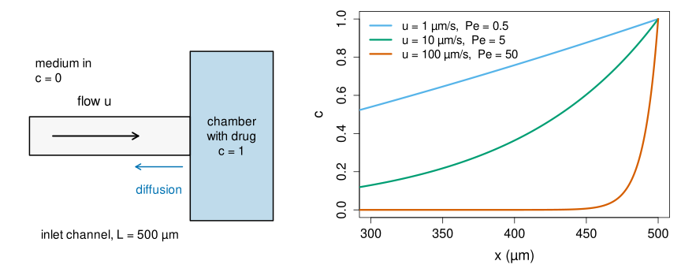{width="85%" fig-align="center"}

Steady state, $u\,c' = D\,c''$, $c(0) = 0$, $c(L) = 1$: $\;c(x) = \dfrac{e^{\text{Pe}\,x/L} - 1}{e^{\text{Pe}} - 1}$, a **boundary layer** of width $D/u$.

- $u = 100$ µm/s, $D = 1000$ µm²/s, $L = 500$ µm: Pe = 50, the drug gets only ~10 µm up the channel.

::: notes
The biology question: medium flows through an inlet channel into a culture chamber that contains a drug. Can the drug diffuse back up the inlet against the flow and contaminate the upstream reservoir? The steady 1D model answers it: at Pe = 0.5 the profile is nearly the straight line of pure diffusion, at Pe = 50 the drug is confined to a layer of thickness D/u = 10 µm next to the chamber. A slow perfusion of 100 µm/s is enough to protect the inlet. We use this problem because the exact solution is known: it is the standard test for advection-diffusion schemes. Check: the exact solution satisfies u c' = D c'' because both sides equal (u Pe / L) times the exponential, divided by the same constant. In R the formula is expm1(u * x / D) / expm1(u * L / D).
:::

## Central differences for $\partial c/\partial x$ {.smaller}

Use the $O(\Delta x^2)$ central difference from [*Numerical differentiation*](../finite-differences/lec.qmd) for both derivatives:

$$u\,\frac{c_{i+1} - c_{i-1}}{2\Delta x} = D\,\frac{c_{i-1} - 2c_i + c_{i+1}}{\Delta x^2}$$

Multiply by $\Delta x^2/D$ and collect, with the **cell Péclet number** $P = u\Delta x/D$:

$$\left(1 + \tfrac P2\right)c_{i-1} - 2c_i + \left(1 - \tfrac P2\right)c_{i+1} = 0$$

- One equation per interior point: a **tridiagonal** linear system, as for steady diffusion.
- $P$ is the Péclet number of **one grid cell**. Here $P = 100\cdot\Delta x/1000 = \Delta x/10$.
- When $P > 2$ the coefficient of $c_{i+1}$ is **negative**. Watch that sign.

::: notes
This is the obvious choice: second order for both terms. The equation for each interior point links it to its two neighbours, so the steady problem is a tridiagonal linear system A c = b; the boundary value c(L) = 1 moves to the right-hand side. The cell Péclet number is the global Péclet number divided by the number of intervals: Pe = 50 with N = 10 intervals gives P = 5. Rewrite the equation as c_i = ((1 + P/2) c_{i-1} + (1 - P/2) c_{i+1}) / 2: an average of the neighbours only if both weights are non-negative, i.e. P <= 2. The recap slide said why that matters.
:::

## Central differences in R {.smaller}

```r
L <- 500; D <- 1000; u <- 100                   # Pe = u L / D = 50
steady <- function(N, scheme, D = 1000) {
  dx <- L / N; P <- u * dx / D; m <- N - 1      # P = cell Peclet number
  if (scheme == "central") { lo <- 1 + P/2; di <- -2;     up <- 1 - P/2 }
  else                     { lo <- 1 + P;   di <- -2 - P; up <- 1 }
  A <- diag(di, m)
  A[cbind(2:m, 1:(m-1))] <- lo; A[cbind(1:(m-1), 2:m)] <- up
  b <- numeric(m); b[m] <- -up                  # c(L) = 1 moves to the right side
  c(0, solve(A, b), 1)
}
round(steady(10, "central"), 3)                 # dx = 50 µm, P = 5
#  [1]  0.000 -0.001  0.001 -0.003  0.006 -0.015  0.034 -0.079  0.184 -0.429
# [11]  1.000
```

- **Negative concentrations**, alternating in sign. The exact values are 0 except $c(450) = 0.007$.

::: notes
The function builds the tridiagonal matrix densely and calls solve; for 9 unknowns that is fine (Thomas or a sparse solve would be the O(n) choice, as in the previous units). The upwind branch is explained in three slides. A drug concentration of -0.43 is physically impossible. Note what the wiggles are not: they are not an instability that grows in time (this is a steady problem, and the linear system is solved exactly). The discrete equations themselves have an oscillating solution.
:::

## Wiggles appear when $P > 2$

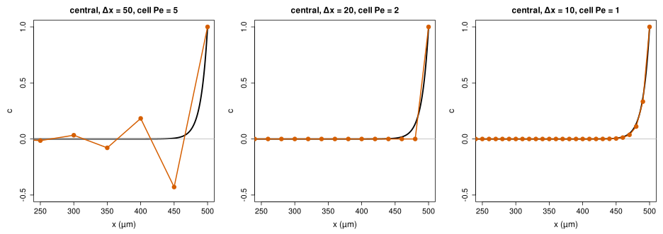{width="100%"}

- $P = 5$: oscillations through the whole channel. $P = 2$: no wiggles, but a kink. $P = 1$: on the exact curve.
- The cure is a **finer grid** near the layer: $\Delta x < 2D/u$ = 20 µm.

::: notes
Black: exact solution. Red: central differences on three grids. The grid with dx = 50 µm cannot represent a boundary layer 10 µm thick, and the discrete equations respond by oscillating. At P = 2 the coefficient (1 - P/2) is exactly zero and the scheme simply sets every value to that of its upstream neighbour: all zeros, then a jump to 1 in the last cell. At P = 1 the grid resolves the layer and the scheme is second-order accurate. The check for students: plot the solution and look for values outside the range of the boundary values, or for a sign change in successive differences. Wiggles in a central-difference advection solution are a message that the grid does not resolve a layer.
:::

## Why exactly 2: the scheme by hand {.smaller}

Try $c_i = \rho^i$ in $\left(1 + \tfrac P2\right)c_{i-1} - 2c_i + \left(1 - \tfrac P2\right)c_{i+1} = 0$:

$$\left(1 - \tfrac P2\right)\rho^2 - 2\rho + \left(1 + \tfrac P2\right) = 0 \quad\Longrightarrow\quad \rho = 1 \;\text{ or }\; \rho = \frac{1 + P/2}{1 - P/2}$$

Every solution is $c_i = A + B\rho^i$, with $A, B$ from the two boundary values.

| $P$ | 0.5 | 1 | 2 | 5 |
|---|---|---|---|---|
| $\rho$ (central) | 1.67 | 3 | ∞ | **−2.33** |
| exact growth per cell $e^P$ | 1.65 | 2.72 | 7.39 | 148 |

- $P > 2$: $\rho < 0$, so $\rho^i$ **alternates in sign**. That is the wiggle.

::: notes
This is the same trick as for linear recurrences (and for the zigzag in the stability analysis of FTCS): try a power and solve the quadratic. The exact solution grows by a factor e^P from one grid point to the next, since c is proportional to exp(u x / D) minus a constant. The central scheme approximates e^P by (1 + P/2)/(1 - P/2), a good approximation for small P (both are 1 + P + P^2/2 + ...) and a disastrous one for large P. The exercise does this by hand for a 3-point grid with P = 4: rho = -3 and a concentration of -0.35.
:::

## Upwind: look where the flow comes from {.smaller}

The flow brings molecules from the **left** ($u > 0$). Use a one-sided difference **upstream**:

$$u\,\frac{c_i - c_{i-1}}{\Delta x} = D\,\frac{c_{i-1} - 2c_i + c_{i+1}}{\Delta x^2}
\quad\Longrightarrow\quad (1 + P)\,c_{i-1} - (2 + P)\,c_i + c_{i+1} = 0$$

```r
round(steady(10, "upwind"), 3)
#  [1] 0.000 0.000 0.000 0.000 0.000 0.000 0.001 0.005 0.028 0.167 1.000
x <- seq(0, L, by = 50); round(expm1(u * x / D) / expm1(u * L / D), 3)
#  [1] 0.000 0.000 0.000 0.000 0.000 0.000 0.000 0.000 0.000 0.007 1.000
```

- All coefficients have the right sign for **every** $P$: $\rho = 1 + P > 0$, no wiggles.
- But $c(450) = 0.167$ instead of 0.007: the layer is **too thick**.

::: notes
Upwind means: information travels with the flow, so the derivative should use the point the flow comes from. For u < 0 use c_{i+1} - c_i instead. Now c_i = ((1 + P) c_{i-1} + c_{i+1}) / (2 + P): an average with positive weights for every P, so the solution stays between 0 and 1 (no new maxima or minima). The power-solution gives rho = 1 + P, positive. The price: a one-sided difference is only first order, O(dx). And the error is not random: upwind always smears. The next slide quantifies by how much.
:::

## Upwind is smooth but smeared

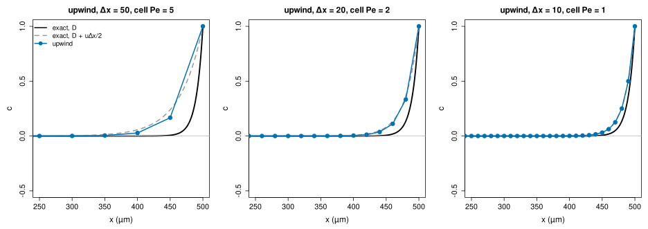{width="100%"}

- Blue: upwind. Black: exact with $D$. Grey dashed: exact with $D + u\Delta x/2$. Upwind follows the **grey** curve.

::: notes
On all three grids the upwind solution lies on or close to the exact solution of a problem with a larger diffusion coefficient. On the coarse grid (dx = 50 µm) the effective D is 1000 + 100 * 50 / 2 = 3500 µm^2/s, three and a half times the true value. For a back-diffusion question that is a serious overestimate: the model claims a layer of D_eff / u = 35 µm when the truth is 10 µm. The scheme is stable and looks plausible; nothing on the plot warns you. That is why it is more dangerous than wiggles.
:::

## Numerical diffusion is exactly $u\Delta x/2$ {.smaller}

Write the upwind difference as central difference plus a correction:

$$\frac{c_i - c_{i-1}}{\Delta x} = \frac{c_{i+1} - c_{i-1}}{2\Delta x} - \frac{\Delta x}{2}\cdot\frac{c_{i+1} - 2c_i + c_{i-1}}{\Delta x^2}$$

So **upwind with $D$ = central with $D + u\Delta x/2$**, exactly, on any grid:

```r
dx <- 50
max(abs(steady(10, "upwind") - steady(10, "central", D = D + u * dx / 2)))
# [1] 2.775558e-17
```

- **Numerical diffusion** $D_\text{num} = u\Delta x/2$ = 2500 µm²/s here, 2.5× the real $D$.
- Rule: upwind is trustworthy only where $D_\text{num} \ll D$, i.e. cell Péclet $P \ll 2$.

::: notes
Check the identity by adding the right-hand side: (c_{i+1} - c_{i-1})/(2 dx) - (c_{i+1} - 2 c_i + c_{i-1})/(2 dx) = (2 c_i - 2 c_{i-1})/(2 dx). Multiply by u and move the correction to the diffusion side. The difference printed is rounding error. This explains both observations at once: upwind is the central scheme with a larger effective diffusion coefficient D + u dx/2, whose cell Péclet number u dx / (D + u dx/2) = P / (1 + P/2) is always below 2, so it never wiggles; and it is wrong by exactly that extra diffusion. Higher-order upwind schemes and flux limiters exist to reduce D_num while avoiding wiggles; they are outside this course.
:::

## Error against grid spacing {.smaller}

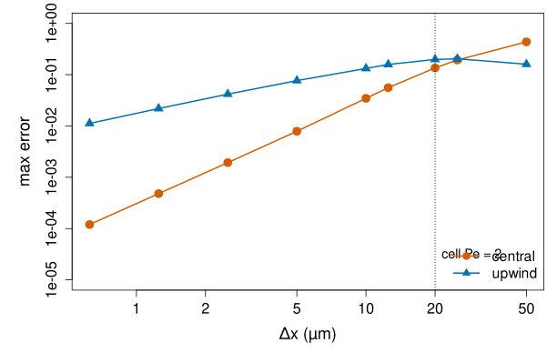{width="62%" fig-align="center"}

- Central: no convergence until $P < 2$, then slope **2**. Upwind: slope **1**, never wiggles.
- To get 1 % error, central needs $\Delta x \approx 5$ µm, upwind $\approx 0.5$ µm.

::: notes
Max error over the grid points against dx, log-log, for the back-diffusion problem. Right of the dotted line (P > 2) the central scheme oscillates and its error is of order 0.1 to 0.4. Left of it the error falls 4x per halving. Upwind error halves per halving (first order), and at coarse grids it is not better than central: 0.2 at dx = 25 µm. The general rule: refine until P is well below 2 and use central, or use upwind and refine until D_num is small; in both cases it is the boundary layer thickness D/u that sets the grid. The printed numbers are in the figure script and the exercise.
:::

## Time-dependent: a pulse of stimulus {.smaller}

A 1 s pulse of a protein ($D = 100$ µm²/s) is carried at $u = 200$ µm/s to cells 2 mm downstream. Explicit Euler in time, upwind in space:

```r
u <- 200; D <- 100; dx <- 10; x <- seq(0, 3000, by = dx)
C <- 0.5; dt <- C * dx / u; r <- D * dt / dx^2       # dt = 0.025 s, r = 0.025
n <- length(x); i <- 2:(n - 1); c <- numeric(n); obs <- NULL
for (k in 1:round(16 / dt)) {
  c[i] <- c[i] - C * (c[i] - c[i - 1]) + r * (c[i - 1] - 2 * c[i] + c[i + 1])
  c[n] <- c[n - 1]                                   # outflow: zero slope
  c[1] <- if (k * dt <= 1) 1 else 0                  # inlet: a 1 s pulse
  obs <- c(obs, c[x == 2000])                        # what the cells see
}
c(peak = max(obs), t_peak = which.max(obs) * dt)
#       peak     t_peak
#  0.6405016 10.4750000
```

- $C = u\Delta t/\Delta x$ is the **Courant number**: how many cells the flow moves per step.

::: notes
A typical experiment in signalling: stimulate cells with a short pulse and record the response. What concentration profile do the cells actually see? The scheme is FTCS with the advection term upwinded. As in the diffusion lecture, the whole right-hand side is evaluated with the old vector before assignment. The outflow boundary sets zero slope (whatever arrives leaves). The peak arrives at 10.5 s = 2000 µm / 200 µm/s + half the pulse length, as expected. But the peak value 0.64 is suspicious: the exact solution with D = 100 has peak 0.975 (next slide). A 1 s pulse is 200 µm long, and a protein spreads only about sqrt(2 * 100 * 10) = 45 µm in 10 s.
:::

## Numerical diffusion again {.smaller}

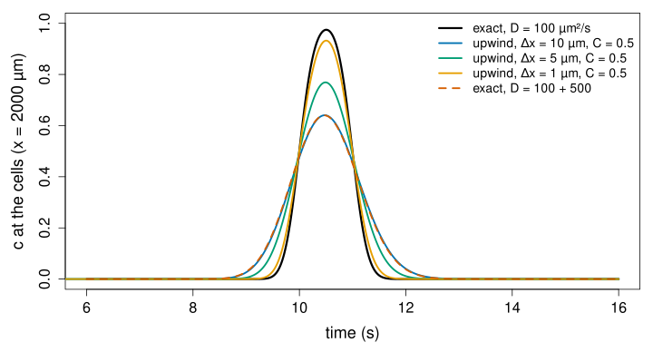{width="70%" fig-align="center"}

- Upwind in time adds $D_\text{num} = \dfrac{u\Delta x}{2}(1 - C) = 500$ µm²/s, **5×** the real $D$. The red dashed curve (exact, $D = 600$) lies on top of the blue one.
- $\Delta x = 1$ µm: peak 0.93 instead of 0.975. A fine grid is the price of upwind.

::: notes
With time stepping the numerical diffusion is u dx (1 - C) / 2: the time error of Euler partly cancels the space error of upwind, and at C = 1 (with D = 0) the scheme is the exact shift c_i^{n+1} = c_{i-1}^n. Here dx = 10 µm, C = 0.5: D_num = 200 * 10 * 0.5 / 2 = 500. The exact curves come from an erfc formula for a long channel (in the exercise). For the biologist: if you simulate a stimulus pulse with a coarse upwind scheme, you will predict a smaller and broader stimulus than the cells really see, and might fit a wrong response model. The check is grid refinement: peaks 0.64, 0.77, 0.93 for dx = 10, 5, 1 µm have clearly not converged at dx = 10.
:::

## The CFL condition {.smaller}

The explicit upwind update, sorted by grid point:

$$c_i^{n+1} = (C + r)\,c_{i-1}^n + (1 - C - 2r)\,c_i^n + r\,c_{i+1}^n, \qquad C = \frac{u\Delta t}{\Delta x},\; r = \frac{D\Delta t}{\Delta x^2}$$

Weights $\ge 0$ (an average, no new extremes) if $\boxed{C + 2r \le 1}$. Without diffusion: $C \le 1$, the **CFL condition**.

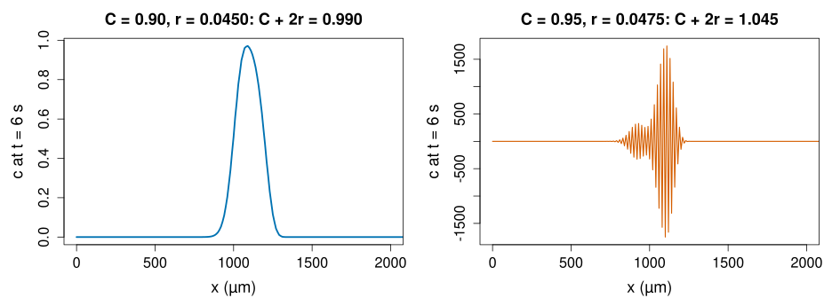{width="68%" fig-align="center"}

::: notes
The Courant-Friedrichs-Lewy condition (1928): in one step the flow must not carry information further than one cell, because the stencil only looks one cell upstream. It is the advection version of r <= 1/2, and together they give C + 2r <= 1 for this scheme. Left: C = 0.90, r = 0.045, sum 0.99, a smooth pulse. Right: C = 0.95 looks safe by CFL alone, but with r = 0.0475 the sum is 1.045 and a zigzag grows to values of 1700 by t = 6 s (and overflows later). The zigzag appears first where the pulse is steep, as in the diffusion lecture. Central differences in space with explicit Euler are worse: for pure advection that scheme is unstable for every time step.
:::

## Try it: wiggles, smearing and the CFL limit

```{=html}
<link rel="stylesheet" href="../demos/dist/demo.css">
<div data-demo="advect" data-tabs="layer pulse" data-tab="layer" data-p="5"></div>
<script src="../demos/dist/advect.js"></script>
```

::: notes
The lecture's two 1D problems, computed live in the browser. First tab, the steady back-diffusion layer (u = 100 µm/s, D = 1000 µm²/s, L = 500 µm): central on the left, upwind on the right, exact in black. Start at P = 5 (dx = 50 µm): central oscillates, minimum -0.429, rho = -2.33; upwind is smooth and sits on the grey dashed curve, the exact solution with D + u dx / 2 = 3500. Click P = 2: the central wiggles are gone, only a kink; drag to P = 2.5: they are back (rho = -9). Click P = 1: central is on the exact curve, upwind still visibly too thick (D_num = 500). Drag to the far left (P = 0.125): upwind error 0.022, central 5e-4. Second tab, the moving pulse (u = 200 µm/s, D = 100 µm²/s): the lecture setting dx = 10, C = 0.5 gives the peak 0.6405 at the cells, on the grey curve for D = 600. Click C 0.9: stable, less smearing (C + 2r = 0.99). Click C 0.95: C + 2r = 1.045 and the zigzag reaches 1750 by t = 6 s. If time allows, tick central: at dx = 10 it needs C <= 2/P = 0.1 and explodes otherwise; at dx = 1 it is stable and its peak (0.998) is even too high, because explicit Euler adds a negative numerical diffusion -C u dx / 2. The exercise page has the same demo with a third tab for the T-sensor / H-filter.
:::

## Back to the T-sensor: two dimensions, steady {.smaller}

Steady flow along $x$, profile $u(y)$ across the channel, concentration $c(x, y)$:

$$u(y)\,\frac{\partial c}{\partial x} = D\left(\frac{\partial^2 c}{\partial x^2} + \frac{\partial^2 c}{\partial y^2}\right) \;\approx\; D\,\frac{\partial^2 c}{\partial y^2}$$

- Drop diffusion **along** the flow: it is $\sim 1/\text{Pe}^2$ smaller (Pe = 100).
- Then $x$ plays the role of **time**: $\dfrac{\partial c}{\partial x} = \dfrac{D}{u(y)}\,\dfrac{\partial^2 c}{\partial y^2}$, a 1D diffusion equation in $y$, with "time step" $\Delta x/u(y)$.
- Start ($x = 0$): $c = 1$ in the sample half, 0 in the buffer half. Walls: **no flux**.
- We **march** downstream from the inlet, one column at a time, instead of solving one big 2D system.

::: notes
The full steady problem is elliptic (like [*Steady state in two dimensions*](../steady-state-2d/lec.qmd)) and needs boundary conditions at the outlet too. When Pe is large, the x-diffusion term is small compared with the advection term: with X = u w^2 / D the length over which c changes in x, the ratio of x-diffusion (D c / X^2) to advection (u c / X) is D / (u X) = D^2 / (u^2 w^2) = 1/Pe^2. Dropping it turns the problem into a parabolic one: what happens at x depends only on what happened upstream. A fluid parcel at height y reaches position x at time x / u(y), and meanwhile diffuses sideways. This is exactly the idea behind the mixing length. Computationally: instead of a sparse 2D solve with M times K unknowns, K small tridiagonal solves.
:::

## The flow profile is given: Poiseuille {.smaller}

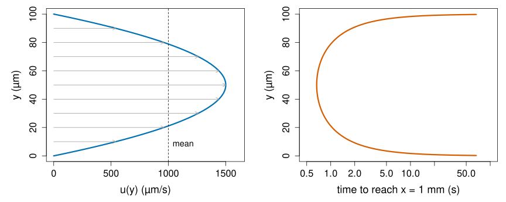{width="85%" fig-align="center"}

$$u(y) = 6\,\bar u\,\frac{y}{w}\left(1 - \frac{y}{w}\right): \quad \text{zero at the walls, } 1.5\,\bar u \text{ in the middle.}$$

- Not solved for here: slow pressure-driven flow in a channel has this parabolic shape.
- Near the walls a parcel needs a **long time** to reach a given $x$, so it has longer to diffuse.

::: notes
The parabola is the classical solution for slow flow between two parallel plates (plane Poiseuille flow); its mean is u-bar. We take it as given. A simplification to state plainly: real T-sensors are wide and shallow, so the strongest velocity variation is across the depth, not across the width we model. Kamholz and Yager (2001) showed that the slow flow near the top and bottom walls makes the interface wider there than in the middle of the depth (stated cautiously: from the T-sensor literature [T1], not checked in detail). Our 2D model has the same effect, but across the width. Right panel: the time to reach x = 1 mm is 0.67 s in the middle and 17 s in the first grid cell next to the wall (1 µm from it).
:::

## Marching: explicit fails at the walls {.smaller}

Explicit Euler in $x$ needs $D\,\Delta x/(u(y)\,\Delta y^2) \le 1/2$ in **every** row: $\Delta x \le u(y)\,\Delta y^2/(2D)$.

```r
w <- 100; ubar <- 1000; M <- 50; dy <- w / M
y <- (1:M - 0.5) * dy                            # cell centres, 1, 3, ..., 99 µm
u <- 6 * ubar * (y / w) * (1 - y / w)            # the given Poiseuille profile
range(u * dy^2 / (2 * 1000))                     # largest stable dx per row (µm)
# [1] 0.1188 2.9988
```

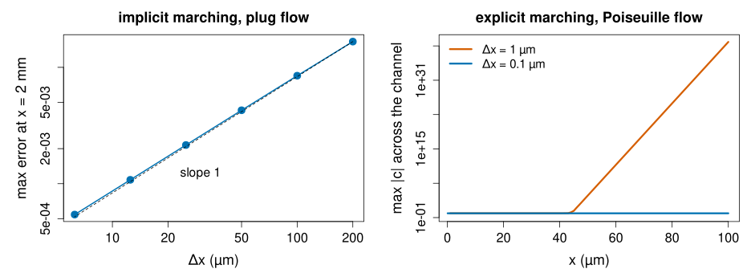{width="66%" fig-align="center"}

::: notes
Cell-centred grid in y: 50 cells of 2 µm, values at the centres 1, 3, ..., 99 µm. This differs on purpose from the node grid x_i = i dx of the diffusion lecture and of Steady state in two dimensions (unknowns on the boundary, ghost nodes outside): no unknown sits on a wall where u = 0, so the marching step dx/u(y) is never infinite, and the no-flux wall is a mirror halfway between the last cell and its ghost cell (c_0 = c_1). Along the channel, x keeps the node grid. Still, u is only 59 µm/s in the first cell and the stable step there is 0.12 µm: 170 000 steps for 20 mm. Left: implicit marching with plug flow against the exact Fourier solution; error halves with dx (backward Euler is first order) and is 0.4 % at dx = 50 µm. Right: explicit marching with dx = 1 µm is stable in the middle of the channel (limit 3 µm) but not near the walls; the zigzag starts there and reaches 1e39 by x = 100 µm. With dx = 0.1 µm it is fine. This is stiffness again ([*Stiffness and implicit methods*](../stiffness/lec.qmd)): the slowest-moving fluid sets the step.
:::

## Implicit marching in R {.smaller}

Backward Euler in $x$: one tridiagonal solve per step, `thomas()` from [*Implicit schemes and the method of lines*](../diffusion-implicit/lec.qmd).

```r
march <- function(c, u, D, dy, dx, nsteps) {     # backward Euler in x
  M <- length(c); a <- D * dx / (u * dy^2)       # one "r" per row
  di <- 1 + 2 * a; di[c(1, M)] <- 1 + a[c(1, M)] # no-flux walls
  for (k in seq_len(nsteps)) c <- thomas(-a, di, -a, c)
  c
}
c0 <- ifelse(y < w / 2, 1, 0)                    # sample below, buffer above
small   <- march(c0, u, 1000, dy, 50, 20)        # 20 steps of 50 µm: x = 1 mm
protein <- march(c0, u,  100, dy, 50, 20)
up <- y > w / 2                                  # the buffer half
c(small = sum(u[up] * small[up]), protein = sum(u[up] * protein[up])) / sum(u * c0)
#     small   protein
# 0.3944334 0.1361406
```

- Check: the **flux** $\sum_j u_j c_j$ is conserved exactly (`sum(u * small) / sum(u * c0)` is 1).

::: notes
Row j of the system: -a_j c_{j-1} + (1 + 2 a_j) c_j - a_j c_{j+1} = old c_j, with a_j = D dx / (u_j dy^2): the r of the implicit diffusion lecture with a different time step in every row. At the walls the mirror ghost cell (c_0 = c_1) removes one neighbour, so the diagonal is 1 + a. Backward Euler in x is also an upwind difference in x: it looks only upstream. It is first order in dx and damps each mode a little too weakly (1/(1 + z) instead of exp(-z)), which is why we check against the exact plug-flow solution and refine dx. The fraction is the share of the solute flux that has reached the buffer half: we weight by u because the outlet collects what flows, not what sits. Conservation is a cheap check that every row was assembled correctly.
:::

## Small molecules cross, cells do not {.smaller}

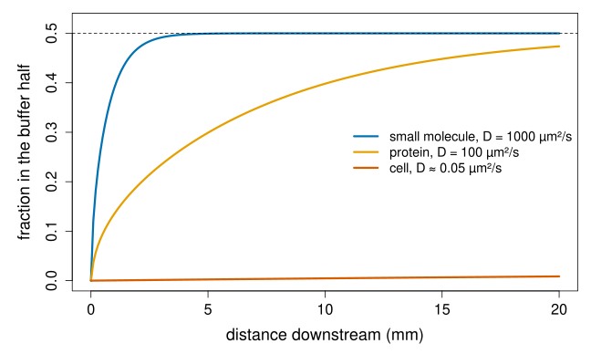{width="62%" fig-align="center"}

- At 2 mm: small molecule 47 % (complete mixing gives 50 %); protein 19 %; cells 0.1 %.
- An H-filter is designed by choosing the length (or the flow rate): long enough for the small molecule, short enough to keep the protein back. Purity is a trade-off.

::: notes
Fraction of each species in the buffer half against distance, from the marching solver (dx = 100 µm). 50 % is complete mixing. The small molecule's flux fraction is 49.95 % at 5 mm. By the stricter criterion "every |c - 1/2| below 0.01" it is mixed at about 3.1 mm with this Poiseuille profile (3.3 mm on this coarse dx = 100 µm grid; the demo in the exercise gives 3.1 mm), earlier than the plug-flow estimate 0.42 u w^2 / D = 4.2 mm because the slow fluid near the walls has more time to diffuse. The protein curve rises like the square root of x at first (the interface width grows like sqrt(D x / u)), and reaches 47 % only at 20 mm. Cells at D = 0.05 µm^2/s stay put. The real H-filter [T2] separated small molecules from blood cells, a separation by a factor of tens of thousands in D; separating a small molecule from a protein (a factor of 10) gives only partial purity, which you can now quantify before building the device. Note that halving the flow speed is the same as doubling the length: only D x / u matters.
:::

## The Christmas-tree gradient generator {.smaller}

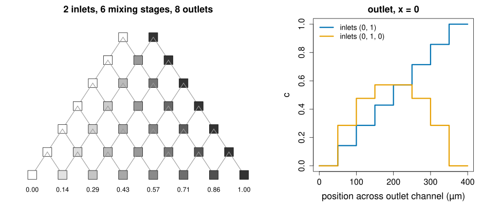{width="90%" fig-align="center"}

- Each stage splits $n$ streams into $n + 1$; each new channel takes **fixed shares** of its two upstream neighbours and mixes them **fully** in a long serpentine [G2].
- Two inlets (0, 1) give a **linear** staircase $0, \tfrac17, \dots, 1$; three inlets (0, 1, 0) give a **hump**.

::: notes
Jeon, Dertinger and colleagues (2000) built networks like this to make gradients of almost any shape from a few inlets [G2]. Our model is a simplification: in stage n -> n + 1 the new channel k (k = 0..n) receives a share k/n from the upstream channel k - 1 and (n - k)/n from channel k, and mixes them completely. With these shares a linear profile stays linear; the real shares are set by the hydraulic resistances in the design. In R: stage <- function(c) { n <- length(c); k <- 0:n; (k/n) * c(0, c) + ((n - k)/n) * c(c, 0) }. The assumption of full mixing in each serpentine is a mixing-length question: the serpentine must be longer than about 0.4 u w^2 / D for the molecule used; the exercise checks it. The numbers of inlets and stages here are ours, not those of the paper.
:::

## What the neutrophils see {.smaller}

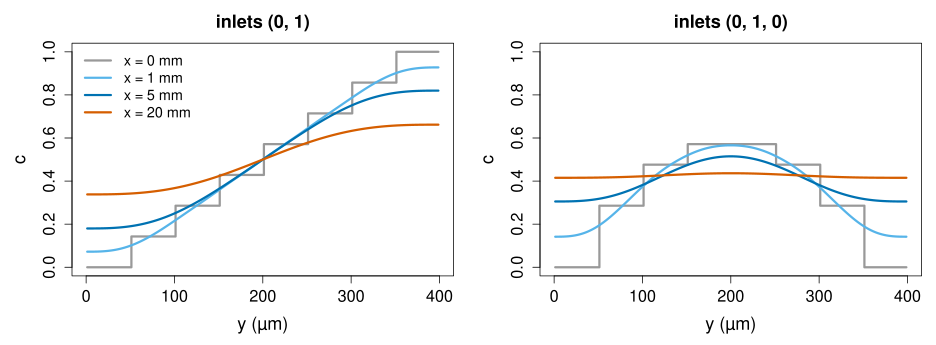{width="100%"}

- The 8 streams flow side by side in a 400 µm channel ($\bar u = 200$ µm/s, $D = 100$ µm²/s). Same `march()`, same Poiseuille profile.
- The steps are gone within ~1 mm; further down the whole gradient flattens, fastest near the slow walls. Cells must sit in the **right window**.

::: notes
This is the outlet profile only, the simplification announced in the plan: the 8 outlet streams of 50 µm each enter a wide observation channel and diffusion acts across it while they flow. Jeon et al. (2002) [G4] used devices of this kind to expose neutrophils to linear and more complex IL-8 gradients and watched them migrate (we model the idea, not their geometry or flow rates; check the paper). The staircase has a period of 100 µm (two steps), much shorter than the 400 µm width, and short length scales decay fastest (the decay rate of a mode goes with one over its wavelength squared), so the steps are gone by about 1 mm. The overall gradient across 400 µm lasts much longer, but near the walls the parabola is slow and the profile flattens there first. The hump (right) decays faster than the linear gradient, because its shape has shorter length scales.
:::

## Fitting $D$ from a downstream profile {.smaller}

The original T-sensor work estimated diffusion coefficients by **fitting** a numerical model to measured profiles [T1]. Synthetic version: a dye with unknown $D$, 25 pixels of 4 µm, $x = 1$ mm.

:::: {.columns}
::: {.column width="45%"}
```r
profile <- function(D, M = 50, dx = 25) {
  dy <- w / M; y <- (1:M - 0.5) * dy
  u <- 6 * ubar * (y / w) * (1 - y / w)
  c <- march(ifelse(y < w / 2, 1, 0),
             u, D, dy, dx, 1000 / dx)
  colMeans(matrix(c, M / 25))  # 4 µm pixels
}
sse <- function(D) sum((cobs - profile(D))^2)
optimize(sse, c(10, 3000), tol = 1e-6)$minimum
# [1] 398.1985
```
:::
::: {.column width="55%"}
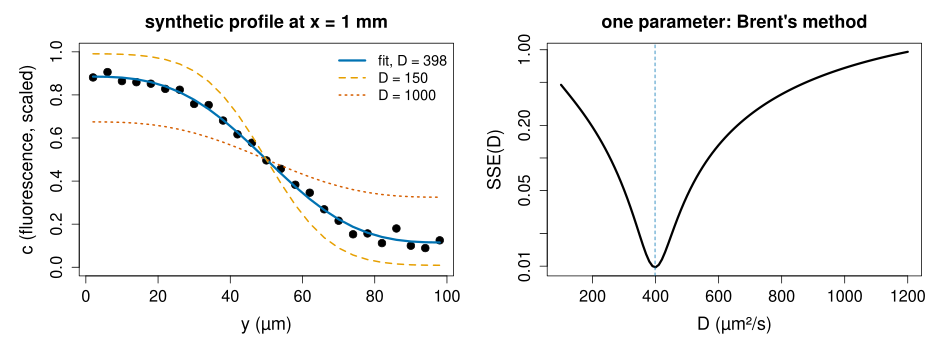{width="100%"}
:::
::::

- One parameter, one bracket: **Brent** ([*Optimisation in one dimension*](../optimisation-1d/lec.qmd)). True value: 400 µm²/s.

::: notes
cobs holds 25 synthetic intensities: the model with D = 400 µm^2/s on a very fine grid, averaged over 4 µm pixels, plus Gaussian noise with sd 0.02 (generated in R and given as numbers in the exercise, so every language uses the same data). Every evaluation of sse runs the whole PDE solver: 40 tridiagonal solves. That is the pattern of every PDE fit: the model is a numerical solver inside an objective function. Two warnings for the exercise. First, the solver's own error biases the estimate: with a single 1 mm step the fit gives 505, with dx = 250 µm 419, with dx = 25 µm 398, finer grids 396. Refine until the fitted parameter stops changing. Second, D and u-bar enter only as D / u-bar: if the flow rate is off by a factor 2, so is D ([*Identifiability and uncertainty of fitted parameters*](../identifiability/lec.qmd), Part 9).
:::

## Before you trust a flow-plus-diffusion simulation {.smaller}

- **Péclet numbers**: compute Pe for the device and the cell Péclet number $u\Delta x/D$ for the grid. Layers have thickness $\sim D/u$; the grid must resolve them.
- **Wiggles** (central): values outside the range of the boundary and initial values, alternating signs. Refine until $u\Delta x/D < 2$.
- **Smearing** (upwind, backward Euler in $x$): compare $D_\text{num} \approx u\Delta x/2$ with $D$. Refine; the answer must stop changing.
- **Stability** (explicit): $C + 2r \le 1$ for upwind/FTCS, row by row; the slowest fluid (near walls) can set the step for marching.
- **Conservation**: the solute flux $\sum u_j c_j$ is constant along a closed channel.
- **Exact solutions**: boundary layer, plug-flow Fourier series, erfc pulse. Test the code on them first.
- **Fits**: refit on a finer grid; know the flow rate, since only $D/\bar u$ is identifiable.

::: notes
The checklist of this unit, extending the one from the diffusion lecture. The first item is the most important: before choosing a scheme, estimate the thinnest layer in the problem (D/u for back-diffusion, sqrt(D x / u) for an interface at distance x) and choose the grid from it. The difference between the two failure modes is worth repeating: wiggles are loud and easy to spot; numerical diffusion is silent and looks like a physically sensible solution. Only refinement or comparison with an exact solution exposes it.
:::

## Summary {.smaller}

- Flow adds the flux $u\,c$: $\;\partial c/\partial t + u\,\partial c/\partial x = D\,\partial^2 c/\partial x^2$. The **Péclet number** $uL/D$ compares the two; in microfluidics Pe ≫ 1 and streams stay separate for a **mixing length** $\approx \bar u w^2/D$.
- **Central** differences: second order, but **wiggles** when the cell Péclet number $u\Delta x/D > 2$ (negative weight, $\rho < 0$).
- **Upwind**: no wiggles, first order, and exactly the central scheme with extra **numerical diffusion** $u\Delta x/2$ (time-dependent: $u\Delta x(1 - C)/2$). Silent smearing.
- Explicit time stepping: **CFL** $C = u\Delta t/\Delta x \le 1$; with diffusion $C + 2r \le 1$.
- Steady channel flow at large Pe: **march** in $x$ as if it were time, with a **given** Poiseuille profile; implicit (tridiagonal) because slow fluid near the walls makes explicit marching stiff.
- Biology: the H-filter separates by $D$; the Christmas tree builds gradients for neutrophils; a fitted $D$ is only as good as the grid and the known flow rate.

**Next:** [*Reaction–diffusion and pattern formation*](../reaction-diffusion/lec.qmd): production and degradation, operator splitting.

::: notes
Recap: the new term, the dimensionless number that says how important it is, the two classical discretisations and how each fails, the time step limit, and the marching trick that turns a steady 2D problem into a sequence of 1D implicit steps. The next unit adds reaction terms to diffusion (Bicoid, Fgf8). [*Beyond rectangles: finite elements and flow*](../fem-outlook/lec.qmd) (Part 11) explains where flow fields like the Poiseuille profile come from when the geometry is not a straight channel.
:::
