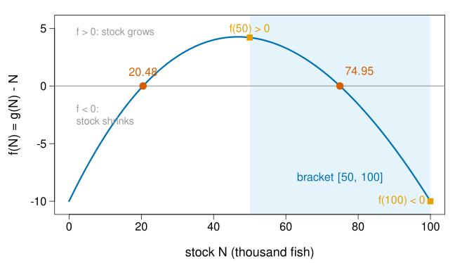
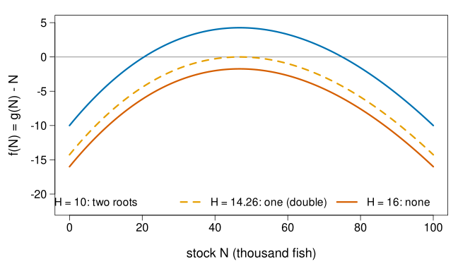
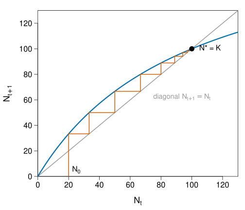
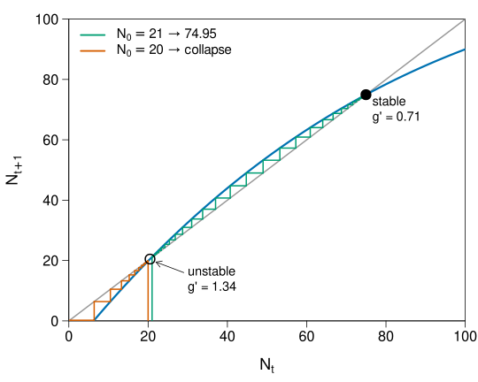
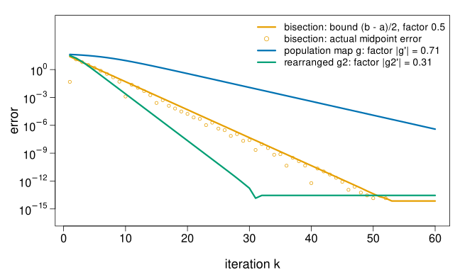
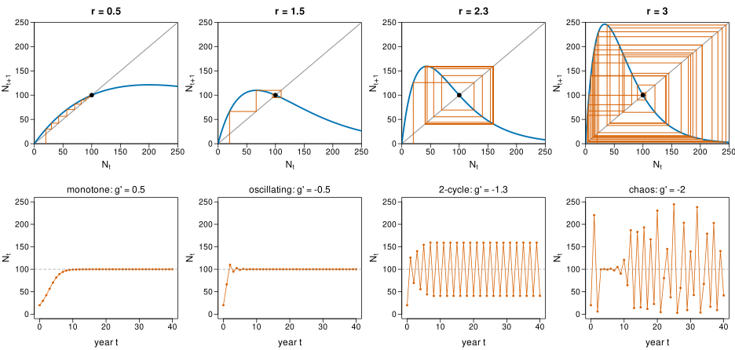

## About this lecture {.smaller}

Part 2 is about solving **one equation** $f(x) = 0$ when there is no formula for $x$. This lecture covers the two simplest methods. Both are slow, and both are worth knowing well.

- **Bisection**: trap the root in a **bracket** $[a, b]$ where $f$ changes sign, and halve the bracket until it is small. Guaranteed to converge; gains one binary digit per step.
- **Fixed-point iteration**: rewrite the equation as $x = g(x)$ and repeat $x_{k+1} = g(x_k)$. Converges when $|g'(x^*)| < 1$, with error shrinking by that factor each step.
- **Stopping criteria**, and how each method **fails**: no sign change, a double root, a repelling fixed point, oscillation, chaos.

Biology: **discrete-time population models**. A population that is iterated year by year *is* a fixed-point iteration. Its steady states are roots, the cobweb plot shows whether they are reached, and $|g'(N^*)| < 1$ is the condition for a stable population.

::: notes
This opens Part 2. The vocabulary of linear convergence comes from Convergence and cost: here we see where the rate comes from. The biology is unusually close to the numerics: a discrete-time population model is literally a fixed-point iteration, so "the numerical method converges" and "the population settles at a stable steady state" are the same statement. That is why ecologists met chaos in the 1970s (Robert May's logistic map) before most numerical analysts cared. Newton's method, the secant method and the library routines uniroot and brentq come in the next lecture, Newton and secant methods.
:::

## Part 2: solving $f(x) = 0$ {.smaller}

A **root** of $f$ is a number $x^*$ with $f(x^*) = 0$. Most questions of the form "for which $x$ does ... hold?" are root problems:

- Which drug dose gives 50 % response? Root of $\text{response}(d) - 0.5$.
- Where does a population stop changing? Root of $N_{t+1} - N_t$.
- Which parameter maximises a likelihood? Root of its derivative.

Linear and quadratic equations have formulas. Almost nothing else does: $x\,e^{x} = 2$, $\;x = \cos x$, or a fifth-degree polynomial have **no formula** in terms of $+,-,\times,/,$ roots, $\exp$ and $\log$.

So we **iterate**: produce numbers $x_0, x_1, x_2, \dots$ that approach $x^*$, and stop when close enough.

- A **bracket** is an interval $[a, b]$ with $f(a)$ and $f(b)$ of opposite sign. If $f$ is continuous, a root lies inside.
- Two questions for every method: does it converge, and how fast (*Convergence and cost*)?

::: notes
The framing slide for the whole of Part 2. Make the point that "no formula" is the normal case, not the exception: the quadratic formula is the last one most of us ever use (cubic and quartic formulas exist but nobody uses them; for degree five and up Abel and Galois proved there is none). Every root finder in every library is iterative. The bracket idea is the subject of the first half of this lecture. Next lecture: Newton and the secant method; then Newton for systems (the toggle switch).
:::

## A harvested fish stock {.smaller}

The **Ricker model** for a fish stock $N_t$ (thousands of fish) in year $t$, with a fixed annual catch $H$:

$$N_{t+1} = g(N_t) = N_t\, e^{\,r(1 - N_t/K)} - H, \qquad r = 0.5,\; K = 100,\; H = 10$$

```r
r <- 0.5; K <- 100; H <- 10            # growth rate, capacity, catch (thousand fish)
g <- function(N) N * exp(r * (1 - N / K)) - H     # stock next year
N <- numeric(41); N[1] <- 30           # 40 years, starting from 30
for (t in 1:40) N[t + 1] <- g(N[t])
round(N[c(1, 6, 11, 21, 41)], 3)       # years 0, 5, 10, 20, 40
# [1] 30.000 47.266 65.664 74.583 74.952
```

- Without fishing, the stock settles at $K = 100$. With a catch of 10 per year it seems to settle near **74.95**.
- Is there a lower steady state? What catch can the stock sustain? Simulating many starts is slow and does not answer this.

::: notes
The Ricker model (1954) was introduced for salmon stock–recruitment; e^{r(1 - N/K)} is the per-capita growth, high at low density and falling as N approaches K. The catch H is taken after reproduction, a constant quota. All numbers are made up but of a realistic shape. The simulation suggests 74.95. But we want all steady states and how they depend on H, which is a root-finding question.
:::

## Steady states are roots {.smaller}

A **steady state** $N^*$ does not change: $g(N^*) = N^*$. Equivalently, $N^*$ is a root of

$$f(N) = g(N) - N = N\left(e^{\,r(1-N/K)} - 1\right) - H .$$

{width="68%" fig-align="center"}

- Two roots: about **20.5** and **75.0**. No formula gives them: $N$ appears both outside and inside the exponential.
- $f(50) > 0$ and $f(100) < 0$: the interval $[50, 100]$ is a **bracket** for the upper root.

::: notes
f(N) is the change in stock over one year: surplus production minus catch. Where f > 0 the stock grows, where f < 0 it shrinks. So the sign of f already tells the biology: below 20.5 the stock shrinks towards collapse, between 20.5 and 75 it grows, above 75 it shrinks. Try to solve N(e^{0.5(1-N/100)} - 1) = 10 by algebra: you cannot isolate N. Note [0, 50] is a bracket for the lower root, since f(0) = -10.
:::

## Brackets: a sign change traps a root {.smaller}

**Intermediate value theorem.** If $f$ is continuous on $[a, b]$ and $f(a)$, $f(b)$ have opposite signs, then $f(x^*) = 0$ for some $x^*$ in $[a, b]$.

```r
f <- function(N) g(N) - N
f(c(0, 25, 50, 75, 100))
# [1] -10.00000000   1.37478537   4.20127083  -0.01386602 -10.00000000
```

- Sign changes between 0 and 25, and between 50 and 75: two brackets, **[0, 25]** and **[50, 75]**.
- $f(0)$ and $f(100)$ have the **same** sign: $[0, 100]$ is not a bracket, although it contains two roots.
- A sign change needs only the **sign** of $f$, not its size or its derivative. That is what makes bracketing robust.

::: notes
The theorem is common sense for a continuous curve: to get from below the axis to above it you have to cross it. Two warnings come out of the same picture: an even number of roots inside an interval gives no sign change, and a discontinuity (a pole) can give a sign change with no root. Evaluating f on a coarse grid and looking for sign changes is a perfectly good way to find brackets, and is what students should do first.
:::

## Bisection by hand {.smaller}

Take the midpoint $m = (a+b)/2$. Keep the half where the sign changes. Repeat.

| $k$ | $a$ | $b$ | $m$ | $f(m)$ | keep |
|---|---|---|---|---|---|
| 1 | 50 | 100 | 75 | $-0.0139$ | $[a, m] = [50, 75]$ |
| 2 | 50 | 75 | 62.5 | $+2.89$ | $[m, b] = [62.5, 75]$ |
| 3 | 62.5 | 75 | 68.75 | $+1.63$ | $[68.75, 75]$ |
| 4 | 68.75 | 75 | 71.875 | $+0.853$ | $[71.875, 75]$ |
| 5 | 71.875 | 75 | 73.4375 | $+0.431$ | $[73.4375, 75]$ |

- The bracket width goes 50, 25, 12.5, 6.25, 3.125, 1.5625: **halved** each step.
- Step 1 landed within 0.05 of the root, yet bisection threw that luck away: it only looks at the **sign** of $f(m)$.

::: notes
Do this on the board. The rule: if f(m) has the same sign as f(a), the root is in [m, b]; otherwise it is in [a, m]. The best estimate after k steps is the midpoint of the current bracket, with error at most half the width. Point at step 1: f(75) = -0.014 is tiny, so 75 is almost a root, but bisection does not use the size of f. Methods that do (secant, Newton, Brent) are next lecture; the price is that they can go wrong where bisection cannot.
:::

## Bisection in R {.smaller}

```r
bisect <- function(f, a, b, tol = 1e-8, maxit = 100) {
  fa <- f(a); fb <- f(b)
  if (sign(fa) == sign(fb)) stop("f(a) and f(b) must have opposite signs")
  for (k in 1:maxit) {
    m <- (a + b) / 2; fm <- f(m)
    if (sign(fm) == sign(fa)) { a <- m; fa <- fm } else b <- m
    if (b - a < tol) break
  }
  c(root = (a + b) / 2, iter = k)
}
print(rbind(bisect(f, 50, 100), bisect(f, 0, 50)), digits = 10)
#             root iter
# [1,] 74.95244250   33
# [2,] 20.48199036   33
```

- One new evaluation of $f$ per step. [`sign`](https://stat.ethz.ch/R-manual/R-devel/library/base/html/sign.html) avoids computing $f(a)\,f(m)$, which can underflow or overflow.

::: notes
Ten lines. Points to make: check the bracket before starting (stop with a clear error); keep fa so f is evaluated once per step; compare signs rather than testing f(a)*f(m) < 0, because the product of two tiny function values can underflow to 0 (floating-point unit). The function returns both the root and the number of iterations; a real function would also return the final bracket. Both roots: 20.482 and 74.952.
:::

## How fast? One binary digit per step {.smaller}

After $k$ steps the bracket has width $(b - a)/2^k$, so the midpoint is within

$$|m_k - x^*| \le \frac{b - a}{2^{k+1}} .$$

To guarantee a bracket narrower than `tol`, we need $k \ge \log_2\!\big((b - a)/\text{tol}\big)$ steps:

```r
ceiling(log2(50 / 1e-8))        # bracket [50, 100], tol = 1e-8
# [1] 33
```

- Exactly the 33 steps `bisect` took, **known in advance**: it does not depend on $f$ at all.
- Error factor $\tfrac12$ per step = **linear convergence** with rate $\tfrac12$: about 0.3 decimal digits per step, 3.3 steps per digit, ~50 steps for full double precision.
- Guaranteed, but slow: each step uses only one bit of information (a sign).

::: notes
This is the slide that links back to Convergence and cost: linear convergence, e_{k+1} = c e_k with c = 1/2. The striking property is that the iteration count is known before you start, whatever f is, as long as the bracket is valid. No other method in this part has that guarantee. The upper bound on the error is what we can promise; the actual midpoint error wobbles below it (see the error plot later).
:::

## When to stop {.smaller}

```r
print(bisect(f, 50, 100, tol = 1e-20, maxit = 200), digits = 10)
#        root        iter
#  74.9524425 200.0000000
```

- With `tol = 1e-20` the loop never stops by tolerance: near 75, neighbouring doubles are $2^{6-52} \approx 1.4\times10^{-14}$ apart, and the bracket cannot shrink below that gap (*How computers store numbers*).
- Use a **relative** tolerance as well: stop when $b - a < \text{tol}\cdot\max(1, |m|)$, with tol no smaller than about $10^{-15}$.
- Always have a **maximum number of iterations**, and report when it was hit.
- A small $|f(m)|$ alone is **not** a safe stopping rule: $|f|$ can be tiny far from a root if $f$ is flat (and huge next to it if $f$ is steep). Bisection stops on the **bracket width**.

::: notes
Three stopping rules, in order of reliability for bisection: bracket width (absolute and relative), maximum iterations, residual |f|. The 1e-20 run is the floating-point floor: once a and b are neighbouring doubles, the midpoint rounds to a or b and nothing changes. Without maxit this would loop forever. The relative tolerance matters when roots are large (a population of 1e9 cells cannot be located to 1e-8 absolutely) or small (a concentration of 1e-12 M needs better than 1e-8 absolute). The flat-f warning will come back with the double root on the next slide.
:::

## When bisection fails {.smaller}

:::: {.columns}
::: {.column width="55%"}
{width="100%"}
:::
::: {.column width="45%"}
- Raise the catch: the two roots move together, merge at $H \approx 14.26$ (a **double root**: $f$ touches 0 without changing sign) and vanish. Above that, **no steady state**: the stock collapses.
- No sign change → bisection cannot start. A grid search for sign changes misses double roots.
- Two roots in one interval → no sign change either.
- A **pole** fakes a sign change: on $f(x) = 1/(x-1)$ over $[0, 3]$, bisection "converges" to $x = 1$.
:::
::::

**Check:** evaluate $f$ at the returned root. $|f| \approx 0$? For $1/(x-1)$ it is about $10^{8}$.

::: notes
The biology here is a real phenomenon: the maximum sustainable yield. Fishing quotas above the peak surplus production (14.26 thousand per year in this model) have no steady state at all; quotas just below it have a stable steady state very close to an unstable one, a small disturbance away from collapse. Numerically, the double root is the hard case: f does not change sign, so no bracketing method can find it, and the problem is ill-conditioned (Error, conditioning and stability): a tiny change in H moves the root a lot. The pole example: bisection only sees signs, so it happily closes in on the discontinuity. Always evaluate f at the answer.
:::

## Fixed-point iteration: $x = g(x)$ {.smaller}

A **fixed point** of $g$ is a number $x^*$ with $g(x^*) = x^*$. **Fixed-point iteration** is

$$x_{k+1} = g(x_k), \qquad k = 0, 1, 2, \dots$$

A discrete-time population model *is* a fixed-point iteration. **Beverton–Holt**, with $R = 2$, $K = 100$:

$$N_{t+1} = g(N_t) = \frac{R\,N_t}{1 + (R-1)N_t/K}$$

```r
R <- 2; bh <- function(N) R * N / (1 + (R - 1) * N / K)
N <- 20
for (t in 1:6) { N <- bh(N); cat(t, round(N, 3), round(K - N, 3), "\n") }
# 1 33.333 66.667
# 2 50 50
# 3 66.667 33.333
# 4 80 20
# 5 88.889 11.111
# 6 94.118 5.882
```

::: notes
Any root problem f(x) = 0 can be written as a fixed-point problem, for example x = x - f(x) or x = x + c f(x), and many models arrive already in this form. Beverton–Holt (1957, also from fisheries) is the classic compensating model: N* = K is always reached, monotonically. The columns are year, N_t and the error K - N_t. Ask the class to read the ratios of successive errors: 50/66.7 = 0.75, 33.3/50 = 0.67, 20/33.3 = 0.6, 11.1/20 = 0.56, 5.9/11.1 = 0.53. They tend to 1/2. Where does 1/2 come from? Two slides on.
:::

## The cobweb plot {.smaller}

:::: {.columns}
::: {.column width="52%"}
{width="100%"}
:::
::: {.column width="48%"}
Draw $y = g(x)$ and the diagonal $y = x$. Fixed points are where they **cross**.

1. Start at $x_0$ on the horizontal axis.
2. Go **vertically** to the curve: height $g(x_0) = x_1$.
3. Go **horizontally** to the diagonal: now at $x = x_1$.
4. Repeat from step 2.

The staircase climbs to $N^* = K = 100$: each step is shorter than the one before.
:::
::::

::: notes
The cobweb plot is the picture to have in mind for every fixed-point iteration. Going horizontally to the diagonal is just "the output becomes the next input". A staircase means monotone convergence (curve above the diagonal on the left of N*, slope of g between 0 and 1). We will see spirals (negative slope) shortly. Students draw a few cobwebs by hand in the exercise.
:::

## Why it converges: $|g'(x^*)| < 1$ {.smaller}

Let $e_k = x_k - x^*$. Taylor around the fixed point, using $g(x^*) = x^*$:

$$e_{k+1} = g(x_k) - g(x^*) \approx g'(x^*)\,(x_k - x^*) = g'(x^*)\, e_k .$$

- $|g'(x^*)| < 1$: the error shrinks by the factor $|g'(x^*)|$ each step. **Linear convergence** with rate $|g'(x^*)|$; the fixed point is **attracting** (stable).
- $|g'(x^*)| > 1$: the error **grows**; the fixed point is **repelling** (unstable).
- $0 < g' < 1$: monotone staircase. $-1 < g' < 0$: alternating spiral.

Beverton–Holt: $g'(N) = \dfrac{R}{(1 + (R-1)N/K)^2}$, so $g'(K) = \dfrac{R}{R^2} = \dfrac1R = 0.5$: the ratio the table approached.

::: notes
This is the main result of the lecture, and it is one line of Taylor (Why numerical analysis? had Taylor; Convergence and cost had linear convergence). It is only valid near x*: far away, the ratios were 0.83, 0.75, ... not 0.5. The ecologists' stability condition for a discrete-time model, |g'(N*)| < 1, is exactly the convergence condition of the numerical method. The closer |g'| is to 1, the slower: 0.99 gains one digit per 230 steps. If g'(x*) = 0, the linear term vanishes and convergence is faster than linear; Newton's method is built that way (next lecture).
:::

## Fixed-point iteration in R {.smaller}

```r
fixed_point <- function(g, x0, tol = 1e-10, maxit = 1000) {
  x <- x0
  for (k in 1:maxit) {
    x_new <- g(x)
    if (abs(x_new - x) < tol) return(c(root = x_new, iter = k))
    x <- x_new
  }
  warning("no convergence after ", maxit, " steps"); c(root = x, iter = maxit)
}
print(fixed_point(g, 30), digits = 12)       # the harvested stock
#          root          iter
# 74.9524424992 82.0000000000
```

- Stops when the **step** $|x_{k+1} - x_k|$ is small. That is not the error: here the true error is $2.0\times10^{-10}$, twice `tol`.
- 82 steps for 10 digits: $|g'(N^*)| = 0.71$ here, so each step gains only $-\log_{10} 0.71 = 0.15$ digits.

::: notes
The stopping rule is the step size, because the root is unknown. When convergence is linear with rate L, the remaining error is about step × L/(1 - L): here 0.71/0.29 = 2.4 times the last step. For L = 0.99 the error is 99 times the step, so a small step can be a long way from the answer. We come back to estimating L from the iterates on the "Checking" slide. maxit plus a warning is again essential: if g has no attracting fixed point, the loop would otherwise run forever.
:::

## Stable and unstable steady states {.smaller}

:::: {.columns}
::: {.column width="52%"}
{width="100%"}
:::
::: {.column width="48%"}
For the harvested stock, $g'(N) = e^{\,r(1-N/K)}\,(1 - rN/K)$:

```r
dg <- function(N) exp(r * (1 - N / K)) * (1 - r * N / K)
dg(c(20.48199, 74.95244))
# [1] 1.3358239 0.7086557
```

- Upper steady state: $g' = 0.71$, **attracting**.
- Lower one: $g' = 1.34$, **repelling**. Start at 21: drift up to 74.95. Start at 20: collapse in 13 years.
- Fixed-point iteration can **never** find the lower root. Bisection found both.
:::
::::

::: notes
This is the key contrast between the two methods. Iterating the model is what nature does, and it only ever shows the stable steady state. The unstable one is a threshold (in fisheries and conservation, a critical stock size): below it the stock collapses even though the catch is sustainable at higher stock. To locate a threshold you need a root finder that does not care about stability: bisection. The cobweb at the lower root moves away in both directions.
:::

## Same equation, different $g$ {.smaller}

$g(N) = N$ can be solved for "an $N$" in more than one way. Each gives a different iteration:

$$g_2(N) = K\left(1 - \frac{\log(1 + H/N)}{r}\right), \qquad g_3(N) = \frac{H}{e^{\,r(1-N/K)} - 1}$$

```r
g2 <- function(N) K * (1 - log(1 + H / N) / r)     # solved for N in the exp
g3 <- function(N) H / (exp(r * (1 - N / K)) - 1)   # solved for the N in front
print(fixed_point(g2, 30), digits = 12)
#          root          iter
# 74.9524424994 26.0000000000
print(fixed_point(g3, 30), digits = 12)
#          root          iter
# 20.4819903614 23.0000000000
```

- $|g_2'| = 0.31$ at the upper root: 26 steps instead of 82. $|g_3'| = 0.31$ at the **lower** root, so $g_3$ finds the root the population map could not.
- Same fixed points, different derivatives. Choosing $g$ is choosing the method.

::: notes
Both rearrangements have exactly the same fixed points as g (check by substituting). But their derivatives at the two roots differ: g2' = 3.20 at the lower root and 0.31 at the upper; g3' = 0.31 at the lower and 3.18 at the upper. So each finds one root and is repelled from the other. Note that g2 and g3 are not population models any more; they are just numerical devices. This is the general lesson of fixed-point iteration: the method is defined by g, and a good g has a small |g'| at the root. Newton's method is the choice of g that makes g'(x*) = 0.
:::

## Error against iteration {.smaller}

{width="72%" fig-align="center"}

- Straight lines on a log-$y$ axis: **linear convergence**. The slope is $\log_{10}$ of the rate: 0.5, 0.71, 0.31.
- All stop at about $10^{-14}$: the rounding floor near 75 ($\varepsilon \cdot 75$).
- Bisection's actual error (circles) wobbles under its bound.

::: notes
Design principle: every method gets an error-vs-iteration plot. Read off the rates: bisection loses a factor 10 every 3.3 steps; the population map every 6.6 steps; g2 every 2 steps. The flat floors are where rounding error takes over, as in Convergence and cost. The midpoint error of bisection is not monotone: sometimes the midpoint happens to land very close to the root (step 1 here). Only the bound is guaranteed.
:::

## Checking a fixed-point iteration {.smaller}

The root is unknown, so estimate the rate from the **steps** $d_k = x_{k+1} - x_k$: $\;d_{k+1}/d_k \to g'(x^*)$.

```r
x <- numeric(31); x[1] <- 30
for (k in 1:30) x[k + 1] <- g(x[k])
d <- diff(x)                              # steps x[k+1] - x[k]
round(d[2:30] / d[1:29], 4)[c(1, 5, 10, 20, 29)]
# [1] 1.1894 1.0183 0.8116 0.7128 0.7088
L <- d[30] / d[29]
c(step = abs(d[30]), est_err = abs(d[30]) * L / (1 - L))
#        step     est_err
# 0.004883929 0.011890220
```

- Ratio settles below 1 → converging, at that rate. Settles above 1 → diverging. Negative → oscillating. Never settles → cycle or chaos.
- Remaining error $\approx |d_k|\,\dfrac{L}{1-L}$: here 0.0119; the true error is 0.0119.

::: notes
This is the check students should run on any iteration they did not write themselves (and on those they did). The ratio of successive steps estimates g'(x*) without knowing x*. The first ratios are above 1 because far from the root the derivative of g is larger (the stock is in the steep part of the curve). The error estimate comes from summing the geometric series of remaining steps: d L + d L^2 + ... = d L/(1 - L). It is remarkably accurate once the ratio has settled. With L near 1 the factor L/(1 - L) is large: a small step does not mean a small error.
:::

## The Ricker model without harvest {.smaller}

Set $H = 0$: $\;N_{t+1} = N_t\,e^{\,r(1 - N_t/K)}$. The steady state is $N^* = K$ for every $r$, and

$$g'(K) = e^{0}\,(1 - r) = 1 - r .$$

| $r$ | $g'(K) = 1 - r$ | prediction |
|---|---|---|
| 0.5 | $+0.5$ | monotone convergence, rate 0.5 |
| 1.5 | $-0.5$ | **oscillating** convergence, rate 0.5 |
| 2.3 | $-1.3$ | $N^* = K$ repelling: no convergence |
| 3.0 | $-2$ | $N^* = K$ repelling: no convergence |

Fast-reproducing species (large $r$) **overshoot**: a small population produces so many offspring that next year is far above $K$, then crashes.

::: notes
Now the population is the iteration, and the question is the biology: what does the population do in the long run? The derivative condition answers it for the steady state: stable if 0 < r < 2. For r > 2 the steady state still exists (N = K solves g(N) = N for every r) but nothing converges to it. What happens instead is not predicted by the derivative; we have to look. Overcompensation is real: many insects and some fish show boom-bust dynamics.
:::

## Four regimes {.smaller}

{width="100%" fig-align="center"}

Staircase, spiral, a square (a **2-cycle**: 159.22, 40.78, 159.22, ...), and no pattern at all: **chaos**.

::: notes
Top: cobwebs from N0 = 20; bottom: the same as time series. r = 0.5: staircase. r = 1.5: the spiral, alternating above and below K, same rate 0.5 as r = 0.5 but with alternating sign. r = 2.3: the iterates settle on a 2-cycle, a fixed point of g(g(x)) that is not a fixed point of g: the population alternates between boom and bust years. r = 3: the iterates never settle; this is deterministic chaos. Note the vertical scale: at r = 3 the population hits 245 and drops to near 1, which a real population might not survive.
:::

## The bifurcation diagram {.smaller}

{width="78%" fig-align="center"}

For each $r$: iterate 500 years from $N_0 = 20$, then plot the next 80 values.

- $r < 2$: one point, $K$. At $r = 2$ the 2-cycle appears, at $r \approx 2.53$ a 4-cycle, then 8, 16, ..., and chaos beyond $r \approx 2.69$, with windows of order (e.g. a 3-cycle near $r = 3.12$).
- The boundary of the green region is exactly $|g'(K)| = 1$.

::: notes
This is the period-doubling route to chaos (May 1976, Nature, "Simple mathematical models with very complicated dynamics", which used exactly these population maps). The numerical message: the convergence condition |g'| < 1 marks precisely where the long-run behaviour is a single number. Beyond it, "the answer" of the iteration is a set of values, and a fixed-point solver would report non-convergence. Throwing away the first 500 iterates removes the transient; for r just above 2 convergence to the cycle is slow, which is why the branches look fuzzy near the splitting points.
:::

## Chaos: iteration fails, bisection does not {.smaller}

```r
ricker <- function(N, r) N * exp(r * (1 - N / K))
a <- 20; b <- 20 + 1e-10; d <- numeric(80)    # two starts, 1e-10 apart
for (t in 1:80) { a <- ricker(a, 3); b <- ricker(b, 3); d[t] <- abs(a - b) }
signif(d[seq(10, 80, by = 10)], 2)             # years 10, 20, ..., 80
# [1] 1.3e-07 1.6e-05 4.6e-04 1.8e-02 1.7e+00 1.9e+00 5.2e+00 7.7e+01
uniroot(function(N) ricker(N, 3) - N, c(50, 150))$root
# [1] 100
```

- The difference grows by a factor of 30–100 every 10 years: after ~60 years the two runs are unrelated. Rounding errors ($10^{-16}$) grow the same way, so the computed trajectory beyond ~100 years is not the true one.
- But the steady state still exists, and a bracketing solver finds $N^* = 100$ at once.

::: notes
Sensitive dependence on initial conditions: errors grow exponentially, here by a factor of roughly 1.4–1.6 per year. This links back to Part 1: in a chaotic iteration, the error of size eps introduced at every step is amplified just like the 1e-10 here. Long chaotic trajectories are therefore not reproducible digit by digit across machines; statistics of the trajectory (mean, range) are. The root-finding view is unaffected: f(N) = g(N) - N changes sign around 100 whatever the stability, so a bracketing method finds it. uniroot is used here as a preview; it is a safeguarded bracketing method.
:::

## Library routines: `uniroot`, `brentq` {.smaller}

```r
out <- uniroot(f, c(50, 100))
c(root = out$root, iter = out$iter, err = out$root - 74.9524424994439)
#          root          iter           err
# 74.9524412607  7.0000000000 -0.0000012387
out <- uniroot(f, c(50, 100), tol = 1e-12)
c(root = out$root, iter = out$iter, err = out$root - 74.9524424994439)
#         root         iter          err
# 7.495244e+01 9.000000e+00 8.526513e-14
```

- [`uniroot`](https://stat.ethz.ch/R-manual/R-devel/library/stats/html/uniroot.html) (R) and `scipy.optimize.brentq` (Python) use **Brent's method**: a bracket that always shrinks, like bisection, but with faster interpolation steps that use the *size* of $f$. 9 steps instead of 46.
- `uniroot`'s default tolerance is $\varepsilon^{1/4} \approx 1.2\times10^{-4}$: here the error is $1.2\times10^{-6}$. **Set `tol`**.
- It also needs a sign change: `uniroot(f, c(0, 100))` stops with an error. How Brent's method works: *Newton and secant methods*.

::: notes
The rule of the course: write it yourself first, then use the library. uniroot keeps bisection's guarantee (the bracket never loses the root) and adds secant and inverse quadratic interpolation steps when they make progress, falling back to bisection when they do not. The loose default tolerance surprises many users: the root printed by default looks right, but its error (1.2e-6) is a million times larger than what a tolerance of 1e-12 gives. brentq's defaults (xtol = 2e-12, rtol = 8.9e-16) are much tighter. uniroot also has extendInt = "yes" to search for a bracket, which is convenient but can wander off; better to find a bracket yourself from a plot or a grid.
:::

## Checklist: is my root (or steady state) right? {.smaller}

- **Plot $f$ first** (or evaluate it on a grid). Count sign changes; look for places where $f$ touches 0 without crossing.
- **Bracket check**: $f(a)$ and $f(b)$ of opposite sign, else bisection and `uniroot` cannot start.
- **Residual check**: evaluate $f$ at the answer. A pole gives a huge $|f|$.
- **Tolerance**: absolute *and* relative, no tighter than about $10^{-15}|x|$; set `uniroot(..., tol = )`.
- **Iteration cap**: always set `maxit` and check whether it was reached.
- **Fixed-point iteration**: watch the step ratios $d_{k+1}/d_k$. Below 1: converging (estimate the error as $|d_k|L/(1-L)$); above 1 or negative with $|.| > 1$: diverging or oscillating; no pattern: cycle or chaos.
- **Biology**: simulating a model only finds **stable** steady states. Use a root finder for thresholds.

::: notes
A summary of the failure checks, to keep next to the keyboard. The last point is easy to forget: "I ran the model for 1000 years and it settled at 75" tells you about stable states only. Unstable states, such as extinction thresholds, are found by solving g(N) - N = 0.
:::

## Summary {.smaller}

- **Root problems** $f(x) = 0$ rarely have formulas; we iterate. A **bracket** $[a, b]$ with a sign change traps a root (continuous $f$).
- **Bisection** halves the bracket each step: guaranteed, linear rate $\tfrac12$, $\lceil\log_2((b-a)/\text{tol})\rceil$ steps known in advance. Fails without a sign change (double roots, even number of roots) and is fooled by poles.
- **Fixed-point iteration** $x_{k+1} = g(x_k)$: $e_{k+1} \approx g'(x^*)\,e_k$. Converges if $|g'(x^*)| < 1$, linearly with that rate; monotone if $g' > 0$, oscillating if $g' < 0$. Different rearrangements $g$ find different roots at different speeds.
- **Stopping**: bracket width or step size, absolute + relative tolerance, a maximum number of iterations; the step underestimates the error by $L/(1-L)$.
- **Population models are fixed-point iterations**: stable steady state ⇔ $|g'(N^*)| < 1$. Ricker: $g'(K) = 1 - r$; $r > 2$ gives cycles and chaos. Unstable steady states (collapse thresholds) need a root finder.
- `uniroot` / `brentq`: safeguarded bracketing; set `tol`.

**Next:** *Newton and secant methods*, where using the derivative gives quadratic convergence, and Brent's method is explained.

::: notes
Two methods, one guarantee each: bisection always converges given a bracket; fixed-point iteration converges near a fixed point with |g'| < 1. Both are linear. Next lecture: Newton is the fixed-point iteration with g(x) = x - f(x)/f'(x), whose derivative at the root is zero, which is why it converges quadratically, and also why it can fail far from the root.
:::
