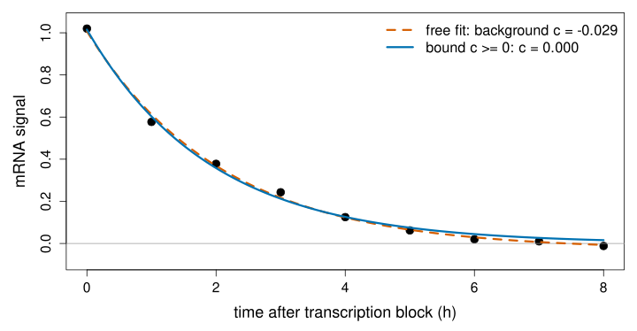
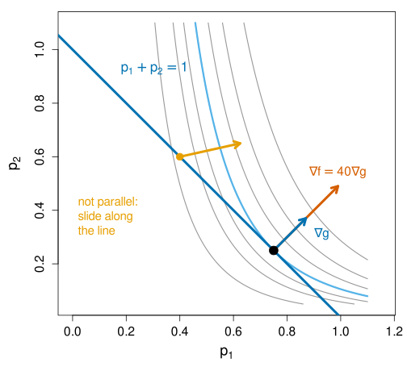
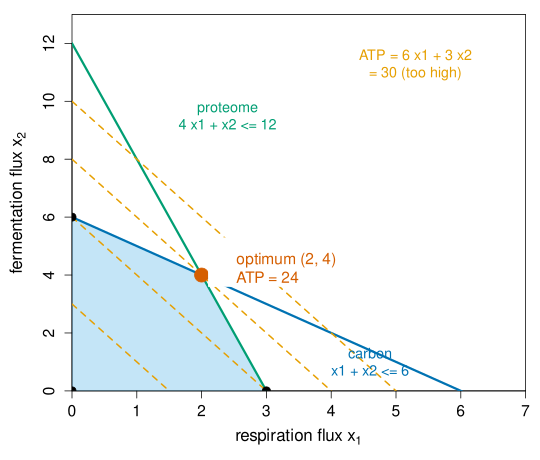
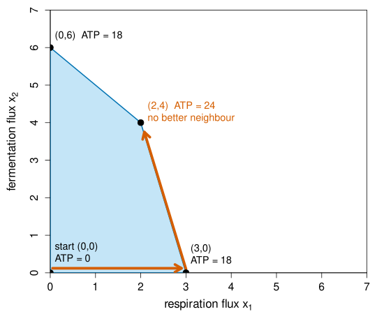
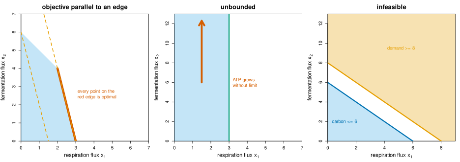
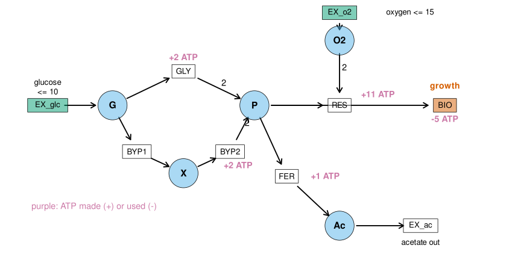
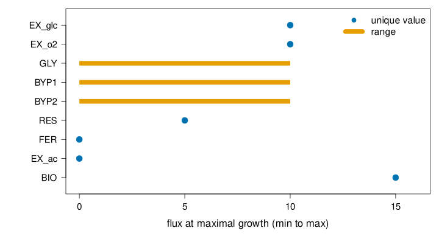
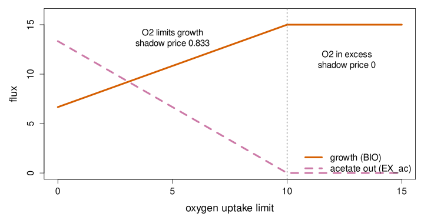

## About this lecture

So far every optimiser was free to try any parameter value. Biology says no: rates are **positive**, proportions **sum to 1**, a cell takes up **at most** so much glucose.

- **Simple fixes** for simple constraints: **bounds** (L-BFGS-B) and **reparameterisation** ($e^\theta$, softmax). Each has a failure.
- **Lagrange multipliers** in one picture: at the optimum the gradient of $f$ is parallel to the gradient of the constraint, and the multiplier is a **shadow price**.
- **Linear programming**: linear objective, linear constraints. The optimum is at a **corner**; the **simplex** method walks from corner to corner.
- Biology: **flux balance analysis** (FBA). Which fluxes maximise growth of a toy metabolic network, which fluxes are not determined, what a knock-out does, and which nutrient limits growth.

::: notes
This is the last unit of Part 9. Units 26 to 29 minimised a smooth function with no restrictions on the parameters. Here the restrictions come in. The first third is a short tool kit for fitting problems (bounds, reparameterisation, the Lagrange picture); the rest is linear programming, which is a different kind of optimisation problem with its own algorithm, and its main biological use, FBA. FBA is used on genome-scale models with thousands of reactions; we use a toy network with 9 reactions that can be solved by hand, so every number on the slides can be checked.
:::

## Three kinds of constraint {.smaller}

| constraint | example | written as |
|---|---|---|
| **sign / bound** | a degradation rate, a background signal | $k \ge 0$, $c \ge 0$ |
| **sum to one** | diet fractions, cell-type proportions | $p_i \ge 0,\ \sum_i p_i = 1$ |
| **capacity** | uptake of glucose, enzyme or ribosome budget | $v_\text{glc} \le 10$ |
| **balance** | metabolites at steady state | $S\mathbf v = \mathbf 0$ |

We have already met answers that break them:

- [*Gaussian elimination as LU*](../lu/lec.qmd): a consumer's diet came out as $(0.55, -0.20, 0.65)$, a negative fraction of maize.
- [*The SVD, rank deficiency and regularisation*](../svd/lec.qmd): least squares gave a CD8 T-cell proportion of $-0.09$.

A constraint is **active** at a solution if it holds with equality there ($c = 0$, $v_\text{glc} = 10$). Inactive constraints do not change the answer.

::: notes
Equality constraints (sum to 1, steady state) cut the search space down to a surface; inequality constraints (signs, capacities) cut off a region. The set of parameter values that satisfy all constraints is the feasible set. The word active matters throughout the lecture: an inactive inequality could be deleted without changing the solution, an active one decides it. The two earlier examples are both cases where the unconstrained answer is impossible, which is the usual way students discover they need constraints.
:::

## A fit that wants a negative background {.smaller}

mRNA decay after a transcription block: signal $y = A e^{-kt} + c$, background $c \ge 0$ (synthetic data).

```r
t <- 0:8                                          # hours
y <- c(1.020, 0.577, 0.378, 0.243, 0.125, 0.062, 0.020, 0.010, -0.012)
sse <- function(p) sum((y - (p[1] * exp(-p[2] * t) + p[3]))^2)   # p = (A, k, c)
fit <- optim(c(1, 0.3, 0.1), sse, method = "BFGS")
round(fit$par, 4)
# [1]  1.0366  0.4788 -0.0294
```

- The best unconstrained fit has a **negative** background. The noise in the last points pulled it down.
- That is not a numerical error: the minimum of the SSE really is at $c < 0$. The model needs to be told that $c \ge 0$.

::: notes
The data are synthetic: true A = 1, k = 0.5, c = 0, plus a fixed noise vector. Background-subtracted signals can go slightly negative, so this happens with real qPCR or fluorescence decay data too. The fitted half-life also depends on c (next slide), so this is not cosmetic. optim with BFGS is what *Gradient descent, Newton and quasi-Newton* used. These are not the decay data of *Optimisation in one dimension* (there the fraction left, with A = 1 and no background, so one parameter); here three parameters, so that one of them can hit a bound.
:::

## Fix 1: bounds {.smaller}

{width="58%" fig-align="center"}

```r
fitb <- optim(c(1, 0.3, 0.1), sse, method = "L-BFGS-B", lower = c(0, 0, 0))
round(fitb$par, 4)
# [1] 1.0152 0.5214 0.0000
```

- [`optim(method = "L-BFGS-B")`](https://stat.ethz.ch/R-manual/R-devel/library/stats/html/optim.html) takes `lower` and `upper`: steps that would leave the box are cut back (projected) onto it.
- The background sits **at the bound**, and the half-life changes from 1.45 h to 1.33 h.

::: notes
L-BFGS-B is the limited-memory BFGS from *Gradient descent, Newton and quasi-Newton* with box constraints added: at each step, any parameter that would cross its bound is held at the bound. In Python it is scipy.optimize.minimize(method="L-BFGS-B", bounds=...). The free fit has a lower SSE (0.0023 vs 0.0038), as it must: it searches a bigger set. The quantity of interest, the half-life ln 2 / k, moves by 8%. Which answer is right is a modelling decision; the numerics only tell you that the bound is active.
:::

## At a bound, the gradient is not zero {.smaller}

```r
round(numDeriv::grad(sse, fitb$par), 4)
# [1] 0.0000 0.0000 0.1054
```

- In $A$ and $k$ (free) the gradient is 0, as usual. In $c$ it is **positive**: the SSE would fall if $c$ could decrease, but the bound stops it.
- That number is the **multiplier** of the bound: how fast the SSE would fall per unit we relax $c \ge 0$.
- **Check:** after a bounded fit, list the parameters that sit at a bound. The standard errors of [*Identifiability and uncertainty of fitted parameters*](../identifiability/lec.qmd) assume an interior minimum with zero gradient: for them they are meaningless, and the result depends on the bound you chose.

::: notes
"Converged" no longer means "gradient zero". The condition at a bounded minimum is: gradient zero in every free parameter, and pointing outward (into the forbidden region) in every parameter held at a bound. A gradient pointing inward would mean the optimiser stopped too early. This is the simplest case of the KKT conditions, which we meet again with NNLS (*The SVD, rank deficiency and regularisation*) and in linear programming. The Hessian-based standard errors of the previous unit assume an interior minimum with zero gradient, so they do not apply to a parameter at its bound.
:::

## Fix 2: reparameterise {.smaller}

Optimise an unconstrained $\theta$ and map it into the allowed set:

- **Positive:** $c = e^{\theta}$, as for rate constants in [*Nonlinear least squares and ODE fitting*](../nonlinear-least-squares/lec.qmd).
- **Proportions:** $p = \text{softmax}(\theta) = e^{\theta_i} / \sum_j e^{\theta_j}$, with $\theta_1 = 0$ fixed. Every $p_i > 0$ and they sum to 1.

```r
sse_log <- function(q) sse(c(q[1], q[2], exp(q[3])))      # c = exp(theta)
fitl <- optim(c(1, 0.3, log(0.1)), sse_log, method = "BFGS")
round(fitl$par, 3); signif(exp(fitl$par[3]), 3); fitl$convergence
# [1]  1.015  0.523 -7.116
# [1] 0.000812
# [1] 1                         # 1 = hit the iteration limit
```

- **Failure:** the best $c$ is 0, which needs $\theta = -\infty$. BFGS walks towards it until it runs out of iterations; $\theta$ is wherever it stopped (Python stops at $-14$, Rust at $-29$).

::: notes
Reparameterisation is the right tool when the true value is well inside the allowed region: it removes the constraint and also helps scaling (rates spanning decades become theta spanning a few units). It is the wrong tool when the answer is on the boundary: e^theta can only approach 0, the SSE becomes flat in theta, and the optimiser drifts. c is still about right (8e-4), but theta is meaningless, convergence is not reported, and anything based on the curvature in theta is nonsense. Softmax has the same problem when a proportion should be exactly 0; the exercise shows it on the diet example. Check: if a reparameterised parameter runs off to large negative values, the constraint is active; switch to a bound.
:::

## Lagrange multipliers in one picture {.smaller}

:::: {.columns}
::: {.column width="48%"}
{width="100%"}
:::
::: {.column width="52%"}
Counts $n = (30, 10)$ of two cell types. Maximise the log-likelihood
$$f(p) = 30 \log p_1 + 10 \log p_2$$
subject to $g(p) = p_1 + p_2 = 1$.

- Grey curves: contours of $f$. Blue line: the constraint.
- At the orange point, $\nabla f$ has a component **along** the line: sliding along it improves $f$.
- At the optimum the contour **touches** the line: $\nabla f$ is **parallel** to $\nabla g$:
$$\nabla f = \lambda \nabla g$$
:::
::::

::: notes
This one picture is the whole idea of Lagrange multipliers. On the constraint we can only move along the line. If the gradient of f has any component along the line, moving that way increases f, so we are not at the optimum. At the optimum the gradient of f must therefore be perpendicular to the line, which is the direction of the gradient of g. Parallel gradients: grad f = lambda grad g, for some number lambda. Together with the constraint itself that gives as many equations as unknowns.
:::

## The multiplier is a shadow price {.smaller}

$\nabla f = (30/p_1,\ 10/p_2)$ and $\nabla g = (1, 1)$, so $30/p_1 = 10/p_2 = \lambda$. With $p_1 + p_2 = 1$: $\lambda = 40$, $p = (0.75, 0.25)$.

```r
n <- c(30, 10)
f <- function(p) sum(n * log(p))
p_hat <- n / sum(n)
n / p_hat                            # gradient of f at the optimum
# [1] 40 40                          # = lambda * (1, 1)
f(1.01 * p_hat) - f(p_hat)           # relax the constraint: sum = 1.01
# [1] 0.3980132                      # about lambda * 0.01 = 0.4
```

- $\lambda$ = how much the best $f$ improves **per unit** the constraint is relaxed. Economists call it the **shadow price** of the constraint.
- Inequalities: the multiplier is $\ge 0$, and **zero if the constraint is inactive** (relaxing it changes nothing). These are the **KKT** conditions; the bounded decay fit and NNLS are examples.

::: notes
The answer p = n/N is no surprise, but the multiplier is the new object. Its meaning, the rate of change of the optimal value when the constraint level changes, carries over to every constrained problem, and in linear programming it becomes the answer to biological questions: which nutrient limits growth? For inequality constraints: an active constraint has a multiplier that tells you how much it costs you; an inactive one has multiplier 0. KKT stands for Karush, Kuhn and Tucker. We do not need the general theory; the gradient of 0.105 at the bounded decay fit was such a multiplier.
:::

## Linear programming {.smaller}

Objective and constraints all **linear**. A cell makes ATP by respiration ($x_1$) or fermentation ($x_2$) (toy numbers):

$$\max\ 6x_1 + 3x_2 \quad\text{subject to}\quad
\begin{aligned}
x_1 + x_2 &\le 6 &&\text{carbon supply}\\
4x_1 + x_2 &\le 12 &&\text{proteome: respiration enzymes are costly}\\
x_1,\ x_2 &\ge 0
\end{aligned}$$

- Respiration gives **twice** the ATP per carbon, but needs **four times** the enzyme per unit flux.
- A linear function has no interior maximum: its gradient $(6, 3)$ is never zero. The answer is always **on the boundary**.
- Gradient methods are the wrong tool; LP has its own algorithms, exact in a finite number of steps.

::: notes
This is a caricature of a real model of overflow metabolism (fast-growing E. coli or yeast ferment even with oxygen present, because respiration costs more protein per unit of flux). We will see that the best strategy is a mix, which is the biological point of such models. Note the absence of a minimum in the interior: no gradient method stopping rule (gradient near zero) can ever be satisfied, so we need a different idea.
:::

## The feasible polygon {.smaller}

:::: {.columns}
::: {.column width="55%"}
{width="100%"}
:::
::: {.column width="45%"}
- Each constraint keeps one side of a line. Together: a convex **polygon** (in $n$ dimensions a **polytope**).
- Orange: lines of equal ATP, $6x_1 + 3x_2 = z$. Push $z$ up until the line leaves the polygon.
- The last point touched is a **corner** (vertex): $(2, 4)$, ATP = 24. A mix of both pathways.
- Fundamental fact: if an LP has an optimum, **one of the corners** is optimal.
:::
::::

::: notes
Draw this on the board. The level lines of a linear objective are parallel straight lines; sliding them in the direction of the gradient, the last contact with a convex polygon is a corner, or a whole edge if the objective is parallel to that edge. So we only need to check the corners, a finite set. The corners here: (0,0) ATP 0, (3,0) ATP 18, (2,4) ATP 24, (0,6) ATP 18. Pure respiration is limited by the proteome, pure fermentation by carbon, the mix uses both resources fully.
:::

## The simplex idea: walk along edges {.smaller}

:::: {.columns}
::: {.column width="50%"}
{width="100%"}
:::
::: {.column width="50%"}
1. Start at a corner: $(0, 0)$, ATP 0.
2. Along which edge does ATP increase? $x_1$: +6 per unit. Go until a constraint stops you: proteome at $x_1 = 3$ (carbon would allow 6). Corner $(3, 0)$, ATP 18.
3. Along the proteome edge, $x_2$ up by 1 means $x_1$ down by $\tfrac14$: ATP changes by $3 - 6/4 = +1.5$. Go until carbon stops you: $(2, 4)$, ATP 24.
4. Along the carbon edge: $x_2$ up 1, $x_1$ down 1: $3 - 6 = -3$ per unit $x_2$ (or $-1$ per unit of proteome freed). Back along the proteome edge: $-1.5$ per unit $x_2$ ($-2$ per unit of carbon freed). **No improving edge: optimal.**
:::
::::

::: notes
This is Dantzig's simplex method (1947) without the tableau. Each step: from the current corner, look at the edges leaving it; the rate of change of the objective along an edge is the reduced cost. Pick an improving edge, walk along it until the first constraint becomes active (the ratio test), and you are at a new corner. The rate depends on what we count per unit: the slide counts per unit of x2, the demo per unit of the constraint the move frees (its slack). Along the carbon edge x2 up 1 frees 3 units of proteome, so -3 per unit x2 is -1 per unit proteome; back along the proteome edge, -1.5 per unit x2 is -2 per unit carbon. The per-slack rates are minus the shadow prices (carbon 2, proteome 1), as lpSolve reports two slides on. Stop when no edge improves. Because the polygon is convex, a corner with no improving edge is the global optimum: there are no local optima in LP. In n dimensions the corners are found by solving n x n linear systems of active constraints, which is where LU factorisations come in; real solvers update the factorisation from step to step.
:::

## How many corners? {.smaller}

- With $n$ variables and $m$ constraints, a corner is where $n$ constraints are active: up to $\binom{m}{n}$ candidates.
- $\binom{4}{2} = 6$ here, $\binom{100}{50} \approx 10^{29}$ for a modest problem. Checking every corner is hopeless.
- The simplex method visits only a short path of improving corners: in practice a small multiple of $m$ steps (in rare worst cases exponentially many).
- **Interior-point methods** cut through the inside of the polytope with Newton steps ([*Newton for systems of equations*](../newton-systems/lec.qmd)) and are polynomial in the worst case.
- Modern solvers ([HiGHS](https://highs.dev/), GLPK, Gurobi) have both and pick one.

::: notes
The exercise has students write the brute-force corner enumeration for 2 variables, and then count how many candidates a larger problem would need. Klee and Minty (1972) built cube-shaped LPs on which the textbook simplex visits all 2^n corners, but on real problems it is fast, and that was a famous puzzle in the theory of algorithms. Interior-point methods (Karmarkar 1984) follow a smooth path through the interior; each step solves a large sparse linear system. For FBA on genome-scale models either kind solves in well under a second.
:::

## LP in R: `lpSolve::lp` {.smaller}

```r
library(lpSolve)
res <- lp("max", objective.in = c(6, 3),
          const.mat = rbind(c(1, 1), c(4, 1)),
          const.dir = c("<=", "<="), const.rhs = c(6, 12),
          compute.sens = TRUE)
res$status; res$solution; res$objval
# [1] 0                    # 0 = success
# [1] 2 4
# [1] 24
res$duals[1:2]             # shadow prices of carbon and proteome
# [1] 2 1
```

- [`lp`](https://cran.r-project.org/package=lpSolve) assumes $x \ge 0$. Python: [`scipy.optimize.linprog`](https://docs.scipy.org/doc/scipy/reference/generated/scipy.optimize.linprog.html) (HiGHS, minimises); Rust: the `minilp` crate.
- Shadow prices: one more unit of carbon gives +2 ATP, one more unit of proteome +1 ATP.

::: notes
Check the shadow prices by hand: with carbon 7 the corner moves to (5/3, 16/3), ATP 26, so +2. With proteome 13: (7/3, 11/3), ATP 25, so +1. These are the Lagrange multipliers of the two active constraints: they solve (6, 3) = y1 (1, 1) + y2 (4, 1), the LP version of grad f = lambda grad g. linprog only minimises, so Python users pass -c and flip the sign of the objective and of the marginals; the exercise shows how. compute.sens = TRUE asks lpSolve for the sensitivity analysis; the first entries of duals belong to the constraints, the rest are reduced costs of the variables.
:::

## When an LP goes wrong {.smaller}

{width="100%" fig-align="center"}

- **Tie** (objective $8x_1 + 2x_2$): a whole edge is optimal. The solver returns **one** corner and does not tell you.
- **Unbounded**: a missing constraint. **Infeasible**: constraints that contradict each other.
- **Check the status** every time. `lpSolve` is not reliable here: on the middle LP it returns status 0 ("success") with $x_2 = 10^{30}$, its internal infinity. Look for absurd values.

::: notes
Each failure has a biological counterpart in FBA. A tie means alternative optimal flux distributions: the next slides show them. Unbounded means a forgotten uptake bound or a cycle that makes ATP from nothing; real genome-scale models are checked for such energy-generating cycles. Infeasible means the model cannot do what you demand (e.g. a measured growth rate higher than the model allows), often a missing reaction. The lpSolve behaviour is real: for this two-variable LP it reports success with 1e30, while on the FBA problem later it correctly reports status 3. scipy reports status 3 (unbounded) or 2 (infeasible) with a message. Degenerate corners (more than n constraints meeting at a point) are a fourth, milder case: the simplex can stall there for a few steps, and the shadow prices are not unique.
:::

## Try it: corners, edges and shadow prices

```{=html}
<link rel="stylesheet" href="../demos/dist/demo.css">
<div data-demo="lpgeom" data-preset="lecture" data-fba="0"></div>
<script src="../demos/dist/lpgeom.js"></script>
```

::: notes
The ATP LP of the last slides, solved live in the browser. Blue polygon: feasible set; coloured lines: the limits; dashed orange: level lines of ATP, the solid one the best level; the arrow is the gradient (6, 3), and it can be dragged. Click step three times: (0, 0) to (3, 0) at +6 per unit x1, to (2, 4) at +1.5 per unit x2, then both edges are negative, -2 and -1, which are minus the shadow prices of carbon and proteome in the readout. The demo counts per unit of the freed slack, the slide per unit x2: the carbon edge is -1 per unit proteome = -3 per unit x2, the proteome edge -2 per unit carbon = -1.5 per unit x2. Drag the carbon slider to 7: ATP 26, the scan plot on the right has slope 2; drag it down to 3 and the readout shows a kink, 6 below and 2 above. Then drag the arrow until it is parallel to the proteome line (or click the tie preset): the whole red edge is optimal, and the walk stops at (3, 0) with an edge of rate 0. Click degenerate corner: three lines through (2, 4) and every price has two values. End with unbounded (the walk runs off up the line x1 = 3) and infeasible (no polygon at all). The exercise has a second tab with the FBA network: knock-outs, FVA ranges and the oxygen scan.
:::

## Flux balance analysis: the network {.smaller}

{width="88%" fig-align="center"}

Toy network: 6 metabolites, 9 reactions. Glucose (G) is split into pyruvate (P) by **two routes** (GLY, or BYP1 + BYP2 via X). P is respired (RES, needs O2), fermented to acetate (FER), or built into biomass (BIO).

::: notes
Fluxes v_j are reaction rates in mmol per gram dry weight per hour; we keep toy units. EX_glc and EX_o2 are exchange reactions: uptake from the medium, with upper bounds 10 and 15. EX_ac secretes acetate. BIO is a pseudo-reaction that drains the precursors and energy needed to make new cells; its flux is the growth rate. ATP is drawn as numbers next to each reaction, not as a node, to keep the picture readable; it is a metabolite like the others. The two parallel routes are on purpose: real networks have isozymes and bypasses, and they make the optimum non-unique. The yields are invented (real respiration yields more ATP), but the structure is that of textbook FBA examples.
:::

## The stoichiometric matrix {.smaller}

Row = metabolite, column = reaction, entry = how many molecules the reaction makes (+) or uses (−).

```r
rxn <- c("EX_glc", "EX_o2", "GLY", "BYP1", "BYP2", "RES", "FER", "EX_ac", "BIO")
S <- rbind(G   = c(1, 0, -1, -1,  0,  0,  0,  0,  0),
           O2  = c(0, 1,  0,  0,  0, -2,  0,  0,  0),
           X   = c(0, 0,  0,  1, -1,  0,  0,  0,  0),
           P   = c(0, 0,  2,  0,  2, -1, -1,  0, -1),
           ATP = c(0, 0,  2,  0,  2, 11,  1,  0, -5),
           Ac  = c(0, 0,  0,  0,  0,  0,  1, -1,  0))
colnames(S) <- rxn
qr(S)$rank
# [1] 6
```

- $\frac{d}{dt}(\text{concentrations}) = S\mathbf v$. **Steady state**: $S\mathbf v = \mathbf 0$: every metabolite is made as fast as it is used.
- 6 independent equations, 9 unknowns: elimination (as in [*Gaussian elimination as LU*](../lu/lec.qmd)) leaves 3 free fluxes, a 3-dimensional **null space** of solutions.

::: notes
Read one row: P (pyruvate) is made twice by GLY and twice by BYP2, used once by each of RES, FER and BIO. Steady state is the key assumption of FBA: intracellular metabolites turn over in seconds, growth takes an hour, so on the slow time scale the metabolite pools are constant. We do not know the kinetics (no rate laws, no parameters), only the stoichiometry, which is known from biochemistry. That is why FBA works on genome-scale models where kinetic models would need thousands of unknown parameters. Elimination of S v = 0 leaves 3 free fluxes (for example glucose uptake, the split between the two routes, and respiration); the bounds and the objective choose among them.
:::

## FBA as a linear program {.smaller}

$$\max_{\mathbf v}\ v_\text{BIO} \quad\text{subject to}\quad S\mathbf v = \mathbf 0,\quad \mathbf v \ge \mathbf 0,\quad v_\text{glc} \le 10,\quad v_{\text{O}_2} \le 15$$

```r
fba <- function(ub = c(10, 15), ko = integer(0)) {
  B <- diag(9)[c(1, 2, ko), , drop = FALSE]     # rows picking v_glc, v_o2, knock-outs
  lp("max", objective.in = c(rep(0, 8), 1),      # maximise v_BIO
     const.mat = rbind(S, B), const.dir = c(rep("=", 6), rep("<=", nrow(B))),
     const.rhs = c(rep(0, 6), ub, rep(0, length(ko))), compute.sens = TRUE)
}
sol <- fba(); sol$objval
# [1] 15
setNames(sol$solution, rxn)
# EX_glc  EX_o2    GLY   BYP1   BYP2    RES    FER  EX_ac    BIO
#     10     10     10      0      0      5      0      0     15
```

- All glucose used, pure respiration, no acetate; oxygen uptake 10 of the 15 allowed.

::: notes
The objective "maximise growth" is an assumption: that evolution has tuned the cell to grow as fast as possible in this medium. It works well for bacteria in exponential growth, less well elsewhere, and other objectives (maximal ATP, minimal total flux) are used too. lpSolve has no variable bounds other than v >= 0, so the uptake limits are extra rows; a knock-out is a row forcing that flux to 0. scipy's linprog takes bounds directly. By hand: with no fermentation, P balance gives 20 = RES + BIO, ATP balance gives 20 + 11 RES = 5 BIO; so BIO = 15, RES = 5. Check with S %*% sol$solution: zero up to rounding.
:::

## The optimum is not unique: flux variability {.smaller}

:::: {.columns}
::: {.column width="52%"}
{width="100%"}
:::
::: {.column width="48%"}
**Flux variability analysis** (FVA): fix growth at its maximum (15), then minimise and maximise each flux in turn, $2 \times 9$ more LPs.

- GLY and the bypass can share the glucose in **any** ratio: each ranges over $[0, 10]$.
- The solver's GLY = 10 was one arbitrary corner.
- Like a non-identifiable parameter ([*Identifiability and uncertainty of fitted parameters*](../identifiability/lec.qmd)): the objective cannot tell the routes apart. **Report ranges**, not one flux vector.
:::
::::

::: notes
This is the tie case of the failure slide, in biology. Growth only depends on the sum GLY + BYP1, so every split is optimal. In real genome-scale models a large fraction of the fluxes have non-trivial ranges at optimal growth. Comparing a single FBA solution with measured fluxes (from 13C labelling) is therefore misleading; FVA ranges are the honest comparison. Other ways to pick one solution: minimise total flux among optimal solutions (parsimonious FBA), or sample the optimal face. The exercise computes the FVA table.
:::

## Knock-outs {.smaller}

```r
ko <- sapply(1:9, function(j) fba(ko = j)$objval)    # remove one reaction at a time
round(setNames(ko, rxn), 3)
# EX_glc  EX_o2    GLY   BYP1   BYP2    RES    FER  EX_ac    BIO
#  0.000  6.667 15.000 15.000 15.000  6.667 15.000 15.000  0.000
fba(ko = c(3, 4))$objval                              # GLY and BYP1 together
# [1] 0
```

- **Essential**: glucose uptake (and BIO itself). No respiration: growth drops to 6.67, by fermentation alone (anaerobic growth).
- GLY and BYP1 are each dispensable, but together **lethal**: a **synthetic lethal** pair, from redundancy.

::: notes
Knock-out predictions are the main use of FBA in practice: gene essentiality screens in E. coli and yeast are predicted with roughly 90% accuracy by genome-scale models, and the errors point to missing knowledge. Each prediction is one more LP. A gene knock-out removes all reactions that need that gene (through gene-protein-reaction rules); here one reaction is one gene. Without RES the cell ferments: P balance 20 = FER + BIO and ATP balance 20 + FER = 5 BIO give BIO = 20/3. Acetate secretion is the measurable signature.
:::

## Shadow prices: what limits growth? {.smaller}

```r
fba()$duals[7:8]                        # rows 7, 8: glucose and oxygen bounds
# [1] 1.5 0.0
round(fba(ub = c(10, 4))$duals[7:8], 3)   # less oxygen
# [1] 0.667 0.833
```

- Plenty of oxygen: one more glucose gives +1.5 growth, oxygen has price **0** (its bound is inactive: 10 used of 15). **Glucose limits growth.**
- Oxygen limited to 4: **both** limit; growth 10, and acetate is secreted (8): **overflow metabolism**.

::: notes
The shadow price is the Lagrange multiplier again: the rate at which the best growth changes if one bound is relaxed. Experimentally that is the question: would adding more of this nutrient help? Rows 7 and 8 of the constraint matrix are the two uptake bounds, so duals[7:8] are their prices. With plenty of oxygen, the cell respires all its pyruvate and only glucose is short. With oxygen 4, respiration is capped at 2, the rest of the pyruvate is fermented, and acetate leaves the cell, as E. coli does in oxygen-limited cultures.
:::

## Scanning the oxygen limit {.smaller}

{width="72%" fig-align="center"}

- Below 10: each unit of oxygen gives $5/6 = 0.833$ more growth and less acetate. Above 10: oxygen is in excess, price 0.
- Shadow prices are **local**: they hold until another constraint becomes active (the kink at 10), where the price is not unique.

::: notes
This is the one-dimensional version of a phenotype phase plane (growth as a function of two uptake rates). Each point is one LP. At exactly 10 the price is ambiguous (0.833 from the left, 0 from the right); solvers report either one, and the exercise shows lpSolve and HiGHS disagreeing there. To predict the effect of a large change, re-solve instead of multiplying by the price.
:::

## FBA checklist {.smaller}

- **Status first.** Infeasible: the bounds contradict each other or the model misses a reaction. Unbounded: a forgotten uptake bound or an ATP-making cycle.
- **$S\mathbf v = \mathbf 0$ check** on the returned fluxes, with a tolerance (fluxes of $10^{-12}$ are zeros).
- **Never trust one flux vector.** Run FVA; a flux is determined only if its range is narrow.
- **Read the shadow prices** to see which bounds matter; they only hold until the next kink.
- **Units and bounds** decide the answer: an uptake bound of 10 vs 15 is a modelling choice, not a fact.

::: notes
The same failures as on the LP failure slide, translated into model-building practice. Genome-scale models come with standard tests (the MEMOTE test suite checks for mass imbalance, energy-generating cycles and blocked reactions). A practical warning: LP solvers work in floating point with feasibility tolerances around 1e-9, so a flux of 3e-15 is zero and an S v of 1e-12 is a balanced metabolite.
:::

## Production tools {.smaller}

- **COBRA Toolbox** (MATLAB) and **cobrapy** (Python) are the standard: they read models in SBML, set bounds, run FBA, FVA, knock-out screens and parsimonious FBA, and call an LP solver (GLPK, HiGHS, Gurobi, CPLEX).
- Genome-scale models: *E. coli* iML1515 has 2712 reactions and 1877 metabolites; human Recon3D about 13 000 reactions. $S$ is **sparse** ([*Structure: symmetric, banded, sparse*](../structured-sparse/lec.qmd)): a reaction touches a handful of metabolites.
- The toy model is exactly what these tools do, at a size where you can check every number by hand.

::: notes
cobrapy: model.optimize() runs FBA, cobra.flux_analysis.flux_variability_analysis runs FVA, single_gene_deletion runs the knock-out screen, and solution.shadow_prices gives the shadow prices of the metabolites. In R the sybil package did the same but is no longer maintained; most R users call cobrapy or use the COBRA Toolbox. The models are curated over years from the literature; the numerical part is a sparse LP, solved in milliseconds.
:::

## Summary {.smaller}

- Biological constraints: signs, sums to 1, capacities, steady state. A constraint is **active** if it holds with equality.
- **Bounds** (L-BFGS-B): the answer can sit at a bound, where the gradient is not zero. **Reparameterisation** ($e^\theta$, softmax) fails when the answer is on the boundary: $\theta$ runs to $-\infty$.
- **Lagrange**: at a constrained optimum $\nabla f = \lambda \nabla g$; $\lambda$ is the **shadow price**, 0 for inactive constraints.
- **LP**: the optimum is at a **corner** of the feasible polytope; **simplex** walks along improving edges; solvers: `lpSolve::lp`, `scipy.optimize.linprog` (HiGHS), `minilp`. **Check the status**: tie, unbounded, infeasible.
- **FBA**: maximise growth subject to $S\mathbf v = \mathbf 0$ and bounds. Optimal fluxes are often not unique (**FVA**), knock-outs are one LP each, shadow prices show which nutrient limits growth.

**Next:** Part 10, [*The diffusion (heat) equation by finite differences*](../diffusion-explicit/lec.qmd).

::: notes
The two ideas that carry furthest: constraints change what "converged" means (gradient not zero at an active constraint), and multipliers measure how much each constraint costs. In FBA both become biology: the active bounds are the limiting nutrients, the multipliers their value to the cell. Part 10 moves from ordinary to partial differential equations.
:::
