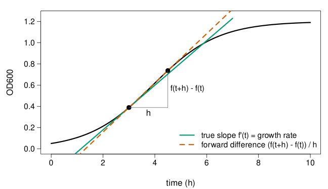
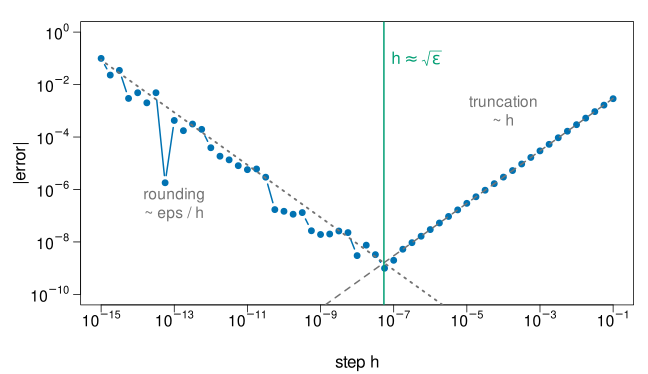
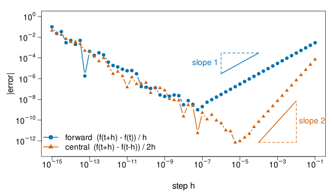
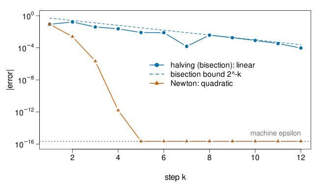
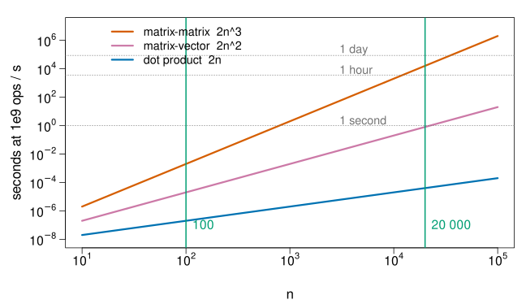
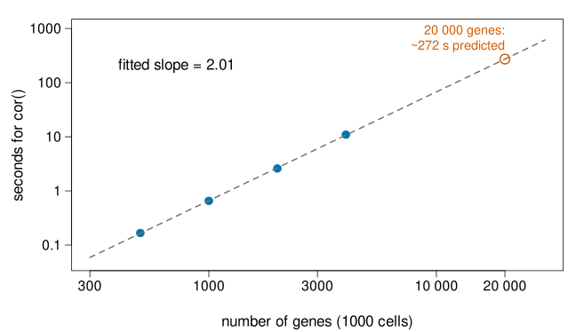
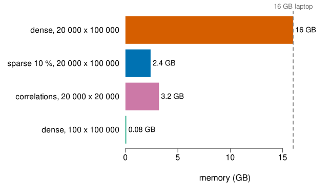

## About this lecture {.smaller}

Every numerical method answers two questions: **how accurate is it**, and **how long does it take**? Today we learn to measure both, with experiments rather than proofs.

- **Truncation error** (from cutting off a Taylor series) against **rounding error** (from floating point): the first shrinks as the step $h$ shrinks, the second grows.
- **Order of accuracy**: error $\approx C h^p$, and how to read $p$ as the **slope of a log–log plot**.
- **Convergence of iterations**: linear (a fixed number of digits per step) against quadratic (digits double each step).
- **Cost**: counting operations, big-O, **timing code**, reading the exponent from a doubling experiment, and **memory**.

Biology: the growth rate of a bacterial culture from an OD curve, and why a gene–gene correlation that takes a second for 100 genes takes hours for 20 000 genes × 100 000 cells.

::: notes
This unit closes Part 1. Why numerical analysis? gave the three failure types, How computers store numbers gave machine epsilon, Error, conditioning and stability gave relative error and cancellation. Here we put numbers on two things every later unit uses: how fast the error falls as we refine a method, and how fast the run time grows as the data grow. The habit we want: plot error against step size on log–log axes, and time against problem size on log–log axes, and read off the slope. Both slopes are predictions you can check.
:::

## Two questions about every method {.smaller}

**Accuracy.** Most numerical methods have a knob: a step size $h$, a number of iterations, a number of grid points.

- How does the error change when I turn the knob? If I halve $h$, does the error halve? Quarter?
- Can I turn the knob too far?

**Cost.** Most biological data sets grow: more genes, more cells, more time points.

- If I double the number of genes, does the run time double? Quadruple? Go up eight-fold?
- Will the answer fit in memory at all?

A single-cell RNA-seq experiment: **20 000 genes × 100 000 cells**. A method tested on 100 genes can look instant and still be useless at full size.

::: notes
Frame the whole lecture around these two knobs. The first half is about accuracy, with one running example (a numerical derivative). The second half is about cost, with gene-by-cell matrices. In both halves the tool is the same: a log–log plot and its slope. Ask the audience: if your pilot analysis on 100 genes ran in a second, how long for 20 000 genes? Most guess "200 seconds". We will see why that guess can be off by a factor of a hundred or more.
:::

## Running example: growth rate from an OD curve {.smaller}

A bacterial culture follows a logistic curve, $N(t) = \dfrac{K}{1 + (K/N_0 - 1)\,e^{-rt}}$, with $K = 1.2$, $N_0 = 0.05$, $r = 0.8$ per hour.

The **growth rate** at time $t$ is the slope $N'(t)$. Approximate it by a **forward difference**:
$$N'(t) \approx \frac{N(t+h) - N(t)}{h}$$

{width="62%" fig-align="center"}

::: notes
The slope of the tangent (green) is what we want. The forward difference is the slope of the secant (dashed) through two points h apart. For large h they differ visibly. As h shrinks the secant turns into the tangent: that is the definition of the derivative from calculus. The question for today: how fast does it approach, and does it keep approaching on a computer? We use the logistic formula so that we know the exact answer, r N (1 - N/K), and can measure the error. With real data you would not; we come back to that.
:::

## First try in R {.smaller}

```r
K <- 1.2; N0 <- 0.05; r <- 0.8            # OD units, per hour
od <- function(t) K / (1 + (K / N0 - 1) * exp(-r * t))
t0 <- 3
exact <- r * od(t0) * (1 - od(t0) / K)    # logistic: N' = r N (1 - N/K)
h  <- 0.1
fd <- (od(t0 + h) - od(t0)) / h
c(fd, exact, fd - exact)
# [1] 0.213147350 0.210259735 0.002887615
```

- At $t = 3$ h the culture grows at $0.2103$ OD units per hour; $h = 0.1$ h gives $0.2131$.
- Error $\approx 0.003$, about 1.4 % relative error. Not bad, but can we do better by shrinking $h$?

::: notes
The exact derivative comes from the logistic differential equation, so we can compute the error exactly. The forward difference overestimates here because the curve is convex (bending upwards) at t = 3 h: the secant lies above the tangent. Make sure students see that the error is a number we can compute, and that it depends on h.
:::

## Make $h$ smaller {.smaller}

```r
h   <- c(0.1, 0.01, 0.001, 0.0001)
fd  <- (od(t0 + h) - od(t0)) / h
err <- abs(fd - exact)
data.frame(h, fd, err)
#       h        fd          err
# 1 1e-01 0.2131473 2.887615e-03
# 2 1e-02 0.2105551 2.953551e-04
# 3 1e-03 0.2102893 2.959917e-05
# 4 1e-04 0.2102627 2.960551e-06
```

- Each time $h$ is divided by 10, the error is divided by 10.
- The error is **proportional to $h$**: $\text{err} \approx 0.0296\,h$.

::: notes
Read the table column by column. The leading digits of the error stay the same (2.9...) and the exponent drops by one each row. That is the signature of error proportional to h. The constant 0.0296 will turn out to be half the second derivative. Note that the code is vectorised over h: od() accepts a vector of times, so one line computes all four estimates.
:::

## Where "error $\propto h$" comes from: Taylor {.smaller}

Taylor's theorem with remainder (from the intro unit): for some $\xi$ between $t$ and $t+h$,
$$N(t+h) = N(t) + h\,N'(t) + \tfrac{h^2}{2}\,N''(\xi).$$

Subtract $N(t)$, divide by $h$:
$$\frac{N(t+h) - N(t)}{h} = N'(t) + \underbrace{\tfrac{h}{2}\,N''(\xi)}_{\text{truncation error}}$$

- **Truncation error**: the part of the Taylor series we cut off. It is there even with exact arithmetic.
- Here $N''(3) = 0.0592$, so the error $\approx \tfrac{0.0592}{2}\,h = 0.0296\,h$. Exactly the constant in the table.

::: notes
This is the one derivation of the lecture. It explains both the power of h (one, because one h was divided away from h^2) and the constant (half the second derivative). The second derivative of the logistic is r N' (1 - 2N/K); at t = 3 that is 0.0592. Students do not need to compute it on the slide; the point is that the measured constant matches the theory. Truncation error is a property of the formula, not of the computer.
:::

## Keep going: smaller is not better {.smaller}

```r
h   <- 10^-(7:15)
fd  <- (od(t0 + h) - od(t0)) / h
print(data.frame(h, fd, err = abs(fd - exact)), digits = 3)
#       h    fd      err
# 1 1e-07 0.210 1.99e-09
# 2 1e-08 0.210 3.00e-09
# 3 1e-09 0.210 1.92e-08
# 4 1e-10 0.210 1.47e-07
# 5 1e-11 0.210 5.70e-06
# 6 1e-12 0.210 3.90e-05
# 7 1e-13 0.210 4.28e-04
# 8 1e-14 0.205 4.87e-03
# 9 1e-15 0.111 9.92e-02
```

- Below $h \approx 10^{-8}$ the error **grows** again. At $h = 10^{-15}$ the growth rate is off by half.

::: notes
This is the failure. Truncation theory says the error should keep falling by ten per row. Instead it bottoms out near 1e-9 and then climbs, roughly by ten per row in the other direction. At h = 1e-15 the estimate is 0.111 instead of 0.210: a confident, wrong growth rate, with no warning from R. The culprit is the floating-point rounding we met in floating-point and the cancellation from error-conditioning.
:::

## Rounding error: $\varepsilon / h$ {.smaller}

- `od(t0 + h)` and `od(t0)` are each stored with a relative error up to $\varepsilon \approx 2.2\times10^{-16}$, i.e. an absolute error of about $\varepsilon\,|N| \approx 10^{-16}$.
- For tiny $h$ the two values agree in almost all digits: subtracting them is **catastrophic cancellation** (error-conditioning). The difference keeps the absolute error $\approx \varepsilon |N|$ but loses the leading digits.
- Dividing by $h$ then **amplifies** it:
$$\text{rounding error} \approx \frac{\varepsilon\,|N(t)|}{h}$$

```r
.Machine$double.eps * od(t0) / 1e-12
# [1] 8.632834e-05
```

The table gave $3.9\times10^{-5}$ at $h = 10^{-12}$: the same size. This error **grows** as $h$ shrinks.

::: notes
This is a size estimate, not an exact formula: the rounding errors are effectively random, which is why the error column in the previous table was jagged rather than a clean power of ten. The factor 1/h is the key: the smaller the step, the more a fixed absolute error in the numerator is blown up. Link to .Machine$double.eps from floating-point. The same logic will appear whenever a method divides a small difference by a small number.
:::

## Total error: the V on a log–log plot {.smaller}

$$\text{total error} \approx \underbrace{\tfrac{|N''|}{2}\,h}_{\text{truncation}} + \underbrace{\frac{\varepsilon\,|N|}{h}}_{\text{rounding}}$$

{width="68%" fig-align="center"}

The two terms balance near $h \approx \sqrt{\varepsilon} \approx 10^{-8}$; the best error is also $\approx \sqrt{\varepsilon}$: **only about 8 of 16 digits survive**.

::: notes
On log–log axes each term is a straight line: slope +1 for truncation, slope -1 for rounding. The total error follows the larger of the two, giving a V. Setting the derivative of the sum to zero gives h* = sqrt(2 eps |N| / |N''|), here 5.4e-8, which for ordinary functions with N and N'' of similar size is about sqrt(eps) = 1.5e-8 (shown in R as sqrt(.Machine$double.eps)). The best forward difference is accurate to about half the digits of a double. This V-plot is the most important picture of the lecture: every method with a step size has one.
:::

## Order of accuracy: error $\approx C\,h^p$ {.smaller}

In the truncation regime most methods behave like
$$\text{error} \approx C\,h^p, \qquad \text{written } \text{error} = O(h^p) \text{ ("big-O of } h^p\text{")}.$$

- $p$ is the **order** of the method; $C$ depends on the function (here $C = |N''|/2 = 0.0296$).
- Forward difference: $p = 1$ (**first order**). Halving $h$ halves the error.
- A second-order method ($p = 2$): halving $h$ quarters the error. Third order: divides it by 8.

| $h$ | $O(h)$, $C=1$ | $O(h^2)$, $C=1$ | $O(h^4)$, $C=1$ |
|----:|----:|----:|----:|
| $10^{-1}$ | $10^{-1}$ | $10^{-2}$ | $10^{-4}$ |
| $10^{-2}$ | $10^{-2}$ | $10^{-4}$ | $10^{-8}$ |

Higher order buys more digits for the same $h$, **if** the function is smooth enough for the Taylor argument to hold.

::: notes
Introduce the notation slowly. O(h^p) means: for small h, the error is at most a constant times h^p. It says nothing about the size of C, and nothing about where "small" starts. Numerical analysis uses O() in two directions: for errors, h goes to 0 and a higher power is better; for cost (second half of the lecture), n goes to infinity and a higher power is worse. Warn students about that now; it trips everybody.
:::

## Reading the order off a log–log plot {.smaller}

Take logs of $\text{err} = C h^p$: $\quad \log_{10}\text{err} = \log_{10} C + p\,\log_{10} h$. A straight line with **slope $p$**.

```r
h   <- c(0.1, 0.01, 0.001, 0.0001)
err <- abs((od(t0 + h) - od(t0)) / h - exact)
log10(err[1] / err[2]) / log10(h[1] / h[2])   # slope from two points
# [1] 0.9901948
coef(lm(log10(err) ~ log10(h)))               # slope from all points
# (Intercept)    log10(h)
#  -1.5399748   0.9966565
```

- Measured order $\approx 1$, as Taylor predicted. $10^{-1.54} = 0.029 \approx C$.
- **Only fit the straight part.** Points in the rounding regime would pull the slope towards $-1$.

::: notes
Two ways to get the slope: from two points (rise over run in log10 units), or from a least-squares line with lm over several points. Both give about 1. Always look at the plot first and choose the range of h where the line is straight; fitting across the bottom of the V gives a meaningless number. This experiment, measure error for a range of steps and read off the slope, is the main check of every method in the course.
:::

## A second-order formula, for contrast {.smaller}

The **central difference** $\dfrac{N(t+h) - N(t-h)}{2h}$ is symmetric about $t$: the $h^2$ Taylor terms cancel and the error is $O(h^2)$.

{width="64%" fig-align="center"}

- Slope 2: dividing $h$ by 10 gains **two** digits. Best error $\approx 10^{-12}$ at $h \approx 10^{-5}$.
- The rounding side is the same as before. Full treatment in Part 7, [*Numerical differentiation*](../finite-differences/lec.qmd).

::: notes
We show the central difference only to see what a different order looks like on the plot: a steeper line on the right, the same rounding line on the left, so the V moves to larger h and lower error. Balancing C h^2 against eps/h gives h* ~ eps^(1/3) ~ 1e-5 and best error ~ eps^(2/3) ~ 1e-11. Derivations, the backward difference, Richardson extrapolation and noisy data are in Numerical differentiation (finite-differences, Part 7). Do not go further here.
:::

## Try it: choose the step size

```{=html}
<link rel="stylesheet" href="../demos/dist/demo.css">
<div data-demo="stepsize" data-method="forward" data-logh="0" data-cost="0"></div>
<script src="../demos/dist/stepsize.js"></script>
```

::: notes
The same OD curve, K = 1.2, N0 = 0.05, r = 0.8, at t = 3 h, computed live in the browser in doubles. Left: the curve, the tangent (true growth rate) and the secant of the chosen formula. Right: the actual error for every h from 1 to 1e-16, with the dashed truncation line C h^p, the dotted rounding line eps |N| / h, and the green line at the predicted best step. Start at h = 1 with the forward formula: the secant is visibly steeper than the tangent, error 0.02. Click 1e-1 and 1e-4: the error falls tenfold per click, and the slope readout (h to h/2) says 1.00. Click 1e-8: error 3e-9, the bottom of the V. Click 1e-12 and 1e-15: the error climbs back up, the estimate at 1e-15 is 0.111, and the slope readout jumps around: rounding regime. Drag to the far left: t + h rounds to t, the estimate is exactly 0. Then switch to central: slope 2 on the right, the best step moves to about 1e-5 with error 1e-12, and the rounding side is the same line as before. Finish with "best h*" for each formula.
:::

## Checking the order without the exact answer {.smaller}

With real OD data you do not know $N'(t)$. But if $D(h) \approx N' + C h^p$, then
$$\frac{D(h) - D(h/2)}{D(h/2) - D(h/4)} \approx 2^p.$$

```r
D <- function(h) (od(t0 + h) - od(t0)) / h
ratios <- function(h0) {
  d <- diff(sapply(h0 / 2^(0:5), D))   # successive differences
  d[-length(d)] / d[-1]                # should be 2^p = 2
}
ratios(0.1)
# [1] 1.961339 1.981418 1.990893 1.995493
ratios(3e-11)
# [1]  0.50 -0.50 -0.25  1.00
```

**The check:** ratios settle near $2^p$ → truncation regime, $h$ is fine. Ratios jump around → you are in the rounding regime; use a larger $h$.

::: notes
This is the practical check a student can run on their own method. The exact derivative cancels in the differences, so it does not need to be known. In the truncation regime the ratios approach 2 for a first-order method (4 for second order). Deep in the rounding regime they are noise, even negative. The same trick works for any method with a step size: quadrature, ODE solvers. Note that with measured OD values the noise is not 1e-16 but perhaps 1e-3, so the rounding regime starts at a far larger h; that is treated in finite-differences.
:::

## Convergence of iterations: digits per step {.smaller}

Many methods do not have a step $h$ but repeat a step until done. Two ways to find $\sqrt{2}$:

- **Halving** (bisection): keep a bracket $[1, 2]$ and halve it.
- **Newton**: $x_{k+1} = \tfrac{1}{2}\left(x_k + 2/x_k\right)$, starting at $x_0 = 1$.

```r
lo <- 1; hi <- 2; x <- 1                 # bracket [1, 2]; Newton start
for (k in 1:5) {
  mid <- (lo + hi) / 2                   # halving (bisection)
  if (mid^2 > 2) hi <- mid else lo <- mid
  x <- (x + 2 / x) / 2                   # Newton for x^2 = 2
  cat(k, signif(abs(mid - sqrt(2)), 2), signif(abs(x - sqrt(2)), 2), "\n")
}
# 1 0.086 0.086
# 2 0.16 0.0025
# 3 0.039 2.1e-06
# 4 0.023 1.6e-12
# 5 0.008 2.2e-16
```

::: notes
Columns: step, error of the bisection midpoint, error of Newton. Bisection's midpoint error wobbles, but its bracket halves every step, so the guaranteed error bound is 2^-k. Newton's error goes 0.086, 0.0025, 2e-6, 2e-12, then machine precision: the number of correct digits roughly doubles each step. Do not derive Newton here; that is Part 2. This slide only introduces the vocabulary.
:::

## Linear vs quadratic convergence {.smaller}

:::: {.columns}
::: {.column width="55%"}
{width="100%"}
:::
::: {.column width="45%"}
- **Linear**: $e_{k+1} \approx c\,e_k$ with $c < 1$. Bisection: $c = \tfrac12$, so about **0.3 digits per step**; 16 digits take ~53 steps. Straight line on a log-$y$ plot.
- **Quadratic**: $e_{k+1} \approx C\,e_k^2$. Digits **double** each step: 1, 2, 5, 11, 16. A line curving downwards.
- The **order** of convergence is the power: 1 for linear, 2 for quadratic.
:::
::::

Preview of Part 2: bisection, fixed-point iteration and Newton ([*Bisection and fixed-point iteration*](../bisection-fixedpoint/lec.qmd), [*Newton and secant methods*](../newton/lec.qmd)).

::: notes
For iterations the x-axis is the step number, not h, and we plot log error against linear k (a semilog plot). Linear convergence gives a straight line whose slope is log10(c); quadratic convergence gives a curve that falls faster and faster. Both stop at machine epsilon: you cannot get more than about 16 digits. log10(2) = 0.3 digits per step is why bisection is slow but steady. Part 2 shows when each method converges and how Newton can fail.
:::

## Cost: counting operations {.smaller}

Count the **multiplications and additions** ("floating-point operations", flops) for vectors of length $n$ and $n\times n$ matrices:

| Operation | R | Work | Flops |
|---|---|---|---:|
| dot product $\mathbf x\cdot\mathbf y$ | `sum(x * y)` | $n$ mult., $n-1$ add. | $\approx 2n$ |
| matrix–vector $A\mathbf x$ | `A %*% x` | $n$ dot products | $\approx 2n^2$ |
| matrix–matrix $AB$ | `A %*% B` | $n$ matrix–vector products | $\approx 2n^3$ |

- For $n = 20\,000$: dot product $4\times10^4$, matrix–vector $8\times10^8$, matrix–matrix $1.6\times10^{13}$ flops.
- A laptop does roughly $10^9$–$10^{10}$ simple flops per second (much more with an optimised library).

::: notes
Build each count from the previous one: a matrix-vector product is n dot products of length n; a matrix-matrix product is n matrix-vector products. That is why the exponents go up one at a time. The 1e9 operations per second figure is a rough rule for one core doing simple arithmetic; optimised linear algebra libraries (BLAS) can be 10-100 times faster on many cores, but the exponent stays. Counting is approximate on purpose: we care about the leading power of n.
:::

## Big-O for cost: what doubling $n$ does {.smaller}

Cost $\approx C n^p$, written $O(n^p)$. Here $n \to \infty$ and a **smaller** $p$ is better. Doubling $n$ multiplies the time by $2^p$:

:::: {.columns}
::: {.column width="45%"}
| Cost | $n \to 2n$ | $100 \to 20\,000$ |
|---|---:|---:|
| $O(n)$ | × 2 | × 200 |
| $O(n^2)$ | × 4 | × 40 000 |
| $O(n^3)$ | × 8 | × 8 000 000 |
:::
::: {.column width="55%"}
{width="100%"}
:::
::::

A matrix–matrix product: 2 ms at $n = 100$, **4.4 hours** at $n = 20\,000$ (at $10^9$ flops/s).

::: notes
The right column is the "pilot to full study" factor: going from 100 to 20 000 is a factor 200 in n. For a linear method that is a factor 200 in time, for a quadratic one 40 000, for a cubic one 8 million. That is how a method that is instant on a pilot becomes useless at full scale. In the figure, read upwards along the green line at n = 20 000: the dot product is microseconds, the matrix-vector product about a second, the matrix-matrix product hours.
:::

## Biology: all-pairs gene correlation {.smaller}

A co-expression network needs the correlation of **every pair of genes**, each across all cells.

- Number of pairs for $n$ genes: $n(n-1)/2$. For 100 genes: 4 950. For 20 000 genes: **≈ 2×10⁸**.
- Each correlation is a dot product over $m$ cells, $O(m)$ work. Total: $O(n^2 m)$.
- For $n = 20\,000$, $m = 100\,000$: $2\times10^8 \times 10^5 \approx 2\times10^{13}$ multiply–adds.

Prediction: **quadratic in genes, linear in cells**. Going from 100 to 20 000 genes costs a factor 40 000.

Let us check that prediction by **timing** R's [`cor()`](https://stat.ethz.ch/R-manual/R-devel/library/stats/html/cor.html).

::: notes
This is the motivating calculation for the unit title. Write the count as (number of pairs) x (cost per pair). The pairs grow as n^2 because every gene meets every other gene. This is the same structure as a matrix product: the correlation matrix is (up to centring and scaling) X^T X, which costs n^2 m. Predictions like this can be wrong: the library may be cleverer than we think, or overheads may dominate. So we measure.
:::

## A doubling experiment {.smaller}

```r
set.seed(1)
cells <- 1000
genes <- c(500, 1000, 2000, 4000)
secs  <- numeric(length(genes))
for (i in seq_along(genes)) {
  X <- matrix(rpois(cells * genes[i], 2), nrow = cells)   # cells x genes
  secs[i] <- system.time(cor(X))["elapsed"]
}
data.frame(genes, secs, ratio = c(NA, secs[-1] / secs[-length(secs)]))
#   genes   secs    ratio
# 1   500  0.167       NA
# 2  1000  0.654 3.916168
# 3  2000  2.594 3.966361
# 4  4000 10.946 4.219738
```

- [`system.time()`](https://stat.ethz.ch/R-manual/R-devel/library/base/html/system.time.html) returns seconds; `"elapsed"` is wall-clock time. Your numbers will differ; the **ratio** should not: × 4 per doubling, so $O(n^2)$.

::: notes
The doubling experiment is the simplest timing method: double n, and look at the ratio of times. A ratio near 2 means linear, near 4 quadratic, near 8 cubic. The data are simulated Poisson counts as a stand-in for a cells x genes count matrix. These timings were measured on a Linux server; a laptop may be faster or slower, but the ratio of about 4 should come out the same. Note that cor() correlates columns, so genes are columns here.
:::

## Log–log of time vs $n$: read the exponent, extrapolate {.smaller}

{width="62%" fig-align="center"}

- `coef(lm(log10(secs) ~ log10(genes)))` gives slope **2.01**: quadratic, as predicted.
- Extrapolate: 20 000 genes ≈ $10.9 \times 5^2 \approx 270$ s for 1000 cells, × 100 for 100 000 cells ≈ **7.6 hours**. 100 genes × 100 000 cells: ≈ **0.7 s**.

::: notes
Same plot, same slope reading as for the error of the derivative, but now the slope is the exponent of the cost. Once you have the slope and one measured point you can predict the time at full size before you start the job. That is the payoff: you find out over coffee, not after a night of waiting, that the job needs a cluster, a faster algorithm, or fewer genes. A BLAS-based correlation (crossprod of the scaled matrix) is about 20 times faster on this machine, but it is still O(n^2 m): a better constant, the same exponent.
:::

## When timing misleads {.smaller}

A timing is a measurement, with noise and systematic errors.

- **Too small**: below ~0.1 s, start-up overhead and the clock resolution dominate. Times look flat in $n$, the slope comes out too low.
- **Multi-threaded libraries** (BLAS, used by `%*%`, `crossprod`) use more cores as $n$ grows, which also lowers the measured slope. Example: `A %*% A` here gave ratios × 2, × 3, × 6 for $n = 500 \ldots 4000$, not × 8.
- **Memory** runs out: once the data no longer fit in RAM, times jump by orders of magnitude.

**The check:** time at least 3–4 sizes, increase $n$ until each run takes ≥ 0.1 s and the doubling ratio settles. Then extrapolate.

::: notes
This is the failure slide for timing. The classic mistake: time n = 10 and n = 20, see no difference, conclude the method is "fast", and launch it at n = 20 000. The other classic: the slope from a multi-threaded library looks like 1.5 at moderate n, because more cores join in, and the extrapolation is too optimistic. Repeat timings and take the minimum or median if they are noisy. The numbers in the second bullet came from this machine with a 40-core OpenBLAS; on a laptop with R's reference BLAS the ratio is much closer to 8.
:::

## Loops vs vectorised code {.smaller}

```r
set.seed(1)
x <- runif(1e7); y <- runif(1e7)
dot_loop <- function(x, y) {
  s <- 0
  for (i in seq_along(x)) s <- s + x[i] * y[i]
  s
}
system.time(dot_loop(x, y))["elapsed"]    # 0.555
system.time(sum(x * y))["elapsed"]        # 0.066
system.time(crossprod(x, y))["elapsed"]   # 0.032
```

- All three are $O(n)$. The **constant** differs: about 17× here; in plain Python loops it is more like 100×.
- Vectorising changes $C$, never $p$. An $O(n^2)$ method stays $O(n^2)$ when vectorised.

::: notes
Vectorised R functions (sum, x * y) run the loop in compiled C code; crossprod calls the BLAS library. The R loop interprets each iteration. Modern R compiles loops to byte code, so the gap is smaller than it used to be; in Python the gap between a for loop and numpy is typically 100 times or more (see the exercise). The point to land: vectorisation is worth a constant factor, often a large one, but it never changes the exponent. Choosing an algorithm with a lower exponent is what saves you at scale. The three sums also differ in the last digits, because they add in different orders.
:::

## Memory: 8 bytes per number {.smaller}

A double takes **8 bytes**. A dense matrix with $r$ rows and $c$ columns takes $8rc$ bytes.

```r
X <- matrix(0, nrow = 1000, ncol = 1000)
object.size(X)
# 8000216 bytes
20000 * 100000 * 8 / 1e9      # GB: genes x cells, dense
# [1] 16
20000^2 * 8 / 1e9             # GB: gene x gene correlation matrix
# [1] 3.2
```

- [`object.size()`](https://stat.ethz.ch/R-manual/R-devel/library/utils/html/object.size.html): $10^6$ entries × 8 bytes, plus a small header.
- A full single-cell matrix as dense doubles needs **16 GB**: a whole laptop's memory, before any copy. R often makes copies.

::: notes
Memory is the other cost, and often the one that bites first. Memory is O(rc) for a matrix; the correlation matrix is O(n^2) in the number of genes, 3.2 GB for 20 000 genes. Any operation that creates a modified copy (for example log-transforming the matrix) doubles the requirement. When the data do not fit, the operating system starts swapping to disk and the program slows down by orders of magnitude, or R stops with "cannot allocate vector of size ...".
:::

## Sparsity: store only the non-zeros {.smaller}

:::: {.columns}
::: {.column width="50%"}
{width="100%"}
:::
::: {.column width="50%"}
- Single-cell count matrices are typically **90 % zeros or more**.
- **Sparse** storage keeps only the non-zeros: value (8 bytes) + row index (4 bytes).
- At 10 % non-zero: 16 GB → **2.4 GB**. Work also scales with the number of non-zeros, not $rc$.
:::
::::

Full treatment: Part 3, [*Structure: symmetric, banded, sparse*](../structured-sparse/lec.qmd).

::: notes
The sparse format here is compressed sparse column: for each non-zero, its value and its row index, plus one pointer per column. That is about 12 bytes per non-zero instead of 8 bytes per entry, so sparse storage wins whenever fewer than two thirds of the entries are non-zero, and wins massively at 5-10 % density. Operations such as a sparse matrix-vector product also only touch the non-zeros, so they cost O(number of non-zeros) instead of O(rc). Part 3 explains the storage formats and the solvers that exploit them.
:::

## Sparsity can be lost in one line {.smaller}

```r
library(Matrix)                          # ships with R
set.seed(1)
S <- rsparsematrix(2000, 10000, density = 0.1,
                   rand.x = function(n) rpois(n, 2) + 1)  # genes x cells
D <- as.matrix(S)
c(dense = object.size(D), sparse = object.size(S)) / 1e6  # MB
#    dense   sparse
# 160.0002  24.0415
Sc <- S - rowMeans(S)                    # centre each gene ...
c(centred = object.size(Sc)) / 1e6       # ... and the zeros are gone
#  centred
# 160.0012
```

- **Centring** subtracts the mean from every entry, so every zero becomes non-zero: the matrix is dense again. At full size: 2.4 GB → 16 GB.
- **The check:** look at `class()` and `object.size()` after each step. Avoid centring the whole matrix; tools like PCA on sparse data centre implicitly.

::: notes
The Matrix package comes with every R installation. rsparsematrix makes a random sparse matrix; we fill it with small counts as a stand-in for UMI counts. The failure is silent: R happily returns a dense matrix (class dgeMatrix) and the memory jumps six-fold here, or more at lower density. This is why single-cell tools scale and centre lazily, and why PCA on large single-cell data uses methods that never form the centred matrix (eigen-algorithms, Part 5).
:::

## Summary {.smaller}

- **Truncation error** comes from cutting off Taylor: forward difference error $\approx \tfrac{|f''|}{2}h$. **Rounding error** $\approx \varepsilon|f|/h$ grows as $h$ shrinks. Total error is a **V**; best $h \approx \sqrt{\varepsilon}$, only ~8 digits left.
- **Order of accuracy**: error $\approx C h^p = O(h^p)$. Read $p$ as the **slope** of log(error) vs log($h$), fitted on the straight part only. Without the exact answer: ratios of successive differences $\approx 2^p$.
- **Iterations**: linear convergence gains a fixed number of digits per step; quadratic doubles the digits per step.
- **Cost**: dot product $O(n)$, matrix–vector $O(n^2)$, matrix–matrix $O(n^3)$, all-pairs correlation $O(n^2 m)$. Doubling $n$ multiplies time by $2^p$.
- **Timing**: `system.time()` at several sizes, slope of log(time) vs log($n$), then extrapolate. Use sizes large enough to measure.
- **Memory**: 8 bytes per double; 20 000 × 100 000 dense = 16 GB. Sparse storage keeps only non-zeros, until a centring step makes the matrix dense.

::: notes
Two log–log plots carry the whole unit: error against h (slope = order of accuracy) and time against n (slope = cost exponent). Every later unit uses both. Next: Part 2, solving nonlinear equations, where linear and quadratic convergence come back with bisection and Newton.
:::
