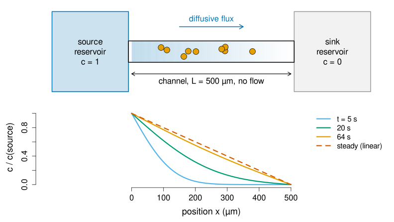
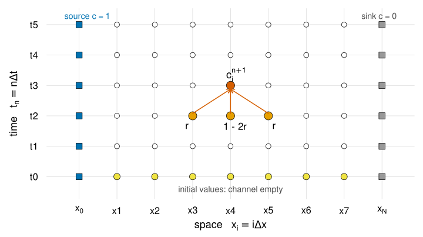
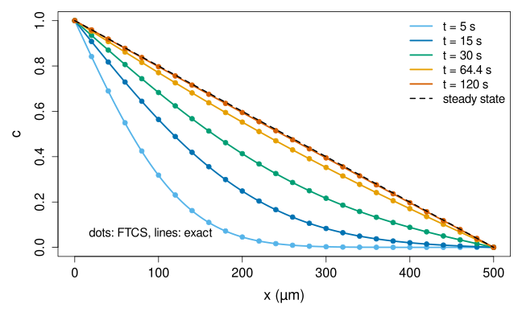
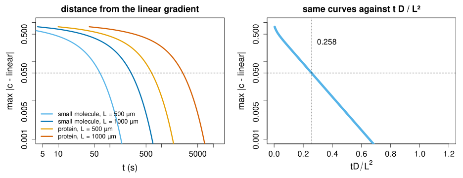
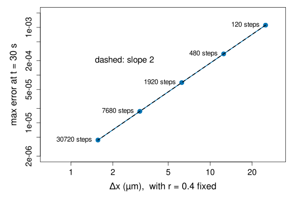
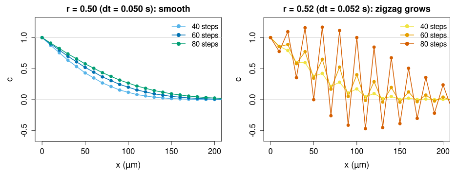
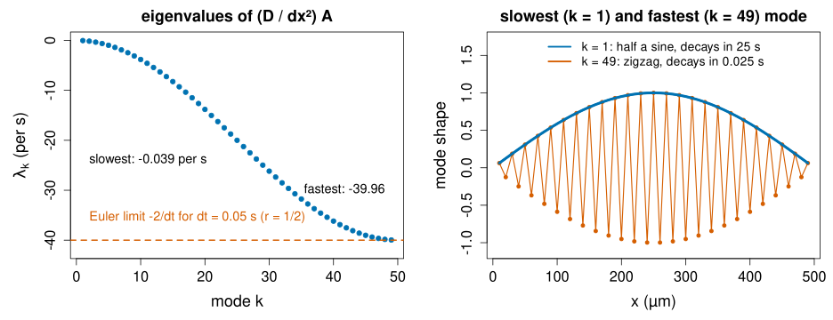
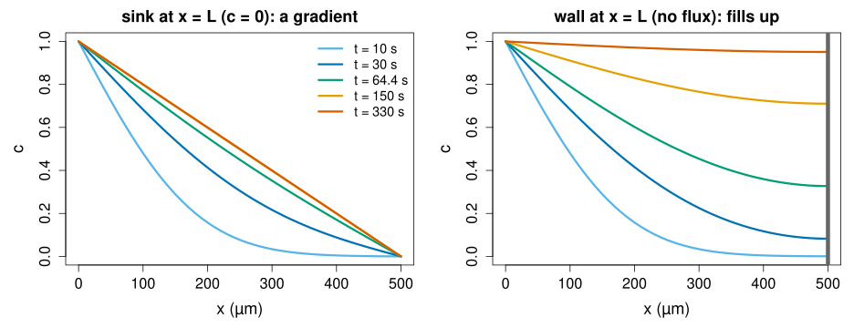

## About this lecture {.smaller}

So far every unknown was a number or a list of numbers that changed in **time**. Inside a microfluidic chip, a concentration also changes from place to place: it is a function of **space and time**, $c(x, t)$. Its model is a **partial differential equation** (PDE).

- **Fick's law** and a mass balance give the **diffusion equation** $\partial c/\partial t = D\,\partial^2 c/\partial x^2$. Heat conduction obeys the same equation.
- Put $x$ and $t$ on a **grid**: the $(1, -2, 1)/\Delta x^2$ stencil in space, an **Euler** step in time. This is the **FTCS** scheme, five lines of code.
- **Stability limit** $D\,\Delta t/\Delta x^2 \le 1/2$: break it and a zigzag explodes. It is Euler's $|1 - kh| \le 1$ again, with $k$ from the **eigenvalues** of the grid.
- **Boundary conditions**: fixed concentration (a reservoir) or no flux (a wall). They change the answer completely.
- Biology: a **chemotaxis chamber** between a source and a sink. How long until cells see a linear gradient? Why does doubling the channel length quadruple the wait?

::: notes
This opens Part 10, the first PDE of the course. Almost nothing here is new mathematics: the second-difference stencil comes from Numerical differentiation (Part 7), the time step is Euler's method from Initial value problems and Euler's method (Part 8), the stability analysis uses eigenvalues (Part 5) and the partial derivative was introduced in Newton for systems of equations (Part 2). The new thing is putting them together on a grid in space and time. Units 32 to 35 reuse the chamber and the grid set up today.
:::

## Biology: a flow-free chemotaxis chamber {.smaller}

{width="62%" fig-align="center"}

- A channel joins a **source** reservoir (chemoattractant) to a **sink** reservoir (plain medium). No flow, so the molecules move only by **diffusion** [G1, G3].
- At steady state the profile is a **straight line**: every cell in the channel sees the same gradient. How long until then?

::: notes
Diffusion-based gradient generators are one of the two families described in the reviews [G1] (Kim, Kim and Jeon 2010) and [G3] (Frontiers in Bioengineering and Biotechnology 2015); the other family uses flow, which we meet in Flow plus diffusion. The advantage of a flow-free chamber is that cells, especially non-adherent ones such as neutrophils, are not pushed by shear and secreted signals are not washed away. The price is time: one waits for diffusion to set up the gradient. Our version is simplified: a single straight channel, L = 500 µm, reservoirs large enough that their concentrations stay fixed. These numbers are typical values, not taken from one specific device; the reviews were only skimmed, so treat them as order-of-magnitude. The profiles at the bottom are computed with today's method. The orange dots are cells.
:::

## Recap: two tools you already have {.smaller}

:::: {.columns}
::: {.column width="50%"}
**Second difference** (*Numerical differentiation*):
$$\frac{u(x+h) - 2u(x) + u(x-h)}{h^2} = u''(x) + \tfrac{h^2}{12}u''''(x) + \dots$$

- Weights $(1, -2, 1)/h^2$, error $O(h^2)$.
- A straight line has second difference **0**.
:::
::: {.column width="50%"}
**Euler** (*Initial value problems and Euler's method*):
$$y_{n+1} = y_n + h\,f(t_n, y_n)$$

- On $y' = -ky$: each step multiplies by $1 - kh$.
- Stable only if $|1 - kh| \le 1$, i.e. $h \le 2/k$.
:::
::::

Today: the stencil handles **space**, Euler handles **time**, and the stability rule comes back with $k$ = the fastest rate on the grid.

::: notes
One slide only. Both results were derived and tested in their own units; students who skipped them should go back. In Numerical differentiation the variable was time t and the function was an OD growth curve; today the variable is position x and the function is a concentration profile. The stencil does not care. From the Euler unit, the key fact is the amplification factor 1 - kh for the decay equation, and the systems version from Stiffness and implicit methods: for y' = Jy the rule must hold for every eigenvalue of J.
:::

## A function of space and time

{width="100%"}

- $c(x, t)$: one number for each position **and** time. Hold $t$ fixed: a **profile** with slope $\partial c/\partial x$. Hold $x$ fixed: a **time course** with slope $\partial c/\partial t$.
- The curly $\partial$ means "the other variable held fixed", exactly as in *Newton for systems of equations*.

::: notes
Left: the concentration in the channel as a heat map, position across, time up; dark is high. The orange line is a slice at t = 30 s: the profile across the channel, whose slope at x = 100 µm is the partial derivative with respect to x (about -0.003 per µm: the gradient the cells feel). The red line is a slice at x = 100 µm: the concentration seen by one cell over time, whose slope is the partial derivative with respect to t. Nothing new beyond Newton for systems of equations, where partial derivatives were slopes of slices of F(u, v). A PDE is an equation that links these partial derivatives to each other.
:::

## Fick's law: flux goes downhill {.smaller}

Molecules spread from high to low concentration. The **flux** $J$ (amount crossing unit area per second) is proportional to the slope:

$$J = -D\,\frac{\partial c}{\partial x}$$

| molecule | $D$ in water (typical) | in µm²/s |
|---|---|---|
| small molecule (sugar, dye, fMLP) | $\approx 10^{-9}$ m²/s | 1000 |
| protein chemokine (≈ 10 kDa) | $\approx 10^{-10}$ m²/s | 100 |
| O₂ | $\approx 2\cdot10^{-9}$ m²/s | 2000 |

- Steady linear profile, source $c_0$, $L = 500$ µm: $J = D\,c_0/L = 1000/500 = 2\,c_0$ µm/s.
- Convert once: $1\ \text{m}^2/\text{s} = 10^{12}\ \mu\text{m}^2/\text{s}$. We work in **µm** and **s**.

::: notes
The minus sign says flux runs from high to low concentration. D has units of length squared per time. The values are the standard textbook orders of magnitude listed in the plan for this part; a specific chemokine such as IL-8 (about 8 kDa) is somewhere around 1e-10 m^2/s, and larger proteins (antibodies, 150 kDa) are nearer 4e-11. Do not quote these to two digits; the exercise uses D = 1000 and 100 µm^2/s as round numbers. Working in µm and seconds keeps numbers near 1: a 10 µm grid spacing and D = 1000 µm^2/s give D/dx^2 = 10 per second.
:::

## From Fick to the diffusion equation {.smaller}

Mass balance in a thin slice $[x, x + \Delta x]$: what flows in on the left minus what flows out on the right.

$$\frac{\partial c}{\partial t}\,\Delta x = J(x) - J(x + \Delta x) \;\;\Longrightarrow\;\; \frac{\partial c}{\partial t} = -\frac{\partial J}{\partial x} = D\,\frac{\partial^2 c}{\partial x^2}$$

- Rate in − rate out, as for every ODE model, now per slice.
- Concentration rises where the profile **curves upward** ($\partial^2 c/\partial x^2 > 0$) and falls where it bends down. A straight line does not change.
- **Heat** obeys the same equation: $\partial T/\partial t = \alpha\,\partial^2 T/\partial x^2$, thermal diffusivity $\alpha \approx 1.4\cdot10^{-7}$ m²/s for water. Hence "the heat equation".

::: notes
The derivation is the ODE principle from the Euler unit applied to each slice: rate in minus rate out. Divide by dx and let it shrink: the difference of the fluxes becomes a derivative. Substitute Fick's law (D constant) to get the second derivative. The curvature rule is the intuition to keep: a bump (curving down at the top) flattens, a dip fills in, a straight line stays. That is why the steady state between two reservoirs is a straight line. The heat equation is the same equation with temperature for concentration; Implicit schemes and the method of lines uses it for a Drosophila embryo held between two temperatures.
:::

## A PDE needs initial and boundary conditions {.smaller}

$$\frac{\partial c}{\partial t} = D\,\frac{\partial^2 c}{\partial x^2}, \quad 0 < x < L,\ t > 0$$

- **Initial condition**: the channel is empty, $c(x, 0) = 0$.
- **Boundary conditions**, one at each end:
  - **Dirichlet** (fixed value): a large reservoir holds the concentration. Source $c(0, t) = 1$, sink $c(L, t) = 0$.
  - **No flux** (Neumann): a wall, nothing crosses. $J = 0$, so $\partial c/\partial x = 0$ at the wall.
- Steady state with two reservoirs: $\partial^2 c/\partial x^2 = 0$, so $c = 1 - x/L$. With a wall at $x = L$ instead: $c = 1$ everywhere, **no gradient at all**.

::: notes
An ODE needed one start value. A PDE needs a whole start profile (initial condition) and, for all time, something at each end of the domain (boundary conditions). Concentrations are scaled by the source concentration, so c runs from 0 to 1. The two boundary types are the two physical situations at the end of a channel: open to a reservoir, or closed by a wall. The last bullet is the whole reason a chemotaxis chamber has a sink: without it, the attractant fills the channel and the gradient disappears. We simulate both cases later.
:::

## The diffusion time scale $L^2/D$ {.smaller}

The only time you can make from a length $L$ and $D$ is $L^2/D$:

| | $L = 500$ µm | $L = 1$ mm |
|---|---|---|
| small molecule, $D = 1000$ µm²/s | 250 s | 1000 s |
| protein, $D = 100$ µm²/s | 2500 s (42 min) | 10 000 s (2.8 h) |

- **Doubling $L$ quadruples the time**; a ten times smaller $D$ means ten times longer.
- Random-walk view: after time $t$ a molecule has moved about $\sqrt{2Dt}$. Over 10 µm (a cell): 0.05 s. Over 1 mm: minutes to hours.
- So far this is a guess at the **scale**. The simulation will give the factor in front.

::: notes
Dimensional analysis: D is in µm^2/s, so L^2/D is in seconds, and any time the equation produces must be a multiple of it. The square is the point: diffusion is fast over short distances and slow over long ones, which is why cells do not need pumps internally but organisms need blood vessels. For chamber design it means that halving the channel length gives a gradient four times sooner, but also a four times steeper one with the same reservoirs. The protein numbers explain why diffusion chambers are pre-equilibrated for tens of minutes to hours before imaging.
:::

## Space and time on a grid

{width="62%" fig-align="center"}

- Grid points $x_i = i\,\Delta x$ ($i = 0, \dots, N$) and times $t_n = n\,\Delta t$. Unknowns $c_i^n \approx c(x_i, t_n)$.
- Blue/grey squares: boundary values (given). Yellow: initial values (given). White: to compute.

::: notes
Superscript n is the time level, subscript i the position; the superscript is a label, not a power. For our chamber N = 50 intervals of dx = 10 µm, so 51 points, of which 49 interior unknowns. The edges of the grid are known: the bottom row from the initial condition, the left and right columns from the boundary conditions. The scheme on the next two slides fills in the white points row by row, each from the row below: the red point from the three orange ones.
:::

## Step 1, space: the second difference {.smaller}

At each interior point replace $\partial^2 c/\partial x^2$ by the stencil:

$$\frac{d c_i}{dt} = \frac{D}{\Delta x^2}\,\bigl(c_{i-1} - 2c_i + c_{i+1}\bigr), \qquad i = 1, \dots, N-1$$

- One ODE per grid point: **49 coupled ODEs**, each linked to its two neighbours.
- In matrix form $\mathbf c' = \frac{D}{\Delta x^2}A\,\mathbf c + \mathbf b$, with $A$ **tridiagonal**: $-2$ on the diagonal, $1$ beside it. $\mathbf b$ holds the boundary values.
- Spatial error $\tfrac{\Delta x^2}{12}\,\partial^4 c/\partial x^4$: second order in $\Delta x$.

::: notes
This is the "method of lines": discretise space only, and you are left with a system of ODEs in time, one per grid line. Implicit schemes and the method of lines takes this literally and hands the system to an ODE solver from Part 8. Read the ODE as a compartment model: each grid cell exchanges with its neighbours at rate D/dx^2 = 10 per second. It is the same tridiagonal matrix as the morphogen in a row of cells in Structure: symmetric, banded, sparse, there with rate 1 per minute. The vector b has D/dx^2 times c_0 = 1 in its first entry (the source) and zeros elsewhere (the sink holds 0).
:::

## Step 2, time: one Euler step = FTCS {.smaller}

Euler on these ODEs with step $\Delta t$ gives **F**orward **T**ime, **C**entred **S**pace:

$$c_i^{n+1} = c_i^n + r\,\bigl(c_{i-1}^n - 2c_i^n + c_{i+1}^n\bigr), \qquad r = \frac{D\,\Delta t}{\Delta x^2}$$

By hand: $L = 500$ µm, $N = 4$ ($\Delta x = 125$ µm), $r = 0.25$; start $(1, 0, 0, 0, 0)$:

| $n$ | $c_0$ | $c_1$ | $c_2$ | $c_3$ | $c_4$ |
|---|---|---|---|---|---|
| 0 | 1 | 0 | 0 | 0 | 0 |
| 1 | 1 | $0 + 0.25(1 - 0 + 0) = 0.25$ | 0 | 0 | 0 |
| 2 | 1 | $0.25 + 0.25(1 - 0.5 + 0) = 0.375$ | $0.0625$ | 0 | 0 |

- **Explicit**: each new value comes straight from three old ones. Ends stay at 1 and 0. $\Delta t = 0.25 \cdot 125^2/1000 = 3.9$ s per step.

::: notes
r, the "mesh ratio", is the only number the scheme sees: it combines D, the time step and the grid spacing. Work the first row on the board. The attractant creeps one grid point per step: after n steps only the first n interior points are non-zero, the numerical version of "it takes time to diffuse". The steady state on this grid is 0.75, 0.5, 0.25: the straight line, which FTCS leaves unchanged because its second difference is zero. The exercise continues the table and repeats it with r = 0.5 and r = 1.
:::

## FTCS in R

```r
D <- 1000                        # µm^2/s  (1e-9 m^2/s)
L <- 500; N <- 50; dx <- L / N   # 51 points, 10 µm apart
x <- seq(0, L, by = dx)
r <- 0.4; dt <- r * dx^2 / D     # 0.04 s
ftcs <- function(c, r, nsteps) {
  i <- 2:(length(c) - 1)                       # interior points
  for (k in seq_len(nsteps))
    c[i] <- c[i] + r * (c[i - 1] - 2 * c[i] + c[i + 1])
  c
}
c60 <- ftcs(c(1, rep(0, N)), r, 60 / dt)       # 1500 steps to 60 s
round(c60[seq(1, 51, by = 10)], 3)             # x = 0, 100, ..., 500
# [1] 1.000 0.765 0.543 0.343 0.165 0.000
```

- **Vectorised** over space: `c[i - 1]`, `c[i]`, `c[i + 1]` are shifted copies. The loop over time stays.

::: notes
Point out the R detail that makes this correct: the whole right-hand side is evaluated with the old vector before anything is assigned, so every point is updated from time level n. A loop over i that overwrites c[i] in place would use the already-updated c[i - 1]: a different (and here not intended) method. In Rust or C you therefore keep a copy of the old level; the exercise shows it. The time loop cannot be vectorised: each level needs the previous one. Boundary values are simply never touched, which is how the Dirichlet conditions are imposed. After one minute the profile is already close to the line 1, 0.8, 0.6, 0.4, 0.2, 0.
:::

## The gradient forms

{width="62%" fig-align="center"}

- FTCS (dots) on top of the exact solution (lines). After about a minute the profile is close to the straight line.

::: notes
Each colour is one time. Early on the attractant has entered only the first 100 µm; the profile is curved, steepest at the source, and the cells at the far end see nothing. Over the next minute it straightens. The exact solution is a Fourier series (two slides on). The FTCS dots sit on the lines to the eye; the largest difference is 5e-4 at 10 s and falls from there.
:::

## When is the gradient established? {.smaller}

Criterion: the profile is within 5 % (of the source concentration) of the line $1 - x/L$.

```r
t_grad <- function(D, L, N = 50, r = 0.4) {
  dx <- L / N; dt <- r * dx^2 / D; x <- seq(0, L, by = dx)
  c <- c(1, rep(0, N)); n <- 0
  while (max(abs(c - (1 - x / L))) > 0.05) { c <- ftcs(c, r, 1); n <- n + 1 }
  c(D = D, L = L, steps = n, t = n * dt, L2_D = L^2 / D)
}
rbind(t_grad(1000, 500), t_grad(1000, 1000), t_grad(100, 500), t_grad(100, 1000))
#         D    L steps       t  L2_D
# [1,] 1000  500  1611   64.44   250
# [2,] 1000 1000  1611  257.76  1000
# [3,]  100  500  1611  644.40  2500
# [4,]  100 1000  1611 2577.60 10000
```

- Small molecule, 500 µm: **1 minute**. Protein chemokine, 1 mm: **43 minutes**. Doubling $L$: exactly ×4.

::: notes
The 5 % criterion is a choice; 1 % takes about 1.6 times longer (exercise). The striking line is the steps column: 1611 every time. With N and r fixed, all four runs do exactly the same arithmetic; only the meaning of one time step changes, dt = r dx^2 / D. The next slide says why. For the experimentalist: a protein gradient over a millimetre needs most of an hour, and cells that start migrating before then see a gradient that is still changing.
:::

## One simulation fits all chambers

{width="100%"}

- Plotted against $t\,D/L^2$ the four curves are **one curve**. The gradient is established at $t \approx 0.26\,L^2/D$.
- Rescale $\tilde x = x/L$, $\tilde t = tD/L^2$: the equation becomes $\partial c/\partial \tilde t = \partial^2 c/\partial \tilde x^2$, with no parameters left.

::: notes
This is nondimensionalisation. With x = L x~ and t = (L^2/D) t~, the chain rule gives dc/dt = (D/L^2) dc/dt~ and d2c/dx2 = (1/L^2) d2c/dx~2, and D and L cancel. So there is only one problem: the chamber of length 1 with D = 1. Every chamber and every molecule is a rescaled copy. Practical value: one simulation (or one exact solution) answers the design question for all of them, and the answer to "why does doubling L quadruple the wait?" is: because time only appears as t D / L^2. The factor 0.258 is what the L^2/D slide could not give.
:::

## Check against the exact solution {.smaller}

For this initial and boundary data there is a Fourier-series solution:

$$c(x, t) = 1 - \frac{x}{L} - \sum_{n=1}^{\infty} \frac{2}{n\pi}\,\sin\frac{n\pi x}{L}\;e^{-n^2\pi^2 D t/L^2}$$

:::: {.columns}
::: {.column width="50%"}
{width="100%"}
:::
::: {.column width="50%"}
- Halve $\Delta x$ with $r = 0.4$ fixed: the error falls **4×**. Slope 2.
- $\Delta t \propto \Delta x^2$, so the $O(\Delta t)$ of Euler and the $O(\Delta x^2)$ of the stencil shrink together.
- Each halving costs **8×** the work: 2× the points, 4× the steps.
:::
::::

::: notes
The series: a straight line (steady state) minus a sum of sine modes that each decay at their own rate n^2 pi^2 D / L^2. At t = 0 the sum reproduces 1 - x/L, so c = 0 inside. The slowest mode, n = 1, decays with time constant L^2/(pi^2 D) = 25.3 s for our chamber; that mode alone explains the factor 0.258: (2/pi) exp(-pi^2 t~) = 0.05 gives t~ = 0.258. The error plot is the order check of Part 8 in a new setting: error at t = 30 s against dx on log-log axes, slope 2. The step counts are printed under the points: 120 steps for dx = 25 µm, 30 720 steps for dx = 1.56 µm. The cost is what Implicit schemes and the method of lines attacks.
:::

## Failure: a slightly larger time step

{width="100%"}

- $r = 0.50$: smooth. $r = 0.52$ (4 % larger $\Delta t$): a **zigzag** starts at the steep front and grows. After 30 s values reach $\pm 4\cdot10^{15}$.
- Symptoms: values **outside** $[0, 1]$, sign alternating from point to point.

::: notes
The two runs differ only in dt: 0.050 s versus 0.052 s. At r = 0.52 the profile looks fine for the first 30 steps, then a point-to-point oscillation appears where the profile is steepest and grows by about 8 % per step. By 30 s (577 steps) the values are of order 1e15, by 60 s they overflow. The check is cheap and physical: diffusion can never create a concentration above the highest or below the lowest value present (maximum principle), so any value outside [0, 1] here is a numerical failure. Run this check in every diffusion simulation.
:::

## Why exactly 1/2: the zigzag by hand {.smaller}

Put a zigzag $c_i = \varepsilon\,(-1)^i$ into one FTCS step:

$$c_{i-1} - 2c_i + c_{i+1} = \varepsilon(-1)^i\,(-1 - 2 - 1) = -4\,c_i \;\;\Longrightarrow\;\; c_i^{n+1} = (1 - 4r)\,c_i^n$$

| $r$ | 0.25 | 0.4 | 0.5 | 0.52 | 0.6 |
|---|---|---|---|---|---|
| factor $1 - 4r$ | 0 | −0.6 | −1 | **−1.08** | **−1.4** |

- Stable only if $|1 - 4r| \le 1$, i.e. $\boxed{r = D\Delta t/\Delta x^2 \le 1/2}$, i.e. $\Delta t \le \Delta x^2/(2D)$.
- Same as Euler's $|1 - kh| \le 1$ with $k = 4D/\Delta x^2$: the **zigzag decays fastest**, and the step must resolve it.
- Another view: for $r \le 1/2$ the new value $(1 - 2r)c_i + r\,c_{i-1} + r\,c_{i+1}$ is an **average** with weights $\ge 0$, so it stays inside $[0, 1]$.

::: notes
The zigzag is the shortest wave the grid can hold (the Nyquist mode from Fourier series and the FFT). Its second difference is -4 times itself, the most negative possible, so it is the fastest-decaying mode of the true dynamics: rate 4D/dx^2 = 40 per second here, a lifetime of 0.025 s. Euler with step dt multiplies it by 1 - 40 dt, the drug clearance example with k = 40 per second. For r between 1/4 and 1/2 the factor is negative but smaller than 1 in size: the zigzag flips sign each step but decays, exactly like Euler with 1/k < h < 2/k. The averaging argument is the cleanest stability proof: weights 1 - 2r, r, r add to 1 and are non-negative only if r <= 1/2. With r = 1/2 the update is c_i = (c_{i-1} + c_{i+1})/2, the plain average of the neighbours.
:::

## The eigenvalue view {.smaller}

```r
n <- 49                                          # interior points
A <- diag(-2, n)
A[cbind(1:(n - 1), 2:n)] <- 1; A[cbind(2:n, 1:(n - 1))] <- 1
lam <- D / dx^2 * eigen(A, symmetric = TRUE)$values   # per second
range(lam)
# [1] -39.96053457  -0.03946543
2 / max(abs(lam))                                # Euler: dt <= 2 / |lambda|
# [1] 0.05004938
```

- Formula: eigenvalues of $A$ are $-4\sin^2\!\bigl(\tfrac{k\pi}{2N}\bigr)$, $k = 1, \dots, N - 1$. All negative, all real.
- Euler on $\mathbf c' = \frac{D}{\Delta x^2}A\mathbf c$ needs $\Delta t\,|\lambda| \le 2$ for **every** eigenvalue (Part 5, *Stiffness and implicit methods*). The largest, $\approx 4D/\Delta x^2$, gives $r \le 1/2$.

::: notes
This connects the zigzag argument to the general theory from Part 8: a linear ODE system decouples into one scalar equation per eigenvalue, and Euler must be stable on each. eigen() from How eigen() works, and big problems; the matrix is symmetric, so all eigenvalues are real. The formula can be checked against eigen() in the exercise. The largest magnitude is 4 sin^2(49 pi / 100) = 3.996, slightly less than 4, which is why the exact limit here is r <= 0.5005 rather than 0.5. Python: numpy.linalg.eigvalsh.
:::

## Slow modes, fast modes, and the cost {.smaller}

{width="88%" fig-align="center"}

- Slowest mode: half a sine, rate $\approx \pi^2D/L^2 = 0.039$ per s. **This is the biology** (25 s time constant).
- Fastest mode: the zigzag, 40 per s. It is gone in a few hundredths of a second, yet it **sets the step**. Ratio ≈ 1000: a **stiff** system.
- Refine to $\Delta x = 1$ µm: ratio ≈ 100 000 and $\Delta t \le 0.5$ ms. Fix: *Implicit schemes and the method of lines*.

::: notes
The eigenvectors are sine waves, the same modes as in the exact Fourier series: the grid has a discrete version of each. The slowest one carries the physics (how fast the gradient settles); the fastest ones are grid artefacts that a sensible method should simply damp. This is exactly the definition of stiffness from Stiffness and implicit methods: the step is set by stability, not by accuracy. The ratio of fastest to slowest rate grows like (2N/pi)^2, so it gets worse with every refinement. The next unit uses backward Euler and Crank–Nicolson, with one tridiagonal (Thomas) solve per step, and no step limit.
:::

## No-flux boundary: the ghost point {.smaller}

A wall at $x_N = L$: $\partial c/\partial x = 0$. Invent a **ghost point** $c_{N+1}$ outside and set $c_{N+1} = c_{N-1}$ (central difference of the slope $= 0$). The FTCS update at the wall becomes

$$c_N^{n+1} = c_N^n + r\,\bigl(c_{N-1}^n - 2c_N^n + c_{N+1}^n\bigr) = c_N^n + 2r\,\bigl(c_{N-1}^n - c_N^n\bigr).$$

```r
ftcs_closed <- function(c, r, nsteps) {         # wall at x = L
  n <- length(c); i <- 2:(n - 1)
  for (k in seq_len(nsteps)) {
    cn <- c[n] + 2 * r * (c[n - 1] - c[n])       # uses old values
    c[i] <- c[i] + r * (c[i - 1] - 2 * c[i] + c[i + 1])
    c[n] <- cn
  }
  c
}
```

::: notes
The wall point is now an unknown, not a given value. The ghost point is a device to reuse the central stencil at the boundary; it keeps the boundary condition second-order accurate. The simpler choice c_N = c_{N-1} also says "zero slope", but only to first order. Note the order of operations: the new wall value is computed from old values before the interior update overwrites c[n - 1]. The stability limit is unchanged (r <= 1/2; the weights 1 - 2r and 2r are still non-negative).
:::

## Sink or wall: a gradient or none

{width="100%"}

- Sink at $x = L$: the straight line after ~1 minute, kept for as long as the reservoirs last.
- Wall at $x = L$ (a dead-end channel): the attractant **piles up** and the channel fills to $c = 1$. The far end reaches 0.95 only after **328 s**, 5× longer, and then there is no gradient.

::: notes
Same channel, same molecule, only the right boundary condition differs. With the wall, the slowest mode is a quarter sine instead of a half sine, with rate pi^2 D / (4 L^2): four times slower, as if the channel were twice as long (the wall acts as a mirror). Two practical points. First, a dead-end side channel in a device is not a gradient generator: any gradient in it is transient. Second, real reservoirs are finite, so in real diffusion chambers source and sink slowly equilibrate and the gradient decays over hours to days; the reviews [G1, G3] list this as a limitation of flow-free devices (stated cautiously: we skimmed them). Our model with fixed boundary values assumes reservoirs that are much larger than the channel.
:::

## Before you trust a diffusion simulation {.smaller}

- **Stability**: compute $r = D\Delta t/\Delta x^2$ before running. FTCS needs $r \le 1/2$, for **every** species (the fastest $D$ decides).
- **Maximum principle**: no value above the largest or below the smallest boundary/initial value. Zigzags or negative concentrations mean $r$ is too large or there is a bug.
- **Steady state**: the run should settle to the solution of $D\,\partial^2 c/\partial x^2 = 0$ (a line between two reservoirs).
- **Conservation**: with walls at both ends the total amount must stay constant (exercise).
- **Grid refinement**: halve $\Delta x$ (and quarter $\Delta t$). Changes should shrink about 4× per halving.
- **Units**: D in µm²/s with x in µm; $10^{-9}$ m²/s is 1000 µm²/s, not 1000 m²/s.

::: notes
The six checks of this unit. The second and fourth are physical invariants and need no exact solution; the fifth is the step-halving check of Part 8 in two variables. A unit error in D (m^2/s used with a grid in µm) changes r by 1e12 and blows up at once; the reverse mistake gives a simulation in which nothing seems to happen. When a model has several species, for example a small drug and a protein, the small one with the larger D sets the time step for all.
:::

## Summary {.smaller}

- A concentration in a channel is a function of **space and time**, $c(x, t)$. Fick's law $J = -D\,\partial c/\partial x$ plus a mass balance gives the **diffusion (heat) equation** $\partial c/\partial t = D\,\partial^2 c/\partial x^2$.
- It needs an **initial profile** and a **boundary condition** at each end: fixed value (reservoir) or **no flux** (wall, ghost point).
- **FTCS**: $(1, -2, 1)$ stencil in space, Euler in time: $c_i^{n+1} = c_i^n + r(c_{i-1}^n - 2c_i^n + c_{i+1}^n)$, $r = D\Delta t/\Delta x^2$. Error $O(\Delta x^2)$ with $r$ fixed.
- **Stable only for $r \le 1/2$**: the zigzag mode has the largest eigenvalue $\approx 4D/\Delta x^2$; Euler's $|1 - kh| \le 1$ again. Violated: an exploding zigzag; check that values stay within bounds.
- **Time scale $L^2/D$**: a linear gradient takes $\approx 0.26\,L^2/D$: 1 minute for a small molecule over 500 µm, 43 minutes for a protein over 1 mm. Doubling $L$ quadruples the wait. Without a sink there is no lasting gradient.

**Next:** *Implicit schemes and the method of lines*: no step limit, one tridiagonal solve per step.

::: notes
Recap the modelling step, the scheme, its accuracy, its failure and the checks. The step limit dt <= dx^2 / (2D) is the price of an explicit method: fine resolution is paid for twice. The next unit removes the limit with implicit time stepping, using the Thomas algorithm from Structure: symmetric, banded, sparse, and hands the method-of-lines system to the stiff solvers of Part 8. Steady state in two dimensions takes the chamber to 2D, Flow plus diffusion adds flow, Reaction–diffusion and pattern formation adds uptake and production.
:::
