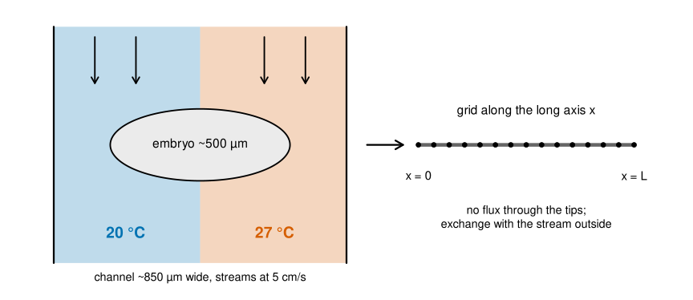
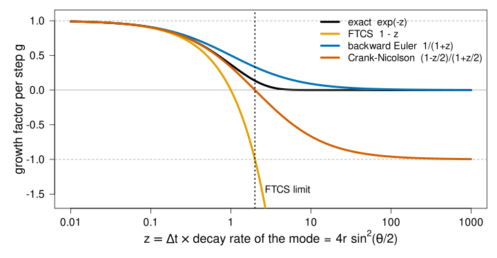
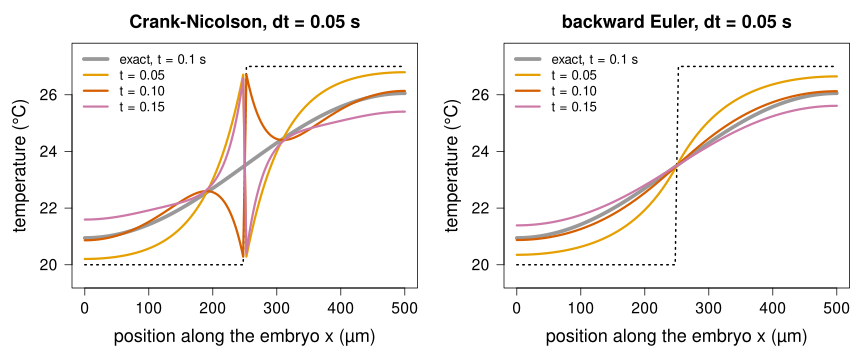
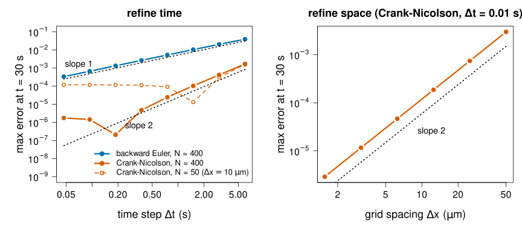
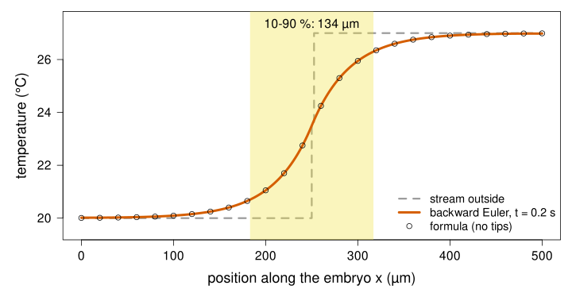
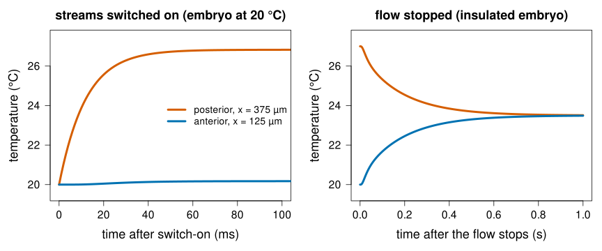

## About this lecture {.smaller}

FTCS is simple, but its time step must shrink with the **square** of the grid spacing. On a fine grid that means millions of steps for a few seconds of biology. Implicit schemes remove the limit.

- **Backward Euler** and **Crank–Nicolson** for the diffusion equation: one **tridiagonal solve** per step, $O(N)$ work with the Thomas algorithm.
- Stable for **every** $\Delta t$. But Crank–Nicolson **oscillates** when the data are sharp and the step is large.
- **Accuracy**: $O(\Delta t)$ (backward Euler) or $O(\Delta t^2)$ (Crank–Nicolson) in time, $O(\Delta x^2)$ in space. Verify with an **exact solution** and with **grid refinement**.
- **Method of lines**: the grid turns the PDE into a large, stiff ODE system; give it to `lsoda` or `bdf`.
- Biology: a *Drosophila* embryo held between a **cold and a warm stream** [M1, M2]. How sharp is the temperature step inside it?

::: notes
Second unit of Part 11. Everything here is assembled from earlier parts: the chamber, the grid and FTCS from [*The diffusion (heat) equation by finite differences*](../diffusion-explicit/lec.qmd); the Thomas algorithm from [*Structure: symmetric, banded, sparse*](../structured-sparse/lec.qmd); backward Euler, stiffness and BDF from [*Stiffness and implicit methods*](../stiffness/lec.qmd). The new things are Crank–Nicolson, the separation of time and space errors, and the habit of verifying a PDE solver before believing it. The biology switches from concentration to temperature: same equation, different D.
:::

## A biology problem first {.smaller}

{width="80%" fig-align="center"}

- Two laminar streams, 20 °C and 27 °C, flow past a live embryo, one on each half [M1]. The warm half develops faster: *even-skipped* stripes appear out of order.
- Heat crosses 500 µm of water in about a second, so why does the embryo not just settle at the average? **How sharp is the step inside it?**

::: notes
[M1] Lucchetta, Lee, Fu, Patel and Ismagilov (2005), Nature 434: 1134–1138. [M2] Lucchetta, Munson and Ismagilov (2006), Lab on a Chip 6: 185–190, characterised the same device. Numbers from [M2]: channel 850 µm wide, embryo about 500 × 200 × 200 µm, inlet temperatures 20 and 27 °C, mean flow 5 cm/s. [M2] also estimates the time for heat to cross the embryo, x^2 / (2 D), as about 0.9 s for cytoplasm approximated by water, and solved the full 3D flow and heat problem with a commercial finite-element package; their simulated profile inside the embryo is step-like. We build a much cruder 1D model of our own. Its numbers are ours, not the paper's.
:::

## Explicit is too slow here {.smaller}

Heat obeys the diffusion equation $\partial T/\partial t = D\,\partial^2 T/\partial x^2$, with $D$ the **thermal diffusivity**; water: $D \approx 1.4\times10^{-7}$ m²/s $= 1.4\times10^{5}$ µm²/s, 140 times a small molecule.

```r
D  <- 1.4e-7 * 1e12             # µm^2/s
L  <- 500; N <- 200; dx <- L / N # embryo, 2.5 µm grid
dx^2 / (2 * D)                  # FTCS limit on dt (s)
# [1] 2.232143e-05
L^2 / D                         # time scale L^2/D (s)
# [1] 1.785714
(L^2 / D) / (dx^2 / (2 * D))    # FTCS steps to cover it
# [1] 80000
```

- 22 µs steps for a process that takes a second; halve $\Delta x$ and it is **4 ×** as many steps.

::: notes
The thermal diffusivity is k / (rho c_p): conductivity 0.6 W/(m K), density 1000 kg/m^3, heat capacity 4180 J/(kg K) give 1.4e-7 m^2/s, the value [M2] uses for water. Heat diffuses about 100 times faster than a small molecule, which is why temperature steps are hard to keep sharp on a chip. 2.5 µm is not an extravagant grid: the transition we look for turns out to be about 130 µm wide, and we want 50 points across it. The FTCS limit r <= 1/2 is from the previous unit. The number of steps grows like N^2 for a fixed simulated time: 80 000 here, 320 000 at 1.25 µm. In 2D ([*Steady state in two dimensions*](../steady-state-2d/lec.qmd)) the limit is even stricter.
:::

## Recap: FTCS and its limit {.smaller}

On the chamber of [*The diffusion (heat) equation by finite differences*](../diffusion-explicit/lec.qmd), with $r = D\,\Delta t/\Delta x^2$:

$$c_i^{n+1} = c_i^n + r\,\bigl(c_{i-1}^n - 2c_i^n + c_{i+1}^n\bigr) \qquad\Longleftrightarrow\qquad \mathbf c^{n+1} = (I + rA)\,\mathbf c^n + \dots$$

- $A$ is tridiagonal ($1, -2, 1$). Its eigenvalues run from $\approx -\pi^2\Delta x^2/L^2$ (slow, the biology) to $\approx -4$ (the zigzag).
- Each FTCS step multiplies a mode by $1 - 4r\sin^2(\theta/2)$. For the zigzag that is $1 - 4r$: **stable only if $r \le 1/2$**.
- The zigzag is gone in milliseconds, but it sets the step: the system is **stiff**.

::: notes
One slide only: everything here was derived in the previous unit (L = 500 µm, D = 1000 µm^2/s, N = 50, dx = 10 µm, source c = 1 at x = 0, sink c = 0 at x = L). The grid is also the same: nodes x_i = i dx, i = 0..N, the boundary values sit on the two end nodes and the N - 1 interior nodes are the unknowns; units µm and s. theta is the wavenumber of the mode times dx, from 0 (smooth) to pi (zigzag). The dots stand for the boundary values, which enter the first and last equations. The stiffness argument is the one from [*Stiffness and implicit methods*](../stiffness/lec.qmd): the explicit step is set by the fastest mode, which we do not care about, rather than by the slow one we do care about. The remedy there was backward Euler.
:::

## Backward Euler for diffusion {.smaller}

Take the second difference at the **new** time level:

$$c_i^{n+1} = c_i^n + r\,\bigl(c_{i-1}^{n+1} - 2c_i^{n+1} + c_{i+1}^{n+1}\bigr)$$

Collect the unknowns on the left:

$$-r\,c_{i-1}^{n+1} + (1 + 2r)\,c_i^{n+1} - r\,c_{i+1}^{n+1} = c_i^n \qquad\Longleftrightarrow\qquad (I - rA)\,\mathbf c^{n+1} = \mathbf c^n + \mathbf b$$

- Every step is a **linear system**. The matrix is **tridiagonal**, diagonally dominant, the same every step.
- $\mathbf b$: the boundary values, $r\,c_0$ in the first row and $r\,c_N$ in the last.
- Linear problem, so no Newton iteration (unlike the enzyme in [*Stiffness and implicit methods*](../stiffness/lec.qmd)).

::: notes
This is backward Euler from Stiffness and implicit methods applied to the ODE system c' = (D / dx^2) A c + boundary terms: y_{n+1} = y_n + h f(y_{n+1}), and f is linear, so the "Newton solve" is a single linear solve with matrix I - h J = I - r A. Diagonal dominance: 1 + 2r > r + r, so Thomas needs no pivoting ([*Structure: symmetric, banded, sparse*](../structured-sparse/lec.qmd)). The matrix is also symmetric positive definite. Because it does not change from step to step, one could even factorise it once and reuse the factors; with Thomas the factorisation costs as much as the solve, so we simply call it every step.
:::

## Backward Euler by hand {.smaller}

The chamber with $N = 4$ ($\Delta x = 125$ µm), empty at $t = 0$, source $c_0 = 1$, sink $c_4 = 0$. One step with $r = 1$ ($\Delta t = 15.6$ s):

$$\begin{pmatrix} 3 & -1 & 0 \\ -1 & 3 & -1 \\ 0 & -1 & 3 \end{pmatrix}\begin{pmatrix} c_1 \\ c_2 \\ c_3 \end{pmatrix} = \begin{pmatrix} 0 + 1\cdot 1 \\ 0 \\ 0 \end{pmatrix} \quad\Rightarrow\quad \mathbf c^1 = \tfrac{1}{21}(8, 3, 1) = (0.381, 0.143, 0.048)$$

| | $c_1$ | $c_2$ | $c_3$ |
|---|---|---|---|
| exact, $t = 15.6$ s | 0.480 | 0.157 | 0.034 |
| backward Euler, $r = 1$ | 0.381 | 0.143 | 0.048 |
| FTCS, $r = 1$ | **1.000** | 0 | 0 |

- One implicit step reaches **all** points at once and stays between 0 and 1. FTCS overshoots to the source value and would then explode.

::: notes
Thomas by hand (as in [*Structure: symmetric, banded, sparse*](../structured-sparse/lec.qmd)): w = -1/3, b2 = 3 - 1/3 = 8/3, d2 = 1/3; w = -3/8, b3 = 3 - 3/8 = 21/8, d3 = 1/8; back substitution c3 = (1/8) / (21/8) = 1/21, c2 = (1/3 + 1/21) / (8/3) = 1/7 = 3/21, c1 = (1 + 3/21) / 3 = 8/21. The exact values come from the Fourier series of the previous unit. Backward Euler is not accurate with a single 15.6 s step (it smears too much near the source and lets too much reach the sink), but it has the right shape. FTCS at r = 1 is outside its limit: the attractant only reaches the first point, and that point already holds the source value. The exercise does one more step by hand.
:::

## One tridiagonal solve per step

```r
be_step <- function(c, r) {           # c includes the two boundary values
  m <- length(c) - 2; i <- 2:(m + 1)  # m interior unknowns
  d <- c[i]
  d[1] <- d[1] + r * c[1]             # source enters the first row
  d[m] <- d[m] + r * c[m + 2]         # sink enters the last row
  c[i] <- thomas(rep(-r, m), rep(1 + 2 * r, m), rep(-r, m), d)
  c
}
```

- `thomas(a, b, c, d)` from [*Structure: symmetric, banded, sparse*](../structured-sparse/lec.qmd): sub-diagonal, diagonal, super-diagonal, right-hand side. About $8N$ operations.
- So one implicit step costs a few times an explicit step, **not** $N^3$. Never build a dense $N\times N$ matrix and call `solve()`.

::: notes
The convention is the one from the structured-sparse unit: all four vectors have length m, a[1] and c[m] are not used, so rep(-r, m) is fine for both off-diagonals. The boundary values stay in c[1] and c[m + 2] and are never changed, exactly as in the ftcs function of the previous unit. With a dense matrix the solve costs about (2/3) m^3: for m = 199 that is 5 million operations per step instead of 1600. Python users: scipy.linalg.solve_banded does the same job; the exercise shows it. Rust: we write Thomas by hand.
:::

## Fifteen steps instead of 1500 {.smaller}

The chamber ($N = 50$, $\Delta x = 10$ µm), empty at $t = 0$, to $t = 60$ s:

```r
r <- D * 4 / dx^2                       # dt = 4 s: r = 40, FTCS needs r <= 0.5
c <- c(1, rep(0, N))
for (k in 1:15) c <- be_step(c, r)
round(c[c(6, 11, 26, 41)], 4)           # x = 50, 100, 250, 400 µm
# [1] 0.8781 0.7583 0.4294 0.1587
round(exact(x[c(6, 11, 26, 41)], 60, L, D), 4)
# [1] 0.8816 0.7650 0.4404 0.1650
```

- FTCS ($r = 0.4$, 1500 steps) agrees with the exact values to 4 digits. Backward Euler with 15 steps is off by about 0.01.
- **Stable** is not **accurate**. The error is now the **time** error of a 4 s step: order 1.

::: notes
Here D = 1000 µm^2/s, L = 500, N = 50, x and exact() are from the previous unit (exact is the Fourier series). With r = 40 FTCS would blow up in a few steps; backward Euler gives a smooth, bounded and slightly too slow profile (backward Euler decays every mode a little too slowly, so the filling front lags). The 1500 FTCS steps are cheaper per step, but backward Euler wins on total work only if the accuracy we need allows large steps. For this chamber, with the gradient forming over a minute, a 1 s step (60 steps) would give about 0.003; we come back to how to choose dt after Crank–Nicolson.
:::

## Stable for every time step

{width="78%" fig-align="center"}

- Per step a mode is multiplied by: FTCS $1 - z$, backward Euler $\frac{1}{1 + z}$, with $z = 4r\sin^2(\theta/2) \ge 0$.
- Backward Euler: $0 < g < 1$ for **every** $z$: unconditionally stable, and fast modes are **killed** ($g \to 0$).

::: notes
z is dt times the decay rate of the mode; the exact solution multiplies the mode by e^{-z} per step (black). For small z (smooth modes, small steps) all methods agree with the exact factor. FTCS leaves the band [-1, 1] at z = 2, i.e. r = 1/2 for the zigzag. Backward Euler never does: this is the A-stability of [*Stiffness and implicit methods*](../stiffness/lec.qmd) on the negative real axis. It damps the fast modes even more strongly than the exact solution would in the limit (both go to 0). The red curve is Crank–Nicolson, the next slide; note where it ends up for large z.
:::

## Crank–Nicolson {.smaller}

Average the second difference over the old and the new level (the **trapezoidal rule** in time):

$$c_i^{n+1} = c_i^n + \tfrac{r}{2}\bigl(c_{i-1}^{n} - 2c_i^{n} + c_{i+1}^{n}\bigr) + \tfrac{r}{2}\bigl(c_{i-1}^{n+1} - 2c_i^{n+1} + c_{i+1}^{n+1}\bigr)$$

```r
cn_step <- function(c, r) {
  m <- length(c) - 2; i <- 2:(m + 1)
  d <- c[i] + r / 2 * (c[i - 1] - 2 * c[i] + c[i + 1])   # explicit half
  d[1] <- d[1] + r / 2 * c[1]; d[m] <- d[m] + r / 2 * c[m + 2]
  c[i] <- thomas(rep(-r / 2, m), rep(1 + r, m), rep(-r / 2, m), d)
  c
}
```

- Same cost as backward Euler: one tridiagonal solve. Growth factor $g = \frac{1 - z/2}{1 + z/2}$: $|g| \le 1$ for every $z$, and **second order** in time.

::: notes
Crank and Nicolson (1947) introduced it for heat conduction. Centred in time around t_{n+1/2}, which is why it is second order: the time error of backward Euler cancels between the two halves, like the trapezoidal rule against the rectangle rule in [*Numerical integration*](../quadrature/lec.qmd). It is A-stable too: |g| <= 1 for every z >= 0. But look at fig02 again: for large z, g tends to -1, not to 0. That is the catch on the next slide.
:::

## Crank–Nicolson fails on sharp data

{width="100%"}

"Stop the flow": the embryo starts with a sharp 20/27 °C step, no heat exchange, $\Delta t = 0.05$ s ($r = 1120$). Crank–Nicolson **flips** the step every time step; backward Euler is smooth and close to the exact curve.

::: notes
A thought experiment on the embryo grid (N = 200, dx = 2.5 µm, insulated tips): at t = 0 the anterior half is at 20 °C and the posterior at 27 °C, and from then on heat only redistributes inside. The exact solution (grey, a cosine series) is a smooth S-curve after 0.1 s. Crank–Nicolson with the same step as backward Euler gets the smooth part roughly right, but the sharp part of the initial step (made of high-frequency modes) survives with factor close to -1: after one step the jump points the wrong way, after two the right way, and so on. It decays only slowly. Note that the values stay between 20 and 27, so a simple range check does not catch it here.
:::

## Why, and what to do {.smaller}

- High modes ($z \gg 1$) get $g = \frac{1 - z/2}{1 + z/2} \approx -1 + \frac{4}{z}$: they are **not damped**, only flipped. Sharp data (a step, an empty channel next to a full reservoir) is made of exactly these modes.
- Chamber, empty at $t = 0$, 15 CN steps of 4 s: $c$ at $x = 10$ µm is **1.1775**, above the source value 1.

| fix | chamber, $c(10\text{ µm}, 60\text{ s})$ (exact 0.9763) |
|---|---|
| plain CN, $\Delta t = 4$ s | 1.1775 |
| 4 backward Euler steps of 1 s, then CN | 0.9762 |
| CN with $\Delta t = 0.4$ s ($r = 4$) | 0.9763 |

- **Check**: values outside the initial/boundary range; changes that alternate in sign from step to step; disagreement with backward Euler.

::: notes
The fix in row 2 is known as Rannacher time-stepping: a few strongly damping backward Euler steps at the start (and after any sudden change of a boundary value) remove the sharp high modes; after that CN's second-order accuracy takes over. Row 3: with r = 4 the zigzag has z = 16, g = -0.78, which still flips but now dies within a few steps. A safe rule of thumb for CN with sharp data is to keep r of order 1 near the start. Backward Euler never oscillates (g between 0 and 1), which is why stiff ODE solvers start with BDF1 and why the method of lines solvers later in this lecture handle sharp starts well. The maximum principle check from the previous unit catches the chamber case but not the embryo case of the previous slide.
:::

## Accuracy in time and space {.smaller}

The error at a fixed time has **two** parts:

$$\text{error} \approx C_t\,\Delta t^{\,p} + C_x\,\Delta x^2, \qquad p = 1 \text{ (backward Euler)},\quad p = 2 \text{ (Crank–Nicolson)}$$

| scheme | time | space | stable for |
|---|---|---|---|
| FTCS | $O(\Delta t)$ | $O(\Delta x^2)$ | $r \le 1/2$ |
| backward Euler | $O(\Delta t)$ | $O(\Delta x^2)$ | all $\Delta t$ |
| Crank–Nicolson | $O(\Delta t^2)$ | $O(\Delta x^2)$ | all $\Delta t$ (oscillates if $r \gg 1$) |

- Refining only one of them hits a **floor** set by the other.
- Balance: backward Euler needs $\Delta t \sim \Delta x^2$ for equal errors (the FTCS step size again!); Crank–Nicolson only $\Delta t \sim \Delta x$.

::: notes
The space error comes from the (1, -2, 1) stencil, the same for all three schemes. FTCS at its stability limit has dt proportional to dx^2 automatically, so its time error is of the same order as its space error; that is why the previous unit could refine with r fixed and see order 2. For backward Euler, a large step buys stability but the time error then dominates: to make it as small as the space error you are pushed back to dt ~ dx^2, but now with a free choice of the constant. Crank–Nicolson is the scheme that actually lets you take large steps and stay accurate, as long as the data are smooth. That is why it is the textbook default for diffusion.
:::

## Verify against an exact solution {.smaller}

Both reservoirs at 0, start with one sine: $c(x, 0) = \sin(\pi x/L)$. The exact solution keeps its shape and decays: $c = e^{-D(\pi/L)^2 t}\sin(\pi x/L)$.

```r
sine_err <- function(N, dt, step, tend = 30) {
  dx <- L / N; x <- seq(0, L, by = dx); c <- sin(pi * x / L)
  for (k in 1:round(tend / dt)) c <- step(c, D * dt / dx^2)
  max(abs(c - exp(-D * (pi / L)^2 * tend) * sin(pi * x / L)))
}
dts <- c(6, 3, 1.5, 0.75)                   # halve dt, fine grid N = 400
e <- rbind(be = sapply(dts, function(h) sine_err(400, h, be_step)),
           cn = sapply(dts, function(h) sine_err(400, h, cn_step)))
round(e[, -4] / e[, -1], 2)                 # error ratio per halving
#    [,1] [,2] [,3]
# be 1.92 1.96 1.98
# cn 4.03 4.06 4.23
```

- Halving $\Delta t$ halves the backward Euler error (order 1) and quarters the Crank–Nicolson error (order 2).

::: notes
Any single Fourier mode is an exact solution of the diffusion equation with zero boundary values, with decay rate D k^2, k = pi / L. Here 1/(D k^2) = 25 s, and at t = 30 s the amplitude is 0.306. The fine grid (dx = 1.25 µm) keeps the space error small (about 1e-6) so that the time error dominates. The errors themselves: backward Euler 0.040, 0.021, 0.010, 0.0053; Crank–Nicolson 1.7e-3, 4.2e-4, 1.0e-4, 2.5e-5. The last CN ratio (4.23) is already drifting because the time error approaches the space-error floor. Why test on such a simple problem? Because it is exact, and a bug in the boundary rows or a factor 2 in r shows up at once as a wrong order.
:::

## Error against step size

{width="100%"}

- Left: slopes 1 and 2, then a **floor** at the space error (open circles: $\Delta x = 10$ µm). The dip: time and space errors of opposite sign **cancel** by luck.
- Right: refine space with a tiny $\Delta t$: slope 2.

::: notes
Read the order off the slope, as in [*Convergence and cost*](../convergence-cost/lec.qmd). The open circles are Crank–Nicolson on the chamber's own grid, N = 50: below dt of about 1 s the error stops at 1.2e-4, the space error of the 10 µm grid. The dip at dt = 1.5 s is a warning: Crank–Nicolson decays the sine slightly too fast, the grid slightly too slowly, and at one particular dt the two cancel. A single run at that dt would look ten times more accurate than it is. Only a sequence of runs (refinement) shows the true behaviour. The right panel uses CN with dt = 0.01 s so that the time error is negligible.
:::

## Try it: one time step, three schemes

```{=html}
<link rel="stylesheet" href="../demos/dist/demo.css">
<div data-demo="implicit" data-tab="race" data-ic="step" data-r="0.4"></div>
<script src="../demos/dist/implicit.js"></script>
```

::: notes
The chamber (N = 50, dx = 10 µm), computed live with FTCS (orange), backward Euler (blue) and Crank–Nicolson (red), all with the same r = D dt / dx^2. Left: the profiles at time t; right: the error at the reference time against dt for all three, with slope-1 and slope-2 guides and the shaded region where FTCS is unstable. Start on the sharp start at r = 0.4: all three agree with the exact curve, FTCS error 8e-5 with 1500 steps. Click 0.6: FTCS overflows, the other two do not notice. Click 40 and press play: FTCS is gone in a few steps, backward Euler is smooth but lags (error 0.011 at 60 s, 15 steps), Crank–Nicolson overshoots the source at the first grid point (1.1775) and flips back and forth. Click 4 and 10: Crank–Nicolson with 60 to 150 steps beats FTCS with 1200; read the cost line. Then switch to the smooth sine: backward Euler on slope 1, Crank–Nicolson on slope 2 until it hits the space-error floor at 1.2e-4, the same picture as the previous slide, now with a marker you can move. The Embryo tab (later slides) runs the embryo model; the flow-stopped case with dt = 50 ms reproduces the Crank–Nicolson figure.
:::

## Grid refinement without an exact solution {.smaller}

For the real problem there is no formula. Refine and watch the **differences** shrink:

```r
T200 <- sapply(c(25, 50, 100, 200, 400), embryo_steady)   # T at x = 200 µm
T200
# [1] 21.03408 21.05464 21.05237 21.05180 21.05166
d <- diff(T200)
round(d[-4] / d[-1], 2)            # should approach 2^p = 4
# [1] -9.05  3.98  4.00
```

- Ratio 4 per halving: order 2, as designed. The answer is $21.0517 \pm 0.0002$ °C.
- The first ratio is **not** 4: $\Delta x = 20$ µm is too coarse to be in the **asymptotic range**. Never trust the order from the two coarsest grids.

::: notes
embryo_steady (on the embryo slides; full code in the exercise) computes the steady temperature profile of the embryo model on N intervals and returns the value at x = 200 µm, 50 µm on the cold side of the middle. With observed order p, the error of the finest grid is about d / (2^p - 1) = 0.00014 / 3 = 5e-5; Richardson extrapolation ([*Numerical differentiation*](../finite-differences/lec.qmd), used again in *Numerical integration*) adds that correction. If the ratios wander instead of settling, the solver is not converging at its design order: look for a bug, a boundary condition of lower order, or a non-smooth input. A sign change in the differences, as in the first one here, means the coarsest grid is outside the asymptotic range, not that the method is wrong.
:::

## Method of lines {.smaller}

Discretise **space only**. The PDE becomes $N - 1$ coupled ODEs, one per grid line:

$$\frac{d\mathbf c}{dt} = \frac{D}{\Delta x^2}A\,\mathbf c + \mathbf b$$

- Backward Euler and Crank–Nicolson are just two ODE methods applied to it. Any ODE solver from Part 8 can take their place.
- Eigenvalues of $\frac{D}{\Delta x^2}A$ on the chamber: $-0.039$ to $-40$ per s. Ratio $\approx (2N/\pi)^2 \approx 1000$, and it grows **4 ×** with every halving of $\Delta x$.
- A fine grid is **always stiff**: use a stiff solver (`lsoda`, `bdf`, `radau`), and tell it the Jacobian is **banded**.

::: notes
The name: the grid lines x = x_i in the (x, t) plane; along each line we solve an ODE in t. The ODE system is the compartment model of the previous unit, cells exchanging with neighbours at rate D / dx^2. Its Jacobian is exactly (D / dx^2) A, tridiagonal. A stiff solver needs to solve with I - h gamma J at each Newton step; if it treats J as dense that costs N^3 and N extra right-hand-side evaluations to build J by finite differences. With the band structure, the Jacobian can be built from 3 evaluations (one per diagonal, by grouping columns) and solved in O(N). The eigenvalue range is from the previous unit's eigenvalue slide.
:::

## Method of lines in R: `ode.1D` {.smaller}

The embryo (next slides) as 201 ODEs, from 20 °C to $t = 0.1$ s:

```r
library(deSolve)
rhs <- function(t, T, p) {
  Tg <- c(T[2], T, T[N])                 # ghost points: no flux through the tips
  list(D * diff(diff(Tg)) / dx^2 + (Tout - T) / tau)
}
for (m in c("lsoda", "bdf", "ode45")) {
  out <- ode.1D(rep(20, N + 1), c(0, 0.1), rhs, NULL, nspec = 1, method = m)
  cat(m, ": steps", attr(out, "istate")[2], " f-evals", attr(out, "istate")[3], "\n")
}
# lsoda : steps 128  f-evals 279
# bdf : steps 85  f-evals 158
# ode45 : steps 3563  f-evals 22235
```

- [`ode.1D`](https://search.r-project.org/CRAN/refmans/deSolve/html/ode.1D.html) tells the stiff solver the Jacobian is **banded** (`nspec = 1`: one species per grid point).
- Plain `ode()` with `lsoda`: same 128 steps but **2655** f-evals, to build a dense $201\times201$ Jacobian.

::: notes
diff(diff(Tg)) is the second difference of the vector with ghost points, exactly the stencil (1, -2, 1). The ghost points T[2] and T[N] are the mirror images for the no-flux condition (previous unit). Tout and tau are defined on the embryo slides. ode45, the explicit Dormand–Prince solver, takes 3563 steps: it rides its stability limit, just like on the enzyme model in [*Stiffness and implicit methods*](../stiffness/lec.qmd). The library solvers choose dt and the order themselves and control the time error to the tolerance; the spatial error is fixed by the grid you chose. In Python the same thing is solve_ivp(method="BDF", jac_sparsity=...) with a tridiagonal sparsity pattern; the exercise compares them.
:::

## What the library controls, and what it does not {.smaller}

- `rtol`, `atol` control the **time** error only. The **space** error is fixed by $\Delta x$ before the solver starts: tightening the tolerance cannot fix a coarse grid.
- Verify the two separately: refine the grid at tight tolerance; tighten the tolerance on a fixed grid.
- Adaptive BDF starts with order 1 (backward Euler) and small steps: it handles **sharp starts** without CN's oscillations.
- Python: `solve_ivp(rhs, ..., method="BDF", jac_sparsity=S)` with `S` the tridiagonal pattern. Rust: no stiff solver in `ode_solvers`; write backward Euler or CN with Thomas by hand.

::: notes
The method of lines is how most production PDE codes for diffusion-like problems work: a spatial discretisation (finite differences here, finite volumes or finite elements in [*Beyond rectangles: finite elements and flow*](../fem-outlook/lec.qmd)) plus a good stiff ODE solver. Its weak point is the false sense of accuracy: the solver reports success at rtol = 1e-8 while the answer is wrong in the third digit because of the grid. The two refinements are independent, which is the practical meaning of error = C_t dt^p + C_x dx^2. BDF's first steps are backward Euler steps with tiny h; the step grows as the sharp modes die out, which is the automatic version of the Rannacher start.
:::

## Back to the embryo: a 1D model {.smaller}

Along the long axis $x$ (0 to 500 µm), heat diffuses **and** leaks to the stream just outside, $T_\text{out}(x) = 20$ or $27$ °C:

$$\frac{\partial T}{\partial t} = D\,\frac{\partial^2 T}{\partial x^2} + \frac{T_\text{out}(x) - T}{\tau}$$

- $\tau$: time for heat to cross the 200 µm thickness. For a cylinder of radius $R = 100$ µm: $\tau = R^2/(2.405^2 D) = 12$ ms.
- No flux through the tips (ghost points). Still **tridiagonal**: the leak only adds $\Delta t/\tau$ to the diagonal.
- Steady state: $T = T_\text{out} \mp 3.5\,e^{-|x - L/2|/\lambda}$ with **length scale** $\lambda = \sqrt{D\tau} = 42$ µm.

::: notes
This is our simplification, not the model of [M2]: we replace the 3D embryo by a cylinder whose surface is held at the temperature of the stream it touches, and keep only the slowest radial mode (2.405 is the first zero of the Bessel function J0; take it as given). The leak term is then exactly a linear "exchange" with rate 1/tau. The steady-state formula ignores the tips (they are 6 lambda away, so their effect is e^{-6}, under 0.01 °C) and comes from solving T - lambda^2 T'' = Tout on each side with T and T' continuous at the middle. lambda = R / 2.405: the step cannot be sharper than about the embryo's own radius. The same structure, decay length sqrt(D / k), comes back for morphogens in [*Reaction–diffusion and pattern formation*](../reaction-diffusion/lec.qmd), and appeared as sqrt(D/k) cells for the morphogen in a row of cells in [*Structure: symmetric, banded, sparse*](../structured-sparse/lec.qmd). Grid: the same nodes x_i = i dx as for the chamber, but N = 200 (dx = 2.5 µm, to put about 50 points across the transition), both tips are no-flux ends handled with ghost points, so all 201 nodes are unknowns, and the variable is temperature in °C instead of a scaled concentration.
:::

## How sharp is the step?

{width="80%" fig-align="center"}

- The 10–90 % transition is $2\lambda\ln 5 \approx$ **134 µm**, about a quarter of the embryo. Each half is within 0.5 °C of its stream over its outer 170 µm.
- Numerical solution (line) and formula (circles) agree to 0.01 °C (the formula ignores the tips).

::: notes
Backward Euler, N = 200, dt = 5 ms, 40 steps from a uniform 20 °C: by 0.2 s the profile has reached steady state. The answer to the biology question: inside the embryo the step is about 130 µm wide, not zero and not the whole embryo. That supports the experimental design of [M1]: each half really is at its stream's temperature except for a band around the middle. [M2] found a step-like profile inside the embryo in their 3D finite-element simulation, and showed that offsetting the embryo by 20–36 µm across the channel shifts the profile by 8–16 % of the embryo length; our 1D model cannot say anything about such placement effects. Treat 134 µm as an order of magnitude.
:::

## How fast does it form?

{width="100%"}

- Streams on: steady within about **50 ms** ($\approx 4\tau$). Development takes minutes, so the embryo always sees the **steady** profile.
- Flow stopped (thought experiment): the step is gone within **1 s**, the time scale $L^2/(\pi^2 D) = 0.18$ s of the slowest mode. The flow is what keeps the step.

::: notes
Left: Crank–Nicolson with dt = 1 ms (r = 22) from 20 °C everywhere, no oscillations because the initial data are smooth relative to dt and the leak damps quickly. The posterior point rises with time constant tau; the anterior point warms by 0.2 °C because of conduction from the warm half. Right: backward Euler with dt = 1 ms on the stop-flow problem from the CN slide. [M2] justified their steady-state simulation with the same argument: heat transfer across the embryo (about 0.9 s by their estimate) is fast compared with the other time scales. The time scale for the PDMS walls is much longer, which is the subject of the exercise on PCR chips.
:::

## Checks before you trust it {.smaller}

- **Exact solution**: a sine mode decays as $e^{-Dk^2t}$. Check the **order** (error ratio 2 or 4 per halving), not just a small error.
- **Refine time and space separately**; expect a floor from the other one. Watch for lucky **cancellation**.
- **Observed order** from three grids without an exact solution; ignore the coarsest pair.
- **Crank–Nicolson**: sign-alternating changes or values beyond the data range → smaller $\Delta t$ near the start, or a few backward Euler steps first.
- **Method of lines**: tolerance controls the time error only. Count steps: thousands of tiny steps mean an explicit solver on a stiff grid.
- **Physical checks**: steady state, conservation with no-flux ends, values between the boundary temperatures.

::: notes
These extend the checklist of the previous unit. The exact-solution test is cheap enough to run every time you change a solver: put it in a test file. In practice the most common bugs in an implicit solver are in the first and last rows (boundary terms forgotten or added with the wrong factor, r instead of r / 2 for CN) and in r itself (units, dx defined as L / N vs L / (N - 1)); the order test catches both. The physical checks need no exact solution at all.
:::

## Summary {.smaller}

- **Backward Euler**: $(I - rA)\mathbf c^{n+1} = \mathbf c^n + \mathbf b$. **Crank–Nicolson**: $(I - \tfrac r2 A)\mathbf c^{n+1} = (I + \tfrac r2 A)\mathbf c^n + \mathbf b$. One **Thomas** solve per step, $O(N)$.
- Both are **unconditionally stable**. Backward Euler damps fast modes ($g \to 0$); Crank–Nicolson flips them ($g \to -1$): **oscillations** with sharp data and large $r$. Fix: backward Euler start steps or smaller $\Delta t$.
- Error $\approx C_t\Delta t^p + C_x\Delta x^2$, $p = 1$ (BE) or 2 (CN). Verify with an **exact sine mode** and by **refinement**; read the order from the ratios.
- **Method of lines**: the grid gives a stiff ODE system; `ode.1D` with `lsoda`/`bdf`, or `solve_ivp(method="BDF", jac_sparsity=...)`. The tolerance does not control the grid error.
- Embryo: the temperature step inside is set by $\lambda = \sqrt{D\tau} \approx 42$ µm: about **130 µm** wide, formed within 50 ms.

**Next:** [*Steady state in two dimensions*](../steady-state-2d/lec.qmd): no time at all, one big sparse solve.

::: notes
Recap. The pattern of this unit, a tridiagonal solve per step with a stiff solver in the background, carries over to every later unit of Part 11: in 2D the matrix becomes sparse rather than tridiagonal ([*Steady state in two dimensions*](../steady-state-2d/lec.qmd)), flow adds a non-symmetric term ([*Flow plus diffusion*](../advection-diffusion/lec.qmd)), and reaction terms are handled by splitting diffusion (implicit) from reaction (explicit) in [*Reaction–diffusion and pattern formation*](../reaction-diffusion/lec.qmd). Note that the embryo steady state was computed as one tridiagonal solve: the limit of backward Euler as dt goes to infinity. That is the starting point of the next unit.
:::
