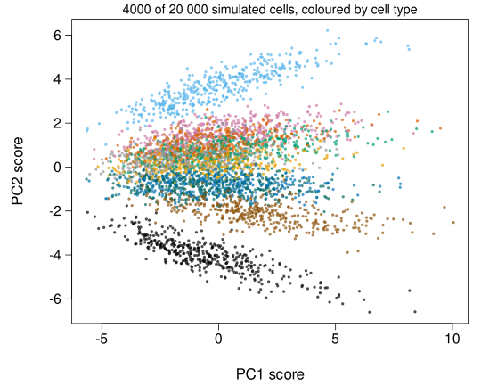
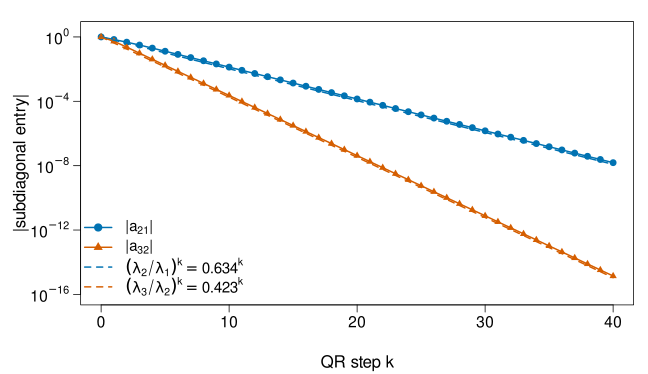
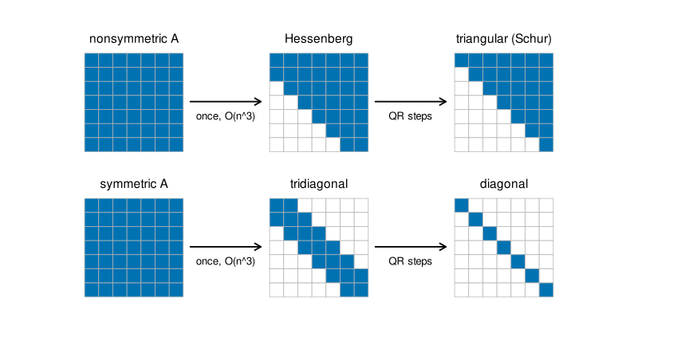
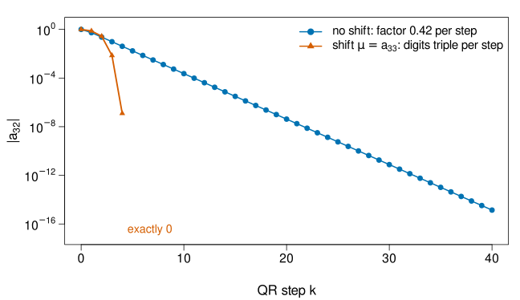
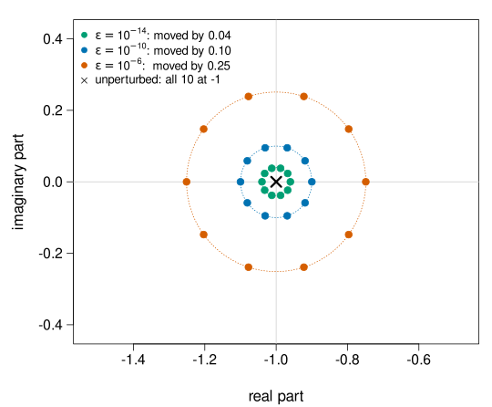
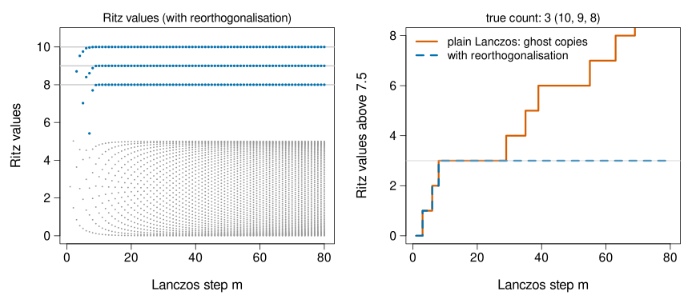
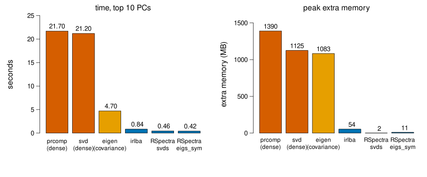

## About this lecture {.smaller}

In [*Power iteration and friends*](../power-iteration/lec.qmd) we found **one** eigenvalue at a time by multiplying a vector by $A$ again and again. This lecture is about what `eigen()` does to get **all** of them, and what to do when the matrix is too big for that.

- The **QR algorithm**: factor $A = QR$, multiply back as $RQ$, repeat. It is power iteration on all vectors at once.
- Two tricks make it fast: **Hessenberg reduction** first, and **shifts**.
- **Symmetric** matrices are easy: real eigenvalues that move very little under rounding. **Nonsymmetric** ones can have **complex** eigenvalues, and their eigenvalues can be very **sensitive**.
- For a large **sparse** matrix we want only a **few** eigenpairs: **Krylov** methods (**Lanczos**), as in `irlba`, `RSpectra` and `scipy.sparse.linalg.eigsh`.
- Biology: **PCA of 20 000 cells × 2 000 genes** without forming a dense or covariance matrix, and a **transit-compartment** model whose eigenvalues a perturbation of $10^{-10}$ moves by 0.1.

::: notes
This is the second of the two eigenvalue units. The previous one gave the building blocks: power iteration, the convergence rate |lambda2/lambda1|, Rayleigh quotients and shifts. Here those blocks are assembled into the algorithm every library uses for dense matrices, and then replaced by a different family (Krylov) when the matrix is large and sparse. The two biology examples carry the two halves: the transit chain shows that a nonsymmetric eigenvalue can be untrustworthy even when the algorithm did nothing wrong; the single-cell PCA shows why nobody computes all the eigenvalues of a big matrix.
:::

## A biology problem first {.smaller}

A single-cell RNA-seq experiment: 20 000 cells, 2 000 highly variable genes, log-transformed counts. Most entries are **zero**.

```r
library(Matrix)
dim(X)                                           # cells x genes (simulated)
# [1] 20000  2000
nnzero(X) / length(X)                            # fraction of non-zero entries
# [1] 0.1296979
format(object.size(X), units = "MB")             # sparse storage
# [1] "59.4 Mb"
format(object.size(as.matrix(X)), units = "MB")  # the same matrix, dense
# [1] "305.2 Mb"
```

- PCA wants the top 10–50 eigenvectors of the gene–gene covariance matrix. The usual route **centres** $X$: subtract each gene's mean. That makes every entry non-zero: the matrix becomes **dense**.
- `prcomp(as.matrix(X))` takes 22 s and 1.4 GB of extra memory here. The method at the end of this lecture takes 0.4 s and 11 MB.
- With 100 000 cells (a typical atlas) the dense matrix alone is 1.6 GB.

::: notes
The matrix is simulated (code in the exercise, C6): 10 cell types, a gamma-distributed mean expression per gene, a random fold change per type and gene, a log-normal library size per cell, Poisson counts, then log1p. About 13 % of entries are non-zero, which is typical after selecting variable genes (raw count matrices are often 5 % or less). Sparse storage (Matrix's dgCMatrix, compressed sparse column) keeps only the non-zeros and their row indices, 12 bytes per entry; dense keeps 8 bytes for every entry. The timings were measured with single-threaded BLAS; your machine will give other numbers, but the ratio is what matters.
:::

## Recap: PCA in one slide {.smaller}

:::: {.columns}
::: {.column width="52%"}
{width="100%"}
:::
::: {.column width="48%"}
- Centre the columns: $X_c = X - \mathbf 1\boldsymbol\mu^T$ (cells × genes).
- The **principal axes** are the eigenvectors $\mathbf v_i$ of $X_c^TX_c$ (a 2000 × 2000 symmetric matrix); the variance along $\mathbf v_i$ is $\lambda_i/(n-1)$.
- Equivalently, $\mathbf v_i$ are the right singular vectors of $X_c$, $\sigma_i = \sqrt{\lambda_i}$, and the **scores** are $X_c\mathbf v_i$.
- We need $\mathbf v_1, \dots, \mathbf v_{10}$, not all 2000.
:::
::::

How to choose the number of PCs, scaling and interpretation: the sister course. Here: how the numbers are **computed**.

::: notes
One slide only, because PCA is taught in the sister course and its link to the SVD is the aside at the end of The SVD, rank deficiency and regularisation. The point here is purely computational: PCA is an eigenvalue problem for a symmetric matrix, and we need only the top few eigenpairs. PC1 in this simulation is mostly library size (sequencing depth), as in real data before normalisation; PC2 separates two cell types. The scores come from irlba, the method at the end of the lecture.
:::

## Recap: power iteration and friends {.smaller}

:::: {.columns}
::: {.column width="55%"}
From [*Power iteration and friends*](../power-iteration/lec.qmd):

- **Power iteration** $\mathbf x \leftarrow A\mathbf x/\|A\mathbf x\|$ finds the eigenvalue of largest $|\lambda|$; the error shrinks by $|\lambda_2/\lambda_1|$ per step. Fish Leslie matrix: $\lambda_1 = 1.177$, rate 0.654, 55 steps.
- It **fails** when $|\lambda_2| = |\lambda_1|$ (semelparous fish: the estimate cycles) and **crawls** when the ratio is near 1 (slow-switching cells: 5406 steps).
- **Inverse iteration** with shift $\sigma$ finds the eigenvalue nearest $\sigma$; **Rayleigh quotient iteration** ($\sigma$ = current Rayleigh quotient) converges **cubically** for symmetric $A$.
- One eigenpair per run.
:::
::: {.column width="45%"}
Our test matrix for this lecture:

```r
A <- matrix(c(4, 1, 0,
              1, 3, 1,
              0, 1, 2), 3)   # symmetric
power_rq(A, c(1, 1, 1))$lambda
# [1] 4.732051              # 51 steps
eigen(A)$values
# [1] 4.732051 3.000000 1.267949
```

Rate $3/4.73 = 0.63$ per step. `eigen()` returns **all three**, to the last digit, in microseconds. How?
:::
::::

::: notes
Recap only; do not re-teach. The numbers are the ones students saw in Power iteration and friends: the fish Leslie matrix (lambda_1 = 1.177, |lambda_2/lambda_1| = 0.654, 55 iterations to a residual of 1e-10), the semelparous variant whose four eigenvalues share one modulus, the slow-switching cell-state chain (5406 iterations and still only 5 digits), and Rayleigh quotient iteration on the trait correlation matrix (exercise C7 there). power_rq is that lecture's power iteration with 2-norm normalisation and the Rayleigh quotient as the estimate; on A it reaches a residual of 1e-10 after 51 steps. This matrix (eigenvalues 3 + sqrt 3, 3, 3 - sqrt 3) is our small test case throughout the lecture. The questions for the next slides: how to get all eigenvalues at once, and how to make the convergence much faster than 0.63 per step. Both answers reuse the pieces above: power iteration on many vectors at once, and shifts.
:::

## The QR algorithm {.smaller}

Factor, then multiply the factors back in the **other order**:

$$A_0 = A, \qquad A_k = Q_kR_k, \qquad A_{k+1} = R_kQ_k.$$

```r
Ak <- A
for (k in 1:30) {
  f  <- qr(Ak)                     # Ak = Q R (Householder, as in lm)
  Ak <- qr.R(f) %*% qr.Q(f)        # A_{k+1} = R Q
}
round(Ak, 6)
#          [,1]  [,2]     [,3]
# [1,] 4.732051 1e-06 0.000000
# [2,] 0.000001 3e+00 0.000000
# [3,] 0.000000 0e+00 1.267949
```

- $R_kQ_k = Q_k^T(Q_kR_k)Q_k = Q_k^TA_kQ_k$: each step is a **similarity** transform, so the eigenvalues never change.
- The off-diagonal entries go to 0, and the **eigenvalues appear on the diagonal**.

::: notes
The algorithm is due to Francis and Kublanovskaya (1961) and is one of the top-ten algorithms of the 20th century. Every step costs one QR factorisation (we met Householder QR in Least squares: normal equations vs QR). Because Q is orthogonal, multiplying by Q^T on the left and Q on the right is a change of basis that keeps eigenvalues; it is also perfectly conditioned, so rounding errors are not magnified. After 30 steps the off-diagonals are 1e-6 and 1e-11: the diagonal is right to about 12 digits (for a symmetric matrix the error in the diagonal is the square of the off-diagonal).
:::

## Why it works: power iteration on all vectors at once {.smaller}

Accumulate the $Q$s: $\;\hat Q_k = Q_1Q_2\cdots Q_k$. Then $A^k = \hat Q_k\hat R_k$: $\hat Q_k$ is the $Q$ of $A^k$.

```r
Ak <- A; Qk <- diag(3)
for (k in 1:5) {
  f <- qr(Ak); Qk <- Qk %*% qr.Q(f); Ak <- qr.R(f) %*% qr.Q(f)
}
A5 <- A %*% A %*% A %*% A %*% A
max(abs(Qk - qr.Q(qr(A5))))             # same Q as A^5
# [1] 5.551115e-16
```

- The columns of $A^k$ are power iteration started from $\mathbf e_1, \mathbf e_2, \mathbf e_3$. QR **orthonormalises** them: column 1 → eigenvector 1, column 2 → the part orthogonal to it → eigenvector 2, ...
- This is **simultaneous (subspace) iteration**. The QR algorithm does it without ever forming $A^k$ (which would overflow and lose all but the top direction).

::: notes
This is the key insight and the reason the previous unit came first. Column j of Q-hat converges to eigenvector j, at a rate set by the ratio of neighbouring eigenvalues. A_k = Q-hat^T A Q-hat is then A in the eigenvector basis: diagonal. Forming A^k explicitly is hopeless for large k: all columns line up with the top eigenvector to machine precision, and QR of that matrix cannot recover the others. The QR algorithm re-orthonormalises at every step, so the information is never lost. (Signs of Q columns can differ between implementations; here they happen to agree.)
:::

## How fast? {.smaller}

{width="68%" fig-align="center"}

- Entry $a_{i+1,i}$ shrinks like $|\lambda_{i+1}/\lambda_i|^k$: the **power-iteration rate** for each pair of neighbours.
- Close eigenvalues → slow. $\lambda_2/\lambda_1 = 0.99$ needs about 3500 steps for 16 digits.

::: notes
The dashed lines are the predicted rates, the points the actual |a21| and |a32|. On a log axis both are straight lines: linear convergence, as for power iteration. A ratio of 0.63 needs about 80 steps for 1e-16, 0.42 about 40. For a matrix with clustered eigenvalues (a covariance matrix with many similar noise eigenvalues, for example) the unshifted algorithm would be useless. Two slides from now: shifts fix this.
:::

## When it stalls {.smaller}

A cell that switches deterministically between two states every generation: transition matrix with eigenvalues $+1$ and $-1$.

```r
P <- matrix(c(0, 1,
              1, 0), 2)
f <- qr(P)
qr.Q(f)
#      [,1] [,2]
# [1,]    0   -1
# [2,]   -1    0
diag(qr.R(f))                          # R = -I
# [1] -1 -1
qr.R(f) %*% qr.Q(f)                    # A_1 = A_0: nothing ever changes
#      [,1] [,2]
# [1,]    0    1
# [2,]    1    0
```

- $|\lambda_2/\lambda_1| = 1$: power iteration cannot separate the two (the semelparous fish of *Power iteration and friends*), and neither can the QR algorithm. The matrix is already its own QR fixed point.
- The **check**: off-diagonal entries that do not shrink. The fix: a **shift**.

::: notes
The same failure as power iteration on the semelparous fish in Power iteration and friends (a periodic life cycle, four eigenvalues of equal modulus): eigenvalues of equal size. Q = -P and R = -I, so RQ = P. In practice exact ties in magnitude are rare except for structure (periodic chains, matrices with symmetric spectra, complex pairs on the next slides), but near-ties are common, and they give the slow convergence of the previous slide. Shifting the matrix by mu changes the eigenvalues to 1 - mu and -1 - mu, which have different sizes for any mu other than 0.
:::

## First trick: Hessenberg form {.smaller}

{width="72%" fig-align="center"}

- One QR step on a full $n \times n$ matrix costs $O(n^3)$. First reduce $A$ by Householder reflections to **Hessenberg** form (zeros below the first subdiagonal): $O(n^3)$, **once**.
- QR steps **keep** the Hessenberg form, and a step costs only $O(n^2)$ (one Givens rotation per subdiagonal entry).
- Symmetric $A$ → **tridiagonal**: a QR step costs $O(n)$.

::: notes
One slide, as promised: the details are in Trefethen and Bau, lectures 26 and 28. The reduction applies the same Householder reflections from the left and from the right (H A H), so it is a similarity and keeps the eigenvalues; it cannot go all the way to triangular in a finite number of steps (that would solve a polynomial of degree n by a formula, which is impossible for n >= 5), but it can reach Hessenberg. After that, every QR step only has to remove n - 1 subdiagonal entries. Remember the tridiagonal picture: Lanczos at the end of the lecture builds exactly such a matrix.
:::

## Second trick: shifts and deflation {.smaller}

{width="62%" fig-align="center"}

- **Shift**: factor $A_k - \mu I = QR$, then $A_{k+1} = RQ + \mu I$. Still a similarity; the rate for the last entry becomes $|\lambda_n - \mu| / |\lambda_{n-1} - \mu|$. $\mu = a_{nn}$ is a Rayleigh quotient: this is the **Rayleigh quotient iteration** of *Power iteration and friends*, working on the last row. Digits triple per step.
- **Deflate**: once $|a_{n,n-1}| < 10^{-12}$, $a_{nn}$ is an eigenvalue. Drop the last row and column and continue. Our 3 × 3: **62** steps unshifted, **7** shifted.

::: notes
Nothing new to teach here: the last column of the QR algorithm does shifted inverse iteration with shift mu, and with mu = a_nn that shift is the current Rayleigh quotient, so this is the Rayleigh quotient iteration of Power iteration and friends (slide and exercise C7 there) in disguise. As there, a symmetric matrix converges cubically: here the last subdiagonal goes 7e-3, 1e-7, 6e-22. The plain Rayleigh shift can fail: for [[2,1],[1,2]] a_nn = 2 lies exactly between the eigenvalues 1 and 3 and the iteration stalls, as in the previous slide. LAPACK uses the Wilkinson shift (the eigenvalue of the trailing 2x2 block closer to a_nn), which always converges for symmetric matrices; the exercise (C2) tries both. For real nonsymmetric matrices LAPACK uses two shifts at once (the Francis double shift) so that complex shifts can be handled in real arithmetic.
:::

## Try it: the QR algorithm, live {.smaller}

```{=html}
<link rel="stylesheet" href="../demos/dist/demo.css">
<div data-demo="qralgo" data-preset="lecture" data-shift="none" data-k="0"></div>
<script src="../demos/dist/qralgo.js"></script>
```

::: notes
The QR algorithm computed live in the browser, with deflation below 1e-12 exactly as in exercise C2. Left: A_k as a heat map (blue positive, orange negative, paler = smaller, white below 1e-12; the diagonal outlined, deflated eigenvalues in green). Right: the subdiagonal entries on a log axis, with the dashed rates |lambda_{i+1}/lambda_i|^k when there is no shift. Start with the lecture's 3 x 3, no shift: step +1 gives the A_1 of the background (4.41, 0.691, 3.15, -0.538, 1.43); press play: a32 follows 0.423^k and deflates at k = 33, a21 follows 0.634^k, all three eigenvalues at k = 62 (fig02). Switch to Rayleigh: 7 steps, |a32| goes 7e-3, 1e-7, 6e-22 (fig03); Wilkinson: 4 steps. Then "close lambda1, lambda2": rate 0.932, 367 steps unshifted, 6 with Wilkinson. B with the Rayleigh shift: mu = 2 sits halfway between 1 and 3 and nothing moves; Wilkinson finds both in one step. Predator-prey J: the 2 x 2 block keeps rotating (next slides). 4 x 4 community: a43 deflates (-0.5), a21 goes to 0 (-3), the block for -1 +- i stays and repeats every 4 steps. If time allows, the second tab belongs to the sensitivity slides: n = 10, eps = 1e-10 moves the chain's eigenvalues by 0.1 and the symmetric matrix's by 4e-11.
:::

## What `eigen()` actually does {.smaller}

[`eigen()`](https://stat.ethz.ch/R-manual/R-devel/library/base/html/eigen.html) calls LAPACK:

- **symmetric** (`dsyevr`): reduce to tridiagonal, then a shifted QR-type method; about $\tfrac{4}{3}n^3$ flops for values, more for vectors.
- **nonsymmetric** (`dgeev`): balance, reduce to Hessenberg, Francis double-shift QR, then eigenvectors; about $10n^3$ flops or more.

| $n$ | symmetric, values + vectors | symmetric, values only | nonsymmetric |
|---|---|---|---|
| 500 | 0.04 s | 0.01 s | 0.19 s |
| 1 000 | 0.23 s | 0.11 s | 1.05 s |
| 2 000 | 1.78 s | 0.74 s | 5.79 s |

- Doubling $n$: about **8×** the time and 4× the memory. A 20 000 × 20 000 cell–cell matrix: about half an hour and 3.2 GB.
- Tell `eigen` what you know: `symmetric = TRUE`, `only.values = TRUE`.

::: notes
Timings from one desktop with single-threaded OpenBLAS; a multithreaded BLAS changes the constants but not the n^3 scaling. Without symmetric = TRUE, eigen checks isSymmetric itself, which is fine for exact symmetry but a matrix that is symmetric only up to rounding (computed as t(X) %*% X in a different order, for example) is then treated as nonsymmetric: slower, and possibly with tiny imaginary parts. numpy has the same split: np.linalg.eigh / eigvalsh for symmetric, np.linalg.eig for general. The O(n^3) cost connects to Convergence and cost (Part 1): for n beyond a few thousand, dense eigen is no longer an option, which is the second half of this lecture.
:::

## Symmetric vs nonsymmetric {.smaller}

| | symmetric ($A = A^T$) | nonsymmetric |
|---|---|---|
| eigenvalues | real | real, or complex conjugate **pairs** |
| eigenvectors | orthogonal | not orthogonal; may be missing (**defective**) |
| QR algorithm ends at | diagonal | upper triangular with 2 × 2 blocks |
| effect of a perturbation of size $\delta$ | eigenvalues move at most $\delta$ | can move much more than $\delta$ |
| LAPACK / R / numpy | `dsyevr`, `eigen(symmetric = TRUE)`, `eigh` | `dgeev`, `eigen`, `eig` |
| in biology | covariance, distance and kernel matrices, graph Laplacians | Jacobians, Leslie matrices, Markov transition matrices, compartment models |

::: notes
This table organises the rest of the dense part. Symmetric problems are the pleasant case in every row. Most matrices in dynamical biology (Jacobians of ODE models at a steady state, population projection matrices, transition matrices of Markov chains, compartment models in pharmacokinetics) are not symmetric, and each row of the right column causes a problem we look at next: complex eigenvalues, and sensitivity.
:::

## Complex eigenvalues: oscillations {.smaller}

Predator–prey model linearised at its steady state (Jacobian $J$):

```r
J <- rbind(c(-0.1, -1),        # prey: self-limitation, eaten by predators
           c( 0.5,  0))        # predators: grow by eating prey
eigen(J)$values
# [1] -0.05+0.7053368i -0.05-0.7053368i
2 * pi / Im(eigen(J)$values[1])     # period of the oscillation
# [1] 8.908064
```

- A **real** matrix with **complex** eigenvalues $-0.05 \pm 0.705i$: a damped oscillation. Real part < 0: perturbations die out. Imaginary part: the frequency.
- This is not rounding noise: complex eigenvalues are the answer.

::: notes
The interpretation of Jacobian eigenvalues (stable node, spiral, centre, saddle) belongs to Equilibria, stability and the phase plane in Part 8; here it is enough that complex eigenvalues mean oscillation and their real part decides growth or decay. The period of the linearised oscillation is 2 pi / 0.705 = 8.9 time units, and the amplitude decays like exp(-0.05 t), a factor exp(-0.05 * 8.9) = 0.64 per cycle. Note: a symmetric matrix can never produce this, so a symmetric model of an interaction (A affects B as much as B affects A) cannot oscillate.
:::

## Real arithmetic cannot split a complex pair {.smaller}

```r
Jk <- J
for (k in 1:50) { f <- qr(Jk); Jk <- qr.R(f) %*% qr.Q(f) }
round(Jk, 4)                         # after 50 steps: still a full 2 x 2 block
#         [,1]    [,2]
# [1,] -0.2314 -0.9291
# [2,]  0.5709  0.1314
eigen(Jk)$values                     # ...but its eigenvalues are right
# [1] -0.05+0.7053368i -0.05-0.7053368i
```

- The two eigenvalues have the **same modulus**, so (as for $P$) the QR iteration never makes $a_{21}$ small; the block keeps rotating.
- LAPACK stops at the **real Schur form**: upper triangular with 2 × 2 blocks on the diagonal, one per complex pair, and reads each pair off its block.

::: notes
Another case of |lambda1| = |lambda2|: complex conjugates always have equal modulus. Run 51 steps instead of 50 and the block looks completely different; it never settles. That is not a failure of the method: real orthogonal transformations can never produce a complex diagonal entry. The eigenvalues of a 2x2 block come from the quadratic formula (trace and determinant), which is what LAPACK does at the end. In the exercise (C3) students see this in all three languages.
:::

## Sensitivity: a transit-compartment model {.smaller}

A drug passes through 10 **transit compartments** (rate 1 per hour) before it reaches the blood. A tiny **recirculation** from the last compartment back to the first:

```r
n <- 10
K <- diag(-1, n)
K[cbind(2:n, 1:(n - 1))] <- 1          # compartment i-1 feeds compartment i
eigen(K)$values
#  [1] -1 -1 -1 -1 -1 -1 -1 -1 -1 -1
K[1, n] <- 1e-10                       # recirculation: a fraction of 1e-10
ev <- eigen(K)$values
range(Mod(ev + 1))                     # distance of every eigenvalue from -1
# [1] 0.1 0.1
```

A change of $10^{-10}$ in one entry moves **every** eigenvalue by **0.1**: a factor $10^9$.

::: notes
Transit compartments are the standard way to model an absorption delay in pharmacokinetics (and maturation stages of cells, e.g. in models of neutrophil production after chemotherapy). The matrix is lower bidiagonal with -1 on the diagonal: all eigenvalues are -1, but there is only one eigenvector (the matrix is defective, a single Jordan block). The 1e-10 in the top-right corner could be enterohepatic recirculation, a modelling choice, or just a rounding error in an entry. Ask the audience to guess how far the eigenvalues move before revealing the output.
:::

## Why so sensitive? {.smaller}

:::: {.columns}
::: {.column width="50%"}
{width="100%"}
:::
::: {.column width="50%"}
- The characteristic polynomial is $(\lambda + 1)^{10} - \varepsilon = 0$, so $|\lambda + 1| = \varepsilon^{1/10}$: the 10 eigenvalues sit on a **circle** of radius $\varepsilon^{1/10}$.
- $\varepsilon = 10^{-10}$ → 0.1. Even **rounding**, $\varepsilon \approx 10^{-16}$, gives 0.025.
- With $n$ compartments the change is $\varepsilon^{1/n}$: the longer the chain, the worse.
- A **symmetric** matrix with the same perturbation: eigenvalues move by at most $10^{-10}$.
:::
::::

::: notes
The general statement: for a symmetric matrix, a perturbation E moves each eigenvalue by at most ||E|| (Weyl). For a diagonalisable nonsymmetric matrix A = V D V^-1, by at most kappa(V) ||E|| (Bauer-Fike), where kappa(V) is the condition number of the eigenvector matrix (Pivoting, norms and conditioning). For a defective matrix kappa(V) is infinite and the change goes like the n-th root of epsilon, as here. Biologically: the dynamics (decay of the drug pulse over hours) are perfectly well determined; only the individual eigenvalues are ill-conditioned. Questions like "is the slowest decay rate 0.9 or 1.0" are not answerable from such a matrix. The matrix exponential and the simulated time course are a much better-conditioned description.
:::

## The check: is this eigenvalue trustworthy? {.smaller}

```r
kappa(eigen(K)$vectors)                   # condition number of the eigenvectors
# [1] 1184131481
S <- A; S[1, 3] <- S[3, 1] <- 1e-10       # symmetric A, same perturbation
eigen(S)$values - eigen(A)$values
# [1]  3.333334e-11 -6.666623e-11  3.333334e-11
set.seed(1)
Kp <- K + 1e-12 * matrix(rnorm(n^2), n)   # perturb at 1e-12 and recompute
range(Mod(eigen(Kp)$values + 1))          # was exactly 0.1 for all ten
# [1] 0.09994035 0.09995391
```

- `kappa(V)` near 1: eigenvalues are as accurate as the matrix. `kappa(V)` of $10^9$: up to 9 digits lost.
- **Perturb and recompute**: change the entries at the level of their uncertainty and see how far the eigenvalues move. Here $10^{-12}$ in, $5\times10^{-5}$ out.

::: notes
Two checks a student can always run. kappa of the eigenvector matrix is cheap for small matrices and directly bounds the amplification (Bauer-Fike). The perturbation test works for anything, including when only eigenvalues are available (as in Rust's nalgebra, which has no nonsymmetric eigenvectors). Perturb at the level of the real uncertainty of the entries: for measured rate constants that is a few per cent, not 1e-12. For a symmetric matrix both checks always pass, which is one more reason to use a symmetric formulation when the problem allows it.
:::

## Big problems: keep every power-iteration vector {.smaller}

For the single-cell matrix: dense $X_c$ is 20 000 × 2 000 and we want 10 eigenpairs of $C = X_c^TX_c$ (2 000 × 2 000).

- Power iteration keeps only the **last** vector $A^{m-1}\mathbf q$ and throws away $\mathbf q, A\mathbf q, \dots$
- A **Krylov subspace** keeps them all: $\mathcal K_m = \text{span}\{\mathbf q, A\mathbf q, A^2\mathbf q, \dots, A^{m-1}\mathbf q\}$.
- Find the best approximations to eigenvectors **inside** $\mathcal K_m$: with an orthonormal basis $Q_m$, take the eigenpairs of the small $m \times m$ matrix $T_m = Q_m^TAQ_m$ (**Ritz values**).
- The method only ever needs **$A$ times a vector**. $C\mathbf v = X_c^T(X_c\mathbf v)$, and $X_c\mathbf v = X\mathbf v - \mathbf 1(\boldsymbol\mu^T\mathbf v)$: sparse $X$, never centred, never formed.
- Cost per step: two sparse products, $4 \times \text{nnz}(X) \approx 2\times10^7$ flops. $m = 30$ steps instead of $10^{10}$ flops for dense `eigen`.

::: notes
This is the idea behind every large-scale eigensolver (and behind CG and GMRES for linear systems, Iterative linear solvers in depth in Part 11). The Krylov subspace after m steps contains the power-iteration vector, so the Ritz value is never worse than power iteration, and usually far better because it can combine the vectors. Matrix-free: the function that computes C v is all the method sees. That is what lets us centre implicitly; centring X explicitly would make it dense and cost 320 MB. With 100 000 cells, the cost per step grows linearly in the number of non-zeros, while dense methods grow like n^2 in memory.
:::

## Lanczos: a three-term recurrence {.smaller}

For symmetric $A$, the orthonormal Krylov basis obeys $\beta_j\mathbf q_{j+1} = A\mathbf q_j - \alpha_j\mathbf q_j - \beta_{j-1}\mathbf q_{j-1}$, and $T_m$ is **tridiagonal**:

```r
lanczos <- function(Afun, n, m) {           # Afun(v) returns A %*% v
  Q <- matrix(0, n, m); a <- b <- numeric(m)
  q <- rep(1, n) / sqrt(n); q_old <- 0; bj <- 0
  for (j in 1:m) {
    Q[, j] <- q
    w <- Afun(q) - bj * q_old                 # three-term recurrence
    a[j] <- sum(w * q); w <- w - a[j] * q
    bj <- sqrt(sum(w^2)); b[j] <- bj
    q_old <- q; q <- w / bj
  }
  list(alpha = a, beta = b[-m], Q = Q)        # T = tridiag(beta, alpha, beta)
}
```

- Each step: **one** product with $A$, and orthogonalisation against only the **two** previous vectors.
- `ritz(L, m)` (exercise C5) = `eigen()` of the $m \times m$ tridiagonal $T_m$.

::: notes
Lanczos (1950). The three-term recurrence is a consequence of symmetry: A q_j is automatically orthogonal to all q_i with i < j - 1 in exact arithmetic. So the work per step is one matrix-vector product plus O(n), and the m x m matrix T is tridiagonal, the same shape as after the Hessenberg reduction for symmetric matrices. In fact, run to m = n, Lanczos is a tridiagonal reduction. For a nonsymmetric matrix the analogue is the Arnoldi method (full orthogonalisation, Hessenberg T), which is what ARPACK and RSpectra::eigs use for general matrices.
:::

## Ritz values converge from the outside in {.smaller}

A test spectrum like a PCA: 3 strong eigenvalues (10, 9, 8) above a bulk of 197 between 0 and 5.

```r
spec <- c(10, 9, 8, seq(0, 5, length.out = 197))
L <- lanczos(function(v) spec * v, 200, 60)    # A = diag(spec), never stored
ritz(L, 5)[1:4]
# [1] 9.756289 7.024457 4.037090 1.931158
ritz(L, 10)[1:4]
# [1] 9.999992 8.999718 7.998994 4.814935
ritz(L, 20)[1:4]
# [1] 10.000000  9.000000  8.000000  4.982533
```

- The **extreme**, **well-separated** eigenvalues converge first: 6 digits of all three after 10–20 products. The bulk converges slowly.
- That is exactly the PCA situation: a few large, separated eigenvalues above a noise bulk.

::: notes
The test matrix is diagonal, so we know the answer; Lanczos does not know it is diagonal, it only sees products. After 5 steps the largest Ritz value is already 9.76; after 10 steps it is right to 6 digits. The rate depends on the gap between the wanted eigenvalue and the rest of the spectrum, relative to the spread of the spectrum (Kaniel-Paige theory, which uses Chebyshev polynomials): a much better rate than power iteration's lambda2/lambda1. Eigenvalues inside the bulk would need many more steps. Shift-and-invert (the shifted inverse iteration of Power iteration and friends) turns interior eigenvalues into extreme ones, at the price of a sparse solve per step.
:::

## Failure: loss of orthogonality {.smaller}

{width="80%" fig-align="center"}

- In floating point the $\mathbf q_j$ slowly lose orthogonality ($Q^TQ - I$ reaches 0.68 after 60 steps). Converged eigenvalues reappear as **ghost** copies: the plain run reports 10, 10, 10, 9, 9, 8, 8.
- Fixes: **reorthogonalise** against all previous $\mathbf q_i$ (cost $O(nm)$ per step), and **restart** after a fixed number of steps to keep $m$ small. **Check**: a duplicate eigenvalue that the problem has no reason to have.

::: notes
Paige showed in the 1970s that the loss of orthogonality is not random: it happens exactly when a Ritz value converges. The ghost copies are converged to full accuracy, so a naive user sees 10 reported three times and concludes the eigenvalue is triple. Full reorthogonalisation (one extra line: w <- w - Q %*% crossprod(Q, w)) removes the problem; the exercise does both. Production codes use selective or partial reorthogonalisation and implicit restarts: ARPACK (implicitly restarted Lanczos/Arnoldi, used by RSpectra and scipy's eigsh) and irlba (augmented implicitly restarted Lanczos bidiagonalisation, which works on X directly instead of X^T X, for the reason in The SVD, rank deficiency and regularisation).
:::

## The library calls {.smaller}

```r
library(RSpectra)
mu <- colMeans(X)
Cv <- function(v, args) {                     # Xc^T Xc v, X stays sparse
  w <- as.vector(X %*% v) - sum(mu * v)        # Xc v  = X v  - 1 (mu . v)
  as.vector(crossprod(X, w)) - mu * sum(w)     # Xc^T w = X^T w - mu (1 . w)
}
e <- eigs_sym(Cv, k = 10, n = ncol(X))          # top 10 eigenpairs, 27 products
sqrt(e$values[1:4])
# [1] 335.2194 294.3642 275.4889 268.5457
library(irlba)
irlba(X, nv = 10, center = mu)$d[1:4]           # top 10 singular triplets of Xc
# [1] 335.2194 294.3642 275.4889 268.5457
```

- [`RSpectra::eigs_sym`](https://cran.r-project.org/package=RSpectra) takes a matrix or a **function** (matrix-free); `svds` does the SVD. [`irlba`](https://cran.r-project.org/package=irlba) works on $X$ and centres implicitly.
- Python: `scipy.sparse.linalg.eigsh` and `svds`, with a `LinearOperator` for the centred matrix.

::: notes
Both give the same singular values as the dense SVD to all printed digits. eigs_sym needed 27 products with C (each two sparse products with X); irlba needed 84 products with X or X^T. sqrt of the eigenvalues of Xc^T Xc are the singular values of Xc, which is what irlba returns; divide the eigenvalues by n - 1 for variances. irlba also has prcomp_irlba, a drop-in for prcomp. Seurat's RunPCA and scanpy's pca call exactly these (irlba in R, ARPACK via scipy svds in Python).
:::

## Back to the cells: time and memory {.smaller}

{width="90%" fig-align="center"}

- Same top 10 singular values (to 15 digits) from every route.
- The dense routes need the **centred dense** matrix (305 MB) and its copies: about 1.1–1.4 GB extra. The truncated ones need $X$ plus a few dozen vectors.
- `eigen` of the 2000 × 2000 covariance is not bad here, because there are only 2000 genes. With all 20 000 genes it would be 1000× slower.

::: notes
Measured on one machine with single-threaded BLAS. With the default multithreaded OpenBLAS on the same 40-core machine the times were not better, and irlba was much slower (thread start-up overhead on many small dense operations); if timings look odd, try OPENBLAS_NUM_THREADS=1. Peak memory is the process maximum minus the 230 MB for R and the data. The covariance route has a second problem: it squares the condition number (Least squares: normal equations vs QR, The SVD unit). For the top PCs this does not matter; for small singular values it does. The scaling argument is the important one: dense methods cost O(n p^2) time and O(n p) memory whatever the sparsity; Lanczos costs O(nnz) per step and O((n + p) m) memory.
:::

## Checks for truncated eigensolvers {.smaller}

```r
set.seed(1)
r <- irlba(X, nv = 10, center = mu)
max(sapply(1:10, function(i)                  # residual ||C v - sigma^2 v|| / sigma^2
  sqrt(sum((Cv(r$v[, i]) - r$d[i]^2 * r$v[, i])^2)) / r$d[i]^2))
# [1] 9.557529e-15
c(r$mprod, irlba(X, nv = 20, center = mu)$mprod)   # products with X or X^T
# [1]  84 336                                 # PCs 11-20 are in the noise bulk
r3 <- irlba(X, nv = 10, center = mu, maxit = 3, work = 12)
# Warning message: ... did not converge--results might be invalid!; try increasing maxit or work
```

- **Residual** $\|C\mathbf v - \lambda\mathbf v\|/\lambda$: small means a true eigenpair (of something very close to $C$).
- Asking for eigenvalues **inside a cluster** costs many more products, and they are poorly determined anyway.
- Read the **warnings** and convergence flags (`irlba`, `eigs_sym$nconv`, `eigsh` raises `ArpackNoConvergence`).

::: notes
The residual check costs one matrix-vector product per eigenpair and is the single most useful check: if it is small, (lambda, v) is an exact eigenpair of a matrix within that distance of C (backward error, Error, conditioning and stability). The second line shows a real effect: the singular values after the tenth are 72.44, 72.41, 72.05, ..., a tight cluster from the noise, and resolving them costs four times as many products. They also carry no biology. irlba starts from a random vector, so mprod varies slightly between runs (set.seed for reproducibility). The warning on the last line is easy to miss in a long pipeline.
:::

## Checklist: eigenvalues you can trust {.smaller}

- **Symmetric?** Say so: `eigen(symmetric = TRUE)`, `eigh`. Faster, real, orthogonal, well-conditioned.
- **Complex eigenvalues** from a real matrix → oscillation, not an error. Do not drop the imaginary part.
- **Nonsymmetric** → check `kappa(eigen(A)$vectors)`, or perturb the entries at the level of their uncertainty and recompute.
- **Repeated eigenvalues** in a nonsymmetric model (chains, cascades) → expect sensitivity like $\varepsilon^{1/n}$.
- **Large and sparse**, only a few eigenpairs needed → `RSpectra::eigs_sym`, `irlba` / `eigsh`, `svds`. Never densify, never centre explicitly.
- **Truncated solver** → check residuals, convergence warnings, and duplicate eigenvalues (ghosts).
- **Many wanted eigenvalues in a cluster** → slow and poorly determined; ask whether you need them.

::: notes
A summary of the failure modes and the check for each. The order follows the lecture: dense symmetric, dense nonsymmetric, large sparse.
:::

## Summary {.smaller}

- The **QR algorithm** ($A_k = Q_kR_k$, $A_{k+1} = R_kQ_k$) is simultaneous power iteration with re-orthonormalisation. Subdiagonals shrink like $|\lambda_{i+1}/\lambda_i|^k$; equal moduli stall it.
- **Hessenberg** (tridiagonal if symmetric) reduction makes a step $O(n^2)$ ($O(n)$); **shifts** make convergence quadratic or cubic; **deflation** removes found eigenvalues. Dense `eigen()` costs $O(n^3)$.
- **Symmetric**: real eigenvalues, perturbations of size $\delta$ move them at most $\delta$. **Nonsymmetric**: complex pairs (oscillations, 2 × 2 blocks), and eigenvalues that can move like $\kappa(V)\,\delta$ or $\delta^{1/n}$.
- **Krylov / Lanczos**: keep all power-iteration vectors, need only $A\mathbf v$; extreme eigenvalues converge first. Reorthogonalise and restart (ARPACK, `irlba`).
- **Single-cell PCA**: matrix-free, implicitly centred, top 10 PCs in 0.4 s and 11 MB instead of 22 s and 1.4 GB.

**Next:** Part 6, [*Polynomial interpolation*](../polynomial-interpolation/lec.qmd).

::: notes
The two halves of the lecture have one idea in common: everything is power iteration, made fast either by orthogonal similarity transforms on a dense matrix (QR algorithm) or by keeping the whole Krylov subspace (Lanczos). The checks to remember: kappa(V) or perturb-and-recompute for nonsymmetric problems, and the residual for truncated solvers.
:::
