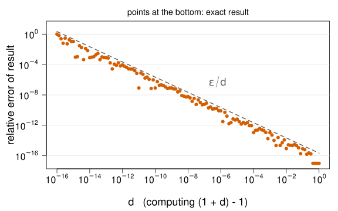
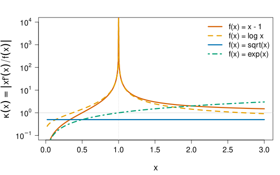
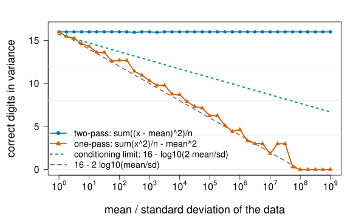
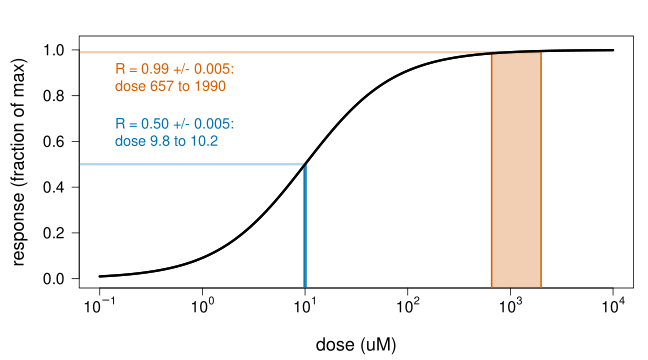
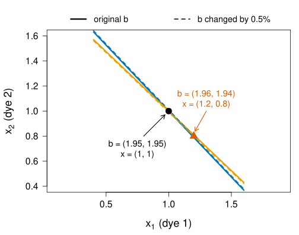

## About this lecture {.smaller}

In How computers store numbers we saw that every double carries a tiny
relative error, about $10^{-16}$. Today: when does that tiny error become a
**large** one, and whose fault is it, the problem's or the method's?

- **Absolute vs relative error**, and why relative error counts **correct digits**.
- **Catastrophic cancellation**: subtracting two nearly equal numbers.
- The **condition number** $\kappa$ of a problem: how much it amplifies
  relative errors in its input.
- **Stability** of an algorithm: does it lose more digits than $\kappa$
  explains? **Backward error** in one slide.
- Two cases: a well-behaved problem ruined by a bad formula (the **one-pass
  variance**), and a problem no formula can save (**dose from a response
  near the plateau**).

::: notes
The thread of the whole lecture: an error in the output has two possible
sources, and they need different cures. If the problem itself is sensitive
(ill-conditioned), no algorithm helps; you change the experiment or the
question. If the problem is fine but the algorithm is unstable, you change the
formula. Students should leave able to tell which of the two they are looking
at, and with two checks they can run. We use machine epsilon and "about 16
significant digits" from How computers store numbers without re-deriving them.
:::

## A variance that comes out as zero {.smaller}

Cut sites from a CUT&RUN experiment pile up around one transcription factor
footprint on chromosome 1, near position 240 000 000, spread over a few bp.

```r
set.seed(3)
pos <- round(rnorm(1000, mean = 2.4e8, sd = 3))   # cut sites (bp)
n <- length(pos)
sum(pos^2) / n - mean(pos)^2        # textbook one-pass formula
# [1] 0
sum((pos - mean(pos))^2) / n        # centre first: two-pass
# [1] 8.986159
```

- Same formula on paper, $\frac1n\sum x_i^2 - \bar x^2 = \frac1n\sum (x_i-\bar x)^2$.
- On the computer one gives **0** (every read at the same base?), the other
  gives $\approx 9\ \text{bp}^2$.
- No warning, no `NaN`. Which one is right, and why does the other fail?

::: notes
Start with the failure. Both lines are the population variance (divide by n);
they are algebraically identical, which every student has seen in a statistics
course. The one-pass form is popular because it needs only one loop over the
data (running sums of x and x^2), and it appears in old textbooks, spreadsheet
formulas and streaming code. The answer 0 would mean all 1000 reads hit the
same base, which is false. By the end of the lecture students can explain
exactly why: it is cancellation, and the fix is to centre first. Genomic
coordinates are a natural source of large numbers with a small spread; so are
large counts and time stamps.
:::

## Absolute and relative error {.smaller}

For a true value $x$ and an approximation $\hat x$:

$$\text{absolute error} = |\hat x - x|, \qquad
  \text{relative error} = \frac{|\hat x - x|}{|x|}.$$

| | true $x$ | measured $\hat x$ | absolute | relative |
|---|---|---|---|---|
| stock solution | 50 µM | 51 µM | 1 µM | 0.02 |
| dilute sample | 0.0005 µM | 0.00051 µM | 0.00001 µM | 0.02 |

- The absolute errors differ by a factor $10^5$; the relative errors are
  **the same**: both are 2 % off.
- Relative error has no units and does not care about scale. It is the natural
  measure for anything that spans orders of magnitude (concentrations, counts,
  intensities).
- Relative error fails when $x = 0$ or near it: then use absolute error.

::: notes
Biologists already think in relative error ("within 2 %") without naming it.
Emphasise that a pipetting error of 1 microlitre is terrible for a 2
microlitre volume and irrelevant for a litre: that is relative error. The
floating-point format is also built on relative error: from How computers store numbers,
each stored number is within a relative error of about 1.1e-16 of the true
one, whatever its size. The caveat about zero matters later, when we look at a
difference that should be near zero.
:::

## Relative error counts correct digits {.smaller}

A relative error of about $10^{-k}$ means about $k$ **correct significant digits**.

```r
rel <- abs(3.1416 - pi) / pi
rel
# [1] 2.338435e-06
-log10(rel)                         # number of correct digits
# [1] 5.631075
```

- $3.1416$ vs $\pi = 3.14159265\ldots$: five to six correct digits.
- A double has $\varepsilon \approx 2.2\times10^{-16}$, so **about 16 digits**.
  That is the budget every computation starts with.
- Today's question: which operations spend that budget fast?

::: notes
-log10 of the relative error is a handy digits counter, and we use it all
lecture: in plots, in the exercise, and in the rule of thumb for the condition
number. It is not an integer and need not be; 5.6 means "between 5 and 6
correct digits". 16 digits sounds like a lot, and for a single operation it is
more than any measurement in biology ever has (a very good measurement has 3 to
4). The danger is computations that throw away 10 or 16 digits at once.
:::

## Catastrophic cancellation {.smaller}

Subtract two numbers that agree in their leading digits:

```r
a <- 1 + 1e-15                      # stored with relative error ~1e-16
print(a, digits = 17)
# [1] 1.0000000000000011
a - 1                               # should be 1e-15
# [1] 1.110223e-15
(a - 1 - 1e-15) / 1e-15             # relative error of the difference
# [1] 0.110223
```

- The subtraction itself is **exact**. The damage was done when `a` was
  stored: an error in the 16th digit of `a` is now in the **1st digit** of
  `a - 1`.
- The leading digits cancel; what is left is mostly the old rounding error.
  That is **catastrophic cancellation**.

::: notes
A common misconception is that the subtraction is the culprit. In floating
point, subtracting two numbers within a factor of 2 of each other is exact. The
problem is that the inputs carry errors (here from rounding 1 + 1e-15 to the
nearest double), and subtraction keeps the absolute error while shrinking the
result. So a relative error of 1e-16 becomes a relative error of 0.11. This
is the most common way digits are lost in practice: in the variance formula,
in differences of large measurements, in finite differences (Numerical
differentiation), in the quadratic formula.
:::

## Why: the error stays, the answer shrinks {.smaller}

:::: {.columns}
::: {.column width="45%"}
If $a$ and $b$ each carry absolute error $\approx \varepsilon |a|$, then
$a - b$ carries the same absolute error, so

$$\frac{\text{error}}{|a-b|} \approx \varepsilon\,\frac{|a|}{|a-b|}.$$

- $a = 1+d$, $b = 1$: relative error $\approx \varepsilon / d$.
- $d = 10^{-8}$: 8 digits left. $d = 10^{-15}$: barely 1.
- **Digits lost** $\approx \log_{10}\dfrac{|a|}{|a-b|}$.
:::
::: {.column width="55%"}
{width="100%"}
:::
::::

::: notes
The plot is (1 + d) - 1 computed in R for d from 1e-16 to 1, with its relative
error. It follows the dashed line epsilon/d: every factor of 10 by which a and b
agree costs one digit. Points on the bottom edge are cases where the result
happened to be exact. The factor |a|/|a - b| will come back in a moment under
a new name: it is the condition number of subtraction.
:::

## Cancellation with measured data {.smaller}

Two near-identical spot intensities, each measured with about **1 %** error:
treated $a = 2010$, control $b = 2000$.

```r
a <- 2010; b <- 2000
log2(a / b)                         # log2 fold change
# [1] 0.007195501
log2(1.01 * a / b)                  # a measured 1 % high
# [1] 0.02155079
log2(0.99 * a / b)                  # a measured 1 % low
# [1] -0.007304068
```

- A 1 % error in $a$ moves the log fold change by **200 %**, even flips its sign.
- Floating point is innocent here: 16 digits are plenty. The **measurement**
  error is amplified by the same factor $|a|/|a-b| = 201$.
- The ratio $a/b = 1.005$ is still known to 1 %. What cannot be known is how
  far it is from 1.

::: notes
Same mechanism, different source of the input error. In floating point the
input error is 1e-16; in the lab it is 1 % or 10 %. The amplification factor is
the same: |a|/|a - b|, here 2010/10 = 201. So the "change" between two nearly
equal measurements is very uncertain, whatever software computes it. This is
why small fold changes need replicates, and why a log fold change near zero
with a large-looking relative error is not a computing bug. (If a ratio near 1
is given as 1 + small, computing its log is the log1p situation from
How computers store numbers, which is about rounding, not measurement.)
:::

## The condition number of a problem {.smaller}

A problem: compute $y = f(x)$. Nudge the input by a small relative amount.
By Taylor, $f(x + \Delta x) \approx f(x) + f'(x)\,\Delta x$, so

$$\underbrace{\frac{|\Delta y|}{|y|}}_{\text{rel. change out}}
\approx \underbrace{\left|\frac{x\, f'(x)}{f(x)}\right|}_{\kappa(x)}
\cdot \underbrace{\frac{|\Delta x|}{|x|}}_{\text{rel. change in}}$$

- $\kappa(x)$, the **(relative) condition number**, is the amplification
  factor for relative errors.
- $\kappa \approx 1$: errors pass through unchanged. **Well-conditioned.**
- $\kappa \gg 1$: errors are magnified. **Ill-conditioned.**
- $\kappa$ belongs to $f$ and $x$, the mathematical **problem**. No algorithm
  appears in it.

::: notes
This is a one-line Taylor argument (first-order Taylor polynomial from the
intro unit): change in output is roughly derivative times change in input.
Divide both sides by y, multiply and divide by x, and the ratio of relative
changes is |x f'(x) / f(x)|. Stress the last bullet: it is computed from the
exact function, before any computer is involved. That is what makes it a
property of the problem.
:::

## Condition numbers you can compute by hand {.smaller}

:::: {.columns}
::: {.column width="50%"}
| $f(x)$ | $\kappa(x) = \lvert x f'/f\rvert$ | at $x = 1.001$ |
|---|---|---|
| $x - 1$ | $\dfrac{\lvert x\rvert}{\lvert x-1\rvert}$ | 1001 |
| $\log x$ | $\dfrac{1}{\lvert\log x\rvert}$ | 1000.5 |
| $\sqrt{x}$ | $\tfrac12$ | 0.5 |
| $e^x$ | $\lvert x\rvert$ | 1.001 |

- Subtraction and $\log$ are ill-conditioned **near 1**.
- $\sqrt{x}$ is always well-conditioned: it halves relative errors.
:::
::: {.column width="50%"}
{width="100%"}
:::
::::

::: notes
Work one entry on the board. For f(x) = x - 1: f'(x) = 1, so kappa = |x / (x -
1)|; at x = 1.001 that is 1.001 / 0.001 = 1001. This is exactly the cancellation
factor |a|/|a - b| from before: cancellation is the ill-conditioning of
subtraction. For log: f' = 1/x, so x f'/f = 1/log x, huge near x = 1 where log x
is near 0. For sqrt: f' = 1/(2 sqrt x), so kappa = 1/2 everywhere. For exp:
kappa = |x|, so exp(100) is moderately sensitive (a relative error of 1e-16
in 100 is an absolute error of 1e-14 in the exponent). Note that kappa
depends on where you are, not only on f.
:::

## Measuring $\kappa$ numerically {.smaller}

When $f'$ is awkward, nudge the input and watch the output:

```r
kappa_num <- function(f, x, h = 1e-7) {
  rel_out <- abs(f(x * (1 + h)) - f(x)) / abs(f(x))
  rel_out / h                       # relative change out / relative change in
}
kappa_num(function(x) x - 1, 1.001)
# [1] 1001
kappa_num(sqrt, 1.001)
# [1] 0.5
kappa_num(log, 1.001)
# [1] 1000.5
```

- Matches the table. Works for **any** function you can evaluate, including a
  whole analysis pipeline.
- `h` must be small but not tiny: $h = 10^{-7}$ keeps cancellation inside
  `kappa_num` itself harmless (Numerical differentiation explains why).

::: notes
This is the experimental condition number, and it is the check students can
run on their own code: perturb an input by a small relative amount, see how
much the output moves. If a 1e-7 nudge moves the output by 1e-2, kappa is
around 1e5 and you should expect to lose 5 digits. The choice of h is itself a
truncation-vs-rounding trade-off, which Convergence and cost and Numerical
differentiation make precise; 1e-7 is a safe default for a smooth function in
double precision.
:::

## Rule of thumb: lose $\log_{10}\kappa$ digits

$$\text{digits in answer} \approx \text{digits in input} - \log_{10}\kappa$$

| input accuracy | $\kappa$ | answer accuracy |
|---|---|---|
| double, 16 digits | $10^3$ | about 13 digits |
| double, 16 digits | $10^{15}$ | about 1 digit |
| measurement, 1 % (2 digits) | $200$ | **none** |
| measurement, 1 % (2 digits) | $0.5$ | 2 digits |

- For rounding errors $\kappa$ must be huge to hurt.
- For **measured** inputs, a modest $\kappa$ is already fatal.

::: notes
This is the single most useful takeaway. The rule is approximate (it is a
first-order estimate and a worst case), but it tells you at a glance whether
a result is trustworthy. Point out the asymmetry: double precision has so many
digits that kappa = 1000 costs nothing of practical importance, but biological
data have 2 to 3 digits, so kappa = 100 wipes them out. We meet the same rule
for matrices in Pivoting, norms and conditioning ("lose log10 kappa digits").
:::

## Problem vs algorithm {.smaller}

| | **Conditioning** | **Stability** |
|---|---|---|
| property of | the **problem** $f$ at $x$ | the **algorithm** that computes $f$ |
| question | do small input changes cause big output changes? | does the method add more error than the problem forces? |
| measured by | $\kappa$ | compare the loss with $\log_{10}\kappa$ |
| if bad | change the question or the data | change the formula |

- A **stable** algorithm loses at most about $\log_{10}\kappa$ digits.
- An **unstable** algorithm loses more, often by computing an
  ill-conditioned **intermediate** step (a cancellation) that the problem
  did not need.

::: notes
This table is the conceptual core. The output error depends on both: a stable
algorithm on an ill-conditioned problem gives a poor answer, and so does an
unstable algorithm on a well-conditioned problem, but for different reasons and
with different cures. The typical mechanism of instability is that the
algorithm routes the computation through a step that is ill-conditioned, such
as subtracting two big nearly equal numbers, even though the final answer is
not sensitive.
:::

## Backward error, in plain language {.smaller}

Instead of asking "how wrong is the answer?", ask:

> **For which slightly different input is my answer exactly right?**

- That input change, as a relative size, is the **backward error**.
- An algorithm is **backward stable** if its backward error is about $\varepsilon$:
  it solves exactly a problem within rounding distance of yours.
- Then: forward error $\lesssim \kappa \times$ backward error.

Example: `(1 + 1e-15) - 1` gave `1.110223e-15`. That is the **exact** answer for
input $1 + 1.110223\times10^{-15}$, which differs from the intended input by
$1.1\times10^{-16}$: backward error $\approx \varepsilon$. The 11 % forward
error is all conditioning ($\kappa \approx 10^{15}$).

::: notes
Backward error is how numerical analysts prove things about algorithms, but
the idea is plain: if the answer is the exact answer to a question that differs
from yours only by the rounding of the input, then the algorithm has done all
anyone could ask. Whatever error remains is the problem's sensitivity, kappa.
The inequality forward error <= kappa x backward error is just the definition
of kappa applied to the input change. Library routines (solve, lm, var) are
designed to be backward stable. We do not compute backward errors in this
course beyond this example; the term will reappear for linear systems (the
residual) in Pivoting, norms and conditioning.
:::

## Back to the variance: an unstable algorithm {.smaller}

```r
mean(pos)^2                         # the two terms being subtracted
# [1] 5.76e+16
```

- $\frac1n\sum x_i^2$ and $\bar x^2$ are both $\approx 5.76\times10^{16}$
  and agree in their first **15–16 digits**. Their difference, 9, is
  $10^{-16}$ of each term: catastrophic cancellation.
- Near $5.76\times10^{16}$, doubles are spaced **8** apart, so the one-pass
  answer can only be a multiple of 8: here 0.
- Conditioning of the variance itself (relative nudges to the data):
  $\kappa \approx 2\,\bar x/s \approx 1.6\times10^{8}$, so up to 8 digits lost,
  8 left.
- One-pass loses about $2\log_{10}(\bar x/s) \approx 16$: **twice** what the
  problem forces. That is instability.

::: notes
The variance with large mean and small spread is moderately conditioned: if
every data point is nudged by a relative 1e-16, the variance moves by a
relative ~1e-8, because the absolute nudge (2.4e8 x 1e-16) is compared with a
spread of 3 bp. (Here the positions are integers and are stored exactly, so
even that loss does not occur.) The one-pass formula goes through two
intermediate numbers of size mean^2 and subtracts them, which costs
2 log10(mean/sd) digits instead of log10(mean/sd). Spacing of doubles: 5.76e16
lies between 2^55 and 2^56, so the gap between neighbouring doubles is
2^(55-52) = 8.
:::

## How many digits does one-pass lose? {.smaller}

{width="60%" fig-align="center"}

- Data with mean $m$ and standard deviation 1. One-pass follows the grey line:
  **2 digits lost per factor 10** in $m/s$. Two-pass stays above the
  conditioning limit (green).
- Counts around $10^8$ with Poisson spread ($s = 10^4$): one-pass keeps only ~8 digits.

::: notes
The experiment: 1000 standard-normal values shifted by m, for m from 1 to 1e9,
variance computed both ways and compared with the exact answer. One-pass
digits fall on the line 16 - 2 log10(m/s) and hit zero at m/s = 1e8. Two-pass
keeps all 16 here, well above the green worst case the conditioning allows.
For Poisson counts with mean 1e8, the sd is 1e4, so m/s = 1e4 and one-pass
keeps about 8 digits: often enough for biology, but genomic positions, time
stamps or sums of counts over many samples push m/s much higher.
:::

## The fix: centre first {.smaller}

```r
var(pos) * (n - 1) / n              # R's var() is two-pass (n - 1 scaling)
# [1] 8.986159
p0 <- pos - pos[1]                  # shift by any data value
sum(p0^2) / n - mean(p0)^2          # one-pass is now harmless
# [1] 8.986159
```

- Variance is **shift invariant**. Subtracting a typical value first removes
  the large common part, so nothing big is left to cancel.
- [`var()`](https://rdrr.io/r/stats/cor.html) and `numpy.var` centre first.
  For streaming data use **Welford's** running update, which also centres.
- **Check:** recompute after shifting the data. A stable answer does not move.

::: notes
Two lessons. First, use the library function: var() in R and numpy.var
compute deviations from the mean first. Second, the shift check is a general
diagnostic: if a quantity should be invariant under shifting or rescaling the
data, compute it both ways; disagreement points to cancellation. Welford's
algorithm updates the mean and the sum of squared deviations one point at a
time, so it works in one pass without the cancellation; we just name it. The
n - 1 factor converts the sample variance that var() returns to the population
version we used above.
:::

## Rewrite to avoid cancellation (1) {.smaller}

$\sqrt{x+1} - \sqrt{x}$ for large $x$ subtracts two nearly equal numbers. Multiply
by the conjugate:

$$\sqrt{x+1} - \sqrt{x} = \frac{(x+1) - x}{\sqrt{x+1} + \sqrt{x}}
= \frac{1}{\sqrt{x+1} + \sqrt{x}}.$$

```r
x <- 1e15
sqrt(x + 1) - sqrt(x)               # cancels
# [1] 1.862645e-08
1 / (sqrt(x + 1) + sqrt(x))         # adds: no cancellation
# [1] 1.581139e-08
```

- The problem is well-conditioned ($\kappa \approx \tfrac12$); the first formula
  is not stable. The rewrite turns a **difference** into a **sum**.

::: notes
This is the standard rewrite pattern: when an expression subtracts two nearly
equal quantities that you can write in closed form, look for an algebraic
identity that removes the subtraction. Conjugates for square roots, log1p and
expm1 for logs and exponentials near 0 (seen in How computers store numbers),
trigonometric identities such as 1 - cos x = 2 sin^2(x/2). The rewritten
version is correct to full precision; the first one has only 1 correct digit.
At x = 1e12 the first version keeps about 5 digits; the exercise explores this.
:::

## Rewrite to avoid cancellation (2): binding {.smaller}

Protein $P$ + ligand $L$, dissociation constant $K_d$, ligand depletion. The bound
complex $C$ is the small root of $C^2 - S\,C + PL = 0$, with $S = P + L + K_d$.

```r
P <- 0.01; L <- 0.01; Kd <- 1e5      # nM: 10 pM each, Kd = 100 uM
S <- P + L + Kd
(S - sqrt(S^2 - 4 * P * L)) / 2          # textbook formula
# [1] 1.004082e-09
2 * P * L / (S + sqrt(S^2 - 4 * P * L))  # rewritten
# [1] 9.999998e-10
```

- The textbook "$-$" root subtracts two numbers $\approx 10^5$ to get $10^{-9}$:
  2 correct digits. Rewrite: $C = \dfrac{2PL}{S + \sqrt{S^2 - 4PL}}$.
- Sanity check: weak binding gives $C \approx PL/K_d = 10^{-9}$ nM.

::: notes
This is the quadratic-formula version of the same trick: multiply the small
root by its conjugate. Since the product of the roots is PL, the small root is
PL divided by the big root, and the big root has no cancellation. The quadratic
appears whenever ligand depletion matters (tight binding, Morrison equation),
and here a weak binder at low concentration makes the textbook formula lose 14
digits. The 0.4 % error looks harmless, but the same code with Kd = 1e6 is off
by 42 %, and inside a fitting routine the error is noisy in the
parameters. The asymptotic check C ~ PL/Kd is the kind of check to run on any
formula: does it match a known limit?
:::

## An ill-conditioned problem: dose from response {.smaller}

:::: {.columns}
::: {.column width="45%"}
Response $R = \dfrac{D}{K + D}$ (Michaelis–Menten shape, fraction of maximum).
To infer the dose from a measured response, invert:

$$D = \frac{K R}{1 - R}, \qquad \kappa = \frac{1}{1 - R}.$$

- $R = 0.5$: $\kappa = 2$.
- $R = 0.99$: $\kappa = 100$. A 0.5 % error in $R$ becomes a factor-3 range
  in $D$.
:::
::: {.column width="55%"}
{width="100%"}
:::
::::

::: notes
Derive kappa: f(R) = K R / (1 - R), f'(R) = K / (1 - R)^2, so R f'(R) / f(R) =
1 / (1 - R). Near the plateau, the curve is flat: a whole range of doses gives
almost the same response, so reading the dose back is hopeless. This is the
generic situation for any saturating curve: Hill functions, binding curves,
standard curves of an ELISA or a qPCR assay at the top end. The figure shows
the same response uncertainty (plus or minus 0.005) mapped to a narrow dose
interval in the middle of the curve and a wide one near the plateau.
:::

## No algorithm saves an ill-conditioned problem {.smaller}

```r
K <- 10                             # dose giving half response (uM)
dose <- function(R) K * R / (1 - R) # invert R = D / (K + D)
dose(c(0.495, 0.5, 0.505))
# [1]  9.80198 10.00000 10.20202
dose(c(0.985, 0.99, 0.995))
# [1]  656.6667  990.0000 1990.0000
kappa_num(dose, 0.99)
# [1] 100.001
```

- The formula is exact and computed to 16 digits. The error comes from the
  **data**, amplified by $\kappa$.
- Cures change the **problem**: dilute the sample into the steep part of the
  curve, measure more replicates, or report a lower bound ("$D > 600$ µM").

::: notes
Contrast with the variance: there, rewriting the formula fixed everything.
Here, any formula gives the same spread, because the spread is in the inverse
function itself. Higher precision arithmetic would not help either. The
experimental cure is standard practice in the lab: dilute samples so they fall
on the linear part of the standard curve. This is also what the Newton unit
meets when solving a Hill equation for a dose: the root is well defined but
poorly determined near the plateau.
:::

## Teaser: the condition number of a matrix {.smaller}

:::: {.columns}
::: {.column width="50%"}
Two dyes with overlapping spectra: unmixing solves $A\mathbf x = \mathbf b$.

```r
A <- matrix(c(1,    0.95,
              0.95, 1   ), nrow = 2, byrow = TRUE)
solve(A, c(1.95, 1.95))
# [1] 1 1
solve(A, c(1.96, 1.94))             # b off by 0.5 %
# [1] 1.2 0.8
kappa(A, exact = TRUE)
# [1] 39
```
:::
::: {.column width="50%"}
{width="100%"}
:::
::::

- 0.5 % change in $\mathbf b$ $\to$ 20 % change in $\mathbf x$: amplified about 40 times.
- Matrices have a condition number too
  ([`kappa()`](https://rdrr.io/r/base/kappa.html)): Pivoting, norms and conditioning.

::: notes
Only a teaser. The two equations are two nearly parallel lines; their
intersection slides a long way when either line moves a little. The same rule
applies: lose about log10(39), so 1.6 digits. With measured fluorescence
(2 to 3 digits) that already matters. The matrix condition number, the norms
it needs, and what it means for solving linear systems are the topic of
Pivoting, norms and conditioning in Part 3. Note that kappa() without exact =
TRUE returns a cheap estimate.
:::

## Checklist: is my number trustworthy? {.smaller}

1. **Estimate $\kappa$**: by hand ($|x f'/f|$) or by nudging the inputs
   (`kappa_num`). Expect to lose $\log_{10}\kappa$ digits **of your data's
   accuracy**.
2. **Look for subtractions of nearly equal numbers** in your formula. Rewrite
   (conjugate, centring, `log1p`) or use a library routine.
3. **Shift or rescale** the data where the answer should not change; compare.
4. **Check a limit** you know ($C \approx PL/K_d$, variance $\ge 0$).
5. **Impossible values** (negative variance, probability $> 1$, a fold change of
   the wrong sign) are a symptom, not noise.

::: notes
These are the habits we want. Step 1 separates the two failure types: if
kappa times your input error is already large, stop worrying about the
algorithm and think about the experiment. Steps 2 to 5 detect instability.
The one-pass variance can even return a negative number for some data, which
is impossible for a variance, so an impossible value is a red flag that
should never be silenced with abs() or max(0, .).
:::

## Summary {.smaller}

- **Relative error** $|\hat x - x|/|x|$ counts correct digits: $\approx -\log_{10}$ of it.
  Doubles start with about 16.
- **Catastrophic cancellation**: subtracting nearly equal numbers keeps the
  absolute error and shrinks the result; lose $\log_{10}(|a|/|a-b|)$ digits.
- **Condition number** $\kappa = |x f'(x)/f(x)|$: how much the **problem**
  amplifies relative input errors. Lose about $\log_{10}\kappa$ digits.
- **Stability**: an algorithm is stable if it loses no more than $\kappa$
  explains; **backward stable** if its answer is exact for a nearby input.
- Well-conditioned problem + unstable algorithm (**one-pass variance**):
  rewrite or centre. Ill-conditioned problem (**dose near the plateau**):
  no algorithm helps; change the measurement.
- Next, Convergence and cost: truncation vs rounding error, and how fast
  methods converge.

::: notes
Recap the two-source picture one last time: output error is roughly kappa
times backward error. Kappa is fixed by the problem; backward error is what
the algorithm controls. Convergence and cost adds the third ingredient, the
truncation error of approximate methods, and how it trades off against
rounding.
:::
