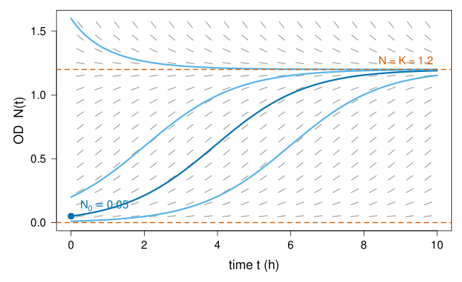
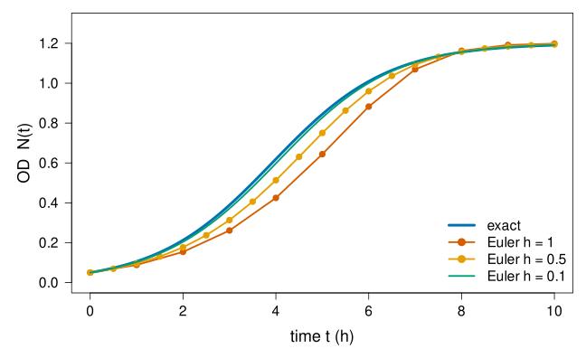
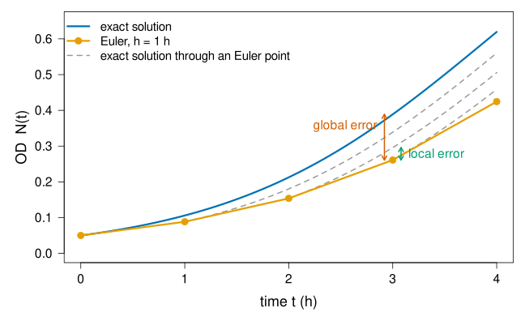
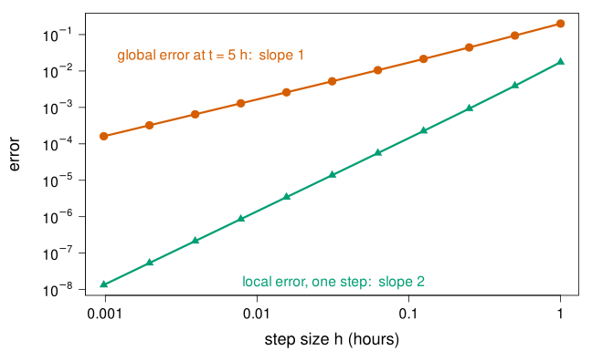
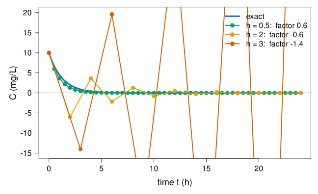
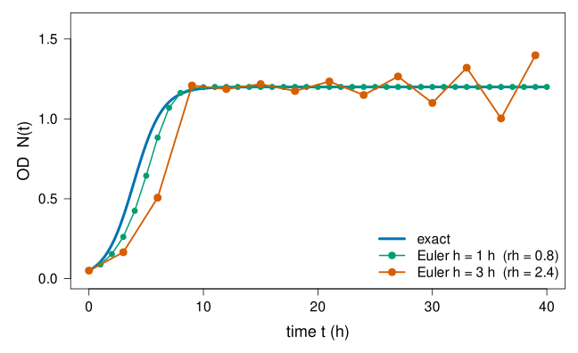
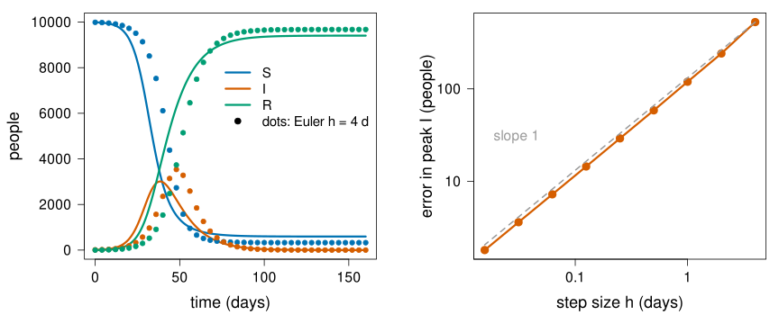
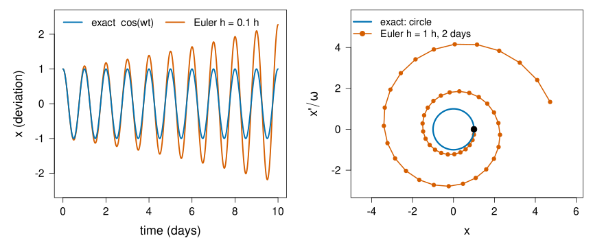

## About this lecture {.smaller}

Most models in biology say how fast something **changes**, not what it **is**: growth, decay, infection, binding. Those are **ordinary differential equations** (ODEs). Very few have a formula for the solution, so we step through time numerically.

- An ODE model is **rate in − rate out**. With a starting value it is an **initial value problem**.
- **Euler's method**: follow the slope for a short step $h$, recompute the slope, repeat. Ten lines of code.
- Its error: **local** $O(h^2)$ per step, **global** $O(h)$ at the end. Order 1: halving $h$ halves the error, read off a log–log plot.
- It can **fail**: too large a step gives negative concentrations, spurious boom–bust cycles, or oscillations that grow without end.
- Systems (the **SIR epidemic**) and higher-order equations (a **24-hour oscillator**) use the same method, with vectors.
- Biology: exponential and **logistic growth** (exact solution known, so we can measure errors), the SIR model.

::: notes
This opens Part 8. Students know y' = ky from calculus and nothing more about differential equations, so the first slides are about what an ODE model is and what a solution is, before any numerics. Everything here is hand-written: library solvers (deSolve::ode, scipy's solve_ivp) come in the next unit, Runge–Kutta and adaptive step size, and they do the same thing as our ten-line Euler, only more cleverly. The point of this unit is to understand what "solving an ODE numerically" means and how to tell whether the answer is right.
:::

## Recap: Euler already failed once {.smaller}

In *Why numerical analysis?* we stepped drug clearance $C' = -kC$ ($k = 0.8$ per hour) forward with 3-hour steps:

```r
k <- 0.8; h <- 3
C <- numeric(9); C[1] <- 10                  # mg/L
for (i in 1:8) C[i + 1] <- C[i] - h * k * C[i]
signif(C, 2)
# [1]   10  -14   20  -27   38  -54   75 -110  150
```

- Each step multiplies by $1 - hk = -1.4$: negative concentrations, growing without bound.
- With $h = 0.5$ the factor is $0.6$ and the answer is fine.
- Today: where that formula comes from, how accurate it is when it works, and how to know which case you are in.

::: notes
One slide only, to connect to the introduction. There we used the formula without deriving it; the point was that a method can amplify errors instead of damping them. Today we derive the step, measure its accuracy, and come back to this exact example on the instability slide with the full rule |1 - kh| < 1. Ask the room: what is the true concentration after 24 hours? (10 e^(-19.2), essentially 0.)
:::

## ODEs as models: rate in − rate out {.smaller}

An ODE says how fast a quantity changes, from what is known about **flows**:

| Model | ODE | Rates |
|---|---|---|
| Drug clearance | $C' = -kC$ | out: $k = 0.8$ per hour |
| mRNA level | $m' = \alpha - \delta m$ | in: $\alpha = 10$ per min; out: $\delta = 0.2$ per min |
| Logistic growth | $N' = rN\,(1 - N/K)$ | $r = 0.8$ per hour, $K = 1.2$ (OD) |

- Together with a start value this is an **initial value problem** (IVP):
  $$y'(t) = f(t, y), \qquad y(t_0) = y_0.$$
- $f$ gives the **slope** at every time and state. Solving the IVP means finding the curve $y(t)$ that starts at $y_0$ and has slope $f$ everywhere.

::: notes
The modelling step is the part biologists are good at: write down what flows in and what flows out. Each term has units of "amount per time". For the mRNA, production is constant and each molecule is degraded with probability delta per minute, so the loss is delta times m. Setting the right-hand side to zero gives the steady state m = alpha / delta = 50 molecules. The logistic: per-capita growth rate r when the culture is sparse, falling linearly to zero at the carrying capacity K. The OD units and numbers are the growth curve from Convergence and cost. In general f can depend on t too (a drug dosed at certain times); in our examples it does not.
:::

## Exponential and logistic growth: exact answers {.smaller}

From calculus:

- $N' = rN$ has $N(t) = N_0 e^{rt}$. Grows for ever.
- $N' = rN(1 - N/K)$ has (separation of variables)
  $$N(t) = \frac{K}{1 + (K/N_0 - 1)\,e^{-rt}}, \qquad K = 1.2,\ N_0 = 0.05,\ r = 0.8 \text{ per hour}.$$

```r
K <- 1.2; N0 <- 0.05; r <- 0.8
exact <- function(t) K / (1 + (K / N0 - 1) * exp(-r * t))
round(exact(0:5), 4)
# [1] 0.0500 0.1059 0.2126 0.3888 0.6193 0.8443
```

- We use the logistic **because** we know the answer: every error today is measured, not guessed.
- Real models (SIR, gene circuits, pharmacokinetics with several compartments) have **no formula**. That is why we need numerics.

::: notes
The logistic formula can be derived by separating variables and partial fractions; we do not need the derivation, only the formula. It is our test case: a nonlinear ODE with a known solution. This is the standard way to test a numerical method: run it on a problem where you know the answer, measure the error, and then trust it (with checks) on problems where you do not. Note how slowly N starts: OD 0.05 to 0.11 in the first hour, then the curve steepens around t = 4 h, where N = K/2 = 0.6.
:::

## Direction field: the ODE as a picture

{width="70%" fig-align="center"}

- At each point $(t, N)$ draw a short line with slope $f(t, N) = rN(1 - N/K)$.
- A solution follows the lines. Different start values give different curves; they never cross.
- $N = 0$ and $N = K$ are **equilibria** (slope 0). Steepest growth at $N = K/2$.

::: notes
The direction field is the ODE without any solving: the equation gives the slope everywhere, and a solution is a curve tangent to all the little lines. Here the slope depends only on N, not on t, so every column looks the same. The dark blue curve is our culture starting at 0.05; the light ones start at 0.01, 0.2 and 1.6 (above the carrying capacity, it decays down to K). Euler's method is exactly "walk along the little lines": that is the next slide. Equilibria and their stability are the topic of Equilibria, stability and the phase plane, later in Part 8.
:::

## Euler's method: follow the slope

Take a small step $h$ along the tangent, then look again:

$$y_{n+1} = y_n + h\,f(t_n, y_n), \qquad t_{n+1} = t_n + h.$$

- From Taylor: $y(t + h) = y(t) + h\,y'(t) + \tfrac{h^2}{2}\,y''(\xi)$, and $y'(t) = f(t, y)$. Euler drops the $h^2$ term.
- One $f$ evaluation per step. $y_n$ is our approximation to $y(t_n)$.
- The forward difference from *Numerical differentiation*, rearranged: $\dfrac{y_{n+1} - y_n}{h} = f(t_n, y_n)$.

::: notes
This is the Taylor row "Euler / Runge-Kutta" from the table in Why numerical analysis?: y(t+h) approx y(t) + h y'(t). The ODE hands us y'(t) for free, as f(t, y). The dropped term h^2/2 y'' is the error of one step; we come back to it in a few slides. Euler (1768) is the simplest method, and every better one (Runge–Kutta, next unit) uses the same template: evaluate the slope, step, repeat; only the choice of slope gets smarter.
:::

## Euler by hand {.smaller}

Logistic growth, $h = 1$ hour, $f(N) = 0.8\,N\,(1 - N/1.2)$:

| $n$ | $t_n$ | $N_n$ | $f(N_n)$ | $N_{n+1} = N_n + 1 \cdot f(N_n)$ | exact $N(t_{n+1})$ |
|---|---|---|---|---|---|
| 0 | 0 | 0.05 | $0.8 \cdot 0.05 \cdot 0.9583 = 0.03833$ | 0.08833 | 0.10587 |
| 1 | 1 | 0.08833 | $0.8 \cdot 0.08833 \cdot 0.9264 = 0.06547$ | 0.15380 | 0.21263 |
| 2 | 2 | 0.15380 | $0.8 \cdot 0.15380 \cdot 0.8718 = 0.10727$ | 0.26107 | 0.38879 |

- Euler is **behind** the true curve: the slope keeps increasing during each step, and Euler uses the slope at the **start**.
- After 3 h the error is $0.26 - 0.39 = -0.13$: a third of the true value. $h = 1$ is too big here.

::: notes
Do the first row on the board. 0.05/1.2 = 0.04167, so 1 - N/K = 0.9583; times 0.8 times 0.05 gives 0.03833. The exercise asks for the same steps with h = 0.5. The curve is convex in this region (y'' > 0), so the tangent lies below the curve and every Euler step undershoots. After the inflection point at N = 0.6 the curve is concave and Euler starts to catch up, and even overshoots slightly near K (next slide).
:::

## Euler in R

```r
euler <- function(f, t0, y0, h, n) {
  t <- t0 + (0:n) * h
  y <- numeric(n + 1); y[1] <- y0         # R vectors start at index 1
  for (i in 1:n) y[i + 1] <- y[i] + h * f(t[i], y[i])
  data.frame(t = t, y = y)
}
f <- function(t, N) r * N * (1 - N / K)    # f(t, y), even if t is unused
out <- euler(f, 0, N0, h = 1, n = 5)
round(out$y, 4)
# [1] 0.0500 0.0883 0.1538 0.2611 0.4245 0.6439
```

- The loop is the whole method. `f` always takes `(t, y)`, so the same `euler` works for every ODE.
- The first values match the hand table.

::: notes
Point out the R detail: y[1] holds y_0, so y[i + 1] holds y_i. The function signature f(t, y) is the convention of every ODE library (deSolve uses f(t, y, parms), scipy uses f(t, y)), so writing it this way now makes the switch to library solvers in the next unit painless. A loop is unavoidable here: each step needs the previous one, so there is nothing to vectorise.
:::

## Smaller steps, closer to the truth

{width="66%" fig-align="center"}

- Error at $t = 5$ h: $-0.20$ with $h = 1$, $-0.094$ with $h = 0.5$, $-0.017$ with $h = 0.1$.
- Error roughly proportional to $h$. Why, and how to check it?

::: notes
The true OD at 5 h is 0.844. With 1-hour steps Euler says 0.644, a 24 % error; that would be a terrible fit to growth data. With 0.1-hour steps the curve is close. The errors 0.20, 0.094, 0.017 are roughly in proportion to h; the next slides explain why and make it precise.
:::

## Local and global error

{width="62%" fig-align="center"}

- **Local error**: error made in **one** step, starting on the exact curve through the previous point. From Taylor: $\tfrac{h^2}{2}\,y''$, so $O(h^2)$.
- **Global error**: $y_n - y(t_n)$, everything accumulated since $t_0$.

::: notes
The dashed grey curves are exact solutions of the ODE, but starting from an Euler point instead of from N0. The local error at t = 3 (green) is how far one Euler step lands from the dashed curve through the previous point. The global error (red) is how far we are from the curve we actually want. After the first step, Euler is on a "wrong" solution curve, and each step moves to another wrong one. The global error is the sum of the local errors, each carried forward (and here slightly grown) by the ODE.
:::

## Why global error is $O(h)$ {.smaller}

- One step: local error $\approx \tfrac{h^2}{2}\,y''$. Check on the first logistic step, $y''(0) = 0.0281$:

  | $h$ | 1 | 0.5 | 0.25 | 0.1 |
  |---|---|---|---|---|
  | local error | 0.0175 | 0.0039 | 0.00093 | 0.000144 |
  | predicted $\tfrac{h^2}{2}y''(0)$ | 0.0141 | 0.0035 | 0.00088 | 0.000141 |

  Halving $h$ divides the local error by about 4.
- To reach time $T$ takes $n = T/h$ steps. Adding up $T/h$ local errors of size $C h^2$:
  $$\text{global error} \approx \frac{T}{h}\cdot C h^2 = C\,T\,h = O(h).$$
- Halving $h$ makes each step 4× more accurate but doubles the number of steps: the total improves 2×. **Euler is order 1.**

::: notes
The local error table is computed in the exercise. The prediction uses y'' at t = 0, which for the logistic is r N' (1 - 2N/K) = 0.8 * 0.0383 * 0.917 = 0.0281. For small h the prediction is very good (0.000141 vs 0.000144); for h = 1, y'' changes during the step and the prediction is off. The counting argument assumes errors simply add. In reality each earlier error is also carried along by the ODE, growing or shrinking; for a stable problem that changes the constant, not the power of h. The general rule: local error O(h^(p+1)) gives global error O(h^p), and p is called the order of the method.
:::

## Measure the order

```r
exact <- function(t) K / (1 + (K / N0 - 1) * exp(-r * t))
h   <- 2^-(0:8)                               # 1, 1/2, ..., 1/256 hours
err <- sapply(h, function(h)
  abs(tail(euler(f, 0, N0, h, 5 / h)$y, 1) - exact(5)))
signif(err, 3)
# [1] 0.200000 0.094000 0.044400 0.021400 0.010500 0.005220 0.002600 0.001300
# [9] 0.000647
signif(err[-9] / err[-1], 3)                  # ratio when h is halved
# [1] 2.13 2.12 2.07 2.04 2.02 2.01 2.00 2.00
coef(lm(log10(err) ~ log10(h)))[2]            # slope on log-log axes
#  log10(h)
#  1.031108
```

- Halving $h$ halves the error: ratio $2 = 2^1$, slope 1. Order $p$ would give ratio $2^p$.

::: notes
This is the experiment from Convergence and cost, now for an ODE solver. tail(..., 1) takes the last value, the approximation at t = 5. The ratios approach 2 as h shrinks; for large h the higher-order terms still matter. Fitting the slope of log error against log h gives 1.03. The figure on the next slide shows it, together with the slope-2 local error.
:::

## Order on a log–log plot

{width="72%" fig-align="center"}

- Global error: slope 1. Local (one-step) error: slope 2. Parallel lines would mean the same order.
- **Check your own solver this way**: a slope that is not the expected order means a bug.

::: notes
Two straight lines on log-log axes: the global error at t = 5 (slope 1) and the error of a single step from t = 0 (slope 2). Neither line bends at small h here; rounding error of order n * eps (about 1e-12 for 5000 steps) is far below. The debugging use is real: if a hand-written method that should be order 1 (or 4, for RK4) shows another slope, there is a mistake in the code, for example the slope evaluated at the wrong time.
:::

## Without the exact answer: halve the step {.smaller}

Usually there is no formula. Run twice, with $h$ and $h/2$:

```r
y1 <- tail(euler(f, 0, N0, 0.1, 50)$y, 1)       # h = 0.1
y2 <- tail(euler(f, 0, N0, 0.05, 100)$y, 1)     # h = 0.05
c(y1, y2, y1 - y2, y2 - exact(5))
# [1]  0.827288203  0.835925961 -0.008637758 -0.008395457
```

- Order 1: $y_h \approx y + Ch$ and $y_{h/2} \approx y + Ch/2$, so $y_h - y_{h/2} \approx Ch/2 \approx$ **the error of $y_{h/2}$**. Here $-0.0086$ vs the true $-0.0084$.
- **Cost**: the error at $t = 5$ is about $0.17\,h$. Four correct digits ($10^{-4}$) need $h \approx 6\times10^{-4}$: **8300 steps**. Six digits: **830 000**.
- Order 1 is cheap per step and expensive per digit. Higher order: *Runge–Kutta and adaptive step size*.

::: notes
Step halving is the check to run on every ODE solution you compute with a fixed step: if halving the step changes the answer in a digit you care about, the step was too large. It is also the idea behind adaptive step-size control in the next unit, which estimates the local error at every step by comparing two methods. The cost numbers: err(1/256) = 0.000647, so C = 0.166 and h = 1e-4 / 0.166 = 6e-4, 5 / 6e-4 = 8300 steps. Every extra digit costs ten times the work for an order-1 method; for an order-4 method, an extra digit costs a factor 10^(1/4) = 1.8.
:::

## Instability: back to drug clearance

{width="58%" fig-align="center"}

On $C' = -kC$ each Euler step multiplies by $1 - kh$:

- $0 < kh < 1$: decays, like the truth. $\;1 < kh < 2$: decays, but flips sign every step.
- $kh > 2$: $|1 - kh| > 1$, **grows** without bound. Stable only for $h < 2/k = 2.5$ h.

::: notes
For C' = -kC Euler gives C_{n+1} = C_n - h k C_n = (1 - kh) C_n, so C_n = (1 - kh)^n C_0. This is a geometric sequence: it shrinks if |1 - kh| < 1 and grows otherwise. h = 0.5: factor 0.6, monotone and close to exact. h = 2: factor -0.6, oscillating but decaying: wrong in shape (negative concentrations) but at least it goes to zero. h = 3: factor -1.4, the introduction's example. The bound h < 2/k depends only on the rate: a drug cleared ten times faster (k = 8 per hour) needs h < 0.25 h. When a model contains one very fast rate, this bound forces tiny steps everywhere; that is stiffness, the topic of Stiffness and implicit methods.
:::

## Instability in a nonlinear model {.smaller}

:::: {.columns}
::: {.column width="58%"}
{width="100%"}
:::
::: {.column width="42%"}
```r
round(tail(euler(f, 0, N0, 3, 40)$y, 4), 3)
# [1] 1.432 0.770 1.432 0.767
```

- Near $K$, the logistic behaves like $y' = -r\,(N - K)$: the same test equation with rate $r$.
- Stable only for $h < 2/r = 2.5$ h. With $h = 3$ ($rh = 2.4$), Euler settles into a **boom–bust cycle** 0.77 ↔ 1.43.
:::
::::

- A **confident wrong answer**: a clean, repeating cycle that the true model does not have. Check: **halve the step**. The cycle disappears.

::: notes
Linearise: f(N) = r N (1 - N/K) has f'(K) = -r, so near the carrying capacity the deviation N - K obeys approximately d/dt (N - K) = -r (N - K). Euler multiplies the deviation by 1 - rh = -1.4 each step, so it grows until the nonlinearity limits it. The Euler map N -> N + h r N (1 - N/K) is the discrete logistic map, the cousin of the Ricker model from Bisection and fixed-point iteration: with rh = 2.4 it has a stable 2-cycle, and above rh = 2.57 it becomes chaotic. A discrete-time population model can really cycle; the continuous logistic ODE cannot. Any long simulation with a fixed step should be repeated with half the step before you interpret oscillations.
:::

## Systems of ODEs: the SIR epidemic {.smaller}

Susceptible $S$, infected $I$, recovered $R$ in a population of $N = 10\,000$:

$$S' = -\beta \frac{SI}{N}, \qquad I' = \beta\frac{SI}{N} - \gamma I, \qquad R' = \gamma I$$

- $\beta = 0.3$ per day (infectious contacts), $\gamma = 0.1$ per day (recovery: 10 days infectious). $R_0 = \beta/\gamma = 3$.
- Start: $S = 9990$, $I = 10$, $R = 0$. Rate in − rate out again: $\beta SI/N$ flows from $S$ to $I$, $\gamma I$ from $I$ to $R$.
- **Vector form**: $\mathbf y = (S, I, R)$, $\mathbf y' = \mathbf f(t, \mathbf y)$. Euler is unchanged:
  $$\mathbf y_{n+1} = \mathbf y_n + h\,\mathbf f(t_n, \mathbf y_n).$$

::: notes
The SIR model (Kermack and McKendrick, 1927) has no closed-form solution in time, which is typical. Each term is a flow: new infections happen at a rate proportional to contacts between S and I, beta S I / N, and infected people recover at rate gamma per person. R0 = 3 means one infected person infects 3 others in a fully susceptible population. Every term appears once with a minus sign and once with a plus, so S + I + R stays N. The vector form is the key idea: a system of ODEs is one ODE for a vector, and the Euler step is the same line of code with vectors. We reuse this model in Runge–Kutta and adaptive step size.
:::

## SIR in R

```r
beta <- 0.3; gamma <- 0.1; N <- 10000       # per day; R0 = beta/gamma = 3
sir <- function(t, y) {
  S <- y[1]; I <- y[2]
  c(-beta * S * I / N, beta * S * I / N - gamma * I, gamma * I)
}
euler_sys <- function(f, t0, y0, h, n) {    # one row per time point
  Y <- matrix(0, n + 1, length(y0)); Y[1, ] <- y0
  for (i in 1:n) Y[i + 1, ] <- Y[i, ] + h * f(t0 + (i - 1) * h, Y[i, ])
  Y
}
Y <- euler_sys(sir, 0, c(9990, 10, 0), h = 1, n = 160)
c(peak = max(Y[, 2]), day = which.max(Y[, 2]) - 1)
#     peak      day
# 3127.315   41.000
```

- The only change from `euler`: `y` is a vector, so the solution is a matrix (time × variable).

::: notes
f now returns a vector of three slopes, and each Euler step updates all three at once, using the old values of all three. (Updating S first and then using the new S for I would be a different method.) The peak of 3127 people infected at day 41: how accurate is it? For SIR there is one quantity with a formula, the peak, so we can measure the error (next slide).
:::

## SIR: how accurate is the peak?

{width="88%" fig-align="center"}

- Exact peak: $I_{\max} = S_0 + I_0 - \tfrac{N}{R_0}\bigl(1 + \ln\tfrac{R_0 S_0}{N}\bigr) = 3008$. Euler: 3127 ($h = 1$ d), 3020 ($h = 0.1$ d). Order 1 again.
- $S + I + R = 10\,000$ to $10^{-11}$ for **every** $h$: Euler keeps sums exactly. A conservation check finds bugs, **not** step-size error.

::: notes
The peak formula comes from dividing I' by S', which gives an ODE for I as a function of S that can be integrated; it is in every epidemiology textbook. The left panel: with 4-day steps (dots) Euler's epidemic starts later, peaks higher (3535) and too late, and ends with too few susceptibles left. The right panel: the error in the peak falls in proportion to h, slope 1. The conservation check is worth stressing: since the three slopes add to zero, the Euler step adds zero to S + I + R whatever h is. So a perfect conservation check says nothing about accuracy. It does catch a typo such as a wrong sign.
:::

## Higher-order ODEs → first-order systems {.smaller}

A 24-hour rhythm in its simplest form: the deviation $x$ of a clock protein from its mean obeys
$$x'' = -\omega^2 x, \qquad \omega = \frac{2\pi}{24} \text{ per hour}, \qquad x(0) = 1,\ x'(0) = 0.$$
Exact solution: $x(t) = \cos \omega t$, period 24 h.

**Recipe**: name each derivative except the highest as a new variable.

- $y_1 = x$, $y_2 = x'$. Then $y_1' = y_2$ and $y_2' = x'' = -\omega^2 y_1$:
  $$\begin{pmatrix} y_1 \\ y_2 \end{pmatrix}' = \begin{pmatrix} y_2 \\ -\omega^2 y_1 \end{pmatrix}, \qquad \mathbf y(0) = \begin{pmatrix} 1 \\ 0 \end{pmatrix}.$$
- An order-$m$ equation becomes $m$ first-order ones; it needs $m$ initial values. Every solver only handles $\mathbf y' = \mathbf f(t, \mathbf y)$.

::: notes
x'' = -omega^2 x is the harmonic oscillator; it is the linearisation of many oscillating systems near their equilibrium, and Newton's law for a spring. Real circadian clock models are nonlinear systems of first-order ODEs (Equilibria, stability and the phase plane), but this one has an exact solution, so we can see what Euler does to an oscillation. The recipe works for any order: for x''' = g(x, x', x''), set y1 = x, y2 = x', y3 = x''. All solvers (Euler, deSolve, solve_ivp, the Rust ode_solvers crate) expect a first-order system, so this rewrite is something you will do yourself.
:::

## Euler on an oscillation: it spirals out

```r
w <- 2 * pi / 24                       # one cycle per 24 h
osc <- function(t, y) c(y[2], -w^2 * y[1])
for (h in c(1, 0.1, 0.01)) {
  Y <- euler_sys(osc, 0, c(1, 0), h, n = 240 / h)
  x <- Y[nrow(Y), ]
  cat(h, sqrt(x[1]^2 + (x[2] / w)^2), "\n")   # amplitude after 10 days; exact: 1
}
# 1 2849.977
# 0.1 2.275467
# 0.01 1.085723
```

- Each step multiplies the amplitude by $\sqrt{1 + \omega^2 h^2} > 1$, for **every** $h$. No step is small enough to be stable for long times.

::: notes
The amplitude sqrt(x^2 + (x'/omega)^2) is constant (1) for the exact solution. Euler multiplies it by sqrt(1 + omega^2 h^2) per step: one Euler step maps (y1, y2) to (y1 + h y2, y2 - h omega^2 y1), and in the scaled variables that is a rotation combined with a stretch by that factor. With h = 1 h the amplitude grows by 3.4 % per step, a factor 2.2 per day, 2850 after 10 days. With h = 0.01 h it is still 8.6 % too large after 10 days. Compare with the decay equation, where small enough h is stable: for pure oscillation Euler is never stable. Methods with a better stability region (RK4, next unit) fix this for practical purposes.
:::

## The spiral

{width="92%" fig-align="center"}

- Left: $h = 0.1$ h, the amplitude grows by 8.6 % per day. Right: $h = 1$ h, the orbit in the $(x, x'/\omega)$ plane spirals outwards instead of closing.
- **Check**: track a quantity that should stay constant (here the amplitude). Drift means step-size error.

::: notes
The right panel is a phase-plane picture, which comes back in Equilibria, stability and the phase plane: the exact solution is a closed circle (a periodic orbit) and Euler turns it into an outward spiral. A biologist simulating a clock model with Euler could conclude that the oscillation is unstable and grows, when it is the method that grows. Unlike S + I + R in the SIR model, the amplitude here is not preserved by Euler, so it is a real accuracy check.
:::

## Before you trust an ODE solution

- **Halve the step** and compare. If the answer moves in a digit you care about, the step was too large.
- **Measure the order** on a test problem with a known answer (logistic): slope 1 for Euler. Another slope means a bug.
- **Stability**: for each decay rate $k$ in the model, need $h < 2/k$. Negative concentrations, sign-flipping or sudden cycles are warning signs.
- **Plausibility and invariants**: concentrations $\ge 0$; conserved totals ($S + I + R$) catch typos; quantities that should be constant (an amplitude) catch step-size error.
- **Plot** the solution, and look at it at the resolution of the steps.

::: notes
These five checks apply to every ODE solver, including the library ones of the next unit. Adaptive solvers automate the first one, but they choose steps from a tolerance you set, so the "halve the step" check becomes "tighten the tolerance".
:::

## Summary {.smaller}

- An **ODE** model is rate in − rate out; with a start value it is an **initial value problem** $y' = f(t, y)$, $y(t_0) = y_0$. The **direction field** shows $f$ as slopes.
- **Euler**: $y_{n+1} = y_n + h\,f(t_n, y_n)$, the first-order Taylor step. Ten lines of code.
- **Local error** $O(h^2)$, **global error** $O(h)$: **order 1**, slope 1 on a log–log plot. Without an exact solution, the change when $h$ is halved estimates the error. Six digits on the logistic: 830 000 steps.
- **Instability**: on $y' = -ky$ each step multiplies by $1 - kh$; need $h < 2/k$. Too large a step gives negative concentrations or a spurious cycle; on an oscillation Euler spirals out for **every** $h$.
- **Systems**: same formula with vectors (SIR). **Higher-order ODEs**: introduce $y_2 = x'$, … to get a first-order system.

**Next:** *Runge–Kutta and adaptive step size*: higher order, automatic step control, and the library solvers `deSolve::ode` and `solve_ivp`.

::: notes
Recap the method, its order, how it fails and the checks. The next unit keeps the SIR model and the logistic test problem and shows how much less work an order-4 method needs, then hands the step-size choice to an adaptive library solver. Stiffness and implicit methods returns to the stability bound h < 2/k, for models with very fast and very slow rates together.
:::
