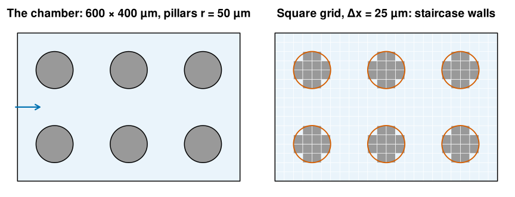
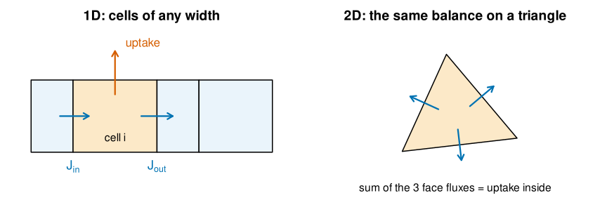
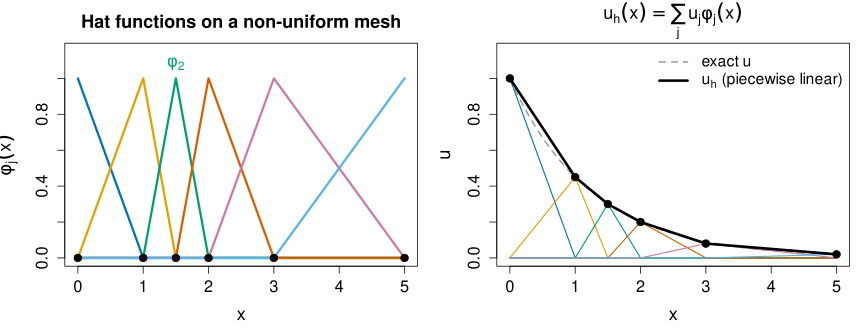
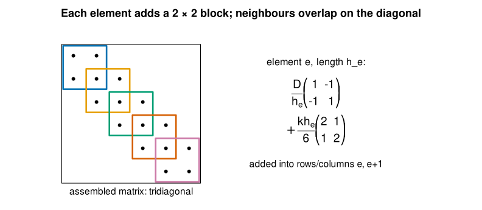
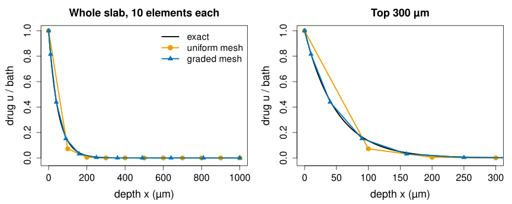
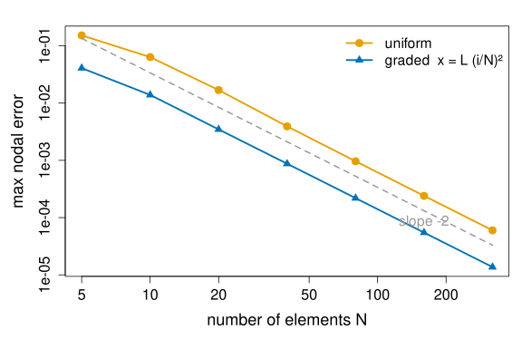
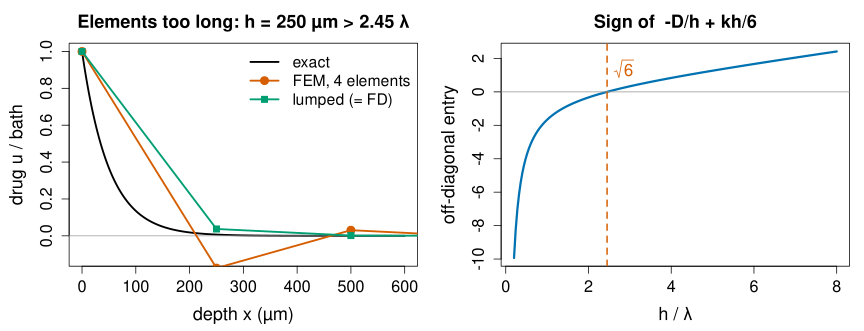
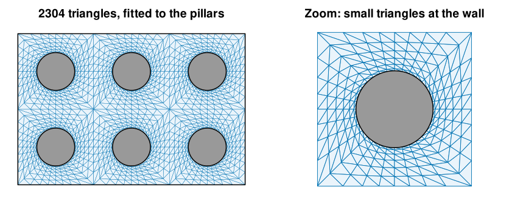
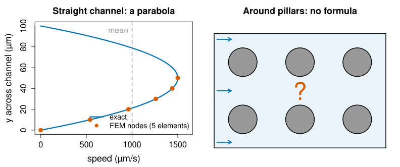

## About this lecture {.smaller}

Part 10 ([*The diffusion (heat) equation by finite differences*](../diffusion-explicit/lec.qmd) to [*Reaction–diffusion and pattern formation*](../reaction-diffusion/lec.qmd)) put every chip on a **rectangular grid**. Real chips have round pillars, curved channels and cells of any shape. This lecture is an **outlook**: what the tools used for real chip design do differently, with one small piece done by hand.

- Why finite differences **struggle** with curved and irregular geometry: staircase walls, refinement that spreads everywhere.
- **Finite volumes** in one picture: conservation in every cell, whatever its shape.
- **Finite elements** in 1D: the unknown is a sum of **hat functions**; the **weak form**; a 2 × 2 matrix per element, **assembled** into a tridiagonal matrix. On a uniform mesh it is the finite-difference matrix again; on a **non-uniform** mesh we put the points where the solution changes.
- **Meshes** of triangles in 2D, and **solving for the flow** itself: Stokes flow, with the Poiseuille profile as its exact solution in a straight channel.
- What **COMSOL**, **FEniCS / Firedrake**, **scikit-fem** and **deal.II** do, and when to reach for them instead of our own codes.

::: notes
This is optional further reading after Part 10. It assumes the diffusion units of Part 10 (the grid, the second difference, the Thomas algorithm, grid refinement as a check) and does not teach any of the big packages: the aim is that students know what they are doing when they open COMSOL or FEniCS, and can check it. The only new hand-written method is a 1D finite element code of about 15 lines, which turns out to need nothing beyond the tridiagonal solve of [*Implicit schemes and the method of lines*](../diffusion-implicit/lec.qmd).
:::

## A chamber with pillars {.smaller}

{width="78%" fig-align="center"}

- Pillars hold up the roof of a wide culture chamber, or trap cells. On a square grid each round wall becomes a **staircase**: its position is wrong by up to $\Delta x/2$, and "no flux through the wall" has no clean stencil on a slanted wall.
- Finer near the pillars means finer **everywhere**: a grid line runs across the whole chamber. Halving $\Delta x$ costs 4× the unknowns in 2D, 8× in 3D.

::: notes
The same chamber returns at the end of the lecture as a triangle mesh. Finite differences can be pushed to handle curved walls (cut cells, immersed boundaries, curvilinear coordinates), and research codes do, but each fix is a project of its own. The two methods below start from a mesh that follows the wall. 72 of the 384 grid cells are inside a pillar here; the staircase is visible even at 25 um, half the pillar radius. For transport near a wall (a drug taken up by cells on the pillar surface) the flux through the wall is exactly what we want to know, and it is what the staircase gets worst.
:::

## Finite volumes in one picture {.smaller}

{width="78%" fig-align="center"}

- Cut the domain into **cells** of any shape. For each cell: flux in − flux out = uptake (or accumulation) inside. One equation per cell.
- Flux through a face between cells $i$ and $j$: $D\,(u_j - u_i)/d_{ij}$ × face area. On a uniform square grid this gives back the five-point stencil.
- What leaves one cell enters its neighbour, so the total amount is **conserved exactly**. This is why most flow (CFD) codes are finite-volume codes: OpenFOAM, Ansys Fluent.

::: notes
Finite volumes are the mass balance with which we derived the diffusion equation in [*The diffusion (heat) equation by finite differences*](../diffusion-explicit/lec.qmd), before taking the limit: keep the cells finite and write one balance per cell. The cells can be triangles, polygons or cut cells at a wall. The approximation sits in the face flux, which is a difference quotient between cell centres. Conservation holds to rounding error whatever the mesh, which matters for flow, where small leaks in mass add up downstream.
:::

## Finite elements: a sum of hats {.smaller}

{width="80%" fig-align="center"}

- Pick nodes $x_0 < x_1 < \dots < x_N$, **any spacing**. Hat function $\varphi_j$: 1 at node $j$, 0 at every other node, straight lines in between.
- Approximate $u(x) \approx u_h(x) = \sum_j u_j\,\varphi_j(x)$: the piecewise linear interpolant through the nodal values $u_j$. The **unknowns** are the $u_j$, as in finite differences.

::: notes
This is piecewise linear interpolation from [*Splines*](../splines/lec.qmd), written as a sum of basis functions. Each hat lives on only two elements (the intervals next to its node), and that will make the matrix tridiagonal. In 2D the hats become pyramids over triangles; with quadratic or cubic pieces instead of straight lines one gets higher-order elements. The difference from finite differences is not the unknowns but how we choose the equations for them.
:::

## The weak form in words {.smaller}

Model: $-(D\,u')' + k\,u = f$ on $0 < x < L$. Instead of asking it to hold **at each node**, ask it to hold **on average** against every hat $\varphi_i$:

1. Multiply the equation by $\varphi_i$ and integrate over the domain.
2. **Integrate by parts**: $-\int (D u')'\varphi_i\,dx = \int D\,u'\varphi_i'\,dx - \big[D u' \varphi_i\big]_0^L$. Now only **first** derivatives appear, so piecewise linear $u_h$ is allowed.
3. The boundary term is the flux. At a no-flux wall it is zero, so the condition is built in (**natural** boundary condition). Where $u$ is prescribed, we do not test.
4. Insert $u_h = \sum_j u_j\varphi_j$: a linear system $K\mathbf u = \mathbf b$ with
$$K_{ij} = \int D\,\varphi_i'\varphi_j'\,dx + \int k\,\varphi_i\varphi_j\,dx, \qquad b_i = \int f\,\varphi_i\,dx.$$

::: notes
Say it slowly: "weak" because we only ask for the equation in an averaged sense, which is also why kinks in u_h are fine. The no-flux wall is the nice surprise: in [*The diffusion (heat) equation by finite differences*](../diffusion-explicit/lec.qmd) it needed a ghost point; here we do nothing at all. Galerkin's choice is to test with the same hats used to build u_h, which makes K symmetric. Since each hat overlaps only its two neighbours, K_ij is zero unless |i - j| <= 1: tridiagonal. Nothing in steps 1-4 needs a uniform mesh or a straight wall, and that is the point.
:::

## Element by element {.smaller}

{width="72%" fig-align="center"}

- On one element of length $h_e$ the two hats have slopes $\pm 1/h_e$, so $\int D\varphi_i'\varphi_j' = \pm D/h_e$; and $\int \varphi_i\varphi_j = h_e/3$ (same hat) or $h_e/6$.
- **Assembly**: loop over elements and **add** each 2 × 2 block into rows and columns $e, e+1$. The same loop, over triangles with 3 × 3 blocks, builds the 2D matrix.

::: notes
Every finite element code, from 15 lines of R to COMSOL, has this structure: compute a small matrix per element from its geometry and material (D and k may differ from element to element, at no extra cost), and add it into the big sparse matrix. The h/3 and h/6 come from integrating products of two straight lines: ∫ (x/h)^2 dx = h/3 and ∫ (x/h)(1 - x/h) dx = h/6 over [0, h]. The load vector gets f h_e / 2 per node of each element for constant f.
:::

## Same matrix as finite differences {.smaller}

For $-D u'' = f$ on a **uniform** mesh, an interior row of $K\mathbf u = \mathbf b$ reads
$$\frac{D}{h}\,(-u_{i-1} + 2u_i - u_{i+1}) = f\,h \quad\Longleftrightarrow\quad D\,\frac{-u_{i-1} + 2u_i - u_{i+1}}{h^2} = f,$$
the second difference from [*Numerical differentiation*](../finite-differences/lec.qmd) (written there as $(1, -2, 1)/h^2$). Check with `assemble()` (next slides), 5 elements of $h = 100$, $D = 1$, $f = 1$:

```r
S <- assemble(seq(0, 500, by = 100), D = 1, k = 0, f = 1)
S$di * 100;  S$off * 100;  S$b          # K times h, and b
# [1] 1 2 2 2 2 1
# [1] -1 -1 -1 -1 -1
# [1]  50 100 100 100 100  50
```

- Interior: $(-1, 2, -1)$ and $f h$. The last row has **half** weights: exactly the ghost-point no-flux row, divided by 2.
- With uptake, FEM gives $\tfrac{kh}{6}(u_{i-1} + 4u_i + u_{i+1})$ where FD has $k h\,u_i$: a weighted average. Lumping it onto the diagonal gives FD exactly.

::: notes
So on a rectangle with a uniform grid, finite elements bring nothing new: the matrix is the one from Part 10, row by row, up to a factor h. The last row is (D/h)(u_N - u_{N-1}) = f h / 2; the ghost-point row from [*The diffusion (heat) equation by finite differences*](../diffusion-explicit/lec.qmd) is D (2u_{N-1} - 2u_N)/h^2 = -f, i.e. the same equation times 2/h. Mass lumping (replacing the h/6, h/3 weights by a diagonal h/2) is a common trick; we will see on the failure slide why it can matter. The gain from finite elements comes when the mesh is not uniform, which the exercise B2 shows also reproduces the non-uniform finite-difference formula in 1D.
:::

## The 1D example: drug into a hydrogel slab {.smaller}

A hydrogel slab, $L = 1$ mm thick on a glass bottom, with cells embedded in it. A drug in the medium above diffuses in ($D = 100$ µm²/s) and the cells take it up ($k = 0.04$ s⁻¹).

$$-D\,u'' + k\,u = 0, \qquad u(0) = 1 \text{ (bath)}, \qquad u'(L) = 0 \text{ (glass)}$$

- Exact steady state: $u(x) = \dfrac{\cosh\big((L - x)/\lambda\big)}{\cosh(L/\lambda)}$ with $\lambda = \sqrt{D/k} = 50$ µm.
- The drug reaches only the top ~150 µm. All the action is in a **thin layer**; the lower 800 µm need almost no points.
- Questions a biologist asks: how deep do cells see the drug? How much is in the gel ($\int u\,dx \approx \lambda = 50$ µm × bath concentration)?

::: notes
λ = sqrt(D/k) is the same length scale as the synthesis-diffusion-degradation morphogen gradient in [*Reaction–diffusion and pattern formation*](../reaction-diffusion/lec.qmd) (there 100 µm, with time in minutes): here the source is the bath at the top and the sink is uptake by the cells. The numbers are round but realistic: a drug or growth factor in a soft gel has D of order 10-100 um^2/s; strong uptake or binding gives penetration depths of tens of um, which is why cells deep in thick gels or spheroids can be untreated. The total amount λ tanh(L/λ) = 50 um (in units of bath concentration) is the flux into the gel divided by k.
:::

## FEM in R: assembly {.smaller}

```r
assemble <- function(x, D, k, f = 0) {        # nodes x, any spacing
  n <- length(x); h <- diff(x)
  di <- numeric(n); off <- numeric(n - 1); b <- numeric(n)
  for (e in 1:(n - 1)) {                     # element e: nodes e and e + 1
    kd <- D / h[e] + k * h[e] / 3            # diagonal entries of the 2 x 2
    ko <- -D / h[e] + k * h[e] / 6           # off-diagonal entries
    di[e:(e + 1)] <- di[e:(e + 1)] + kd
    off[e] <- off[e] + ko
    b[e:(e + 1)] <- b[e:(e + 1)] + f * h[e] / 2
  }
  list(di = di, off = off, b = b)            # tridiagonal K, load b
}
```

- `di` is the diagonal, `off` the off-diagonal (the matrix is symmetric). No ghost point: the no-flux end needs nothing.

::: notes
Eleven lines, and no assumption about the spacing: h[e] is the length of element e. To let D or k vary from element to element (a two-layer gel, cells only in the lower layer), write D[e] and k[e]; the exercise does that with rep_len. Note how small the loop body is: this is the R version of the assembly picture. Python users: the same loop with numpy arrays; Rust: a plain for loop over Vec<f64>.
:::

## FEM in R: solve and check {.smaller}

```r
fem1d <- function(x, D, k, f = 0, u0 = 1) {  # u(x[1]) = u0, u' = 0 at the end
  S <- assemble(x, D, k, f); off <- S$off
  rhs <- S$b[-1]; rhs[1] <- rhs[1] - off[1] * u0     # move known u0 to the right
  c(u0, thomas(off, S$di[-1], c(off[-1], 0), rhs))
}
L <- 1000; D <- 100; k <- 0.04; lam <- sqrt(D / k)
exact <- function(x) cosh((L - x) / lam) / cosh(L / lam)
xu <- seq(0, L, length.out = 11)                 # uniform, h = 100 um
xg <- L * (0:10 / 10)^2                          # graded: 0, 10, 40, 90, ...
max(abs(fem1d(xu, D, k) - exact(xu)))
# [1] 0.06353851
max(abs(fem1d(xg, D, k) - exact(xg)))
# [1] 0.0138701
```

- Same 10 elements, 4.6 times smaller error, by moving nodes to where $u$ changes. The uniform mesh needs 20 elements (error 0.0169) to come close.

::: notes
thomas() is the tridiagonal solver from [*Structure: symmetric, banded, sparse*](../structured-sparse/lec.qmd), with the convention used in [*Implicit schemes and the method of lines*](../diffusion-implicit/lec.qmd): a, b, c, d all of length m, a[1] and c[m] unused. The Dirichlet value at x = 0 is removed from the unknowns and its column moved to the right-hand side, exactly as boundary values were handled in Part 10. The graded mesh x_i = L (i/N)^2 has its first element 10 um long and its last 190 um. The error is measured at the nodes against the exact cosh solution.
:::

## Refine where the solution changes

{width="92%" fig-align="center"}

- The uniform mesh puts one node inside the layer ($x = 100$ µm) and nine where $u \approx 0$. The graded mesh puts four nodes in the top 100 µm.

::: notes
The right panel zooms in on the top 300 um. The uniform mesh misses the curvature of the profile at the surface and undershoots at 100 um (0.072 instead of 0.135). Where u is flat, long elements cost nothing in accuracy. In 1D a finite-difference code could also use a non-uniform grid (exercise B2 shows the formulas agree), so the 1D example only shows the mechanics; the real payoff of a mesh that follows the solution and the geometry comes in 2D and 3D, where a grid cannot be refined locally.
:::

## Error against number of elements

{width="62%" fig-align="center"}

- Both meshes are **second order**: doubling $N$ divides the error by 4. Grading changes the constant, not the order.
- The check is the one from Part 10: refine and watch the error fall at the expected rate. Real codes **adapt** the mesh automatically, refining where an error estimate is large.

::: notes
Slope -2 on log-log axes, as for the second difference: piecewise linear elements have error of order h^2 in the values. On the graded mesh the first element is L/N^2 long, N times shorter than on the uniform mesh, and the error constant drops by a factor of about 4.5 at every N. Adaptive refinement (deal.II, COMSOL, FEniCS with error estimators) automates "put nodes where the error is": solve, estimate the error per element, split the worst elements, solve again. Without an exact solution, compare successive refinements, as in the grid refinement slide of [*Implicit schemes and the method of lines*](../diffusion-implicit/lec.qmd).
:::

## Failure: elements too long, negative drug {.smaller}

{width="82%" fig-align="center"}

- With 4 elements ($h = 250$ µm) FEM returns $u = -0.17$ at 250 µm: a **negative concentration**. The off-diagonal $-D/h + kh/6$ turns **positive** once $h > \sqrt6\,\lambda = 122$ µm.
- **Check**: look for negative or non-monotone values; keep $h$ below ~$\lambda$ in layers; refine and compare. Lumping (= FD) stays positive (0.037 vs exact 0.0067) but is still wrong.

::: notes
The exact u at 250 um is 0.0067. With positive off-diagonals the matrix is no longer an M-matrix, and the discrete maximum principle (no new minima or maxima inside) is lost; the oscillation is the same kind of non-physical wiggle as central differences at high cell Péclet number (above 2) in [*Flow plus diffusion*](../advection-diffusion/lec.qmd). The fix is not a cleverer solver but a finer mesh where the solution changes over lengths shorter than h. Lumping restores the sign, at the price of a different (and here still large) error. In 2D the analogous warning sign is a mesh with very flat or very obtuse triangles; mesh generators report a quality measure for this.
:::

## Meshes in 2D: triangles {.smaller}

{width="80%" fig-align="center"}

- Triangles follow round walls; small triangles where the solution changes fast (near walls), large ones elsewhere. Same assembly loop, 3 × 3 element blocks.
- Mesh generators (Gmsh, the meshers inside COMSOL) build this from a CAD drawing of the chip. The matrix is sparse but no longer banded: a sparse direct or iterative solver does the work.

::: notes
This mesh has 2304 triangles, graded towards each pillar; a real mesher would make it less regular. The matrix has one row per node, and each row has one non-zero per neighbour plus the diagonal (about 7). It is solved with the sparse direct solvers of [*Steady state in two dimensions*](../steady-state-2d/lec.qmd) or, in 3D, with the iterative solvers of [*Iterative linear solvers in depth*](../iterative-solvers/lec.qmd). Bad triangles (angles near 0 or 180 degrees) hurt accuracy and conditioning, so the first thing to look at in any simulation is the mesh.
:::

## Solving for the flow itself {.smaller}

So far the flow was **given**. To compute it, solve for velocity $\mathbf u$ and pressure $p$: Navier–Stokes, mass + momentum.

- **Reynolds number** $Re = \rho U \ell/\mu$: inertia against viscosity. Water ($\rho = 1000$ kg/m³, $\mu = 10^{-3}$ Pa s) at $U = 1$ mm/s in a 100 µm channel: $Re = 0.1$.
- At $Re \ll 1$ inertia drops out, leaving **Stokes flow**: $\mu\nabla^2\mathbf u = \nabla p$, $\nabla\cdot\mathbf u = 0$. **Linear**: no turbulence, flow follows walls smoothly, and reverses if the pressure reverses.
- Numerically: three unknown fields coupled, the incompressibility constraint makes the linear system a **saddle-point** problem, and velocity and pressure need matched element types (e.g. quadratic velocity, linear pressure).

::: notes
Navier–Stokes in words: mass is conserved (divergence of u is zero for water), and momentum changes by pressure forces, viscous friction and inertia (the nonlinear term u·grad u). Microfluidics lives at small Re, which is why the flow there is laminar and predictable: the T-sensor works because two streams flow side by side without mixing except by diffusion. Stokes flow is a linear system per solve, so it fits everything in Part 3. We do not solve 2D Stokes here: the saddle-point structure and the choice of element pairs are where library code earns its keep. Navier–Stokes at larger Re adds the nonlinear term, handled with Newton's method from [*Newton for systems of equations*](../newton-systems/lec.qmd).
:::

## Straight channel: the Poiseuille profile {.smaller}

{width="56%" fig-align="center"}

In a long straight channel between walls $w$ apart, Stokes reduces to 1D: $-\mu u'' = G$ (pressure gradient $G$). Exact: $u(y) = \frac{G}{2\mu}\,y\,(w - y)$, peak 1.5 × mean. [*Flow plus diffusion*](../advection-diffusion/lec.qmd) took this as **given** (its T-sensor: $w = 100$ µm, mean 1000 µm/s). Our 1D code, half channel, wall $u(0) = 0$, symmetry $u'(w/2) = 0$, $w = 100$ µm, mean 1000 µm/s:

```r
fem1d(seq(0, 50, by = 10), D = 1, k = 0, f = 1.2, u0 = 0)   # f = G/mu = 12 * mean / w^2
# [1]    0  540  960 1260 1440 1500
```

::: notes
These are exactly the values 0.6 y (100 - y): for this 1D problem linear elements happen to be exact at the nodes. The same flow in physical units needs G = 12 mu ubar / w^2 = 1200 Pa/m, about 1.2 Pa per mm of channel. In a rectangular channel of finite depth the profile is a series solution; around pillars or in a curved channel there is no formula, and that is the job for a 2D or 3D Stokes solver. Once the velocity field is computed it is fed into the advection-diffusion equation of [*Flow plus diffusion*](../advection-diffusion/lec.qmd), on the same mesh; COMSOL calls this coupling "laminar flow" plus "transport of diluted species".
:::

## What the tools do {.smaller}

All of them: geometry → **mesh** → weak form → **assemble** → sparse **solve** → plots. They differ in how you talk to them.

| Tool | What it is | Typical use |
|---|---|---|
| [COMSOL Multiphysics](https://www.comsol.com/) | commercial, graphical, many physics modules | microfluidic chip design: draw or import the chip, flow + transport + heat |
| [FEniCS](https://fenicsproject.org/) / [Firedrake](https://www.firedrakeproject.org/) | open source, Python; write the weak form almost as on paper | custom models, research codes, large parallel runs |
| [scikit-fem](https://scikit-fem.readthedocs.io/) | small pure-Python (numpy/scipy) library | learning, modest 2D problems |
| [deal.II](https://www.dealii.org/) | C++ library, adaptive mesh refinement | large and adaptive simulations |

Meshing: [Gmsh](https://gmsh.info/). Finite-volume flow solvers: OpenFOAM, Ansys Fluent.

::: notes
Mention, do not teach. COMSOL is what most microfluidics papers report for chip design, because it couples laminar flow, species transport and heat transfer in a graphical interface from a CAD drawing. FEniCS and Firedrake let you type the weak form (the K_ij formula of the weak form slide) in a Python-like language and generate the assembly code; scikit-fem does the same in plain numpy and is easy to install next to scipy. deal.II is for people writing their own large solvers. There is no mainstream finite element library in R; R users call Python or export results. Whatever the tool: it hides the same steps we did by hand, and it can go wrong in the same ways.
:::

## When to reach for which {.smaller}

**Our finite-difference codes (Part 10)** are enough when:

- the geometry is a slab, channel or rectangle, or can be reduced to one by symmetry;
- you need many solves (parameter scans, fitting a model to data as in Part 9, [*Nonlinear least squares and ODE fitting*](../nonlinear-least-squares/lec.qmd)) and want to know every line.

**A finite element / finite volume tool** when:

- walls are curved or irregular (pillars, cells, CAD geometry), or the problem is 3D;
- you need the **flow field** itself, or coupled physics (flow + transport + heat);
- the solution has thin layers that need local refinement.

**Either way, the same checks**: refine the mesh and see the answer settle; check conservation (flux in = uptake); compare with an exact or 1D special case (a straight channel must give Poiseuille).

::: notes
A useful habit: before trusting a COMSOL simulation of a chip, reproduce one 1D slice or a straight-channel special case with a 20-line script from Part 10. If they disagree, one of them is wrong, and it is usually a boundary condition or a mesh that is too coarse in a layer. Also remember the question behind the model (exercise C3 of [*Steady state in two dimensions*](../steady-state-2d/exercise.qmd): does a model of nutrient in a mother-machine trench answer the right question?): a more accurate solution of the wrong model does not help.
:::

## Summary {.smaller}

- Square grids turn round walls into **staircases**, and refine everywhere at once.
- **Finite volumes**: one balance per cell of any shape; conservation is exact.
- **Finite elements**: $u_h = \sum_j u_j\varphi_j$ with hat functions; the **weak form** needs only first derivatives and builds no-flux walls in; each element adds a small block to a sparse matrix (**assembly**).
- On a uniform 1D mesh the FEM matrix **is** the finite-difference matrix. Its strength is freedom of the mesh: **refine where the solution changes**. Too-long elements across a layer give **negative concentrations**.
- At low Reynolds number the flow obeys the linear **Stokes** equations; in a straight channel the answer is the **Poiseuille** parabola. Around pillars it must be computed.
- COMSOL, FEniCS / Firedrake, scikit-fem and deal.II do mesh → assemble → solve; check them with mesh refinement, conservation and a 1D special case.

**See also:** [*Iterative linear solvers in depth*](../iterative-solvers/lec.qmd) (Part 10), for the large sparse systems that 2D and 3D meshes produce.

::: notes
The one idea to keep: finite elements are not a different kind of mathematics, they are the same sparse linear algebra on a mesh that follows the geometry and the solution. Everything students learned about checking a finite-difference solution applies unchanged. The next further-reading unit is about how such systems are solved when they are too big for a direct solve.
:::
