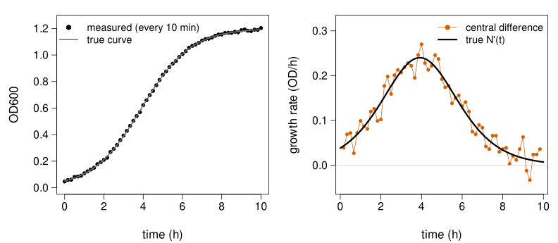
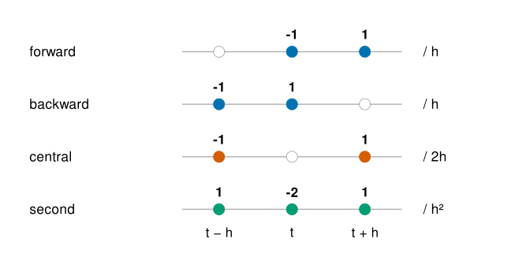
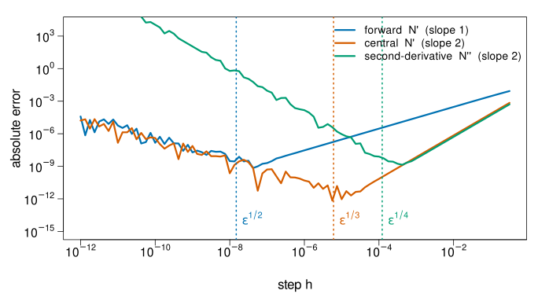
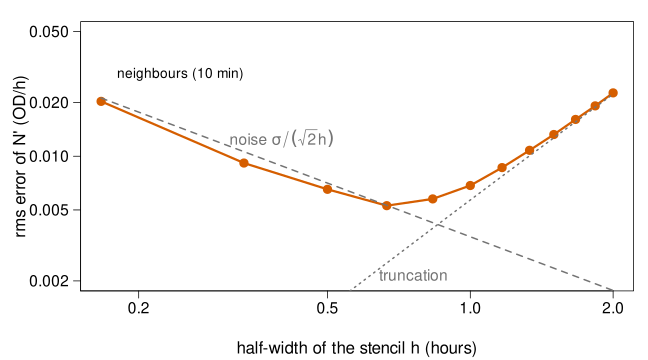
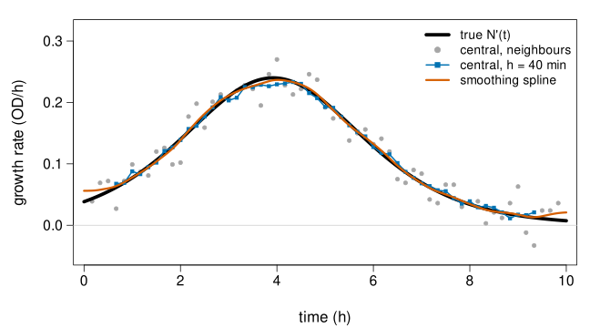

## About this lecture {.smaller}

A derivative is a rate: how fast a culture grows, how fast a drug is cleared, how steeply a log-likelihood rises. A computer only has function **values**, so it estimates the rate from a few nearby values.

- **Stencils from Taylor**: forward, backward and central differences, a one-sided formula for the ends of a data set, and the **second derivative**.
- The **best step** for each: $\varepsilon^{1/2}$, $\varepsilon^{1/3}$, $\varepsilon^{1/4}$, and why.
- **Richardson extrapolation**: combine two poor estimates into a good one (what `numDeriv::grad` does).
- **Measured data**: differentiating amplifies noise. Widen the stencil or smooth first.
- **Gradients for fitting** by finite differences, how they fail inside `optim`, and the alternatives: the complex step and **automatic differentiation**.

Biology: the instantaneous growth rate from a noisy plate-reader OD curve; the gradient of a log-likelihood when fitting the growth curve.

::: notes
This unit opens Part 7. In Convergence and cost we used the forward difference of the logistic OD curve to see the truncation/rounding V and only previewed the central difference. Here we do the systematic version: where every stencil comes from, how to pick the step, how to do better than any single stencil, and what happens with real, noisy data. The second half is about gradients, the multivariate version, because that is where most biologists meet numerical derivatives without noticing: every optimiser that is not given a gradient computes one by finite differences.
:::

## Recap: the V from *Convergence and cost* {.smaller}

Logistic OD curve $N(t) = \dfrac{K}{1 + (K/N_0 - 1)\,e^{-rt}}$, $K = 1.2$, $N_0 = 0.05$, $r = 0.8$ per hour. True growth rate at $t = 3$ h: $N'(3) = 0.21026$ OD/h.

- **Forward difference** $\dfrac{N(t+h) - N(t)}{h}$: truncation error $\tfrac{h}{2}N''$, order 1.
- **Rounding error** $\approx \varepsilon|N|/h$: the two values agree in almost all digits, and dividing by a small $h$ blows up their rounding.
- Total error: a **V** on log–log axes, best $h \approx \sqrt{\varepsilon} \approx 10^{-8}$, best error $\approx 10^{-8}$: half the digits lost.
- The **central difference** $\dfrac{N(t+h) - N(t-h)}{2h}$ had slope 2 and a deeper V.
- The ratio check $\dfrac{D(h) - D(h/2)}{D(h/2) - D(h/4)} \approx 2^p$ tells truncation regime from rounding regime without the exact answer.

Today: where these formulas come from, how to build any formula you need, and what changes when $N$ is **measured**, not computed.

::: notes
One slide only: students who skipped Convergence and cost should go back to it. The three facts to carry forward: truncation error falls like h^p, rounding error grows like eps/h, and the best step balances them. Everything in the first half of this lecture is a variation on that balance. The second half replaces eps by the measurement noise, which is about 10^13 times larger.
:::

## The problem: growth rate from a plate reader {.smaller}

A plate reader measures OD600 every 10 minutes for 10 hours (61 values, 3 decimals, noise sd $\approx 0.005$). We want the growth rate $N'(t)$ and its maximum.

{width="88%" fig-align="center"}

The curve looks clean. Its **central differences** do not: they jump by $\pm 0.03$, and one is **negative**, a culture "shrinking" in mid-growth.

::: notes
Simulated data: the same logistic curve, plus Gaussian noise of sd 0.005 OD (a realistic plate-reader noise level), rounded to three decimals as a plate reader exports them. Left panel: you cannot see the noise by eye. Right panel: the naive derivative, (y[i+1] - y[i-1]) / (20 min), is visibly noisy, overshoots the maximum (0.27 instead of 0.24) and goes negative near the end. The maximum specific growth rate, the number many papers report, is read off exactly this kind of curve. By the end of the lecture we know why the noise grows when we differentiate and two ways to tame it. First, though, the stencils themselves.
:::

## Taylor, three times {.smaller}

Write the neighbours of $t$ as Taylor series around $t$ (prime = derivative at $t$):

$$
\begin{aligned}
N(t+h) &= N + h N' + \tfrac{h^2}{2} N'' + \tfrac{h^3}{6} N''' + \tfrac{h^4}{24} N'''' + \dots \\
N(t-h) &= N - h N' + \tfrac{h^2}{2} N'' - \tfrac{h^3}{6} N''' + \tfrac{h^4}{24} N'''' - \dots \\
N(t+2h) &= N + 2h N' + \tfrac{4h^2}{2} N'' + \tfrac{8h^3}{6} N''' + \dots
\end{aligned}
$$

For the OD curve at $t = 3$:

| $N$ | $N'$ | $N''$ | $N'''$ | $N''''$ |
|--:|--:|--:|--:|--:|
| 0.38879 | 0.21026 | 0.05921 | $-0.04227$ | $-0.06170$ |

**Recipe:** add multiples of these rows so that everything cancels except the derivative you want. What is left over is the error.

::: notes
This is the only tool we need. Each row is the Taylor polynomial from first-year calculus, evaluated at a shifted point. The minus signs in the second row alternate because (-h)^k changes sign with k. The derivatives of the logistic come from differentiating N' = r N (1 - N/K) repeatedly; students do not need to compute them, but having the numbers lets us check every error formula against the computer. Notation: N, N', N'' without an argument all mean "at t".
:::

## Forward and backward differences {.smaller}

**Forward:** take row 1, subtract $N$, divide by $h$:
$$\frac{N(t+h) - N(t)}{h} = N' + \underbrace{\tfrac{h}{2} N''}_{\text{error}} + O(h^2)$$

**Backward:** take row 2, the same way:
$$\frac{N(t) - N(t-h)}{h} = N' - \tfrac{h}{2} N'' + O(h^2)$$

- Both are **first order**. At $t = 3$: error $\approx \pm 0.0296\,h$; with $h = 0.1$ h, $+0.0029$ and $-0.0030$.
- The errors have **opposite signs**: forward overestimates, backward underestimates (the curve bends upwards at $t = 3$).
- Use: the backward difference needs only **past** values, the forward only future ones. At the last measurement of a time course, backward is all you have.

::: notes
The leading error term is the first Taylor term we did not cancel. The O(h^2) collects the rest. For a curve that bends upwards (N'' > 0), the forward secant is steeper than the tangent and the backward secant shallower. That the two errors are almost equal and opposite is the hint for the next slide: average them.
:::

## Central difference: let the errors cancel {.smaller}

Subtract row 2 from row 1: the even terms ($N$, $N''$, $N''''$) cancel.
$$N(t+h) - N(t-h) = 2hN' + \tfrac{2h^3}{6} N''' + \dots
\quad\Longrightarrow\quad
\frac{N(t+h) - N(t-h)}{2h} = N' + \underbrace{\tfrac{h^2}{6} N'''}_{\text{error}} + O(h^4)$$

- **Second order**: halving $h$ quarters the error. At $t = 3$: error $\approx -0.00705\,h^2$, so $-7.0\times10^{-5}$ at $h = 0.1$, forty times smaller than forward.
- Same cost as forward (two evaluations), if $N(t)$ is not needed anyway.
- It is the **average** of forward and backward; their $\pm\tfrac{h}{2}N''$ errors cancel.
- It needs a point on **each side**: not available at the first and last time point.

::: notes
Symmetry is what buys the extra order. Note the next error term is O(h^4), not O(h^3): only even powers of h appear in the central difference's error. That fact is what makes Richardson extrapolation so effective later. One caveat about cost: if you need N(t) anyway (e.g. inside a Newton step), the forward difference costs one extra evaluation and the central two.
:::

## Any stencil you need: match Taylor terms {.smaller}

At the **first** time point there is no $t - h$. Look for weights $w_0, w_1, w_2$ with
$$w_0 N(t) + w_1 N(t+h) + w_2 N(t+2h) \approx h\,N'(t).$$
Matching the $N$, $hN'$ and $h^2N''$ terms of the Taylor rows gives a $3\times3$ linear system:

```r
s <- c(0, 1, 2)                            # offsets: t, t+h, t+2h
A <- outer(0:2, s, function(k, s) s^k / factorial(k))   # row k: Taylor term k
solve(A, c(0, 1, 0))                       # want: 0 N + 1 hN' + 0 h^2 N''
# [1] -1.5  2.0 -0.5
```

So $N'(t) \approx \dfrac{-3N(t) + 4N(t+h) - N(t+2h)}{2h}$, error $-\tfrac{h^2}{3}N'''$: **second order with one-sided data**.

- Same method with offsets $(-1, 0, 1)$ and right-hand side $(0, 0, 1)$ gives the second derivative.
- [`np.gradient`](https://numpy.org/doc/stable/reference/generated/numpy.gradient.html) uses central differences inside and (with `edge_order=2`) this formula at the ends.

::: notes
This is the method of undetermined coefficients. Row k of A holds s^k / k!, the Taylor coefficient of h^k N^(k) at offset s; the right-hand side says which derivative we want. Three points can match three terms, so the first unmatched term, k = 3, is the error. The linear system ties back to Part 3: it is a small Vandermonde-type matrix. More points give higher order: offsets -2..2 give the five-point formula (1, -8, 0, 8, -1)/12h with error O(h^4) (exercise C2). The same idea builds every stencil in the diffusion units.
:::

## The second derivative {.smaller}

**Add** rows 1 and 2: now the odd terms cancel.
$$N(t+h) + N(t-h) = 2N + h^2 N'' + \tfrac{2h^4}{24} N'''' + \dots
\;\Longrightarrow\;
\frac{N(t+h) - 2N(t) + N(t-h)}{h^2} = N'' + \underbrace{\tfrac{h^2}{12} N''''}_{\text{error}} + \dots$$

- Second order. At $t = 3$: error $\approx -0.00514\,h^2$.
- Biology: $N''$ is the **acceleration** of growth. It changes sign at the **inflection point**, the time of fastest growth ($t = 3.92$ h here).
- This $(1, -2, 1)/h^2$ stencil is the **workhorse of Part 10**: in space it becomes the diffusion term $D\,\partial^2 c/\partial x^2$, in *The diffusion (heat) equation by finite differences*.

{width="46%" fig-align="center"}

::: notes
The picture summarises the four stencils so far: dots are the points used, numbers the weights, right column the divisor. Filled dots only. For the second derivative the weights must sum to zero (a constant has no curvature) and the stencil is symmetric. Flag the forward reference clearly: the diffusion equation replaces t by a space coordinate x, and the second difference of concentrations on a grid of channels is exactly this formula. Its error, h^2/12 times the fourth derivative, is the spatial accuracy of every scheme in Part 10.
:::

## All four in R {.smaller}

```r
K <- 1.2; N0 <- 0.05; r <- 0.8
od <- function(t) K / (1 + (K / N0 - 1) * exp(-r * t))
gr <- function(t) r * od(t) * (1 - od(t) / K)            # exact N'(t)
t0 <- 3; exact <- gr(t0); d2 <- r * exact * (1 - 2 * od(t0) / K)  # N'(3), N''(3)
h   <- c(0.1, 0.05, 0.025)
fwd <- (od(t0 + h) - od(t0)) / h
bwd <- (od(t0) - od(t0 - h)) / h
cen <- (od(t0 + h) - od(t0 - h)) / (2 * h)
sec <- (od(t0 + h) - 2 * od(t0) + od(t0 - h)) / h^2
err <- cbind(fwd = fwd - exact, bwd = bwd - exact, cen = cen - exact, sec = sec - d2)
err[1, ] / err[2, ]                                      # halve h: error ratio
#      fwd      bwd      cen      sec
# 1.974603 2.022227 3.999432 3.997985
```

- Ratios $\approx 2$ (first order) and $\approx 4$ (second order), as the Taylor errors predicted.
- The errors themselves: $0.00289$, $-0.00303$, $-7.04\times10^{-5}$, $-5.14\times10^{-5}$ at $h = 0.1$: the leading terms $\pm0.0296h$, $-0.00705h^2$, $-0.00514h^2$.

::: notes
Vectorised over h as in Convergence and cost. N''(3) is computed from the differentiated logistic equation, N'' = r N' (1 - 2N/K). The ratio of errors at h and h/2 is 2^p, the cheapest way to confirm the order when the exact answer is known; without it, use the difference-ratio check from the recap slide. The forward and backward ratios are not exactly 2 because the O(h^2) terms are still visible at h = 0.1.
:::

## Each stencil has its own V {.smaller}

{width="74%" fig-align="center"}

Rounding hits the second derivative hardest: it divides by $h^2$, not $h$. Its V is shifted far to the right.

::: notes
Three curves, same OD function at t = 3. Right side: truncation, slopes 1, 2 and 2. Left side: rounding, slope -1 for the first-derivative formulas and -2 for the second derivative. The dotted lines mark eps^(1/2), eps^(1/3) and eps^(1/4), the rule-of-thumb best steps from the next slide; each is close to the bottom of its V. Note how much worse the second derivative is at small h: at h = 1e-8, where the forward difference is at its best, the second difference is wrong by about 1.
:::

## The best step: balance the two errors {.smaller}

Truncation $\approx C h^p$, rounding $\approx \varepsilon |N| / h^k$ for the $k$-th derivative. Setting them equal:
$$h^* \approx \varepsilon^{1/(p+k)}, \qquad \text{best error} \approx \varepsilon^{p/(p+k)} \qquad (\text{if } C \text{ and } |N| \text{ are of order } 1).$$

| formula | $p$ | $k$ | $h^*$ | best error | digits kept |
|---|--:|--:|--:|--:|--:|
| forward / backward | 1 | 1 | $\varepsilon^{1/2} \approx 1.5\times10^{-8}$ | $\approx 10^{-8}$ | 8 |
| central | 2 | 1 | $\varepsilon^{1/3} \approx 6\times10^{-6}$ | $\approx 10^{-11}$ | 11 |
| second derivative | 2 | 2 | $\varepsilon^{1/4} \approx 1.2\times10^{-4}$ | $\approx 10^{-8}$ | 8 |

- Higher order **and** a larger step: the central difference wins twice.
- Steps are **relative**: use $h = \varepsilon^{1/3}\max(|t|, 1)$. Time in seconds ($t = 10\,800$ s) or a rate constant of size $10^{-4}$ needs a step scaled to it.

::: notes
Derivation for the central case: minimise C h^2 + eps |N| / h; derivative 2 C h - eps |N| / h^2 = 0 gives h = (eps |N| / 2C)^(1/3). With C = |N'''|/6 = 0.007 and |N| = 0.39 that is 1.8e-5, close to eps^(1/3) = 6e-6; the rule of thumb ignores the constants because they are rarely known. For the second derivative the rounding term is about 4 eps |N| / h^2 (weights 1, 2, 1). The relative step matters as soon as t (or a parameter) is far from 1: for a rate constant of 1e-4, an absolute step of 6e-6 changes it by 6 percent (truncation error), and for t = 10800 s, the truncation-optimal step is scaled up in proportion. Library codes scale every step by the size of the variable.
:::

## Failure: the second derivative with a tiny step {.smaller}

```r
h   <- 10^-(2:8)
sec <- (od(t0 + h) - 2 * od(t0) + od(t0 - h)) / h^2
print(data.frame(h, sec, err = abs(sec - d2)), digits = 3)
#       h     sec      err
# 1 1e-02  0.0592 5.14e-07
# 2 1e-03  0.0592 5.21e-09
# 3 1e-04  0.0592 7.82e-09
# 4 1e-05  0.0592 9.07e-07
# 5 1e-06  0.0591 1.49e-04
# 6 1e-07  0.0500 9.25e-03
# 7 1e-08 -0.5551 6.14e-01
```

- At $h = 10^{-8}$, the step that is **best** for the forward difference, the curvature is $-0.56$: ten times too large, with the **wrong sign**. "Growth is slowing down", confidently and falsely.
- **Check:** vary $h$ by factors of 10. The answer must stay put over a range of $h$; if it drifts or changes sign, you are in the rounding regime.

::: notes
A typical way to hit this: copying the step 1e-8 (or sqrt(eps)) from a first-derivative code into a second-derivative code. The numerator is the difference of three numbers that agree in about 15 digits, so it is pure rounding noise of size 1e-16, divided by 1e-16. The check costs a few extra evaluations and is always worth it: a derivative estimate that is stable over two or three decades of h can be trusted; one that changes with h cannot. Same check as the difference ratios from Convergence and cost, without needing the exact answer.
:::

## Richardson extrapolation {.smaller}

The central difference has an error made of **even powers** only:
$$D(h) = N' + c_2 h^2 + c_4 h^4 + \dots, \qquad D(h/2) = N' + \tfrac{c_2}{4} h^2 + \tfrac{c_4}{16} h^4 + \dots$$
Take $4 D(h/2) - D(h)$: the $h^2$ term cancels. Divide by 3:
$$R(h) = \frac{4 D(h/2) - D(h)}{3} = N' + O(h^4).$$

```r
D <- function(h) (od(t0 + h) - od(t0 - h)) / (2 * h)
c(D(0.1), D(0.05), (4 * D(0.05) - D(0.1)) / 3) - exact      # errors
# [1] -7.043731e-05 -1.761183e-05 -3.336916e-09
```

- Two second-order estimates with errors $10^{-4}$ and $10^{-5}$ give one with error $3\times10^{-9}$. **Fourth order**, from the same four function values.
- Repeat on the $R$'s (now dividing by $16 - 1$, then $64 - 1$): a table of ever higher order. Four levels from $h = 0.4$: error $3\times10^{-13}$.

::: notes
Richardson extrapolation is "use the known shape of the error to remove it". We do not know c2, but we know how it scales with h, so two estimates are enough to eliminate it. This only works if the error really is c2 h^2 + ..., i.e. in the truncation regime and for a smooth function. The repeated version is a triangular table, column j removing the h^(2j) term with weights 4^j/(4^j - 1) and -1/(4^j - 1); exercise C3 builds it. The same idea turns the trapezoid rule into Romberg integration in the next unit, Numerical integration.
:::

## What `numDeriv::grad` does {.smaller}

```r
library(numDeriv)
grad(od, 3) - exact                       # Richardson, the default
# [1] 2.060019e-13
grad(od, 3, method = "simple") - exact    # one forward difference
# [1] 2.960551e-06
```

- [`grad`](https://search.r-project.org/CRAN/refmans/numDeriv/html/grad.html) takes central differences at a **relative** step $h = 10^{-4}|x|$ and at $h/2$, $h/4$, $h/8$ (8 evaluations of $f$ per variable) and runs the Richardson table: 12–13 correct digits.
- `method = "simple"`: one forward difference with $h = 10^{-4}$, error $\approx 0.0296 \times 10^{-4}$.
- Python: [`scipy.differentiate.derivative`](https://docs.scipy.org/doc/scipy/reference/generated/scipy.differentiate.derivative.html) (adaptive, Richardson-like); [`scipy.optimize.approx_fprime`](https://docs.scipy.org/doc/scipy/reference/generated/scipy.optimize.approx_fprime.html) is a plain forward difference.
- **When Richardson fails:** if $f$ is not smooth (an `if`, `abs`, interpolated data, an adaptive ODE solver), or noisy, the error is not $c_2h^2 + \dots$ and the extrapolation can make it **worse**.

::: notes
numDeriv's defaults: method.args = list(d = 1e-4, r = 4, v = 2): initial relative step d, r rounds of extrapolation, step reduction factor v. The large starting step keeps the whole table out of the rounding regime, and the extrapolation supplies the accuracy instead of a tiny step. That is the main practical lesson: accuracy should come from the formula's order, not from shrinking h. On noise: the weights 4/3 and -1/3 add up to 1 but their absolute values sum to 5/3, so random errors in D grow at every level.
:::

## Measured data: the noise replaces $\varepsilon$ {.smaller}

Each measurement is $y_i = N(t_i) + e_i$, noise sd $\sigma = 0.005$. The central difference of the noise has sd
$$\frac{\sqrt{2}\,\sigma}{2\,\Delta t} = \frac{\sigma}{\sqrt2\,\Delta t} = \frac{0.005}{\sqrt2 \cdot \tfrac16} = 0.021 \text{ OD/h}.$$

```r
set.seed(1)
t  <- seq(0, 10, by = 1/6)                            # every 10 min
y  <- round(od(t) + rnorm(length(t), sd = 0.005), 3)  # plate reader, 3 decimals
i  <- 2:(length(t) - 1)
cen <- (y[i + 1] - y[i - 1]) / (2 / 6)                # central, h = 10 min
sqrt(mean((cen - gr(t[i]))^2))                        # rms error
# [1] 0.02030602
```

- The same $\varepsilon/h$ term as before, with $\varepsilon|N| \approx 10^{-16}$ replaced by $\sigma = 5\times10^{-3}$: **13 orders of magnitude** larger.
- Measuring **more often** makes it **worse**: every 2 min, the noise in $N'$ is 0.11 OD/h, almost half the peak growth rate.

::: notes
The derivation: the difference of two independent errors has variance 2 sigma^2; dividing by 2 dt divides the sd by 2 dt. The measured rms error 0.0203 matches the predicted 0.0212. Differentiation is an ill-conditioned operation in the language of Error, conditioning and stability: a small change in the data (0.005) gives a large change in the derivative, and the smaller the spacing, the larger the amplification. That is the opposite of most students' intuition that more data is always better. More data helps only if we use it to average, which is what the next slides do. If you then compute the specific growth rate N'/N (or the slope of log OD), the noise is further divided by N, so it is worst at the low ODs of early growth.
:::

## The V again, with noise {.smaller}

Use a **wider** central difference: $\dfrac{y_{i+k} - y_{i-k}}{2k\,\Delta t}$, half-width $h = k\,\Delta t$. Noise $\sigma/(\sqrt2 h)$ falls, truncation $\tfrac{h^2}{6}|N'''|$ grows.

{width="66%" fig-align="center"}

Best near $h = 40$ min ($k = 4$): rms error $0.0053$, **four times** smaller than neighbours. Predicted: $h^* = \big(3\sigma / (\sqrt2\,|N'''|)\big)^{1/3} \approx 0.5$ h.

::: notes
Exactly the V of the recap slide, on a much larger scale: truncation on the right, noise on the left, and an optimal step that is now about half an hour instead of 1e-8. The formula for h* is the same balance as for rounding, with eps|N| replaced by sigma/sqrt(2) and |N'''| taken at its largest, 0.077 at the inflection point. In practice you do not know sigma or N''' precisely, but the lesson is robust: with noisy data the best stencil is much wider than the sampling interval. The price: fewer points at the ends (k values lost on each side) and some blurring of sharp features.
:::

## Smooth first, then differentiate {.smaller}

Fit a smooth curve to all the data, then differentiate the **curve**. A smoothing spline (*Splines*, Part 6) picks its smoothness from the data:

```r
fit <- smooth.spline(t, y)                 # smoothness chosen by GCV
d   <- predict(fit, t, deriv = 1)$y        # derivative of the spline
sqrt(mean((d - gr(t))^2))                  # rms error
# [1] 0.004708606
c(max(d), t[which.max(d)])                 # max growth rate and when
# [1] 0.2366499 4.0000000
```

- rms error $0.0047$, and a value at **every** time point, ends included. Maximum growth rate $0.237$ OD/h at 4.0 h (true: $0.240$ at 3.92 h); raw central differences gave $0.270$.
- Python: [`scipy.interpolate.make_smoothing_spline`](https://docs.scipy.org/doc/scipy/reference/generated/scipy.interpolate.make_smoothing_spline.html), then `.derivative()`.
- Alternatives: a local polynomial fit (Savitzky–Golay), or fit a growth **model** and differentiate it (Part 9).

::: notes
smooth.spline chooses its smoothing parameter by generalised cross-validation, which balances fit against roughness, the same bias-variance trade-off as the stencil width, made automatically. predict with deriv = 1 differentiates the fitted cubic pieces exactly. How smoothing splines work is the topic of Splines. Fitting a parametric model (logistic, Gompertz) and differentiating it is the most accurate option when the model is right, and the most misleading when it is wrong; that is Part 9 (Nonlinear least squares and ODE fitting).
:::

## Comparing the three {.smaller}

{width="70%" fig-align="center"}

- Raw neighbours (grey): noisy. Wider stencil (blue) and spline (orange): close to the truth, both slightly **flatten the peak**.
- The spline is least reliable at the **ends** (here $0.056$ instead of $0.038$ at $t = 0$).
- **Check:** compute the derivative with two different smoothing levels (stencil widths, spline `df`). Features that survive both are real; features that move are noise.

::: notes
All smoothing trades noise for bias: a peak gets lower and wider. The spline errs at the ends because there are no data beyond them to pin down the slope; this is where the first growth rate (lag phase) is estimated, so be careful when reporting it. The two-smoothing-level check is the noisy-data version of "vary h by factors of 10". Never report a derivative of raw data without having looked at this plot.
:::

## Gradients for fitting {.smaller}

Fit $(r, K, N_0)$ to the plate-reader data by maximum likelihood (Gaussian noise, $\sigma = 0.005$):
$$\ell(r, K, N_0) = -\frac{1}{2\sigma^2}\sum_i \big(y_i - N(t_i; r, K, N_0)\big)^2.$$
The **gradient** $\nabla\ell = (\partial\ell/\partial r, \partial\ell/\partial K, \partial\ell/\partial N_0)$: one central difference per parameter, nudging only that one.

```r
logistic <- function(t, r, K, N0) K / (1 + (K / N0 - 1) * exp(-r * t))
loglik <- function(th) -sum((y - logistic(t, th[1], th[2], th[3]))^2) / (2 * 0.005^2)
cen_grad <- function(f, x, h = 6e-6) sapply(seq_along(x), function(j) {
  e <- replace(numeric(length(x)), j, h)          # nudge parameter j only
  (f(x + e) - f(x - e)) / (2 * h) })
th <- c(r = 0.75, K = 1.15, N0 = 0.06)            # a point on the way to the optimum
cen_grad(loglik, th)
# [1]  42388.45  57583.61 109411.83
```

- Relative error against the analytic gradient: forward ($h = 10^{-8}$) $10^{-7}$–$10^{-6}$; central $10^{-11}$–$10^{-7}$; `numDeriv::grad` $10^{-12}$.
- Cost: $p + 1$ (forward), $2p$ (central), $8p$ (`numDeriv`) evaluations of $\ell$ for $p$ parameters.

::: notes
A partial derivative is an ordinary derivative with the other parameters held fixed, so every formula of this lecture applies one coordinate at a time. This is the same construction as the finite-difference Jacobian in Newton for systems of equations, applied to a scalar function. The gradient components are large (1e4 to 1e5) because sigma is small; what matters is the relative error. The analytic gradient is in the exercise (C6). For three parameters the cost does not matter; for an ODE model with 50 parameters where one evaluation takes a second, 100 or 400 seconds per gradient does.
:::

## Failure: `optim`'s default gradient {.smaller}

Without a gradient, [`optim`](https://stat.ethz.ch/R-manual/R-devel/library/stats/html/optim.html) uses central differences with a **fixed absolute** step `ndeps = 1e-3`.

```r
fit1 <- optim(th, loglik, method = "BFGS", control = list(fnscale = -1))
fit2 <- optim(th, loglik, gr = function(p) grad(loglik, p),
              method = "BFGS", control = list(fnscale = -1))
rbind(default = fit1$par, numDeriv = fit2$par)
#                  r        K         N0
# default  0.7948541 1.202606 0.05085940
# numDeriv 0.7954268 1.202457 0.05076077
grad(loglik, fit1$par)                    # should be ~0 at the maximum
# [1] 48.205320  7.205445 -8.363963
```

- $h = 10^{-3}$ is **2 %** of $N_0 = 0.05$: at the true maximum the default gradient is still $290$ in the $N_0$ direction. BFGS stops at the wrong place.
- Here the error is about $\tfrac15$ of a standard error. For a parameter of size $10^{-3}$ (a rate constant in /s) the step is the size of the parameter.
- **Check:** evaluate an accurate gradient at the returned optimum. **Fix:** pass `gr`, or set `parscale`/`ndeps` to the parameter sizes.

::: notes
fnscale = -1 makes optim maximise. The default-gradient run stops after 16 gradient evaluations at a point where the true gradient is (48, 7, -8), compared with 1e-4 for the run with the numDeriv gradient. The parameter differences (6e-4 in r, 1e-4 in N0) are about 0.17 standard errors (standard errors 0.0035 and 0.0006 from the Hessian), so the conclusions here do not change. But it is a silent wrong answer, and it gets worse the further parameters are from size 1. scipy.optimize.minimize uses a relative forward step instead, so it fails differently (fewer digits, not a biased gradient). Identifiability and uncertainty of fitted parameters (Part 9) uses the Hessian, again by finite differences.
:::

## Optional: the complex step {.smaller}

If $f$ is a formula that also works for **complex** numbers, step in the imaginary direction:
$$f(x + ih) = f(x) + ih f'(x) - \tfrac{h^2}{2}f''(x) - \dots \;\Longrightarrow\; f'(x) = \frac{\operatorname{Im} f(x + ih)}{h} + O(h^2).$$

```r
Im(od(t0 + 1e-20i)) / 1e-20 - exact       # 1e-20i: the complex number 10^-20 i
# [1] -2.775558e-17
```

- **No subtraction**, so no cancellation: $h = 10^{-20}$ is fine, and the result is exact to rounding.
- Only for code that accepts complex input: no `abs`, `max`, `if (x > 0)`, compiled solvers. One derivative per evaluation.

::: notes
Optional slide; complex numbers are not assumed knowledge. The idea: the real part carries f(x), the imaginary part carries h f'(x), and they never have to be subtracted from each other. The O(h^2) truncation term is h^2 f''' / 6 times 1e-40: invisible. In R, exp, log, sin and arithmetic all work on complex numbers, so the logistic formula works unchanged. It breaks as soon as the code compares numbers or calls something that is real-only. It is a stepping stone to the next slide: carrying a derivative along with the value through the computation.
:::

## Automatic differentiation: what Stan, JAX and torch do {.smaller}

A program is a chain of elementary steps ($+$, $\times$, `exp`, …), each with a known derivative. **Automatic differentiation (AD)** applies the chain rule to the **numbers** as the program runs.

| | finite differences | AD |
|---|---|---|
| accuracy | half to two-thirds of the digits | exact up to rounding: no $h$ |
| gradient of $p$ parameters | $p+1$ to $8p$ evaluations | **reverse mode**: about 2–4 evaluations, any $p$ |
| needs | only $f$ as a black box | code written in an AD-aware library |

- **Forward mode**: carry (value, derivative) through every step; one pass per parameter.
- **Reverse mode** (backpropagation): record the steps, then run the chain rule backwards once for the whole gradient.
- Stan (gradients for HMC sampling), TMB/RTMB, JAX, PyTorch, Julia. A log-likelihood with 10 000 parameters: AD is the only option.

::: notes
One slide, no code: the point is to know what these tools do and why they exist. Forward mode on the logistic: v1 = -r t, v2 = exp(v1), v3 = 1 + A v2, v4 = K / v3; carrying derivatives with respect to t gives dv1 = -r, dv2 = v2 dv1, dv3 = A dv2, dv4 = -K dv3 / v3^2 (exercise B7 does this by hand). Reverse mode is why deep learning is possible: a network with a million weights gets its whole gradient for the price of a few forward passes. Its cost is memory: every intermediate value is stored for the backward pass. For an ODE model inside a likelihood, the AD-aware tools differentiate through the solver (sensitivity equations or adjoints). Finite differences remain the right tool for black-box code and for checking an AD or hand-written gradient.
:::

## Checklist: detecting derivative trouble {.smaller}

- **Value changes when $h$ changes by 10×** → rounding regime (too small) or truncation (too large). Find the plateau.
- **Step not scaled to the variable** → use $h = \varepsilon^{1/3}\max(|x|, 1)$ (central), or `parscale` in `optim`.
- **Second derivative with a first-derivative step** → use $h \approx \varepsilon^{1/4}$, never $10^{-8}$.
- **Derivative of measured data** → never difference neighbours; widen the stencil or smooth, and compare two smoothing levels.
- **Negative growth rates mid-growth, spiky curves** → noise, not biology.
- **Optimiser stops with a non-zero gradient** → check with `numDeriv::grad` at the result; supply an analytic or AD gradient.
- **Hand-written gradient** → compare with a finite-difference gradient; agreement to ~$10^{-7}$ relative, not $\sim 1$.
- **Function with `if`, `abs`, interpolation, or an adaptive ODE solve** → not smooth: no Richardson, larger $h$.

::: notes
Every item corresponds to a failure shown in this lecture or the exercise. The gradient check (last-but-one item) is standard practice before trusting any hand-coded or AD gradient: a sign error or missing factor gives a relative difference of order 1, not 1e-7. The last item: an adaptive ODE solver's output changes in small jumps when a parameter changes, because the step sequence changes; its tolerance (say 1e-6) plays the role of eps, so the best step is around sqrt(1e-6) = 1e-3, not 1e-8.
:::

## Summary {.smaller}

- **Stencils from Taylor**: forward/backward $O(h)$, central $O(h^2)$, second derivative $\tfrac{N(t+h) - 2N(t) + N(t-h)}{h^2}$, $O(h^2)$. Any stencil: match Taylor terms with a small linear system.
- **Best step** balances truncation $Ch^p$ against rounding $\varepsilon/h^k$: $\varepsilon^{1/2}$ (forward), $\varepsilon^{1/3}$ (central), $\varepsilon^{1/4}$ (second derivative). Steps are relative to the variable.
- **Richardson**: $\tfrac{4D(h/2) - D(h)}{3}$ removes the $h^2$ error; repeated, it gives 12–13 digits (`numDeriv::grad`). Needs a smooth function.
- **Measured data**: noise $\sigma$ replaces $\varepsilon$, and $\sigma/h$ is huge. Widen the stencil or smooth first (*Splines*); check with two smoothing levels.
- **Gradients for fitting**: one difference per parameter; watch the step size relative to each parameter (`optim`'s `ndeps`). AD gives exact gradients at the cost of a few evaluations.

**Next:** *Numerical integration*, the opposite operation: integrating **averages** the noise away, and Richardson returns as Romberg.

::: notes
The single idea of the unit: every derivative estimate divides a difference by a small number, and that amplifies whatever error is in the values, rounding or measurement noise. The stencils tell us how fast truncation falls; the balance tells us where to stop. The second-derivative stencil returns in Part 10 as the diffusion term. Numerical integration is the friendly counterpart: errors average out instead of being amplified.
:::
