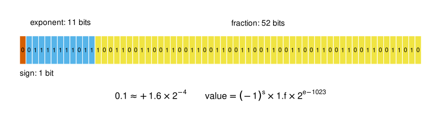
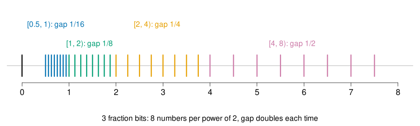
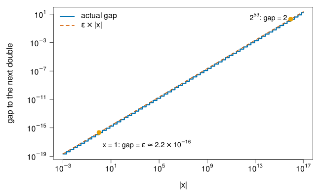
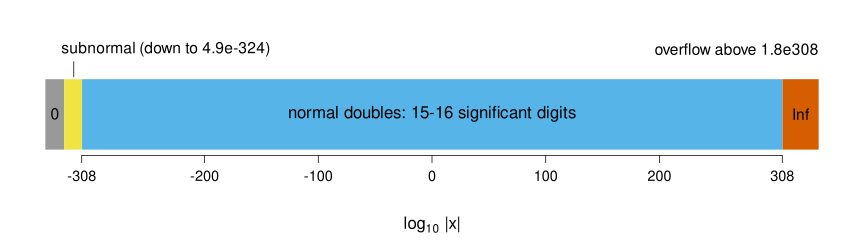
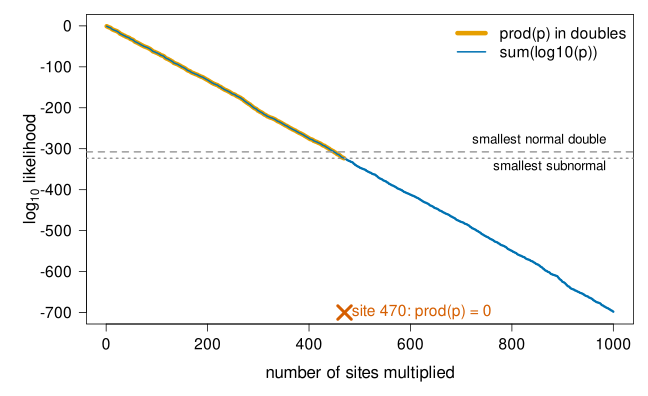

## About this lecture

In the introduction we met three ways a computation goes wrong: **rounding**, truncation and instability. This lecture is about the first one: where rounding comes from.

- A computer stores a real number in **64 bits**, in **binary**. Most decimals (even 0.1) cannot be stored exactly.
- The numbers it *can* store are spaced **relative** to their size: about 16 significant digits, everywhere. That spacing is **machine epsilon**.
- There is a **largest** and a **smallest** number. Go past them and you get `Inf` or `0` (**overflow** / **underflow**), or `NaN`.
- Never test floats with `==`; compare with a **tolerance**.
- Biology: the likelihood of a long alignment (or of 10 000 reads) underflows to **0**. The fix is to work with **logs**, add probabilities with **log-sum-exp**, and use `log1p`/`expm1` for small rates.

::: notes
This is the "what is a number on a computer" unit. Everything later in the course (error analysis, convergence plots that flatten out at 1e-16, stopping tolerances in root finders) leans on the ideas here, so spend the time. The biology payoff is concrete and very common: anyone who has computed a likelihood over many sites, reads or time points has met (or silently suffered) underflow. The log-likelihood trick and log-sum-exp are what HMM and phylogenetics software does internally.
:::

## A biology problem first {.smaller}

A phylogenetics program computes the likelihood of a tree from an alignment of 10 000 sites. Each site contributes a probability between 0.01 and 0.5; the sites are independent, so the likelihood is the **product**.

```r
set.seed(1)
p <- runif(10000, min = 0.01, max = 0.5)   # per-site likelihoods
prod(p)
# [1] 0
sum(log(p))
# [1] -16177.67
```

- The true likelihood is about $e^{-16178} \approx 10^{-7026}$. Not zero, but **smaller than any number R can store**.
- Two trees with likelihood "0" cannot be compared. The **log** of the same quantity is a perfectly ordinary number.
- Why does this happen, and where exactly is the limit? That needs a look at how numbers are stored.

::: notes
Start with the problem the student will actually hit. Per-site likelihoods in a real phylogenetics program are of this size (often smaller). The same thing happens for the likelihood of 10 000 sequencing reads, or of a long time series under an HMM. prod returns exactly 0, with no warning. sum(log(p)) returns a finite number, and that is what every serious program reports: the log-likelihood. Promise that by the end of the lecture they will know the limit (about 1e-308) and the tools to stay away from it.
:::

## A second surprise {.smaller}

```r
0.1 + 0.2 == 0.3
# [1] FALSE

0.1 + 0.2
# [1] 0.3                       # R prints 7 significant digits by default

sprintf("%.20f", c(0.1, 0.2, 0.1 + 0.2, 0.3))
# [1] "0.10000000000000000555" "0.20000000000000001110" "0.30000000000000004441"
# [4] "0.29999999999999998890"
```

- None of 0.1, 0.2, 0.3 is stored exactly. The sum lands on a **different** stored number than 0.3.
- [`sprintf`](https://stat.ethz.ch/R-manual/R-devel/library/base/html/sprintf.html) with `"%.20f"` shows more digits than `print` does; use it to see what is really stored.

::: notes
Everyone has seen this once. The default print hides it because R rounds to 7 significant digits for display. sprintf with %.20f shows the stored value. Note the stored 0.1 is slightly too big, 0.3 slightly too small, and the sum one step above 0.3. This is not an R bug: Python, C, Excel and your GPU give the same answer, because all use the same IEEE 754 standard. The rest of the lecture explains why.
:::

## Binary integers {.smaller}

Decimal uses powers of 10; binary uses powers of 2, with digits 0 and 1.

$$13 = 8 + 4 + 1 = 1\cdot 2^3 + 1\cdot 2^2 + 0\cdot 2^1 + 1\cdot 2^0 = 1101_2$$

**Recipe (decimal → binary):** divide by 2, write down the remainder, repeat; read the remainders **bottom-up**.

| step | quotient | remainder |
|---|---|---|
| 13 / 2 | 6 | **1** |
| 6 / 2 | 3 | **0** |
| 3 / 2 | 1 | **1** |
| 1 / 2 | 0 | **1** |

Bottom-up: $1101_2$. Check: $8+4+0+1 = 13$.

::: notes
Pen and paper. Every whole number has a finite binary expansion, so integers (up to a limit) are stored exactly. The exercise has more of these. The bits are just a place-value system like decimal, only with base 2.
:::

## Binary fractions {.smaller}

After the binary point the places are $\tfrac12, \tfrac14, \tfrac18, \dots$

$$0.625 = \tfrac12 + \tfrac18 = 0.101_2$$

**Recipe (fraction → binary):** multiply by 2, the integer part is the next bit, keep the fraction, repeat.

:::: {.columns}
::: {.column width="50%"}
$0.625$:

- $0.625 \cdot 2 = \mathbf{1}.25$
- $0.25 \cdot 2 = \mathbf{0}.5$
- $0.5 \cdot 2 = \mathbf{1}.0$ → stop

$0.625 = 0.101_2$, exact.
:::
::: {.column width="50%"}
$0.1$:

- $0.1 \to \mathbf{0}.2 \to \mathbf{0}.4 \to \mathbf{0}.8 \to \mathbf{1}.6$
- $0.6 \to \mathbf{1}.2 \to \mathbf{0}.4 \to \dots$ (repeats)

$0.1 = 0.0\overline{0011}_2$, **never** stops.
:::
::::

Only fractions with a power of 2 in the denominator ($\tfrac12, \tfrac38, \tfrac{5}{16}$) end. Like $\tfrac13 = 0.333\ldots$ in decimal, $\tfrac1{10}$ repeats forever in binary, so it **must** be cut off.

::: notes
This is the root of 0.1 + 0.2 != 0.3. In decimal we cannot write 1/3 exactly; in binary we cannot write 1/10 exactly. The computer keeps 53 significant bits and rounds the rest. Ask: which of 0.5, 0.75, 0.2, 0.125 are exact in binary? (0.2 is not: it is 0.1 times 2.)
:::

## Scientific notation in base 2

Write every nonzero number as

$$x = \pm\, 1.f \times 2^{e}, \qquad \text{e.g. } 13 = 1.101_2 \times 2^3, \quad 0.625 = 1.01_2 \times 2^{-1}$$

- The leading digit is always 1, so it does not need to be stored.
- Only the **sign**, the **exponent** $e$ and the **fraction** $f$ are stored.
- A fixed number of bits for $f$ means a fixed number of **significant** digits, whatever the size of $x$.

Same idea as $6.02 \times 10^{23}$: the digits and the size are kept apart.

::: notes
Floating point is just scientific notation in base 2 with a fixed number of digits. The point "floats": the exponent says where it goes. Because the number of fraction bits is fixed, the relative precision is the same for 1e-200 and 1e200. The trick of not storing the leading 1 buys one extra bit for free.
:::

## The IEEE double: 64 bits

{width="95%" fig-align="center"}

- **1** sign bit, **11** exponent bits ($e$ from $-1022$ to $1023$), **52** fraction bits.
- 52 stored + 1 hidden = **53 significant bits** $\approx$ 15–16 decimal digits.
- R's `numeric` and Python's `float` (and numpy's `float64`) are all this format.

::: notes
These are the real 64 bits of 0.1. The exponent field 01111111011 is 1019, and the stored exponent is offset by 1023, so e = -4. The fraction is the repeating 1001 pattern, rounded up in the last bit (that is why the stored 0.1 is slightly larger than 0.1). The standard is IEEE 754, from 1985; essentially every processor follows it, which is why the same surprise appears in every language. Single precision (32 bits, about 7 digits) exists too, mainly on GPUs; we do not use it in this course.
:::

## Floats are not evenly spaced

A toy system with only **3** fraction bits: $1.f_1f_2f_3 \times 2^e$.

{width="95%" fig-align="center"}

- 8 numbers between each power of 2 and the next. Each time you go up a power of 2, the **gap doubles**.
- The **relative** gap is roughly constant: gap / $x$ is between $\tfrac1{16}$ and $\tfrac18$.
- Any real number in between is **rounded** to the nearest tick.

::: notes
Real doubles are the same picture with 52 fraction bits instead of 3, so 2^52 numbers between each pair of powers of 2. In the toy system, 1 + 1/16 is exactly halfway between 1 and 1.125 and gets rounded (ties go to the even neighbour, here 1). The exercise asks them to work with this toy system by hand: list numbers, find gaps, round.
:::

## Machine epsilon

**Machine epsilon** $\varepsilon$ is the gap between 1 and the next double: $\varepsilon = 2^{-52} \approx 2.2 \times 10^{-16}$.

```r
.Machine$double.eps
# [1] 2.220446e-16
1 + .Machine$double.eps == 1
# [1] FALSE
1 + .Machine$double.eps / 2 == 1
# [1] TRUE                   # rounded back down to 1
```

- [`.Machine`](https://stat.ethz.ch/R-manual/R-devel/library/base/html/zMachine.html) lists the limits of the number system on your computer.
- Rounding $x$ to the nearest double has **relative** error at most $\varepsilon/2 \approx 1.1 \times 10^{-16}$.
- That is why doubles are good to "about 16 significant digits".

::: notes
Two definitions float around: the gap at 1 (2^-52, what R and numpy call eps) and the maximum relative rounding error (2^-53, sometimes called unit roundoff). They differ by a factor of 2; we use the R/numpy one. The second code line shows a number smaller than epsilon disappearing when added to 1. That is the seed of everything in the error-conditioning unit.
:::

## The gap grows with the number {.smaller}

{width="62%" fig-align="center"}

- Near $x$, the gap to the next double is about $\varepsilon\,|x|$. Exactly: $2^{\lfloor \log_2 |x| \rfloor - 52}$.
- Near $1000$: gap $2^{9-52} = 2^{-43} \approx 1.1\times10^{-13}$. Near $2^{53} \approx 9\times10^{15}$: gap $= 2$.
- **Relative** precision is fixed; **absolute** precision depends on the size of $x$.

::: notes
The staircase is the exact gap; the dashed line is the eps times |x| rule of thumb. At 1 the gap is eps. At 2^53 the gap reaches 2, so odd integers can no longer be stored: 2^53 + 1 rounds to 2^53. That is the integer limit we come back to in two slides. A practical consequence: a genomic coordinate near 3e9 stored as a double has a gap of about 5e-7, which is no problem since coordinates are whole numbers. Python has np.spacing(x) to show the gap directly; in R we compute it from the formula.
:::

## Every operation rounds

IEEE rule: the result of $+, -, \times, /, \sqrt{\ }$ is the **exact** result, **rounded** to the nearest double.

$0.1 + 0.2$:

- stored 0.1 + stored 0.2 $= 0.3000000000000000166\ldots$ (exact sum of two stored numbers)
- nearest double: $0.30000000000000004441$
- stored 0.3: $0.29999999999999998890$, one gap ($2^{-54} \approx 5.6\times10^{-17}$) below

```r
(0.1 + 0.2) - 0.3
# [1] 5.551115e-17
```

Each step adds a relative error of up to $\varepsilon/2$. Over millions of steps these errors can add up, or (worse) be magnified. That is unit 3, error-conditioning.

::: notes
Walk through the three numbers. The errors are tiny, one unit in the last place, but the equality test asks for exact agreement, so it fails. The good news is that a single operation is as accurate as possible. The bad news is that errors made earlier are carried along, and some operations magnify them. Leave the magnification to the error-conditioning unit.
:::

## Never test floats with `==` {.smaller}

```r
x <- seq(0, 1, by = 0.1)
which(x == 0.3)
# integer(0)                                  # not found!
which(abs(x - 0.3) < 1e-9)
# [1] 4

all.equal(0.1 + 0.2, 0.3)
# [1] TRUE
all.equal(1, 1.1)
# [1] "Mean relative difference: 0.1"         # not FALSE!
isTRUE(all.equal(1, 1.1))
# [1] FALSE
```

- Compare with a tolerance: $|a - b| \le \text{tol} \cdot \max(|a|, |b|)$ (relative), or $|a-b| \le \text{tol}$ (absolute, near 0).
- [`all.equal`](https://stat.ethz.ch/R-manual/R-devel/library/base/html/all.equal.html) uses a relative tolerance of $1.5\times10^{-8}$. In an `if`, wrap it in `isTRUE()`.

::: notes
The seq example is a classic bug: filtering a grid of concentrations or time points with == silently returns nothing. all.equal returns either TRUE or a character string describing the difference, which is why if (all.equal(a, b)) gives an error when they differ; always use isTRUE(all.equal(a, b)). The default tolerance is sqrt(eps), about 1.5e-8: loose enough to forgive rounding, tight enough to catch real bugs. Pick a tolerance that matches the problem: comparing two simulations that differ in rounding needs a relative tolerance; checking whether something is zero needs an absolute one.
:::

## Subtraction can lose digits

```r
(1 + 1e-15) - 1
# [1] 1.110223e-15             # should be 1e-15: 11% wrong
```

- $1 + 10^{-15}$ is rounded to the nearest double near 1 (gap $2.2\times10^{-16}$), so only about **one** significant digit of $10^{-15}$ survives.
- The subtraction itself is exact; it just **exposes** the earlier rounding.
- This is **catastrophic cancellation**: the topic of unit 3, error-conditioning (e.g. variances of large counts).

::: notes
One slide only, to show that rounding errors of size eps can become large relative errors. The full story (relative error, condition number, the one-pass variance formula) is the next unit. Here the point is just: a tiny difference of two large-ish numbers keeps only the digits that the two numbers did not share.
:::

## Integers {.smaller}

R has a separate **integer** type (32 bits, written `5L`); plain `5` is a double.

```r
.Machine$integer.max                       # 2^31 - 1
# [1] 2147483647
len <- c(248956422L, 242193529L, 198295559L, 190214555L, 181538259L,
         170805979L, 159345973L, 145138636L, 138394717L, 133797422L,
         135086622L, 133275309L, 114364328L)     # chr1-13, GRCh38
cumsum(len)[11:13]
# [1] 1943767673 2077042982         NA
# Warning message: integer overflow in 'cumsum'; use 'cumsum(as.numeric(.))'
2^53 + 1 == 2^53
# [1] TRUE
```

- The human genome (3.1 × 10⁹ bp) does not fit in a 32-bit integer. Integer overflow gives `NA`.
- Doubles store **every** whole number exactly up to $2^{53} \approx 9\times10^{15}$. Above that, the gap is 2 or more.

::: notes
Genomic coordinates on a concatenated genome are a real case: tools that use 32-bit integers for positions break on genomes larger than 2.1 Gb, and R's integer type is 32-bit. Data read from files often comes in as integer (counts, positions), so cumsum and similar can overflow. Converting with as.numeric fixes it, since doubles are exact for whole numbers up to 2^53. Python's built-in int never overflows (it grows as needed), but numpy int32 arrays do, silently wrapping around; int64 is the numpy default on most systems.
:::

## The range of doubles {.smaller}

{width="95%" fig-align="center"}

```r
.Machine$double.xmax      # largest double
# [1] 1.797693e+308
.Machine$double.xmin      # smallest normal double
# [1] 2.225074e-308
2^-1074                   # smallest subnormal
# [1] 4.940656e-324
```

Below $2.2\times10^{-308}$, **subnormal** numbers fill the gap to zero, with fewer and fewer significant digits.

::: notes
The 11-bit exponent limits the range to roughly 1e-308 to 1e308. Subnormal (denormal) numbers use the smallest exponent with no hidden 1, trading precision for range; the smallest is 2^-1074. Below half of that, the result is 0. Anything above 1.8e308 becomes Inf. These limits look enormous, but products of probabilities reach them quickly, as we saw on slide 2.
:::

## Overflow and underflow {.smaller}

```r
1e308 * 10                # overflow
# [1] Inf
exp(709); exp(710)
# [1] 8.218407e+307
# [1] Inf
2^-1075                   # underflow
# [1] 0
exp(-745); exp(-746)
# [1] 4.940656e-324
# [1] 0
```

- **Overflow** → `Inf`; **underflow** → `0` (or a subnormal with few digits). **No warning** in either case.
- `exp` overflows for arguments above 709.8 and underflows below about $-745$. In likelihoods, `exp` of a log-likelihood is the usual culprit.

::: notes
The silence is the dangerous part. An Inf or 0 in the middle of a computation flows on: a ratio of two underflowed likelihoods is 0/0 = NaN; a normalising constant of Inf turns every probability into 0. Remember the thresholds for exp: 709 and -745. A log-likelihood of -800 is nothing unusual, so exp(loglik) is almost always a mistake.
:::

## `Inf`, `-Inf` and `NaN` {.smaller}

```r
1 / 0;  -1 / 0;  log(0)
# [1] Inf
# [1] -Inf
# [1] -Inf
0 / 0;  Inf - Inf;  Inf * 0
# [1] NaN
# [1] NaN
# [1] NaN
is.finite(c(1, Inf, NaN, NA))
# [1]  TRUE FALSE FALSE FALSE
```

- `NaN` = "not a number": the result is undefined. Any arithmetic with `NaN` gives `NaN`; even `NaN == NaN` is not `TRUE` (it is `NA` in R).
- In R, `NA` (missing value) is different from `NaN` (failed arithmetic); `is.na()` is `TRUE` for both, [`is.nan()`](https://stat.ethz.ch/R-manual/R-devel/library/base/html/is.finite.html) only for `NaN`.
- **Check:** `stopifnot(all(is.finite(x)))` after a long computation.

::: notes
Inf and -Inf are useful: log(0) = -Inf is the correct log-probability of an impossible event, and it behaves sensibly in max and sum. NaN signals that something went wrong, usually Inf - Inf or 0/0 from two overflowed or underflowed quantities. NaN propagates, so it usually shows up far from its cause; is.finite at checkpoints narrows down where. In Python: np.isfinite, np.isnan, math.inf, math.nan.
:::

## Try it: inspect a double {.smaller}

```{=html}
<link rel="stylesheet" href="../demos/dist/demo.css">
<div data-demo="floatbits" data-x="0.1"></div>
<script src="../demos/dist/floatbits.js"></script>
```

::: notes
The 64 bits of the stored double, coloured as on the IEEE slide: sign, 11 exponent bits, 52 fraction bits. Every readout is exact: "stored exactly" is the full decimal expansion of the stored binary fraction. The number line shows the stored double (blue), its neighbours (grey), and in orange the exact value before rounding: the number typed, or the exact result of the last operation on the stored operands. Walk through the presets. 0.1: stored slightly above 0.1, 0.4 gaps away. 0.3: stored slightly below. 0.1+0.2: the exact sum of the stored 0.1 and 0.2 lies exactly halfway between the stored 0.3 (the grey tick below) and the next double, and the tie goes to the even neighbour, the one above: that is why 0.1 + 0.2 != 0.3. 1 and 1+eps: the gap is 2^-52 above 1 but 2^-53 below it. 2^53 and 2^53+1: the gap is 2, 2^53+1 is a tie and is rounded to 2^53. The chromosome 1 length 248956422 is stored exactly; its gap is 3e-8. 5e-324: the smallest subnormal, a single 1 in the last bit, only 1 significant bit. 1e308*10: Inf. Finally click bits: from 1, flip the top exponent bit to get Inf, then any fraction bit to get NaN.
:::

## Back to the likelihood

{width="62%" fig-align="center"}

- Each site multiplies the likelihood by about 0.1–0.3, so it loses about 0.7 decimal orders per site.
- After **470** sites the product is below the smallest subnormal and becomes exactly **0**.
- The sum of the logs is the same information, as an ordinary number of size $10^{4}$.

::: notes
Same simulated per-site likelihoods as on slide 2. The orange product follows the blue log-sum exactly until it reaches the bottom of the range, then is 0 forever. Note that with 10 000 sites the full log-likelihood is about -16 178 (natural log), or -7026 in log10. The same happens for reads: 10 000 reads each with probability 1e-3 under a model gives 1e-30000.
:::

## Fix 1: work with log-likelihoods {.smaller}

$$\log L = \log \prod_i p_i = \sum_i \log p_i$$

```r
loglik <- sum(log(p))                       # -16177.67
dbinom(3, size = 10, prob = 0.2, log = TRUE) # log of a density, directly
# [1] -1.602827                             # = log(0.2013266)

# compare two trees: likelihood ratio from a difference of logs
loglik_A <- -16177.67;  loglik_B <- -16180.12
exp(loglik_A - loglik_B)                    # L_A / L_B
# [1] 11.58835
```

- Products become sums; tiny numbers become moderate negative numbers.
- Every R density function (`dnorm`, `dbinom`, `dpois`, ...) has `log = TRUE`, which avoids even the single underflow of a very small density.
- Take `exp` only of **differences** of log-likelihoods, which are moderate.

::: notes
This is the standard remedy and the reason likelihood software reports log-likelihoods. The likelihood ratio between two trees, or a Bayes factor, needs only the difference of the logs. Using log = TRUE in density functions matters for extreme values: dnorm(40) underflows to 0, but dnorm(40, log = TRUE) is -800.9.
:::

## But sometimes we must **add** probabilities {.smaller}

Logs turn products into sums, but some models need a **sum of probabilities**:

- **Genotype calling:** $P(\text{reads}) = \sum_{g \in \{AA, AB, BB\}} P(\text{reads} \mid g)\,P(g)$
- **HMMs** (gene finding, copy number): the forward algorithm sums over the hidden states at each step.
- **Phylogenetics** (Felsenstein's pruning): at each node, sum over the 4 possible bases.

With 1000 reads, each term $P(\text{reads} \mid g)$ is something like $e^{-1000}$. We have the **logs** $a_k = \log x_k$ and need $\log \sum_k x_k$.

```r
a <- c(-1000, -1001, -1003)         # log P(reads | g) + log P(g)
log(sum(exp(a)))
# [1] -Inf                           # every exp(a) underflowed to 0
```

::: notes
This is the second half of the story. Products are easy on the log scale; sums are not, because log(x + y) is not log x + log y. The naive route exp-sum-log underflows (or overflows for large positive a). The three examples are exactly where professional software uses log-sum-exp: GATK-style genotype likelihoods, HMMER and other HMM tools, and phylogenetic likelihood programs.
:::

## Log-sum-exp {.smaller}

Pull out the largest term $m = \max_k a_k$:

$$\log \sum_k e^{a_k} = m + \log \sum_k e^{a_k - m}$$

Now every $a_k - m \le 0$, and the largest is exactly $0$, so $e^{0} = 1$: no overflow, and the sum is at least 1, so no $\log 0$.

With $a = (-1000, -1001, -1003)$, $m = -1000$:

$$e^{0} + e^{-1} + e^{-3} = 1 + 0.3679 + 0.0498 = 1.4177, \quad \log 1.4177 = 0.3490$$

$$\log \sum_k e^{a_k} = -1000 + 0.3490 = -999.651$$

::: notes
Do this on the board. The identity is just factoring e^m out of the sum. Terms much smaller than the largest (a_k - m below about -745) still underflow, but they would not change the sum anyway. The answer is close to the largest term, which is typical: the log of a sum is dominated by its biggest term. Students do one by hand in the exercise.
:::

## Log-sum-exp in R {.smaller}

```r
logsumexp <- function(a) {
  m <- max(a)
  m + log(sum(exp(a - m)))
}
a <- c(-1000, -1001, -1003)
logsumexp(a)
# [1] -999.651
exp(a - logsumexp(a))               # posterior P(g | reads)
# [1] 0.70538451 0.25949646 0.03511903
```

- Normalising on the log scale gives the posterior probabilities directly; they sum to 1.
- Base R has no `logsumexp`; Python has [`scipy.special.logsumexp`](https://docs.scipy.org/doc/scipy/reference/generated/scipy.special.logsumexp.html).
- Edge case: if every $a_k = -\infty$, then $m - m$ is `NaN`. Production code handles that case separately.

::: notes
Five lines that every likelihood programmer writes once. The posterior line is the same identity again: x_k / sum x = exp(a_k - logsumexp(a)). The edge case appears when all hypotheses are impossible (log-probability -Inf); return -Inf directly. The exercise asks them to add that guard.
:::

## Small rates: `log1p` and `expm1` {.smaller}

Mutation rate $\mu = 10^{-9}$ per site per generation. $P(\text{at least one mutation}) = 1 - e^{-\mu}$.

```r
mu <- 1e-9
print(1 - exp(-mu), digits = 15)
# [1] 9.99999971718069e-10           # wrong from the 8th digit
print(-expm1(-mu), digits = 15)
# [1] 9.999999995e-10                # correct
mu <- 1e-17
1 - exp(-mu);  -expm1(-mu)
# [1] 0
# [1] 1e-17
```

- $e^{-\mu}$ is rounded to the nearest double near 1 (gap $\varepsilon$), and $1 - $ that keeps only the digits that survived.
- [`expm1(x)`](https://stat.ethz.ch/R-manual/R-devel/library/base/html/Log.html) $= e^x - 1$ and `log1p(x)` $= \log(1+x)$ are computed without forming $1 + x$. Use them when $|x| \ll 1$.
- The same holds for $\log(1 - p)$ with small $p$: use `log1p(-p)`.

::: notes
Small rates are everywhere in biology: mutation rates, per-base error rates, death rates per small time step, survival probabilities over short intervals. 1 - exp(-mu) is the probability of at least one event in a Poisson process. The problem is the same as on the subtraction slide: first rounding near 1, then subtracting 1. expm1 and log1p are evaluated with a special formula (essentially the Taylor series for small x) and are accurate to full precision. They are in every language: numpy has np.expm1 and np.log1p.
:::

## Checklist: detecting floating-point trouble

- **Exact zeros or `-Inf`** in a likelihood → underflow. Work on the log scale.
- **`Inf` or `NaN`** anywhere → overflow or 0/0. Check with `is.finite()` after each step.
- **`==` on computed numbers** → replace with `isTRUE(all.equal(a, b))` or an explicit tolerance.
- **`1 - exp(-x)` or `log(1 + x)`** with small $x$ → `-expm1(-x)`, `log1p(x)`.
- **`exp()` of a log-likelihood** → take differences first, or use log-sum-exp.
- **Large whole numbers** (coordinates, counts) as R integers → convert with `as.numeric()` before summing.
- **Doubt about the stored value** → `sprintf("%.20f", x)`.

::: notes
A short list to keep next to the keyboard. Each item is something students will meet in their own analyses. The underlying cause is always one of the three facts of this lecture: finite precision (epsilon), finite range (overflow and underflow), and rounding at every step.
:::

## Summary {.smaller}

- A double is $\pm 1.f \times 2^e$ in 64 bits: 53 significant bits, about **16 decimal digits**, range about $10^{-308}$ to $10^{308}$.
- Most decimals (0.1) are **not** stored exactly. Every operation **rounds** to the nearest double, with relative error at most $\varepsilon/2$, $\varepsilon = 2.2\times10^{-16}$.
- The gap between doubles near $x$ is about $\varepsilon |x|$: relative precision is constant.
- Compare floats with a **tolerance** (`isTRUE(all.equal())`), never `==`.
- Doubles hold whole numbers exactly up to $2^{53}$; R integers only to $2^{31}-1$.
- Overflow gives `Inf`, underflow gives `0`, undefined gives `NaN`, all **silently**.
- Likelihoods: sum **log**-probabilities, add probabilities with **log-sum-exp**, and use `log1p`/`expm1` for small rates.

**Next:** error-conditioning, where we measure errors and see when they grow.

::: notes
Recap the three facts and the three likelihood tools. The next unit asks how rounding errors of size epsilon can become large errors in the result (catastrophic cancellation, condition numbers). After that, convergence-cost puts rounding error next to truncation error.
:::
