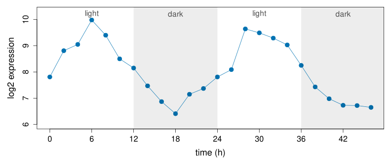
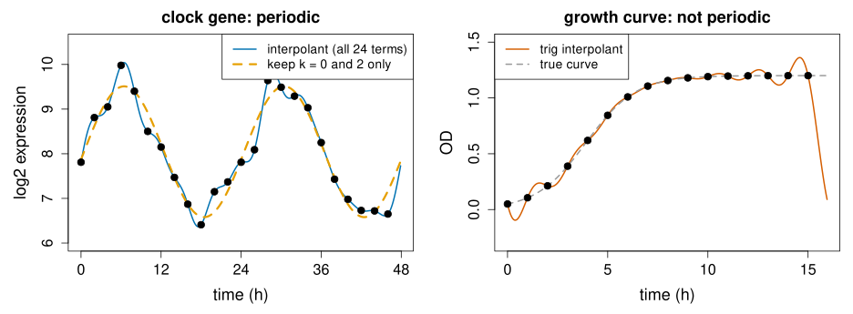
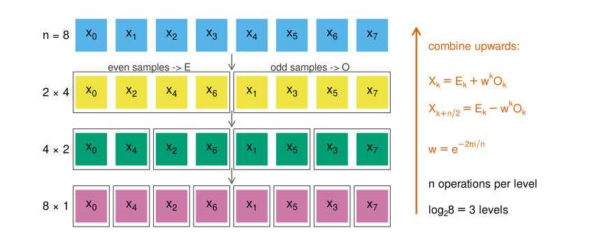
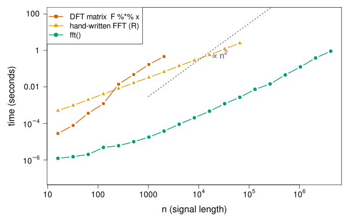
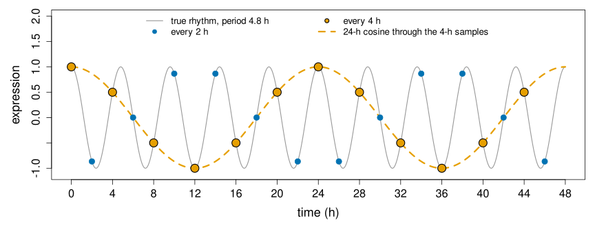
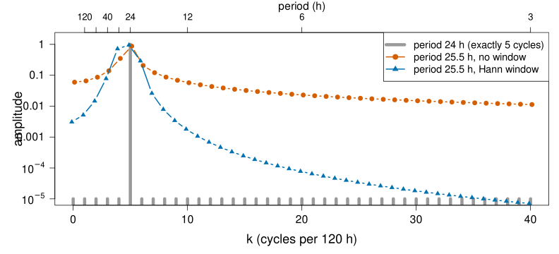
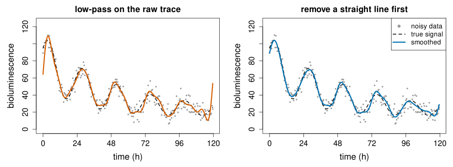
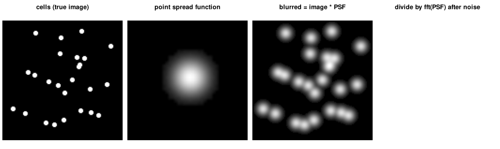

## About this lecture

The last two units, [*Polynomial interpolation*](../polynomial-interpolation/lec.qmd) and [*Splines*](../splines/lec.qmd), interpolated data with polynomials and splines. For **periodic** data (daily rhythms, cell cycles, a row of pixels) a better basis is sines and cosines.

- **Trigonometric interpolation:** $n$ samples, $n$ Fourier coefficients. Computing them is the **discrete Fourier transform** (DFT), a matrix–vector product, $O(n^2)$.
- The **fast Fourier transform** (FFT) gets the same numbers in $O(n\log n)$ by splitting even and odd samples. That is what `fft()` does.
- **Sampling** limits what you can see: rhythms faster than the **Nyquist** frequency are not lost, they are **aliased** onto slower ones.
- **Filtering** = multiplying the coefficients; the **convolution theorem** makes smoothing and image blur a product in frequency space.
- Biology: is a gene **circadian**? What is its amplitude and peak time? Smoothing a noisy trace; blur in a microscope.

::: notes
The sister course (Quantitative biology, Fourier lecture) gave the picture: a signal is a sum of waves, the transform is a change of basis, and filtering works by masking the spectrum. Here we look at the machinery: what fft() computes exactly (and its conventions), why it is fast, and the three ways it misleads you: aliasing, leakage and wrap-around. The biology thread is a circadian time course, the kind of data from a liver or Arabidopsis experiment sampled every few hours over two days.
:::

## A biology problem first

A clock-controlled gene (think *Dbp* in mouse liver), log2 expression, measured every **2 h** for **48 h** (simulated).

{width="80%" fig-align="center"}

- Is it rhythmic? With what **period**, **amplitude** and **peak time**?
- Thousands of genes per experiment: we need a fast, automatic answer.
- And would sampling every **4 h** (half the mice, half the cost) have been enough?

::: notes
This is the running example of the unit: 24 numbers, given as a literal vector in the code so that every language uses the same data. It was simulated as 8 + 1.5 cos(2 pi (t - 6)/24) plus noise with sd 0.3, so the true answers are amplitude 1.5, period 24 h, peak at 6 h after lights on. Circadian studies really do face this design question: published guidelines for genome-scale rhythm studies recommend sampling every 2 h or more often over at least two cycles. We will see at the end why sparser sampling is risky.
:::

## Recap: interpolation in a basis

In [*Polynomial interpolation*](../polynomial-interpolation/lec.qmd) we wrote the interpolant as a combination of basis functions and solved for the coefficients:

$$p(t) = \sum_k c_k\,\phi_k(t), \qquad p(t_j) = x_j \text{ for every sample } j.$$

- Polynomials ($\phi_k = t^k$): fine for a few points, **Runge** wiggles for many equispaced points.
- For **periodic** data on equispaced times, use $\phi_k = \cos$ and $\sin$ of whole numbers of cycles per record:

$$p(t) = a_0 + \sum_{k=1}^{n/2-1}\Big[a_k\cos\frac{2\pi k t}{T} + b_k\sin\frac{2\pi k t}{T}\Big] + a_{n/2}\cos\frac{\pi n t}{T}$$

- $T$ = record length (48 h), $n$ = number of samples (24). $k$ = **cycles per record**: $k = 2$ is a period of $48/2 = 24$ h.
- $1 + 2(n/2 - 1) + 1 = n$ coefficients for $n$ samples: a square system, as before.

::: notes
One-slide recap of the interpolation idea, only to frame the Fourier basis as "one more basis". Counting coefficients: the constant, a cosine and a sine for each k from 1 to n/2 - 1, and only a cosine at k = n/2 (the sine at k = n/2 is zero at every sample, since sin(pi j) = 0). Total n. The last term, the fastest wave on the grid, alternates +1, -1 from sample to sample; it will be the Nyquist frequency later. Solving this n x n system by Gaussian elimination would cost n^3; the next slides show that the matrix is so special that we never need to.
:::

## The DFT gives the coefficients

Because sines and cosines on an equispaced grid are **orthogonal**, each coefficient is a plain sum (no system to solve). In complex form, with $e^{i\theta} = \cos\theta + i\sin\theta$:

$$X_k = \sum_{j=0}^{n-1} x_j\, e^{-2\pi i jk/n}, \qquad k = 0, \dots, n-1 \qquad \text{(the DFT)}$$

$$a_0 = \frac{X_0}{n}, \qquad a_k = \frac{2\,\mathrm{Re}\,X_k}{n}, \qquad b_k = -\frac{2\,\mathrm{Im}\,X_k}{n}, \qquad a_{n/2} = \frac{X_{n/2}}{n}$$

**Small example**, $x = (1, 2, 0, 1)$, $n = 4$: $e^{-2\pi i/4} = -i$, so

- $X_0 = 1 + 2 + 0 + 1 = 4$, $\quad X_1 = 1 + 2(-i) + 0(-1) + 1(i) = 1 - i$
- $X_2 = 1 - 2 + 0 - 1 = -2$, $\quad X_3 = 1 + 2i + 0 - i = 1 + i$
- $p(t) = 1 + \tfrac12\cos\tfrac{2\pi t}{T} + \tfrac12\sin\tfrac{2\pi t}{T} - \tfrac12\cos\tfrac{4\pi t}{T}$. Check at $t = 0$: $1 + 0.5 - 0.5 = 1$. ✓

::: notes
The complex exponential is only bookkeeping: it packs the cosine sum (real part) and the sine sum (imaginary part) into one number. Students who are not at ease with complex numbers only need e^{i theta} = cos + i sin, and that Mod gives the length and Arg the angle of a complex number. Do the n = 4 example on the board. Note X_3 is the complex conjugate of X_1: for real data the second half of the DFT mirrors the first and carries no new information. The exercise has more of these by hand.
:::

## `fft()` in R: the conventions

```r
x <- c(7.81, 8.81, 9.05, 9.98, 9.40, 8.50, 8.15, 7.47, 6.87, 6.41, 7.15, 7.37,
       7.81, 8.09, 9.64, 9.49, 9.29, 9.03, 8.25, 7.43, 6.98, 6.73, 6.72, 6.65)
X <- fft(x)
round(X[1:4], 2)
# [1] 193.08+ 0.00i  -0.35+ 0.16i  -2.08-17.45i  -0.39- 1.42i
round(X[22:24], 2)
# [1] -0.39+ 1.42i -2.08+17.45i -0.35- 0.16i
sum(x)
# [1] 193.08
```

- [`fft`](https://stat.ethz.ch/R-manual/R-devel/library/stats/html/fft.html) is **unnormalised**: `X[1]` is the **sum**, not the mean. Divide by $n$ yourself.
- **1-indexed**: `X[k + 1]` holds frequency $k$. `X[3]` is $k = 2$: 2 cycles in 48 h = **24 h**.
- Real data: `X[n + 2 - m]` = `Conj(X[m])`. Only `X[1:(n/2 + 1)]` is informative.

::: notes
These three conventions cause most fft bugs. R and numpy both put no factor in front of the forward transform; some textbooks and other software use 1/n or 1/sqrt(n). R's indices start at 1, so frequency k lives at index k + 1; numpy's start at 0, so frequency k is X[k] directly, which is one reason to be careful when translating code. The mirror: index 24 is the conjugate of index 2, index 23 of index 3, and so on. Negative frequencies are just the other half of the cosine: cos = (e^{i theta} + e^{-i theta})/2.
:::

## Reading off amplitude, period and phase

For $x_j = A\cos(2\pi k t_j/T - \theta)$ the DFT gives $X_k = \tfrac{nA}{2}e^{-i\theta}$. So amplitude $= 2|X_k|/n$ and phase $\theta = -\arg X_k$.

```r
n <- length(x)
amp <- 2 * Mod(X) / n                  # amplitude of each cosine
round(amp[1:7], 2)                     # amp[1] is 2 x mean: ignore
# [1] 16.09  0.03  1.46  0.12  0.12  0.08  0.10
k <- which.max(amp[2:(n / 2)])         # strongest k >= 1
k; 48 / k                              # cycles per 48 h -> period (h)
# [1] 2
# [1] 24
(-Arg(X[k + 1]) / (2 * pi) * 24) %% 24 # peak time (h)
# [1] 6.452646
```

- True values (simulation): amplitude 1.5, period 24 h, peak at 6 h. Noise of sd 0.3 moves them a little.
- [`Mod`](https://stat.ethz.ch/R-manual/R-devel/library/base/html/complex.html) = length, `Arg` = angle of a complex number. `Re`, `Im` give $a_k$, $b_k$.

::: notes
This is the whole "rhythm detection" computation for one gene: one fft, one Mod, one Arg. The peak time comes from the phase: the cosine peaks when 2 pi k t / T = theta, i.e. t = theta/(2 pi) x period. The %% 24 brings it into [0, 24). Two cautions: the amplitude formula 2|X_k|/n holds for 0 < k < n/2; for k = 0 and k = n/2 it is |X_k|/n. And the frequencies are only those with a whole number of cycles in the record: 48, 24, 16, 12, ... hours. A 22-h rhythm falls between bins (leakage, later).
:::

## Trigonometric interpolation in code

```r
trig_interp <- function(x, T, tt) {    # evaluate p(t) at times tt
  n <- length(x); X <- fft(x) / n
  p <- Re(X[1]) + Re(X[n/2 + 1]) * cos(pi * n * tt / T)
  for (k in 1:(n/2 - 1))
    p <- p + 2 * Re(X[k + 1]) * cos(2 * pi * k * tt / T) -
             2 * Im(X[k + 1]) * sin(2 * pi * k * tt / T)
  p
}
max(abs(trig_interp(x, 48, seq(0, 46, by = 2)) - x))
# [1] 5.329071e-15                     # passes through every sample
round(trig_interp(x, 48, c(1, 3, 5)), 2)
# [1] 8.51 8.86 9.53                   # values between the samples
```

- 24 coefficients through 24 noisy points: the curve follows the **noise** too.
- Keeping only $k = 0$ and $k = 2$ gives the **least-squares** fit of mean + 24-h cosine: orthogonality again, no system to solve (next slide).

::: notes
The interpolant is exact at the samples up to rounding. Between samples it is the unique trigonometric polynomial of this form through the data. For noisy data, interpolation is the wrong goal (as with polynomials and splines): we want to keep the few coefficients that carry signal. Because the columns of the Fourier basis are orthogonal on the grid, dropping coefficients gives exactly the least-squares fit with the remaining basis functions; this is the normal-equations matrix of Least squares: normal equations vs QR being diagonal. That is how the cosinor method, a standard circadian analysis, can be done with one fft.
:::

## When the data are not periodic

{width="95%" fig-align="center"}

- Left: dashed = mean + 24-h cosine only (least squares). Solid = all 24 terms (interpolation).
- Right: an OD growth curve is **not** periodic. The interpolant joins the end (1.2) back to the start (0.05): wiggles everywhere, a dive at the end.
- **Check:** does `x[n]` lead smoothly into `x[1]`? If not, remove the trend first, or use [*Splines*](../splines/lec.qmd).

::: notes
The right panel uses the course's logistic growth curve from Convergence and cost (K = 1.2, N0 = 0.05, r = 0.8 per hour) sampled every hour for 16 h. The trigonometric interpolant is periodic with period 16 h by construction, so between t = 15 and t = 16 it must come back down to 0.05. Fitting a jump with smooth waves gives Gibbs-type ringing that spreads over the whole record. The same problem returns as leakage and as edge effects in filtering. The rule: Fourier methods assume that the record wraps around.
:::

## The DFT is a matrix

$X = F x$ with $F_{jk} = w^{jk}$, $w = e^{-2\pi i/n}$. For $n = 4$, $w = -i$:

:::: {.columns}
::: {.column width="45%"}
$$F_4 = \begin{pmatrix} 1 & 1 & 1 & 1\\ 1 & -i & -1 & i\\ 1 & -1 & 1 & -1 \\ 1 & i & -1 & -i\end{pmatrix}$$

- Columns are orthogonal: $\bar F^T F = nI$.
- So $F^{-1} = \bar F^T / n$: the inverse DFT is the same sum with $+i$, divided by $n$.
:::
::: {.column width="55%"}
```r
n <- 24; j <- 0:(n - 1)
F <- exp(-2i * pi * outer(j, j) / n)
max(Mod(F %*% x - fft(x)))
# [1] 2.419928e-13
max(Mod(Conj(F) %*% X / n - x))
# [1] 9.019499e-15
max(Mod(fft(X, inverse = TRUE) / n - x))
# [1] 3.619753e-15
```
:::
::::

- A matrix–vector product: $n^2$ complex multiplications. $n = 10^6$: $10^{12}$, and $F$ alone needs 16 TB.
- `fft(X, inverse = TRUE)` is **also unnormalised**: divide by $n$ to get `x` back.

::: notes
F is symmetric (not Hermitian), and F/sqrt(n) is unitary: it is a rotation in complex n-dimensional space, which is why the sister course called the transform a change of basis. The orthogonality means solving Fx = ... costs no elimination at all. But even the product F x costs n^2, and storing F costs n^2 complex numbers (16 bytes each). Note also that the matrix product is a little less accurate than fft (2e-13 against about 1e-14): the FFT does fewer operations, so it also makes fewer rounding errors.
:::

## The FFT idea: split even and odd {.smaller}

Split the sum into even samples $j = 2m$ and odd samples $j = 2m+1$:

$$X_k = \underbrace{\sum_{m} x_{2m}\, e^{-2\pi i mk/(n/2)}}_{E_k:\ \text{DFT of the even samples}} + w^k \underbrace{\sum_m x_{2m+1}\, e^{-2\pi i mk/(n/2)}}_{O_k:\ \text{DFT of the odd samples}}$$

{width="85%" fig-align="center"}

- $E$ and $O$ have period $n/2$ in $k$, and $w^{k+n/2} = -w^k$: two half-size DFTs give **all** $n$ outputs.
- Repeat until size 1: $\log_2 n$ levels, $n$ operations each: **$O(n \log n)$**.

::: notes
This is the Cooley–Tukey algorithm (1965; Gauss had it around 1805 for asteroid orbits). Walk through the recursion: a DFT of size n is two DFTs of size n/2 plus n/2 multiplications by the twiddle factors w^k and n additions. The cost satisfies C(n) = 2 C(n/2) + n, so C(n) = n log2 n. For n = 8: 3 levels; the bottom row is the input in bit-reversed order (0, 4, 2, 6, 1, 5, 3, 7), which is how in-place FFT codes arrange the data. The exercise does one n = 4 FFT by hand.
:::

## A hand-written FFT in 8 lines

```r
my_fft <- function(x) {
  n <- length(x)                        # n must be a power of 2
  if (n == 1) return(x)
  E <- my_fft(x[seq(1, n, by = 2)])     # samples 0, 2, 4, ...
  O <- my_fft(x[seq(2, n, by = 2)])     # samples 1, 3, 5, ...
  w <- exp(-2i * pi * (0:(n/2 - 1)) / n)
  c(E + w * O, E - w * O)               # X_k and X_(k + n/2)
}
set.seed(1); y <- rnorm(1024)
max(Mod(my_fft(y) - fft(y)))
# [1] 5.904884e-14
```

- Same answer as `fft()`. Only powers of 2; the library handles every $n$.
- R's `seq(1, n, by = 2)` picks the **even** samples $x_0, x_2, \ldots$ because of 1-indexing.

::: notes
Write it yourself first, then use the library. This recursive version is correct but slow in R: every call allocates new vectors. The production code (R uses Singleton's mixed-radix FFT in C; numpy and scipy use pocketfft; Rust has rustfft; FFTW is the classic C library) works in place, avoids recursion, and handles factors 2, 3, 4, 5 and more. Its cost is still n log n. Note the 1-indexing trap: x[seq(1, n, by = 2)] is x_0, x_2, ... in the 0-based maths.
:::

## $O(n^2)$ against $O(n\log n)$

{width="62%" fig-align="center"}

- The matrix (including building $F$) grows like $n^2$; both FFTs like $n\log n$.
- The hand-written R FFT is ~1000× slower than `fft()` (interpreted, recursive) but has the **same slope**.
- `fft()` does $n = 4\times10^6$ in about a second. The matrix would take hours (and 256 TB).

::: notes
Timings on our laptop; yours will differ by a constant factor, not in the slopes. Read off the slopes as in *Convergence and cost*: a factor 10 in n gives a factor 100 in time for the matrix, about 13 for the FFT. The crossover between matrix and hand-written FFT is around n = 256, because the R recursion has a large constant overhead. The lesson about constants: an O(n log n) algorithm in a slow language can lose to an O(n^2) one in compiled code for small n, but never for large n.
:::

## When `fft()` is slow: awkward $n$

```r
set.seed(1)                                    # times vary by machine
system.time(fft(rnorm(65536)))[["elapsed"]]    # 2^16
# [1] 0.007
system.time(fft(rnorm(65537)))[["elapsed"]]    # 65537 is prime
# [1] 4.677
nextn(65537)                                   # next 2^a 3^b 5^c
# [1] 65610
```

- R's `fft` splits $n$ into its prime factors. A large prime factor $p$ costs $O(np)$; for prime $n$ that is $O(n^2)$.
- **Check:** `nextn(n) == n` is `TRUE` only if $n$ has no prime factors above 5. If not, pad with zeros to [`nextn(n)`](https://stat.ethz.ch/R-manual/R-devel/library/stats/html/nextn.html), or trim a few samples.
- numpy/scipy and rustfft use Bluestein's algorithm for primes: still $O(n\log n)$, a few times slower.

::: notes
About a factor 700 for adding one sample on our laptop (the 2^16 time is too short to time precisely; on a busy machine we measured factors of 1000 to 10 000). It bites in practice when n is the number of frames of a movie or the length of a recording, which nobody chose to be a power of 2. Padding changes the frequency grid (k now counts cycles per padded length) and adds an edge, so for spectra it is often better to trim to a nice length. scipy.fft.next_fast_len is the Python equivalent of nextn. (R's factor() is something else entirely: it makes categorical variables.)
:::

## Sampling and the Nyquist frequency

Samples every $\Delta t$ hours, $n$ samples, record length $T = n\Delta t$.

| | every 2 h ($n = 24$) | every 4 h ($n = 12$) |
|---|---|---|
| frequency step $1/T$ | 1 cycle / 48 h | 1 cycle / 48 h |
| **Nyquist** $f_N = 1/(2\Delta t)$ | 1 cycle / 4 h | 1 cycle / 8 h |
| periods on the grid | 48, 24, 16, 12, …, **4** h | 48, 24, 16, 12, 9.6, **8** h |

- The fastest wave on the grid goes up–down–up in **two** samples: $f_N = 1/(2\Delta t)$.
- The record length sets the **resolution**: 24 h and 22 h are not separable in 48 h (both are near $k = 2$).
- Faster sampling buys a higher Nyquist frequency; a longer record buys finer resolution.

::: notes
Two different numbers students mix up. Delta t (sampling interval) decides the highest frequency you can see; T (record length) decides how finely you can tell frequencies apart. Both 2-h and 4-h designs over 48 h have the same frequency grid up to their Nyquist frequency. For a circadian question, both look adequate on paper. The danger is what happens to rhythms faster than the Nyquist frequency: they do not disappear.
:::

## Aliasing: a fast rhythm in disguise {.smaller}

{width="90%" fig-align="center"}

A rhythm with period 4.8 h (an ultradian oscillator). Sampled every 4 h, its samples are **exactly** those of a 24-h cosine:

$\cos(2\pi\cdot 4j/4.8) = \cos(2\pi j\cdot\tfrac56) = \cos(2\pi j\cdot\tfrac16) = \cos(2\pi\cdot 4j/24)$.

::: notes
Frequencies above Nyquist fold back: f and f_s - f (and f + any multiple of f_s) give the same samples. Here f = 1/4.8 = 0.2083 per hour, f_s = 1/4 = 0.25 per hour, so the alias is 0.25 - 0.2083 = 0.0417 per hour = 1/24. The 2-h samples (blue) still follow the fast rhythm: Nyquist is 1/4 per hour, above 1/4.8. Ultradian rhythms of a few hours exist (p53 pulses, about 5.5 h; Hes1, about 2 h; 12-h and 8-h harmonics of the clock), so this is not only a textbook trick. The same effect makes wagon wheels turn backwards in films.
:::

## Aliasing in the spectrum

```r
f <- function(t) cos(2 * pi * t / 4.8)      # true period 4.8 h
x2 <- f(seq(0, 46, by = 2)); x4 <- f(seq(0, 44, by = 4))
which.max(Mod(fft(x2))[2:12])               # k, cycles per 48 h
# [1] 10                                    # 48/10 = 4.8 h: correct
which.max(Mod(fft(x4))[2:6])
# [1] 2                                     # 48/2 = 24 h: "circadian"!
g <- function(t) cos(2 * pi * (t - 2) / 8)  # 8-h rhythm, exactly at Nyquist
round(g(seq(0, 44, by = 4)), 12)
#  [1] 0 0 0 0 0 0 0 0 0 0 0 0              # invisible
```

- No warning: the sparse design reports a **confident, wrong** period.
- **Checks:** sample faster than twice the fastest rhythm you expect; compare designs (or subsample your own data); stagger sample times; in instruments, filter **before** sampling (anti-aliasing).

::: notes
The fft cannot know that the samples came from a fast rhythm; any frequency analysis of these 12 numbers gives 24 h. The second example is a rhythm sitting exactly at the Nyquist frequency: whether you see it depends on its phase. Here it happens to be sampled at its zero crossings and vanishes completely. Uneven or staggered sampling breaks the symmetry that creates the alias (the Lomb–Scargle periodogram handles uneven sampling). Microscopes, ADCs and audio hardware apply a low-pass filter before sampling for exactly this reason; with mice and RNA-seq the only defence is the design.
:::

## Leakage and windowing

{width="72%" fig-align="center"}

- A 25.5-h free-running rhythm over 120 h is not a whole number of cycles: its energy **leaks** to all $k$ (red), slowly decaying.
- A **Hann window** $w_j = \tfrac12 - \tfrac12\cos(2\pi j/n)$ tapers both ends to 0: leakage drops by orders of magnitude, the peak gets slightly wider (blue). Weak rhythms next to strong ones become visible.

::: notes
Leakage is the spectral version of the growth-curve wiggles: the periodic extension of 4.7 cycles has a jump at the wrap-around point, and a jump needs all frequencies. The window removes the jump by forcing both ends to zero. Divide by sum(w) instead of n to keep the amplitude scale. Zero-padding (appending zeros) samples the same spectrum on a finer grid, which helps to locate the peak between bins; it does not improve the true resolution 1/T. One slide only: windows are a large topic in signal processing (Hamming, Blackman, Welch's method), and Hann is a good default.
:::

## Try it: sampling, aliasing and leakage

```{=html}
<link rel="stylesheet" href="../demos/dist/demo.css">
<div data-demo="nyquist" data-dt="2" data-dur="48"></div>
<script src="../demos/dist/nyquist.js"></script>
```

::: notes
Live in the browser: the clock gene 8 + 1.5 cos(2 pi (t - 6)/24), optionally plus a fast rhythm cos(2 pi t / Pu), sampled every Delta t over the chosen duration; the DFT is computed directly in JS. Top: true signal (grey), samples (blue), and the Fourier curve through the samples (orange dashed, the trigonometric interpolant). Bottom: amplitude 2|X_k|/n against cycles per day, Nyquist as a black line, grey beyond it. Start on "course data": with noise sd 0.3 the samples are exactly the 24 values of the lecture, and the readout gives 8.045, amplitude 1.465, peak 6.45 h, as fft() did. Click "+ 4.8 h, every 2 h": a second peak at 5 per day = 4.8 h, below Nyquist (6 per day), 24-h bin still 1.5 at 6 h. Click "every 4 h": Nyquist drops to 3 per day, the purple arrow folds 5 per day onto 1 per day, the orange curve is a smooth 24-h wave through the samples, and the 24-h bin now reads 1.80 with peak 3.75 h: confident and wrong. Drag the sampling interval to 3 h: the alias moves to 8 h. Then "leakage": a 25.5-h rhythm over 120 h on a log scale, energy in every bin; tick Hann window and the far bins fall by orders of magnitude (12-h bin from 0.07 to 0.003). Note the orange curve jumping back at the end of the record: the wrap-around. Last, "low-pass": noisy trace sd 1, keep periods of 8 h and more; rms error 0.97 -> 0.41; drag the cut-off to 24 h (0.24) and to 48 h (1.07: the rhythm itself is removed).
:::

## Screening many genes

```r
set.seed(4)
t <- seq(0, 46, by = 2); G <- 1000
E <- matrix(rnorm(24 * G, sd = 0.5), 24, G)          # 24 times x 1000 genes
peak <- runif(100, 0, 24)                            # genes 1-100 cycle
E[, 1:100] <- E[, 1:100] + 0.5 * cos(2 * pi * outer(t, peak, "-") / 24)
amp24 <- 2 * Mod(mvfft(E)[3, ]) / 24                 # 24-h bin, all genes
null  <- 2 * Mod(mvfft(apply(E, 2, sample))[3, ]) / 24   # shuffled times
thr <- quantile(null, 0.99); round(thr, 3)
#   99%
# 0.462
c(cycling = sum(amp24[1:100] > thr), flat = sum(amp24[-(1:100)] > thr))
# cycling    flat
#      63       3
```

- [`mvfft`](https://stat.ethz.ch/R-manual/R-devel/library/stats/html/fft.html) transforms every column: 1000 genes in one call.
- **Check:** noise alone gives a non-zero amplitude. Compare with a null (shuffled time order) before calling a gene rhythmic.

::: notes
The amplitude in one bin is a test statistic. With noise sd 0.5 and 24 samples, a flat gene shows a 24-h "amplitude" of up to about 0.46 one time in a hundred. Genes with true amplitude 0.5 pass only 63 times out of 100: the power of a 48-h design is limited. Published tools (JTK_CYCLE, RAIN, the cosinor method, Lomb–Scargle) differ in their statistics and in how they handle uneven sampling and waveform shape, but all rest on this projection onto a 24-h wave. Multiple testing across 20 000 genes needs a false-discovery-rate correction on top.
:::

## Filtering: smoothing a noisy trace

A PER2::LUC bioluminescence trace, every 30 min for 5 days ($n = 240$), simulated with noise.

```r
lowpass <- function(y, kmax) {
  n <- length(y); Y <- fft(y)
  k <- c(0:(n/2), -(n/2 - 1):-1)        # signed frequency of each entry
  Y[abs(k) > kmax] <- 0                 # keep periods >= 120/kmax h
  Re(fft(Y, inverse = TRUE)) / n
}
s <- lowpass(y, 15)                     # keep periods >= 8 h
round(c(noisy = rms(y - truth), smoothed = rms(s - truth)), 2)
#    noisy smoothed
#     5.96     4.55
```

- **Filter** = multiply each coefficient by a gain (here 1 or 0), transform back.
- Zero both $k$ and $-k$, or the result is not real. `Re()` drops the rounding-level imaginary part.

::: notes
The trace is 20 + 60 exp(-t/40) + 30 exp(-t/80) cos(2 pi (t - 4)/24) plus noise with sd 6, the typical shape of a luciferase recording: decaying baseline and damped oscillation. rms is sqrt(mean(e^2)), defined in the exercise. The low-pass keeps 31 of 240 coefficients and should remove most of the noise, but the error only drops from 5.96 to 4.55. The next slide shows where the remaining error is. Forgetting to zero the mirrored negative frequencies is a classic bug: the result then has a large imaginary part, and taking Re hides the mistake.
:::

## Filtering fails at the edges

{width="95%" fig-align="center"}

- Left: the trace starts at 95 and ends near 26. The periodic extension has a **jump**; the cut-off filter **rings** and pulls both ends towards each other (start: 64 instead of 95).
- Right: subtract a straight-line fit, filter, add it back: error 4.55 → **2.49**.
- **Check:** plot the smoothed curve over the data, especially the first and last few points.

::: notes
Same message as the growth curve and leakage: the DFT treats the record as one period of a periodic signal. A trend makes the ends disagree, and the sharp cut-off in frequency produces Gibbs ringing in time. Remedies: detrend (linear or a smooth fit), mirror the data before filtering, pad, or use a gentler filter whose gain falls smoothly to zero. For smoothing alone, smoothing splines (Splines) or a moving average with proper edge handling are often simpler; Fourier filtering pays off when the frequency content matters (remove 50 Hz mains hum, or a known stripe in an image).
:::

## The convolution theorem

A moving average is a **convolution**: $(h * y)_j = \sum_m h_m\, y_{j-m}$. The DFT turns it into a product:

$$\mathrm{DFT}(h * y)_k = H_k \, Y_k \qquad \text{(circular convolution)}$$

```r
m <- 9                                          # 4-h moving average
h <- c(rep(1/m, 5), rep(0, n - m), rep(1/m, 4)) # box centred on 0, wrapped
ma_fft <- Re(fft(fft(y) * fft(h), inverse = TRUE)) / n
ma_dir <- stats::filter(y, rep(1/m, m), circular = TRUE)
max(abs(ma_fft - ma_dir))
# [1] 4.263256e-14
round(c(ma_fft[1], truth[1]), 1)
# [1] 63.4 95.0                                 # wrap-around at the start
```

- Direct: $n\cdot m$ operations. Via FFT: $O(n\log n)$, whatever the width $m$.
- **Circular:** the first values average in the **last** samples. For an ordinary (linear) convolution, pad both with zeros to length $\ge n + m - 1$.

::: notes
The convolution theorem is why the FFT matters far beyond spectra: every linear, shift-invariant filter (smoothing, blur, cross-correlation for aligning two signals) is a multiplication of coefficients. fft(h) is the gain of the moving-average filter at each frequency: it is not 0/1 but a sinc shape, so a box filter lets some high frequencies through (exercise). The wrap-around value 63.4 is the same edge problem as before, now from the circular convolution. stats::filter with circular = FALSE gives NA at the ends instead; convolve(x, rev(h), type = "open") pads for you.
:::

## Image blur is a convolution

{width="100%" fig-align="center"}

- A microscope image = true image convolved with the **point spread function** (PSF). 2D: `fft()` of a matrix, multiply, transform back: $O(N^2\log N)$ for an $N\times N$ image.
- **Deconvolution** = divide by `fft(psf)`. Where that is $\approx 10^{-18}$, noise is amplified $10^{18}$×: the image is lost. Regularise, as in [*The SVD, rank deficiency and regularisation*](../svd/lec.qmd).

::: notes
One slide, to connect to imaging. The blurred image is computed as Re(fft(fft(img) * fft(psf), inverse = TRUE)) / N^2 with a Gaussian PSF of sd 2 pixels, stored with its centre at pixel [1, 1] (the 2D version of the wrapped box on the previous slide). Deconvolution is an ill-conditioned linear problem: the Fourier coefficients of the PSF are the singular values of the blur matrix, and dividing by tiny ones amplifies noise exactly like the small singular values in the SVD unit. Wiener filtering (ridge regression in frequency space) and Richardson–Lucy are the standard remedies in microscopy software.
:::

## Checklist: detecting Fourier trouble

- **Off-by-one in frequency** → R's `X[k + 1]` is $k$ cycles per record; period $= T/k$.
- **Amplitudes $n/2$ times too big** → `fft` is unnormalised; amplitude $= 2|X_k|/n$.
- **Inverse off by a factor $n$** → `fft(X, inverse = TRUE) / n`.
- **Complex result after filtering** → zero $k$ and $-k$ together.
- **A peak at an unexpected period** → aliasing? Is the rhythm faster than $1/(2\Delta t)$?
- **Broad peak, raised floor** → leakage: window, or a whole number of cycles.
- **Wiggles at the ends** → the record does not wrap around: detrend, pad, or mirror.
- **Unexpectedly slow** → large prime factor in $n$? Pad to `nextn(n)` or trim.

::: notes
Pin this next to the keyboard. The first three are convention bugs and are caught by a test signal: always run your pipeline once on a pure cosine with known amplitude, period and phase, and check that you get them back. The next four are properties of the DFT that no convention fixes.
:::

## Summary

- Equispaced samples of periodic data: interpolate with sines and cosines. The coefficients are the **DFT**, $X_k = \sum_j x_j e^{-2\pi i jk/n}$, because the basis is orthogonal.
- The DFT is a matrix–vector product, $O(n^2)$. The **FFT** splits even/odd samples recursively: $O(n\log n)$. Awkward (prime) $n$ can be slow in R.
- R's `fft`: unnormalised, 1-indexed, mirror-symmetric for real data. Amplitude $2|X_k|/n$, phase $-\arg X_k$, period $T/k$.
- **Nyquist:** sampling every $\Delta t$ resolves periods down to $2\Delta t$. Faster rhythms are **aliased** onto slower ones, silently.
- A non-periodic record leaks (window it) and rings at the edges (detrend it).
- **Convolution theorem:** smoothing and blur are products of DFTs; circular unless zero-padded. Deconvolution is ill-conditioned.

**Next:** Part 7 starts with [*Numerical differentiation*](../finite-differences/lec.qmd): derivatives from sampled data, where noise is amplified much as in deconvolution.

::: notes
The two ideas to keep: the FFT is just a fast way to compute an orthogonal change of basis, and everything it tells you is about a periodic, sampled version of your data. Most mistakes come from forgetting one of those two words. Numerical differentiation of noisy data is a high-pass filter (in Fourier terms, multiplication by i k), which is why it amplifies noise; the next unit treats it with finite differences.
:::
