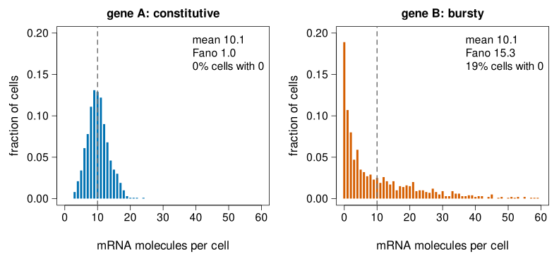
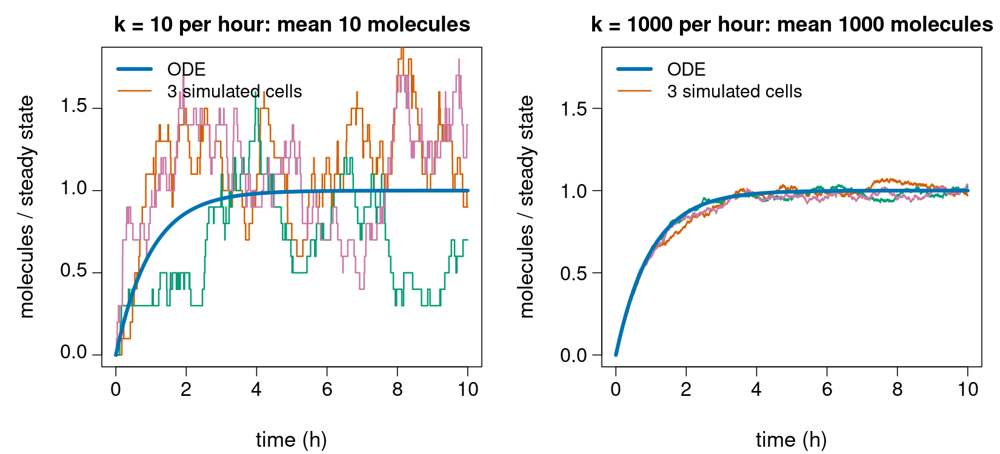
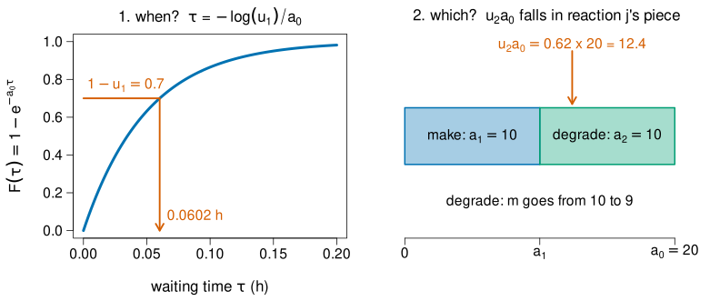
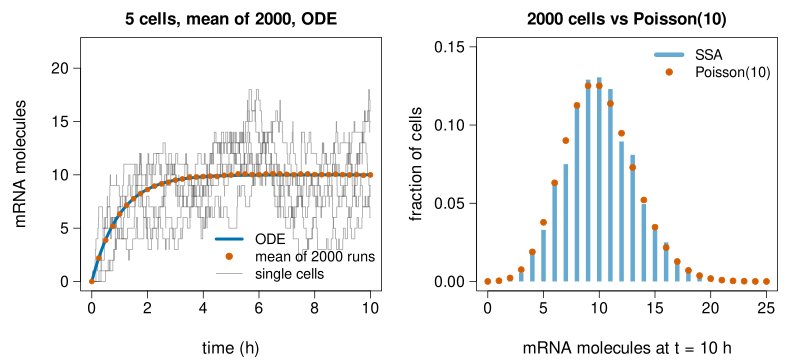
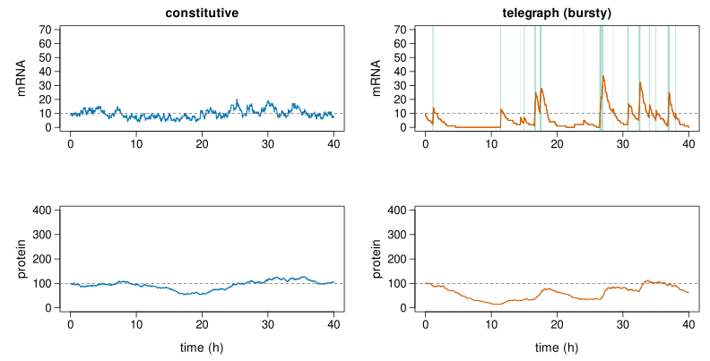
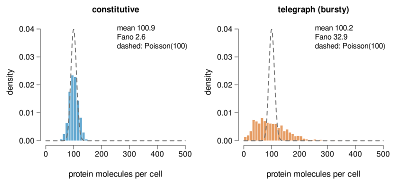
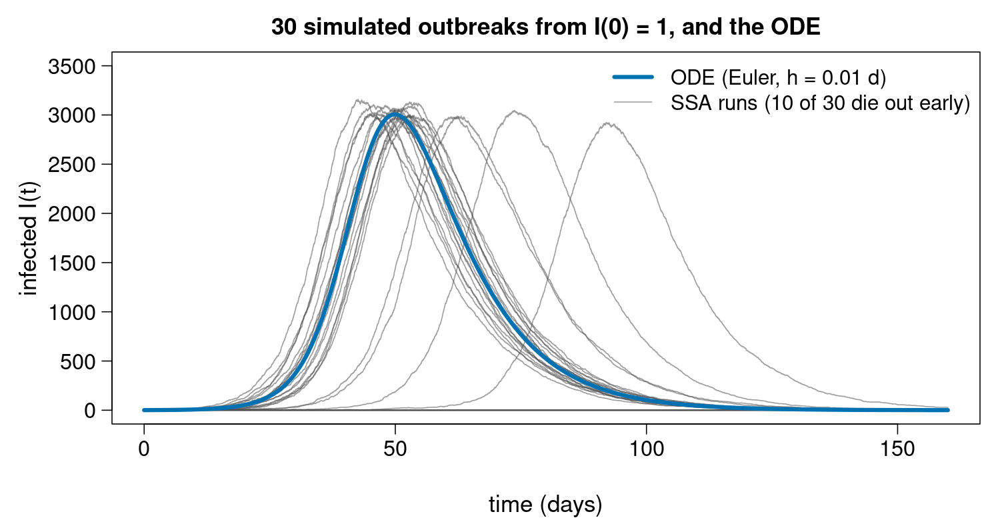

## About this lecture {.smaller}

So far in Part 8 a model was an ODE: one smooth curve, the same in every cell. With **10 mRNA molecules per cell** that picture breaks.

- When copy numbers are small, reactions are **random events**. Each has a **propensity**: its probability per unit time.
- The **chemical master equation** describes the probabilities of all states, but it is far too large to solve. We **sample** it instead.
- **Gillespie's algorithm** (the SSA): draw *when* the next reaction happens (an exponential waiting time) and *which* one it is (in proportion to its propensity). Exact, and 10 lines of code.
- Many runs give a **distribution**. Its mean is compared with the ODE; its spread is the biology.
- When the SSA is too slow: **tau-leaping**, and **Euler–Maruyama** for stochastic differential equations, each with its failure.
- Biology: **transcriptional bursting** and the cell-to-cell variability it causes; the **Fano factor**.

::: notes
This is the last unit of Part 8. The previous four units treated an ODE as the model and asked how to solve it accurately. Here the model itself changes: a cell with ten copies of an mRNA does not have a concentration that changes smoothly; it has a whole number of molecules that jumps up and down at random times. The numerical method is a Monte Carlo method (Random numbers and Monte Carlo), and its accuracy is a statistical question: how many runs, what standard error. We hand-write the algorithm in R; packages exist (GillespieSSA2, adaptivetau in R; gillespy2 in Python), but the algorithm is the point and is short.
:::

## Recap: the mRNA ODE {.smaller}

The mRNA model $m' = \alpha - \delta m$ of [*Initial value problems and Euler's method*](../euler/lec.qmd), with the transcription rate now called $k$. There $\alpha = 10$ per **minute**, $\delta = 0.2$ per minute (50 molecules); here a weaker gene, time in **hours**:

$$m'(t) = k - \delta\, m, \qquad m(0) = 0 \quad\Rightarrow\quad m(t) = \frac{k}{\delta}\left(1 - e^{-\delta t}\right).$$

| | value | meaning |
|---|---|---|
| $k$ | 10 per hour | transcription rate |
| $\delta$ | 1 per hour | degradation rate per molecule (mean lifetime 1 h) |
| $k/\delta$ | 10 molecules | steady state |

- The ODE says: every cell reaches **exactly 10.0** molecules after a few hours, and stays there.
- A single-molecule FISH (smFISH) experiment counts mRNA in single cells. Do all cells have 10?

::: notes
Same model as in the Euler unit, where it is written m' = alpha - delta m with alpha = 10 per minute and delta = 0.2 per minute (steady state 50, reached on a time scale of 5 minutes). Here we call the transcription rate k (alpha is free for other uses, and k is the usual name in the stochastic literature), take a gene expressed at a lower level and measure time in hours, so that the steady state is 10 molecules: the small-number case this lecture is about. smFISH counts individual mRNA molecules as fluorescent dots, so it gives a whole number per cell for thousands of cells: a distribution, not a curve. The question of this lecture: what does the model predict for that distribution?
:::

## A biology problem first: two genes, same mean

{width="88%" fig-align="center"}

- Two genes, both with a mean of 10 mRNA per cell. Gene A: a narrow peak. Gene B: one cell in five has **none**, a few have 40+.
- The ODE gives the same answer, 10, for both. It cannot tell them apart.

::: notes
These are simulated cells (1000 per gene), made with the two models of this lecture; real smFISH data look like this (Raj et al. 2006, mammalian cells; Zenklusen et al. 2008, yeast). Gene A is transcribed at a steady rate. Gene B is transcribed in bursts: the promoter switches on now and then, makes a burst of mRNA, and switches off. Such bursting is common in mammalian genes and is one source of cell-to-cell variability in genetically identical cells in the same environment: a clonal population is not uniform. Whether a cell has 0 or 40 copies of a transcription factor can decide its fate. The mean, which is all an ODE predicts, is identical.
:::

## When copy numbers are small, the ODE is not enough

{width="85%" fig-align="center"}

- The same model, scaled by its steady state. With 10 molecules, single cells fluctuate by $\pm 30\%$; with 1000, by $\pm 3\%$.
- The relative fluctuation is about $1/\sqrt{\text{mean}}$: $1/\sqrt{10} = 0.32$, $1/\sqrt{1000} = 0.032$.

::: notes
The ODE is the limit of many molecules: when every species is present in thousands of copies, the random fluctuations average out and the deterministic curve describes each cell well. Bacteria have about 1 mRNA copy per gene on average, mammalian cells a few to a few hundred; many transcription factors are present in tens to hundreds of copies; a gene has 1 or 2 copies of its promoter. So in gene expression the small-number case is the rule. The 1/sqrt(mean) law is the Poisson law (variance = mean), which we will see is exact for this model.
:::

## Reactions as random events {.smaller}

A reaction $j$ has a **propensity** $a_j(\mathbf x)$: in a short time $dt$ it happens with probability $a_j(\mathbf x)\,dt$. It changes the state $\mathbf x$ by a fixed **stoichiometry** vector.

| reaction | | propensity $a_j$ | change $(m, p)$ | at $(m, p) = (10, 100)$ |
|---|---|---|---|---|
| transcription | $\varnothing \to M$ | $k = 10$ | $(+1, 0)$ | 10 per h |
| mRNA decay | $M \to \varnothing$ | $\delta_m m = 1 \cdot m$ | $(-1, 0)$ | 10 per h |
| translation | $M \to M + P$ | $k_p m = 2\, m$ | $(0, +1)$ | 20 per h |
| protein decay | $P \to \varnothing$ | $\delta_p p = 0.2\, p$ | $(0, -1)$ | 20 per h |

- Total propensity $a_0 = \sum_j a_j = 60$ per hour: a reaction every minute on average.
- The ODE uses the **same** rates: $m' = k - \delta_m m$, $p' = k_p m - \delta_p p$, i.e. (change vectors) × (propensities).

::: notes
The propensity is the rate of the ODE, read as a probability per unit time. "Each mRNA is degraded at rate 1 per hour" means each molecule has probability delta dt of being degraded in the next dt, so with m molecules the probability that one of them goes is delta m dt. A protein is made from an mRNA: translation does not use up the mRNA, so its change vector is (0, +1). Steady state of the ODE: m = 10, p = k_p m / delta_p = 100. For a reaction between two molecules (A + B), the propensity is c times a times b; for two molecules of the same kind, c a (a - 1)/2. These combinatorial factors are where the stochastic and the deterministic model start to differ.
:::

## The chemical master equation, in words {.smaller}

$P_n(t)$ = probability that a cell has $n$ mRNA molecules at time $t$. Probability flows **into** state $n$ from $n-1$ (a molecule made) and $n+1$ (one degraded), and **out** of $n$ by any reaction:

$$\frac{dP_n}{dt} = \underbrace{k\,P_{n-1} + \delta\,(n+1)\,P_{n+1}}_{\text{in}} - \underbrace{(k + \delta n)\,P_n}_{\text{out}}.$$

For $n = 3$: $\;P_3' = 10\,P_2 + 4\,P_4 - 13\,P_3$.

- A **linear ODE system**, one equation per state. Its steady state here is **Poisson(10)**.
- But one equation per **state**: (promoter, mRNA ≤ 100, protein ≤ 500) has $2 \cdot 101 \cdot 501 \approx 10^5$ states; an epidemic in 10 000 people about $5 \cdot 10^7$.
- So we do not solve the master equation; we **sample** from it, one cell at a time.

::: notes
The chemical master equation (CME) is the exact description of a well-mixed reacting system: it is the Kolmogorov forward equation of a continuous-time Markov chain whose states are the molecule counts. It is linear in the P's, so in principle we know how to solve it: a matrix exponential, or for the steady state a null vector of the rate matrix (an eigenvector for eigenvalue 0; for the discrete-time Markov chains in Power iteration and friends the same vector is the eigenvector for eigenvalue 1 of the transition matrix). The problem is size: one unknown per possible state, and the number of states is the product of the ranges of all species. Detailed balance gives the steady state of the one-species case by hand: k P_{n-1} = delta n P_n, so P_n = (k/delta)^n / n! P_0, the Poisson distribution (exercise B3).
:::

## Gillespie's idea: two questions per step

{width="90%" fig-align="center"}

- **When?** With total propensity $a_0$, the waiting time is exponential with rate $a_0$: inverse transform $\tau = -\log(u_1)/a_0$.
- **Which?** Reaction $j$ with probability $a_j/a_0$: cut $[0, a_0)$ into pieces of length $a_j$, see where $u_2 a_0$ falls.

::: notes
Gillespie (1976, 1977) showed that these two draws produce exact sample paths of the master equation: no time step, no approximation beyond the model itself. Why exponential: each reaction j would fire after an exponential time with rate a_j if nothing else happened; the first of several independent exponentials is exponential with the sum of the rates, and it is reaction j with probability a_j / a0. Both draws are inverse-transform sampling from Random numbers and Monte Carlo: the continuous one for the exponential (with u in place of 1 - u, since both are uniform), the discrete one for the reaction, exactly the base-composition example there. After the reaction the propensities change, so they are recomputed before the next step.
:::

## One step by hand {.smaller}

State $m = 10$: $a_1 = k = 10$ (make), $a_2 = \delta m = 10$ (degrade), $a_0 = 20$ per hour.

| | uniform | computation | result |
|---|---|---|---|
| when? | $u_1 = 0.3$ | $\tau = -\log(0.3)/20 = 1.204/20$ | $0.0602$ h (3.6 min) |
| which? | $u_2 = 0.62$ | $u_2 a_0 = 12.4 \ge a_1 = 10$ | degrade: $m \to 9$ |

Next step: $a = (10, 9)$, $a_0 = 19$; with $u_1 = 0.9$, $u_2 = 0.2$: $\tau = 0.105/19 = 0.0055$ h; $0.2 \cdot 19 = 3.8 < 10$: make, $m \to 10$.

- The time advances by **random, unequal** steps, one reaction per step. There is no step size $h$ to choose.
- Mean waiting time $1/a_0$: 3 minutes here. A busier cell takes more, smaller steps.

::: notes
Do this on the board. The time axis is not a grid: the algorithm jumps from event to event. Between events nothing happens, so the state is a step function of time. Compare with Euler: there we chose h and the error depended on it; here the only error is the randomness, which we control by the number of runs. The expected number of steps in a time T is about a0 T; that is the cost of the method, and it is large when molecule numbers are large (the propensities grow with them).
:::

## Gillespie's algorithm in R {.smaller}

```r
k <- 10; delta <- 1                      # per hour: transcription, mRNA decay
set.seed(1)
t <- 0; m <- 0; tt <- 0; mm <- 0         # no mRNA at t = 0
while (t < 10) {
  a <- c(k, delta * m); a0 <- sum(a)     # propensities: make, degrade
  t <- t - log(runif(1)) / a0            # 1. when? waiting time ~ Exp(a0)
  m <- m + if (runif(1) * a0 < a[1]) 1 else -1   # 2. which? make or degrade
  tt <- c(tt, t); mm <- c(mm, m)         # record every event
}
length(tt) - 1                           # reactions in 10 h
# [1] 223
```

- `mm` jumps by $\pm 1$ at the times `tt`: 0, 0.133, 0.183, 0.317, ... h. Plot it as a step function, `plot(tt, mm, type = "s")`.
- With $a_0 \approx 20$ per hour, 10 hours take about 200 steps.

::: notes
[runif](https://stat.ethz.ch/R-manual/R-devel/library/stats/html/Uniform.html) never returns exactly 0 in R, so the log is safe; in Python and Rust the generators can return 0, so the exercise uses 1 - u there. The comparison runif(1) * a0 < a[1] is the discrete inverse transform for two reactions. Growing a vector with c() inside a loop is slow for long runs (it copies every time); fine for a few hundred events, and the general function on the next slide records only at chosen times. Starting at m = 0, the first propensities are (10, 0), so the first reaction must be a transcription.
:::

## A general SSA {.smaller}

Any network: a **stoichiometry matrix** `S` (one column per reaction) and a **propensity function**.

```r
ssa <- function(x, S, propensity, times) {   # S: species x reactions
  out <- matrix(0, length(times), length(x)); t <- 0; i <- 1
  repeat {
    a <- propensity(x); a0 <- sum(a)
    t <- t - log(runif(1)) / a0               # Inf if a0 = 0: nothing more happens
    while (i <= length(times) && times[i] < t) { out[i, ] <- x; i <- i + 1 }
    if (i > length(times)) return(out)
    j <- findInterval(runif(1) * a0, cumsum(a)) + 1   # reaction j w.p. a_j / a0
    x <- x + S[, j]
  }
}
```

- Records the state at fixed output `times`: the state **before** the jump is the state at every output time up to the jump.
- [`findInterval`](https://stat.ethz.ch/R-manual/R-devel/library/base/html/findInterval.html) on the cumulative propensities picks the reaction; a reaction with $a_j = 0$ is never chosen.

::: notes
Walk through the while loop: the next event happens at time t; every output time before t sees the current state x, because nothing changes until then. When all output times are filled, return. If all propensities are zero (an absorbing state, such as an extinct population), a0 = 0, the waiting time is infinite, and all remaining output times get the final state. findInterval(v, cumsum(a)) counts how many cumulative sums are <= v; adding 1 gives the reaction whose piece contains v. This is the "direct method"; the "next reaction method" (Gibson and Bruck 2000) is a faster variant for large networks.
:::

## Many cells: a distribution, and its mean {.smaller}

```r
S1 <- matrix(c(1, -1), nrow = 1)          # 1 species (m), 2 reactions
bd <- function(x) c(10, 1 * x)            # propensities: k, delta * m
set.seed(1)
tm <- c(0.5, 1, 2, 10)
M <- replicate(2000, ssa(0, S1, bd, tm)[, 1])   # 4 times x 2000 cells
rbind(ssa = rowMeans(M), se = apply(M, 1, sd) / sqrt(2000),
      ode = 10 * (1 - exp(-tm)))
#           [,1]      [,2]       [,3]        [,4]
# ssa 3.85750000 6.3285000 8.66400000 10.11850000
# se  0.04415962 0.0558243 0.06451847  0.06981881
# ode 3.93469340 6.3212056 8.64664717  9.99954600
c(mean = mean(M[4, ]), var = var(M[4, ]))       # Poisson: var = mean
#      mean       var
# 10.118500  9.749332
```

- The SSA mean agrees with the ODE **within 2 SE** at every time. Variance ≈ mean: Fano factor ≈ 1.

::: notes
[replicate](https://stat.ethz.ch/R-manual/R-devel/library/base/html/lapply.html) runs 2000 independent cells; each column of M is one cell at the four times. The mean over cells is a Monte Carlo estimate, so it comes with a standard error sd / sqrt(N), exactly as in Random numbers and Monte Carlo. The largest deviations, 1.7 SE at t = 0.5 and at t = 10, are ordinary. For this model (all propensities linear in the state) the mean of the master equation obeys the ODE exactly; that is a check we can always run when the propensities are linear. In Python and Rust the streams differ (different generators), so the numbers in the exercise differ in the second decimal; compare them with their SEs, not digit by digit.
:::

## Runs, mean and distribution

{width="90%" fig-align="center"}

- Single cells wander around 10; the **average** of many follows the ODE.
- At $t = 10$ h the counts follow **Poisson(10)**, the steady state of the master equation. A check with a known answer.

::: notes
Left: five single-cell trajectories (grey steps), the mean of 2000 runs on a grid of times (dots) and the ODE (blue). Right: the histogram of the 2000 counts at t = 10 h (from the slide before) against the Poisson(10) probabilities. Always test a stochastic simulator on such a case before trusting it on a model without a known answer, exactly as we tested Monte Carlo on the binomial overlap count.
:::

## A classic bug: averaging over events {.smaller}

One long run, mean of $m$ after a 10 h burn-in, computed two ways:

```r
set.seed(1); t <- 0; m <- 0
n_ev <- 0; sum_ev <- 0; area <- 0
while (t < 5000) {
  a <- c(10, 1 * m); a0 <- sum(a)
  tau <- -log(runif(1)) / a0
  if (t > 10) area <- area + m * tau          # m holds for a time tau
  t <- t + tau
  m <- m + if (runif(1) * a0 < a[1]) 1 else -1
  if (t > 10) { n_ev <- n_ev + 1; sum_ev <- sum_ev + m }   # one record per event
}
c(per_event = sum_ev / n_ev, time_weighted = area / (t - 10))
#     per_event time_weighted
#     10.455514      9.957675
```

- Events happen **more often** when $m$ is large ($a_0 = 10 + m$), so averaging over events overweights large $m$: 10.5 instead of 10.
- **Check:** weight each state by how **long** it lasts, or sample at fixed times (as `ssa` does).

::: notes
A confident wrong answer that runs without any warning. The expected per-event mean is exactly 10.5 here: the event-sampled distribution is proportional to P_n times (10 + n), with mean (100 + 110) / 20. The error is 5% for this model and can be much larger when propensities vary a lot (bursty genes). The same bug appears when people take every row of an SSA output table as an equally likely snapshot. Packages that return all events (rather than fixed output times) invite it.
:::

## Bursting: the telegraph promoter {.smaller}

The promoter switches between **off** and **on**; it is transcribed only when on.

| reaction | propensity | value |
|---|---|---|
| off → on | $k_{\text{on}}\,(1 - g)$ | $k_{\text{on}} = 0.5$ per h (a burst every 2 h) |
| on → off | $k_{\text{off}}\, g$ | $k_{\text{off}} = 4.5$ per h (on for 13 min) |
| transcription | $k_m\, g$ | $k_m = 100$ per h while on |
| mRNA decay, translation, protein decay | $\delta_m m$, $k_p m$, $\delta_p p$ | 1, 2, 0.2 per h, as before |

- $g \in \{0, 1\}$ is the promoter state. Each burst makes on average $k_m/k_{\text{off}} = 22$ mRNA.
- ODE for the means: $g^* = \frac{k_{\text{on}}}{k_{\text{on}} + k_{\text{off}}} = 0.1$, $\;m^* = \frac{k_m g^*}{\delta_m} = 10$, $\;p^* = 100$: **the same** as the constitutive gene.

::: notes
The two-state or "telegraph" model (Peccoud and Ycart 1995): the name comes from the on-off signal of the promoter. Biologically, "on" can be a state with the right transcription factors and chromatin opened; many mammalian genes are on only a small fraction of the time and fire bursts of transcripts. We chose the rates so that the mean mRNA and protein levels equal those of the constitutive gene: k_m g* = 10 per hour on average. So the two genes have the same ODE, and the difference is entirely in the noise. The single promoter copy (g is 0 or 1) is the extreme case of a small copy number.
:::

## The telegraph model in R {.smaller}

```r
S3 <- rbind(g = c(1, -1, 0,  0, 0,  0),   # promoter: on, off
            m = c(0,  0, 1, -1, 0,  0),   # mRNA: make, degrade
            p = c(0,  0, 0,  0, 1, -1))   # protein: make, degrade
telegraph <- function(x) c(0.5 * (1 - x[1]), 4.5 * x[1], 100 * x[1],
                           1 * x[2], 2 * x[2], 0.2 * x[3])
set.seed(1)
Y <- t(replicate(1000, ssa(c(0, 0, 0), S3, telegraph, 30)[1, ]))  # ~20 s
fano <- function(v) var(v) / mean(v)
c(mean_m = mean(Y[, 2]), Fano_m = fano(Y[, 2]),
  mean_p = mean(Y[, 3]), Fano_p = fano(Y[, 3]))
#    mean_m    Fano_m    mean_p    Fano_p
#  10.10700  15.26168 100.21200  32.92882
```

- Same `ssa`, new `S` and propensities. 1000 cells at $t = 30$ h (six protein lifetimes: steady state).
- Means 10 and 100, as the ODE says. The variance is 15 times the mean for mRNA, 33 times for protein.

::: notes
Nothing in the algorithm changes; only the model description. Starting values: promoter off, no mRNA, no protein; t = 30 h is long enough to forget the start (protein lifetime 5 h, e^-6 = 0.25% of the initial transient left). The constitutive gene in the same set-up (exercise C2) gives means 10.15 and 100.9 and Fano factors 1.02 and 2.64. 1000 cells take about 20 s in R, because every one of about 1800 reactions per cell is a trip through an R loop; the Rust version in the exercise takes under a second.
:::

## Bursts in time

{width="90%" fig-align="center"}

- Green bands: promoter **on**. mRNA jumps up in a burst, then decays; long stretches with **zero** mRNA.
- The protein (lifetime 5 h) **averages** over several mRNA bursts, but still swings from 20 to 110.

::: notes
Same mean, very different single-cell behaviour. The constitutive gene (left) stays near 10 mRNA and 100 proteins. The bursty gene (right) has long silent periods and short bursts. The protein integrates over its lifetime, which smooths the mRNA bursts, but a few hours without a burst still drain it. A cell that needs this protein above a threshold will sometimes fall below it by chance: this is how bursting turns into different fates for identical cells (e.g. persistence to antibiotics, competence in Bacillus subtilis, lineage choice).
:::

## The Fano factor {.smaller}

$$F = \frac{\text{variance}}{\text{mean}} \qquad \text{Poisson: } F = 1.$$

| | exact | simulated (1000 cells) |
|---|---|---|
| constitutive mRNA | $1$ | 1.02 |
| bursty mRNA: $1 + \dfrac{k_m k_{\text{off}}}{(k_{\text{on}} + k_{\text{off}})(k_{\text{on}} + k_{\text{off}} + \delta_m)} = 1 + \dfrac{100 \cdot 4.5}{5 \cdot 6}$ | $16$ | 15.3 |
| constitutive protein: $1 + \dfrac{k_p}{\delta_m + \delta_p} = 1 + \dfrac{2}{1.2}$ | $2.67$ | 2.64 |
| bursty protein | $32.5$ | 32.9 |

- $F = 1$: molecules made **one at a time**, independently. $F > 1$: made in **bursts**; roughly $1 +$ burst size.
- A measured $F \gg 1$ for an mRNA is evidence for transcriptional bursting.

::: notes
The exact formulas come from the master equation (for linear propensities the mean and variance satisfy closed linear ODEs; the exercise uses only the results). Even a constitutive promoter gives protein F > 1: each mRNA makes a burst of proteins (on average k_p / delta_m = 2 per mRNA lifetime), so protein noise has a translational-burst part. The SE of a simulated Fano factor is roughly F sqrt(2/N), about 5% with 1000 cells, so 15.3 against 16 is fine. Caveat for data: the Fano factor depends on units. Fluorescence in arbitrary units, a times the molecule count, has F multiplied by a; only counts of molecules can be compared with 1.
:::

## Try it: one cell, many cells

```{=html}
<link rel="stylesheet" href="../demos/dist/demo.css">
<div data-demo="ssa" data-model="tele" data-tab="cell"></div>
<script src="../demos/dist/ssa.js"></script>
```

::: notes
The SSA running live in the browser, for the two genes of this lecture: constitutive (k = 10, delta = 1) and bursty (k_on = 0.5, k_off = 4.5, k_m = 100), both with ODE mean 10. Start on "One cell" with the bursty gene and click Step: from g = 0, m = 0 the only possible reaction is switching on (a0 = 0.5, the bar is all green), here after 30 min. Keep stepping: while on, a0 is about 105 to 135 per hour, waits of seconds, almost every step a "make"; panel (b) shows the exponential CDF with 1 - u1 marked and the stacked bar with u2 a0 marked. After about 40 steps u2 a0 = 3.2 lands in the thin "off" sliver: a burst of 35 mRNA in 16 minutes. Then Run to 20 h: bursts of very different sizes, silent stretches near 0, and the dashed ODE mean at 10 that no single cell follows. Switch to constitutive and Run for contrast. Then the "Many cells" tab, N = 1000, T = 30 h: bursty mean 10.4 +- 0.4, Fano 16.0, 17 % of cells with no mRNA; constitutive Fano 0.97. Drag k_on (k_off = 9 k_on keeps the mean at 10): at k_on = 0.2 the Fano factor is 31, at 20 it is 1.4; the dots follow the exact curve in panel (d). If time: constitutive with tau-leaping at tau = 1.5 h, N = 2000, T = 10: variance 33 and a third of the runs went negative, as in the tau-leaping slide.
:::

## Protein distributions

{width="88%" fig-align="center"}

- Constitutive: a little wider than Poisson(100) (Fano 2.6). Bursty: spread from 0 to 300 (Fano 33), with the same mean.
- Many genes, many cells: a plot of $F$ against the mean separates bursty genes from Poisson-like ones.

::: notes
The 1000 cells of the previous two slides. The dashed curve is the Poisson distribution with the same mean, the narrowest a birth-death process can give. This is the kind of comparison made in single-cell studies of gene expression noise (e.g. Taniguchi et al. 2010, E. coli, protein and mRNA in single cells). Note how badly the ODE describes the bursty population: the "typical" cell is not at 100.
:::

## When the mean is not the ODE: extinction {.smaller}

The SIR epidemic from [*Initial value problems and Euler's method*](../euler/lec.qmd) ($N = 10\,000$, $\beta = 0.3$, $\gamma = 0.1$ per day, $R_0 = 3$), but starting from **one** case:

```r
sir_fate <- function(I0, N = 10000, beta = 0.3, gamma = 0.1) {
  S <- N - I0; I <- I0
  while (I > 0 && I < 100) {                 # stop: extinct, or 100 infected
    a1 <- beta * S * I / N; a2 <- gamma * I  # infection, recovery
    if (runif(1) * (a1 + a2) < a1) { S <- S - 1; I <- I + 1 } else I <- I - 1
  }
  I == 0                                     # TRUE if the outbreak died out
}
set.seed(1); ext <- replicate(10000, sir_fate(1))
c(extinct = mean(ext), se = sd(ext) / sqrt(10000))
#     extinct          se
# 0.334800000 0.004719441
```

- The ODE always predicts an epidemic. One in three outbreaks **dies out** early ($1/R_0 = 0.333$).

::: notes
The infection propensity beta S I / N is nonlinear (a product of two counts), but that is not the main point; the main point is the absorbing state I = 0, which the ODE never reaches. Early on, the first case recovers before infecting anyone with probability gamma / (beta + gamma) = 1/4, and the full extinction probability of the branching process is 1/R0 (exercise B7). Once 100 people are infected, extinction is practically impossible, so we stop there; we need only the order of events, not the times, for this question. The same kind of question: does a new mutant lineage survive drift, does a noise kick switch the toggle switch to its other stable state (Equilibria, stability and the phase plane)? The ODE answers none of them.
:::

## Single outbreaks vs the ODE

{width="80%" fig-align="center"}

- Runs that take off look like the ODE, but **shifted in time** by a random delay. Their **average** is lower and wider than the ODE curve.
- The ODE is the mean only for **linear** propensities. Otherwise: simulate, and compare.

::: notes
The 20 outbreaks that take off all peak at about 3000 infected, like the ODE, but the time to reach a few hundred cases varies by weeks, because the early phase with a handful of cases is dominated by chance. Averaging over runs, including the ones that died out, gives a curve with a lower and wider peak than any single run: the mean of the stochastic model is not the solution of the ODE. Fitting an ODE to a stochastic outbreak can therefore give wrong rates (fitting methods are Part 9; that part fits deterministic models only). For linear propensities the ODE is exactly the mean (the mRNA examples); for nonlinear ones it is an approximation that is good when all counts are large.
:::

## The cost: one step per reaction {.smaller}

| model | $a_0$ (reactions per hour) | steps for 30 h, 1 cell | 1000 cells in R |
|---|---|---|---|
| mRNA only, mean 10 | 20 | 600 | 4 s |
| gene, mRNA 10, protein 100 | 60 | 1 800 | 20 s |
| gene, mRNA 100, protein 10 000 | 4 200 | 126 000 | 25 min |

- The work grows with the **number of molecules**, not with the accuracy wanted. Abundant species make the SSA slow, even when nothing interesting happens to them.
- Rust or C is 20–50 times faster than an R loop (exercise). Beyond that, **approximate**: many reactions per step.

::: notes
The SSA is exact but simulates every single reaction. In the third row, 10 000 proteins with lifetime 5 h means 2000 degradation events per hour, and as many translations. Compiled code helps by a constant factor. The algorithmic way out is to stop simulating each event: fire many reactions in one step when the propensities hardly change during that step. That is tau-leaping. The numbers in the last column are estimates from the measured cost of about 10 microseconds per step in R.
:::

## Tau-leaping, and its failure {.smaller}

Take a fixed step $\tau$; reaction $j$ fires a **Poisson**$(a_j \tau)$ number of times, propensities frozen during the step.

```r
tau_leap <- function(tau, t_end = 10, k = 10, delta = 1) {
  m <- 0; went_negative <- FALSE
  for (n in 1:round(t_end / tau)) {
    m <- m + rpois(1, k * tau) - rpois(1, delta * m * tau)   # many reactions per leap
    if (m < 0) { went_negative <- TRUE; m <- 0 }             # impossible: clip
  }
  c(m, went_negative)
}
```

| $\tau$ (h) | 0.01 | 0.1 | 0.5 | 1 | 1.5 |
|---|---|---|---|---|---|
| var at $t = 10$ (exact 10) | 9.9 | 10.0 | 12.8 | 20.4 | 33.7 |
| runs with a **negative** count | 0.1% | 0.4% | 1.9% | 10% | 32% |

- Large $\tau$: wrong variance and **negative molecule numbers**. **Check:** $\delta\tau \ll 1$ (each propensity changes little per leap); count negatives; halve $\tau$.

::: notes
Tau-leaping (Gillespie 2001) is to the SSA what Euler's method is to the exact ODE solution: a fixed step, frozen rates, an error that grows with the step. The Poisson number of degradations does not know how many molecules there are: with m = 3 and delta tau = 1.5 it removes 4.5 on average. Clipping to zero hides the failure and biases the result. The variance is wrong even without negatives: for this model the tau-leap variance is 2k/(delta (2 - delta tau)), 20 instead of 10 at tau = 1 (exercise C4). Production codes choose tau adaptively and switch to exact SSA steps for species with few molecules ([rpois](https://stat.ethz.ch/R-manual/R-devel/library/stats/html/Poisson.html); the adaptivetau package in R).
:::

## Euler–Maruyama for stochastic differential equations {.smaller}

With many molecules, replace the Poisson numbers by normals with the same mean and variance: the **chemical Langevin equation** $\;dm = (k - \delta m)\,dt + \sqrt{k + \delta m}\;dW$. **Euler–Maruyama**: an Euler step plus a random kick of size $\sqrt h$.

```r
em <- function(h, k, t_end = 10, delta = 1) {
  m <- 0
  for (n in 1:round(t_end / h))
    m <- m + (k - delta * m) * h + sqrt((k + delta * m) * h) * rnorm(1)
  m
}
set.seed(1); m <- replicate(2000, em(h = 0.01, k = 10))
c(mean = mean(m), var = var(m))
#     mean      var
# 9.917764 9.817142
m <- replicate(2000, em(h = 0.01, k = 0.5)); mean(is.nan(m))   # mean 0.5 molecules
# [1] 0.076          (Warning: NaNs produced)
```

- Mean 10, variance 10: right. With a mean of **0.5** molecules, $m$ goes negative and $\sqrt{\cdot}$ gives `NaN` in 8% of runs. **Continuous noise needs large numbers.**

::: notes
The drift term is the ODE right-hand side; the diffusion term has variance (sum of propensities) per unit time, matching the Poisson numbers of a tau-leap step. Euler-Maruyama is Euler's method with a normal kick of standard deviation sqrt(h) times the noise strength; it has weak order 1 (for means and variances) and strong order 1/2 (for single paths), lower than the order 1 of Euler for ODEs. SDEs also model noise outside chemistry: fluctuating environments, Brownian motion of particles, population sizes with environmental noise. The failure is the opposite of the SSA's cost problem: the approximation is only valid when every species has many copies.
:::

## Checklist: is my stochastic simulation right? {.smaller}

- **Test on a known answer**: birth–death should give Poisson($k/\delta$); for linear propensities the mean must follow the ODE.
- **Every estimate has an error bar**: mean $\pm 2\,\text{SE}$ over cells; a Fano factor from 1000 cells is uncertain by about 5%.
- **Sample at fixed times**, or weight by duration: never average over events.
- Run long enough to forget the start (several lifetimes of the slowest species).
- **Seeds**: set once; R, numpy and Rust have different generators, so **trajectories differ** between languages. Compare **statistics**, not trajectories.
- Tau-leaping and Euler–Maruyama: no negative counts, no `NaN`; halve the step and compare.

::: notes
A stochastic simulation always returns plausible-looking numbers, so the checks are about the statistics. The cross-language point is practical: the exercise solutions in R, Python and Rust give different numbers for every run (and the Python seed for one task happens to give a mean 3 SE from the truth, which is what happens now and then). Agreement means agreement within the standard errors. A result that depends on the seed by more than its error bar is not a result.
:::

## Summary {.smaller}

- Small copy numbers: reactions are **random events** with **propensities**; the ODE describes only the mean, and only for linear propensities.
- The **chemical master equation** is exact but has one equation per state; we **sample** it.
- **Gillespie's SSA**: $\tau = -\log(u_1)/a_0$, reaction $j$ with probability $a_j/a_0$. Exact, no step size, cost one step per reaction.
- **Many runs → distribution**: mean $\pm$ SE against the ODE; sample at fixed times.
- **Tau-leaping** (Poisson numbers per step) and **Euler–Maruyama** (normal kicks) are faster; they fail with negative counts or `NaN` when numbers are small.
- Biology: **transcriptional bursting** (telegraph promoter) gives Fano factor $\gg 1$; constitutive transcription gives Poisson, $F = 1$. Early **extinction** of an outbreak, which no ODE shows.

**Next:** Part 9, [*Optimisation in one dimension*](../optimisation-1d/lec.qmd): from simulating models to fitting them.

::: notes
The SSA closes Part 8: from ODEs solved accurately to the stochastic models behind them. Part 9 turns to fitting model parameters to data; Nonlinear least squares and ODE fitting fits ODE models, and the variability seen here is one reason why an ODE fitted to single-cell data can mislead. The Monte Carlo ideas (standard errors, seeds, known-answer tests) from Random numbers and Monte Carlo carried over unchanged.
:::
