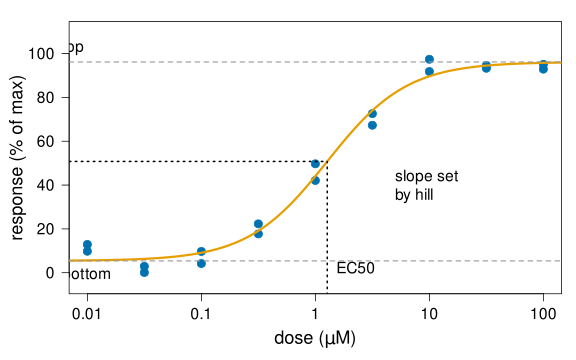
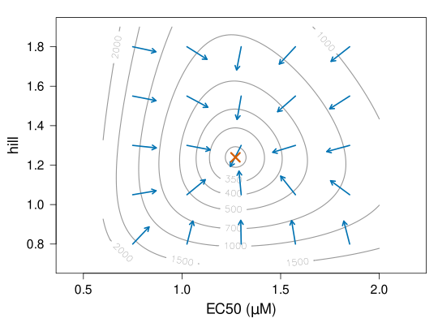
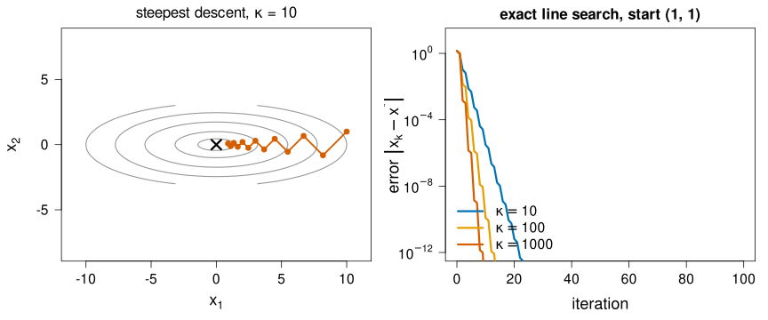
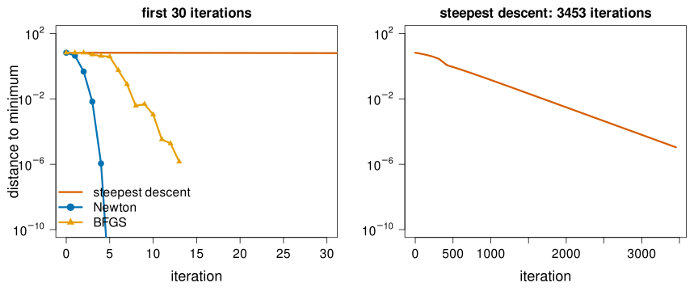
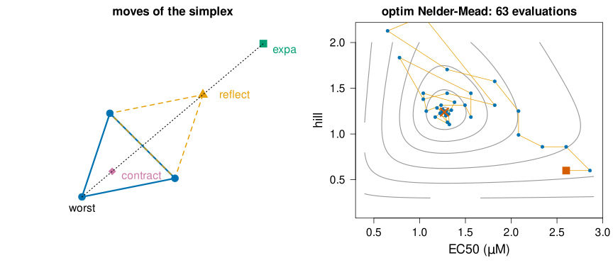
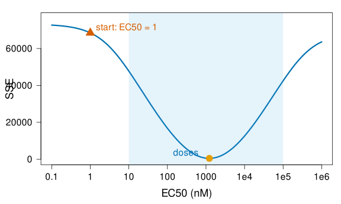

## About this lecture {.smaller}

Fitting a model means finding the parameters that make a misfit (a sum of squares, a negative log-likelihood) as small as possible. With more than one parameter we need new tools.

- The **gradient** (the slopes in every direction) and the **Hessian** (the curvatures). Both are Jacobians, which you met in [*Newton for systems of equations*](../newton-systems/lec.qmd).
- **Steepest descent** with a **backtracking line search**, and why it **zig-zags** when the Hessian is badly conditioned.
- **Newton's method** for minimisation: fast near the minimum, unreliable far from it.
- **Quasi-Newton (BFGS, L-BFGS)**: build the curvature from gradients. **Nelder–Mead**: no derivatives at all.
- What `optim` and `scipy.optimize.minimize` do, and why **scaling** and **starting values** matter. One slide on **stochastic gradient descent**.
- Biology: fitting a **4-parameter logistic dose–response curve** (EC50, Hill slope, top, bottom). We also explain the growth-curve failure from [*Why numerical analysis?*](../intro/lec.qmd).

::: notes
This is the central unit of Part 9. Everything the students do when they call optim, nls or scipy.optimize.minimize happens here. The previous unit, Optimisation in one dimension, gave the one-variable picture: a minimum has f' = 0 and f'' > 0, golden section and Brent need no derivatives, and Newton x - f'/f'' must check that f'' > 0 and that f decreases, shortening the step if not. That last check becomes today's line search. Today we go to several variables. The new mathematics is small: the gradient and the Hessian are Jacobians, so the students already know how to compute and check them. The real content is the behaviour of the methods: which ones are slow, which ones fail, and how to tell.
:::

## A biology problem: a dose–response curve {.smaller}

:::: {.columns}
::: {.column width="55%"}
{width="100%"}
:::
::: {.column width="45%"}
A reporter assay: 9 doses of an agonist, 2 wells each. The **4-parameter logistic** (4PL):

$$m(c) = b + \frac{t - b}{1 + (\mathrm{EC50}/c)^{h}}$$

- $b$, $t$: **bottom** and **top** plateaus (% of max)
- $\mathrm{EC50}$: dose at half response (µM)
- $h$: **Hill slope**
:::
::::

- Find the 4 numbers that minimise the sum of squared errors $\mathrm{SSE}(\mathbf p) = \sum_i (y_i - m(c_i))^2$. There is no formula: we must **search**.

::: notes
The 4PL (also called the Hill equation with baseline, or the four-parameter logistic of GraphPad Prism) is the standard model for dose-response data: drug screens, receptor assays, ELISA standard curves. The data are simulated (bottom 5, top 100, EC50 1.5 µM, Hill 1.2, noise sd 4), so we know what a good answer looks like. In Newton and secant methods we had a known curve and solved for the dose with R = 0.5; here the curve is unknown and we solve for its parameters from measurements. Four parameters means a search in four dimensions: we cannot plot the SSE, and grid search with 100 values per parameter would need 10^8 evaluations.
:::

## Fitting is minimising {.smaller}

```r
dose <- rep(10^seq(-2, 2, by = 0.5), each = 2)        # µM: 9 doses, 2 wells each
y <- c(12.9, 9.8, 2.9, 0.1, 4.2, 9.7, 17.7, 22.3, 49.7, 42.1,
       67.3, 72.6, 97.4, 91.8, 94.6, 93.3, 92.9, 95.1)  # % of max response
f4 <- function(p, c)                     # p = (bottom, top, EC50, hill)
  p[1] + (p[2] - p[1]) / (1 + (p[3] / c)^p[4])
sse <- function(p) sum((y - f4(p, dose))^2)
p0 <- c(0, 100, 1, 1)                    # a first guess, read off the plot
sse(p0)
# [1] 558.9029
```

- `sse` is an ordinary R function of a vector `p` of length 4. Every method today only needs to **call** it (and perhaps its gradient).
- The best fit has $\mathrm{SSE} = 314.924$ at $\mathbf p^* = (5.39,\ 96.17,\ 1.271,\ 1.240)$. How do we get there from $\mathbf p_0$?

::: notes
The starting guess comes from the plot: the response runs from about 0 to about 100, crosses 50 near 1 µM, and a Hill slope of 1 is the usual default. Later in the lecture we see what happens with a worse guess. The answer quoted here is what every method in this lecture should agree on; we use it to measure errors. Note that p is a vector, and p[3] is EC50: R indexes from 1.
:::

## What we already have {.smaller}

From [*Optimisation in one dimension*](../optimisation-1d/lec.qmd):

- At a minimum of $f(x)$: $f'(x^*) = 0$ and $f''(x^*) > 0$. Newton $x - f'/f''$ is fast, but only safe with checks: $f'' > 0$, and $f$ must **decrease** (else shorten the step).

From [*Newton for systems of equations*](../newton-systems/lec.qmd):

- The **Jacobian** $J$ of $\mathbf F: \mathbb R^n \to \mathbb R^m$ has entries $J_{ij} = \partial F_i / \partial x_j$ (row = output, column = input).
- Newton for $\mathbf F(\mathbf x) = \mathbf 0$: solve $J\,\boldsymbol\delta = -\mathbf F$, set $\mathbf x \leftarrow \mathbf x + \boldsymbol\delta$. Quadratic convergence near the root.
- A finite-difference Jacobian costs $n+1$ evaluations of $\mathbf F$, step $h \approx \sqrt\varepsilon$; `numDeriv::jacobian` does it more accurately.

Today: **minimum of $f(\mathbf x)$** = a point where all slopes are zero and the surface curves **up** in every direction.

::: notes
One slide of recap. Two facts carry over: the one-variable conditions for a minimum, and Newton's method as "linearise, then solve a linear system". The plan for the rest of the lecture is to write "all slopes zero" as a system of n equations, the gradient equal to zero, and to reuse the Jacobian machinery on it. The check from the previous unit, "if f does not decrease, shorten the step", becomes the line search: the safeguard that makes every method in this lecture work from a poor start. Brent and golden section could also do the one-dimensional search along a direction, but an exact search is rarely worth its cost.
:::

## The gradient: all slopes at once {.smaller}

:::: {.columns}
::: {.column width="52%"}
For $f(x_1, x_2) = x_1^2 + x_1x_2 + 3x_2^2$ at $(2, 1)$:

$$\frac{\partial f}{\partial x_1} = 2x_1 + x_2 = 5, \quad \frac{\partial f}{\partial x_2} = x_1 + 6x_2 = 8$$

$$\nabla f(2, 1) = \begin{pmatrix} 5 \\ 8 \end{pmatrix}$$

- The **gradient** $\nabla f$ is the Jacobian of a **scalar** function: one row, written as a column.
- It points **uphill**, perpendicular to the contour lines; $-\nabla f$ is the **steepest descent** direction.
- At a minimum: $\nabla f(\mathbf x^*) = \mathbf 0$.
:::
::: {.column width="48%"}
{width="100%"}

Arrows: $-\nabla \mathrm{SSE}$ for the 4PL, bottom and top held at their best values.
:::
::::

::: notes
Pen and paper first: a partial derivative is the ordinary derivative with the other variable frozen, as in Newton for systems. A scalar function has a 1 by n Jacobian; by convention we write it as a column vector and call it the gradient, with the symbol nabla. Why uphill: the change of f for a small step d is approximately the gradient dotted with d, which is largest when d points along the gradient and zero when d runs along a contour. The figure shows the SSE of the dose-response fit as a function of EC50 and Hill, with the two plateaus frozen at their best values; every arrow is the negative gradient, normalised to the same length. All arrows cross the contours at right angles (the axes have the same scale) and point roughly, but not exactly, at the minimum.
:::

## The gradient of the SSE: the chain rule {.smaller}

$\mathrm{SSE}(\mathbf p) = \sum_i r_i^2$ with residuals $r_i = y_i - m(c_i; \mathbf p)$, so

$$\nabla \mathrm{SSE} = -2\, J^\mathsf{T} \mathbf r, \qquad J_{ij} = \frac{\partial m(c_i)}{\partial p_j} \quad (18 \times 4)$$

```r
grad_sse <- function(p) {
  u <- (p[3] / dose)^p[4];  D <- 1 + u
  J <- cbind(u / D,                                       # dm/d bottom
             1 / D,                                       # dm/d top
             -(p[2] - p[1]) * p[4] * u / (p[3] * D^2),    # dm/d EC50
             -(p[2] - p[1]) * u * log(p[3] / dose) / D^2) # dm/d hill
  -2 * drop(t(J) %*% (y - f4(p, dose)))
}
grad_sse(p0)
# [1]    -1.729861    48.929861 -1125.637873    59.964774
library(numDeriv);  grad(sse, p0)             # check with finite differences
# [1]    -1.729861    48.929861 -1125.637873    59.964774
```

::: notes
The SSE is a sum of squares of the residuals, so each partial derivative is -2 times the sum of residual times the derivative of the model prediction. Collect the model derivatives in the 18 by 4 Jacobian of the predictions and the whole gradient is one matrix product. The four model derivatives are first-year calculus: with u = (EC50/c)^h and D = 1 + u, the derivative of D with respect to EC50 is h u / EC50 and with respect to h is u log(EC50/c). numDeriv::grad uses Richardson extrapolation of central differences (Numerical differentiation) and agrees to all printed digits. Always run this check before trusting a hand-coded gradient: a wrong sign or a missing factor shows up as a difference of order 1. Read the numbers: the slope along EC50 is 20 times larger than any other; we come back to that.
:::

## The Hessian: the Jacobian of the gradient {.smaller}

The gradient is a vector function of $\mathbf x$, so it has a Jacobian: the **Hessian**, $H_{ij} = \dfrac{\partial^2 f}{\partial x_i\,\partial x_j}$.

For $f = x_1^2 + x_1x_2 + 3x_2^2$: $\nabla f = (2x_1 + x_2,\ x_1 + 6x_2)$, so $H = \begin{pmatrix} 2 & 1 \\ 1 & 6 \end{pmatrix}$ (symmetric).

**Quadratic model** (Taylor in several variables):

$$f(\mathbf x + \mathbf s) \approx f(\mathbf x) + \nabla f^\mathsf{T}\mathbf s + \tfrac12\, \mathbf s^\mathsf{T} H\, \mathbf s$$

**Test for a minimum:** $\nabla f = \mathbf 0$ and $H$ **positive definite** (all eigenvalues $> 0$): the surface curves up in every direction.

- Here: eigenvalues $4 \pm \sqrt5 = 6.24,\ 1.76$, both positive. One positive, one negative: a **saddle**. Both negative: a maximum.

::: notes
The one-variable conditions f' = 0, f'' > 0 become gradient = 0 and Hessian positive definite. The Hessian is symmetric because mixed partial derivatives do not depend on the order (for smooth f). For a 2 by 2 matrix: positive definite if and only if the determinant and the trace are both positive; here det = 11, trace = 8. The quadratic model is the Optimisation row of the Taylor table ("Where Taylor comes back") in Why numerical analysis?, now with vectors: s^T H s is the curvature along the direction s, times the length squared. Eigenvectors of H are the directions of largest and smallest curvature, the axes of the elliptical contours.
:::

## The Hessian at the 4PL minimum {.smaller}

```r
hess <- function(p) jacobian(grad_sse, p)      # Jacobian of the gradient
H <- hess(pstar);  round(H, 1)                 # pstar = best fit
#        [,1]   [,2]   [,3]   [,4]
# [1,]   16.0    2.8 -123.8 -100.8
# [2,]    2.8   14.4 -123.6   99.6
# [3,] -123.8 -123.6 3611.5   12.5
# [4,] -100.8   99.6   12.5 3701.6
ev <- eigen(H, symmetric = TRUE)$values;  ev
# [1] 3708.824707 3618.223881    9.741189    6.737673
max(ev) / min(ev)
# [1] 550.4608
```

- All four eigenvalues positive: a true **minimum**.
- Curvature differs by a factor **550** between directions: the valley is long and narrow. This is the **condition number** $\kappa(H)$ from [*Pivoting, norms and conditioning*](../pivoting-conditioning/lec.qmd).

::: notes
We get the Hessian as the finite-difference Jacobian of the analytic gradient: four extra gradient evaluations. This is exactly the finite-difference Jacobian of Newton for systems, applied to F = gradient. numDeriv::hessian(sse, p) also works and needs only sse, at more cost. The eigenvalues say: along EC50 and Hill (the large entries 3611 and 3701), the SSE is steep; along bottom and top, it is shallow, with curvature about 7 to 10. Part of this is units: a change of 1 µM in EC50 is a huge change, a change of 1 % in top is a small one. Condition number of a symmetric positive definite matrix = largest over smallest eigenvalue. We will see that kappa decides the speed of steepest descent, and in Identifiability and uncertainty of fitted parameters, the same Hessian gives the standard errors.
:::

## Steepest descent with a fixed step {.smaller}

Go downhill: $\mathbf x_{k+1} = \mathbf x_k - \alpha\, \nabla f(\mathbf x_k)$, with a fixed **step size** $\alpha$.

```r
x <- p0
for (k in 1:5000) x <- x - 1e-4 * grad_sse(x)
sse(x)
# [1] 315.1635                            # 5000 steps, still not at 314.924
x <- p0
for (k in 1:20) x <- x - 6e-4 * grad_sse(x)
sse(x)
# [1] NaN                                 # overshoots, EC50 < 0, NaN after 11 steps
```

- Too small: slow. Too large: each step **overshoots** the valley and the iteration blows up.
- On a quadratic, steepest descent is stable only for $\alpha < 2/\lambda_{\max}$; here $2/3709 = 5.4\times10^{-4}$. Nobody knows $\lambda_{\max}$ in advance.

::: notes
This is the simplest possible method, and the one used (with tricks) to train neural networks. With alpha = 1e-4 it creeps; with 6e-4 the steps along the steep EC50 direction overshoot, grow, EC50 goes negative, (negative)^h is NaN in R, and everything after is NaN. The bound 2 / lambda_max is the same stability condition as for Euler's method on y' = -lambda y (Initial value problems and Euler's method): steepest descent with a fixed step is Euler's method on the gradient flow x' = -grad f. A step that suits the steep direction is far too small for the shallow one, which is the whole problem.
:::

## Backtracking line search (Armijo) {.smaller}

Try $\alpha = 1$; **halve** it until the step decreases $f$ enough: $f(\mathbf x - \alpha \mathbf g) \le f(\mathbf x) - c\,\alpha\, \|\mathbf g\|^2$, with $c = 10^{-4}$.

```r
sd_armijo <- function(f, g, x, tol = 1e-4, maxit = 1e4) {
  for (k in 1:maxit) {
    gk <- g(x)
    if (sqrt(sum(gk^2)) < tol) break           # gradient ~ 0: stop
    a <- 1
    while (!isTRUE(f(x - a * gk) <= f(x) - 1e-4 * a * sum(gk^2)))
      a <- a / 2                                # backtrack
    x <- x - a * gk
  }
  list(par = x, steps = k - 1)
}
sd_armijo(sse, grad_sse, p0)$steps
# [1] 3453
```

- `isTRUE` also rejects a step that gives `NaN`. Never diverges; but **3453 steps**.

::: notes
The Armijo (sufficient decrease) condition asks for a decrease of at least a small fraction c of what the linear model predicts: alpha times the squared gradient length. Halving guarantees that some step is accepted, because for small enough alpha the linear model is accurate. It turns the check of Optimisation in one dimension ("f must decrease, otherwise shorten the step") into a rule, used here along the direction -g. Production codes also enforce a curvature condition (the Wolfe conditions) so that steps are not too short, and interpolate rather than halve. The stopping tolerance 1e-4 on the gradient length is about 1e-7 of its starting size; asking for much less runs into rounding, because a line search on f cannot see decreases below about eps times f (about 7e-14 here). A real code should also cap the number of halvings.
:::

## Why steepest descent zig-zags {.smaller}

{width="92%" fig-align="center"}

- On a long narrow valley, $-\nabla f$ points across the valley, not along it. Each step overshoots to the other side.
- With exact line search the error shrinks per step by about $\dfrac{\kappa - 1}{\kappa + 1}$. For the 4PL, $\kappa = 550$: $0.9964$ per step, about **3800** steps per 6 digits.

::: notes
Left: f = (x1^2 + 10 x2^2)/2, kappa = 10, exact line search: the best step along the current gradient. Successive directions are at right angles, so the path zig-zags across the valley and makes slow progress along it. Right: the error after k steps for kappa = 10, 100, 1000, from the worst-case start (1, 1/kappa). The rate depends only on kappa: (kappa - 1)/(kappa + 1) per step for the error (its square for f - f*), so kappa = 10 needs about 70 steps per 6 digits and kappa = 1000 about 7000. The 4PL with kappa = 550 predicts about 3800 steps per 6 digits; our Armijo version took 3453, from a start where part of the error was in the steep directions. This is the same condition number as in Pivoting, norms and conditioning: there it bounded error amplification in a linear solve, here it bounds the speed of the simplest optimiser. Rescaling the parameters changes kappa, which is why scaling matters (later slide).
:::

## Newton's method for minimisation {.smaller}

Minimum $\Rightarrow$ $\nabla f = \mathbf 0$: a system of $n$ equations. Apply **Newton for systems** with $\mathbf F = \nabla f$ and $J = H$:

$$H(\mathbf x_k)\, \mathbf s = -\nabla f(\mathbf x_k), \qquad \mathbf x_{k+1} = \mathbf x_k + \mathbf s$$

| Newton for systems | Newton for minimisation |
|---|---|
| $\mathbf F(\mathbf x) = \mathbf 0$ | $\nabla f(\mathbf x) = \mathbf 0$ |
| Jacobian $J$ | Hessian $H$ (= Jacobian of $\nabla f$) |
| `solve(J, -F)` | `solve(H, -g)` |

- Same step = the **minimum of the quadratic model**. On a quadratic $f$, one step is exact. Toy example from $(2, 1)$: $\mathbf s = -H^{-1}(5, 8)^\mathsf{T} = (-2, -1)$, straight to $(0, 0)$.
- Quadratic convergence near the minimum. The condition number does **not** slow it down.

::: notes
This slide is the bridge. Setting the derivative of the quadratic model to zero, grad f + H s = 0, gives the same step as Newton on the gradient. In one variable this is x - f'(x)/f''(x), from Optimisation in one dimension. By hand: H = [2 1; 1 6], det 11, inverse = (1/11)[6 -1; -1 2]; H^-1 (5, 8) = (1/11)(30 - 8, -5 + 16) = (2, 1); the step is (-2, -1). Newton uses the curvature in every direction, so it rescales the long narrow valley into a round one: kappa no longer matters. The cost: second derivatives (n^2 of them) and a linear solve, O(n^3), per step.
:::

## Newton in R {.smaller}

```r
newton_min <- function(f, g, H, x, tol = 1e-4, maxit = 50) {
  for (k in 1:maxit) {
    gk <- g(x)
    if (sqrt(sum(gk^2)) < tol) break
    s <- solve(H(x), -gk)                      # Newton direction
    a <- 1                                     # line search, as before
    while (!isTRUE(f(x + a * s) <= f(x) + 1e-4 * a * sum(gk * s))) a <- a / 2
    x <- x + a * s
  }
  list(par = x, steps = k - 1)
}
newton_min(sse, grad_sse, hess, p0)$steps
# [1] 5
```

| step | 0 | 1 | 2 | 3 | 4 | 5 |
|---|---|---|---|---|---|---|
| SSE | 558.90 | 395.01 | 315.68 | 314.92418 | 314.92395940 | 314.92395940 |
| $\lVert\nabla \mathrm{SSE}\rVert$ | 1128 | 218 | 11.6 | 0.735 | $1.4\times10^{-4}$ | $2.2\times10^{-11}$ |

::: notes
Five steps instead of 3453. Every step here has a = 1, the full Newton step; the line search is only a safety net. Read the gradient row: 0.735, 1.4e-4, 2.2e-11, the exponent roughly doubles, which is quadratic convergence as in Newton and secant methods. The Hessian is the finite-difference Jacobian of the analytic gradient, with about 8 correct digits; that is enough for quadratic convergence in practice. Each step costs one gradient plus four more for the Hessian, plus a 4 by 4 solve: trivial here, expensive for thousands of parameters.
:::

## Three methods on the same fit

{width="95%" fig-align="center"}

- Newton: 5 steps. BFGS (in a few slides): 13 steps, gradients only. Steepest descent: a straight line on a log axis, **linear** convergence, slope set by $\kappa$.

::: notes
Distance to the best parameters, log scale, all from the same start p0. The steepest descent curve on the right is a straight line after an initial phase: linear convergence, a fixed fraction per step, as in Convergence and cost. The slope corresponds to about 0.995 per step, close to the (kappa - 1)/(kappa + 1) = 0.9964 predicted from kappa = 550. Newton bends down ever faster (quadratic). BFGS starts like steepest descent, because its first approximation of the Hessian is the identity, then learns the curvature and accelerates (superlinear convergence). In terms of work: steepest descent used 3453 gradients and many more function values for the backtracking.
:::

## When Newton fails {.smaller}

Start from a worse guess, $\mathrm{EC50} = 10$ µM: $\mathbf p = (0, 100, 10, 1)$.

```r
eigen(hess(c(0, 100, 10, 1)), symmetric = TRUE)$values
# [1]   115.27332    13.13729   -42.62776 -2422.74914
```

- Two **negative** eigenvalues: the quadratic model has no minimum (a saddle). Pure Newton steps head for **any** point with $\nabla f = 0$; after 20 steps: EC50 = 86, hill = 16, $\mathrm{SSE} = 21188$.
- **Check:** eigenvalues of $H$, or $\nabla f^\mathsf{T}\mathbf s < 0$ (a descent direction); a line search only helps if $\mathbf s$ goes downhill.
- **Fixes:** make $H$ positive definite (add $\mu I$; 9 steps to the minimum from here), a **trust region**, or quasi-Newton.

::: notes
Far from the minimum the SSE is not shaped like a bowl. With EC50 = 10 µM the model curve sits to the right of most of the data, and the curvature along the Hill direction is negative. Newton's method only looks for a zero of the gradient, so it is just as happy with a saddle or a maximum: the same lesson as in Newton for systems, where Newton found the unstable middle steady state. The fix "add mu times I" with mu larger than the most negative eigenvalue makes the model a bowl again; for huge mu the step becomes a short steepest descent step. That interpolation between Newton and steepest descent is the Levenberg-Marquardt idea of Nonlinear least squares and ODE fitting. A trust region instead limits the step length to a region where the quadratic model is trusted.
:::

## Quasi-Newton: learn the curvature from gradients {.smaller}

The secant idea from [*Newton and secant methods*](../newton/lec.qmd): replace $f''$ by a slope of $f'$ between two points. In $n$ dimensions, with step $\mathbf s_k = \mathbf x_{k+1} - \mathbf x_k$ and gradient change $\mathbf y_k = \nabla f_{k+1} - \nabla f_k$:

$$\textbf{secant condition:}\quad B_{k+1}\,\mathbf y_k = \mathbf s_k \qquad (B \approx H^{-1})$$

**BFGS** (Broyden, Fletcher, Goldfarb, Shanno, 1970) picks the update closest to $B_k$ that satisfies it:

$$B_{k+1} = V^\mathsf{T} B_k V + \rho\, \mathbf s_k \mathbf s_k^\mathsf{T}, \qquad V = I - \rho\, \mathbf y_k \mathbf s_k^\mathsf{T}, \quad \rho = 1/(\mathbf y_k^\mathsf{T}\mathbf s_k)$$

- Start from $B_0 = I$ (first step = steepest descent). Direction $-B_k \nabla f_k$: no Hessian, no linear solve.
- If $\mathbf y_k^\mathsf{T}\mathbf s_k > 0$, $B$ stays **positive definite**: every direction goes downhill.

::: notes
In one variable the secant condition says B times (change of f') equals the step, which is the secant method applied to f'. In n variables one secant condition gives only n equations for the n^2 entries of B, so there are many solutions; BFGS takes the one closest to the previous B (in a weighted norm), which turns out to be a rank-2 update. The four authors found it independently in 1970. Keeping the inverse Hessian means no linear solve: the direction is a matrix-vector product, O(n^2). y^T s > 0 says the slope increased along the step, i.e. the function curves up along it; the Wolfe line search guarantees this, our simpler Armijo version checks it and skips the update otherwise. Broyden's method for root finding, mentioned in Newton for systems of equations, is the same idea for a nonsymmetric Jacobian.
:::

## BFGS in R {.smaller}

```r
bfgs <- function(f, g, x, tol = 1e-4, maxit = 200) {
  n <- length(x); B <- diag(n); gk <- g(x)     # B ~ inverse Hessian
  for (k in 1:maxit) {
    if (sqrt(sum(gk^2)) < tol) break
    s <- -drop(B %*% gk);  a <- 1
    while (!isTRUE(f(x + a*s) <= f(x) + 1e-4 * a * sum(gk*s))) a <- a / 2
    s <- a * s;  x <- x + s;  gn <- g(x);  yv <- gn - gk;  gk <- gn
    if ((sy <- sum(yv * s)) > 0) {             # curvature check
      V <- diag(n) - outer(yv, s) / sy
      B <- t(V) %*% B %*% V + outer(s, s) / sy }
  }
  list(par = x, steps = k - 1)
}
bfgs(sse, grad_sse, p0)$steps
# [1] 13
```

- 13 steps, one gradient each, plus backtracking. Superlinear convergence; no second derivatives.

::: notes
Thirteen lines. The update is the formula from the previous slide; outer(s, s) is the matrix s s^T. Without a gradient function, the gradient is taken by finite differences, which is what optim does when you do not pass gr. Compare the costs: steepest descent 3453 gradients; Newton 5 gradients plus 5 Hessians (20 gradients with finite differences); BFGS 13 gradients. For four parameters all are instant; for an ODE model where each SSE evaluation takes a second, the difference is hours.
:::

## L-BFGS: when there are many parameters {.smaller}

- BFGS stores an $n \times n$ matrix. For $n = 10^6$ parameters (an image, a genome-wide model, a neural network) that is $8 \times 10^{12}$ bytes.
- **L-BFGS** (limited-memory BFGS) never forms $B$. It keeps the last $m$ pairs $(\mathbf s_k, \mathbf y_k)$, typically $m = 5$ to $20$, and computes $-B\nabla f$ from them in $O(mn)$ operations.
- Each step costs about as much as a steepest-descent step, but converges almost as fast as BFGS.
- In R: `optim(method = "L-BFGS-B")` (the B is for **bounds**, e.g. `lower = 0`). In Python: `minimize(method="L-BFGS-B")`, the default when bounds are given.

::: notes
The memory argument is the whole story: n^2 storage and n^2 work per step are fine for 4 or 400 parameters and impossible for a million. L-BFGS applies the last m updates to a scaled identity using a short recursion (the two-loop recursion), never storing a matrix. In practice it is the default large-scale smooth optimiser. L-BFGS-B adds simple bounds, lower <= p <= upper, which is useful for parameters that must be positive; Constraints and linear programming treats constraints properly.
:::

## Nelder–Mead: no derivatives at all {.smaller}

{width="90%" fig-align="center"}

- Keep $n + 1$ points (a **simplex**: a triangle in 2-D). Replace the worst by its **reflection** through the others; **expand** if that was very good, **contract** if bad, **shrink** if nothing helps.
- Needs only $f$: works for noisy or non-smooth functions. `optim`'s **default**. Slow, and it can stop at a non-minimum, especially in many dimensions.

::: notes
Nelder and Mead, 1965. No gradients, no line search, just comparisons of function values, so it does not care about rounding noise in f, kinks, or discontinuities that would wreck a finite-difference gradient. Right: the points R's optim evaluates when fitting only EC50 and Hill (63 evaluations); the simplex tumbles downhill, then shrinks around the minimum. Weaknesses: in more than a handful of dimensions it becomes very slow, and the simplex can collapse into a flat shape and stop where the gradient is not zero; there are known examples (McKinnon 1998) where it converges to a non-stationary point. Its stopping rule is "the function values at the corners agree to reltol", which is also satisfied on a plateau: that is what happened to the growth curve in Why numerical analysis?.
:::

## Try it: an optimiser race

```{=html}
<link rel="stylesheet" href="../demos/dist/demo.css">
<div data-demo="optrace" data-preset="quad" data-kappa="10"></div>
<script src="../demos/dist/optrace.js"></script>
```

::: notes
The four methods of this lecture, as on the slides, computed live in the browser on functions of two variables: steepest descent with Armijo backtracking (vermillion), Newton with the same line search and H + mu I when H is not positive definite (blue), BFGS with B0 = I (orange), Nelder-Mead with optim's rules, simplex shaded (green). Right: f - f* on a log axis against the iteration, and the counts of f, gradient and Hessian calls. Start on the bowl with kappa = 10: press race, steepest descent zig-zags, 76 iterations, a straight line on the log plot; Newton 1 step, BFGS 5. Drag kappa to 100 and 1000: steepest descent 861 and 9475 iterations (switch the iteration axis to "all"), Newton still 1. Then Rosenbrock: Newton 21, BFGS 35, Nelder-Mead 86, steepest descent 19435; point at Newton's tail, the exponent doubles (quadratic), BFGS slightly slower (superlinear). Then the 4PL with EC50 in µM (bottom and top fixed at the best fit): kappa 1.03, all fast. Switch to nM: the map looks the same, kappa is 1e6, steepest descent is stuck after 20000 iterations, Newton takes exactly the same 4 steps. Finish by clicking near EC50 = 3.5, hill = 0.4: steepest descent and BFGS shoot to hill = 36, a plateau, and report convergence with SSE 1700 too high.
:::

## What `optim`, `minimize` and `argmin` do {.smaller}

| R [`optim`](https://stat.ethz.ch/R-manual/R-devel/library/stats/html/optim.html) | Python [`minimize`](https://docs.scipy.org/doc/scipy/reference/generated/scipy.optimize.minimize.html) | Rust `argmin` | method |
|---|---|---|---|
| `"Nelder-Mead"` (**default**) | `"Nelder-Mead"` | `NelderMead` | simplex, no derivatives |
| `"BFGS"` | `"BFGS"` (default without bounds) | `BFGS` | quasi-Newton |
| `"L-BFGS-B"` | `"L-BFGS-B"` (default with bounds) | `LBFGS` | limited memory, bounds |
| `"CG"` | `"CG"` | `NonlinearConjugateGradient` | conjugate gradients |
| [`nlm`](https://stat.ethz.ch/R-manual/R-devel/library/stats/html/nlm.html) | `"trust-exact"`, `"Newton-CG"` | `Newton`, `TrustRegion` | Newton-type |

- No gradient given → **finite differences**: R's `optim` uses central differences with `ndeps = 1e-3` (an absolute step!); scipy uses forward differences with $h \approx \sqrt\varepsilon\max(1, |x|)$.
- Stopping: **relative change in $f$** below `reltol` $\approx 1.5\times10^{-8}$ (R), gradient norm below `gtol` $= 10^{-5}$ (scipy BFGS). `maxit` = 500 for Nelder–Mead, 100 for BFGS in R.
- `convergence = 0` means "a stopping rule was met", not "this is the minimum".

::: notes
The point of this table is that the library methods are the ones we just wrote, plus careful engineering: better line searches (Wolfe conditions, interpolation), scaling of the first B, and stopping rules. Defaults matter. optim's ndeps = 1e-3 is an absolute step: fine for parameters near 1, terrible for a parameter of size 1e-6 or 1e4, which is one more reason to scale. R's nlm is a Newton-type method with finite-difference Hessian; nlminb (PORT library) is another common choice. Python users: minimize returns an OptimizeResult with x, fun, nfev, njev, success, message. The Rust argmin crate provides the same solvers; we use it in the exercises.
:::

## The 4PL with `optim` {.smaller}

```r
for (m in c("Nelder-Mead", "BFGS", "CG", "L-BFGS-B")) {
  o <- optim(p0, sse, method = m)
  cat(sprintf("%-11s  SSE %.4f  EC50 %.4f  fn %3d  gr %3s  conv %d\n",
              m, o$value, o$par[3], o$counts[1], o$counts[2], o$convergence))
}
# Nelder-Mead  SSE 314.9240  EC50 1.2711  fn 335  gr  NA  conv 0
# BFGS         SSE 314.9240  EC50 1.2711  fn  40  gr  11  conv 0
# CG           SSE 321.2024  EC50 1.2765  fn 333  gr 101  conv 1
# L-BFGS-B     SSE 314.9240  EC50 1.2710  fn  36  gr  36  conv 0
```

- `fn`, `gr`: calls of `sse` and of the (finite-difference) gradient; each `gr` costs 8 more `sse` calls.
- Conjugate gradients hit `maxit` = 100 (`conv 1`): another victim of $\kappa = 550$.
- Passing the analytic gradient, `optim(p0, sse, grad_sse, method = "BFGS")`, saves the finite-difference calls.

::: notes
All but CG agree on the minimum to the printed digits. Nelder-Mead needs 335 function calls; BFGS 40 plus 11 gradients, each of which is 8 function calls by central differences, so 128 in total. CG is a method between steepest descent and quasi-Newton that needs only O(n) memory; it is also slowed down by a bad condition number and stops at its iteration limit with a worse SSE. It at least says so: convergence = 1 means maxit reached. Always print the convergence code and the counts.
:::

## Scaling: the same data in nM {.smaller}

:::: {.columns}
::: {.column width="48%"}
{width="100%"}
:::
::: {.column width="52%"}
```r
dose_nM <- dose * 1000
sse_nM <- function(p) sum((y - f4(p, dose_nM))^2)
o <- optim(c(0, 100, 1, 1), sse_nM, method = "BFGS")
round(o$par, 2); o$value; o$convergence
# [1]  48.69 127.67   2.24 -13.82
# [1] 25807.26
# [1] 0
```
:::
::::

- "EC50 is about 1" is now **1000 times too small**. The curve sits left of every dose; BFGS slides to a **flat line** at the mean (hill $= -13.8$) and reports success.
- Even from a good start (EC50 = 1000), $\kappa(H) = 1.9\times10^{6}$ and BFGS stops early: SSE 314.9246, 109 calls. With `control = list(parscale = c(1, 100, 1000, 1))`: 314.9240, 36 calls.

::: notes
Same data, same model, only the dose unit changed. Two separate problems. First, the habit of starting at 1: with doses from 10 to 100000 nM, an EC50 of 1 nM means every well is on the top plateau, and the optimiser goes to a degenerate fit where the curve is flat over the data (a negative Hill slope with EC50 below all doses gives the constant 48.69, the mean of y). The SSE is then flat in EC50 and hill, the gradient is zero there, and BFGS stops. Second, scaling: the EC50 entry of the Hessian shrinks by a factor 10^6, the condition number grows from 550 to 1.9 million, and the finite-difference step ndeps = 1e-3 is now tiny relative to EC50 = 1271. parscale tells optim to work with p / parscale internally, so all parameters are of size 1. Fitting log10(EC50) instead of EC50 does the same job and also keeps EC50 positive.
:::

## Back to the growth curve {.smaller}

[*Why numerical analysis?*](../intro/lec.qmd): logistic fit, time in **minutes**, start $r = 0.5$ ("per hour" by habit).

```r
grad(sse_min, c(r = 0.5, K = 1, N0 = 0.05))      # time in minutes
# [1] 0.000 3.940 0.098
optim(c(r = 0.5, K = 1, N0 = 0.05), sse_min, method = "BFGS")$par
#            r            K           N0
# 0.5000000000 0.8358333304 0.0009999665
optim(c(r = 0.5, K = 1, N0 = 0.05), sse_h)$par   # time in hours
#         r         K        N0
# 0.5241071 1.1913604 0.0165278
```

- At $r = 0.5$/min the model reaches $K$ within minutes, long before the first reading: $\partial\,\mathrm{SSE}/\partial r \approx 4\times10^{-23}$. BFGS never moves $r$; Nelder–Mead wanders on the plateau until its corner values agree (to $r = 0.68$, SSE 2.23, as in the intro).
- In hours the natural guess is right, and $\kappa$ drops from $1.2\times10^4$ to $1.0\times10^3$. **Choose units so parameters are near 1.**

::: notes
Now we can explain the opening failure of the course. The model at r = 0.5 per minute predicts e^(-60) of the way from K at the first measurement (120 minutes), so it is K at every time point after zero. Changing r changes nothing: the exact partial derivative is 3.8e-23, numDeriv prints 0. A gradient method moves only in directions where the slope is nonzero, so r stays exactly 0.5 and only K and N0 are fitted (K to the mean of the later points). Nelder-Mead's reflections in r also change nothing, the corner values agree to reltol and it stops. With time in hours the same starting value is in the right region, both Nelder-Mead and BFGS find r = 0.524 per hour (doubling time 79 minutes), and the Hessian is better conditioned because r is no longer 100 times smaller than the other parameters.
:::

## Starting values and multistart {.smaller}

- **Start from the data:** bottom ≈ min(y), top ≈ max(y), EC50 ≈ dose where y crosses halfway, hill ≈ 1. R's [`SSfpl`](https://stat.ethz.ch/R-manual/R-devel/library/stats/html/SSfpl.html) self-start model for `nls` does this for you.
- **Multistart:** run from many starts, keep the best, and look at how many agree.

```r
starts <- expand.grid(EC50 = 10^(-2:2), hill = c(0.5, 1, 3))   # 15 starts
nm <- apply(starts, 1, function(s) optim(c(0, 100, s), sse)$value)
table(round(nm, 1))
#  314.9 1344.4 1557.2 1926.8 2453.2
#     10      2      1      1      1
```

- Nelder–Mead from 15 starts: 5 end far from the minimum, 4 of them with `convergence = 0`. BFGS with the analytic gradient finds 314.9 from all 15.

::: notes
These are the generic defences, and they are cheap. A data-based start is what commercial curve-fitting software does. SSfpl uses log dose and a scale parameter (1/Hill on the natural log scale), which also takes care of scaling. Multistart costs 15 fits here, a fraction of a second. If all starts agree, you have some confidence it is the global minimum (no proof!); if they disagree, look at the bad ones: here Nelder-Mead ends with a step-like curve (Hill 11 to 14) from two of the Hill = 3 starts, and with a very shallow one (Hill 0.17 to 0.45, plateaus far outside the data) from three others; only one of the five says so (convergence = 1, maxit reached). Different local minima, or the same minimum found with poor accuracy, are both worth knowing about. The rows of starts are (EC50, hill); bottom and top start at 0 and 100.
:::

## Stochastic gradient descent, in one slide {.smaller}

When the objective is a sum over **many** data points, $f(\mathbf p) = \sum_{i=1}^N f_i(\mathbf p)$, with $N$ in the millions (images, sequences, cells):

$$\mathbf p_{k+1} = \mathbf p_k - \alpha_k \sum_{i \in \text{batch}_k} \nabla f_i(\mathbf p_k)$$

- Each step uses the gradient of a small random **minibatch** (say 32 points): a noisy but cheap estimate of $\nabla f$.
- No line search: the **learning rate** $\alpha_k$ is set by hand and decreased over time; variants (momentum, Adam) adapt it per parameter, a cheap form of scaling.
- This is how **neural networks** are trained (gradients by automatic differentiation). For an 18-point dose–response curve, use BFGS.

::: notes
One slide only, because students will meet it in machine learning. The noise is a feature for huge data sets: a full gradient over 10 million images costs 10 million evaluations; a minibatch gradient costs 32, so you get hundreds of thousands of rough steps for the price of one exact one. The disadvantages are those of steepest descent (condition number, step size) plus noise: it converges slowly to an exact minimum, which in machine learning is not the goal. Adam divides each gradient component by a running estimate of its size, which is a diagonal rescaling, the same idea as parscale. Automatic differentiation computes exact gradients by applying the chain rule to the program; it is the third way, next to hand-derived and finite differences.
:::

## Checklist for a fit {.smaller}

- **Check the gradient** against `numDeriv::grad` before using it (agreement to ~$10^{-6}$ relative, not ~1).
- **Look at the convergence code and the counts**; `maxit` reached means "not finished".
- **Plot the fitted curve over the data.** A flat line or a step is a degenerate fit.
- **Units and scale**: parameters near 1 (µM, hours, log EC50), or `parscale`.
- **Start from the data**, and **multistart**: do the answers agree?
- **At the answer:** gradient near 0 and Hessian eigenvalues all positive (a minimum, not a saddle or plateau). A huge $\kappa$ warns of poorly determined parameters.
- **Method:** smooth with gradient → BFGS (L-BFGS for many parameters); noisy or non-smooth → Nelder–Mead; sum of squares → [*Nonlinear least squares and ODE fitting*](../nonlinear-least-squares/lec.qmd).

::: notes
A list to keep next to the keyboard. Each item caught one of today's failures: the wrong gradient (exercise), the iteration limit (CG), the flat fits (nM start, growth curve), the bad conditioning (nM, minutes), the bad starts (Nelder-Mead multistart), and the saddle (Newton from EC50 = 10). The Hessian at the answer comes back in Identifiability and uncertainty of fitted parameters, where its inverse gives standard errors; a near-zero eigenvalue means a parameter combination the data do not determine.
:::

## Summary {.smaller}

- **Gradient** $\nabla f$: Jacobian of a scalar function, points uphill. **Hessian** $H$: Jacobian of the gradient. Minimum: $\nabla f = \mathbf 0$, $H$ positive definite.
- **Steepest descent** + backtracking (Armijo): always goes downhill, but converges linearly at a rate set by $\kappa(H)$; it zig-zags in narrow valleys.
- **Newton**: solve $H\mathbf s = -\nabla f$. Quadratic convergence near the minimum; can head for saddles when $H$ is not positive definite.
- **BFGS** builds $H^{-1}$ from gradient differences; **L-BFGS** stores only a few of them. **Nelder–Mead** uses only $f$.
- `optim` (default Nelder–Mead) and `minimize` (default BFGS) report "converged" when a stopping rule is met. Scale the parameters, start from the data, multistart, check.

**Next:** [*Nonlinear least squares and ODE fitting*](../nonlinear-least-squares/lec.qmd): Gauss–Newton and Levenberg–Marquardt use the structure of a sum of squares.

::: notes
Recap the three families: first-order (steepest descent, SGD), second-order (Newton), and in between (quasi-Newton), plus the derivative-free simplex. The SSE has special structure: its Hessian is approximately 2 J^T J, using only the model Jacobian we already computed for the gradient. That is Gauss-Newton, and adding mu I to it is Levenberg-Marquardt, the method behind nls and minpack.lm: the next unit.
:::
