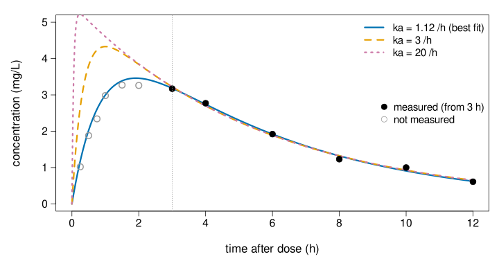
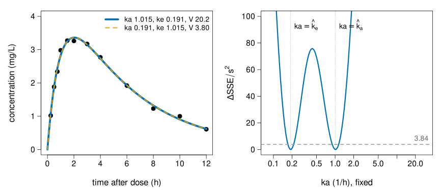
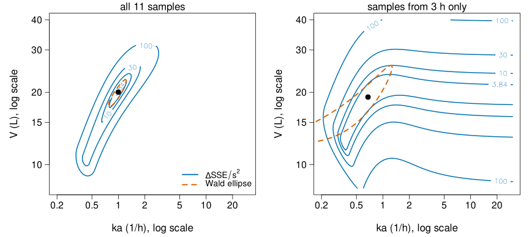
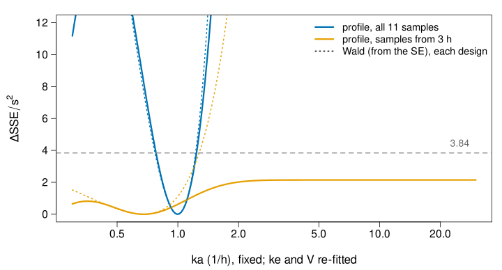
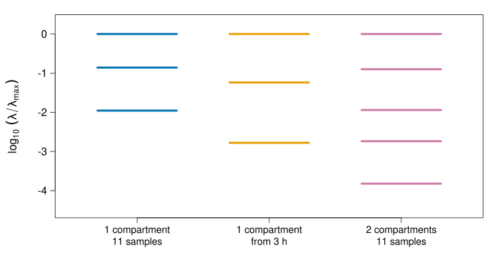
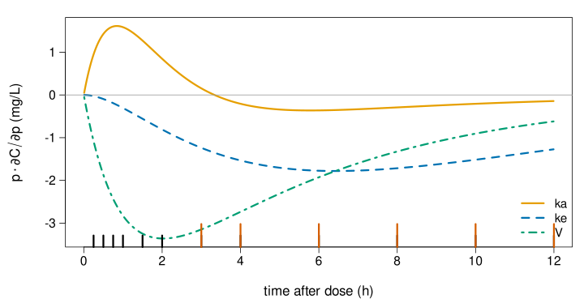

## About this lecture {.smaller}

In *Nonlinear least squares and ODE fitting* we fitted a pharmacokinetic model and got numbers for $k_a$, $k_e$ and $V$. This lecture asks **how much those numbers can be trusted**.

- **Structural** non-identifiability: the model itself cannot tell parameters apart (a product $F\!\cdot\!D/V$; the $k_a/k_e$ **flip-flop**). No amount of data helps.
- **Practical** non-identifiability: the model could, but *these* data do not.
- Near the optimum the sum of squares is a bowl. Its curvature, the **Hessian** $\approx 2J^TJ$, gives **standard errors** $\sqrt{\operatorname{diag}(s^2(J^TJ)^{-1})}$ and a **correlation matrix**.
- **Small singular values of $J$** name the badly determined combinations, as in *The SVD, rank deficiency and regularisation*.
- The **profile likelihood** checks the bowl picture, and shows flat directions the standard errors hide. **Sloppy** models have many of them.
- Fixes: **better sampling times**, **reparameterisation**, **priors**.

::: notes
This closes the loop of Part 9: we can now fit a nonlinear model, and the question is what the fitted numbers mean. The numerical content is small (a Jacobian, a matrix inverse or SVD, a loop of re-fits), but the consequences are large: a model that fits the data perfectly can still have parameters that are not determined at all. The running example is the one-compartment oral pharmacokinetic model from the previous unit. Everything here applies equally to growth curves, enzyme kinetics and signalling models.
:::

## A biology problem: the fit is fine {.smaller}

{width="72%" fig-align="center"}

- One oral dose of 100 mg; the first blood sample is taken at **3 h**. Three fits with absorption rate $k_a = 0.68$, $2$ and $20$ /h (each with $k_e$ and $V$ re-fitted) pass equally well through the data.
- The grey circles are what early samples **would** have shown. Without them, the data cannot say how fast the drug was absorbed.
- `nls` happily reports $k_a = 0.68 \pm 0.31$ /h. Is that number worth anything?

::: notes
This is the situation the lecture is about. The model fits, the residuals look fine, the software prints an estimate and a standard error, and yet the parameter is not determined: any absorption rate from about 0.3 per hour to infinity (instant absorption) fits the late data. The curves only differ before the first sample. In clinical pharmacokinetics this is common: outpatients come in hours after the dose. The data here are simulated (true ka = 1, ke = 0.2, V = 20) so that we know the truth; the grey points are the early samples of the same simulated subject.
:::

## Recap: the model and the fit {.smaller}

One-compartment model, oral dose $D$, bioavailability $F$ (fraction absorbed):

$$C(t) = \frac{F\,D\,k_a}{V\,(k_a - k_e)}\left(e^{-k_e t} - e^{-k_a t}\right)$$

```r
pk <- function(t, ka, ke, V, D = 100) D * ka / (V * (ka - ke)) * (exp(-ke * t) - exp(-ka * t))
t <- c(0.25, 0.5, 1, 1.5, 2, 3, 4, 6, 8, 12, 24)                         # hours
y <- c(0.98, 1.89, 2.69, 3.47, 3.39, 3.00, 2.77, 1.98, 1.35, 0.52, 0.28)  # mg/L
fit <- nls(y ~ pk(t, ka, ke, V), start = list(ka = 0.5, ke = 0.1, V = 10))
coef(fit)
#         ka         ke          V
#  0.9976079  0.1925081 20.0326702
deviance(fit)                          # residual sum of squares
# [1] 0.1626121
```

- All 11 samples, $F = 1$ assumed. Truth: $k_a = 1$, $k_e = 0.2$ /h, $V = 20$ L, noise SD 0.15 mg/L.

::: notes
The same model as in the previous unit: first-order absorption from the gut with rate ka, first-order elimination with rate ke, one well-mixed compartment of volume V. The fit with all 11 samples recovers the truth well. The rest of the lecture asks how well, and what goes wrong with fewer or worse-placed samples. D = 100 mg, so D/V has units mg/L. nls uses Gauss-Newton by default; the details are in the previous unit.
:::

## Two kinds of trouble

A parameter is **identifiable** if the data determine it: different values give different predictions.

| | **Structural** | **Practical** |
|---|---|---|
| Cause | the model equations | the data (too few, too noisy, badly placed) |
| Perfect, noise-free data | still not determined | determined |
| Example | $F$ and $V$ only as $F/V$; flip-flop | $k_a$ with first sample at 3 h |
| Symptom | $J$ exactly rank-deficient; equal-SSE minima | huge SE, $|r| \to 1$, flat profile |
| Fix | reparameterise, add a different experiment | better design, more data, prior |

::: notes
Structural identifiability is a property of the model and the measured output alone; one can check it with algebra before any experiment. Practical identifiability depends on how many samples, where, and how noisy. A structurally identifiable model can be practically non-identifiable (our sparse design); a structurally non-identifiable model stays so whatever the data. Both show up in the same numerical objects: the Jacobian and the shape of the sum of squares.
:::

## Structural (1): parameters that only appear as a product {.smaller}

If the bioavailability $F$ is unknown, $F$ and $V$ enter only through $F/V$: doubling both changes nothing.

```r
nls(y ~ pk(t, ka, ke, V / F), start = list(ka = 0.5, ke = 0.1, V = 10, F = 0.8))
# Error in nlsModel(...) : singular gradient matrix at initial parameter estimates
p4 <- c(coef(fit), F = 1)
J4 <- jacobian(function(p) pk(t, p[1], p[2], p[3] / p[4]), p4)  # numDeriv
svd(J4 %*% diag(p4))$d                # columns scaled: d C / d log p
# [1] 1.124957e+01 3.096841e+00 9.077142e-01 3.183060e-11
round(svd(J4 %*% diag(p4))$v[, 4], 3)
# [1]  0.000  0.000 -0.707 -0.707      # log V and log F together
```

- The Jacobian has an exact null direction: $\sigma_4 \approx 10^{-11}$ (rounding), $v_4 \propto (0, 0, 1, 1)$ in $(\log k_a, \log k_e, \log V, \log F)$.
- Fix: fit and report the identifiable combination, the **apparent volume** $V/F$. Separating $F$ needs a different experiment (an IV dose).

::: notes
"Singular gradient" is how nls reports that the columns of the Jacobian are linearly dependent; Gauss-Newton cannot solve for a step. The SVD tells us exactly which combination is missing: the right singular vector for the zero singular value says increase log V and log F by the same amount, i.e. V/F stays fixed. We use log parameters (each column multiplied by its parameter) so that the singular vectors are about relative changes. jacobian is from the numDeriv package. Pharmacokineticists report V/F and CL/F after oral dosing for exactly this reason; F itself needs an intravenous reference dose.
:::

## Structural (2): the flip-flop {.smaller}

{width="88%" fig-align="center"}

Swap $k_a \leftrightarrow k_e$ and set $V' = V\,k_e/k_a$: the formula gives **the same** $C(t)$ for every $t$.

- Two exact minima with the same SSE: $(0.998, 0.193, 20.0)$ and $(0.193, 0.998, 3.87)$. Each is **locally** identifiable; globally the data cannot choose.
- Right: fix $k_a$, re-fit the rest, plot the rise in SSE. Two wells of equal depth.

::: notes
Check the algebra: with ka and ke swapped the prefactor becomes ke/(V'(ke-ka)) and the bracket changes sign, so the curve is unchanged if ke/V' = ka/V. Biologically: is the drug absorbed fast and eliminated slowly, or absorbed slowly and eliminated fast? The concentration curve alone cannot say. Slow-release formulations really do show "flip-flop kinetics" (absorption slower than elimination), so this is not only a mathematical curiosity. The right panel is a profile, which we define properly later: for each fixed ka, re-fit ke and V and record the SSE. The hump between the wells is what keeps an optimiser on one side: which minimum you get depends on the starting values.
:::

## The flip-flop in practice

```r
fit2 <- nls(y ~ pk(t, ka, ke, V), start = list(ka = 0.1, ke = 0.5, V = 5))
coef(fit2)
#        ka        ke         V
# 0.1925080 0.9976088 3.8656951
c(deviance(fit), deviance(fit2))
# [1] 0.1626121 0.1626121
```

- Same residuals, different parameters. Neither run warns.
- **Check:** multistart (previous unit). Equal-SSE minima at different parameter values mean a structural problem, not a convergence problem.
- **Fix:** use outside knowledge. An IV dose gives $k_e$ directly; or impose $k_a > k_e$ by fitting $k_a = k_e + e^{\delta}$.

::: notes
The multistart check from the previous unit was a guard against local minima. Here it finds two minima with identical SSE to all printed digits, which is the signature of a symmetry in the model. The second solution has V = 3.9 L, which is physiologically odd for many drugs, but only outside knowledge can say that. Constraining ka > ke is a modelling decision: make it explicitly and say so.
:::

## Near the optimum the SSE is a bowl {.smaller}

Taylor expansion of $S(\theta) = \sum_i r_i(\theta)^2$ around the optimum $\hat\theta$ (gradient = 0):

$$S(\hat\theta + \delta) \approx S(\hat\theta) + \tfrac12\,\delta^T H\,\delta, \qquad H = \nabla^2 S$$

With residuals $r_i = y_i - C(t_i;\theta)$ and the Jacobian $J_{ij} = \partial C(t_i)/\partial\theta_j$ ($11\times3$):

$$H = 2J^TJ \;-\; 2\sum_i r_i\,\nabla^2 C(t_i) \;\approx\; 2J^TJ$$

- The second term is small when residuals are small and random: this is the **Gauss–Newton** approximation from the previous unit.
- **Steep** directions of the bowl (large eigenvalues of $H$) are well determined; **flat** ones are not.

::: notes
This is the multivariate version of the parabola from Optimisation in one dimension: near a minimum every smooth function looks quadratic, and the curvature tells how sharply the minimum is defined. The Hessian of the sum of squares has two parts; the one with second derivatives of the model is multiplied by residuals, which are small and of both signs at a good fit, so it nearly cancels. That is why J^T J (which needs only first derivatives) is used everywhere. We will check the approximation numerically in two slides.
:::

## Standard errors from the Jacobian {.smaller}

If the noise is independent with variance $\sigma^2$, the estimate is approximately normal with

$$\operatorname{Cov}(\hat\theta) \approx \sigma^2 (J^TJ)^{-1}, \qquad \hat\sigma^2 = s^2 = \frac{S(\hat\theta)}{n - p} = \frac{0.1626}{11 - 3} = 0.0203$$

```r
library(numDeriv)
th <- coef(fit)
J  <- jacobian(function(p) pk(t, p[1], p[2], p[3]), th)   # 11 x 3
s2 <- deviance(fit) / (length(y) - 3)
sqrt(diag(s2 * solve(crossprod(J))))          # standard errors by hand
# [1] 0.1158224 0.0204759 1.3158715
sqrt(diag(vcov(fit)))                         # what nls reports
#        ka        ke         V
# 0.1158224 0.0204759 1.3158715
```

- The same formula as for linear regression, with $J$ in place of the design matrix.

::: notes
For a linear model y = X beta + noise, Cov(beta-hat) = sigma^2 (X^T X)^{-1} exactly. For a nonlinear model we linearise around the optimum: J plays the role of X. So the standard errors printed by summary(nls) are only as good as that linearisation, which is the point of the profile slides. vcov uses the QR factor of the gradient matrix rather than solve(crossprod(J)), for the conditioning reason a few slides on. numDeriv::jacobian uses Richardson extrapolation of central differences (Numerical differentiation unit), so it is accurate to many digits. Python: scipy.optimize.least_squares returns jac, and the covariance is s2 * inv(jac.T @ jac).
:::

## The Hessian and the Fisher information {.smaller}

```r
sse <- function(p) sum((y - pk(t, p[1], p[2], p[3]))^2)
H <- hessian(sse, th)                         # numDeriv: full second derivatives
round(H, 2)                                   # round(2 * crossprod(J), 2):
#       [,1]   [,2]  [,3]                     #       [,1]   [,2]  [,3]
# [1,] 16.75  -6.56 -1.41                     # [1,] 16.59  -6.56 -1.41
# [2,] -6.56 690.81 10.57                     # [2,] -6.56 696.41 10.57
# [3,] -1.41  10.57  0.29                     # [3,] -1.41  10.57  0.29
sqrt(diag(2 * s2 * solve(H)))
# [1] 0.11518692 0.02071607 1.32153067
```

- $H$ and $2J^TJ$ agree to about 1 %: the Gauss–Newton approximation is good here.
- In likelihood language: $-\log L = S/(2\sigma^2) + \text{const}$, so the **Fisher information** is $\mathcal I = J^TJ/\sigma^2$ and $\operatorname{Cov} \approx \mathcal I^{-1}$. For a general likelihood: invert the Hessian of $-\log L$ (`optim(..., hessian = TRUE)`).

::: notes
numDeriv::hessian computes all second derivatives numerically. This is the route to use when the objective is not a sum of squares, e.g. a Poisson or binomial likelihood: minimise the negative log-likelihood with optim, ask for the Hessian, and invert it. For least squares with Gaussian noise the two routes agree up to the residual term. The observed Fisher information is the Hessian of the negative log-likelihood at the optimum; its inverse is the asymptotic covariance. The standard errors differ by about 1 % here, which is irrelevant for reporting.
:::

## The correlation matrix

$$r_{jk} = \frac{\operatorname{Cov}_{jk}}{\sqrt{\operatorname{Cov}_{jj}\operatorname{Cov}_{kk}}}$$

```r
round(cov2cor(vcov(fit)), 2)
#       ka    ke     V
# ka  1.00 -0.83  0.90
# ke -0.83  1.00 -0.93
# V   0.90 -0.93  1.00
```

- $r(k_a, V) = 0.90$: a larger $k_a$ can be compensated by a larger $V$. The bowl is a **tilted, elongated valley**.
- $|r| > 0.95$ is a warning; $|r| \to 1$ means one parameter can replace another.
- A standard error alone hides this: each SE is the width of the valley **after** the others have moved along.

::: notes
cov2cor divides each covariance by the product of the two standard errors. High correlation between estimates is not a property of the biology (the true ka and V are not "correlated"), it is a property of the experiment: the data constrain a combination of ka and V much better than either alone. With all 11 samples the correlations are high but below 0.95; on the sparse design they reach 0.99. Python: np.corrcoef does not apply here; compute C / np.outer(se, se).
:::

## The SVD of $J$: which combinations are determined {.smaller}

Scale the columns ($\partial C/\partial \log\theta_j = \theta_j\,\partial C/\partial\theta_j$) so all parameters are compared in **relative** terms:

```r
Jl <- J %*% diag(th)                  # sensitivities to log ka, log ke, log V
sv <- svd(Jl)
sv$d
# [1] 8.2918957 3.0896881 0.8728112
round(sv$v[, 3], 2)                   # the worst direction
# [1]  0.68 -0.62  0.39
sqrt(s2) / sv$d                       # SE along each direction (log units)
# [1] 0.01719403 0.04614417 0.16334701
```

- As in *The SVD, rank deficiency and regularisation*: noise along $v_i$ is amplified by $1/\sigma_i$. Here the SE along $v_3$ is $s/\sigma_3 = 0.16$, about **16 %**.
- $v_3$: increase $k_a$, decrease $k_e$, increase $V$ together. The data barely notice.

::: notes
This is the link to Part 4. There the matrix was the signature S and v5 said "CD4 minus CD8"; here the matrix is the Jacobian and v3 names the combination of rate constants that the data constrain least. In log units, an SE of 0.16 means a factor exp(0.16) = 1.18, so about 16 % relative uncertainty in that combination, against 2 % along v1. Exact zero singular values are structural non-identifiability (the F/V slide); small ones are practical non-identifiability.
:::

## Scaling and conditioning {.smaller}

```r
kappa(J, exact = TRUE)                # columns in 1/h, 1/h and L
# [1] 172.817
kappa(Jl, exact = TRUE)               # columns per unit log-parameter
# [1] 9.500217
kappa(crossprod(J), exact = TRUE)     # forming J^T J squares kappa
# [1] 29865.7
```

- Part of a large $\kappa(J)$ is just **units** ($V$ in litres vs rates per hour). Log-parameters remove that part; what is left is real.
- As in *Pivoting, norms and conditioning*: solving with $J^TJ$ loses about $\log_{10}\kappa(J)^2$ digits. `vcov` uses the QR factor $R$ of $J$: $(J^TJ)^{-1} = R^{-1}R^{-T}$.
- `solve(crossprod(J))` on a sloppy model can return garbage or fail: use `chol2inv(qr.R(qr(J)))` or the SVD.

::: notes
Two separate issues. First, scaling: a parameter measured in litres has a much smaller derivative than a rate per hour, so the raw kappa is inflated by units. Multiplying each column by its parameter value (equivalent to fitting log parameters) makes the comparison fair. Second, numerical: the covariance matrix is (J^T J)^{-1}, and forming J^T J squares the condition number, exactly as in the normal equations of Least squares: normal equations vs QR. With kappa = 1e8 that leaves no correct digits. chol2inv(qr.R(qr(J))) computes (R^T R)^{-1} from the QR factor without forming J^T J.
:::

## Practical non-identifiability: samples from 3 h {.smaller}

```r
late <- t >= 3                                    # first sample at 3 h
fits <- nls(y ~ pk(t, ka, ke, V), start = list(ka = 1, ke = 0.2, V = 20),
            subset = late)
summary(fits)$coefficients[, 1:2]
#      Estimate Std. Error
# ka  0.6770636 0.30528148
# ke  0.2144039 0.05541457
# V  19.1086919 3.44482006
round(cov2cor(vcov(fits)), 3)
#        ka     ke      V
# ka  1.000 -0.936  0.933
# ke -0.936  1.000 -0.986
# V   0.933 -0.986  1.000
```

- After 3 h the curve is $\approx A\,e^{-k_e t}$ with $A = D k_a/(V(k_a - k_e))$: only **two** numbers, for three parameters.
- The SE says $k_a = 0.68 \pm 0.31$; Wald 95 % interval $(0.08, 1.28)$. The truth (1.0) is inside, but is this interval right?

::: notes
The model is structurally fine; the problem is where the samples are. Once absorption is complete, exp(-ka t) is negligible and the data only see the elimination phase, which has two features: an amplitude and a slope. ka enters only through the amplitude, together with V, so ka and V can trade off. The correlation of ke and V is -0.986. The SE is not absurd, which makes it dangerous: it suggests ka is known to about 50 %. The next slides show that the truth is much worse.
:::

## Where the bowl picture fails

{width="88%" fig-align="center"}

- Contours of $\Delta S/s^2$ over $(k_a, V)$, with $k_e$ re-fitted at each point; red: the ellipse that the SEs and correlations describe.
- All samples: the ellipse matches the valley. From 3 h: the valley is **open to the right**: $k_a \to \infty$ (instant absorption) fits as well. The ellipse cannot show that.

::: notes
The Wald ellipse is the quadratic approximation drawn at the 3.84 level; the blue 3.84 contour is the real thing. With the rich design they coincide: the quadratic picture is fine and the standard errors are trustworthy. With the sparse design the region of acceptable fits is a long channel that never closes: as ka grows, V settles at a value (the IV-bolus volume) and the fit stays acceptable. The ellipse, being an ellipse, must close, and it even extends to negative ka on the left (cut off here). A standard error cannot describe a one-sided, unbounded uncertainty.
:::

## The profile likelihood {.smaller}

To check one parameter, **fix** it on a grid and **re-optimise all the others**:

$$\text{PL}(k_a) = \min_{k_e,\,V} S(k_a, k_e, V), \qquad \text{95 \% interval: } \frac{\text{PL}(k_a) - S(\hat\theta)}{s^2} \le 3.84$$

```r
prof <- function(ka, t, y) {           # fix ka, re-fit ke and V
  f <- nls(y ~ pk(t, ka, ke, V), start = list(ke = 0.2, V = 20))
  deviance(f)
}
crit <- function(ka) (prof(ka, t, y) - deviance(fit)) / s2 - 3.84
c(uniroot(crit, c(0.3, 0.998))$root, uniroot(crit, c(0.998, 30))$root)
# [1] 0.7794766 1.2375772                         # profile interval
coef(fit)["ka"] + c(-1.96, 1.96) * sqrt(vcov(fit)["ka", "ka"])
# [1] 0.7705976 1.2246214                         # Wald interval
```

- $3.84 = 1.96^2$ is the 95 % point of $\chi^2_1$. For a linear model the two intervals are identical.

::: notes
The profile is the honest version of the standard error: instead of assuming the valley is a parabola, we walk along it. Each grid point is a full nonlinear fit with one parameter held fixed, so it costs as many fits as grid points, which is cheap for small models. The threshold: with Gaussian noise, -2 log L = S/sigma^2 + const, and the likelihood-ratio test says a drop of chi^2_1(0.95) = 3.84 is the 95 % boundary. We plug in s^2 for sigma^2; with few degrees of freedom an F-based threshold is a bit wider, which does not change the picture. With all 11 samples the two intervals agree to within 0.01: the profile confirms the SE. uniroot finds where the profile crosses the threshold, as in Bisection and fixed-point iteration.
:::

## Profiles show what the SE hides

{width="78%" fig-align="center"}

- All samples (blue): a clear well, close to the Wald parabola (dotted). $k_a \in (0.78, 1.24)$.
- From 3 h (orange): the profile **never** reaches 3.84 between 0.3 and 30. It levels off at 2.15: no upper bound. The Wald interval $(0.08, 1.28)$ is wrong at both ends.

::: notes
This is the main diagnostic of the lecture. A profile that rises above the threshold on both sides gives a confidence interval (possibly asymmetric). A profile that flattens below the threshold on one side means the parameter is practically non-identifiable in that direction: here, any ka above 0.3 fits, and the curve stays at 2.15 all the way to infinity (instant absorption). A profile that is flat everywhere means the parameter is not determined at all. On the left of the orange curve the profile also stays low because ka approaches ke, where the flip-flop branch begins. Raue et al. (2009, Bioinformatics) popularised profiles for exactly this use in systems biology.
:::

## Sloppy models {.smaller}

{width="68%" fig-align="center"}

Eigenvalues $\lambda_i$ of $J^TJ$ (log-parameters, so units do not matter), relative to the largest.

- Two-compartment version (5 parameters: $k_a$, $k_{10}$, $k_{12}$, $k_{21}$, $V$), same 11 samples: eigenvalues spread **evenly over 4 decades**.
- SE along each eigenvector $\propto 1/\sqrt{\lambda_i}$: the stiffest combination is known 80× better than the sloppiest.
- Typical of biochemical network models (Gutenkunst et al. 2007): a few stiff combinations, many **sloppy** ones, no clear gap.

::: notes
The eigenvalues of J^T J are the squared singular values of J. A gap between large and small (as with the F/V product) says "this many combinations are determined, the rest are not". Sloppy models have no gap: the eigenvalues are roughly evenly spaced on a log scale, often over 6 or more decades in signalling models with dozens of parameters. Here sqrt(10^3.8) is about 80. The point of Gutenkunst et al. was that this is the norm, not the exception, in systems biology: individual rate constants are rarely determined by time-course data, even when the fit is excellent.
:::

## Sloppy parameters, good predictions {.smaller}

Prediction SE at time $t^*$: with $g = \partial C(t^*)/\partial\theta$, $\operatorname{Var}\hat C(t^*) \approx g^T\operatorname{Cov}(\hat\theta)\,g$.

| $t^*$ (h) | 0.5 | 1 | 6 | 12 |
|---|---|---|---|---|
| all samples: $\hat C \pm$ SE | 1.86 ± 0.08 | 2.82 ± 0.08 | 1.93 ± 0.08 | 0.61 ± 0.09 |
| from 3 h: $\hat C \pm$ SE | 1.42 ± 0.33 | 2.29 ± 0.41 | 1.98 ± 0.10 | 0.58 ± 0.12 |

- From 3 h: predictions **inside** the sampled window are as good as with all samples; **before** 3 h they are poor (and still optimistic).
- Ask what you need the model for. A sloppy model can predict well **where the data constrain it**, while its parameters are not determined.

::: notes
This is the constructive side of sloppiness. If the question is "what is the concentration at 6 h", the sparse design answers it with SE 0.10 mg/L, close to the rich design. If the question is "what is ka" or "what is the peak concentration", it cannot. The delta-method formula g^T Cov g propagates the parameter covariance to any derived quantity: a prediction, the AUC, the half-life ln 2 / ke. It inherits the linearisation, so for the sparse design the 0.5 h and 1 h SEs are still too small (the true values are 1.86 and 2.82). For those, profile the prediction itself or simulate.
:::

## Fix 1: choose the sampling times {.smaller}

{width="66%" fig-align="center"}

- Relative sensitivities $\theta_j\,\partial C/\partial\theta_j$: $k_a$ matters only in the **first 3 h**; $k_e$ late; $V$ near the peak. Ticks: all samples (black), from 3 h (red).
- $J$ needs only a **guess** of $\theta$, not data: compare designs **before** the experiment.

::: notes
The columns of the Jacobian are these sensitivity curves evaluated at the sample times. A parameter is well determined if its column is large and not proportional to the others at the chosen times. ka has a large positive sensitivity early (faster absorption, faster rise) and a small negative one later, which is almost proportional to the V sensitivity: that is the ka-V trade-off on the sparse design. Optimal experimental design formalises this: choose times to maximise det(J^T J) (D-optimal) or minimise the variance of a parameter of interest.
:::

## Design in code: same cost, earlier samples {.smaller}

```r
se_design <- function(tt, p = c(1, 0.2, 20), sigma = 0.15) {
  J <- jacobian(function(lp) pk(tt, exp(lp[1]), exp(lp[2]), exp(lp[3])), log(p))
  sigma * sqrt(diag(solve(crossprod(J))))   # predicted SE of log ka, log ke, log V
}
round(se_design(c(3, 4, 6, 8, 12, 24)), 3)
# [1] 0.624 0.198 0.103
round(se_design(c(0.5, 1, 2, 4, 8, 24)), 3)
# [1] 0.171 0.170 0.105
```

- Six samples either way. Moving three of them before 3 h cuts the SE of $\log k_a$ from 0.62 (a factor 1.9) to 0.17 (18 %), at no cost to $k_e$ and $V$.
- The guess $\theta$ need not be right, only roughly right. Check several guesses.
- These are linearised SEs; for the first design the profile showed the truth is worse still.

::: notes
This is the cheapest fix of all: it costs nothing but thought before the experiment. sigma is the assay SD (known from calibration). We use the true parameters as the guess here; in practice one uses a literature value or a pilot study, and checks that the conclusion does not depend much on the guess. Note the Jacobian is evaluated at the guess, with no data at all: the identifiability of a design can be computed before a single blood sample is taken.
:::

## Fix 2: reparameterise {.smaller}

- **Log-parameters** $\theta = \log k$: positivity for free, columns of $J$ on the same scale ($\kappa$ 173 → 9.5), and the bowl is often more nearly quadratic (better SEs, as factors).
- **Fit what is identifiable.** Unknown $F$: estimate $V/F$, not $F$ and $V$. From 3 h only: the late curve $A e^{-k_e t}$ determines $k_e$, $A$, and the clearance-type quantity $\text{AUC} = FD/(k_eV)$.
- **Remove a symmetry.** $k_a = k_e + e^{\delta}$ allows only the branch $k_a > k_e$: no flip-flop.
- Reparameterising does not create information. It moves the undetermined part into one named parameter and keeps the rest clean.

::: notes
The general strategy: find the combinations that the data determine (from the SVD of J, the profiles, or algebra), and make them the parameters. Then the fit converges more easily, the covariance matrix is well conditioned, and what you report is meaningful. AUC (area under the curve) and clearance CL = ke V are exactly the quantities clinical pharmacokinetics reports, partly for this reason: they are determined by the elimination phase. Note that log parameters change the Wald interval (symmetric in log ka means asymmetric in ka) but not the profile interval, which is invariant to reparameterisation.
:::

## Fix 3: a prior is an extra residual {.smaller}

Prior knowledge "$k_a$ is about 1.2 /h, within a factor $e^{0.5} = 1.65$" becomes one more residual, $(\log k_a - \log 1.2)/0.5$:

```r
library(minpack.lm)
res <- function(lp, t, y) c((y - pk(t, exp(lp[1]), exp(lp[2]), exp(lp[3]))) / 0.15,
                            (lp[1] - log(1.2)) / 0.5)
fp <- nls.lm(par = log(c(1, 0.2, 20)), fn = res, t = t[late], y = y[late])
exp(fp$par)
# [1]  0.9168597  0.1872567 20.7779831
Ja <- jacobian(res, fp$par, t = t[late], y = y[late])   # 7 x 3 (6 data + 1 prior)
sqrt(diag(solve(crossprod(Ja))))                        # SE of log ka, log ke, log V
# [1] 0.37112145 0.15471983 0.09106729
```

- This is **ridge regularisation** (*The SVD, rank deficiency and regularisation*) on $\log k_a$, and the maximum a posteriori estimate with a log-normal prior.
- SE of $\log k_a$: 0.37, against 0.50 in the prior alone. The data added **little**: the answer is mostly the prior. Say so.

::: notes
Dividing the data residuals by the noise SD (0.15, known from the assay) and the prior residual by the prior SD puts them on the same footing: the sum of squares is then -2 log of likelihood times prior. nls.lm (Levenberg-Marquardt, from the previous unit) takes a residual function, so adding a row is trivial. Python: scipy.optimize.least_squares with the extra residual. The SE now has a finite value, but compare it with the prior SD: the posterior is only a little narrower than the prior, so the estimate is mostly assumption. A prior removes the numerical symptom (flat valley, huge SE) but not the lack of information, the same lesson as NNLS and ridge in Part 4.
:::

## Checklist: can I trust these parameters? {.smaller}

- **Multistart.** Equal SSE at different parameter values → structural symmetry (flip-flop). Different SSE → local minima.
- **`nls` says "singular gradient"**, or `svd(J)` has a $\sigma$ near rounding level → structural: find the combination in $v_n$ and reparameterise.
- **Standard errors** from `vcov` / $s^2(J^TJ)^{-1}$, computed by QR or SVD, and the **correlation matrix**: $|r| > 0.95$ is a warning.
- **SVD of $J$** in log-parameters: name the badly determined combinations; look for a gap or an even (sloppy) spread.
- **Profile** each parameter you will report. Flat on one side → no bound in that direction; do not quote the SE.
- **Before the experiment:** compute $J$ at a guessed $\theta$ for candidate sampling times.
- **Report** what is determined (predictions, $V/F$, AUC), and any prior you used.

::: notes
Every line maps to one of the slides. The order is roughly the order of cost: a multistart and a look at vcov are free once you have a fit; the SVD of J is one line; profiles cost one fit per grid point per parameter. The last line matters most in a paper: if ka is not identifiable from your design, report the quantities that are, and say that ka was fixed or given a prior.
:::

## Summary {.smaller}

- **Structural** non-identifiability is in the model: products like $F/V$ (exact null direction of $J$), symmetries like the $k_a/k_e$ **flip-flop** (equal-SSE minima). **Practical** non-identifiability is in the data.
- Near $\hat\theta$, $S$ is a bowl with Hessian $H \approx 2J^TJ$. **Covariance** $\approx s^2(J^TJ)^{-1}$ = inverse **Fisher information**; `vcov(nls)`, `numDeriv::hessian`. Correlations near ±1 = parameters that trade off.
- **Small singular values of $J$** = badly determined directions, SE $s/\sigma_i$. Scale to log-parameters; never form $J^TJ$ when $\kappa$ is large.
- **Profile likelihood** (fix one, re-fit the rest) checks the bowl; a flat profile means no bound, whatever the SE says.
- **Sloppy** models: eigenvalues of $J^TJ$ spread over decades. Predictions can be good where data constrain them.
- Fixes: **design** (sampling times, computable in advance), **reparameterise** (log, identifiable combinations), **priors** (= ridge; say how much they did).

**Next:** *Constraints and linear programming*: bounds, Lagrange multipliers, and flux balance analysis.

::: notes
The one-sentence version: a good fit is necessary but not sufficient; look at J (its SVD and the covariance it implies) and at profiles before reporting any fitted parameter. The capstone of the course (if used) asks for exactly this analysis on a real time course.
:::
