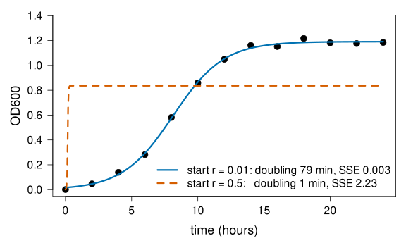
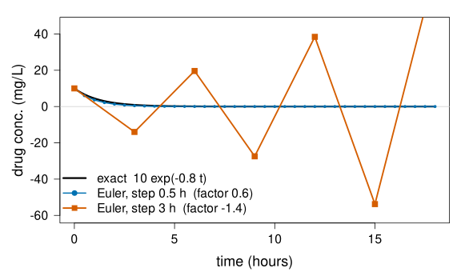
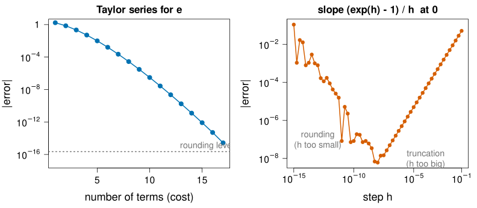
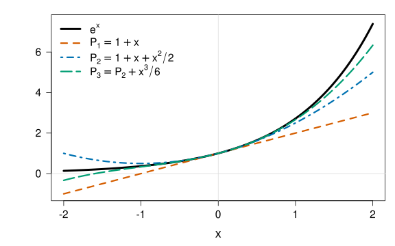
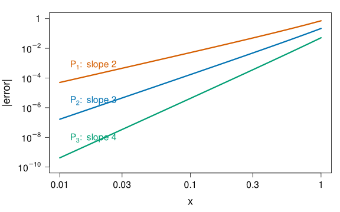
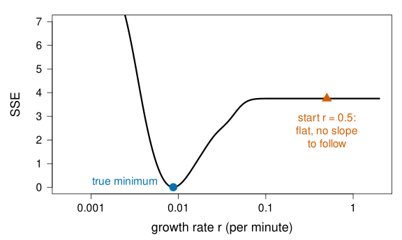

## About this lecture

You already call `optim()`, `uniroot()`, `integrate()`, `solve()` and `ode()`. This course opens those boxes. Today sets up the whole course:

- What a **numerical method** is: a finite recipe of arithmetic that approximates a mathematical answer.
- **Three ways** a computation goes wrong: **rounding**, **truncation** and **instability**, each with a tiny example.
- **Error vs cost**: more work buys accuracy, up to a limit.
- A recap of **Taylor polynomials**, with the remainder term: the tool behind almost every method in the course.
- Biology: a **growth-curve fit** that reports success and returns a doubling time of 1 minute.

::: notes
This is the opening deck of the course, so it does two jobs: it motivates the whole course, and it gives the one piece of mathematics we lean on everywhere, Taylor polynomials with a remainder. The three failure types are only previewed here, each with a one-line example; units 2, 3 and 4 treat them properly. Keep an R session open: every code block on the slides is short and worth running live.
:::

## A growth curve, a fit, a green light {.smaller}

Bacteria in a plate reader, OD600 every 2 hours for 24 hours. The reader exports time in **minutes**. Fit the logistic model $N(t) = \dfrac{K}{1 + (K/N_0 - 1)\,e^{-rt}}$:

```r
t_min <- seq(0, 1440, by = 120)          # minutes
od <- c(0.001, 0.047, 0.139, 0.282, 0.581, 0.859, 1.049,
        1.161, 1.152, 1.217, 1.182, 1.176, 1.185)
logistic <- function(p, t)               # p = (r, K, N0)
  p[2] / (1 + (p[2] / p[3] - 1) * exp(-p[1] * t))
sse <- function(p) sum((od - logistic(p, t_min))^2)
fit <- optim(c(r = 0.5, K = 1, N0 = 0.05), sse)  # "r is about 0.5"
fit$par
#            r            K           N0
# 0.6759128151 0.8357871891 0.0009330162
```

- [`optim`](https://stat.ethz.ch/R-manual/R-devel/library/stats/html/optim.html) minimises the sum of squared errors (SSE). `fit$convergence` is `0`, meaning "converged". No warning, no error.

::: notes
This is the hook for the whole course. The data are simulated from a logistic curve with r = 0.5 per hour, K = 1.2, N0 = 0.02, plus a little noise. The student remembers that E. coli-like growth rates are about 0.5 per hour and uses that as the starting value, but the time axis is in minutes. optim returns convergence code 0, which is what everyone checks, if they check anything. The fitted r of 0.68 per minute means a doubling time of log(2)/0.68 = 1 minute. Ask the audience: would you have noticed, if you only printed fit$par?
:::

## Two "converged" fits of the same data

{width="80%" fig-align="center"}

- Same data, same model, same `optim`; only the starting value of $r$ differs.
- Both report `convergence = 0`. One is right (doubling 79 min), one is nonsense.
- **"Converged" means "stopped improving", not "found the answer".**

::: notes
The blue curve starts from r = 0.01 per minute, which is the right order of magnitude (0.5 per hour is 0.0083 per minute). The orange curve is the fit from the previous slide: it jumps to K immediately and is flat, a horizontal line at the mean of the data. Its SSE is 2.23, about 700 times larger than the good fit's 0.003. We come back at the end of the lecture to why the optimiser stopped there, and what checks would have caught it. The proper treatment of model fitting is Part 9.
:::

## What is a numerical method?

A **numerical method** is a finite list of arithmetic operations ($+,-,\times,\div$) that **approximates** a mathematical answer we cannot write down exactly.

```r
x <- 1                                # first guess for sqrt(2)
for (i in 1:5) {
  x <- (x + 2 / x) / 2                # average of x and 2/x
  print(x, digits = 16)
}
# [1] 1.5
# [1] 1.416666666666667
# [1] 1.41421568627451
# [1] 1.41421356237469
# [1] 1.414213562373095
```

- An **approximation**, an **iteration**, and a **stopping rule**. Each one is a place where error enters.
- Questions for every method: how **accurate**? how **fast**? when does it **fail**?

::: notes
Heron's method for square roots, about 2000 years old. If x is too big, 2/x is too small, so their average is closer. The number of correct digits roughly doubles each step: 1, 3, 6, 12, 16. This is Newton's method in disguise (unit 6 in Part 2). The point here is the anatomy: we replaced an exact answer we cannot compute with a sequence of arithmetic steps, and we had to decide when to stop. Every method in the course has that shape. Even here, the last iterate differs from sqrt(2) in R by 2.2e-16: that is rounding, the subject of the next unit.
:::

## What is inside the black boxes

| R | Python | Computes | Method inside | Silent failure | Part |
|---|---|---|---|---|---|
| [`solve`](https://stat.ethz.ch/R-manual/R-devel/library/base/html/solve.html) | `numpy.linalg.solve` | $A\mathbf x = \mathbf b$ | LU with pivoting | ill-conditioned $A$: digits lost | 3 |
| [`uniroot`](https://stat.ethz.ch/R-manual/R-devel/library/stats/html/uniroot.html) | `scipy.optimize.brentq` | $f(x) = 0$ | Brent: bisection + secant | loose default tolerance (R) | 2 |
| [`optim`](https://stat.ethz.ch/R-manual/R-devel/library/stats/html/optim.html) | `scipy.optimize.minimize` | minimum of $f$ | Nelder–Mead, BFGS | stops at a plateau or local minimum | 9 |
| [`integrate`](https://stat.ethz.ch/R-manual/R-devel/library/stats/html/integrate.html) | `scipy.integrate.quad` | $\int_a^b f(x)\,dx$ | adaptive Gauss–Kronrod | misses a narrow peak | 7 |
| [`ode`](https://rdrr.io/cran/deSolve/man/ode.html) (deSolve) | `scipy.integrate.solve_ivp` | $y' = f(t, y)$ | adaptive Runge–Kutta, LSODA | wrong tolerance, stiffness | 8 |

- Each one is a numerical method with **tuning knobs** (tolerances, starting values, step sizes) and **defaults** chosen for a typical problem.
- Your problem may not be typical. The course teaches you what the knobs do.

::: notes
Walk through the table quickly; each row is a Part of the course. The methods column will mean little now, and that is the point: by the end of the course every entry should be familiar. Stress the last two columns: these routines rarely crash. They return a number, and the number may be wrong. The Python column is for students who will do the exercises in Python.
:::

## Silent failures in two lines

```r
integrate(dnorm, 0, 20000)       # half the area under a normal: 0.5
# 0 with absolute error < 0
integrate(dnorm, 0, Inf)
# 0.5 with absolute error < 4.7e-05

uniroot(function(x) x^2 - 2, c(0, 2))$root - sqrt(2)
# [1] -2.423776e-07
```

- `integrate` samples a few points in $[0, 20000]$; all of them are far out where `dnorm` is 0. It reports 0, with an error estimate of 0.
- `uniroot` stops when it is within its default tolerance, about $10^{-4}$. Fine for a dose, not for a likelihood.

::: notes
The integrate example is from R's own help page for integrate. The adaptive rule evaluates the function at 21 points spread over [0, 20000]; the normal density is non-zero only near 0, so every sample is (numerically) zero, and the method is confident. Asking for [0, Inf] works because integrate then transforms the interval. For uniroot the default tol is .Machine$double.eps^0.25, about 1.2e-4. Neither is a bug: both are documented, and both are the kind of thing this course teaches you to look for.
:::

## Three ways a computation goes wrong

1. **Rounding error.** The computer stores about 16 significant digits. Every operation rounds.
2. **Truncation error.** The method stops early: a finite sum for an infinite series, a finite step $h$ instead of a limit $h \to 0$, a finite number of iterations.
3. **Instability.** The algorithm amplifies small errors (from 1 or 2) step after step, until they swamp the answer.

Plus one that is not the computer's fault: an **ill-conditioned problem**, where tiny changes in the data change the answer a lot (unit 3).

::: notes
This is the classification we use for the rest of the course. Rounding is about how numbers are stored (unit 2). Truncation is about the mathematics of the approximation, and is usually the error we control with a step size or number of terms (unit 4). Instability is a property of the algorithm: a stable algorithm keeps small errors small, an unstable one lets them grow (unit 3). Conditioning is a property of the problem itself, not of the algorithm; we mention it so students do not blame the method for it. The next three slides give one tiny example of each.
:::

## 1. Rounding

```r
0.1 + 0.2 == 0.3
# [1] FALSE
print(0.1 + 0.2, digits = 17)
# [1] 0.30000000000000004
1e16 + 1 - 1e16
# [1] 0
```

- 0.1 is stored rounded (it has no exact binary form). Near $10^{16}$, stored numbers are 2 apart, so adding 1 is lost.
- Each rounding error is tiny (relative size $\approx 10^{-16}$). Trouble starts when many of them add up or one gets amplified.

Full story: **How computers store numbers** (binary, machine epsilon, overflow, log-likelihoods).

::: notes
Do not explain binary here; that is the whole of the next unit. The message is only: the computer does not do exact real arithmetic, every result is rounded to about 16 significant digits, and that is usually harmless. The second example shows that rounding is relative: at 1e16 the spacing between doubles is 2, so 1e16 + 1 rounds back to 1e16. The practical rule, comparing with a tolerance instead of ==, also comes in unit 2.
:::

## 2. Truncation

The slope of $e^x$ at $x = 0$ is exactly 1. Approximate it with a finite step $h$:

```r
h <- 0.1
(exp(h) - 1) / h          # slope of the secant from 0 to h
# [1] 1.051709
```

- Error 0.0517. Not rounding: the formula itself is only an approximation.
- Why? $e^h = 1 + h + \frac{h^2}{2} + \dots$, so $\dfrac{e^h - 1}{h} = 1 + \dfrac{h}{2} + \dots$ The error is about $h/2 = 0.05$.
- Make $h$ smaller and the truncation error shrinks, but only up to a point (two slides on).

More: **Convergence and cost**, and finite differences in **Part 7**.

::: notes
Truncation error is the error of the mathematical approximation, the part we would have even with exact arithmetic. Here the derivative is a limit as h goes to 0, and we stop at h = 0.1. Notice that we explained the size of the error with a Taylor expansion: that is exactly why Taylor is the workhorse of the course, and the second half of this lecture. The predicted error h/2 = 0.05 matches the observed 0.0517; the small difference is the next term, h^2/6.
:::

## 3. Instability {.smaller}

Drug clearance $C' = -kC$, $k = 0.8$ per hour. Step forward with Euler, $C_{n+1} = C_n - hkC_n$:

:::: {.columns}
::: {.column width="55%"}
```r
k <- 0.8; h <- 3      # 3-hour steps
C <- numeric(9); C[1] <- 10   # mg/L
for (i in 1:8)
  C[i + 1] <- C[i] - h * k * C[i]
signif(C, 2)
# [1]   10  -14   20  -27   38  -54   75 -110  150
```
:::
::: {.column width="45%"}
{width="100%"}
:::
::::

- Each step multiplies by $1 - hk = -1.4$: any error grows by 40 % and flips sign every step.
- With $h = 0.5$ the factor is $0.6$, and errors die out. Same formula, different stability.

Stability of algorithms: **Error, conditioning and stability**; of ODE solvers: **Part 8**.

::: notes
The true concentration decays smoothly to zero. Euler with 3-hour steps produces negative concentrations that grow without bound. Nothing is wrong with the formula; the step is simply too big for this rate, and the method amplifies errors instead of damping them. The rule here is |1 - hk| < 1, so h < 2/k = 2.5 hours. A stable method keeps small errors small; an unstable one turns them into the whole answer. Unit 3 shows instability caused by rounding alone (no step size involved), and Part 8 treats stiff ODEs, where this exact problem forces tiny steps.
:::

## Error vs cost

{width="95%" fig-align="center"}

- **Left:** more terms of the series for $e$ (more work) give a smaller truncation error, until it hits the rounding level $\approx 10^{-16}$.
- **Right:** a smaller step helps only down to $h \approx 10^{-8}$; below that, rounding error grows. Best accuracy: about 8 digits, not 16.

::: notes
Two lessons. First, accuracy costs work: each extra term, smaller step, or extra iteration costs time, and the art is getting enough accuracy for the least work. Second, you cannot buy accuracy forever: rounding sets a floor. The right panel is the classic V-shape of a finite-difference derivative: truncation error goes like h, rounding error like 1e-16/h, and the best h is where they balance, near 1e-8. Unit 4 derives this, and shows how to read the order of a method off the slope of the right branch.
:::

## Taylor polynomials: the workhorse

Near a point $a$, replace a hard function by a polynomial, which needs only $+$ and $\times$:

$$P_n(x) = f(a) + f'(a)(x-a) + \frac{f''(a)}{2!}(x-a)^2 + \dots + \frac{f^{(n)}(a)}{n!}(x-a)^n$$

- $P_n$ matches $f$ and its first $n$ derivatives at $a$.
- Most of the course uses $a = 0$ or "a point we are already at", and small steps $h = x - a$.
- Two questions: **how good** is $P_n$ near $a$? **How fast** does the error shrink as $x \to a$?

::: notes
This is a recap from first-year calculus; the audience has seen the formula but often not the remainder term or the "how fast does the error shrink" question, which is what numerical analysis cares about. The factorials 2! = 2, 3! = 6, 4! = 24 are worth writing on the board. The point "a polynomial needs only + and ×" is why Taylor matters for computers: arithmetic is all the hardware does.
:::

## Example: $e^x$ around 0

Every derivative of $e^x$ is $e^x$, and $e^0 = 1$, so

$$e^x \approx 1 + x + \frac{x^2}{2} + \frac{x^3}{6} + \dots$$

{width="62%" fig-align="center"}

- Close to 0 all three are good; far from 0 you need more terms.

::: notes
Point at the picture: P1 is the tangent line, P2 bends with the curve, P3 hugs it further out. Near x = 0 the curves are indistinguishable; at x = 2 even P3 is off by 1. The take-home is that a Taylor polynomial is a local approximation: excellent near the expansion point, useless far from it. Every method that uses Taylor therefore takes small steps.
:::

## With numbers: $x = 0.1$

```r
x <- 0.1
P <- c(1 + x, 1 + x + x^2/2, 1 + x + x^2/2 + x^3/6)
P
# [1] 1.100000 1.105000 1.105167
exp(x) - P
# [1] 5.170918e-03 1.709181e-04 4.251409e-06
```

| | $P_1$ | $P_2$ | $P_3$ |
|---|---|---|---|
| error | $5.2\times10^{-3}$ | $1.7\times10^{-4}$ | $4.3\times10^{-6}$ |
| next term $\frac{x^{n+1}}{(n+1)!}$ | $5.0\times10^{-3}$ | $1.67\times10^{-4}$ | $4.2\times10^{-6}$ |

- Each extra term gains about 1.5 digits at $x = 0.1$. The error is close to **the first term we left out**.

::: notes
Compare the error row with the first omitted term row: 0.1^2/2 = 0.005, 0.1^3/6 = 0.000167, 0.1^4/24 = 0.0000042. They agree to about two digits. This rule of thumb, "the error is about the first neglected term", is what we used on the truncation slide to predict the h/2 error. The next slide makes it exact.
:::

## The remainder term

**Taylor's theorem**: for some $\xi$ (unknown) between $a$ and $x$,

$$f(x) = P_n(x) + R_n(x), \qquad R_n(x) = \frac{f^{(n+1)}(\xi)}{(n+1)!}(x-a)^{n+1}$$

For $e^x$, $n = 2$, $x = 0.1$: $R_2 = \dfrac{e^{\xi}}{6}\,(0.1)^3$ with $0 < \xi < 0.1$, so

$$\frac{1}{6}(0.001) = 1.667\times10^{-4} \;\le\; R_2 \;\le\; \frac{e^{0.1}}{6}(0.001) = 1.842\times10^{-4}$$

- The actual error, $1.709\times10^{-4}$, is inside the bound. We **bounded the error without knowing the answer**.

::: notes
The remainder is the first omitted term, with the derivative evaluated at some unknown point xi instead of at a. We do not know xi, but we know it lies between a and x, and that is enough to bound the error from above and below. This is the core move of numerical analysis: we cannot compute the error exactly (that would need the exact answer), but we can bound it or estimate its size. Students weak on this theorem should note just the shape: (derivative of order n+1) times (distance)^(n+1) over (n+1)!.
:::

## How fast the error shrinks: order {.smaller}

From the remainder, the error of $P_n$ is about $C\,x^{n+1}$ for small $x$. Halve $x$:

```r
x <- c(0.1, 0.05, 0.025)
err1 <- exp(x) - (1 + x)              # P1
err1[1:2] / err1[2:3]                 # ratio when x is halved
# [1] 4.068077 4.033683
err2 <- exp(x) - (1 + x + x^2/2)      # P2
err2[1:2] / err2[2:3]
# [1] 8.101774 8.050441
```

- $P_1$: halving $x$ divides the error by $4 = 2^2$. $P_2$: by $8 = 2^3$.
- Notation: error $= O(x^{n+1})$, read "of order $x^{n+1}$": it shrinks at least like $x^{n+1}$. The same halving test works for any method with a step size.

::: notes
This is the first appearance of big-O notation, used for error: error = O(h^p) means that for small h the error is at most a constant times h^p. The ratio test is something students can do on any method with a step: halve the step, divide the errors, take log2 of the ratio, and you have the order. Here log2(4) = 2 and log2(8) = 3. The ratios approach exactly 4 and 8 as x gets smaller. Unit 4 uses the same idea with big-O for cost (operation counts), which is a different use of the same notation.
:::

## On log–log axes, order is a slope

{width="68%" fig-align="center"}

- If error $\approx C x^{p}$, then $\log(\text{error}) = \log C + p \log x$: a straight line with slope $p$.
- Slope 2, 3, 4 for $P_1$, $P_2$, $P_3$. Every method in the course gets a plot like this.

::: notes
Taking logs turns a power law into a straight line, and the slope is the power. One decade along x (factor 10) moves P1's error by two decades, P3's by four. This is the "error-vs-step on log axes" plot from the design of the course: every method gets one, and students read the order off it. Unit 4 does this systematically, including what happens when rounding makes the line bend upward at small steps, as in the right panel of the error-vs-cost figure.
:::

## Try it: Taylor error, order and the rounding floor

```{=html}
<link rel="stylesheet" href="../demos/dist/demo.css">
<div data-demo="taylor" data-fn="exp" data-n="2" data-x="0.1"></div>
<script src="../demos/dist/taylor.js"></script>
```

::: notes
Left: e^x (black) and P_n (blue dashed) on [-1, 2], with the error at x as an orange bar; click or drag to move x. Right: the computed error |f - P_n| against x on log-log axes, the dashed first omitted term with slope n + 1, and the green band allowed by the remainder term. Start at n = 2, x = 0.1: the readout shows error 1.709e-4 inside the bound 1.667e-4 to 1.842e-4, the remainder slide. Step n from 0 to 4: the error drops by a factor 20, 30, 40, 50, and the slope readout goes 1, 2, 3, 4, 5. Then press x times 10 to go to x = 1 and x = 2: more terms help slowly. Switch to log(1+x) and the preset x = 1.5: now adding terms makes it worse, P_n swings up and down, because the terms x^k/k grow when x > 1. Finally go back to e^x, n = 3, and press x divided by 10 from 0.01: at about x = 4e-4 the computed error leaves the green band and sits at 1e-16 or exactly 0. The mathematics still says slope 4; the computer cannot see differences below 16 digits. That is the next unit. The exercise has five tasks with this demo.
:::

## A second expansion: $\log(1+x)$ {.smaller}

A population grows by a fraction $x$ per hour. The continuous rate is $r = \log(1+x)$. For small $x$:

$$\log(1+x) = x - \frac{x^2}{2} + \frac{x^3}{3} - \dots$$

```r
x <- 0.01                             # 1 % per hour
log(1 + x) - c(x, x - x^2/2)          # errors of P1 and P2
# [1] -4.966915e-05  3.308532e-07
```

- So $r \approx x$ for small growth, with error about $x^2/2 = 5\times10^{-5}$.
- Remainder of $P_2$: $f'''(\xi) = 2/(1+\xi)^3$, so $R_2 = \dfrac{x^3}{3(1+\xi)^3}$, between $3.24\times10^{-7}$ and $3.33\times10^{-7}$. Actual: $3.31\times10^{-7}$.
- For very small $x$, computing `log(1 + x)` loses digits; R's [`log1p`](https://stat.ethz.ch/R-manual/R-devel/library/base/html/Log.html) uses this expansion instead (unit 2).

::: notes
Derivatives: f = log(1+x), f' = 1/(1+x), f'' = -1/(1+x)^2, f''' = 2/(1+x)^3; at 0 these are 0, 1, -1, 2, giving coefficients 1, -1/2, 2/6 = 1/3. The remainder with xi between 0 and 0.01 gives the bracket [0.01^3/(3*1.01^3), 0.01^3/3]. Biology: per-generation or per-hour growth fractions versus continuous rates; for 1 % they differ in the fifth decimal, for 50 % they do not agree at all (log 1.5 = 0.405). The log1p remark is a forward pointer: in unit 2 we see why 1 + x rounds away the digits of a tiny x.
:::

## Where Taylor comes back {.smaller}

| Unit / Part | Taylor statement | Gives |
|---|---|---|
| Newton (Part 2) | $f(x+h) \approx f(x) + f'(x)\,h$ | set to 0, solve for $h$ |
| Conditioning (unit 3) | $f(x + \delta) - f(x) \approx f'(x)\,\delta$ | how errors in data propagate |
| Finite differences (Part 7) | $\dfrac{f(x+h) - f(x)}{h} = f'(x) + \dfrac{h}{2}f''(\xi)$ | derivative, error $O(h)$ |
| Euler / Runge–Kutta (Part 8) | $y(t+h) \approx y(t) + h\,y'(t)$ | one ODE step |
| Optimisation (Part 9) | $f(x+h) \approx f(x) + f'(x)h + \tfrac12 f''(x)h^2$ | minimise the parabola |

- Every time: **replace the function by its Taylor polynomial, solve the easy problem, use the remainder to bound the error.**

::: notes
This slide is the reason for the Taylor recap. Each row is a method we derive later, and each derivation is one line of Taylor. The error of each method comes from the remainder term, and its order (how fast the error shrinks with h) is the power in the remainder. In Parts 2 and 9 we extend this to several variables, which brings in the Jacobian, gradient and Hessian; those are introduced where they are first needed.
:::

## Back to the growth curve: why did `optim` stop?

{width="70%" fig-align="center"}

- With $r = 0.5$ per **minute**, the curve reaches $K$ within minutes. Changing $r$ a bit changes nothing: the SSE is **flat**.
- The optimiser sees no slope, makes no progress, and stops. "Converged."

::: notes
This is the SSE as a function of r with K and N0 held at their best values. The good minimum is at r = 0.0087 per minute (0.52 per hour). At r = 0.5 per minute, e^(-r t) is e^(-60) at the first measurement after zero, so the model predicts K at every time point except t = 0, whatever the exact value of r. A local method only sees the neighbourhood of where it is; on a plateau there is nothing to follow. The root cause is scaling: time in minutes made the natural guess wrong by a factor of 60. Part 9 discusses scaling, starting values and multistart in depth.
:::

## Checks that would have caught it {.smaller}

```r
for (r0 in c(0.001, 0.01, 0.1, 1)) {        # several starting values
  f <- optim(c(r = r0, K = 1, N0 = 0.05), sse)
  cat("start r =", r0, " SSE =", signif(f$value, 3),
      " r =", signif(f$par["r"], 3), "\n")
}
# start r = 0.001  SSE = 2.23  r = 0.333
# start r = 0.01  SSE = 0.003  r = 0.00874
# start r = 0.1  SSE = 2.23  r = 0.237
# start r = 1  SSE = 2.23  r = 1.18
```

- **Plot the fit over the data**, and **try several starts**: keep the lowest SSE; different answers mean a hard problem.
- **Check units and scale**: is a 1-minute doubling time plausible? Use units where parameters are near 1 (hours, not minutes).
- `convergence == 0` is **necessary, not sufficient**. Fitting in depth: **Part 9**.

::: notes
Only one of four starts finds the good fit, and the SSE makes the difference unmistakable: 0.003 versus 2.23. Each check here is generic: plot, multistart, sanity-check the parameters, and treat the convergence code as the least you check. These checks recur in every Part: for each method we ask how it fails and what check a student runs to detect it. Note that nls from the same bad start fails loudly with a "singular gradient" error, which is better than failing silently.
:::

## The course map {.smaller}

1. **Numbers on a computer**: floating point, error, conditioning, stability, cost (this Part).
2. **Nonlinear equations**: bisection, fixed points, Newton. *Steady states, EC50.*
3. **Linear systems**: LU, pivoting, sparse matrices. *Spectral unmixing, count matrices.*
4. **Least squares**: QR, SVD, regularisation. *Calibration curves, deconvolution.*
5. **Eigenvalues**: power iteration, QR algorithm, Lanczos. *Leslie matrices, PCA.*
6. **Interpolation**: polynomials, splines, FFT. *Smoothing time courses, circadian rhythms.*
7. **Differentiation and integration**: finite differences, quadrature, Monte Carlo. *Growth rates, AUC.*
8. **ODEs**: Euler to Runge–Kutta, stiffness, Gillespie. *Epidemics, gene circuits.*
9. **Optimisation and fitting**: gradient methods, nonlinear least squares, identifiability. *Today's growth curve.*
10. **Diffusion and heat**: finite-difference PDEs in microfluidic chips.
11. **Further reading**: finite elements, flow solvers, iterative solvers.

::: notes
The course is self-paced; work down the sidebar. Each Part pairs methods with a biological problem that needs them, shown in italics. Parts 1 to 9 are the core; Part 10 builds on Parts 3, 7 and 8; Part 11 is pointers only. The growth curve returns in Part 6 (smoothing splines, growth rate as a derivative) and Part 9 (fitting it properly).
:::

## Next in Part 1

- **How computers store numbers**: how a double is stored, machine epsilon, overflow and underflow, why `0.1 + 0.2 != 0.3`. *A likelihood over 10 000 alignment sites underflows to 0: log-likelihoods and log-sum-exp.*
- **Error, conditioning and stability**: absolute and relative error, catastrophic cancellation, the condition number, stable vs unstable algorithms. *A variance formula that loses all its digits.*
- **Convergence and cost**: truncation vs rounding, order of accuracy on log–log plots, big-O operation counts, timing code. *From 100 genes to 20 000 genes × 100 000 cells.*

Each unit: lecture, quiz, exercise with **by-hand** problems and code (R and Python).

::: notes
These three units turn today's three failure types into tools. Unit 2 is rounding, unit 3 is instability and conditioning, unit 4 is truncation and cost. After Part 1 students should be able to look at any numerical result and ask the right three questions: how many digits can I trust, how sensitive is the problem, and how does the error shrink with more work.
:::

## Summary

- A **numerical method** approximates an answer with finitely many arithmetic steps: approximation, iteration, stopping rule.
- Three ways it goes wrong: **rounding** (16 digits), **truncation** (stopping early), **instability** (errors amplified). Plus ill-conditioned problems.
- **Error vs cost**: more work buys accuracy, down to the rounding floor.
- **Taylor**: $f(x) = P_n(x) + R_n(x)$, $R_n = \frac{f^{(n+1)}(\xi)}{(n+1)!}(x-a)^{n+1}$. The error is $O(h^{n+1})$: a slope $n+1$ on a log–log plot.
- Library routines fail **silently**. Plot the result, try several starts, check units, and do not trust `convergence = 0` alone.

::: notes
If students remember one sentence: a numerical answer is not the answer, it is an approximation with an error, and part of the job is to estimate that error. The exercise has by-hand Taylor bounds, classifying failures, and the growth-curve fit with multistart in R and Python.
:::
