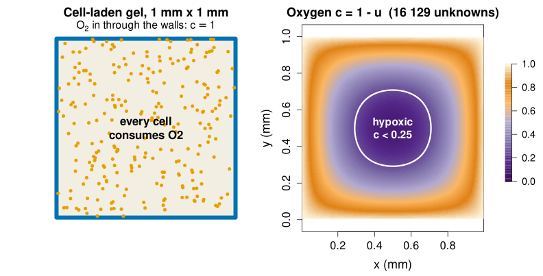
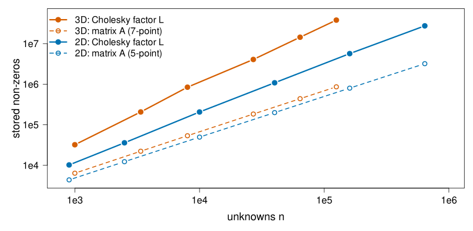
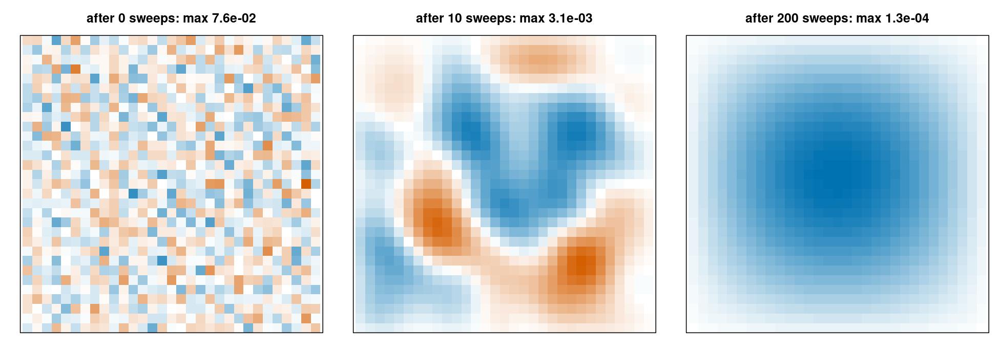
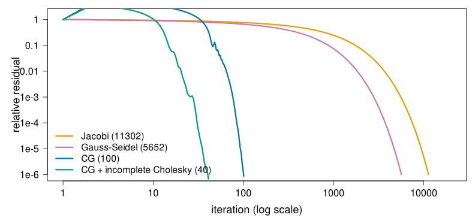
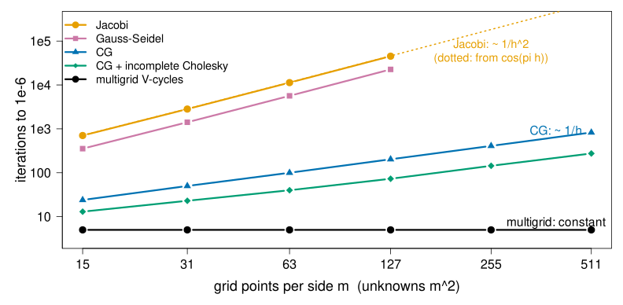
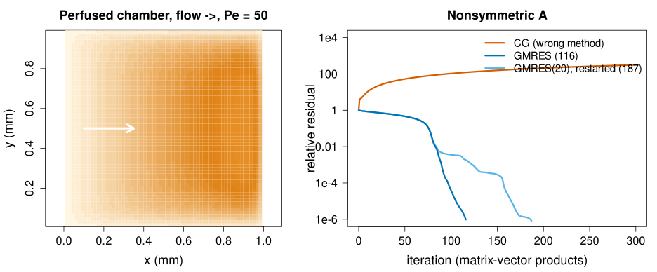
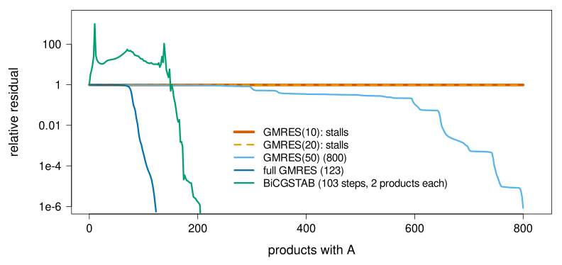
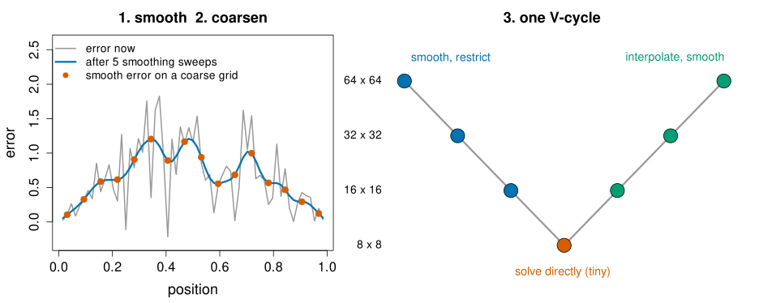

## About this lecture {.smaller}

[*Steady state in two dimensions*](../steady-state-2d/lec.qmd) solved its 2D grids with a sparse direct solver and watched the Cholesky factor fill in. [*Flow plus diffusion*](../advection-diffusion/lec.qmd) avoided a 2D solve altogether by marching downstream. This lecture is about the solvers used when the direct solve is too big, or the flow cannot be marched.

- On fine 2D and especially **3D grids**, the factor fills in: memory and time explode. Iterative methods only need products $A\mathbf{x}$.
- **Jacobi** and **Gauss–Seidel** are *splittings*. Their speed is the **spectral radius** of an iteration matrix (eigenvalues again), and it gets worse as the grid is refined.
- **Conjugate gradient** (SPD matrices) needs about $\sqrt{\kappa}$ iterations; **preconditioning** makes $\kappa$ smaller; **multigrid** needs the same number of iterations on every grid.
- **Flow** makes $A$ nonsymmetric: **GMRES**, its restarted version (which can **stall**), and **BiCGSTAB**.
- Biology: **oxygen in a cell-laden gel**, refined until each grid point is one cell; then **perfused**, and with a signal that amplifies itself.

::: notes
This is the fifth unit of Part 11. It uses the sparse matrices and fill-in of [*Structure: symmetric, banded, sparse*](../structured-sparse/lec.qmd) (Part 3) and [*Steady state in two dimensions*](../steady-state-2d/lec.qmd), eigenvalues from Part 5, and the upwind differences of [*Flow plus diffusion*](../advection-diffusion/lec.qmd). The matrix is rebuilt in one slide, so nothing has to be looked up. The message to take away: the number of iterations depends on the condition number, and the condition number of a diffusion matrix grows as the grid is refined. Preconditioning and multigrid are attacks on that growth. For nonsymmetric matrices a second message: there is no method that is both cheap in memory and guaranteed to work, so we learn the checks that show a solver has stalled.
:::

## Recap: what we already have {.smaller}

- [*Structure: symmetric, banded, sparse*](../structured-sparse/lec.qmd) (morphogen in 1000 cells): **Jacobi** $\mathbf{x} \leftarrow \mathbf{x} + D^{-1}(\mathbf{b} - A\mathbf{x})$ took about **4160** iterations, **CG** about **240**. Jacobi **diverges** for $\begin{pmatrix}1&2\\2&1\end{pmatrix}$; CG needs $A$ **SPD**.
- [*Steady state in two dimensions*](../steady-state-2d/lec.qmd): the five-point Laplacian by `kronecker`, solved by sparse Cholesky with a fill-reducing ordering. At $h = 12.5$ µm the factor already has **6×** the non-zeros of $A$, and the ratio grows with refinement.
- [*Flow plus diffusion*](../advection-diffusion/lec.qmd): upwind differences give the upstream neighbour weight $1 + P$, the downstream one 1: **$A \ne A^T$**. Marching avoided the 2D solve, but only by dropping diffusion along the flow.
- Check from all three: monitor the **residual** $\|\mathbf{b} - A\mathbf{x}\|$, stop on a tolerance, report when the iteration limit is hit.

Open questions: *why* 4160 and 240? When does the direct solve stop being an option? What if $A$ is not symmetric?

::: notes
One-slide recap. The exercise of Structure: symmetric, banded, sparse (C8) had the students write jacobi() and cg() in about 10 lines each, and the Rust tabs of Steady state in two dimensions already used a hand-written CG because sprs has no direct solver; we do not repeat the code here. The fill-in numbers are from the table of Steady state in two dimensions (nnz(A) = 252 649, nnz(L) reordered = 1 475 954 at h = 12.5 µm); its browser demo solves the chamber by nonlinear SOR, a Gauss-Seidel variant explained on the next slides. Today's answers: 4160 comes from the spectral radius of the Jacobi iteration matrix (0.995 there); 240 from the square root of the condition number; the 2 x 2 diverges because its iteration matrix has an eigenvalue -2; the direct solve stops being an option in 3D; and for nonsymmetric matrices we use GMRES or BiCGSTAB.
:::

## Biology: oxygen in a culture chamber {.smaller}

{width="78%" fig-align="center"}

- A 1 mm × 1 mm gel with cells, oxygen enters through all four walls (concentration 1 = ambient). Cells consume it: **hypoxic** core where $c < 0.25$ (about 5 % O₂).
- Steady state: $-D\,\Delta c = -q$. With $u = 1 - c$ (the oxygen *deficit*): $-\Delta u = \Phi$, $u = 0$ on the walls, $\Phi = qL^2/(Dc_0) = 12$.
- At $h = 7.8$ µm (about one grid point per cell): **16 129 unknowns**. Centre $c = 0.116$; 14 % of the gel is hypoxic.

::: notes
This is not the chamber of [*Steady state in two dimensions*](../steady-state-2d/lec.qmd). That unit follows oxygen under a gas-impermeable lid over a cell monolayer (4 mm x 2 mm seen from above, oxygen in µM, Michaelis-Menten uptake solved by Newton); here the cells are embedded in a 1 mm x 1 mm gel, consume at a uniform zero-order rate, and the equation is scaled so that the matrix has integer entries. The per-cell consumption (50 amol/s) is the same assumption in both, the matrix is the same five-point Laplacian, and both ask the same question: how hypoxic does the middle get? Numbers, all order-of-magnitude: D = 2000 µm^2/s for oxygen in water, c0 = 0.2 mM (air-saturated medium), about 1e8 cells per mL each consuming about 50 amol O2 per second gives q of about 5 µM/s, and with L = 1 mm that is Phi = q L^2 / (D c0) = 12. The real experiments [O1, O2] use gas-impermeable barriers or a PDMS membrane to shape the gradient on purpose; here we just ask how hypoxic the middle of a thick gel gets. The point for this lecture: a question about cells needs a grid with roughly one point per cell, and in 3D that is a million unknowns per cubic millimetre.
:::

## The matrix: a 2D Laplacian {.smaller}

```r
library(Matrix)
lap1 <- function(m) bandSparse(m, k = -1:1,
  diagonals = list(rep(-1, m - 1), rep(2, m), rep(-1, m - 1)))
lap2 <- function(m) { I <- Diagonal(m); T <- lap1(m); kronecker(I, T) + kronecker(T, I) }
m <- 127; A <- lap2(m); b <- rep(12 / (m + 1)^2, m^2)    # multiplied through by h^2
c(n = nrow(A), nnz = nnzero(A))
#     n   nnz
# 16129 80137
u <- solve(A, b)                     # sparse direct solve (Cholesky, reordered)
1 - u[(m^2 + 1) / 2]                 # oxygen in the centre
# [1] 0.1159863
```

- Each row: $4u_{ij} - u_{i-1,j} - u_{i+1,j} - u_{i,j-1} - u_{i,j+1} = \Phi h^2$. **SPD**, five non-zeros per row.
- [`kronecker`](https://stat.ethz.ch/R-manual/R-devel/library/base/html/kronecker.html) builds the 2D operator from the 1D one; the same trick with three factors gives 3D (seven non-zeros per row).

::: notes
This is the Kronecker construction of [*Steady state in two dimensions*](../steady-state-2d/lec.qmd), on a square (n_x = n_y = m) and without the factor D/h^2 there; we multiply the equation by h^2 so that A has integer entries 4 and -1 and the right-hand side is Phi h^2. The unknowns are numbered row by row (natural ordering): u[i + m (j-1)]. lap2(3)[1:4, 1:4] shows the pattern: 4 on the diagonal, -1 for the left/right neighbour (next to the diagonal) and for the neighbour above/below (m positions away), with a 0 where a row of the grid ends. At this size, the direct solve takes a fraction of a second. The question of the next slide is what happens when we refine or go to 3D.
:::

## Why iterative? Fill-in in 2D and 3D {.smaller}

:::: {.columns}
::: {.column width="58%"}
{width="100%"}
:::
::: {.column width="42%"}
Cholesky with the best ordering `Matrix` finds:

| grid | unknowns | nnz(A) | nnz(L) | time |
|---|---|---|---|---|
| 2D 800² | 640 000 | 3.2 M | 27 M | 11 s |
| 3D 50³ | 125 000 | 0.86 M | 38 M | 52 s |
| 3D 100³ | 10⁶ | 6.9 M | ~600 M | ~1 h |
:::
::::

- In 2D the factor is 9 times larger than $A$; in 3D 44 times, growing like $n^{4/3}$ (time like $n^2$). A 1 mm³ tissue block at 10 µm needs **~7 GB** for $L$.
- CG on that block: **6.9 M** non-zeros stored (83 MB), 203 iterations, **6 s** in R.

::: notes
Numbers from make-iterative-solvers-figs.R (Cholesky(A, perm = TRUE), timed on one core) and from one CG run on lap3(100). The times are single runs and machine-dependent (on a heavily loaded machine several times longer); the non-zero counts are not. The 3D 100^3 row is an extrapolation from the measured 3D points (nnz(L) ~ n^(4/3), time ~ n^2 for nested dissection), so read it as an order of magnitude. Why 3D is so much worse: with the best ordering (nested dissection), the separators that cut the grid into pieces are lines in 2D (m points) but planes in 3D (m^2 points), and the separator blocks become dense. Memory per non-zero: about 12 bytes in CSC (Structure: symmetric, banded, sparse), so 600 M non-zeros is about 7 GB. An iterative method stores A, x and a handful of vectors: memory O(n). The price: the number of iterations, which is the rest of this lecture.
:::

## Jacobi and Gauss–Seidel as splittings {.smaller}

Split $A = M - N$ with $M$ easy to solve. Then $A\mathbf{x} = \mathbf{b}$ becomes the fixed-point iteration
$$\mathbf{x}_{k+1} = \mathbf{x}_k + M^{-1}(\mathbf{b} - A\mathbf{x}_k).$$

| method | $M$ | one step means |
|---|---|---|
| Jacobi | diagonal $D$ | every point: average of its 4 *old* neighbours (+ source) |
| Gauss–Seidel | lower triangle of $A$ (incl. diagonal) | sweep through the grid, use *new* values as soon as they exist |

Four interior points, $A$ = `lap2(2)`, $\mathbf{b} = (1,1,1,1)$, exact $x_i = 0.5$, start at 0:

- Jacobi: $x_i = 0.25 \to 0.375 \to 0.4375$: error $0.25, 0.125, 0.0625$, **halves** each step.
- Gauss–Seidel, first sweep: $0.25,\ (1 + 0.25)/4 = 0.3125,\ 0.3125,\ (1 + 0.625)/4 = 0.40625$.

::: notes
The general picture: any matrix splitting turns the linear system into a fixed-point iteration x = g(x), exactly as in [*Bisection and fixed-point iteration*](../bisection-fixedpoint/lec.qmd) (Part 2); there the iteration converged when |g'| < 1 near the root, here the role of g' is played by the iteration matrix T = I - M^{-1} A (next slide but one). M must be cheap to solve with: a diagonal for Jacobi (one division per point), a triangle for Gauss-Seidel (one forward substitution, also O(nnz)). In the four-point example each point has two neighbours inside the domain; for Jacobi all four values stay equal, x <- (1 + 2x)/4, so the error is multiplied by exactly 1/2 each step. Gauss-Seidel uses the freshly computed value of point 1 when it updates point 2, and so on; after one sweep it is already further along. Exercise B1 completes the second sweep.
:::

## Both in ten lines {.smaller}

```r
splitting <- function(A, b, M, tol = 1e-6, maxit = 1e5) {
  x <- numeric(length(b))
  for (it in 0:maxit) {
    r <- b - (A %*% x)[, 1]                     # residual
    if (sqrt(sum(r^2)) < tol * sqrt(sum(b^2))) return(it)
    x <- x + as.vector(solve(M, r))             # x <- x + M^{-1} r
  }
  NA                                            # not converged
}
m <- 63; A <- lap2(m); b <- rep(12 / (m + 1)^2, m^2)
c(jacobi = splitting(A, b, Diagonal(x = diag(A))), gauss_seidel = splitting(A, b, tril(A)))
#       jacobi gauss_seidel
#        11302         5652
```

- Stop on the **relative residual** $\|\mathbf{r}\| / \|\mathbf{b}\| < 10^{-6}$. [`tril`](https://rdrr.io/cran/Matrix/man/band-methods.html) keeps the lower triangle; `solve` with a triangular sparse $M$ is a forward substitution.
- 3969 unknowns, and still **11 302** Jacobi sweeps. Gauss–Seidel takes exactly half. Why these numbers?

::: notes
The same function does both methods; only M changes. That is the point of the splitting view. Gauss-Seidel needing exactly half the Jacobi iterations is no accident for this matrix: its spectral radius is the square of Jacobi's (next slide). In practice Gauss-Seidel is written as a loop that overwrites x in place, point by point; the triangular solve is the same arithmetic. Each run takes a few seconds in R; at m = 127 it takes 45 193 Jacobi sweeps.
:::

## The rate is a spectral radius {.smaller}

The exact solution is a fixed point, so the error $\mathbf{e}_k = \mathbf{x}_k - \mathbf{x}$ obeys
$$\mathbf{e}_{k+1} = T\,\mathbf{e}_k, \qquad T = I - M^{-1}A.$$
Write $\mathbf{e}_0$ in eigenvectors of $T$: each component is multiplied by its eigenvalue every step. The slowest one wins: error $\approx \rho(T)^k$, **spectral radius** $\rho(T) = \max|\lambda_i(T)|$.

```r
A7 <- as.matrix(lap2(7))                       # 49 unknowns, h = 1/8
TJ  <- diag(49) - A7 / 4                       # Jacobi: I - D^{-1} A
TGS <- diag(49) - solve(A7 * lower.tri(A7, diag = TRUE), A7)
rho <- function(T) max(Mod(eigen(T)$values))
c(rho(TJ), rho(TGS), cos(pi / 8), cos(pi / 8)^2)
# [1] 0.9238795 0.8535534 0.9238795 0.8535534
```

- Converges if and only if $\rho(T) < 1$. Iterations per digit: $\ln 10 / (-\ln\rho)$. For the $2\times2$ of Part 3, $\rho = 2$: divergence.
- For this grid $\rho_J = \cos \pi h$, $\rho_{GS} = \cos^2 \pi h$. At $m = 63$: $\rho_J = 0.99880$, **1910 sweeps per digit**, $\approx 11\,460$ for six digits (measured: 11 302).

::: notes
This is the power iteration of [*Power iteration and friends*](../power-iteration/lec.qmd) (Part 5) in disguise: repeatedly multiplying by T, the error lines up with the dominant eigenvector, and the residual ratio settles at rho (exercise C1 checks this: 0.99518 for m = 31). Mod() because T_GS is not symmetric and could have complex eigenvalues (here they are real). eigen() is the dense routine of [*How `eigen()` works, and big problems*](../eigen-algorithms/lec.qmd); fine for 49 unknowns, and the formula cos(pi h) comes from the sine modes of the Laplacian that we met in [*The diffusion (heat) equation by finite differences*](../diffusion-explicit/lec.qmd). The 2 x 2 matrix [1 2; 2 1] from Part 3 has T_J = [0 -2; -2 0], eigenvalues +2 and -2, so the error doubles. Sufficient condition for Jacobi to converge: strict diagonal dominance. The prediction 11 463 slightly overestimates because the start error does not have its full component in the slowest mode.
:::

## Why they slow down as the grid is refined {.smaller}

:::: {.columns}
::: {.column width="55%"}
{width="100%"}
Gauss–Seidel error, $m = 31$.
:::
::: {.column width="45%"}
- Each sweep only talks to **neighbours**: wiggly error is averaged away fast, **smooth** error barely moves.
- $\rho_J = \cos\pi h \approx 1 - \tfrac{\pi^2h^2}{2}$, so sweeps per digit $\approx 0.47/h^2$: **halve $h$, 4× the sweeps** (and 4× the unknowns).
- The same fact as a condition number: $\kappa(A) = \lambda_{\max}/\lambda_{\min} \approx 4/(\pi^2h^2)$ ([*Pivoting, norms and conditioning*](../pivoting-conditioning/lec.qmd)): 1659 at $m = 63$, 26 560 at $m = 255$.
:::
::::

::: notes
The left panel is random error; after 10 sweeps the high-frequency part is gone; after 200 only the smoothest mode, a single bump, is left, and it decays by a factor cos^2(pi h) = 0.990 per sweep. Information travels one grid point per sweep: for the centre to learn about the walls takes at least m/2 sweeps, and averaging needs many crossings. Plain Jacobi additionally keeps a checkerboard mode with eigenvalue -cos(pi h), which is why multigrid uses Gauss-Seidel or damped Jacobi as the smoother. The eigenvalues of the 2D Laplacian (h^2-scaled) are 4 sin^2(i pi h / 2) + 4 sin^2(j pi h / 2), from about 2 pi^2 h^2 to about 8; hence kappa = cot^2(pi h / 2), about 4 / (pi^2 h^2). The same eigenvalues set the explicit time-step limit in [*The diffusion (heat) equation by finite differences*](../diffusion-explicit/lec.qmd). Total work for Jacobi is then sweeps x unknowns ~ h^-4 in 2D: refining by 2 costs 16 times.
:::

## Failure: a small step is not a small error {.smaller}

A tempting stopping rule: stop when the iterate no longer changes.

```r
u <- as.vector(solve(A, b))                    # reference, m = 63
x <- numeric(m^2); d <- diag(A)
for (it in 1:1e5) {
  step <- (b - (A %*% x)[, 1]) / d             # Jacobi step
  x <- x + step
  if (max(abs(step)) < 1e-6) break             # "nothing changes any more"
}
c(it, max(abs(x - u)))
# [1] 5.875000e+03 8.286336e-04
```

- Steps of $10^{-6}$, but the error is **830 times larger**: with $\rho$ close to 1 the iteration *crawls*. Error $\approx$ step $\cdot \rho/(1-\rho) = 8.29\times10^{-4}$.
- **Check:** stop on the residual relative to $\|\mathbf{b}\|$; on a test problem, compare with a direct solve; look at the residual curve: a straight line on a log scale with a shallow slope means "still far away".

::: notes
This is the classic failure of slowly converging linear iterations: the change per step is small because the method is slow, not because it is done. The estimate: the remaining error is the sum of all future steps, a geometric series step (rho + rho^2 + ...) = step rho / (1 - rho); with rho = cos(pi/64) = 0.9988 the factor is 829, and the measured error 8.29e-4 matches it to two digits. The deficit u is about 0.88 at most, so we have three correct digits, not six. A residual test is better but not perfect either: a small residual is not a small error when A is ill-conditioned ([*Pivoting, norms and conditioning*](../pivoting-conditioning/lec.qmd)), error <= kappa * residual in relative terms. Exercise B4 does the geometric-series estimate by hand.
:::

## Conjugate gradient: the Krylov idea {.smaller}

After $k$ products with $A$, every method on these slides has $\mathbf{x}_k$ in the **Krylov space**
$$\mathcal{K}_k = \text{span}\{\mathbf{b}, A\mathbf{b}, A^2\mathbf{b}, \dots, A^{k-1}\mathbf{b}\}.$$
Jacobi uses only the newest direction with a fixed weight. **CG** picks the **best** $\mathbf{x}_k$ in all of $\mathcal{K}_k$:

- For SPD $A$, solving $A\mathbf{x} = \mathbf{b}$ = minimising $f(\mathbf{x}) = \tfrac12 \mathbf{x}^TA\mathbf{x} - \mathbf{b}^T\mathbf{x}$. CG minimises the error in the "$A$-norm" over $\mathcal{K}_k$.
- Search directions $\mathbf{p}_k$ are **$A$-conjugate** ($\mathbf{p}_i^TA\mathbf{p}_j = 0$): a step never spoils earlier ones. Each step: one $A\mathbf{p}$, two dot products, three vector updates. Memory: 4 vectors.
- Bound: error $\le 2\left(\frac{\sqrt\kappa - 1}{\sqrt\kappa + 1}\right)^k$, so iterations $\approx \tfrac12\sqrt{\kappa}\,\ln(2/\text{tol})$: **$\sqrt\kappa$ instead of $\kappa$**.

::: notes
Krylov space: the only vectors you can make from b with k multiplications by A. Gradient descent on f ([*Gradient descent, Newton and quasi-Newton*](../gradient-methods/lec.qmd), Part 10) also stays in this space but zigzags when kappa is large; CG keeps a memory of the previous direction so that the new direction is conjugate to all old ones, and the minimisation over the growing space is exact without storing it (a three-term recurrence; Lanczos in [*How `eigen()` works, and big problems*](../eigen-algorithms/lec.qmd) is the same recurrence used for eigenvalues). In exact arithmetic CG finishes in at most n steps; that is irrelevant in practice, where we stop after far fewer. For m = 63: kappa = 1659, sqrt = 41, times ln(2e6)/2 = 7.3 gives about 300 as the bound; the measured 100 is better because the bound is a worst case over right-hand sides. What matters is the scaling: sqrt(kappa) ~ 1/h. Note: Jacobi can also be seen as using K_k, but it picks a fixed polynomial in A, not the optimal one.
:::

## CG against the splittings {.smaller}

{width="72%" fig-align="center"}

- Same chamber, $m = 63$, tolerance $10^{-6}$: Jacobi 11 302, Gauss–Seidel 5652, **CG 100**, CG with an incomplete-Cholesky preconditioner **40**.
- CG's residual is not monotone (it minimises the $A$-norm of the error, not the residual), but the trend is steep.

::: notes
Log-log axes so that all four fit (the x axis is iteration + 1, so that the start, iteration 0, can be shown); on linear iteration axes the splittings are straight lines (linear convergence, [*Convergence and cost*](../convergence-cost/lec.qmd)) with slope log10(rho). CG's curve bends downwards: it gets faster as the Krylov space captures the extreme eigenvalues. Each CG iteration costs about the same as a Jacobi sweep (one sparse matrix-vector product plus a few vector operations), so the 100 vs 11 302 is a fair comparison of work. The green curve is preconditioned; we come to it in two slides. The non-monotone residual is the reason to stop on a tolerance and not on "the residual went up".
:::

## Iterations against grid size {.smaller}

{width="72%" fig-align="center"}

- Doubling $m$: Jacobi and Gauss–Seidel **×4** (slope 2), CG and preconditioned CG **×2** (slope 1), multigrid **constant** (5 V-cycles).
- Work = iterations × unknowns: in 2D, Jacobi $\sim h^{-4}$, CG $\sim h^{-3}$, multigrid $\sim h^{-2}$, i.e. $O(n)$.

::: notes
Measured counts (dots); Jacobi and Gauss-Seidel stop at m = 127 (45 193 and 22 598 sweeps; minutes in R), and the dotted line is the prediction log(1e-6)/log(cos(pi h)) from the spectral radius. CG: 24, 50, 100, 203, 409, 827 for m = 15 ... 511: exactly a factor 2 per refinement, as sqrt(kappa) ~ 1/h predicts. Incomplete-Cholesky CG lowers the constant (13 ... 275) but not the slope. Multigrid needs 5 cycles from m = 15 to 511; each cycle costs a few sweeps on the fine grid. In 3D the picture is the same with n = m^3: CG on 100^3 took 203 iterations, the same as 127^2 in 2D, because the iteration count depends on h, not on the dimension.
:::

## Preconditioning {.smaller}

Solve $M^{-1}A\mathbf{x} = M^{-1}\mathbf{b}$ instead, with $M \approx A$ and $M\mathbf{z} = \mathbf{r}$ cheap. CG then needs $\sim\sqrt{\kappa(M^{-1}A)}$ iterations. Only one line of CG changes: $\mathbf{z} = M^{-1}\mathbf{r}$.

- **Jacobi (diagonal):** $M = D$. Free. Removes bad **scaling** (rows of very different size); does nothing if the diagonal is constant.
- **Incomplete Cholesky, IC(0):** run Cholesky but **drop every fill-in entry**: $L$ keeps the pattern of $A$, $LL^T \approx A$. Two triangular solves per iteration.

```r
pcg <- function(A, b, Minv = function(r) r, tol = 1e-6, maxit = 1e4) {
  x <- numeric(length(b)); r <- b; z <- Minv(r); p <- z; rz <- sum(r * z)
  for (it in 1:maxit) {
    Ap <- (A %*% p)[, 1]; alpha <- rz / sum(p * Ap)
    x <- x + alpha * p; r <- r - alpha * Ap
    if (sqrt(sum(r^2)) < tol * sqrt(sum(b^2))) return(list(x = x, it = it))
    z <- Minv(r); rz_new <- sum(r * z); p <- z + (rz_new / rz) * p; rz <- rz_new
  }
  list(x = x, it = NA)                                   # not converged
}
```

::: notes
The two extremes: M = I (plain CG, free, slow) and M = A (one iteration, but solving with M is the original problem). A preconditioner is a compromise: close enough to A that kappa(M^-1 A) is small, cheap enough that applying M^-1 costs about one matrix-vector product. For CG, M must be SPD too (then the method is equivalent to CG on a symmetrically scaled system). IC(0) in words: do the Cholesky algorithm of [*Structure: symmetric, banded, sparse*](../structured-sparse/lec.qmd), but wherever it would create a new non-zero (fill-in), throw it away. For the five-point matrix this gives a three-term recurrence along the grid (in the exercise). It can break down (negative number under the square root) for matrices that are not diagonally dominant; modified and shifted variants exist. Memory: one more copy of the pattern of A. Allowing more fill (IC(k), ILU(k), threshold dropping) gives a better M for more memory; multigrid used as the preconditioner gives iteration counts independent of h. With pcg and Minv = identity, this is exactly the CG of Part 3.
:::

## Experiment: what does a preconditioner buy? {.smaller}

A second chamber: a dense **cell aggregate** (radius 0.3 mm) in the middle where $D$ is 10× lower (more realistic for a drug molecule than for oxygen). $A = -\nabla\cdot(D\nabla\,\cdot)$, still SPD; the diagonal now varies from 0.4 to 4.

| CG iterations to $10^{-6}$ | uniform, $m = 63$ | uniform, $m = 127$ | aggregate, $m = 63$ | aggregate, $m = 127$ |
|---|---|---|---|---|
| no preconditioner | 100 | 203 | 197 | 399 |
| Jacobi $M = D$ | 100 | 203 | 103 | 208 |
| incomplete Cholesky | 40 | 73 | 49 | 97 |

```r
d <- diag(A); L <- ic0(A, m); Lt <- t(L)          # ic0: exercise C4
c(pcg(A, b)$it, pcg(A, b, function(r) r / d)$it,
  pcg(A, b, function(r) as.vector(solve(Lt, solve(L, r))))$it)
```

- Jacobi: **useless** on the uniform chamber, **halves** the count with a jump in $D$. IC: 2–4× fewer, but still doubling with $m$.

::: notes
The failure case for a preconditioner is the left column: on the constant-coefficient Laplacian, D = 4I, so D^-1 A = A/4 has the same condition number and CG takes exactly the same steps. With a 10-fold jump in D, plain CG pays for the jump (kappa grows about 10x, iterations about 2x: sqrt(10) would be 3.2, the bound is pessimistic) and the diagonal scaling removes most of it. IC(0) costs two triangular solves per iteration (about twice the work of a matrix-vector product), so 40 IC iterations are roughly 120 plain CG iterations of work: a real but modest gain, and not every preconditioner pays off in wall-clock time. Check: always report both iteration count and time. Oxygen diffusion in dense tissue is perhaps 2-3 times slower than in water; a 10-fold drop is typical of larger molecules (antibodies, drugs binding to tissue), so treat the aggregate as an illustration.
:::

## Flow through the chamber: $A$ is not symmetric {.smaller}

{width="80%" fig-align="center"}

- Perfused chamber: medium flows left to right, $u = 100$ µm/s, Péclet number $uL/D = 50$; upwind differences as in [*Flow plus diffusion*](../advection-diffusion/lec.qmd), but now the whole 2D system at once (no marching). $A \ne A^T$.
- **CG fails silently:** the true residual grows to 314 after 300 iterations. **Check:** `isSymmetric(A)` before using CG.
- **GMRES** converges in **116** iterations; restarted GMRES(20) in 187.

::: notes
Advection-diffusion with the upwind scheme of [*Flow plus diffusion*](../advection-diffusion/lec.qmd). There the T-sensor was marched downstream because diffusion along the flow could be dropped (Pe = 100 over a long channel); in a square chamber at Pe = 50 it cannot, and the steady problem is one 2D system. The advection term adds Pe h to the diagonal and -Pe h to the upstream neighbour only, so the matrix is no longer symmetric (Pe h = 0.78 at m = 63). The fixed concentration on the outflow wall is a simplification to keep the matrix small; the matrix structure, not the boundary details, is the point. CG's derivation needs symmetry (the minimisation of x^T A x / 2 - b^T x only gives Ax = b for symmetric A); here it does not converge and nothing in the algorithm warns you. Nonsymmetric matrices also arise from Newton's method on reaction-diffusion systems (the Jacobian) and from implicit time steps with flow. The perfused gel is better oxygenated (minimum 0.88) because the flow brings oxygen in.
:::

## GMRES in one slide {.smaller}

**G**eneralised **M**inimal **RES**idual: the $\mathbf{x}_k \in \mathcal{K}_k$ with the **smallest residual**. Arnoldi builds an orthonormal basis $Q$ of $\mathcal{K}_k$ (Gram–Schmidt); a tiny least-squares problem gives the best combination.

```r
gmres <- function(A, b, k = 300, tol = 1e-6) {
  Q <- matrix(0, length(b), k + 1); H <- matrix(0, k + 1, k)
  beta <- sqrt(sum(b^2)); Q[, 1] <- b / beta
  for (j in 1:k) {
    w <- (A %*% Q[, j])[, 1]                           # one product with A
    for (i in 1:j) { H[i, j] <- sum(Q[, i] * w); w <- w - H[i, j] * Q[, i] }
    H[j + 1, j] <- sqrt(sum(w^2)); Q[, j + 1] <- w / H[j + 1, j]
    e1 <- c(beta, rep(0, j)); Hj <- H[1:(j + 1), 1:j, drop = FALSE]
    y <- qr.solve(Hj, e1)                              # (j+1) x j least squares
    if (sqrt(sum((e1 - Hj %*% y)^2)) < tol * beta) break
  }
  list(x = as.vector(Q[, 1:j] %*% y), it = j)
}
```

- Residual never increases. Price: **stores all $k$ basis vectors**, work per step grows with $k$. Restart after 20–50 steps (GMRES($k$)); restarting can **stall**. On the symmetric chamber: GMRES 99, CG 100 (CG is the cheap version).

::: notes
The least-squares problem is the QR approach of [*Least squares: normal equations vs QR*](../least-squares-qr/lec.qmd) (Part 4), at size (j+1) x j; qr.solve does it. Production codes update a QR of H with Givens rotations instead of re-solving. Memory: k vectors of length n; for n = 1e6 and k = 300 that is 2.4 GB, which is why restarts are used. GMRES(20) needed 187 iterations instead of 116 here; on harder problems restarted GMRES can stall completely (the residual stops decreasing), and the cure is a better preconditioner rather than a longer restart. Alternatives with short recurrences (BiCGSTAB) come two slides later. Arnoldi is also what eigs/ARPACK runs for eigenvalues ([*How `eigen()` works, and big problems*](../eigen-algorithms/lec.qmd)).
:::

## Restarted GMRES can stall {.smaller}

:::: {.columns}
::: {.column width="55%"}
{width="100%"}
:::
::: {.column width="45%"}
- Perfused chamber, GMRES(10), (20), (50), full: **147, 187, 284, 116** iterations. Longer is not always better.
- **Signal chamber:** positive feedback (cells release more signal where it is high) adds $-\sigma h^2 I$, $\sigma = 100$. GMRES(10) and (20) **stall** at 0.97.
- Why: the smooth bump $\mathbf{v}$ has $\mathbf{v}^TA\mathbf{v} < 0$. GMRES($k$) is only safe if $\mathbf{v}^TA\mathbf{v} > 0$ for every $\mathbf{v}$.
- **Check:** a flat residual curve.
:::
::::

::: notes
The signal chamber: dimensionless -Laplace(s) + Pe ds/dx - sigma s = Phi, s = 0 on the walls (the signal is washed out there). The feedback term is a linearised self-induction, as in quorum sensing where the signal induces its own synthase; sigma = k L^2 / D = 100 is chosen for illustration. Without flow sigma = 100 would exceed the smallest eigenvalue of the Laplacian (2 pi^2 = 19.7) and there would be no positive steady state; with Pe = 50 the flow removes the signal fast enough: all eigenvalues of A - sigma h^2 I still have positive real part (smallest 0.093, h^2-scaled) and the direct solution is positive (0.002 to 0.66). But A is far from normal, and its symmetric part (A + A^T)/2 has a negative eigenvalue: for the bump v = sin(pi x) sin(pi y) the Rayleigh quotient v^T A v / v^T v is 0.0058 for the perfused chamber and 0.0058 - 100 h^2 = -0.0187 here (exercise C6). A classical result says that GMRES(k) converges for every k when the symmetric part is positive definite; when it is not, a restart can throw away exactly the directions needed, and the next cycle starts from the same place. Full GMRES keeps them all: 123 iterations. GMRES(50) needs 800. The by-hand version: exercise B8, where restarted GMRES on a pure loop never moves at all. The fix in practice is a preconditioner, not a longer restart.
:::

## BiCGSTAB: short recurrences {.smaller}

```r
bicgstab <- function(A, b, tol = 1e-6, maxit = 5000) {
  x <- v <- p <- numeric(length(b)); r <- rh <- b; rho <- alpha <- omega <- 1
  for (it in 1:maxit) {
    rho_new <- sum(rh * r); beta <- (rho_new / rho) * (alpha / omega); rho <- rho_new
    p <- r + beta * (p - omega * v)
    v <- (A %*% p)[, 1]; alpha <- rho / sum(rh * v); s <- r - alpha * v
    t <- (A %*% s)[, 1]; omega <- sum(t * s) / sum(t * t)      # a GMRES(1) step
    x <- x + alpha * p + omega * s; r <- s - omega * t
    if (sqrt(sum(r^2)) < tol * sqrt(sum(b^2))) return(list(x = x, it = it))
  }
  list(x = x, it = NA)
}
```

| to $10^{-6}$ | perfused | signal, $\sigma = 100$ | signal, $\sigma = 200$ |
|---|---|---|---|
| full GMRES (vectors stored) | 116 | 123 | 133 |
| BiCGSTAB steps (products with $A$) | 88 (176) | 103 (206) | **fails** |

- Fixed memory (7 vectors), 2 products per step, an erratic residual. Its $\omega$ step is a GMRES(1) step, so it shares the weakness of short restarts.

::: notes
BiCGSTAB (van der Vorst, 1992) combines two ideas: the bi-conjugate gradient method, which builds a second Krylov space with A^T and gets CG-like short recurrences for nonsymmetric A (but an erratic residual and, in its plain form, products with A^T), and a one-step minimal-residual "stabilisation" (the omega line), which is exactly GMRES(1). Memory is fixed (x, r, rh, p, v, s, t), so it is the usual first choice when GMRES's basis does not fit in memory. The price: no minimisation property, so the residual jumps around (on the perfused chamber it is above its starting value for the first 65 steps and peaks at 560 times the start, step 35, before it drops to 1e-6 by step 88), and it can break down (division by a tiny rho or omega) or stagnate. At sigma = 200 it stagnates at a residual of order 1 after 5000 steps; when the symmetric part is indefinite, the omega step can do nothing, as for GMRES(1). Iteration counts near the tolerance are sensitive to rounding: Python's hand-written version needs 86 and 100 steps, Rust 88 and 101 (exercise C7). Python: scipy.sparse.linalg.bicgstab. Variants that repair the weakness: BiCGstab(l), IDR(s). And, as always, a preconditioner (ILU for nonsymmetric matrices) changes the picture more than the choice of Krylov method.
:::

## Multigrid in one picture {.smaller}

{width="85%" fig-align="center"}

- A few Gauss–Seidel sweeps make the error **smooth**. Smooth error on a fine grid is **wiggly on a coarser grid**, where sweeps are cheap and effective again. Recurse down to a tiny grid, solve, interpolate back up.
- One V-cycle costs a few fine-grid sweeps; **5 cycles** to $10^{-6}$ for every $m$ from 15 to 511: $O(n)$ work.

::: notes
The slide on grid refinement showed that relaxation kills high-frequency error and leaves smooth error; multigrid turns that weakness into a method. On the coarse grid (every second point, a quarter of the unknowns in 2D) the remaining error has half as many points per wavelength, so it looks rougher and relaxation works on it. The coarse problem is the residual equation A e = r, restricted. Our 40-line implementation in make-iterative-solvers-figs.R uses Gauss-Seidel V(2,2) cycles with Galerkin coarse operators and needed 5 cycles for m = 15, 31, 63, 127, 255 and 511. Algebraic multigrid (AMG) builds the coarse levels from the matrix alone, so it also works on unstructured finite-element meshes ([*Beyond rectangles: finite elements and flow*](../fem-outlook/lec.qmd)); used as a preconditioner for CG, it is the default choice for large diffusion problems. Libraries: hypre (BoomerAMG), PETSc, pyamg (Python), AMGCL.
:::

## Tools, and which solver? {.smaller}

| | R | Python | Rust |
|---|---|---|---|
| CG, PCG | hand-written; [`cPCG`](https://cran.r-project.org/package=cPCG), [`Rlinsolve`](https://cran.r-project.org/package=Rlinsolve) | `scipy.sparse.linalg.cg(A, b, M=..., callback=...)` | hand-written on `sprs` |
| GMRES | [`pracma::gmres`](https://rdrr.io/cran/pracma/man/gmres.html) (dense), `Rlinsolve` | `scipy.sparse.linalg.gmres(..., restart=...)` | hand-written |
| BiCGSTAB | hand-written; `Rlinsolve` | `scipy.sparse.linalg.bicgstab` | hand-written |
| multigrid | — | `pyamg` | — |

| matrix | first choice |
|---|---|
| sparse, 1D or moderate 2D | sparse direct: `solve(A, b)`, `spsolve` (Part 3) |
| large 2D/3D, SPD | CG + preconditioner (IC, multigrid) |
| large, nonsymmetric | full GMRES if memory allows, else GMRES($k$) or BiCGSTAB; + preconditioner (ILU) |

**Checks:** `isSymmetric(A)`; report iterations and the final **relative residual**; did it hit `maxit`? Flat residual = stall. Compare with a direct solve on a small grid.

::: notes
R has no iterative solvers in base or Matrix; Rlinsolve and cPCG exist on CRAN but are not installed for this course and not needed (everything here is hand-written in a dozen lines); pracma::gmres works on dense matrices only. pyamg is a separate Python package, also not needed. In Rust, sprs and nalgebra provide the matrices; every solver in the exercise is hand-written. In Python, scipy's cg and gmres take a callback (cg: called with the current iterate; gmres: with callback_type="pr_norm", called with the residual norm at every inner step), which is the way to count iterations; their info return value is 0 on success and positive when the iteration limit was hit. Large-scale codes (PETSc, Trilinos, hypre) offer all of these with many preconditioners. A practical rule: start with a sparse direct solver; when memory runs out or 3D grids appear, switch to preconditioned CG or GMRES, and keep the direct solver on a small grid as the test.
:::

## Summary {.smaller}

- **Why iterative:** in 3D the Cholesky factor fills in ($n^{4/3}$ memory, $n^2$ time); iterative methods need only $A\mathbf{x}$ and $O(n)$ memory.
- **Splittings** $\mathbf{x} \leftarrow \mathbf{x} + M^{-1}(\mathbf{b} - A\mathbf{x})$: Jacobi ($M = D$), Gauss–Seidel ($M$ = lower triangle). Error $\sim\rho(T)^k$, $T = I - M^{-1}A$; converge iff $\rho < 1$.
- On a diffusion grid $\rho = \cos\pi h$, $\kappa \approx 4/(\pi^2h^2)$: smooth error decays slowly, **iterations ×4** per refinement.
- **CG** (SPD): best point in the Krylov space, iterations $\sim\sqrt\kappa \sim 1/h$. **Preconditioning** shrinks $\kappa$ (Jacobi: fixes scaling only; incomplete Cholesky: 2–4×). **Multigrid**: constant.
- **GMRES** for nonsymmetric $A$ (flow); restarts save memory but can **stall** ($\mathbf{v}^TA\mathbf{v} < 0$). **BiCGSTAB**: fixed memory, erratic. CG on nonsymmetric $A$ fails silently.
- **Checks:** relative residual, not step size; `isSymmetric`; `maxit` reached? flat residual?; compare with a direct solve on a small grid.

**Next:** [*Reaction–diffusion and pattern formation*](../reaction-diffusion/lec.qmd).

::: notes
The one-line version: the cost of an iterative solve is (cost per iteration) x (number of iterations), the first is O(nnz), the second is set by the condition number (and, for nonsymmetric matrices, by more than that), and the condition number of a diffusion problem grows like 1/h^2. Preconditioners and multigrid exist to break that growth. Where this connects: [*Steady state in two dimensions*](../steady-state-2d/lec.qmd) produces such matrices, and every Newton step there is a linear solve with an SPD Jacobian, for which preconditioned CG is the large-scale choice. The next unit, [*Reaction–diffusion and pattern formation*](../reaction-diffusion/lec.qmd), adds reactions to diffusion; with self-activation the Jacobian gets the -sigma I term of the signal chamber, and on a large grid with walls (instead of its periodic FFT box) its implicit steps would need exactly these solvers. [*Beyond rectangles: finite elements and flow*](../fem-outlook/lec.qmd) (Part 12) produces bigger and less regular matrices, for which algebraic multigrid and Krylov methods are the standard tools inside COMSOL, FEniCS and friends.
:::
