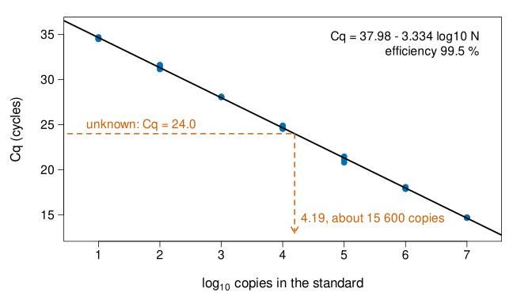
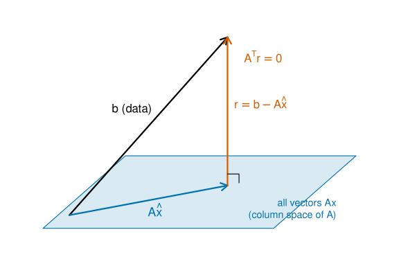
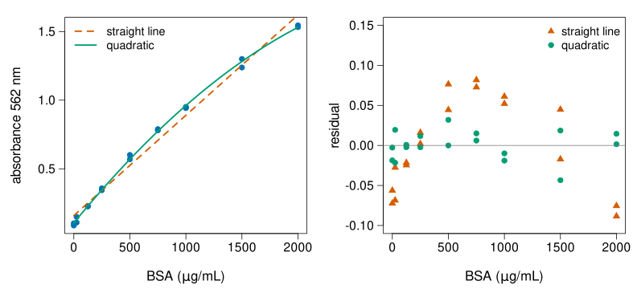
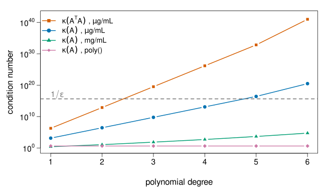
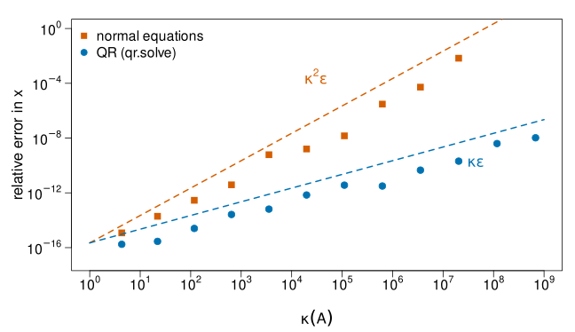
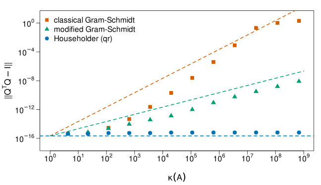
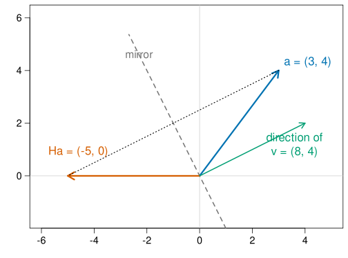

## About this lecture

Part 3 solved square systems $A\mathbf x = \mathbf b$. A calibration curve gives **more equations than unknowns**: 21 measurements, 2 parameters. No $\mathbf x$ satisfies them all.

- **Least squares** picks the $\mathbf x$ that makes the sum of squared **residuals** smallest. Geometrically: a projection.
- The textbook route, the **normal equations** $A^TA\mathbf x = A^T\mathbf b$, is short but **squares the condition number**: it can lose twice as many digits as necessary.
- The route software takes is the **QR factorisation** (Gram–Schmidt in principle, **Householder** reflections in practice). It loses only what the problem itself forces.
- Biology: qPCR and protein-assay **standard curves**; a polynomial calibration in µg/mL that is so badly conditioned that R refuses to solve it.
- You have used `lm()`. This is what is inside it.

::: notes
This opens Part 4. The students know lm as a tool; most have never asked how the coefficients are computed. The lecture has three parts: what least squares is (residuals, projection, normal equations), why the obvious formula is numerically poor (kappa squared), and what QR does instead and what lm, qr.solve and numpy.linalg.lstsq actually call. The SVD, rank deficiency and regularisation follow in the next unit.
:::

## A biology problem first: the qPCR standard curve {.smaller}

:::: {.columns}
::: {.column width="45%"}
A 10-fold dilution series of a standard, $10^1$ to $10^7$ copies, each in triplicate. Theory: $\text{Cq} = x_1 + x_2 \log_{10} N$.

```r
logN <- rep(1:7, each = 3)
cq <- c(34.52, 34.69, 34.48, 31.62, 31.37,
  31.14, 28.05, 28.10, 28.07, 24.54, 24.90,
  24.68, 21.13, 20.81, 21.47, 17.89, 17.90,
  18.09, 14.71, 14.67, 14.73)
coef(lm(cq ~ logN))
# (Intercept)        logN
#   37.981429   -3.333929
```
:::
::: {.column width="55%"}
{width="100%"}
:::
::::

- Slope $-3.33$: amplification **efficiency** $10^{-1/x_2} - 1 = 99.5\,\%$. An unknown with Cq 24.0 holds about $10^{4.19} \approx 15\,600$ copies.
- 21 equations, 2 unknowns. What does [`lm`](https://stat.ethz.ch/R-manual/R-devel/library/stats/html/lm.html) actually solve?

::: notes
A standard curve is the most common least-squares fit in a wet lab: qPCR, ELISA, Bradford or BCA protein assays, HPLC peak areas. The data are simulated once (true slope -3.35, noise sd 0.2 cycles) and typed in as fixed numbers, so R, Python and Rust in the exercise use exactly the same values. A slope of -3.32 means perfect doubling per cycle (efficiency 100 %); MIQE guidelines accept roughly 90 to 110 %. Reading off an unknown is the inverse prediction: solve the fitted line for log10 N.
:::

## More equations than unknowns {.smaller}

Each standard gives one equation $x_1 + x_2 \log_{10} N_i = \text{Cq}_i$. Stacked:

$$
\underbrace{\begin{pmatrix} 1 & 1\\ 1 & 1\\ 1 & 1\\ 1 & 2\\ \vdots & \vdots\\ 1 & 7 \end{pmatrix}}_{A,\ 21\times 2}
\begin{pmatrix} x_1 \\ x_2 \end{pmatrix}
\approx
\underbrace{\begin{pmatrix} 34.52\\ 34.69\\ 34.48\\ 31.62\\ \vdots\\ 14.73 \end{pmatrix}}_{\mathbf b,\ 21\times 1}
$$

- $A$ is the **design matrix** (in R: `model.matrix`). One row per measurement, one column per parameter.
- $m = 21$ rows, $n = 2$ columns: **overdetermined**. The first three rows already disagree (34.52, 34.69, 34.48 for the same $x$), so there is no exact solution.
- We need a rule that picks the "best" $\mathbf x$.

::: notes
Write the matrix with the students. The column of ones is the intercept; it is what lm adds silently. Every linear model, including polynomial fits, multiple regression and ANOVA, has this form: the model is linear in the parameters, even if not in the predictor. More rows than columns is the normal case in data analysis: we measure more than we estimate, so that noise averages out.
:::

## Residuals and the least-squares criterion {.smaller}

For any trial $\mathbf x$, the **residual** vector is what the model misses:

$$\mathbf r = \mathbf b - A\mathbf x, \qquad r_i = \text{Cq}_i - (x_1 + x_2 \log_{10} N_i)$$

**Least squares**: choose $\mathbf x$ to minimise $\;\|\mathbf r\|^2 = \sum_i r_i^2$.

| trial $\mathbf x$ | $r_1, r_2, r_3$ | $\sum_i r_i^2$ (all 21) |
|---|---|---|
| $(38, -3.3)$ | $-0.18,\; -0.01,\; -0.22$ | 1.23 |
| $(37.98, -3.334)$, the fit | $-0.13,\; \phantom{-}0.04,\; -0.17$ | **0.627** |

- Why squares: smooth (we can differentiate), and it is the maximum-likelihood fit for independent **Gaussian** noise of equal size.
- The minimum is not zero. Its size, $0.627$ over 19 degrees of freedom, estimates the noise: $\hat\sigma = \sqrt{0.627/19} = 0.18$ cycles.

::: notes
The residuals are the vertical distances in the figure. Squaring treats over- and undershoot alike and penalises large misses heavily (which also makes least squares sensitive to outliers; mention robust regression only if asked). The noise estimate sigma-hat is exactly the "Residual standard error" in summary(lm). Equal noise size is an assumption: real Cq values are noisier at low copy number. Weighted least squares handles that; it is the same machinery with rows scaled by 1/sigma_i.
:::

## Least squares is a projection

{width="58%" fig-align="center"}

- $A\mathbf x$ can only reach the **column space** of $A$ (here a plane in $\mathbb R^{21}$). $\mathbf b$ sticks out of it.
- The closest point $A\hat{\mathbf x}$ is the **orthogonal projection** of $\mathbf b$: the residual is **perpendicular** to every column of $A$:
$$A^T \mathbf r = \mathbf 0.$$

::: notes
Draw this on the board. The shortest distance from a point to a plane is the perpendicular one. "Perpendicular to the plane" means perpendicular to every column of A, which is A^T r = 0, one equation per column. For the intercept column this says the residuals sum to zero; for the logN column, they are uncorrelated with logN. Students can check both on any lm fit: sum(resid(fit)) is zero up to rounding.
:::

## The normal equations {.smaller}

Put $\mathbf r = \mathbf b - A\mathbf x$ into $A^T\mathbf r = \mathbf 0$:

$$A^TA\,\mathbf x = A^T\mathbf b \qquad (\text{a square } n\times n \text{ system})$$

For the qPCR data ($\sum 1 = 21$, $\sum \log_{10} N_i = 84$, $\sum (\log_{10} N_i)^2 = 420$):

$$
\begin{pmatrix} 21 & 84 \\ 84 & 420 \end{pmatrix}
\begin{pmatrix} x_1 \\ x_2 \end{pmatrix}
=
\begin{pmatrix} 517.56 \\ 1790.19 \end{pmatrix}
\quad\Rightarrow\quad
x_1 = 37.981, \; x_2 = -3.334
$$

- $A^TA$ is $2\times 2$, symmetric and positive definite: Cholesky ([*Structure: symmetric, banded, sparse*](../structured-sparse/lec.qmd)) solves it.
- Entries of $A^TA$ are sums of products of columns; entries of $A^T\mathbf b$ are $\sum \text{Cq}_i$ and $\sum \text{Cq}_i \log_{10}N_i$.
- The same answer comes from setting the derivative of $\sum r_i^2$ to zero.

::: notes
This is the formula in every statistics textbook, (X^T X)^{-1} X^T y. Do the 2x2 by hand: determinant 21*420 - 84^2 = 1764; x2 = (21*1790.19 - 84*517.56)/1764 = -3.334. The name "normal" refers to the residual being normal (perpendicular) to the columns, not to the normal distribution. The exercise does a 4-point version by hand.
:::

## Normal equations in R {.smaller}

```r
A <- cbind(1, logN)                         # 21 x 2 design matrix
x <- solve(crossprod(A), crossprod(A, cq))  # (A^T A) x = A^T b
x[, 1]
#                logN
# 37.981429 -3.333929
r <- cq - A %*% x
crossprod(A, r)[, 1]                        # A^T r: zero up to rounding
#                       logN
# -6.572520e-14  1.225686e-13
```

- [`crossprod(A)`](https://stat.ethz.ch/R-manual/R-devel/library/base/html/crossprod.html) is $A^TA$, `crossprod(A, b)` is $A^T\mathbf b$, faster than `t(A) %*% A`.
- Use [`solve(M, v)`](https://stat.ethz.ch/R-manual/R-devel/library/base/html/solve.html), never `solve(M) %*% v`.
- Same numbers as `lm`. So why does `lm` not do this?

::: notes
Three lines. crossprod exploits symmetry. Remind students of Part 3: forming an inverse is slower and less accurate than solving. The residual check is the projection property; zero up to about 1e-13, which is the size of rounding in sums of numbers around 1000. For this problem the normal equations are perfectly fine. The rest of the lecture is about problems where they are not.
:::

## Recap: the condition number of a matrix {.smaller}

From [*Pivoting, norms and conditioning*](../pivoting-conditioning/lec.qmd) (Part 3):

- $\kappa(A) = \dfrac{\text{largest stretch}}{\text{smallest stretch}} = \dfrac{\max \|A\mathbf v\|}{\min \|A\mathbf v\|}$ over unit vectors $\mathbf v$. This works for rectangular $A$ too.
- Rule of thumb: solving with $A$ loses about $\log_{10}\kappa(A)$ digits of the 16 we have.
- $\kappa \ge 1/\varepsilon \approx 4.5\times10^{15}$: as good as singular in double precision.

```r
kappa(A, exact = TRUE)                      # qPCR design matrix
# [1] 10.40388
```

[`kappa(A, exact = TRUE)`](https://stat.ethz.ch/R-manual/R-devel/library/base/html/kappa.html) gives the 2-norm $\kappa$; without `exact` it is a cheap estimate.

::: notes
One-slide recap only. For a square matrix this is the same 2-norm condition number as in Part 3. For a rectangular one, the stretch factors are the singular values, which come properly in the next unit ([*The SVD, rank deficiency and regularisation*](../svd/lec.qmd)); here "how much A stretches the most and the least stretched direction" is enough. kappa 10 for the qPCR line: lose about one digit. Harmless.
:::

## The normal equations square $\kappa$ {.smaller}

$$\|A\mathbf v\|^2 = \mathbf v^T A^TA\,\mathbf v$$

So every stretch factor of $A^TA$ is the **square** of a stretch factor of $A$:

$$\kappa(A^TA) = \kappa(A)^2$$

```r
c(kappa(A, exact = TRUE), kappa(crossprod(A), exact = TRUE))
# [1]  10.40388 108.24076                   # 10.40388^2 = 108.24
```

- Solving through $A^TA$ loses $2\log_{10}\kappa(A)$ digits; the data only force $\log_{10}\kappa(A)$.
- $\kappa(A) = 10^8$: the problem allows 8 good digits, the normal equations give **zero**.
- The damage is done the moment $A^TA$ is **formed** and rounded. A better solver for $A^TA\mathbf x = A^T\mathbf b$ cannot repair it.

::: notes
The one-line argument: for a unit vector v, v^T (A^T A) v = ||Av||^2, so the most and least stretched directions are the same, with squared stretches. (Strictly the stretch factors of a symmetric positive definite matrix are its eigenvalues, and those are the squared singular values of A; the SVD unit makes that precise.) This is the central fact of the lecture. The normal equations are not wrong; they are unstable in the sense of [*Error, conditioning and stability*](../error-conditioning/lec.qmd): they route the computation through an intermediate problem that is worse conditioned than the original.
:::

## A second assay: the BCA protein standard curve {.smaller}

BSA standards 0–2000 µg/mL in duplicate; absorbance at 562 nm. The curve **bends**.

{width="88%" fig-align="center"}

- The straight line leaves **runs** of residuals with the same sign: `------+++++++++---`. That is lack of fit, not noise.
- A quadratic removes the pattern. Kit manuals suggest a quadratic or a 4-parameter logistic.

::: notes
The data are simulated from a saturating curve with noise sd 0.015 and typed in (see the exercise). The residual plot is the check for the model: random signs mean the model captures the shape; long runs mean it does not. Here the line underestimates in the middle and overestimates at both ends. The 4-parameter logistic is a nonlinear model; models like it are fitted in [*Nonlinear least squares and ODE fitting*](../nonlinear-least-squares/lec.qmd) (Part 10, which uses a pharmacokinetic model as its example); a polynomial is still linear in its coefficients, so it is a least-squares problem of this lecture.
:::

## A polynomial fit is a Vandermonde system {.smaller}

$$a_i \approx c_0 + c_1 x_i + c_2 x_i^2 + c_3 x_i^3, \qquad
A = \begin{pmatrix} 1 & x_1 & x_1^2 & x_1^3 \\ \vdots & & & \vdots \\ 1 & x_m & x_m^2 & x_m^3 \end{pmatrix}$$

This $A$ is a **Vandermonde** matrix: `outer(conc, 0:3, "^")`. With $x$ in µg/mL:

| column | $1$ | $x$ | $x^2$ | $x^3$ |
|---|---|---|---|---|
| largest entry | 1 | 2000 | $4\times10^6$ | $8\times10^9$ |

- Columns of wildly different size: $\kappa(A) = 5.8\times 10^9$ for the cubic.
- Normal equations: $\kappa(A^TA) = \kappa(A)^2 \approx 3\times10^{19}$, **above** $1/\varepsilon$.

::: notes
Linear least squares means linear in the coefficients, so a polynomial in x is fine. The columns are powers of the concentration; in microgram per mL the cubic column is ten billion times larger than the intercept column. Also, x^2 and x^3 look alike on [0, 2000] (both small then steeply rising), which is a second, genuine source of ill-conditioning. The next two slides separate the two sources.
:::

## The failure: R refuses the normal equations {.smaller}

```r
conc <- rep(c(0, 25, 125, 250, 500, 750, 1000, 1500, 2000), each = 2)
a562 <- c(0.087, 0.103, 0.150, 0.109, 0.226, 0.229, 0.358, 0.344, 0.601,
          0.569, 0.780, 0.789, 0.951, 0.942, 1.300, 1.238, 1.545, 1.532)
V <- outer(conc, 0:3, "^")                       # cubic, ug/mL
solve(crossprod(V), crossprod(V, a562))
# Error in solve.default(crossprod(V), crossprod(V, a562)) :
#   system is computationally singular: reciprocal condition number = 2.98348e-20
qr.solve(V, a562)                                # QR: no complaint
# [1]  9.750013e-02  1.095169e-03 -2.847165e-07  4.881629e-11
```

- `solve` estimates $1/\kappa(A^TA) \approx 3\times10^{-20} < \varepsilon$ and stops. numpy's `solve` does **not** check, and returns numbers without a warning.
- `lm(a562 ~ conc + I(conc^2) + I(conc^3))` gives the QR numbers.

::: notes
This is the error message students meet when they write their own regression with solve(t(X) %*% X). The reciprocal condition number is LAPACK's cheap estimate of 1/kappa(A^T A) in the 1-norm. Honest detail: in this particular case most of the huge kappa is caused by the units (next slide), and a solver happens to tolerate that kind of ill-conditioning, so the numpy answer is in fact close. But the error is real information: the matrix R was asked to solve is, as far as double precision can tell, singular. Do not lower solve's tol to make the message go away.
:::

## Two sources of ill-conditioning {.smaller}

{width="70%" fig-align="center"}

- **Units.** Measure $x$ in mg/mL (`conc / 1000`): the cubic's $\kappa$ drops from $5.8\times10^9$ to **72**. Same fit, rescaled coefficients ($c_k \to 1000^k c_k$).
- **Look-alike columns.** What is left (72, 506, 4624, ...) still grows with degree: $x^k$ and $x^{k+1}$ look alike. [`poly()`](https://stat.ethz.ch/R-manual/R-devel/library/stats/html/poly.html) builds **orthogonal** polynomial columns: $\kappa = 4.2$ at any degree.

::: notes
Orange: kappa(A^T A) in microgram per mL, crossing 1/eps at degree 3. Blue: kappa(A) itself, which QR works with, crossing at degree 5. Green: the same columns with x in mg/mL. Purple: lm(y ~ poly(conc, d)), whose columns are orthogonal by construction (poly uses a QR of the centred Vandermonde matrix). Scaling and centring are the cheapest fix and should be the first reflex. The remaining growth is genuine ill-conditioning; the next slide shows what it costs.
:::

## Genuine ill-conditioning: digits lost {.smaller}

Polynomials of degree 1–12 on 50 points in $[0, 1]$ (no unit problem), data with known coefficients $\mathbf x = (1, \dots, 1)$:

{width="66%" fig-align="center"}

- Normal equations follow $\kappa^2\varepsilon$; QR follows $\kappa\varepsilon$. At $\kappa = 2\times10^7$: error $7\times10^{-3}$ vs $2\times10^{-10}$.
- From degree 11 `solve` refuses; from degree 13 `qr.solve` does too (its rank tolerance is $10^{-7}$).

::: notes
This is the error-versus-condition-number plot the course asks for with every method; the two slopes, 2 and 1, are read off as in [*Convergence and cost*](../convergence-cost/lec.qmd). Points sit below the dashed lines because those are worst-case rates. Strictly, QR's error is kappa*eps plus a kappa^2*eps term multiplied by the relative size of the residual; for data that fit well (small residual) QR is far better, and for data with a huge residual the two get closer. Calibration data are of the first kind. The exercise (C5) reproduces the table.
:::

## Try it: fit a calibration curve two ways

```{=html}
<link rel="stylesheet" href="../demos/dist/demo.css">
<div data-demo="lsqfit" data-data="bca" data-units="scaled" data-degree="1"></div>
<script src="../demos/dist/lsqfit.js"></script>
```

::: notes
The BCA standards, fitted live in the browser in doubles by the normal equations (dashed, vermillion) and by Householder QR (solid, blue). Panel (b): relative error of the coefficients for every degree, measured against the exact least-squares solution computed in exact fractions, with the kappa^2 eps and kappa eps lines. Start at degree 1 in mg/mL: residual signs show the runs from the BCA slide, RSS 0.057; degree 2 removes them, RSS 0.0055. Then click degrees 4, 6, 8 in panel (b): kappa 506, 5.5e4, 2e7; the normal equations keep 12.3, 7.6, 3.0 digits, QR 14.3, 11.4, 10.0. The squares follow the kappa^2 line, the circles the kappa line. Switch to ug/mL at degree 3: kappa 5.8e9, kappa^2 above 1/eps, the shading and the warning say R's solve stops, yet both routes still give 14 digits: units are a fake ill-conditioning, which is why the earlier slide said numpy's answer is close. Switch to centred: kappa at degree 8 drops from 2e7 to 4e4 and the normal equations gain 5 digits; that is the real fix. If time: drag a standard to show that the residuals react and panel (b) does not, because kappa depends only on A.
:::

## A failure you can do by hand {.smaller}

$$A = \begin{pmatrix} 1 & 1 \\ \delta & 0 \\ 0 & \delta \end{pmatrix}, \qquad
A^TA = \begin{pmatrix} 1 + \delta^2 & 1 \\ 1 & 1+\delta^2 \end{pmatrix}$$

With $\delta = 10^{-8}$: $\delta^2 = 10^{-16} < \varepsilon/2$, so $1 + \delta^2$ is **stored as 1**. $A$ has rank 2, the computed $A^TA$ is singular.

```r
d <- 1e-8
A <- rbind(c(1, 1), c(d, 0), c(0, d));  b <- c(2, d, d)   # exact x = (1, 1)
solve(crossprod(A), crossprod(A, b))
# Error in solve.default(crossprod(A), crossprod(A, b)) :
#   Lapack routine dgesv: system is exactly singular: U[2,2] = 0
qr.solve(A, b, tol = 1e-12)
# [1] 1 1
```

::: notes
This is Läuchli's example (1961). Two predictors that are almost the same (first row) and differ only by a small amount delta elsewhere: think of two marker genes that nearly always move together. kappa(A) is about 1.4e8, well below 1/eps, so the problem is solvable to about 8 digits. Forming A^T A throws delta^2 away completely. qr.solve needs a smaller tol here; with its default 1e-7 it declares the matrix rank deficient (see the lm slide).
:::

## The idea of QR {.smaller}

Write $A = QR$ with

- $Q$: $m\times n$ with **orthonormal** columns, $Q^TQ = I$ (perpendicular, length 1);
- $R$: $n\times n$ **upper triangular**.

Then the normal equations simplify without ever forming $A^TA$:

$$A^TA\mathbf x = A^T\mathbf b \;\Leftrightarrow\; R^T\underbrace{Q^TQ}_{I}R\,\mathbf x = R^TQ^T\mathbf b \;\Leftrightarrow\; R\,\mathbf x = Q^T\mathbf b$$

- One back substitution, as in [*Gaussian elimination as LU*](../lu/lec.qmd).
- $Q$ does not stretch: $\|Q\mathbf y\| = \|\mathbf y\|$. So $\|A\mathbf v\| = \|R\mathbf v\|$ and $\kappa(R) = \kappa(A)$, **not** squared.

::: notes
The derivation uses only Q^T Q = I and that R is invertible (A has full column rank). The key point is the last bullet: multiplying by Q is a rotation or reflection, which keeps lengths and angles, so R is exactly as well or badly conditioned as A. QR is to least squares what LU is to square systems.
:::

## QR in R {.smaller}

```r
A <- cbind(1, logN)                          # qPCR again
f <- qr(A)
R <- qr.R(f);  R
#                      logN
# [1,] -4.582576 -18.330303
# [2,]  0.000000   9.165151
backsolve(R, crossprod(qr.Q(f), cq))[, 1]    # R x = Q^T b
# [1] 37.981429 -3.333929
qr.solve(A, cq)                              # the same in one call
```

- [`qr()`](https://stat.ethz.ch/R-manual/R-devel/library/base/html/qr.html) returns the factorisation in compact form; `qr.Q`, `qr.R` unpack it. [`backsolve`](https://stat.ethz.ch/R-manual/R-devel/library/base/html/backsolve.html) solves an upper triangular system.
- $r_{11} = -\sqrt{21}$: the length of the column of ones (the sign is a convention).

::: notes
In practice one never forms Q: qr.coef(f, cq) and qr.qty apply the stored reflections directly. The negative diagonal comes from Householder's sign choice (two slides on). r11 = sqrt(21) because the first column of Q is the ones column divided by its length. r22 = 9.17 is the length of the logN column after its mean has been removed: sqrt(sum((logN - 4)^2)) = sqrt(84) = 9.17. Gram-Schmidt explains why.
:::

## Gram–Schmidt by hand {.smaller}

Make the columns orthonormal one at a time. $A$ with columns $\mathbf a_1 = (1,1,1,1)$, $\mathbf a_2 = (1,2,3,4)$:

1. $r_{11} = \|\mathbf a_1\| = 2$, $\;\mathbf q_1 = \mathbf a_1 / 2 = (\tfrac12,\tfrac12,\tfrac12,\tfrac12)$.
2. Remove the $\mathbf q_1$ part of $\mathbf a_2$: $r_{12} = \mathbf q_1^T\mathbf a_2 = 5$, $\;\mathbf v = \mathbf a_2 - 5\,\mathbf q_1 = (-1.5, -0.5, 0.5, 1.5)$.
3. $r_{22} = \|\mathbf v\| = \sqrt5$, $\;\mathbf q_2 = \mathbf v/\sqrt5$.

$$A = \begin{pmatrix} \mathbf q_1 & \mathbf q_2\end{pmatrix}\begin{pmatrix} 2 & 5 \\ 0 & \sqrt5 \end{pmatrix}$$

- Against the column of ones, "remove the $\mathbf q_1$ part" means **subtract the mean**: $\mathbf v = \mathbf a_2 - \bar a_2$.
- If $\mathbf a_2$ were a multiple of $\mathbf a_1$, $\mathbf v = \mathbf 0$ and $r_{22} = 0$: **rank deficiency** shows up on the diagonal of $R$.

::: notes
Do this on the board. Check A = QR column by column: a2 = 5 q1 + sqrt5 q2. The connection to centring is worth stating: regression on a centred predictor is the second Gram-Schmidt step, which is why centring helps conditioning. A zero (or tiny) r_jj means column j is (nearly) a combination of the earlier ones; that is how lm detects aliased coefficients.
:::

## Gram–Schmidt in R: classical vs modified {.smaller}

```r
gs <- function(A, modified = FALSE) {
  n <- ncol(A); Q <- A; R <- matrix(0, n, n)
  for (j in 1:n) {
    v <- A[, j]
    for (i in seq_len(j - 1)) {
      R[i, j] <- sum(Q[, i] * (if (modified) v else A[, j]))
      v <- v - R[i, j] * Q[, i]
    }
    R[j, j] <- sqrt(sum(v^2)); Q[, j] <- v / R[j, j]
  }
  list(Q = Q, R = R)
}
```

- **Classical** (CGS): project the **original** column $\mathbf a_j$ on each $\mathbf q_i$.
- **Modified** (MGS): project the **current** $\mathbf v$, already cleaned of $\mathbf q_1, \dots, \mathbf q_{i-1}$. Same in exact arithmetic; one word differs in the code.

::: notes
Write it yourself first, then use the library: this is the hand-written version. In exact arithmetic the two give identical Q and R, because q_i is orthogonal to the parts already removed. With rounding, the q_i are only nearly orthogonal, and CGS lets those errors add up. MGS removes each component from the current vector, so it also removes the rounding errors left by earlier steps. Python and Rust versions are in the exercise.
:::

## Gram–Schmidt loses orthogonality {.smaller}

{width="66%" fig-align="center"}

- $\|Q^TQ - I\|$ should be 0. CGS: grows like $\kappa^2\varepsilon$ (no better than the normal equations). MGS: like $\kappa\varepsilon$. Householder `qr()`: $\varepsilon$, whatever $\kappa$.
- **Check** any $Q$ you compute: `norm(crossprod(Q) - diag(ncol(Q)))`.

::: notes
Same Vandermonde matrices as before (degrees 1 to 12 on [0, 1]). At degree 10, CGS's "orthonormal" columns are 20 % off, useless. MGS is good enough for least squares if b is processed as an extra column; it is used in iterative methods (GMRES, Lanczos) where columns arrive one at a time. Householder keeps Q orthogonal to machine precision. Reorthogonalisation (running Gram-Schmidt twice) is another standard fix, mentioned only.
:::

## Householder reflections {.smaller}

:::: {.columns}
::: {.column width="48%"}
{width="100%"}
:::
::: {.column width="52%"}
Reflect a column onto the first axis with a **mirror**:

$$H = I - 2\frac{\mathbf v\mathbf v^T}{\mathbf v^T\mathbf v}, \quad \mathbf v = \mathbf a + \text{sign}(a_1)\|\mathbf a\|\mathbf e_1$$

$\mathbf a = (3, 4)$, $\|\mathbf a\| = 5$, $\mathbf v = (8, 4)$:

$$H\mathbf a = (-5, 0)$$

- $H$ is orthogonal ($H^TH = I$): lengths are kept **exactly** in theory, to $\varepsilon$ in practice.
- The sign choice avoids **cancellation** in $a_1 \pm \|\mathbf a\|$.
:::
::::

::: notes
The mirror is the line (hyperplane in general) perpendicular to v. Reflecting across it maps a to a vector of the same length along e1. Check: H a = a - 2 (v.a / v.v) v = (3,4) - 2 (40/80) (8,4) = (3,4) - (8,4) = (-5, 0). With the other sign, v = a - 5 e1 = (-2, 4) also works here, but if a were almost along e1, a1 - ||a|| would subtract two nearly equal numbers: catastrophic cancellation from [*Error, conditioning and stability*](../error-conditioning/lec.qmd). This is why R's qr gives a negative r11.
:::

## Householder QR in outline {.smaller}

$H_1$ zeroes column 1 below the diagonal, $H_2$ column 2, and so on:
$$H_n\cdots H_2H_1\,A = R \quad\Rightarrow\quad A = \underbrace{H_1H_2\cdots H_n}_{Q} R$$
Apply the same reflections to $\mathbf b$ to get $Q^T\mathbf b$ (**$Q$ is never formed**), then back-substitute.

| | flops for $m\times n$ | accuracy |
|---|---|---|
| normal equations + Cholesky | $mn^2 + \tfrac13 n^3$ | $\kappa^2\varepsilon$ |
| Householder QR | $2mn^2 - \tfrac23 n^3$ | $\kappa\varepsilon$ |

For $m \gg n$, QR costs about **twice** as much. For a standard curve that is microseconds.

::: notes
Same pattern as LU, where elimination matrices zero the subdiagonal; here the transformations are orthogonal, so they never amplify errors (no pivoting needed for stability). Leftover entries (Q^T b) rows n+1..m are the residual in rotated coordinates: their sum of squares is the residual sum of squares. The factor 2 in cost almost never matters in biology; when m is in the millions and n small, people sometimes do use the normal equations, knowingly, after scaling.
:::

## What `lm()` actually does {.smaller}

`lm` → [`lm.fit`](https://stat.ethz.ch/R-manual/R-devel/library/stats/html/lmfit.html) → Householder QR (LINPACK `dqrdc2`) with **column pivoting** and a rank tolerance `tol = 1e-7`.

```r
mgml <- conc / 1000                          # same concentration, other units
coef(lm(a562 ~ conc + mgml))
#  (Intercept)         conc         mgml
# 0.1592784830 0.0007305681           NA
qr(cbind(1, conc, mgml))$rank
# [1] 2
```

- A column whose remaining length drops below `tol` (relative) is declared **aliased**: coefficient `NA`, not an error.
- numpy [`linalg.lstsq`](https://numpy.org/doc/stable/reference/generated/numpy.linalg.lstsq.html) uses the **SVD** (LAPACK `gelsd`), returns the rank, and gives a minimum-norm answer instead of `NA`.

::: notes
lm never forms X^T X. Even the standard errors in summary(lm) come from R: (A^T A)^{-1} = R^{-1} R^{-T} (chol2inv), never by inverting A^T A. qr.solve uses the same qr(), but stops with "singular matrix" when the rank is below n. The NA is lm's way of saying: these columns are linearly dependent, I dropped the later one. In biology this happens with confounded designs (batch identical to condition) or a predictor entered twice in different units. numpy and scipy.linalg.lstsq (default driver gelsd) use the SVD, which is the topic of the next unit; nalgebra in Rust offers both QR and SVD. The rank tolerance also caused qr.solve to refuse degree 13 earlier: tolerance choices are part of what the black box does.
:::

## Fix the problem, not only the algorithm {.smaller}

```r
fit_raw  <- lm(a562 ~ poly(conc, 2, raw = TRUE))   # columns 1, x, x^2
fit_orth <- lm(a562 ~ poly(conc, 2))               # orthogonal columns
predict(fit_raw,  data.frame(conc = 600))
#         1
# 0.6531236
predict(fit_orth, data.frame(conc = 600))
#         1
# 0.6531236
kappa(model.matrix(fit_orth), exact = TRUE)
# [1] 4.242641
```

- **Scale** predictors to $O(1)$ units and **centre** them before building powers.
- Use **orthogonal** bases (`poly()`) for polynomial fits; predictions are identical, coefficients are just in another basis.
- Ask whether degree 5 is needed: a high-degree calibration polynomial is ill-conditioned **and** wiggles between standards ([*Polynomial interpolation*](../polynomial-interpolation/lec.qmd), Part 6).

::: notes
QR handles kappa up to about 1e8 gracefully, but the cheapest accuracy gain is to give it a well-conditioned matrix. The coefficients of poly() are not interpretable on their own, but calibration only needs predictions. The last bullet points ahead to *Polynomial interpolation* and [*Splines*](../splines/lec.qmd) in Part 6: high-degree polynomials oscillate between data points; for calibration, use the lowest degree that removes the residual pattern.
:::

## Checklist: is my least-squares fit trustworthy? {.smaller}

1. **Residual plot**: runs of equal sign → wrong model (degree too low), not noise.
2. **`kappa(model.matrix(fit), exact = TRUE)`**: expect to lose $\log_{10}\kappa$ digits. Huge? Rescale, centre, or use `poly()`.
3. **Never solve `t(X) %*% X` yourself** unless $\kappa(X)$ is small. "Computationally singular" from `solve` means $\kappa(X)^2 \gtrsim 10^{16}$.
4. **`NA` coefficients** in `lm` (or `rank < ncol` from `lstsq`): columns are linearly dependent. Find the duplicate or confounded predictor.
5. **Orthogonality check** for a hand-made $Q$: `norm(crossprod(Q) - diag(ncol(Q)))` near $10^{-15}$.
6. **Projection check**: `crossprod(X, resid(fit))` near zero.

::: notes
These are the habits. 1 is about the model, 2 to 4 about the numerics, 5 and 6 about one's own code. For calibration curves specifically: check the efficiency (qPCR) or the fit residuals (protein assay) at every run; a change in either is a lab problem, not a numerical one.
:::

## Summary {.smaller}

- Overdetermined $A\mathbf x \approx \mathbf b$: minimise $\|\mathbf b - A\mathbf x\|^2$. The residual is **perpendicular** to the columns: $A^T\mathbf r = \mathbf 0$.
- **Normal equations** $A^TA\mathbf x = A^T\mathbf b$: short, cheap, but $\kappa(A^TA) = \kappa(A)^2$, so twice the digit loss. Fine for small $\kappa$.
- **QR**: $A = QR$, solve $R\mathbf x = Q^T\mathbf b$. $Q$ keeps lengths, so only $\kappa(A)$ counts.
- **Gram–Schmidt** explains QR (and centring); classical GS loses orthogonality like $\kappa^2\varepsilon$, modified like $\kappa\varepsilon$. **Householder** reflections keep $Q$ orthogonal to $\varepsilon$; that is what `qr`, `lm`, `numpy.linalg.qr` and nalgebra use.
- Polynomial calibration in raw units is a badly conditioned **Vandermonde** system: rescale, centre, or use `poly()`.
- `lm` flags dependent columns with `NA`; `lstsq` uses the SVD and reports the rank.

**Next:** [*The SVD, rank deficiency and regularisation*](../svd/lec.qmd): what to do when columns really are (nearly) dependent.

::: notes
Recap the three layers: the problem (projection), the bad algorithm (normal equations, kappa squared), the good algorithm (Householder QR). The next unit takes the SVD apart, makes "stretch factors" precise as singular values, and handles the rank-deficient case that lm marks with NA, with the deconvolution of bulk RNA-seq as the biology.
:::
