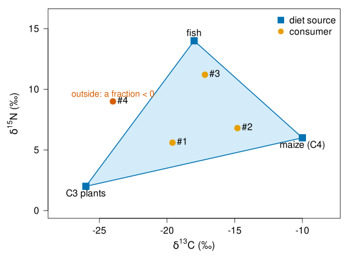
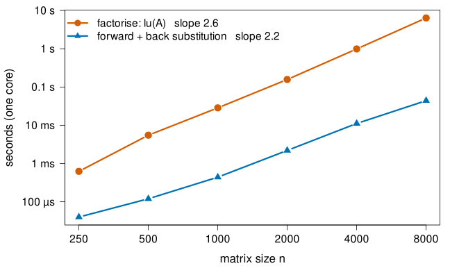
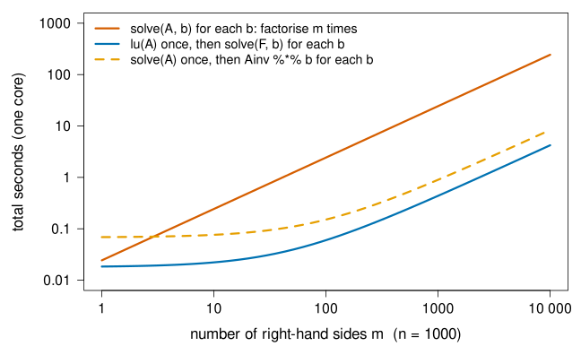
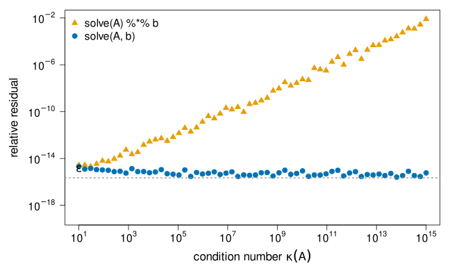

## About this lecture {.smaller}

Part 2 ended with *Newton for systems of equations*: one linear solve $J\,\Delta\mathbf x = -\mathbf f$ per step. This part opens the black box behind `solve()`.

- **Recap:** Gaussian elimination, as in a first linear algebra course.
- **The new view:** elimination *is* a factorisation $A = LU$, lower triangular times upper triangular.
- With $L$ and $U$ in hand, $A\mathbf x = \mathbf b$ is two cheap **triangular solves**: forward and back substitution.
- **Cost:** factorising is $O(n^3)$, each solve with the factors only $O(n^2)$. So: **factor once, solve many**.
- **Never** `solve(A) %*% b`: slower and less accurate.
- **Failure:** a zero pivot stops elimination even when the system has a perfectly good answer (the fix, pivoting, is the next unit).
- Biology: **isotope mixing models**: what fraction of an animal's diet came from each source, for one animal or for thousands.

::: notes
This is the first of three units on linear systems. Students know Gaussian elimination as a pen-and-paper procedure for solving one system. The point of this unit is to see it as an object, the factorisation A = LU, which can be stored and reused. That one change of view explains why solve() is fast, why R and Python offer lu functions at all, and why inverting a matrix is almost never the right thing to do. Pivoting and conditioning are deliberately left to the next unit, Pivoting, norms and conditioning; here we only show the zero-pivot failure as a teaser.
:::

## A biology problem: what did they eat? {.smaller}

:::: {.columns}
::: {.column width="55%"}
{width="100%"}
:::
::: {.column width="45%"}
Stable isotope ratios in bone collagen record diet. Each **source** has a signature ($\delta^{13}$C, $\delta^{15}$N, corrected for trophic enrichment); a **consumer** is a mixture.

- Three sources, unknown diet fractions $f_1, f_2, f_3$.
- Two isotopes give two equations; the fractions summing to 1 gives the third.
- 3 equations, 3 unknowns: a **linear system**.
- Consumer #4 lies outside the triangle; we come back to it.
:::
::::

::: notes
This is the classic linear mixing model used in archaeology (human bone collagen), ecology (food webs, hair and feather samples) and microbial ecology (tracer studies). With k isotopes one can separate k + 1 sources exactly. The source values here are illustrative but realistic: C3 plants around -26 per mil carbon, C4 plants such as maize around -10, marine fish in between with high nitrogen because they sit higher in the food web. Real studies add uncertainty (Bayesian mixing models such as MixSIAR), but at their core is this linear system. Ask: where in the triangle would a pure maize eater be? Answer: at the maize corner.
:::

## As a matrix equation {.smaller}

Mass balance for each isotope, plus "fractions sum to 1":

$$
\underbrace{\begin{pmatrix} 1 & 1 & 1 \\ -26 & -10 & -18 \\ 2 & 6 & 14 \end{pmatrix}}_{A:\ \text{columns = sources}}
\begin{pmatrix} f_1 \\ f_2 \\ f_3 \end{pmatrix}
=
\underbrace{\begin{pmatrix} 1 \\ -19.6 \\ 5.6 \end{pmatrix}}_{\mathbf b:\ \text{consumer \#1}}
$$

```r
A <- rbind(c(  1,   1,   1),      # fractions sum to 1
           c(-26, -10, -18),      # d13C of C3 plants, maize, fish
           c(  2,   6,  14))      # d15N
b <- c(1, -19.6, 5.6)             # consumer #1
solve(A, b)
# [1] 0.5 0.3 0.2
```

Half C3 plants, 30 % maize, 20 % fish. What did [`solve()`](https://stat.ethz.ch/R-manual/R-devel/library/base/html/solve.html) do?

::: notes
Row 2 reads: -26 f1 - 10 f2 - 18 f3 = -19.6, the consumer's carbon signature as a weighted average of the sources. The matrix A depends only on the sources; the right-hand side b depends only on the consumer. That split is the key to the rest of the lecture. Check by hand: 0.5 * (-26) + 0.3 * (-10) + 0.2 * (-18) = -13 - 3 - 3.6 = -19.6.
:::

## Many consumers, one matrix {.smaller}

A study has hundreds of animals (or an isotope image has $10^5$ pixels), all against the **same** sources:

```r
B <- cbind(c(1, -19.6,  5.6),     # one column per consumer
           c(1, -14.8,  6.8),
           c(1, -17.2, 11.2),
           c(1, -24.0,  9.0))
X <- solve(A, B)                  # one column of fractions per consumer
X
#      [,1] [,2] [,3]  [,4]
# [1,]  0.5  0.2  0.1  0.55
# [2,]  0.3  0.6  0.2 -0.20
# [3,]  0.2  0.2  0.7  0.65
```

- Same $A$, many right-hand sides $\mathbf b$. Can the work on $A$ be **done once**?
- Consumer #4: a **negative** fraction. The numerics are fine; the consumer lies outside the mixing triangle (a missing source, or wrong source values).

::: notes
This is the situation the lecture is built around: A fixed, b changing. It is extremely common: calibration against the same set of standards, per-pixel unmixing in an image, the same matrix at every time step of an implicit ODE solver (Part 8) or diffusion solver (Part 10), Newton with a frozen Jacobian. Consumer 4 is a model check, not a numerical failure: fractions must lie between 0 and 1, and a negative one means the point is outside the polygon of sources. Always check this in a mixing model.
:::

## Recap: Gaussian elimination {.smaller}

Subtract multiples of row 1 to make zeros below the **pivot** $a_{11} = 1$:

$$
\begin{pmatrix} 1 & 1 & 1 \\ -26 & -10 & -18 \\ 2 & 6 & 14 \end{pmatrix}
\xrightarrow[\ R_3 \,-\, 2\,R_1\ ]{\ R_2 \,-\, (-26)\,R_1\ }
\begin{pmatrix} 1 & 1 & 1 \\ 0 & 16 & 8 \\ 0 & 4 & 12 \end{pmatrix}
\xrightarrow{\ R_3 \,-\, \tfrac14 R_2\ }
\begin{pmatrix} 1 & 1 & 1 \\ 0 & 16 & 8 \\ 0 & 0 & 10 \end{pmatrix} = U
$$

- The **multiplier** for row $i$ at step $k$: $\ell_{ik} = a_{ik}/a_{kk}$ (entry to be zeroed / pivot).
- Here $\ell_{21} = -26/1 = -26$, $\ell_{31} = 2/1 = 2$, $\ell_{32} = 4/16 = \tfrac14$.
- The result $U$ is **upper triangular**.

In a first course you did the same row operations on $\mathbf b$ at the same time (the augmented matrix). Now we keep $\mathbf b$ out of it.

::: notes
Do it on the board, slowly. Row 2: -26 - (-26)(1) = 0, -10 + 26 = 16, -18 + 26 = 8. Row 3: 2 - 2 = 0, 6 - 2 = 4, 14 - 2 = 12. Step 2: 4 - (1/4)(16) = 0, 12 - (1/4)(8) = 10. In the augmented-matrix version from the first course, b is carried along, so all the work has to be redone for the next consumer. The trick of this lecture is to write down the multipliers instead of throwing them away.
:::

## Keep the multipliers: $L$ {.smaller}

Put each multiplier where it made its zero, with 1 on the diagonal:

$$
L = \begin{pmatrix} 1 & 0 & 0 \\ \ell_{21} & 1 & 0 \\ \ell_{31} & \ell_{32} & 1 \end{pmatrix}
= \begin{pmatrix} 1 & 0 & 0 \\ -26 & 1 & 0 \\ 2 & \tfrac14 & 1 \end{pmatrix},
\qquad
U = \begin{pmatrix} 1 & 1 & 1 \\ 0 & 16 & 8 \\ 0 & 0 & 10 \end{pmatrix}
$$

**Then $A = LU$.** Check row 3: $2\cdot(1, 1, 1) + \tfrac14 \cdot (0, 16, 8) + 1\cdot(0, 0, 10) = (2, 6, 14)$. ✓

- Row $i$ of $A$ = (row $i$ of $U$) + (the multiples of earlier $U$ rows that elimination subtracted). $L$ records exactly those multiples.
- $L$ is **unit lower triangular**, $U$ is **upper triangular**. This is the **LU factorisation**.

::: notes
The check is the whole proof in miniature: elimination subtracted l_ik times (new) row k from row i, so adding those multiples back reconstructs the original row. Students rarely see this in a first course, where the multipliers are computed and immediately forgotten. Point out that L and U together hold n^2 numbers, the same as A: in practice they are stored in the space of A (the 1s on the diagonal of L are not stored), which is exactly what LAPACK and the lu() functions return.
:::

## Why triangular is good {.smaller}

$A\mathbf x = \mathbf b$ becomes $L(U\mathbf x) = \mathbf b$. Call $\mathbf y = U\mathbf x$ and solve two triangular systems:

:::: {.columns}
::: {.column width="50%"}
**1. Forward substitution** $L\mathbf y = \mathbf b$, top to bottom:

$$\begin{aligned}
y_1 &= 1 \\
y_2 &= -19.6 + 26\,y_1 = 6.4 \\
y_3 &= 5.6 - 2\,y_1 - \tfrac14 y_2 = 2.0
\end{aligned}$$
:::
::: {.column width="50%"}
**2. Back substitution** $U\mathbf x = \mathbf y$, bottom to top:

$$\begin{aligned}
x_3 &= 2.0 / 10 = 0.2 \\
x_2 &= (6.4 - 8\,x_3)/16 = 0.3 \\
x_1 &= 1 - x_2 - x_3 = 0.5
\end{aligned}$$
:::
::::

- **Forward substitution replays on $\mathbf b$ the row operations that elimination did on $A$** ($\mathbf y$ is the right-hand column of the augmented matrix after elimination).
- Next consumer: new $\mathbf b$, same $L$ and $U$, only these 6 lines again.

::: notes
This is the same arithmetic the augmented matrix would have done to b, just done afterwards. That is why factorising does not cost anything extra: it is elimination, with the b part postponed. Count the work: forward substitution here is 3 multiply-subtract pairs, back substitution 3 pairs and 2 divisions. Compare with the elimination itself (next slides): that work does not depend on b, so it is done once.
:::

## Elimination in R, written out {.smaller}

```r
lu_nopivot <- function(A) {
  n <- nrow(A); L <- diag(n); U <- A
  for (k in 1:(n - 1)) {                         # pivot column k
    for (i in (k + 1):n) {                       # rows below the pivot
      L[i, k] <- U[i, k] / U[k, k]               # multiplier l_ik
      U[i, k:n] <- U[i, k:n] - L[i, k] * U[k, k:n]   # row i - l_ik * row k
    }
  }
  list(L = L, U = U)
}
F <- lu_nopivot(A)
F$L %*% F$U                                      # gives back A exactly
```

- Three nested loops (the third is the vector operation on `k:n`): that is where $n^3$ will come from.
- `diag(n)` is the $n \times n$ identity matrix; `%*%` is the matrix product.

::: notes
Ten lines, exactly the board procedure. The inner vector operation updates only columns k to n, since the columns before k are already zero in those rows. This is a teaching implementation: R loops are slow, and real code calls LAPACK (next slides). The name lu_nopivot is a reminder that something is missing: it fails when U[k, k] is 0, as we see near the end of the lecture. Python and Rust versions are in the exercise.
:::

## Forward and back substitution in R {.smaller}

```r
forward_sub <- function(L, b) {          # solve L y = b, top to bottom
  n <- length(b); y <- numeric(n)
  for (i in 1:n) {
    j <- seq_len(i - 1)                  # columns 1..i-1
    y[i] <- (b[i] - sum(L[i, j] * y[j])) / L[i, i]
  }
  y
}
back_sub <- function(U, y) {             # solve U x = y, bottom to top
  n <- length(y); x <- numeric(n)
  for (i in n:1) {
    j <- seq_len(n - i) + i              # columns i+1..n
    x[i] <- (y[i] - sum(U[i, j] * x[j])) / U[i, i]
  }
  x
}
```

`back_sub(F$U, forward_sub(F$L, b))` gives `[1] 0.5 0.3 0.2`; the intermediate `y` is `1.0 6.4 2.0`, as on the board.

::: notes
seq_len(0) is the empty vector, so the first row of forward substitution and the last row of back substitution need no special case: sum of an empty vector is 0. Base R has these two functions built in, as forwardsolve and backsolve; we write them once to see that there is only one loop over rows with a dot product inside, so about n^2 operations. Python has scipy.linalg.solve_triangular.
:::

## What libraries do: `Matrix::lu` {.smaller}

```r
library(Matrix)
Fm <- lu(A)                     # LAPACK's LU, stored compactly
e  <- expand2(Fm)               # A = P1. %*% L %*% U
e$L
#             [,1]        [,2]        [,3]
# [1,]  1.00000000           .           .
# [2,] -0.07692308  1.00000000           .
# [3,] -0.03846154  0.11764706  1.00000000
solve(Fm, b)                    # forward + back substitution only
# [1] 0.5 0.3 0.2
```

- [`lu()`](https://rdrr.io/cran/Matrix/man/lu-methods.html) gives **different** $L$ and $U$ from ours: it **reorders the rows** first (pivot $-26$, the largest in column 1). The permutation matrix $P$ records the swaps: $A = PLU$.
- Same answer. Why it reorders is the next unit, *Pivoting, norms and conditioning*.

::: notes
The Matrix package ships with R. expand2 returns the three factors (in Matrix >= 1.6; older versions have expand). The pivot -26 was chosen because it is the largest entry in absolute value in the first column; dividing by large pivots keeps the multipliers at most 1 in size, and all entries of L here are below 1. That is partial pivoting, the topic of the next lecture. Python: scipy.linalg.lu_factor and lu_solve; Rust: nalgebra's a.lu() and .solve(&b). Base solve(A, b) calls the same LAPACK routine and then substitutes, every time: solve(A, b) in base R is LAPACK dgesv: factorise with pivoting, then substitute; it does not keep the factors.
:::

## Counting the cost {.smaller}

**Factorising.** At step $k$ there are $n-k$ rows below the pivot; each needs 1 division and $n-k$ multiply–subtract pairs:

$$\sum_{k=1}^{n-1} 2(n-k)^2 \;\approx\; 2\sum_{j=1}^{n} j^2 \;\approx\; \tfrac23 n^3 \text{ operations}$$

**Substitution.** Row $i$ of forward substitution needs $i-1$ pairs: $\sum_i 2(i-1) \approx n^2$. Back substitution the same. Total $\approx 2n^2$.

| $n$ | factorise $\tfrac23 n^3$ | substitute $2n^2$ | ratio |
|---|---|---|---|
| 3 | 18 | 18 | 1 |
| 100 | $6.7\times10^5$ | $2\times10^4$ | 33 |
| 1000 | $6.7\times10^8$ | $2\times10^6$ | 333 |
| 10 000 | $6.7\times10^{11}$ | $2\times10^8$ | 3 333 |

::: notes
Use sum of j^2 = n^3/3 + lower terms. The ratio is n/3: for small systems it does not matter, for a 1000 x 1000 system one factorisation costs as much as several hundred solves. Recall from Convergence and cost: at about 1e9 simple operations per second per core, 6.7e8 is under a second, 6.7e11 is ten minutes. For n = 3 the leading-term formulas are rough (the exact counts are 13 and 15 operations, see the exercise), but for large n only the leading term matters.
:::

## Measured: slopes on a log–log plot {.smaller}

{width="62%" fig-align="center"}

- Substitution: slope ≈ 2. Factorising: slope ≈ 2.6, doubling ratio 5.5 → 6.3 → 6.5 (towards 8).
- The **gap** grows with $n$: at $n = 8000$, one factorisation (6.4 s) = 145 solves (0.044 s).

::: notes
Timed with a single BLAS thread (OPENBLAS_NUM_THREADS=1, see the figure script), minimum of several runs, random dense matrices. The factorisation slope is below 3 because LAPACK's blocked algorithm runs at more operations per second as n grows (it keeps blocks in cache), so the time grows slower than the operation count until the processor runs at full speed; the doubling ratio creeps up towards 8. This is the "When timing misleads" slide from Convergence and cost: count operations, then measure, and expect the measured exponent to approach the count only for large n. The substitution slope is close to 2: each entry of L and U is read once.
:::

## Factor once, solve many {.smaller}

Right-hand sides that arrive **one at a time** (a new sample, the next time step, the next Newton step with a frozen Jacobian):

```r
set.seed(1)
n <- 1000; A <- matrix(rnorm(n * n), n)
Bm <- matrix(rnorm(n * 200), n)                    # 200 right-hand sides
system.time(for (j in 1:200) x <- solve(A, Bm[, j]))["elapsed"]
#  6.618                                           # factorises 200 times
system.time({ F <- lu(A); for (j in 1:200) x <- solve(F, Bm[, j]) })["elapsed"]
#  0.12                                            # factorises once
system.time(X <- solve(A, Bm))["elapsed"]
#  0.035                                           # all at once
```

- **55 times** faster by keeping the factors. If all $\mathbf b$ are known in advance, put them as columns of a matrix: `solve(A, B)` factorises once.

::: notes
Single thread again (timings in seconds on our server; yours will differ, the ratios less so). The loop with solve(A, b) redoes the O(n^3) factorisation every time. Keeping the lu object costs one factorisation plus 200 cheap substitutions. solve(A, Bm) with a matrix right-hand side does one factorisation and then substitutes all 200 columns in one optimised LAPACK call, which is faster still. The one-at-a-time case is the important one in practice: in an implicit ODE or diffusion solver (Parts 8 and 10), the right-hand side of step t + 1 depends on the solution at step t, so they cannot be batched.
:::

## How the total cost grows with $m$ {.smaller}

{width="62%" fig-align="center"}

- Refactorising: $m \cdot \tfrac23 n^3$. Factor once: $\tfrac23 n^3 + m \cdot 2n^2$. For $m = 10\,000$ samples: **4 min** vs **4 s**.
- The orange dashed line (inverse once) runs parallel to the blue one, but higher. Next slide.

::: notes
Built from measured single-call times at n = 1000 (see the figure script): solve(A, b) 0.024 s, lu(A) 0.018 s, one substitution 0.00042 s, solve(A) 0.068 s, one product Ainv %*% b 0.00083 s. For one right-hand side the two blue/red strategies are the same. For many, the cost of the factorisation is spread over all of them, and the curve is set by the cheap substitutions. The inverse curve starts higher (inverting costs about 3 to 4 times a factorisation) and stays higher.
:::

## Never `solve(A) %*% b` (1): cost {.smaller}

`solve(A)` with one argument returns $A^{-1}$. It computes it by solving $A\,\mathbf x_j = \mathbf e_j$ for each column $\mathbf e_j$ of the identity:

- LU of $A$: $\tfrac23 n^3$, plus $n$ right-hand sides: about $\tfrac43 n^3$ more. Total $\approx 2n^3$, **3 times** one factorisation.
- Then $A^{-1}\mathbf b$ costs $2n^2$, the same as forward + back substitution.

```r
system.time(solve(A))["elapsed"]       # n = 1000, one thread
#  0.068
system.time(lu(A))["elapsed"]
#  0.018
```

So for one $\mathbf b$, the inverse is 3–4 times slower, and for many $\mathbf b$ it gains nothing over keeping $L$ and $U$.

::: notes
The 4/3 n^3 for the n extra right-hand sides already uses the zeros in the identity columns; without that trick it would be 2 n^3. Memory too: the inverse is a full dense matrix even when A is sparse or banded (Structure: symmetric, banded, sparse), while LU of a banded matrix stays banded. In formulas, x = A^{-1} b is fine notation. In code, it should always be read as "solve A x = b".
:::

## Never `solve(A) %*% b` (2): accuracy {.smaller}

Four sources, three isotopes; sources 1 and 2 differ by only 0.01–0.02 ‰:

```r
A4 <- rbind(1,
            c(-26, -25.99, -10, -18),   # d13C
            c(  2,   2.01,   6,  14),   # d15N
            c(  4,   4.02,   3,  19))   # d34S
f <- c(0.3, 0.2, 0.4, 0.1); b <- A4 %*% f
x_lu  <- solve(A4, b)
x_inv <- solve(A4) %*% b
c(max(abs(b - A4 %*% x_lu)), max(abs(b - A4 %*% x_inv)))   # residuals
# [1] 0.000000e+00 4.657608e-12
c(max(abs(x_lu - f)),        max(abs(x_inv - f)))          # errors
# [1] 2.060296e-13 4.786171e-13
```

- The **residual** $\mathbf b - A\mathbf x$ of `solve(A, b)` is at rounding level; the inverse's is $10^4$ times larger. The error is also larger.

::: notes
Two sources with almost the same signature make the matrix nearly singular (kappa(A4) is about 8e4; that number and why it matters are the next unit). Both answers lose some digits because of that. But the LU solution is backward stable (as in Error, conditioning and stability): it is the exact solution for a matrix within rounding of A4, so its residual is at the level of epsilon. The inverse route is not: its residual grows with the condition number. The residual is the check you can always run, because it does not need the true answer.
:::

## The residual check, on many matrices {.smaller}

{width="62%" fig-align="center"}

- Random $50 \times 50$ matrices with condition number $\kappa$ from 10 to $10^{15}$. Residual relative to $\max|A|\cdot\max|\mathbf x|$.
- `solve(A, b)`: about $\varepsilon$, whatever $\kappa$. Inverse: grows like $\kappa\,\varepsilon$.

::: notes
The blue points are the signature of a backward stable algorithm: the computed x solves a system within rounding of the given one, so the residual is tiny even when the error in x is large. The orange points are not: multiplying by a computed inverse adds error proportional to kappa. Conditioning (kappa, and why a small residual does not guarantee a small error) is the next unit.
:::

## When elimination breaks: a zero pivot {.smaller}

Two sources with the **same** $\delta^{13}$C (C3 plants and freshwater fish, both $-26$ ‰), told apart by $\delta^{15}$N:

```r
A0 <- rbind(c(  1,   1,   1),
            c(-26, -26, -10),       # d13C: C3 plants, freshwater fish, maize
            c(  2,  10,   6))       # d15N
lu_nopivot(A0)$U
#      [,1] [,2] [,3]
# [1,]    1    1    1
# [2,]    0    0   16             # pivot U[2, 2] = 0
# [3,]    0  NaN -Inf
solve(A0, c(1, -20, 6.5))
# [1] 0.250 0.375 0.375
```

- After step 1 the pivot is **0**: division by zero gives `Inf` and `NaN`, **no error message**.
- The system is fine (`solve` answers): **swapping rows 2 and 3** fixes it.

::: notes
A zero pivot does not mean the matrix is singular. Here it means only that the rows are in an unlucky order: the carbon row cannot tell sources 1 and 2 apart, but the nitrogen row can. Swap rows 2 and 3 and elimination goes through (the exercise does it by hand). Note again that R gives no error: 0/0 is NaN and x/0 is Inf, as in How computers store numbers. This is the first reason libraries reorder rows. The second reason is on the next slide.
:::

## Worse: a tiny pivot gives a wrong answer silently {.smaller}

$$\begin{pmatrix} 10^{-20} & 1 \\ 1 & 1 \end{pmatrix}\mathbf x = \begin{pmatrix} 1 \\ 2 \end{pmatrix}, \qquad \mathbf x \approx (1, 1)$$

```r
As <- rbind(c(1e-20, 1), c(1, 1))
Fs <- lu_nopivot(As)                  # l21 = 1e20, u22 = 1 - 1e20
back_sub(Fs$U, forward_sub(Fs$L, c(1, 2)))
# [1] 0 1                               # x1 is 100 % wrong
solve(As, c(1, 2))
# [1] 1 1
```

- $1 - 10^{20}$ rounds to $-10^{20}$: the "1" in $a_{22}$ is lost, and with it $x_1$.
- No `NaN`, no warning. **Check:** the residual, `b - A %*% x`, here $(0, 1)$.
- The cure is **partial pivoting**: *Pivoting, norms and conditioning*.

::: notes
The matrix is perfectly well conditioned; the algorithm without pivoting is unstable. A huge multiplier (1e20) means that the second row of U is dominated by the first, and information in a22 vanishes in rounding (the epsilon of How computers store numbers). This is the teaser for the next lecture, which shows that choosing the largest available pivot keeps all multipliers at most 1 and makes elimination stable in practice. The residual check catches this failure: for x = (0, 1), A x = (1, 1), so b - A x = (0, 1), far from rounding level.
:::

## Checks to run on a linear solve {.smaller}

1. **Residual:** `max(abs(b - A %*% x))` should be near $\varepsilon \cdot \max|A| \cdot \max|\mathbf x|$. If not, the algorithm failed (no pivoting, inverse).
2. **Factors:** `max(abs(L %*% U - A))` for your own LU; `is.finite()` on the factors catches a zero pivot.
3. **Use the library:** `solve(A, b)`, `solve(A, B)`, or `F <- lu(A)` then `solve(F, b)`. They pivot.
4. **No inverses** in code: `solve(A) %*% b` → `solve(A, b)`.
5. **Plausibility:** diet fractions between 0 and 1. A negative fraction = consumer outside the source polygon, a model problem, not a numerical one.

A small residual does **not** prove a small error (A4 above): that depends on the condition number. Next unit.

::: notes
Checks 1 and 2 detect algorithmic failure. Check 5 detects modelling failure. Neither detects an ill-conditioned problem, where a tiny residual can come with a large error; that is the topic of Pivoting, norms and conditioning, with flow cytometry spectral unmixing as the biology.
:::

## Summary {.smaller}

- **Gaussian elimination = LU factorisation.** Keep the multipliers $\ell_{ik} = a_{ik}/a_{kk}$ in a unit lower triangular $L$; the eliminated matrix is the upper triangular $U$; $A = LU$.
- **Solve** $A\mathbf x = \mathbf b$ as $L\mathbf y = \mathbf b$ (forward substitution), then $U\mathbf x = \mathbf y$ (back substitution).
- **Cost:** factorising $\approx \tfrac23 n^3$, each solve with the factors $\approx 2n^2$. **Factor once, solve many**: `F <- lu(A); solve(F, b)`, or `solve(A, B)` for many columns at once.
- **Never** `solve(A) %*% b`: about 3 times the work, and a residual that grows with $\kappa$.
- Libraries reorder rows ($A = PLU$). Without that, a **zero pivot** gives `NaN`, a **tiny pivot** a silently wrong answer. Check the **residual**.
- Biology: isotope mixing models for many consumers against the same sources; negative fractions flag a consumer outside the source polygon.

**Next:** *Pivoting, norms and conditioning*: why libraries pivot, and how much a matrix amplifies noise.

::: notes
Recap the change of view: elimination is not just a procedure that spits out x, it produces an object (L, U, and the permutation) that can be stored and reused. The cost split n^3 / n^2 is what makes implicit ODE solvers, Newton's method for systems and implicit diffusion schemes affordable. The next unit explains pivoting, defines the condition number of a matrix and uses it to read off how many digits a solve can lose.
:::
