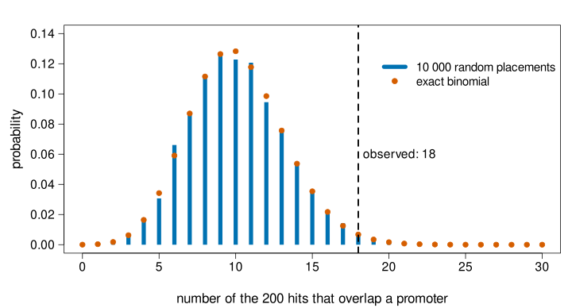
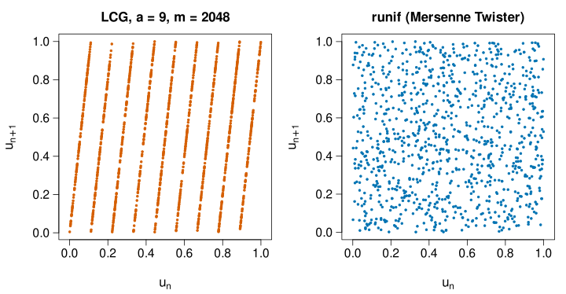
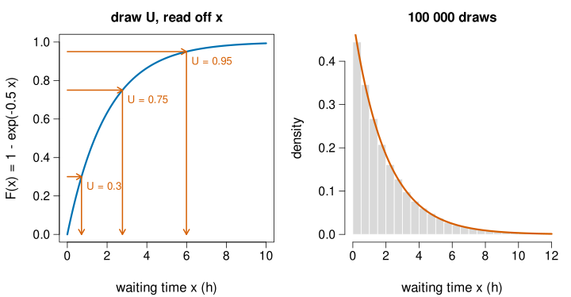
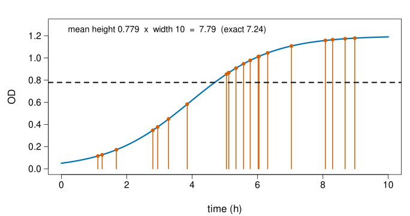
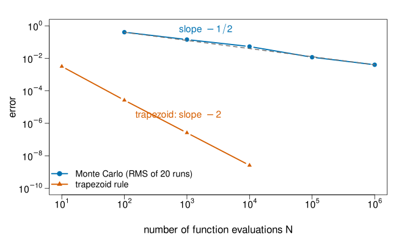
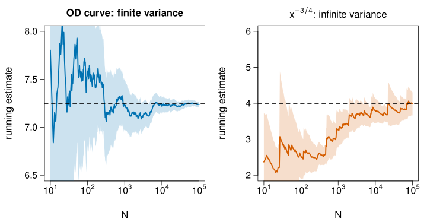
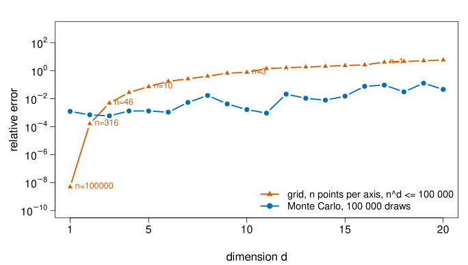
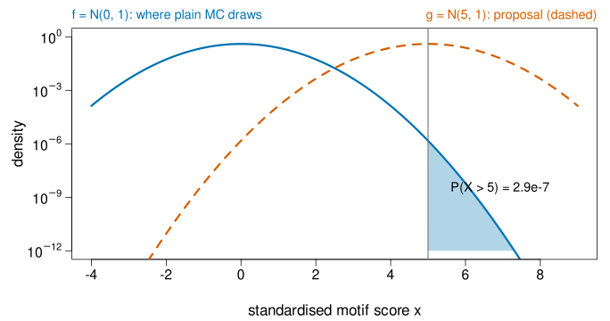

## About this lecture

*Numerical integration* placed points on a grid. This lecture places them **at random**, and answers questions a grid cannot.

- A computer makes "random" numbers with a **deterministic** recipe. A **seed** fixes the whole stream, which makes results reproducible.
- **Inverse-transform** and **rejection** sampling turn uniform numbers into draws from other distributions.
- **Monte Carlo integration**: an integral is an average, so estimate it by a sample mean, with a **standard error** as the error bar. The error falls like $1/\sqrt{N}$, whatever the dimension.
- That is slow in 1-D but beats any grid in **many dimensions** (the curse of dimensionality).
- **Importance sampling** makes rare events visible.
- Biology: are motif hits enriched in promoters (a **permutation-style test**)? A **marginal likelihood** in 10 dimensions.

::: notes
The thread of the lecture: an integral (or a probability, which is an integral) can be written as an expected value, and expected values can be estimated by averaging random draws. That trades the high order of the quadrature rules from the previous unit for an error rate that does not care about dimension. We start with where the random numbers come from, because every later result depends on them being good and reproducible.
:::

## A biology problem first {.smaller}

A ChIP-seq peak caller reports **200** hits of a TF motif (10 bp) in a 1 Mb region. **18** of them overlap one of the region's **50 promoters** (1 kb each, 5% of the region). Is that more than chance?

```r
G <- 1e6; L <- 10                                   # region and motif length (bp)
pstart <- seq(10001, by = 20000, length.out = 50)   # 50 promoters of 1 kb
pend   <- pstart + 999
n_hits <- 200; k_obs <- 18
p <- 50 * (1000 + L - 1) / (G - L + 1)   # P(one random hit overlaps a promoter)
n_hits * p                               # expected number of overlaps
# [1] 10.09009
pbinom(k_obs - 1, n_hits, p, lower.tail = FALSE)    # exact P(K >= 18)
# [1] 0.01314003
```

- A hit overlaps a 1 kb promoter if its start is in a window of $1000 + L - 1 = 1009$ positions. With independent uniform starts, $K \sim \text{Binomial}(200, p)$.
- Here an exact answer exists. Change the null model a little and it does not.

::: notes
This is the question behind every "enrichment of binding sites in promoters" or "overlap of two sets of genomic intervals" analysis (tools like bedtools shuffle, GAT, regioneR). The exact calculation works because the null model is very simple: each hit starts uniformly and independently. The (1000 + L - 1) is the classic off-by-a-motif-length: a hit starting up to 9 bp before the promoter still overlaps it. pbinom with lower.tail = FALSE gives P(K > 17) = P(K >= 18).
:::

## Simulate instead: a permutation-style test {.smaller}

Place the 200 hits at random, count overlaps, repeat 10 000 times.

```r
overlaps <- function(s) {                     # s: start positions of the hits
  i <- findInterval(s + L - 1, pstart)        # last promoter starting before hit end
  i > 0 & pend[pmax(i, 1)] >= s
}
set.seed(1)
K <- replicate(10000, sum(overlaps(sample.int(G - L + 1, n_hits, replace = TRUE))))
mean(K >= k_obs)                              # simulated P(K >= 18)
# [1] 0.0122
```

- Simulated $0.0122$ vs exact $0.0131$. The difference is **Monte Carlo error**: about $\sqrt{0.012 \cdot 0.988 / 10\,000} = 0.0011$.
- The simulation needs no formula. Real nulls do not have one: keep hits out of gaps and repeats, match GC content, forbid overlapping hits. Change the placement line, keep the rest.

::: notes
This is the same idea as a permutation test: generate data under the null hypothesis by shuffling, and see how often the shuffled statistic is at least as extreme as the observed one. findInterval finds for each hit end the last promoter that starts at or before it; the hit overlaps that promoter if the promoter has not ended before the hit starts. sample.int draws start positions uniformly. The standard error formula is that of a proportion; we will see it is the general Monte Carlo standard error. Ask: how many simulations would you need to tell 0.0131 from 0.0122 reliably?
:::

## Simulated vs exact

{width="85%" fig-align="center"}

- Bars: the 10 000 simulated counts. Dots: the exact binomial probabilities. The p-value is the mass at or right of the dashed line.
- Report a simulated p-value as $(k+1)/(B+1)$ ($k$ of $B$ simulations as extreme), so it is never exactly 0.

::: notes
The two agree within simulation noise, which is the check that the simulation code is right. Always run a simulation once on a case with a known answer before trusting it on a case without one. The (k+1)/(B+1) rule counts the observed data as one of the permutations; with k = 122 and B = 10000 it gives 0.0123. A p-value of exactly 0 from 1000 permutations means p < about 1/1000, not p = 0.
:::

## A second problem: an integral in 10 dimensions {.smaller}

A model with $d = 10$ parameters $\theta$ (e.g. log fold changes of 10 genes in a pathway), prior $\pi(\theta)$, likelihood $L(\theta)$. To compare it with another model (a Bayes factor) we need the **marginal likelihood**

$$Z = \int L(\theta)\,\pi(\theta)\,d\theta_1 \cdots d\theta_{10}.$$

- $Z$ is the **normalising constant** of the posterior $L(\theta)\pi(\theta)/Z$.
- A grid with only **10 points per axis** needs $10^{10}$ likelihood evaluations. At 1 µs each: **3 hours**. With 100 points per axis: $10^{20}$ evaluations, about 3 million years.
- But $Z = \mathrm{E}_\pi[L(\theta)]$: the **average likelihood over draws from the prior**. An average can be estimated from a sample.

::: notes
This is the second motivating problem: any Bayesian model comparison needs Z, and so do many latent-variable likelihoods (integrating over unobserved random effects). The tensor-product rules of the previous unit cost n^d. The rewriting of an integral as an expected value is the key step of the whole lecture; everything else is about making the average accurate. We return to this integral with numbers later; it is chosen so that Z is known exactly.
:::

## Random numbers are computed {.smaller}

A **linear congruential generator** (LCG): $x_{n+1} = (a\,x_n + c) \bmod m$, $\;u_n = x_n / m$.

```r
lcg <- function(n, seed, a = 5, c = 1, m = 16) {
  x <- numeric(n); x[1] <- seed
  for (i in 2:n) x[i] <- (a * x[i - 1] + c) %% m     # %% is "mod"
  x
}
lcg(18, seed = 1)
#  [1]  1  6 15 12 13  2 11  8  9 14  7  4  5 10  3  0  1  6
lcg(8, seed = 7)
# [1]  7  4  5 10  3  0  1  6
```

- Entirely **deterministic**: the seed fixes the whole sequence. Another seed starts at another place in the **same cycle**.
- After at most $m$ steps the sequence **repeats** (period 16 here). Real generators have astronomically long periods.

::: notes
Pseudo-random numbers look random but are produced by a formula. This is a feature: rerunning with the same seed gives the same numbers, which is how we make simulations reproducible and debuggable. The toy LCG with m = 16 has full period 16 because the constants satisfy the Hull–Dobell conditions; with a = 4 it gets stuck after one step (the exercise does this by hand). Old C library rand() functions were LCGs with m = 2^31 or 2^32.
:::

## Bad generators leave patterns {.smaller}

:::: {.columns}
::: {.column width="55%"}
{width="100%"}
:::
::: {.column width="45%"}
Successive **pairs** of an LCG lie on a few lines.

RANDU ($a = 65539$, $m = 2^{31}$, 1960s IBM) puts all **triples** on 15 planes:

```r
u <- randu(30000)       # exercise C1
v <- 9 * u[1:29998] -
     6 * u[2:29999] + u[3:30000]
table(round(v))         # only -5..9
```
:::
::::

- **Check:** plot $u_{n+1}$ against $u_n$; use the language's default generator, never a home-made one.

::: notes
An LCG with a small multiplier relative to m gives pairs on a lattice of lines; every LCG has such a lattice in some dimension (Marsaglia, 1968, "random numbers fall mainly in the planes"). RANDU was used widely for years, and simulation results from that time had to be redone. The identity behind the RANDU check is x_{n+2} = 6 x_{n+1} - 9 x_n mod 2^31, so 9u_n - 6u_{n+1} + u_{n+2} is always a whole number. For runif the same combination takes over 11 000 different values (rounded to 3 decimals) in 30 000 triples.
:::

## The generators you actually use {.smaller}

| | default generator | set the seed |
|---|---|---|
| R | Mersenne Twister (period $2^{19937}-1$) | [`set.seed(42)`](https://stat.ethz.ch/R-manual/R-devel/library/base/html/Random.html); `runif(3)` |
| Python / numpy | PCG64 | `rng = np.random.default_rng(42)`; `rng.random(3)` |
| Rust (`rand`) | `StdRng` (ChaCha12) | `StdRng::seed_from_u64(42)`; `rng.random::<f64>()` |

```r
set.seed(42); runif(3)
# [1] 0.9148060 0.9370754 0.2861395
set.seed(42); runif(3)          # same seed: same numbers
# [1] 0.9148060 0.9370754 0.2861395
runif(3)                        # the stream continues
# [1] 0.8304476 0.6417455 0.5190959
```

- The same seed in **another language** gives **other** numbers (numpy: 0.774, 0.439, 0.859). Compare results statistically, never digit by digit.

::: notes
Three different generator algorithms, so the streams differ even for the same seed; this is why the exercise outputs differ between the R, Python and Rust tabs. All three are good for simulation. None is suitable for cryptography except ChaCha, which is a stream cipher. RNGkind() in R shows the generator in use, the method for normal numbers (Inversion) and for sample() (Rejection). numpy's old global np.random.seed / np.random.random interface uses the Mersenne Twister; new code should use default_rng.
:::

## Seeds and reproducibility {.smaller}

```r
set.seed(42); sample(10, 3)                      # R >= 3.6
# [1]  1  5 10
RNGversion("3.5.0"); set.seed(42); sample(10, 3) # R before 3.6
# [1] 10  9  3
```

- R changed how `sample()` turns uniform numbers into integers in version 3.6 (the old way was slightly biased). Same seed, different result. **Record the software version** with the seed ([`sessionInfo()`](https://stat.ethz.ch/R-manual/R-devel/library/utils/html/sessionInfo.html)).
- Set the seed **once**, at the top of a script, not inside a loop (re-seeding with the same value repeats the same numbers).
- A seed makes a run **reproducible**, not **correct**: a result that changes with the seed by more than its error bar is not a result. Try a few seeds.
- Parallel runs need **separate streams** (`parallel::RNGStreams`, numpy `SeedSequence.spawn`), not seeds 1, 2, 3 by hand.

::: notes
Reproducibility questions come up in every reviewer report on simulation work. The R 3.6 change is a real example of the same seed producing different results on different versions. Re-seeding inside a loop is a common bug: set.seed(1) inside a function called 1000 times gives the same "random" sample 1000 times. Choosing the seed that gives the nicest result is a form of p-hacking. Parallel streams: R's L'Ecuyer-CMRG generator via RNGkind("L'Ecuyer-CMRG") and parallel::nextRNGStream; numpy SeedSequence.
:::

## Inverse-transform sampling

{width="80%" fig-align="center"}

If $U \sim \text{Uniform}(0, 1)$ and $F$ is a CDF, then $X = F^{-1}(U)$ has CDF $F$. Exponential waiting time (rate $\lambda$): $u = 1 - e^{-\lambda x} \Rightarrow x = -\log(1 - u)/\lambda$.

::: notes
Read the picture: draw a height U on the vertical axis, go across to the curve and down. Where F is steep (short waiting times), many U values map to a small range of x, so x is dense there. Proof in one line: P(X <= x) = P(F^{-1}(U) <= x) = P(U <= F(x)) = F(x). Example: waiting times between transcriptional bursts at rate 0.5 per hour, mean 2 h. Since 1 - U is also uniform, -log(U)/lambda works too. The unit Stochastic simulation draws all its waiting times this way.
:::

## Inverse transform in R {.smaller}

```r
set.seed(1)
lambda <- 0.5                          # bursts per hour
x <- -log(runif(1e5)) / lambda         # F^{-1}(1 - U), and 1 - U is uniform too
c(mean(x), sd(x))                      # both should be 1 / lambda = 2
# [1] 2.007696 2.011384

prob <- c(A = 0.3, C = 0.2, G = 0.2, T = 0.3)       # base composition
u <- c(0.45, 0.95)
names(prob)[findInterval(u, c(0, cumsum(prob)))]    # discrete inverse transform
# [1] "C" "T"
```

- **Discrete** case: cut $[0, 1)$ into pieces of length $p_k$ (cumulative sums) and see where $U$ falls. This is what `sample()` does with `prob =`.
- **Check:** compare sample mean, sd or histogram with the target. R's own `rexp`, `qnorm(runif(n))` (R's default for `rnorm`) do the same.

::: notes
The exponential case is two lines. For the discrete case, findInterval returns the index of the interval [0, 0.3), [0.3, 0.5), [0.5, 0.7), [0.7, 1) in which each u falls: 0.45 is in the second (C), 0.95 in the fourth (T). The failure of inverse transform is that F^{-1} often has no formula: the normal CDF has none, so qnorm is itself a numerical approximation (a rational function, accurate to full precision). RNGkind() says "Inversion" for normals for exactly this reason.
:::

## Rejection sampling (when $F^{-1}$ is hard) {.smaller}

Target density $f$, easy proposal $g$, constant $M$ with $f \le M g$. Draw $x \sim g$, **accept** with probability $f(x)/(M g(x))$.

```r
f <- function(x) 20 * x * (1 - x)^3      # Beta(2, 4) density on [0, 1]
(M <- f(1/4))                            # its maximum: f <= M * 1 (uniform g)
# [1] 2.109375
set.seed(1)
x <- runif(1e5)                          # proposals
keep <- runif(1e5) < f(x) / M            # accept or reject
c(mean(keep), mean(x[keep]))             # acceptance ~ 1/M; Beta(2,4) mean = 1/3
# [1] 0.4737500 0.3338191
```

- Accepted points are exact draws from $f$. The acceptance rate is $1/M$.
- **Failure:** a poor $g$ gives a huge $M$; in $d$ dimensions $M$ typically grows exponentially and almost nothing is accepted. **Check:** print the acceptance rate.

::: notes
Geometrically: scatter points uniformly under the curve M g(x) and keep the ones under f(x); their x-coordinates are distributed as f. Rejection sampling only needs f up to a constant, which is why it appears inside many samplers (rgamma, rbeta, rbinom use clever rejection methods). With a box proposal for a narrow peak in 10 dimensions, the acceptance rate can easily be 1e-6. MCMC is the answer for those cases; it is outside this course.
:::

## Monte Carlo integration

{width="72%" fig-align="center"}

$$\int_a^b f(t)\,dt = (b - a)\,\mathrm{E}[f(U)], \quad U \sim \text{Uniform}(a, b) \quad\Rightarrow\quad \hat I_N = \frac{b-a}{N}\sum_{i=1}^N f(U_i).$$

::: notes
The area under the curve is the width times the mean height, and the mean height is estimated by the average of the curve at random points. Example: area under the logistic OD curve (K = 1.2, N0 = 0.05, r = 0.8 per hour, the shared running example) from 0 to 10 h, the AUC that Numerical integration computed with the trapezoid rule. Exact value 7.244. With only 20 random times the estimate is 7.79: the points happen to fall more in the late, high part of the curve. More points, smaller error; how much smaller is the next question.
:::

## Monte Carlo in R, with an error bar {.smaller}

```r
K <- 1.2; N0 <- 0.05; r <- 0.8
od <- function(t) K / (1 + (K / N0 - 1) * exp(-r * t))
set.seed(1)
N <- 1000
fx <- 10 * od(runif(N, 0, 10))          # (b - a) f(U_i)
c(estimate = mean(fx), se = sd(fx) / sqrt(N))
#  estimate        se
# 7.2188630 0.1306143
integrate(od, 0, 10)                    # for comparison
# 7.244448 with absolute error < 3.2e-06
```

- **Standard error** $\text{SE} = s/\sqrt{N}$, $s$ = sample sd of the $(b-a) f(U_i)$. Report $7.22 \pm 0.26$ ($\pm 2\,\text{SE}$, about 95%).
- The true error ($-0.026$) is well inside the error bar. The SE comes **free**, from the same sample.

::: notes
The central limit theorem says the average of N independent draws is approximately normal with sd sigma/sqrt(N), so the estimate plus or minus 2 SE covers the true value about 95% of the time. This is the big practical advantage of Monte Carlo: every estimate comes with its own error estimate, without knowing the answer. Quadrature rules give an error estimate only by comparing two rules (as integrate does). For a smooth 1-D integral, integrate is far better: 3e-6 error with 21 evaluations.
:::

## The error falls like $1/\sqrt{N}$ {.smaller}

{width="62%" fig-align="center"}

- Monte Carlo: slope $-\tfrac12$. **100 times more samples for one more digit.** For $\pm 0.01$ on the AUC: $N \approx (2 \cdot 4.13 / 0.01)^2 \approx 680\,000$.
- Trapezoid: slope $-2$ in 1-D. In one dimension, Monte Carlo is a **bad** idea.

::: notes
The error is random, so the plot shows the root-mean-square error over 20 runs at each N; the fitted slope is -0.51. The dashed reference line has slope -1/2 exactly. To plan N: solve 2 s / sqrt(N) = target for N, with s estimated from a pilot run (here s = 4.13 from N = 1000). Compare with the trapezoid rule from Numerical integration: 10^4 points give an error near 1e-9. The reason to use Monte Carlo is never one dimension; it is many dimensions, or a complicated region, or a probability defined by a simulation (the binding sites).
:::

## Try it: watch the error fall like $1/\sqrt{N}$

```{=html}
<link rel="stylesheet" href="../demos/dist/demo.css">
<div data-demo="mclab" data-problem="auc" data-seed="1"></div>
<script src="../demos/dist/mclab.js"></script>
```

::: notes
Live in the browser, seed 1, with its own generator (numbers differ from R but agree within the SE). OD-curve area first: click +10, +100, +1000, +10 000, +100 000. Left: the running estimate wanders, the ±2 SE band narrows around the green exact value 7.244. Right: the error of this run follows the dashed line sigma/sqrt(N) with slope -1/2, with dips whenever the running mean crosses the truth. At N = 100: 6.93 ± 0.85; at N = 10 100: 7.230 ± 0.083, a hundred times more draws for one more digit. Then motif overlap, +10 000: 143 of 10 000 placements have K >= 18, 0.0143 ± 0.0024, exact 0.01314 inside the band, same as the simulation two slides back. Preview for later: rare event P(X > 5) without importance sampling, +100 000: estimate 0, SE 0, a confident wrong answer, and the dashed true SE lies above 100 %. Tick importance sampling and click +100 000: 0.75 % relative SE. Last, the second tab: grid against Monte Carlo at a budget of 1e5 evaluations; drag d from 1 to 10, the grid's error passes Monte Carlo's at d = 3 to 4, and at d = 10 the grid needs about 1e18 evaluations for 1 % error (43 000 years at 1 µs), Monte Carlo 213 000 draws.
:::

## When the error bar lies {.smaller}

{width="78%" fig-align="center"}

- $\int_0^1 x^{-3/4}\,dx = 4$ is finite, but $\int_0^1 (x^{-3/4})^2 dx = \infty$: **infinite variance**. The estimate creeps up in jumps, and the $\pm 2$ SE band misses 4 for long stretches.
- **Check:** plot the running estimate; repeat with a few seeds. Jumps or SEs that disagree between seeds mean the SE is not to be trusted.

::: notes
The 1/sqrt(N) law needs a finite variance of f(U). Integrands with a singularity (or, after a change of variables, heavy tails) can have a finite integral but infinite variance. Then the sample sd is dominated by the rare huge values: most of the time it underestimates, and a rare draw near 0 makes the estimate and the SE jump. Over seeds 2 to 6 at N = 1e5, the estimates were 3.75, 4.13, 3.85, 4.35, 4.47, each with an SE that is too small. Fixes: remove the singularity analytically (substitute x = v^4 here) or use importance sampling with a proposal that has the same singularity.
:::

## The curse of dimensionality {.smaller}

$N$ function evaluations in $d$ dimensions:

| | grid, $n$ points per axis | Monte Carlo |
|---|---|---|
| points per axis | $n = N^{1/d}$ | (no grid) |
| error, trapezoid-like rule of order 2 | $n^{-2} = N^{-2/d}$ | $\sigma / \sqrt{N}$ |
| $N = 10^6$, $d = 1$ | $10^6$ per axis | |
| $N = 10^6$, $d = 10$ | **3–4** per axis | same $1/\sqrt{N}$ |

- A grid's error rate gets worse with every dimension; Monte Carlo's **rate** does not depend on $d$. They break even at $d = 4$ for a second-order rule.
- The **constant** $\sigma$ can still grow with $d$ (see importance sampling).

::: notes
This is the reason Monte Carlo exists. The tensor-product rules of Numerical integration have an error of order n^-p per axis, and with a fixed total budget N the points per axis shrink like N^(1/d). Simpson (order 4) breaks even with Monte Carlo at d = 8, Gauss rules a bit later, but all lose eventually. The term "curse of dimensionality" is from Richard Bellman (1957). Quasi-Monte Carlo (low-discrepancy sequences, Sobol) improves on 1/sqrt(N) for smooth integrands in moderate d; one sentence only.
:::

## The marginal likelihood in 10 dimensions {.smaller}

Toy model with a known answer: prior $\theta_i \sim N(0, 1)$, one measurement $y_i = 1$ per parameter with noise sd 1. Then $Z = \phi(1; 0, \sqrt2)^{10}$.

```r
d <- 10; y <- rep(1, d)
lik <- function(th) exp(colSums(dnorm(y, th, sd = 1, log = TRUE)))  # th: d x N
Z_exact <- dnorm(1, 0, sqrt(2))^d
nodes <- qnorm((1:3 - 0.5) / 3)                          # 3 prior quantiles per axis
grid <- t(as.matrix(expand.grid(rep(list(nodes), d))))   # 3^10 = 59049 points
set.seed(1)
th <- matrix(rnorm(d * 59049), nrow = d)                 # 59049 draws from the prior
L <- lik(th)
c(exact = Z_exact, grid = mean(lik(grid)), mc = mean(L), se = sd(L) / sqrt(59049))
#        exact         grid           mc           se
# 2.619476e-07 4.668612e-07 2.633375e-07 5.102569e-09
```

- Same budget: the grid is **78% wrong**; Monte Carlo is off by 0.5%, with an honest SE of 2%.

::: notes
The integrand is the likelihood times the prior; writing it as an average over prior draws absorbs the prior. The grid uses 3 points per axis at the prior quantiles 1/6, 1/2, 5/6 (a midpoint rule after the inverse-transform change of variables u = pnorm(theta)), so each grid point has weight 1/59049. Three points per axis cannot resolve a bell-shaped likelihood, and the error multiplies over 10 axes. The model is a product of 1-D models only so that we know Z exactly; real models are not, and that is where nothing but sampling works. dnorm(..., log = TRUE) and colSums avoid underflow when d is large (floating-point unit).
:::

## Grid vs Monte Carlo as $d$ grows

{width="75%" fig-align="center"}

- Budget $10^5$ evaluations. The grid wins for $d \le 2$, is level at $d = 3$, loses from $d = 4$, and at $d \ge 17$ has **one** point per axis.
- Monte Carlo's error grows slowly with $d$: here the variance of $L$ under the prior grows like $1.36^d$.

::: notes
Read off the crossover around d = 3 (expected SE of Monte Carlo 0.004, grid error 0.005), close to the d = 4 the table predicted from the rates alone. Monte Carlo errors are random: each dot is one run. The grid errors for d = 1..3 are tiny because the midpoint rule on a smooth integrand converges fast. The Monte Carlo error is still rising: the relative variance of the likelihood over the prior is 1.364^d - 1. When the data are informative (many measurements per parameter), the likelihood is a narrow peak inside the broad prior, almost all prior draws have negligible L, and the factor per dimension becomes large. That is the case for importance sampling.
:::

## Rare events: plain Monte Carlo sees nothing

{width="70%" fig-align="center"}

- A motif score of a random sequence is roughly normal (a sum over positions). **P-value of a hit with standardised score above 5**: $P(X > 5) = 2.87\times10^{-7}$.
- `set.seed(1); mean(rnorm(1e5) > 5)` gives **0**, with SE **0**: a confident wrong answer. For 10% relative error, plain MC needs $N = 100/p \approx 3.5 \times 10^8$.

::: notes
For a rare event the indicator f(x) = 1(x > 5) is almost always 0. With N draws we expect Np = 0.029 hits, so the estimate is almost always exactly 0, and so is the sample sd. The relative SE of a proportion is sqrt((1-p)/(N p)), roughly 1/sqrt(expected number of hits): you need about 100 hits for 10% error. The same issue appears for small permutation p-values (genome-wide significance, 5e-8, needs billions of permutations) and for rare-event probabilities in stochastic simulation.
:::

## Importance sampling {.smaller}

Draw from a proposal $g$ that puts points **where the integrand matters**, and reweight:

$$\int h(x) f(x)\,dx = \mathrm{E}_g\!\left[h(X)\,\frac{f(X)}{g(X)}\right], \qquad w(x) = \frac{f(x)}{g(x)}.$$

```r
set.seed(1)
N <- 1e5
x <- rnorm(N, mean = 5)                   # proposal g = N(5, 1)
w <- dnorm(x) / dnorm(x, mean = 5)        # weights f / g = exp(12.5 - 5 x)
hw <- (x > 5) * w
c(estimate = mean(hw), se = sd(hw) / sqrt(N))
#     estimate           se
# 2.865596e-07 2.157211e-09
pnorm(5, lower.tail = FALSE)
# [1] 2.866516e-07
```

- Half of the draws now land in the tail; the weights correct for drawing them too often. Relative SE **0.75%** with the same $10^5$ draws.

::: notes
The identity is one line: multiply and divide by g inside the integral. Any g works as long as g > 0 wherever h f is nonzero; a good g makes h(x) f(x) / g(x) nearly constant. The best possible g is proportional to |h f|, which would give zero variance but needs the answer to normalise it; in practice we choose something close. Shifting a normal to the threshold is the classic choice for tail probabilities. For the marginal likelihood, the analogue is drawing from an approximation to the posterior instead of the prior, with weights prior times likelihood over proposal.
:::

## When importance sampling fails {.smaller}

A proposal with **lighter tails** than the target. Estimate $\int \phi(x)\,dx = 1$ with $g = N(0, 0.5^2)$:

```r
ess <- function(w) sum(w)^2 / sum(w^2)        # effective sample size
set.seed(1)
x <- rnorm(1e5, sd = 0.5)
w <- dnorm(x) / dnorm(x, sd = 0.5)            # grows like exp(1.5 x^2)
c(estimate = mean(w), se = sd(w) / sqrt(1e5))   # true value: 1
#   estimate         se
# 0.98970045 0.01692477
ess(w)
# [1] 3306.464
```

- The variance of $w$ is **infinite**: a few draws in the tail carry huge weights. Over seeds the SE ranges from 0.011 to 0.029.
- **Check:** the effective sample size, here 3 306 of 100 000. With $g = N(0, 2^2)$ (heavier tails): ESS 65 997, SE 0.0023.
- Rule: the proposal must have **heavier tails** than $|h| f$.

::: notes
The ESS formula (Kish) says how many equally weighted draws the weighted sample is worth. A low ESS, or one huge weight (here one draw carries 1.2% of the total weight), is the warning sign; it is the importance-sampling version of the heavy-tail problem two slides back. The narrow proposal almost never visits |x| > 2, where the target still has 5% of its mass, and when it does, the weight is enormous. A wider proposal wastes some draws but has bounded weights. In high dimensions even a well-chosen Gaussian proposal can have a tiny ESS, which is why Bayesian software uses MCMC or sequential methods.
:::

## Checklist: is my Monte Carlo answer right?

- **Seed** set once at the top, software version recorded; result stable over a few seeds.
- **Every estimate has an error bar**: estimate $\pm 2\,\text{SE}$, $\text{SE} = s/\sqrt{N}$.
- Code tested on a case with a **known answer** (the binomial overlap, the toy $Z$).
- **Running estimate** plotted: smooth $1/\sqrt{N}$ narrowing, no jumps.
- **Rare events**: zero hits is not a probability of zero; use importance sampling, or report $p < 1/N$.
- **Weights**: check the effective sample size and the largest weight.
- In **1–3 dimensions** with a smooth integrand, use quadrature (`integrate`) instead.

::: notes
A list to keep next to the keyboard. The common thread: Monte Carlo always returns a number, so the checks are about whether the number and its error bar can be trusted. The last item is a reminder that Monte Carlo is the method of last resort for low-dimensional smooth integrals.
:::

## Summary {.smaller}

- Pseudo-random numbers are **deterministic** streams from a seed. Use the default generator (R: Mersenne Twister, numpy: PCG64, Rust: ChaCha12); streams differ between languages.
- **Inverse transform** $X = F^{-1}(U)$; **rejection** when $F^{-1}$ is unknown (acceptance rate $1/M$).
- **Monte Carlo integration**: integral = average; estimate $\pm 2\,s/\sqrt{N}$. Error $\propto N^{-1/2}$ in **any** dimension, if the variance is finite.
- **Curse of dimensionality**: a grid's error $N^{-p/d}$ collapses with $d$; Monte Carlo wins from $d \approx 4$.
- **Importance sampling** for rare events and peaked integrands; check the effective sample size.
- Biology: motif enrichment by simulated placement (permutation-style test); marginal likelihood as an average over prior draws.

**Next:** Part 8, *Initial value problems and Euler's method*. Random numbers return in *Stochastic simulation*, where exponential waiting times drive Gillespie's algorithm.

::: notes
Recap the two pillars: where random numbers come from and how to turn averages into integrals with an error bar. The deterministic ODE units come next; Stochastic simulation (the last unit of Part 8) uses inverse-transform sampling of exponential waiting times to simulate reactions with small copy numbers, and its results are again Monte Carlo averages with standard errors.
:::
