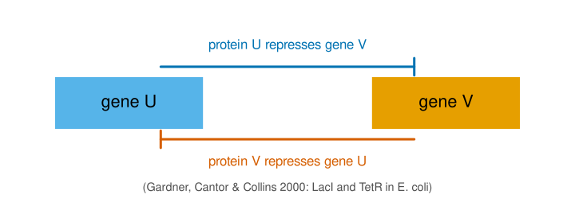
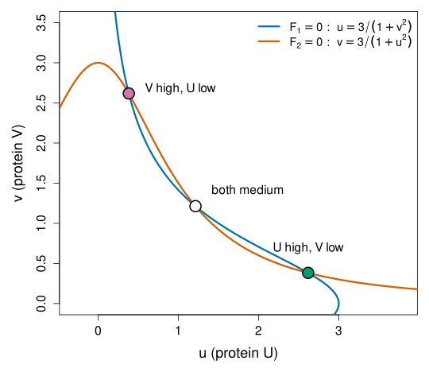
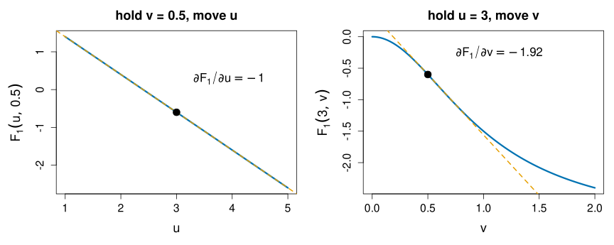
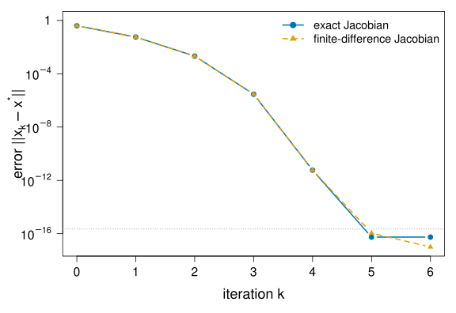
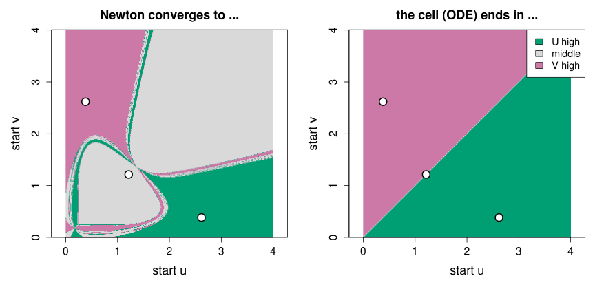
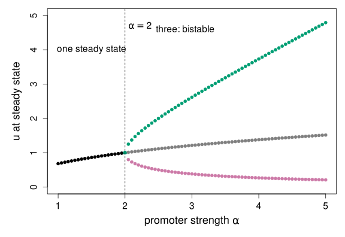
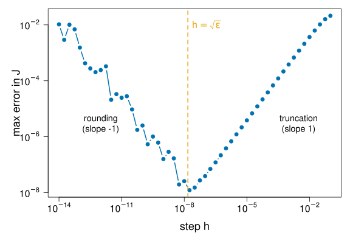

## About this lecture {.smaller}

So far we solved **one** equation in **one** unknown. Biology rarely stops there: two genes regulate each other, so their steady state is **two equations in two unknowns**, solved together.

- **Partial derivatives**: the slope in one direction while the other variables are held fixed. New for most of you; we go slowly, with numbers.
- The **Jacobian**: all partial derivatives in one matrix. It plays the role of $f'(x)$.
- **Newton for systems**: linearise, then do **one linear solve per step**, `solve(J, -F)`. Still quadratic convergence.
- A **finite-difference Jacobian** when you cannot (or do not want to) differentiate by hand, and the library routine `rootSolve::multiroot`.
- Biology: the **genetic toggle switch**. It has three steady states (**bistability**), and which one Newton finds depends on where it starts.

::: notes
This unit closes Part 2. It reuses the one-variable Newton method from the previous unit and the ideas of quadratic convergence and the sqrt(eps) step from Convergence and cost. The genuinely new mathematics is the partial derivative and the Jacobian matrix. Audience survey says most students have never seen multivariate calculus, so the first third of the lecture is a slow introduction with numbers on every slide. The Jacobian comes back in Equilibria, stability and the phase plane (stability) and in Part 10 (optimisation), so time spent here pays off later.
:::

## A biology problem: the toggle switch {.smaller}

{width="55%" fig-align="center"}

Two genes whose proteins **repress each other** (Gardner, Cantor & Collins, *Nature* 2000). Concentrations $u$, $v$ (in units of the repression threshold), time in units of the protein lifetime:

$$\frac{du}{dt} = \frac{\alpha}{1 + v^{n}} - u, \qquad \frac{dv}{dt} = \frac{\alpha}{1 + u^{n}} - v, \qquad \alpha = 3,\; n = 2$$

- First term: production, a **Hill function** that falls as the repressor rises. Second term: degradation and dilution.
- $\alpha$ = promoter strength, $n$ = Hill coefficient (cooperativity).

::: notes
The synthetic toggle switch was one of the two founding papers of synthetic biology (together with the repressilator, same issue of Nature). Real version: LacI and TetR in E. coli. The same motif appears in natural cell-fate decisions, for example GATA1 and PU.1 in blood cell differentiation. The model is dimensionless: concentrations are measured in units of the repressor concentration that halves expression, time in units of the protein lifetime. With alpha = 3 the maximal production is three times the repression threshold. We use alpha = 3 and n = 2 throughout; the phase-plane unit reuses exactly this model.
:::

## Steady states: two equations, two unknowns {.smaller}

:::: {.columns}
::: {.column width="52%"}
{width="100%"}
:::
::: {.column width="48%"}
A **steady state** has $du/dt = 0$ and $dv/dt = 0$:

$$\begin{aligned}
F_1(u, v) &= \frac{3}{1 + v^2} - u = 0\\[2pt]
F_2(u, v) &= \frac{3}{1 + u^2} - v = 0
\end{aligned}$$

- Each equation alone is a **curve**. Steady states are where the curves **cross**.
- Here: **three** crossings. Two "decided" states (U on/V off, V on/U off) and one in between.
- Two stable states = **bistability**: a memory switch.
:::
::::

::: notes
Write the system as a vector function F of a vector x = (u, v); a steady state is a root, F(x) = 0. The blue curve is where u is not changing, the red where v is not changing (these curves are called nullclines; the phase-plane unit uses them more). Point at the three crossings. The cell sits in one of the two outer states and stays there: that is cellular memory. Which state is reached depends on history. The middle one exists, but (as we will see in the phase-plane unit) it is unstable. Our job today: compute these points to 15 digits, for this model and for models with many genes where no picture is possible.
:::

## Why a new method? {.smaller}

```r
alpha <- 3; n <- 2
F <- function(x) {
  u <- x[1]; v <- x[2]
  c(alpha / (1 + v^n) - u,
    alpha / (1 + u^n) - v)
}
F(c(2.618, 0.382))          # close to the "U on" state?
# [1] -2.533501e-05 -2.533358e-05
F(c(1, 1))
# [1] 0.5 0.5
```

- With 2 genes we could **substitute** one equation into the other and use a 1-D method. With 20 genes we cannot.
- We could **simulate** the ODE until it stops moving. That is slow near a steady state, and it never finds the unstable middle one.
- Newton generalises directly: one method for any number of equations.

::: notes
F takes a vector of length 2 and returns a vector of length 2. A root makes both entries zero at once. The first test point is close to a root: both residuals are about 2.5e-5. Substitution: v = 3/(1+u^2), plug into the first equation, get one equation in u, use uniroot. Fine for two genes, impossible to organise for a network of twenty. Simulation: the approach to a steady state is exponential with a rate set by the slowest decay, so getting 12 digits can take a long simulation, and an unstable state is never reached by simulation. Newton handles all of that, and we can check it costs only a handful of steps.
:::

## Recap: Newton in one variable {.smaller}

Replace $f$ by its **tangent line** at $x_k$ and solve the line instead:

$$f(x_k + \delta) \approx f(x_k) + f'(x_k)\,\delta = 0 \quad\Rightarrow\quad \delta = -\frac{f(x_k)}{f'(x_k)}, \qquad x_{k+1} = x_k + \delta$$

Example from [*Newton and secant methods*](../newton/lec.qmd): the EC50 of the two-site dose–response curve, $f(c) = R(c) - 0.5$, from $c_0 = 1$:

| $k$ | $c_k$ | $f(c_k)$ | $f'(c_k)$ | error $\lvert c_k - c_{50}\rvert$ |
|---|---|---|---|---|
| 0 | 1 | $-0.200$ | 0.0766 | 2.26 |
| 1 | 3.61661 | 0.0324 | 0.0895 | $3.6\times10^{-1}$ |
| 2 | 3.25482 | $-6.0\times10^{-4}$ | 0.0926 | $6.5\times10^{-3}$ |
| 3 | 3.2613037 | $-1.4\times10^{-7}$ | 0.0925 | $1.6\times10^{-6}$ |
| 4 | 3.26130527 | $-8.4\times10^{-15}$ | 0.0925 | $9.1\times10^{-14}$ |

To do the same for $\mathbf F(u, v)$ we need the "derivative" of a function of **two** variables that returns **two** numbers.

::: notes
One-slide recap only; the previous unit has the details (derivation, failure modes, the secant method). The numbers are the run on that unit's slide 'Newton in R: watch the digits' (c50 = 3.2613); the error goes 2.26, 0.36, 6.5e-3, 1.6e-6, 9.1e-14. The key idea to carry over: approximate the nonlinear function by a linear one, solve the linear problem exactly, repeat. Digits roughly double each step: quadratic convergence. For a system, "linear function" will mean a matrix times a vector, and "solve the linear problem" will mean solving a linear system. The missing piece is the derivative.
:::

## Partial derivatives: hold the others fixed {.smaller}

$F_1(u, v) = \dfrac{3}{1+v^2} - u$ depends on **two** numbers. Ask one question at a time:

- **How fast does $F_1$ change when only $u$ moves?** Treat $v$ as a constant and differentiate in $u$ as usual:
  $$\frac{\partial F_1}{\partial u} = -1$$
- **How fast does $F_1$ change when only $v$ moves?** Treat $u$ as a constant (it drops out) and use the chain rule on $3(1+v^2)^{-1}$:
  $$\frac{\partial F_1}{\partial v} = -\frac{3 \cdot 2v}{(1+v^2)^2} = -\frac{6v}{(1+v^2)^2}$$
- At the point $(u, v) = (3, 0.5)$: $\dfrac{\partial F_1}{\partial v} = -\dfrac{6 \cdot 0.5}{1.25^2} = -\dfrac{3}{1.5625} = -1.92$.

The curly $\partial$ ("partial") just means: other variables held fixed.

::: notes
Go slowly; this is the first time many students see this. A partial derivative is nothing new: it is the ordinary derivative of a one-variable function, obtained by freezing all the other variables at numbers. Freeze v at 0.5 and F1 is 2.4 - u, a straight line with slope -1. Freeze u at 3 and F1 is 3/(1+v^2) - 3, a curve in v whose slope at v = 0.5 is -1.92. Read the units: dF1/dv = -1.92 means that raising the repressor V by 0.01 lowers F1 (the net rate of change of U) by about 0.0192. Work the chain rule on the board: d/dv (1+v^2)^-1 = -(1+v^2)^-2 * 2v.
:::

## Partial derivatives are slopes of slices {.smaller}

{width="62%" fig-align="center"}

```r
f1 <- function(u, v) alpha / (1 + v^2) - u
h <- 1e-6
(f1(3 + h, 0.5) - f1(3, 0.5)) / h      # move u only
# [1] -1
(f1(3, 0.5 + h) - f1(3, 0.5)) / h      # move v only
# [1] -1.92
```

::: notes
Left: freeze v = 0.5 and plot F1 against u: a straight line, slope -1 everywhere. Right: freeze u = 3 and plot F1 against v: a curve, and the dashed tangent at v = 0.5 has slope -1.92. The code checks both numbers with a forward difference, exactly as in Convergence and cost: nudge one input, keep the other fixed, divide the change by the nudge. This is also the recipe for the finite-difference Jacobian later in the lecture. If a hand-derived partial derivative disagrees with this check in the first few digits, the hand derivation is wrong.
:::

## The Jacobian: all partial derivatives in one matrix {.smaller}

Row $i$ = equation $F_i$, column $j$ = variable $x_j$:

:::: {.columns}
::: {.column width="45%"}
$$J = \begin{pmatrix} \dfrac{\partial F_1}{\partial u} & \dfrac{\partial F_1}{\partial v} \\[8pt] \dfrac{\partial F_2}{\partial u} & \dfrac{\partial F_2}{\partial v}\end{pmatrix}$$

$$\phantom{J} = \begin{pmatrix} -1 & -\dfrac{6v}{(1+v^2)^2} \\[8pt] -\dfrac{6u}{(1+u^2)^2} & -1\end{pmatrix}$$

At $(3, 0.5)$: $\dfrac{6\cdot 3}{(1+9)^2} = 0.18$ and $\dfrac{6\cdot0.5}{1.25^2} = 1.92$.
:::
::: {.column width="55%"}
```r
J <- function(x) {
  u <- x[1]; v <- x[2]
  matrix(c(-1, -alpha * n * v^(n - 1) / (1 + v^n)^2,
           -alpha * n * u^(n - 1) / (1 + u^n)^2, -1),
         nrow = 2, byrow = TRUE)
}
J(c(3, 0.5))
#       [,1]  [,2]
# [1,] -1.00 -1.92
# [2,] -0.18 -1.00
```
:::
::::

::: notes
The Jacobian (after Carl Jacobi) is the multivariable version of f'(x). For n equations in n unknowns it is an n by n matrix. Check the bottom-left entry by hand: 6 * 3 / (1 + 9)^2 = 18/100 = 0.18. Read the matrix as biology: the diagonal -1 is degradation (each protein reduces its own rate of change); the off-diagonal entries are the repression strengths, how much each protein lowers the production of the other. At (3, 0.5), V at 0.5 is right on the steep part of its Hill curve, so it acts strongly on U (-1.92); U at 3 is far above threshold, the Hill curve is flat there, so a small change in U hardly matters to V (-0.18). byrow = TRUE lets us type the matrix row by row as it is printed.
:::

## The linear approximation, with numbers {.smaller}

One variable: $f(x + \delta) \approx f(x) + f'(x)\,\delta$. Two variables, one line per equation:

$$\begin{aligned}
F_1(u + \delta_u, v + \delta_v) &\approx F_1 + \tfrac{\partial F_1}{\partial u}\delta_u + \tfrac{\partial F_1}{\partial v}\delta_v\\
F_2(u + \delta_u, v + \delta_v) &\approx F_2 + \tfrac{\partial F_2}{\partial u}\delta_u + \tfrac{\partial F_2}{\partial v}\delta_v
\end{aligned}$$

In matrix form: $\mathbf F(\mathbf x + \boldsymbol\delta) \approx \mathbf F(\mathbf x) + J\,\boldsymbol\delta$ (matrix $J$ times vector $\boldsymbol\delta$).

```r
x <- c(3, 0.5); d <- c(-0.1, 0.05)
F(x + d)                       # the true value
# [1] -0.5967370 -0.2311902
F(x) + J(x) %*% d              # the linear prediction
#        [,1]
# [1,] -0.596
# [2,] -0.232
```

::: notes
Each change adds up: moving u changes F1 by (dF1/du) times the move, moving v changes it by (dF1/dv) times its move, and for small moves the two effects simply add. Written as a matrix-vector product that is J times delta. Check one entry by hand: F1 = -0.6, plus (-1)(-0.1) = +0.1, plus (-1.92)(0.05) = -0.096, total -0.596. True value -0.5967: agreement to 3 digits for a step of size 0.1; the mismatch is second order in delta, just as for the tangent line. %*% is R's matrix product (Python: @).
:::

## The Newton step: one linear solve {.smaller}

Ask for $\mathbf F(\mathbf x_k + \boldsymbol\delta) = \mathbf 0$ in the linear approximation:

$$\mathbf F(\mathbf x_k) + J(\mathbf x_k)\,\boldsymbol\delta = \mathbf 0 \quad\Longleftrightarrow\quad \boxed{J(\mathbf x_k)\,\boldsymbol\delta = -\mathbf F(\mathbf x_k)}, \qquad \mathbf x_{k+1} = \mathbf x_k + \boldsymbol\delta$$

| one variable | system |
|---|---|
| $f(x_k)$, a number | $\mathbf F(\mathbf x_k)$, a vector |
| $f'(x_k)$, a number | $J(\mathbf x_k)$, a matrix |
| $\delta = -f/f'$ (divide) | solve $J\boldsymbol\delta = -\mathbf F$ (linear system) |
| fails if $f' = 0$ | fails if $J$ is **singular** ($\det J = 0$) |

- Each step is a **linear system**, which we know how to solve (Gaussian elimination). In R: `solve(J, -F)`.

::: notes
This slide is the whole method. Division by the derivative becomes solving a linear system with the Jacobian. Write the analogy table on the board. "Singular" is the matrix version of "derivative zero": the linear approximation then has no unique solution, and near-singular Jacobians give huge steps, just as a nearly flat tangent does in one dimension. We will see that failure later in the lecture.
:::

## One step by hand {.smaller}

Start $\mathbf x_0 = (3, 0.5)$. We have $\mathbf F(\mathbf x_0) = (-0.6, -0.2)$ and $J$ from before. Solve

$$\begin{pmatrix} -1 & -1.92 \\ -0.18 & -1 \end{pmatrix}\begin{pmatrix}\delta_u\\ \delta_v\end{pmatrix} = \begin{pmatrix} 0.6 \\ 0.2 \end{pmatrix}$$

- Row 2 minus $0.18\times$ row 1: $(-1 + 0.3456)\,\delta_v = 0.2 - 0.108$, so $\delta_v = 0.092 / (-0.6544) = -0.1406$.
- Row 1: $-\delta_u = 0.6 + 1.92\,\delta_v = 0.3301$, so $\delta_u = -0.3301$.
- $\mathbf x_1 = (3 - 0.3301,\; 0.5 - 0.1406) = (2.6699,\; 0.3594)$.

```r
delta <- solve(J(c(3, 0.5)), -F(c(3, 0.5)))
delta
# [1] -0.3300733 -0.1405868
F(c(3, 0.5) + delta)              # residual: was (-0.6, -0.2)
# [1] -0.013126396  0.009658204
```

::: notes
Gaussian elimination on a 2 by 2 system, as in a first linear algebra course. The residual went from size 0.6 to size 0.013 in one step. The exact steady state is (2.6180, 0.3820), so the error went from 0.4 to 0.05. Students repeat this by hand in the exercise and do a second step. Note: never compute the inverse matrix; solve(J, b) solves the system directly. Why that matters is a topic of Gaussian elimination as LU.
:::

## Newton for systems in R {.smaller}

```r
newton_sys <- function(F, J, x, tol = 1e-12, maxit = 50) {
  for (k in 1:maxit) {
    delta <- solve(J(x), -F(x))          # one linear solve per step
    x <- x + delta
    if (sqrt(sum(delta^2)) < tol) return(x)
  }
  warning("no convergence")
  x
}
print(newton_sys(F, J, c(3, 0.5)), digits = 15)
# [1] 2.618033988749895 0.381966011250105
```

- `sqrt(sum(delta^2))` is the **length** of the step vector, $\|\boldsymbol\delta\|$. Stop when the step is tiny; also check the residual $\|\mathbf F\|$.
- Exact root (exercise): $\big((3+\sqrt5)/2,\ (3-\sqrt5)/2\big)$. All 16 digits agree.

::: notes
Ten lines, the same shape as the one-variable Newton: only the update line changed. The step length is the Euclidean norm of the step vector; norms in general come in Pivoting, norms and conditioning. Two stopping tests are common: small step and small residual; use both in serious code. It takes 5 steps from (3, 0.5) here (the next slide shows the errors). The exact answer ((3 + sqrt 5)/2, (3 - sqrt 5)/2) is derived by hand in the exercise (u and v have sum 3 and product 1). [solve](https://stat.ethz.ch/R-manual/R-devel/library/base/html/solve.html) with two arguments solves the linear system.
:::

## Still quadratic {.smaller}

:::: {.columns}
::: {.column width="55%"}
{width="100%"}
:::
::: {.column width="45%"}
Error $\|\mathbf x_k - \mathbf x^*\|$ from $(3, 0.5)$:

| $k$ | error |
|---|---|
| 0 | $4.0\times10^{-1}$ |
| 1 | $5.7\times10^{-2}$ |
| 2 | $2.1\times10^{-3}$ |
| 3 | $2.9\times10^{-6}$ |
| 4 | $5.9\times10^{-12}$ |
| 5 | $< 10^{-16}$ |

- The exponent roughly **doubles** each step, as in 1-D: $e_{k+1} \approx C\,e_k^2$.
- A dropping curve on a log axis that gets **steeper** = quadratic.
:::
::::

::: notes
Same signature as in Convergence and cost: on a log axis, linear convergence is a straight line, quadratic convergence curves downward ever more steeply. Once the error is at the rounding level (about 1e-16 relative) it cannot improve. The orange curve uses a finite-difference Jacobian (later in this lecture) and is indistinguishable here: an approximate Jacobian with 8 correct digits still gives practically quadratic convergence for this problem.
:::

## Three steady states: which one do we get? {.smaller}

```r
starts <- rbind(c(3, 0.5), c(0.5, 3), c(1, 1), c(1, 0.2), c(4, 4))
t(apply(starts, 1, function(s) newton_sys(F, J, s)))   # one run per row
#          [,1]     [,2]
# [1,] 2.618034 0.381966       U on, V off
# [2,] 0.381966 2.618034       V on, U off
# [3,] 1.213412 1.213412       middle
# [4,] 0.381966 2.618034       V on: although U > V at the start!
# [5,] 1.213412 1.213412       middle
```

- **Bistable**: two "decided" states, plus the middle one. Newton finds **one root per start**.
- To find them all: run from **many starts** and collect the distinct answers.
- The start $(1, 0.2)$ has more U than V, yet Newton lands on "V on". Newton's choice is not the cell's choice.

::: notes
The apply line runs Newton from each row of starts. The first two answers are mirror images: the model is symmetric under swapping u and v. The middle state has u = v = 1.2134, the real root of u^3 + u - 3 = 0. A start on the diagonal u = v stays on the diagonal for ever (by symmetry), so (1,1) and (4,4) can only find the middle state. The fourth start is the interesting one: biologically a cell with U = 1 and V = 0.2 will switch U on, but Newton jumps to the other state. Next slide shows why.
:::

## Where Newton goes vs where the cell goes {.smaller}

{width="88%" fig-align="center"}

- Left: colour = the steady state Newton converges to from that start. Right: where the ODE (the cell) ends up.
- Newton's regions (**basins**) are curved, with thin bands of all colours; the middle, **unstable** state takes 57 % of this square.

::: notes
Each pixel is a start (u0, v0); colour = the root reached. Right panel: simulate the ODE from the same start; the line u = v separates the two fates (by symmetry), and nobody ever ends in the middle state because it is unstable: the slightest push sends the cell to one side. Left panel: Newton's basins have nothing to do with that. Newton is a root finder: it finds points where F = 0, stable or unstable, and the middle state, with 57 percent of the square, is the most common answer. Near the boundaries, thin interleaved bands appear, where tiny changes of the start change the answer. Lesson: Newton tells you where the steady states are, not which one the cell goes to, nor whether a steady state is stable. Stability needs the eigenvalues of the Jacobian: Equilibria, stability and the phase plane.
:::

## Try it: Newton in the plane

```{=html}
<link rel="stylesheet" href="../demos/dist/demo.css">
<div data-demo="newton2d" data-alpha="3" data-n="2" data-start="3 0.5"></div>
<script src="../demos/dist/newton2d.js"></script>
```

::: notes
The toggle switch with alpha = 3, n = 2, computed live in the browser. Blue and red solid curves: the nullclines F1 = 0 and F2 = 0; the dots are the three steady states. The orange dot is the start (3, 0.5). Click "+ 1": the two dashed lines are the nullclines of the linear approximation at x0, each one straight; they cross at x1 = (2.6699, 0.3594), exactly the step by hand from earlier. Point at the readout: F = (-0.6, -0.2), J, det J = 0.654, delta = solve(J, -F). Keep clicking: the dashed lines hug the curves more and more, and the errors 0.4, 0.057, 2.1e-3, 2.9e-6, 5.9e-12 show the doubling exponent. Then click (1, 0.2): the first step jumps to the V-high state. Click (1.9, 0.5): det J = -0.03, the dashed lines are nearly parallel, x1 is off the plot at (-5.1, 4.4). Tick "basins": 21 / 57 / 21 percent as in the figure; tick "det J = 0" and show that the thin bands follow the dotted curve. Finally drag alpha down to 2: the three states merge, the whole square becomes one colour, and the run from (3, 0.5) needs 39 steps because J is singular at the root. That leads into the next slide.
:::

## Bistability needs a strong promoter {.smaller}

:::: {.columns}
::: {.column width="55%"}
{width="100%"}
:::
::: {.column width="45%"}
Run Newton from a 7 × 7 grid of starts for each promoter strength $\alpha$, keep the distinct roots.

- $\alpha < 2$: **one** steady state; the circuit is not a switch.
- $\alpha > 2$: **three**; the circuit is bistable.
- Designing the switch (Gardner et al.) meant tuning promoters until the circuit was in the bistable range.
:::
::::

::: notes
This is the biological payoff: the number of steady states is a property you can compute, and it decides whether the circuit works as a memory. Gardner and colleagues showed exactly this kind of diagram for their toggle and picked promoters and ribosome binding sites to sit inside the bistable region. For this symmetric model with n = 2 the threshold is exactly alpha = 2 (the exercise shows why: the outer states satisfy u + v = alpha, uv = 1, which has real solutions only for alpha >= 2). With n = 1 (no cooperativity) there is never bistability. The multi-start loop is the honest way to count roots when you do not have a formula, and it can miss roots whose basins your starts do not touch.
:::

## No formula for $J$? Finite differences {.smaller}

Often $\mathbf F$ is a long function (a 20-gene network, a model with many terms) and deriving $J$ by hand is tedious and error-prone. Approximate **column $j$** by nudging only $x_j$:

$$J_{:,j} \approx \frac{\mathbf F(\mathbf x + h_j\,\mathbf e_j) - \mathbf F(\mathbf x)}{h_j}, \qquad h_j = \sqrt{\varepsilon}\,\max(|x_j|, 1) \approx 1.5\times10^{-8}\max(|x_j|, 1)$$

($\mathbf e_j$ = 1 in place $j$, 0 elsewhere.)

- One nudge gives a whole **column**: how every equation responds to $x_j$.
- Cost: $n + 1$ evaluations of $\mathbf F$ per Jacobian.
- $h = \sqrt\varepsilon$ balances truncation and rounding error ([*Convergence and cost*](../convergence-cost/lec.qmd)): about **8 correct digits**.

::: notes
This is the forward difference from Convergence and cost, applied one variable at a time. Column j, not row: moving one input changes all outputs at once. Scaling h with the size of x_j keeps the nudge relative: a concentration of 1000 needs a bigger absolute nudge than one of 0.001. For n genes the Jacobian costs n + 1 function evaluations; for big models (or expensive F, like an ODE solve) this dominates, which is why library codes reuse a Jacobian over several steps (Broyden's method, quasi-Newton in Part 10). Central differences give more digits for twice the cost; see Numerical differentiation.
:::

## Finite-difference Jacobian in R {.smaller}

:::: {.columns}
::: {.column width="55%"}
```r
fd_jacobian <- function(F, x,
                        h = sqrt(.Machine$double.eps)) {
  Fx <- F(x)
  Jm <- matrix(0, length(Fx), length(x))
  for (j in seq_along(x)) {
    hj <- h * max(abs(x[j]), 1)
    xh <- x; xh[j] <- x[j] + hj
    Jm[, j] <- (F(xh) - Fx) / hj     # column j
  }
  Jm
}
max(abs(fd_jacobian(F, c(3, 0.5)) - J(c(3, 0.5))))
# [1] 1.311302e-08
```
:::
::: {.column width="45%"}
{width="100%"}
:::
::::

- Use it also to **check** a hand-derived `J`: a wrong entry shows up as an error much larger than $10^{-7}$.

::: notes
Twelve lines, and it works for any F of any size. The error 1.3e-8 is what sqrt(eps) predicts. The figure shows the same V as in Convergence and cost: truncation error on the right (slope 1), rounding error on the left (slope -1), best near h = 1.5e-8. Comparing a hand-written Jacobian with the finite-difference one is the standard bug check before trusting a Newton code: a sign error or a missing factor gives a difference of order 1, not 1e-8. numDeriv::jacobian in R does this with a more accurate (Richardson) scheme.
:::

## The cost of a step: one linear solve {.smaller}

Per Newton step for $n$ genes:

| part | cost |
|---|---|
| evaluate $\mathbf F$ | depends on the model, often $\sim n$ |
| Jacobian by finite differences | $n + 1$ evaluations of $\mathbf F$ |
| solve $J\boldsymbol\delta = -\mathbf F$ (Gaussian elimination) | $\approx \tfrac23 n^3$ operations |

- $n = 2$: nothing. $n = 1000$: $\approx 7\times10^8$ per step, still under a second. $n = 20\,000$: hours, unless $J$ is **sparse** (most genes do not regulate most others).
- Never form `solve(J)` (the inverse) and multiply: `solve(J, -F)` is cheaper and more accurate.

::: notes
For small networks the cost is irrelevant. For genome-scale models the linear solve dominates, and the structure of J matters: a gene regulatory network has few edges, so J is mostly zeros, and sparse solvers are vastly faster. The why and how of these costs (LU factorisation, why not the inverse, sparsity) is Part 3: Gaussian elimination as LU and Structure: symmetric, banded, sparse. Today: one step = one linear solve.
:::

## The library routine: `rootSolve::multiroot` {.smaller}

```r
library(rootSolve)
sol <- multiroot(f = F, start = c(3, 0.5))      # Jacobian by finite differences
sol$root;  sol$f.root;  sol$iter
# [1] 2.618034 0.381966
# [1] -1.471712e-12  8.891221e-13
# [1] 5
sol2 <- multiroot(f = F, start = c(3, 0.5), jacfunc = J)  # supply your own J
```

- [`multiroot`](https://search.r-project.org/CRAN/refmans/rootSolve/html/multiroot.html) is Newton–Raphson with a finite-difference Jacobian (unless you pass `jacfunc`), plus tolerances (`rtol`, `atol`, `ctol`), an iteration limit and sparse-Jacobian options for large models.
- It stops at its own tolerance: here $\|\mathbf F\| \approx 10^{-12}$, not $10^{-16}$. **Check** `f.root`, and set `atol` tighter if you need it.
- It finds **one** root, from **your** start. Multiple starts are still your job.

::: notes
rootSolve was written for steady states of ODE models (it has runsteady and stode for that purpose too). The output list has root, f.root (the residual at the root), iter and estim.precis. Default tolerances are about 1e-8 absolute, so the answer is correct to about 12 digits here, which is plenty for biology but worth knowing. Python users: scipy.optimize.root (default method hybr, Powell's hybrid method from MINPACK, which adds a trust region so that it cannot take arbitrarily large steps) or the older fsolve. Neither knows about multiple steady states.
:::

## Failure 1: a nearly singular Jacobian {.smaller}

```r
x0 <- c(1.9, 0.5)
det(J(x0))                          # close to 0
# [1] -0.02992175
x0 + solve(J(x0), -F(x0))           # the first step
# [1] -5.136430  4.425224           # negative concentration!
newton_sys(F, J, c(1.9, 0.5))       # ends in the middle state
newton_sys(F, J, c(2.0, 0.55))      # a nearby start: "U on"
```

- $\det J \approx 0$: the linear model is nearly flat in some direction, so the step is **huge**. It lands at $u < 0$, which is not a concentration.
- With a non-integer Hill coefficient ($n = 2.5$) the same kind of jump gives $(-3.25)^{2.5}$ = `NaN`, and Newton returns `NaN`.
- **Check:** watch $\|\boldsymbol\delta\|$ and $\det J$ (or the condition number); check `all(is.finite(x))` and `all(x >= 0)`.

::: notes
The analogue of a flat tangent in 1-D. Near the curve where det J = 0 (here det J = 1 - (dF1/dv)(dF2/du)), the Newton step blows up. This is where the thin coloured bands of the basin picture come from: start near det J = 0 and you are thrown far away, and from there you can end anywhere. Two starts 0.1 apart end in different steady states. Negative concentrations are a sign the iteration has left the biologically meaningful region; with v^2 it happens to recover, but with x^2.5 negative numbers give NaN. Remedies used by library codes: damping (take only part of the step if the residual does not decrease), trust regions (scipy's hybr), or working with log-concentrations so that they stay positive. In rootSolve: multiroot(F, c(2, 0.5)) with n = 2.5 warns "steady-state not reached"; multiroot(F, c(2, 0.5), positive = TRUE) keeps the iterates non-negative and converges to (2.955, 0.187).
:::

## Failure 2: a root, but not the one you wanted {.smaller}

- Newton from $(1, 1)$, $(2, 2)$ or $(4, 4)$ converges, quickly and **correctly**, to the **middle** state $(1.2134, 1.2134)$: a start with $u = v$ stays on the diagonal by symmetry.
- The residual is $10^{-16}$: nothing in the output warns you that this state is **unstable**, i.e. that no real cell sits there.
- A single run hides the other two states completely: you would conclude the switch is not bistable.

**Checks**

- Run from **many** starts (a grid, or random) and list the **distinct** roots.
- Check each root for stability: eigenvalues of $J$ at the root ([*Equilibria, stability and the phase plane*](../phase-plane/lec.qmd)), or a short ODE simulation from a nearby point.

::: notes
This failure is the worse one, because everything looks fine: quadratic convergence, residual at machine precision. In practice people start from a symmetric guess (all genes equal, all at 1) more often than you would think. The cure is not a better root finder but a better procedure: many starts, deduplicate, then classify each root. Here the middle state is a saddle: J there has eigenvalues 0.19 and -2.19, one positive. That calculation is the topic of the phase-plane unit.
:::

## Checklist for Newton on a system

- **Check `J`** against a finite-difference Jacobian before anything else (difference $\sim 10^{-8}$, not $\sim 1$).
- **Watch the iteration:** $\|\mathbf F(\mathbf x_k)\|$ should fall fast (digits double). If it grows or stalls, the start is too far or $J$ is wrong.
- **Look at the root:** finite, non-negative, residual small (`f.root` in `multiroot`).
- **Large steps / tiny $\det J$** → the start is near a singular Jacobian; try another start or a damped/trust-region solver.
- **Many starts** → collect distinct roots; one run finds one root.
- **Stability is a separate question:** a root of $\mathbf F$ is not necessarily where the cell goes.

::: notes
A practical list to go through whenever a steady-state computation is part of an analysis. The first item catches most bugs in hand-written Newton codes. The last two items are about the biology: counting and classifying steady states.
:::

## Summary {.smaller}

- A **partial derivative** $\partial F_i/\partial x_j$ is an ordinary derivative with all other variables held fixed. The **Jacobian** $J$ collects them: row = equation, column = variable.
- Linearise: $\mathbf F(\mathbf x + \boldsymbol\delta) \approx \mathbf F(\mathbf x) + J\boldsymbol\delta$. **Newton step**: solve $J\boldsymbol\delta = -\mathbf F$, set $\mathbf x \leftarrow \mathbf x + \boldsymbol\delta$. One linear solve per step: `solve(J(x), -F(x))`.
- Convergence is **quadratic** near a root, as in one variable.
- **Finite-difference Jacobian**: one column per nudge, $h = \sqrt\varepsilon\max(|x_j|, 1)$, about 8 correct digits, $n + 1$ evaluations of $\mathbf F$.
- Library: `rootSolve::multiroot` (R), `scipy.optimize.root` (Python).
- The toggle switch has **three** steady states when $\alpha > 2$ (bistable). **Which one** Newton finds depends on the start, in complicated ways, and it finds **unstable** states as happily as stable ones.
- Failures: nearly singular $J$ (huge steps, negative concentrations, `NaN`), and converging to a root you did not want. Checks: step size, positivity, many starts.

**Next:** Part 3, [*Gaussian elimination as LU*](../lu/lec.qmd): what `solve` does inside, and what it costs.

::: notes
Recap the three new objects: partial derivative, Jacobian, Newton step as a linear solve. The toggle switch comes back in Equilibria, stability and the phase plane, where the Jacobian at each steady state decides its stability, and the Jacobian comes back in Part 10 as the derivative of a gradient (the Hessian) in Newton's method for optimisation. Part 3 opens the black box solve.
:::
