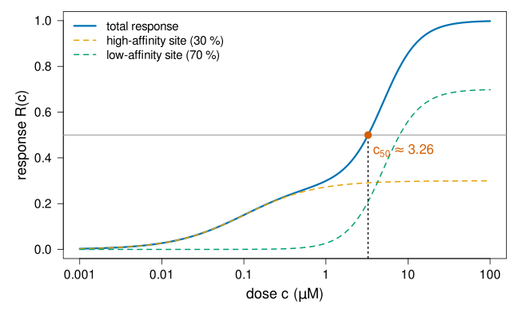
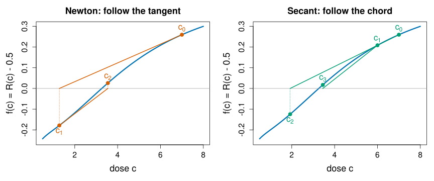
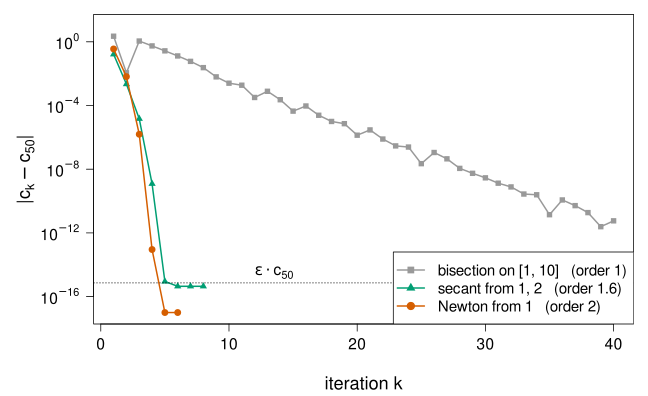
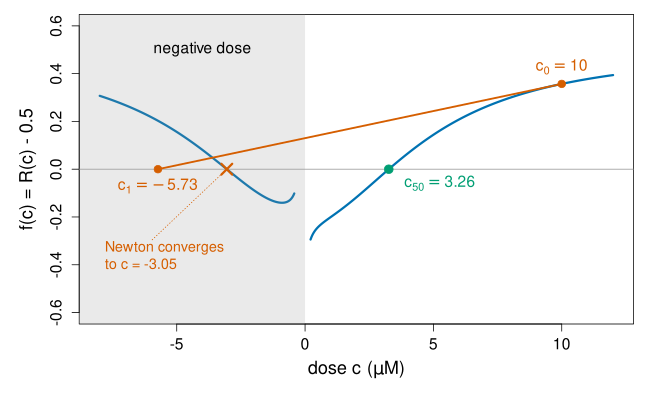
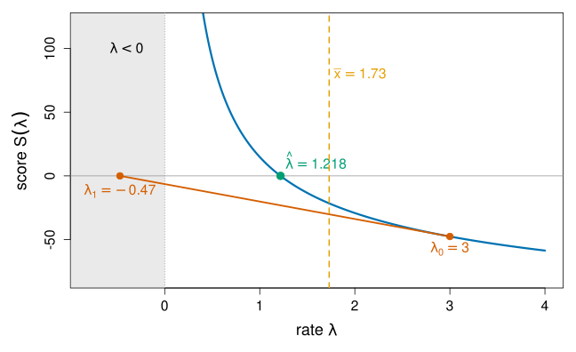
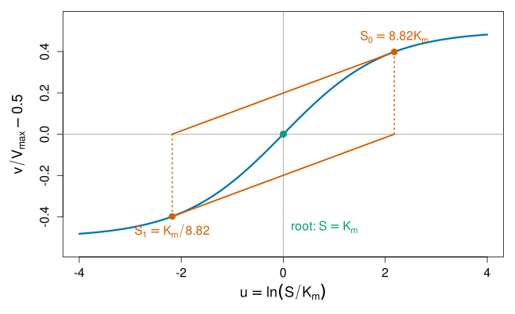

## About this lecture {.smaller}

Bisection is safe but slow: one binary digit per step. This lecture is about the fast methods, and about how they fail.

- **Newton's method** replaces $f$ by its tangent line and solves that instead. Near a root the number of correct digits **doubles** every step (quadratic convergence).
- The **secant method** uses a line through the last two points instead of the tangent, so it needs no derivative. Order about 1.6.
- Both can **fail**: a flat derivative throws the iterate far away, a bad start runs off to a meaningless root, some starts **cycle** forever.
- Production root finders (**Brent's method**: R's `uniroot`, Python's `scipy.optimize.brentq`) keep a bracket for safety and take fast steps when they can.
- Biology: the dose giving 50 % response of a **two-site dose–response curve**, and a **maximum-likelihood estimate** as the root of the score function.

::: notes
This is the second unit of Part 2. The previous unit (Bisection and fixed-point iteration) gave us a method that always works but is slow; this one gives methods that are fast but can fail, and ends with the combination that every library uses. The two biology examples run through the whole lecture: an EC50 that has no closed form, and a maximum-likelihood estimate of a rate that has no closed form either. Both are things students already compute with black boxes (drc, nls, glm, fitdistr); here we open the box.
:::

## Recap: bracketing and fixed points {.smaller}

From [*Bisection and fixed-point iteration*](../bisection-fixedpoint/lec.qmd):

- **Bisection** keeps an interval $[a, b]$ with $f(a)\,f(b) < 0$ and halves it. It **always** converges, but only linearly: the error halves each step, about **0.3 decimal digits per step**, ~50 steps for full precision.
- **Fixed-point iteration** $x_{k+1} = g(x_k)$ converges near $x^*$ if $|g'(x^*)| < 1$, and the error shrinks by about $|g'(x^*)|$ per step.
- Stopping: stop when the step (or bracket) is below a **relative** tolerance, and always cap the number of steps.

Question for today: can we use more information about $f$ (its slope) to go faster?

::: notes
One slide only. Remind them of the two facts we build on: bisection is the safe fallback, and a fixed-point iteration converges at a rate set by |g'(x*)|. That second fact explains Newton's speed in a few slides: Newton is a fixed-point iteration with g'(x*) = 0. In Convergence and cost we already saw Newton for sqrt(2) gain digits much faster than halving; now we see where it comes from.
:::

## A biology problem: EC50 of a two-site drug {.smaller}

:::: {.columns}
::: {.column width="55%"}
{width="100%"}
:::
::: {.column width="45%"}
A drug binds two receptor subtypes: a high-affinity site ($K_1 = 0.1\,\mu$M, 30 % of the response) and a low-affinity site ($K_2 = 5\,\mu$M, Hill coefficient 2, 70 %):

$$R(c) = 0.3\,\frac{c}{0.1 + c} + 0.7\,\frac{c^2}{25 + c^2}$$

Which dose $c_{50}$ gives $R = 0.5$?
:::
::::

- For **one** Hill curve, $c_{50} = K$, by algebra. For the sum of two, there is **no formula**: we must solve $f(c) = R(c) - 0.5 = 0$ numerically.

::: notes
Two-site (or biphasic) dose-response curves are common: receptor subtypes, two binding sites on a protein, a drug with an on-target and an off-target effect. The single Hill curve c^n / (K^n + c^n) has c50 = K, which is why papers report EC50 as a fitted parameter. As soon as the model is a mixture, the dose that gives 50 % response is not a parameter any more and must be found by root finding. Setting R(c) = 0.5 and clearing denominators gives a quartic in c here, which has an ugly formula; for non-integer Hill coefficients there is no formula at all. Note the log dose axis, as usual in pharmacology.
:::

## The function and its derivative in R

```r
R  <- function(c) 0.3 * c / (0.1 + c) + 0.7 * c^2 / (25 + c^2)
f  <- function(c) R(c) - 0.5                       # root = c50
df <- function(c) 0.03 / (0.1 + c)^2 + 35 * c / (25 + c^2)^2
f(c(1, 3, 10))
# [1] -0.2003497 -0.0243833  0.3570297
```

- $f(3) < 0 < f(10)$: the root lies between 3 and 10. Bisection would work.
- `df` is $f'(c)$, by hand: quotient rule on each term, $\frac{d}{dc}\frac{c}{0.1 + c} = \frac{0.1}{(0.1 + c)^2}$ and $\frac{d}{dc}\frac{c^2}{25 + c^2} = \frac{50c}{(25 + c^2)^2}$.
- Check the derivative before trusting it (exercise C1): compare with $\bigl(f(c + h) - f(c)\bigr)/h$.

::: notes
Newton needs the derivative. Here it is short to derive by hand; the exercise asks them to check it against a finite difference, as in Convergence and cost. A wrong derivative is the single most common Newton bug: the iteration then often still converges, but only linearly, or not at all. The sign change between 3 and 10 tells us a root exists there; remember it for when Newton goes astray.
:::

## Newton's idea: follow the tangent {.smaller}

Near $x_k$, Taylor says $f(x) \approx f(x_k) + f'(x_k)\,(x - x_k)$: a straight line. Set the line to zero and solve for $x$:

$$x_{k+1} = x_k - \frac{f(x_k)}{f'(x_k)}$$

{width="88%" fig-align="center"}

::: notes
This is the whole derivation: keep the first two terms of Taylor (the tangent), throw away the rest, and solve the linear equation. The left panel starts at c0 = 7, on the concave side of the curve: the tangent overshoots to c1 = 1.28, but from there the tangent lands at c2 = 3.54, already close to 3.26. The right panel is the secant method, which comes later in the lecture: same idea, but with a line through the last two points. Point out that the further you are from the root, the worse the tangent approximates the curve; close to the root it is excellent.
:::

## One Newton step with numbers

Start at $c_0 = 1$:

- $f(1) = 0.3 \cdot \tfrac{1}{1.1} + 0.7 \cdot \tfrac{1}{26} - 0.5 = 0.27273 + 0.02692 - 0.5 = -0.20035$
- $f'(1) = \tfrac{0.03}{1.21} + \tfrac{35}{676} = 0.02479 + 0.05178 = 0.07657$
- $c_1 = 1 - \tfrac{-0.20035}{0.07657} = 1 + 2.6166 = 3.6166$

The true $c_{50} = 3.2613$: from an error of $2.26$ to $0.355$ in one step.

::: notes
Do this on the board, with a calculator. The step is minus f over f-prime: f is negative and the curve is rising, so we step to the right. The step size 2.6 is large because the slope is small. The exercise asks for the next step by hand too (on a simpler Hill curve with a known answer).
:::

## Newton in R: watch the digits

```r
c50 <- 3.261305265055212            # converged value, see later
x <- 1
for (k in 1:5) {
  x <- x - f(x) / df(x)
  cat(k, sprintf("%.15f", x), sprintf("%.1e", abs(x - c50)), "\n")
}
# 1 3.616605460641865 3.6e-01
# 2 3.254817195760261 6.5e-03
# 3 3.261303701902960 1.6e-06
# 4 3.261305265055122 9.1e-14
# 5 3.261305265055212 0.0e+00
```

- Correct digits: 1, 2, 6, 13, 16. The number of correct digits roughly **doubles** each step.
- Bisection on $[1, 10]$ needs about 50 steps for the same accuracy.

::: notes
This is the quadratic convergence promised in Convergence and cost, now on a real problem. The first step is a long jump that gets only the leading digit right; once close, the digit count doubles: 2, 6, 13, then all of them. Step 5 hits the reference value exactly, to the last bit. Of course in practice we do not know c50; the next slide shows how to stop without it.
:::

## A reusable Newton function

```r
newton <- function(f, df, x0, tol = 1e-12, maxit = 50) {
  x <- x0
  for (k in 1:maxit) {
    step <- f(x) / df(x)
    x <- x - step
    if (abs(step) <= tol * abs(x)) return(list(root = x, iter = k))
  }
  warning("no convergence after ", maxit, " steps")
  list(root = x, iter = maxit)
}
newton(f, df, x0 = 1)$root        # 5 iterations
# [1] 3.261305
```

- **Stop** when the step is small **relative** to $x$. Near a root the step is a good estimate of the error, because the next step is much smaller.
- **Cap** the number of steps and **warn**, never fail silently.
- Check afterwards: is $|f(\text{root})|$ small, and is the root in the range that makes biological sense ($c > 0$)?

::: notes
Ten lines, the hand-written version the design principles ask for. The stopping rule uses the size of the last step: with quadratic convergence the error after the step is far smaller than the step, so |step| is a slightly pessimistic estimate of the error before the step. A relative tolerance makes the rule work for doses in nM and in mM alike; tol = 1e-12 asks for about 12 digits. (For a root at exactly 0 a relative test never succeeds; add an absolute tolerance in that case.) maxit and the warning are the safety net for the failures later in the lecture. The post-checks are cheap and catch most of them.
:::

## Why digits double {.smaller}

Write $e_k = x_k - x^*$. Taylor to **second** order around $x_k$, then one line of algebra:

$$e_{k+1} \approx \frac{f''(x^*)}{2 f'(x^*)}\; e_k^2$$

Check on our run (error ratio $e_{k+1}/e_k^2$):

| $k$ | 1 | 2 | 3 | 4 |
|---|---|---|---|---|
| $e_k$ | $3.6\times10^{-1}$ | $6.5\times10^{-3}$ | $1.6\times10^{-6}$ | $9.1\times10^{-14}$ |
| $e_{k+1}/e_k^2$ | 0.051 | 0.037 | 0.037 | |

and $|f''(c_{50}) / (2 f'(c_{50}))| = 0.0374$. Squaring the error doubles the digits; the constant only shifts them a little.

- Another view: Newton is fixed-point iteration with $g(x) = x - f(x)/f'(x)$, and $g'(x^*) = 0$, the best possible case of $|g'(x^*)| < 1$.

::: notes
The derivation: 0 = f(x*) = f(x_k) - f'(x_k) e_k + f''/2 e_k^2 + ..., divide by f'(x_k) and use the Newton update; the first-order terms cancel and what is left is the e_k^2 term. We do not do this in full on the slide; the exercise has a guided version. The table is the experimental check: the ratio settles at 0.037, which matches f''/(2f') computed at the root (with numDeriv). The constant tells you what can spoil quadratic convergence: f' = 0 at the root (a double root, the quiz) or a huge f''. The fixed-point view links back to the previous unit: g'(x*) = 0 means the error is not shrunk by a constant factor but squared.
:::

## Second biology problem: a rate from truncated counts {.smaller}

A gene's UMI counts, recorded only in the 100 cells where it was **detected** (count ≥ 1):

| count | 1 | 2 | 3 | 4 | 5 |
|---|---|---|---|---|---|
| cells | 52 | 30 | 12 | 5 | 1 |

Model: Poisson with rate $\lambda$, **zero-truncated** (zeros are not seen). Log-likelihood and its derivative, the **score**:

$$\ell(\lambda) = \textstyle\sum_i x_i \log\lambda - n\lambda - n\log(1 - e^{-\lambda}) + \text{const}, \qquad S(\lambda) = \ell'(\lambda) = \frac{\sum_i x_i}{\lambda} - \frac{n}{1 - e^{-\lambda}}$$

- The MLE $\hat\lambda$ solves $S(\lambda) = 0$, i.e. $\bar x = \lambda / (1 - e^{-\lambda})$. **No closed form.**
- The naive mean $\bar x = 1.73$ overestimates $\lambda$, because the zeros were thrown away.

::: notes
Zero-truncated data are common in biology: counts recorded only where something was seen (UMIs in cells where a gene is detected, eggs in nests that have at least one, number of infected cells per infected well). For a plain Poisson the score is sum(x)/lambda - n and the MLE is the mean. The truncation adds the log(1 - e^-lambda) term, and the equation for the MLE becomes transcendental. Every maximum-likelihood fit you have run (glm, fitdistr, nls with likelihoods) solves an equation score = 0 like this one, usually with Newton or a relative of it. The maximisation view comes back in Part 10 (Gradient descent, Newton and quasi-Newton).
:::

## Newton on the score

```r
x <- rep(1:5, times = c(52, 30, 12, 5, 1))   # UMI counts, cells with >= 1 UMI
n <- length(x); sx <- sum(x)
S  <- function(l) sx / l - n / (-expm1(-l))        # score; -expm1(-l) = 1 - exp(-l)
dS <- function(l) -sx / l^2 + n * exp(-l) / expm1(-l)^2
fit <- newton(S, dS, x0 = mean(x))
fit$root; fit$iter
# [1] 1.21847
# [1] 6
1 / sqrt(-dS(fit$root))                           # standard error of lambda-hat
# [1] 0.1325479
```

- $\hat\lambda = 1.218$, not 1.73. Starting at $\bar x$ (a sensible guess from the data) converges in 6 steps.
- $-S'(\hat\lambda)$ is the **observed information**; $1/\sqrt{-S'(\hat\lambda)}$ is the usual standard error. Newton computes it for free.
- `expm1` from [*How computers store numbers*](../floating-point/lec.qmd) keeps $1 - e^{-\lambda}$ accurate for small $\lambda$.

::: notes
The same ten-line newton function, now on a statistical problem. S' is the second derivative of the log-likelihood; minus it is the observed Fisher information, so the standard error comes out of the last Newton step at no cost. That is why Newton-type methods are standard in likelihood fitting (glm's iteratively reweighted least squares is Fisher scoring, a Newton variant). Uncertainty of fitted parameters gets its own unit in Part 10 (Identifiability and uncertainty of fitted parameters). expm1 matters for rates near 0, where 1 - exp(-l) cancels.
:::

## The secant method: no derivative needed {.smaller}

Often $f'$ is tedious or impossible to write down (an ODE solution, a simulation). Replace the tangent by the line through the last **two** points:

$$x_{k+1} = x_k - f(x_k)\,\frac{x_k - x_{k-1}}{f(x_k) - f(x_{k-1})}$$

- The fraction is $1/\text{slope}$ of the chord, an estimate of $1/f'(x_k)$.
- **One** new function evaluation per step ($f(x_k)$; $f(x_{k-1})$ is reused). Newton needs **two** ($f$ and $f'$).
- Needs two starting values. Unlike bisection, they need **not** bracket the root.

::: notes
Point back to the right panel of the tangent picture. The secant method is Newton with the derivative replaced by a finite difference that uses points we already have, so it is free. The two start points do not need opposite signs; this is not regula falsi (false position), which keeps a bracket. In practice derivatives are often unavailable: if f involves solving an ODE or running a simulation, a hand-derived f' does not exist.
:::

## Secant in R

```r
secant <- function(f, x0, x1, tol = 1e-12, maxit = 50) {
  f0 <- f(x0); f1 <- f(x1)
  for (k in 1:maxit) {
    step <- f1 * (x1 - x0) / (f1 - f0)
    x0 <- x1; f0 <- f1                           # shift the pair
    x1 <- x1 - step; f1 <- f(x1)
    if (abs(step) <= tol * abs(x1)) return(list(root = x1, iter = k))
  }
  warning("no convergence after ", maxit, " steps")
  list(root = x1, iter = maxit)
}
secant(f, 1, 2)$iter;  secant(S, 1, 2)$iter     # c50: 6 steps; lambda-hat: 8 steps
```

- Same structure as `newton`; only `df` is gone.
- Danger: if $f_1 = f_0$ the step is $0/0$ or $\pm\infty$. Production code tests for it.

::: notes
Line by line the same as newton, with the slope computed from the stored pair. Storing f0 and f1 is what makes it one evaluation per step. Near convergence f1 - f0 becomes tiny and both are dominated by rounding; the stopping test usually fires first, but a robust implementation checks for f1 == f0 (the exercise does). Six steps for c50 against Newton's five, but Newton's five steps cost ten evaluations.
:::

## Digits per step: bisection, secant, Newton {.smaller}

:::: {.columns}
::: {.column width="55%"}
{width="100%"}
:::
::: {.column width="45%"}
Correct digits of $c_{50}$ after step $k$:

| $k$ | bisect | secant | Newton |
|---|---|---|---|
| 1 | 0.2 | 1.3 | 1.0 |
| 2 | 2.5 | 3.2 | 2.7 |
| 3 | 0.5 | 5.3 | 6.3 |
| 4 | 0.8 | 9.4 | 13.6 |
| 5 | 1.1 | 15.6 | all |
:::
::::

- **Order** $p$: $e_{k+1} \approx C e_k^p$. Bisection $p = 1$, secant $p = 1.618$ (the golden ratio), Newton $p = 2$.
- Per **function evaluation**, secant (1.62) beats Newton ($\sqrt2 = 1.41$): two secant steps cost as much as one Newton step.

::: notes
Digits = -log10(relative error). Bisection's midpoint error wobbles (step 2 is a lucky hit), but its bound halves every step; it ends at about 12 digits after 40 steps. The secant digit counts grow by a factor of about 1.6 per step: 3.2, 5.3, 9.4, 15.6. Newton's double. The flat part at the bottom is machine precision, eps times c50. The per-evaluation comparison: two Newton evaluations multiply the order by 2, so per evaluation the order is sqrt(2); a secant evaluation multiplies by 1.618. When f' costs as much as f, the secant method is usually faster in time. Estimating p from three consecutive errors is in the exercise.
:::

## Try it: step through Newton, secant and bisection

```{=html}
<link rel="stylesheet" href="../demos/dist/demo.css">
<div data-demo="newtonstep" data-problem="dose" data-method="newton" data-x0="1"></div>
<script src="../demos/dist/newtonstep.js"></script>
```

::: notes
The same f(c) = R(c) - 0.5, computed live in the browser. Press Step five times from c0 = 1: each step draws the tangent and where it meets zero; the table shows correct digits 1.0, 2.7, 6.3, 13.6, all, the × column (factor by which the digits grew) about 2, and the bold digits of c_k grow the same way. 10 evaluations. Click "secant 1, 2" and Run: digits 1.3, 3.2, 5.3, 9.4, all, factors near 1.6; 8 evaluations. Click "bisection [1, 10]" and Run: +0.3 digits per step, 42 steps, 44 evaluations. Then, as a lead-in to the next three slides, click "1 flat tangent" and step: c1 = -5.73, and the run converges to -3.05 with f = 0 and zero correct digits. Drag the start to show that 7.85 still works and 9 does not. The exercise's Explore section has the bad-start and cycling presets as tasks; show them here only if there is time.
:::

## Failure 1: a flat tangent throws you far away

:::: {.columns}
::: {.column width="55%"}
{width="100%"}
:::
::: {.column width="45%"}
```r
r <- newton(f, df, x0 = 10)$root
r
# [1] -3.04997
f(r)
# [1] 0             # a root!
```
:::
::::

- At $c_0 = 10$ the curve is nearly flat ($f' = 0.023$), so $f/f'$ is a huge step, to $c_1 = -5.73$.
- Newton then converges, **quickly and quietly**, to an exact root at a **negative dose**. No warning.
- **Check:** is the root in the meaningful range? Plot $f$. Start inside a bracket.

::: notes
The formula for R accepts negative c, and it happens to have another root there. Newton does not know that doses are positive. This is the "confident wrong answer" of the introduction: converged, f is exactly zero in floating point, and biologically meaningless. Whenever f' is small compared with f, the step f/f' is large; near a plateau of a saturating curve that is always the case. The checks: look at the answer (negative dose), plot f over the plausible range, and start from a point inside a bracket where f changes sign. Solving in log dose would make negative doses impossible, but has its own failure (two slides on).
:::

## Failure 2: a bad start for the MLE

:::: {.columns}
::: {.column width="55%"}
{width="100%"}
:::
::: {.column width="45%"}
```r
l <- 3                       # start
for (k in 1:6) {
  l <- l - S(l) / dS(l)
  cat(signif(l, 4), "")
}
# -0.4704 -1.066 -2.587
# -6.032 -12.33 -24.67
```
:::
::::

- The score is convex and flattens for large $\lambda$; from $\lambda_0 = 3$ the tangent crosses zero at $\lambda_1 = -0.47$. From there Newton runs off to $-\infty$.
- Starts up to about 2.7 converge; from 2.8 on they do not. The start must be **close enough**.
- **Check:** $\lambda > 0$ at every step; the log-likelihood should **increase** at every step.

::: notes
Newton converges only from close enough. "Close enough" is not a fixed distance; it depends on the shape of f. For large lambda the score behaves like sum(x)/lambda - n, and Newton on 1/lambda type functions overshoots badly: the exercise derives that the iteration for 1/x - a only converges from 0 < x0 < 2/a. Here that predicts trouble from about 2 x-bar = 3.5; the true limit is between 2.7 and 2.8. A good start (the mean, a method-of-moments estimate) avoids it, and so does a bracket. Optimisation routines check that each step increases the log-likelihood and shorten the step if not (line search, Part 10).
:::

## Failure 3: cycling forever

:::: {.columns}
::: {.column width="55%"}
{width="100%"}
:::
::: {.column width="45%"}
Michaelis–Menten, in log substrate $u = \ln(S/K_m)$: solve $v/V_{\max} = 0.5$ (root $S = K_m$). Newton's step is $u_{k+1} = u_k - \sinh u_k$.

```r
u <- 2.1773189849653  # S0 = 8.82 Km
for (k in 1:6) {
  u <- u - sinh(u); cat(signif(u, 4), "")
}
# -2.177 2.177 -2.177 2.177 -2.177 2.177
```
:::
::::

- Start at $8.82\,K_m$: the tangents bounce between $8.82\,K_m$ and $K_m/8.82$ **forever**. Start at $10\,K_m$: $u$ grows, `Inf`, then `NaN`. Start at $5\,K_m$: converges.
- **Check:** cap the number of steps (`maxit`) and look at the last few iterates.

::: notes
Working in log dose is good practice (doses are positive, curves are symmetric), but Newton can still fail on a sigmoid. For the logistic curve in u the Newton step simplifies to u - sinh(u) (exercise). A 2-cycle needs u - sinh(u) = -u, i.e. sinh(u) = 2u, at u = 2.177, S = 8.82 Km. Beyond it Newton diverges (u = 2.3 gives -2.64, 4.31, -33, 1e14, -Inf, NaN), inside it converges. Exact cycles are rare, but near-cycles that wander for many steps before escaping are common. The maxit cap plus a warning is what turns an endless loop into a message.
:::

## Failures and checks at a glance {.smaller}

| What goes wrong | Symptom | Check / fix |
|---|---|---|
| Start far from root, $f'$ small | huge first step | plot $f$; start inside a bracket |
| Converges to the wrong root | root outside the meaningful range | check sign and range of the answer |
| Divergence | iterates grow, `Inf`, `NaN` | `is.finite()` on each iterate; `maxit` |
| Cycling | iterates repeat | `maxit` plus warning; print the last iterates |
| Wrong derivative | slow (linear) or no convergence | compare `df` with a finite difference |
| $f'(x^*) = 0$ (double root) | linear convergence, few digits | look at the digits-per-step |
| Secant: $f(x_k) = f(x_{k-1})$ | division by 0 | test before dividing |

The cure for most of them: **never leave a bracket**.

::: notes
A summary table to keep. Most of these failures share one cause: Newton and secant only use local information, so nothing stops them from leaving the region where the root is. If we know an interval with a sign change, we can refuse any step that leaves it. That is the idea of safeguarded methods, next. The double-root case is in the quiz: a tangency, e.g. at a saddle-node bifurcation, where f touches zero without crossing it; bracketing does not help there either, because there is no sign change.
:::

## Safeguarding: Brent's method {.smaller}

Keep a bracket $[a, b]$ with a sign change, **and** try a fast step:

1. Propose a fast step: secant, or **inverse quadratic interpolation** (a parabola $x(f)$ through the last three points, evaluated at $f = 0$).
2. If the proposal falls **outside** the bracket, or the bracket has not shrunk enough lately, take a **bisection** step instead.
3. Evaluate $f$ at the new point and keep the half that still has the sign change.

- **Guaranteed** to converge, like bisection: never worse than about bisection's pace.
- **Superlinear** (order up to ~1.8) once close, like secant. No derivative needed.
- This is R's [`uniroot`](https://stat.ethz.ch/R-manual/R-devel/library/stats/html/uniroot.html) and Python's `scipy.optimize.brentq`.

::: notes
Brent (1973), building on Dekker. The details of when to switch are fiddly, but the idea fits on a slide: a fast method on a leash. Inverse quadratic interpolation fits x as a quadratic function of f through three points and reads off x at f = 0; it converges with order about 1.84. The bisection fallback guarantees that the bracket keeps shrinking, so the method cannot diverge, cycle or leave the interval. We do not implement Brent; we use it, and the exercise compares its function-evaluation count with ours.
:::

## `uniroot` in practice

```r
r <- uniroot(f, interval = c(0.01, 100))
c(root = r$root, iter = r$iter, estim.prec = r$estim.prec)
#         root         iter   estim.prec
# 3.261305e+00 9.000000e+00 6.103516e-05
r$root - c50
# [1] -1.360226e-07                            # only ~7 digits!
r <- uniroot(f, interval = c(0.01, 100), tol = 1e-12)
r$root - c50; r$iter
# [1] 4.440892e-16
# [1] 10
uniroot(f, c(5, 100))          # Error: f() values at end points not of opposite sign
```

- The default `tol` is $\varepsilon^{1/4} \approx 1.2\times10^{-4}$, an **absolute** tolerance: set `tol` yourself.
- It needs a sign change; `extendInt = "yes"` widens a bad interval for you.

::: notes
Three practical points. First, uniroot's default tolerance is loose: fine for an EC50 reported to 3 digits, not fine if the root feeds into further computation (e.g. a derivative by finite differences, or an outer optimisation). estim.prec reports the achieved bracket width. Second, with a sensible tol it reaches machine precision in 10 iterations from a 10 000-fold wide bracket; bisection would need 50. Third, it refuses intervals without a sign change, which is exactly the safety we wanted. brentq in scipy has a tighter default (xtol = 2e-12, plus a relative rtol), but the same idea.
:::

## Back to the MLE, safely

```r
uniroot(S, interval = c(0.01, 10), tol = 1e-10)$root
# [1] 1.21847
S(c(0.01, 10))
# [1] 7249.91667  -82.70454
```

- A **wide** bracket of plausible rates is easy to give: $S > 0$ for small $\lambda$, $S < 0$ for large $\lambda$.
- No start value to choose, no derivative, no run-off to negative rates.
- When you need the derivative anyway (standard error), polish with one or two Newton steps from the bracketed answer.

Rule of thumb: **bracket first** (`uniroot`, `brentq`), use hand-written Newton when you need speed in a loop over thousands of genes, and then **with** a good start and checks.

::: notes
The bracket [0.01, 10] covers any plausible rate for these data. uniroot finds the same 1.21847 that Newton found from the mean, and cannot fail the way Newton did from 3. In practice: for one-off roots, use uniroot with tol set. For a root inside a loop over 20 000 genes, Newton from a good start (the mean) converges in a handful of steps and is cheaper; add a fallback to uniroot for the genes where the checks fail.
:::

## Checklist: before you trust a root

- **Plot $f$** over the plausible range. How many roots? Where?
- **Bracket** the root if you can, and use a bracketing method (`uniroot`, `brentq`).
- **Set the tolerance** yourself; know whether it is absolute or relative.
- **Check the answer:** $|f(x)|$ small, $x$ in the meaningful range (positive dose, positive rate).
- **Hand-written Newton:** check `df` against a finite difference; cap the iterations; warn on failure.
- **Look at the convergence:** digits should double (Newton) or grow by ~1.6× (secant). If they grow by a fixed amount per step, something is wrong (derivative, double root).

::: notes
Read through it once. The last point is the diagnostic that comes from this lecture: the digits-per-step table is not just a picture of the theory, it is a debugging tool. Linear convergence from a method that should be quadratic almost always means a wrong derivative or a root where f' = 0.
:::

## Summary {.smaller}

- **Newton**: $x_{k+1} = x_k - f(x_k)/f'(x_k)$, from the tangent line (first-order Taylor). Near a simple root, **quadratic**: $e_{k+1} \approx \frac{f''}{2f'}\,e_k^2$, digits double each step.
- **Secant**: the tangent replaced by the chord through the last two points. No derivative, one evaluation per step, order **1.618**.
- Both converge only from **close enough**. Failures: a flat derivative sends the iterate far away (negative dose), a bad start diverges (negative rate), some starts **cycle**. Detect with range checks, `is.finite()`, `maxit`, and a plot of $f$.
- **Brent's method** (`uniroot`, `brentq`) keeps a sign-change bracket and uses fast steps inside it: guaranteed and fast. Set `tol` yourself.
- Biology: an EC50 of a two-site curve and a maximum-likelihood rate are both roots with **no closed form**; the observed information $-S'(\hat\lambda)$ from Newton gives the standard error.

**Next:** [*Newton for systems of equations*](../newton-systems/lec.qmd), where $f'$ becomes the Jacobian matrix and each step is a linear solve.

::: notes
Recap the two methods, the convergence orders and the failure modes with their checks. Next unit: two or more unknowns (steady states of a toggle switch); Newton generalises directly, with the derivative replaced by the matrix of partial derivatives. The secant idea generalises too (Broyden, and later quasi-Newton optimisation in Part 10).
:::
