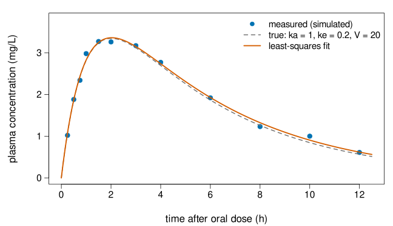
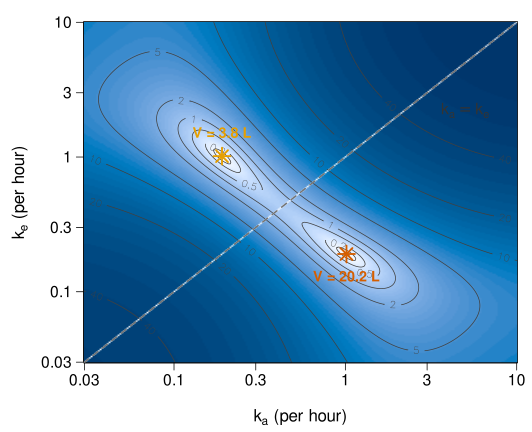
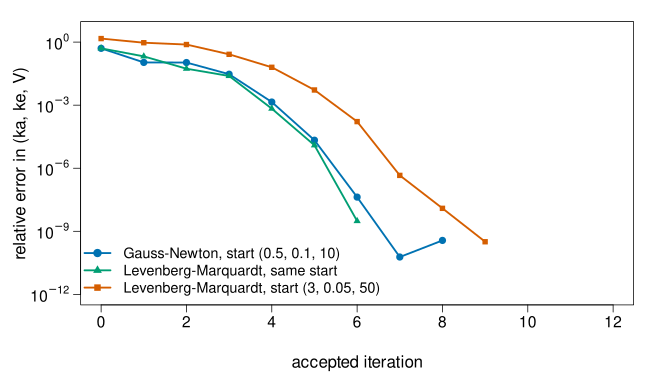
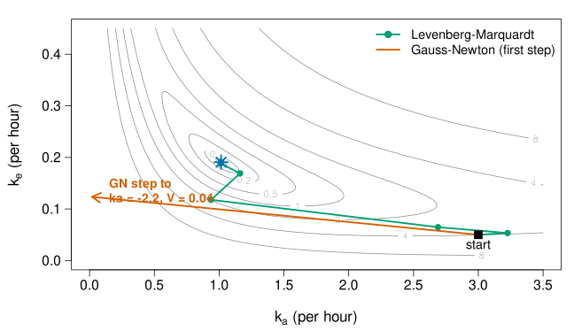
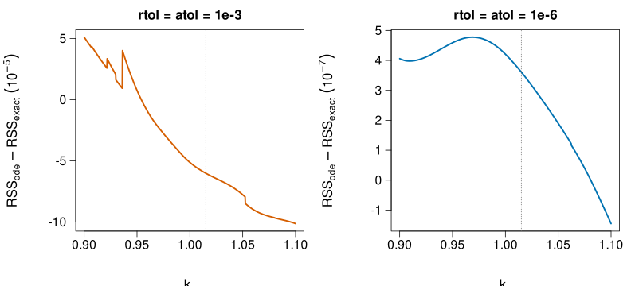
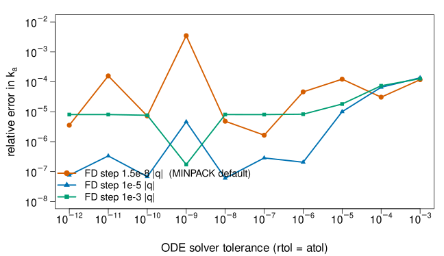
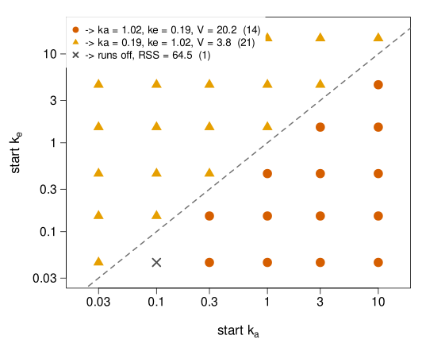
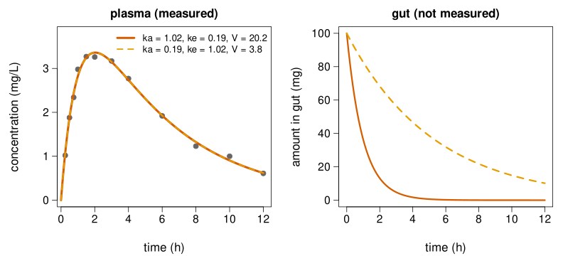

## About this lecture {.smaller}

Fitting a model to data means choosing parameters that make the **residuals** small. When the model is **nonlinear in its parameters** (a rate inside an exponential), `lm` cannot do it and there is no formula: we iterate.

- **Gauss–Newton**: linearise the model, solve **one linear least-squares problem per step** (by QR), repeat. Fast near the answer, wild far from it.
- **Levenberg–Marquardt**: damped Gauss–Newton, sliding between Gauss–Newton and gradient descent. What `minpack.lm::nlsLM` and `scipy.optimize.least_squares` use.
- Practicalities: `nls` and its **"singular gradient"**, **log-parameters** for positive rates, **multistart**.
- **ODE models**: the ODE solver sits *inside* the residual function. Its tolerance and the finite-difference step must fit together.
- Biology: a drug taken orally. From 12 plasma samples, estimate the **absorption rate**, the **elimination rate** and the **volume of distribution**.

::: notes
This unit puts together three earlier ones: linear least squares by QR (Part 4), Newton for systems with its Jacobian (Part 2) and the ODE solvers of Part 8. It also runs alongside Gradient descent, Newton and quasi-Newton: Levenberg-Marquardt is the special-purpose method for sums of squares, and its two limits are Gauss-Newton and gradient descent. The PK model is the running example; it has a closed form, which lets us check every ODE-based fit exactly. The flip-flop at the end leads into the next unit, Identifiability and uncertainty of fitted parameters.
:::

## A biology problem first: a drug in plasma {.smaller}

{width="62%" fig-align="center"}

- One oral dose $D = 100$ mg. Plasma sampled 12 times over 12 hours.
- Questions: how fast is the drug **absorbed** ($k_a$), how fast **eliminated** ($k_e$), and in what **volume** ($V$) does it distribute? These decide the dosing schedule.
- The data are **simulated** from $k_a = 1$/h, $k_e = 0.2$/h, $V = 20$ L, plus noise with SD 0.1 mg/L, so we know the truth.

::: notes
This is the standard one-compartment model with first-order absorption, the first model fitted in any pharmacokinetics course. Real data would come from a phase 1 study. The data were simulated with set.seed(1), rounded to 2 decimals and typed in, so R, Python and Rust use the same 12 numbers (they are in the exercise and in the figure script). The fitted curve (orange) differs slightly from the true one (dashed) because of the noise: least squares finds the best curve for these data, not the truth. How close the estimates are to the truth is the topic of the next unit.
:::

## The model: an ODE with a closed form {.smaller}

:::: {.columns}
::: {.column width="50%"}
Amount in gut $A_g$, in the central compartment (plasma) $A_c$:

$$A_g' = -k_a A_g, \qquad A_c' = k_a A_g - k_e A_c$$

$A_g(0) = D$, $A_c(0) = 0$, and we measure $C = A_c / V$.
:::
::: {.column width="50%"}
Solved by hand (the **Bateman function**):

$$C(t) = \frac{D\,k_a}{V(k_a - k_e)}\left(e^{-k_e t} - e^{-k_a t}\right)$$
:::
::::

```r
D  <- 100
tt <- c(0.25, 0.5, 0.75, 1, 1.5, 2, 3, 4, 6, 8, 10, 12)
y  <- c(1.02, 1.88, 2.34, 2.98, 3.27, 3.26, 3.17, 2.77, 1.92, 1.23, 1.00, 0.61)
bateman <- function(t, ka, ke, V) D * ka / (V * (ka - ke)) * (exp(-ke * t) - exp(-ka * t))
```

- $k_a$ and $k_e$ sit **inside exponentials**: the model is **nonlinear in its parameters**. No transformation turns it into `lm`.
- Most ODE models have no closed form. We use the formula first, then fit the ODE directly and check against it.

::: notes
The ODE is linear in the state, which is why it can be solved by hand: first A_g = D exp(-ka t), then a linear first-order ODE for A_c. Taking logs helps for a single exponential (log C = log C0 - k t is a straight line, as in the intro), but not for a difference of two exponentials. Note the formula is 0/0 at ka = ke: R returns NaN there. The ODE has no such problem; the exercise looks at this. Bioavailability F is absorbed into V here (strictly, V is V/F).
:::

## The least-squares problem {.smaller}

Parameters $\mathbf p = (k_a, k_e, V)$, model values $m_i(\mathbf p) = C(t_i)$, residuals $r_i = y_i - m_i(\mathbf p)$:

$$\min_{\mathbf p}\ \text{RSS}(\mathbf p) = \sum_{i=1}^{12} r_i(\mathbf p)^2$$

:::: {.columns}
::: {.column width="52%"}
{width="100%"}
:::
::: {.column width="48%"}
- RSS over $(k_a, k_e)$, with $V$ at its best value for each pair.
- A curved valley, **two** minima with the **same** RSS (stars), and a line $k_a = k_e$ where the formula is 0/0.
- A start in the wrong place can end in the wrong minimum. We come back to this at the end.
:::
::::

::: notes
Contours of RSS on log axes; V is "profiled out": for fixed ka and ke the model is linear in D/V, so the best V comes from a one-line linear least-squares fit. The valley is long and curved, which is typical for rate constants: the data mainly determine a combination of them. The second minimum is not a numerical artefact; it is the flip-flop solution, an exact symmetry of the model, discussed at the end. For now: nonlinear least squares can have several minima, and a local method finds the one whose valley it starts in.
:::

## Recap: linear least squares by QR {.smaller}

For a **linear** model $A\mathbf x \approx \mathbf b$ (unit *Least squares: normal equations vs QR*):

- minimise $\|\mathbf b - A\mathbf x\|^2$; factor $A = QR$ and back-substitute $R\mathbf x = Q^T\mathbf b$. In R: `qr.solve(A, b)`.
- The normal equations $A^TA\mathbf x = A^T\mathbf b$ give the same $\mathbf x$ in exact arithmetic, but **square** the condition number: $\kappa(A^TA) = \kappa(A)^2$.

And from *Newton for systems of equations*: the **Jacobian** $J_{ij} = \partial m_i / \partial p_j$ is the matrix of slopes, and

$$\mathbf m(\mathbf p + \boldsymbol\delta) \approx \mathbf m(\mathbf p) + J\,\boldsymbol\delta.$$

Gauss–Newton = these two ideas together.

::: notes
One slide of recap only. The student should remember: QR for least squares, never form A^T A if you can avoid it, and the Jacobian as the matrix that turns a small change in the parameters into the change in the model. Here the Jacobian is 12 x 3: one row per measurement, one column per parameter. Unlike in Newton for systems, J is not square, which is why each step is a least-squares problem rather than a linear system.
:::

## Linearise the model {.smaller}

At the start $\mathbf p_0 = (0.5, 0.1, 10)$, by forward differences (rows $t = 0.25$, $2$, $12$ h):

```r
model <- function(p) bateman(tt, p[1], p[2], p[3])
jac <- function(p, h = 1e-7) sapply(1:3, function(j) {      # forward differences
  e <- replace(numeric(3), j, h * p[j]); (model(p + e) - model(p)) / e[j] })
J <- jac(c(0.5, 0.1, 10));  round(J[c(1, 6, 12), ], 3)
#        [,1]    [,2]   [,3]
# [1,]  2.178  -0.147 -0.116
# [2,]  6.379  -6.379 -0.564
# [3,] -1.495 -35.844 -0.373
```

- Column 1: raising $k_a$ raises early concentrations and lowers late ones (faster in, faster gone).
- Column 2: raising $k_e$ lowers everything, most at 12 h. Column 3: raising $V$ dilutes.
- Step $h = 10^{-7}\,p_j$ is relative to each parameter, as in *Newton for systems of equations*.

::: notes
Each column is a sensitivity: how much each predicted concentration moves per unit change of one parameter. Read the signs with the students; they are pharmacology. The forward-difference step of about sqrt(eps) times the parameter balances truncation and rounding error (Convergence and cost). We could differentiate the Bateman function by hand, but for an ODE model we cannot, so we use the generic finite-difference Jacobian from the start. Keep the 0.373 in mind: V's column is small because V is large, a scaling issue that the log-parameters slide comes back to.
:::

## The Gauss–Newton step {.smaller}

Replace the model by its linearisation and minimise the RSS of that:

$$\min_{\boldsymbol\delta}\ \|\mathbf r - J\boldsymbol\delta\|^2, \qquad \mathbf r = \mathbf y - \mathbf m(\mathbf p_k), \qquad \mathbf p_{k+1} = \mathbf p_k + \boldsymbol\delta$$

A **linear** least-squares problem with design matrix $J$ (12 × 3) and data $\mathbf r$: solve it **by QR**.

```r
r <- y - model(c(0.5, 0.1, 10))
qr.solve(J, r)                                  # delta
# [1]  0.35245282 -0.01478552  8.03484167
```

- In the normal-equation form, $J^TJ\,\boldsymbol\delta = J^T\mathbf r$. Same $\boldsymbol\delta$ here, but at the minimum $\kappa(J) = 170$ while $\kappa(J^TJ) = 2.9\times10^4$: QR keeps 2 more digits.
- Compare *Newton for systems of equations*: there $J$ was square and we solved $J\boldsymbol\delta = -\mathbf F$. Here $J$ is tall and we solve in the least-squares sense.

::: notes
This is the whole method: linearise, solve a linear least-squares problem, update, repeat. Gauss used it for orbits of asteroids around 1800. Many textbooks write the step with the normal equations; libraries do not form J^T J. With three well-scaled parameters the difference is small, but with 20 parameters of very different size, or a nearly non-identifiable model, kappa(J) can be 1e7 and then kappa squared is 1e14, and the normal equations lose everything. qr.solve uses Householder QR (Part 4).
:::

## One Gauss–Newton step by hand {.smaller}

One parameter: after an IV bolus, $C(t) = 10\,e^{-kt}$. Data $t = 1, 2, 4$ h: $y = 6.0,\ 3.7,\ 1.3$ mg/L. Start $k_0 = 0.3$.

| $t$ | $m = 10e^{-0.3t}$ | $J = -10\,t\,e^{-0.3t}$ | $r = y - m$ |
|---|---|---|---|
| 1 | 7.408 | −7.408 | −1.408 |
| 2 | 5.488 | −10.976 | −1.788 |
| 4 | 3.012 | −12.048 | −1.712 |

With one column, the least-squares solution is a ratio:

$$\delta = \frac{\sum J_i r_i}{\sum J_i^2} = \frac{50.68}{320.51} = 0.158, \qquad k_1 = 0.458.$$

RSS: 8.11 → 0.285. Next steps: 0.5021, 0.504413, 0.5044173 (the minimum).

::: notes
Do this on the board. The one-column least-squares formula is the slope of a line through the origin, from the qPCR unit. The RSS drops by a factor 28 in one step. The exercise repeats this and does the second step, then the same step in log k. The number of correct digits roughly doubles in the last steps: GN behaves like Newton here because the residuals at the minimum are small (RSS 0.0052).
:::

## Gauss–Newton in R {.smaller}

```r
gauss_newton <- function(p, maxit = 30, tol = 1e-8) {
  for (k in 1:maxit) {
    r <- y - model(p)
    delta <- qr.solve(jac(p), r)               # linear least squares by QR
    p <- p + delta
    cat(sprintf("%2d %10.6f %10.6f %10.4f %12.8f\n", k, p[1], p[2], p[3], sum((y - model(p))^2)))
    if (sqrt(sum(delta^2)) < tol * sqrt(sum(p^2))) break
  }
  p
}
p_hat <- gauss_newton(c(0.5, 0.1, 10))
```

```
 1   0.852453   0.085214    18.0348  15.91083738
 2   1.124562   0.128428    22.3757   0.97745046
 3   1.056583   0.176306    20.8165   0.09134721
 4   1.016284   0.189795    20.2448   0.06656857
 5   1.015102   0.190607    20.2166   0.06646745
 6   1.015072   0.190616    20.2162   0.06646744
```

Two more iterations change nothing visible: $\hat k_a = 1.0151$, $\hat k_e = 0.1906$, $\hat V = 20.216$, RSS $0.0665$.

::: notes
Ten lines. The stopping rule is a relative step size; the RSS itself cannot go to zero because of the noise, so "RSS small" is not a usable criterion. Iterations 7 and 8 are not shown. With a forward-difference Jacobian, the step stalls at about 1e-9 relative, so asking for tol = 1e-10 would never stop: the stopping tolerance must sit above the accuracy of the Jacobian.
:::

## `nls` is Gauss–Newton {.smaller}

```r
fit <- nls(y ~ bateman(tt, ka, ke, V), start = list(ka = 0.5, ke = 0.1, V = 10),
           trace = TRUE)
# 93.53426    (2.65e+01): par = (0.5 0.1 10)
# 15.91084    (1.43e+01): par = (0.8524528 0.08521448 18.03484)
# 0.9774509   (3.57e+00): par = (1.124562 0.1284276 22.37571)
# 0.09134723  (6.10e-01): par = (1.056583 0.1763063 20.81648)
# 0.06656857  (3.89e-02): par = (1.016284 0.1897946 20.24476)
# 0.06646745  (3.05e-04): par = (1.015102 0.1906071 20.21665)
# 0.06646744  (1.67e-06): par = (1.015072 0.1906157 20.21621)
```

- Exactly our iterates. [`nls`](https://stat.ethz.ch/R-manual/R-devel/library/stats/html/nls.html) uses Gauss–Newton with a QR solve and a numerical Jacobian, plus **step halving** if the RSS goes up.
- The number in brackets is its convergence criterion (the size of the predicted RSS decrease); it stops below $10^{-5}$.

::: notes
The first column is the RSS, the second nls's relative-offset convergence criterion, then the parameters. The match with our 10 lines is digit for digit: nls computes the gradient with numericDeriv (forward differences) and solves with qr. Step halving: if the full step increases the RSS, nls tries half, a quarter, and so on, down to minFactor = 1/1024. That is a crude form of damping. Python: scipy.optimize.curve_fit does the same job, but uses Levenberg-Marquardt (MINPACK) by default.
:::

## How fast? Gauss–Newton is almost Newton {.smaller}

{width="58%" fig-align="center"}

- Newton for minimising RSS needs the Hessian $2\left(J^TJ - \sum_i r_i \nabla^2 m_i\right)$. Gauss–Newton **drops the second term**: it needs only first derivatives.
- Small residuals (good fit) or a nearly linear model → the dropped term is small → convergence close to **quadratic**. Large residuals → only **linear** convergence.

::: notes
Relative error in (ka, ke, V) against a reference fit, per accepted iteration, on a log axis. Gauss-Newton (blue) needs 3 slow steps and then gains 2-3 digits per step; the curve bending downwards is the signature of superlinear convergence. It flattens at 1e-10 because the Jacobian is a forward difference. The green and orange curves are Levenberg-Marquardt, which comes next. The Hessian formula connects to Gradient descent, Newton and quasi-Newton: Gauss-Newton is a quasi-Newton method whose Hessian approximation J^T J comes for free from the Jacobian.
:::

## Failure: Gauss–Newton from a bad start {.smaller}

Start $\mathbf p_0 = (3, 0.05, 50)$: fast absorption, very slow elimination, large volume. RSS 9.5.

```r
p0 <- c(3, 0.05, 50)
p1 <- p0 + qr.solve(jac(p0), y - model(p0));  p1        # one Gauss-Newton step
# [1] -2.22468806  0.17865474  0.04427022
sum((y - model(p1))^2)
# [1] 6.742435e+29
nls(y ~ bateman(tt, ka, ke, V), start = list(ka = 3, ke = 0.05, V = 50))
# Error in nls(y ~ bateman(tt, ka, ke, V), start = list(ka = 3, ke = 0.05,  :
#   singular gradient
```

- The linearisation is only good **near** $\mathbf p_0$; the full step goes far outside: a **negative** absorption rate and a volume of 44 mL.
- `nls` evaluates the Jacobian at that point, finds it numerically rank deficient ($\kappa \approx 10^{12}$) and stops: **"singular gradient"**.

::: notes
"Singular gradient" is the most common nls error and it rarely means the model is wrong. It means: at some trial point the columns of the Jacobian became (numerically) dependent. Typical causes: a bad start (here), a parameter that wandered to a place where it no longer affects the model (V = 0.04 makes everything huge; ka negative makes the exponentials blow up), or a model that really is over-parameterised. The remedies: better starting values, bounds or log-parameters, or a damped method. The damped method is next.
:::

## Levenberg–Marquardt: damped Gauss–Newton {.smaller}

Add a penalty on the step length:

$$\min_{\boldsymbol\delta}\ \|\mathbf r - J\boldsymbol\delta\|^2 + \lambda\,\|D_g\boldsymbol\delta\|^2 \quad\Longleftrightarrow\quad \min_{\boldsymbol\delta} \left\| \begin{pmatrix} J \\ \sqrt{\lambda}\,D_g \end{pmatrix}\boldsymbol\delta - \begin{pmatrix}\mathbf r\\ \mathbf 0\end{pmatrix}\right\|^2$$

- Still a linear least-squares problem, 3 rows taller: solve by **QR**. ($D_g$ = diagonal of column lengths of $J$, Marquardt's scaling, so the units of $V$ do not matter.)
- $\lambda \to 0$: the Gauss–Newton step. $\lambda$ large: $\boldsymbol\delta \approx D_g^{-2}J^T\mathbf r/\lambda$, a short step **downhill** ($-J^T\mathbf r$ is half the gradient of the RSS): **gradient descent**.
- Rule: if the RSS went **down**, accept and divide $\lambda$ by 10; if **up**, reject and multiply $\lambda$ by 10.

::: notes
Levenberg (1944) and Marquardt (1963). The normal-equation form is (J^T J + lambda D^2) delta = J^T r; the stacked form on the slide is the same thing without squaring the condition number. Far from the minimum, where the linearisation is poor, steps are rejected and lambda grows until the step is short enough to go downhill: gradient descent is slow but safe. Near the minimum lambda shrinks and the method becomes Gauss-Newton with its fast convergence. This is a trust-region idea: lambda controls how far we trust the linear model. Gradient descent and trust regions in general are in Gradient descent, Newton and quasi-Newton.
:::

## Levenberg–Marquardt in R {.smaller}

```r
lev_mar <- function(p, lambda = 0.01, maxit = 200, tol = 1e-8) {
  rss <- sum((y - model(p))^2)
  for (k in 1:maxit) {
    J <- jac(p); r <- y - model(p)
    Dg <- diag(sqrt(colSums(J^2)))              # Marquardt's scaling
    delta <- qr.solve(rbind(J, sqrt(lambda) * Dg), c(r, 0, 0, 0))
    rss_new <- sum((y - model(p + delta))^2)
    if (is.finite(rss_new) && rss_new < rss) {  # accept: trust the linear model more
      p <- p + delta; rss <- rss_new; lambda <- lambda / 10
      if (sqrt(sum(delta^2)) < tol * sqrt(sum(p^2))) break
    } else lambda <- lambda * 10                # reject: shorter, more downhill step
  }
  p
}
```

- From $(3, 0.05, 50)$: 15 passes, 10 steps accepted, 5 rejected (the first two among them); ends at $(1.0151, 0.1906, 20.216)$.

::: notes
Fourteen lines, and the core is the same qr.solve as Gauss-Newton with three extra rows. The is.finite check matters: a trial point with ka negative may give Inf or NaN, which must count as a rejection. The fixed factor 10 is the simplest rule; MINPACK adjusts lambda more cleverly through a trust-region radius, but the behaviour is the same. Iteration counts: 15 loop passes; passes 1, 2 and 4 are rejected far from the minimum, passes 13 and 14 near the end, where the RSS can hardly decrease any more within rounding.
:::

## The two paths {.smaller}

{width="68%" fig-align="center"}

- Gauss–Newton (orange) jumps out of the region where the model makes sense.
- Levenberg–Marquardt (green) first takes short downhill steps along the valley, then Gauss–Newton steps: error curve in orange on the convergence plot.

::: notes
Projected on the (ka, ke) plane; contours are the profiled RSS of the earlier slide in linear axes. The first two LM trial steps were rejected (not drawn), so lambda went up to 1 before a step was accepted. Steps 3-5 move along the valley floor, then the method switches to almost pure Gauss-Newton and converges in four more steps. On the convergence plot the orange LM curve has the same steep end as Gauss-Newton: near the minimum, LM is Gauss-Newton.
:::

## The library versions {.smaller}

```r
library(minpack.lm)
fit <- nlsLM(y ~ bateman(tt, ka, ke, V), start = list(ka = 3, ke = 0.05, V = 50))
coef(fit)
#         ka         ke          V
#  1.0150722  0.1906157 20.2162105
```

- [`nlsLM`](https://search.r-project.org/CRAN/refmans/minpack.lm/html/nlsLM.html) has the `nls` interface but uses MINPACK's Levenberg–Marquardt; [`nls.lm`](https://search.r-project.org/CRAN/refmans/minpack.lm/html/nls.lm.html) takes a residual **function** instead of a formula.
- Python: `scipy.optimize.curve_fit` (LM by default) and `least_squares` (trust region by default, `method="lm"` for MINPACK). Rust: nalgebra + 40 hand-written lines (exercise).
- Same answer as `nls` when both converge. LM converges from **more** starts, not from all.

::: notes
MINPACK (Moré, 1980) is the Fortran library behind both minpack.lm and scipy's "lm" option. scipy's default for least_squares is "trf", a trust-region reflective method that also handles bounds. curve_fit wraps least_squares with a model-function interface like nls and also returns a covariance matrix; standard errors are for the next unit. The Rust argmin crate has a Gauss-Newton solver, but it needs extra trait plumbing; in the exercise we write LM ourselves with nalgebra's QR, which is shorter and shows everything.
:::

## Positive rates: fit the logarithms {.smaller}

Rates and volumes must be positive. Fit $\mathbf q = \log\mathbf p$ and use $k_a = e^{q_1}$, ...:

```r
fit <- nlsLM(y ~ bateman(tt, exp(lka), exp(lke), exp(lV)),
             start = list(lka = log(3), lke = log(0.05), lV = log(50)))
exp(coef(fit))
#        lka        lke         lV
#  1.0150721  0.1906157 20.2162104
```

- **Positivity for free**: any step in $\mathbf q$ gives $\mathbf p > 0$. No negative $k_a$, no $V = 0.04$ with a negative sign next.
- **Scale-free**: a step of 0.1 in $q$ is a 10 % change in any parameter, whatever its units. $\kappa(J)$ at the minimum: **170** in $(k_a, k_e, V)$, **8.7** in logs.
- Chain rule: $\partial m/\partial q_j = p_j\,\partial m/\partial p_j$.
- Not a cure-all: plain Gauss–Newton in logs from $(3, 0.05, 50)$ still diverges ($k_a \to 2\times10^{-4}$, $k_e \to 617$). Damping is still needed.

::: notes
The log-parameterisation is standard in pharmacometrics and systems biology (it also makes the multistart grid natural: starts spread over orders of magnitude). The conditioning improvement comes from the column scaling: V's column was small because V is large; in log form all columns measure relative sensitivities. Bounds are the other option (least_squares(bounds=...), nlsLM(lower=...)); they are covered in Constraints and linear programming. Log-parameters cannot express a parameter that is truly zero; if a rate might be zero, you will see q drifting to minus infinity.
:::

## Fitting an ODE model {.smaller}

Most models (saturable elimination, viral dynamics, gene circuits) have **no closed form**. Then the residual function **solves the ODE**:

```r
library(deSolve)
pk_rhs <- function(t, A, p) list(c(-p[1] * A[1],                 # gut
                                    p[1] * A[1] - p[2] * A[2]))   # central compartment
pk_ode <- function(p, tol = 1e-10) {
  out <- ode(c(D, 0), c(0, tt), pk_rhs, p, rtol = tol, atol = tol)
  out[-1, 3] / p[3]                       # amount in the central compartment / V
}
resid <- function(q, ...) y - pk_ode(exp(q), ...)
fit <- nls.lm(log(c(0.5, 0.1, 10)), fn = resid,
              control = nls.lm.control(epsfcn = 1e-10))
exp(fit$par)
# [1]  1.0150721  0.1906157 20.2162095
```

- Matches the closed-form fit to 7 digits. Cost: each residual = one ODE solve; each Jacobian = 3 more.

::: notes
deSolve's ode with its default method lsoda (Stiffness and implicit methods). The output matrix has time in column 1 and the states after it; we drop the t = 0 row and take column 3 (A_c). Python: solve_ivp inside the function passed to least_squares; Rust: ode_solvers' Dopri5 inside a hand-written LM. The epsfcn setting is explained two slides on. Saturable (Michaelis-Menten) elimination, ke A_c replaced by Vmax C/(Km + C), has no closed form and is fitted exactly like this. Viral dynamics (target cells, infected cells, virus) likewise.
:::

## The optimiser sees the solver error {.smaller}

{width="80%" fig-align="center"}

- What the optimiser minimises is $\text{RSS}_\text{exact}$ **plus the solver error**: smooth stretches with **jumps** where the solver changes its step sequence.
- With `rtol = atol = 1e-3` the error ($10^{-4}$) is as large as the RSS change from a 0.3 % change in $k_a$: the fitted $k_a$ is wrong in the 4th digit, and the reported RSS (0.06641) is **below** the true minimum (0.06647).

::: notes
RSS computed through deSolve minus the exact RSS from the Bateman formula, along a line in ka (ke and V fixed at the estimate). Left, tolerance 1e-3: an error of about 1e-4 with visible jumps (step rejections and order changes in lsoda). Right, 1e-6: three orders smaller, still with one small kink. The optimiser cannot tell solver error from model misfit, so it partly fits the solver error. For this mild model the effect on the estimate is small even at 1e-3 (4 digits); for stiff models, or models where a small state drives a big one, the noise is larger and the optimiser can stall, stop early or report a wrong convergence. Table in exercise C6: estimates and RSS for rtol from 1e-2 to 1e-10.
:::

## Inner tolerance vs finite-difference step {.smaller}

{width="60%" fig-align="center"}

- The Jacobian is a difference quotient: solver error $\varepsilon_\text{ode}$ divided by the step $h$. MINPACK's default step $1.5\times10^{-8}|q|$ is tiny (here $|q_1| = |\log k_a| = 0.015$): the error **jumps around** whatever the tolerance.
- Rule (from *Convergence and cost*): $h \approx \sqrt{\varepsilon_\text{ode}}$, and the solver tolerance 100–1000 times tighter than the accuracy you want from the fit. Then **refit with a tighter tolerance** and keep only the digits that agree.

::: notes
Relative error of the fitted ka against the exact fit, for deSolve tolerances from 1e-3 to 1e-12 (tighter to the right) and two finite-difference steps. Orange: MINPACK's default, sqrt(machine eps) times |q|. Because log ka is close to 0, the absolute step for ka is 2e-10, smaller than the solver error, and the Jacobian is garbage at random tolerances (3.5e-3 error at 1e-9!). Blue: epsfcn = 1e-10 gives step 1e-5 |q|; the error falls with the tolerance until it reaches the 1e-7 level set by the optimiser's own stopping rule. scipy's least_squares (default "trf") uses a step relative to max(1, |q|), which avoids the trap. Alternative: forward sensitivity equations (deSolve's companion packages, SUNDIALS) compute the Jacobian by solving extra ODEs; mention only.
:::

## Multistart {.smaller}

:::: {.columns}
::: {.column width="52%"}
```r
resid <- function(q) y - bateman(tt, exp(q[1]), exp(q[2]), exp(q[3]))
g <- c(0.03, 0.1, 0.3, 1, 3, 10)
starts <- expand.grid(ka = g, ke = 1.5 * g)
ends <- t(apply(starts, 1, function(s) {
  fit <- nls.lm(log(c(s, 10)), fn = resid,
                control = nls.lm.control(maxiter = 200))
  c(exp(fit$par), rss = fit$deviance)
}))
```
:::
::: {.column width="48%"}
{width="100%"}
:::
::::

- 36 starts over 2.5 orders of magnitude (log grid). **14** end at $(1.02, 0.19, 20.2)$, **21** at $(0.19, 1.02, 3.8)$, **1** runs off ($k_a \to 10^{15}$, RSS 64.5 = no model at all).
- Always compare the **RSS** of the ends: a failed run has a much larger RSS. Here the two good ends have the **same** RSS: 0.06646744.

::: notes
Multistart is the simplest global strategy: many local fits from spread-out starts, keep the best. A grid on log axes (or random log-uniform starts) covers the plausible range. Starts above the diagonal ka = ke go to the mirror solution: each start finds the minimum on its side of the ridge. The one failure started close to the diagonal and drifted to ka huge, ke tiny, V huge: the model predicts essentially 0, RSS = sum(y^2) = 64.5. Cost: 36 fits of about 8 iterations each, about 1500 model evaluations; with an ODE inside each costs one solve. Other global methods (simulated annealing, evolutionary algorithms, scatter search) are popular in systems biology; multistart with a good local method is hard to beat in benchmarks.
:::

## The flip-flop: two answers, one curve {.smaller}

{width="75%" fig-align="center"}

- Swap $k_a \leftrightarrow k_e$ and set $V' = V\,k_e/k_a$: the Bateman function is **exactly** the same. Plasma data alone **cannot** tell "fast in, slow out" from "slow in, fast out".
- Pharmacology: **flip-flop kinetics** (e.g. slow-release tablets). Decide with other data (an IV dose gives $k_e$ directly) or prior knowledge ($V = 3.8$ L is plasma volume only).
- No optimiser fixes this: the parameters are not **identifiable**. Next unit.

::: notes
Check the algebra: D ka / (V (ka - ke)) times (e^{-ke t} - e^{-ka t}); swapping ka and ke flips the sign of both the denominator and the bracket, and the prefactor ka/V becomes ke/V', which equals ka/V when V' = V ke / ka. So the two parameter sets give identical concentrations at every time; the RSS values agree to all printed digits. The difference is in the gut, which is not measured. This is structural non-identifiability: a symmetry of the model, not a lack of data. The next unit, Identifiability and uncertainty of fitted parameters, takes this up with the same model and data, together with practical non-identifiability (flat valleys) and standard errors.
:::

## Checklist: is my nonlinear fit trustworthy? {.smaller}

- **"singular gradient" / no convergence** → better starts, log-parameters, or Levenberg–Marquardt (`nlsLM`, `least_squares`).
- **A parameter at a strange value** (negative rate, $10^{15}$, $10^{-27}$) → the fit ran off; restart, reparameterise, or the data do not determine it.
- **Plot the fitted curve over the data**, and the residuals against time: a systematic pattern means a wrong model, not a numerical problem.
- **Multistart**: several local fits from a log grid; compare the RSS of the ends. Equal RSS at different parameters → non-identifiable.
- **ODE inside**: set `rtol`/`atol` explicitly and tight (1e-8 to 1e-10); refit with 100× tighter tolerance; finite-difference step $\gg$ solver error.
- **Stopping**: ask for a tolerance above the accuracy of your Jacobian; read the convergence message.

::: notes
Each item is a failure from this lecture: the bad start, the run-off to infinity, the flip-flop, the solver error and the finite-difference step. The plot-the-fit item is the one that catches model errors, which no optimiser can detect: a perfect minimisation of the wrong model is still the wrong answer.
:::

## Summary {.smaller}

- Nonlinear least squares: minimise $\sum_i (y_i - m_i(\mathbf p))^2$ when $\mathbf p$ enters nonlinearly. No formula: iterate.
- **Gauss–Newton**: linearise, $\mathbf m(\mathbf p + \boldsymbol\delta) \approx \mathbf m + J\boldsymbol\delta$, then **one linear least-squares solve per step**, by QR. Nearly quadratic near a good fit; can jump far away from a bad start. `nls` is Gauss–Newton with step halving ("singular gradient").
- **Levenberg–Marquardt**: add $\lambda\|D_g\boldsymbol\delta\|^2$; $\lambda$ small = Gauss–Newton, $\lambda$ large = gradient descent. `nlsLM`, `nls.lm`, `curve_fit`, `least_squares`.
- **Log-parameters** for positive rates: positivity for free, better conditioning (170 → 8.7).
- **ODE fitting**: the solver runs inside the residual; its error is part of the objective. Tight tolerance, a finite-difference step well above the solver error, refit to check.
- **Multistart** finds several minima; the PK model has two with equal RSS (flip-flop).

**Next:** *Identifiability and uncertainty of fitted parameters*: which parameters the data determine, and how well.

::: notes
The methods of this unit are the workhorse of quantitative biology: almost every published rate constant from a time course came out of a Levenberg-Marquardt or trust-region fit with an ODE solver inside. The next unit asks how much to trust the numbers: standard errors from J^T J, profile likelihoods, and the structural non-identifiability we just met. After that, Constraints and linear programming deals with bounds and linear constraints.
:::
