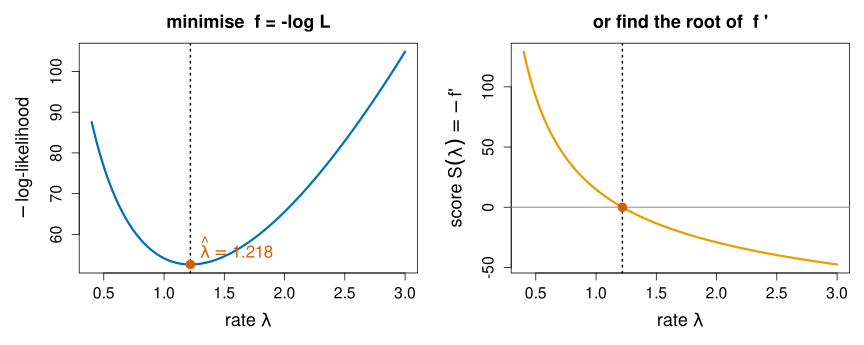
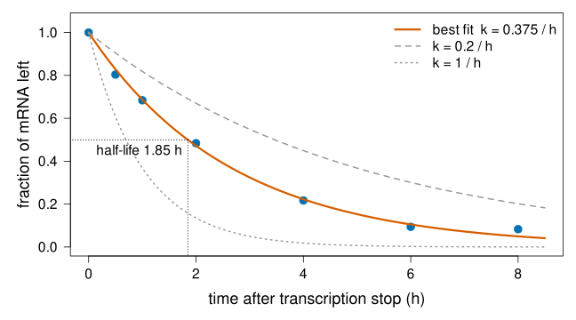
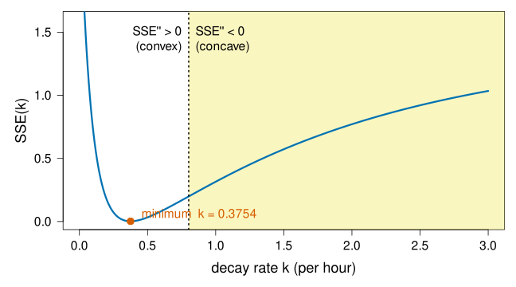
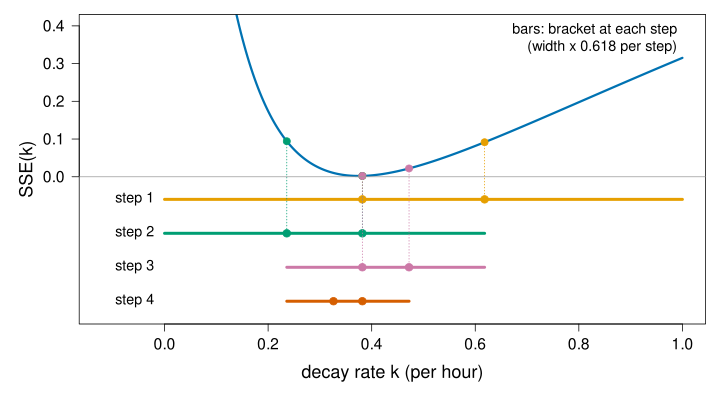
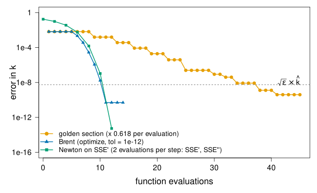
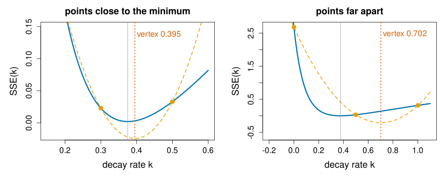
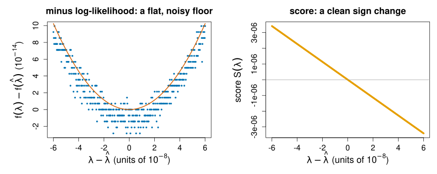
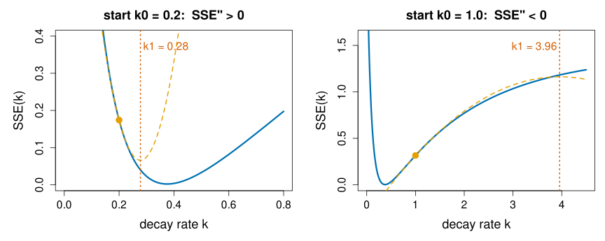
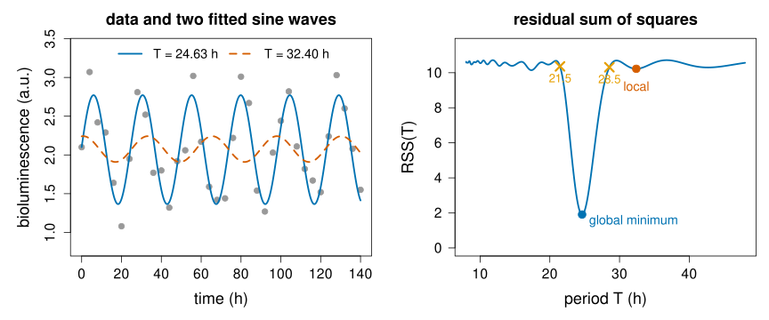

## About this lecture {.smaller}

Part 9 is about **fitting models**: finding the parameter value that makes a model agree best with data. This lecture does it for **one** parameter.

- A **minimum** of $f$ is a root of $f'$, but you can also search for the minimum **directly**, using only values of $f$: no derivative, and harder to fool.
- **Golden-section search** keeps a three-point bracket and shrinks it by 0.618 per function evaluation: slow, but it cannot fail on a unimodal function.
- **Brent's method** (R's `optimize`) adds fast **parabolic** steps. **Newton** for minimisation uses $f'/f''$.
- Two limits: a minimum can only be located to about $\sqrt{\varepsilon} \approx 10^{-8}$ (the bottom is **flat**), and every method here finds a **local** minimum, not necessarily the global one.

Biology: the **decay rate** of an mRNA from a time course (maximum likelihood with one parameter), and the **period** of a circadian rhythm, whose likelihood has two local maxima.

::: notes
This opens Part 9. Everything here is one-dimensional, so we can draw every function we optimise, and see exactly what each method does. The next unit (Gradient descent, Newton and quasi-Newton) moves to several parameters, where we can no longer draw the function and the ideas from today (brackets, local models, local versus global) are what keeps us safe. The link to Part 2 is direct: a minimum of a smooth function is a root of its derivative, and the methods mirror each other (golden section ~ bisection, parabolic interpolation ~ secant, Brent ~ Brent, Newton ~ Newton).
:::

## Recap: an MLE as the root of the score {.smaller}

From *Newton and secant methods*: UMI counts of a gene in the 100 cells where it was detected, modelled as a zero-truncated Poisson with rate $\lambda$.

$$\ell(\lambda) = 173\log\lambda - 100\,\lambda - 100\log(1 - e^{-\lambda}) + \text{const}, \qquad S(\lambda) = \ell'(\lambda) = \frac{173}{\lambda} - \frac{100}{1 - e^{-\lambda}}$$

- The maximum-likelihood estimate (MLE) $\hat\lambda = 1.218$ was found as the **root** of the score $S$, with Newton and with `uniroot`.
- But the question was never "where is $S = 0$?". It was "which $\lambda$ makes the data **most likely**?"
- Today: answer that question directly, by **maximising $\ell$**, and see what is gained and what is lost.

::: notes
A quick reminder of the second running example of the Newton unit. 100 cells, counts 1 to 5 in 52, 30, 12, 5 and 1 cells, so the sum is 173. The truncation term (zeros are never seen) is what makes the MLE a transcendental equation. Newton from the mean converged in 6 steps; Newton from 3 ran off to negative rates; uniroot on a wide bracket found it safely.
:::

## Minimum versus root {.smaller}

{width="88%" fig-align="center"}

Maximising $\ell$ is the same as **minimising $f = -\ell$** (the convention of every optimiser). At a smooth minimum $f'(x^*) = 0$, so the minimum is a root of $f'$.

```r
nll <- function(l) -(173 * log(l) - 100 * l - 100 * log(-expm1(-l)))  # minus log-lik
optimize(nll, interval = c(0.01, 10), tol = 1e-10)
# $minimum
# [1] 1.21847
#
# $objective
# [1] 52.61033
```

::: notes
Same answer as uniroot on the score, without writing down the derivative. "nll" is the usual abbreviation for negative log-likelihood. optimize minimises by default; optimize(loglik, ..., maximum = TRUE) maximises instead, which is the same thing. Python's minimize_scalar and Rust's argmin only minimise: pass the negative log-likelihood. $objective is the value of nll at the minimum.
:::

## Why search for the minimum directly? {.smaller}

| | root of $f'$ | minimum of $f$ |
|---|---|---|
| needs | the derivative $f'$ | only values of $f$ |
| a root can be | a minimum, a maximum or a flat inflection | a minimum (lower values are always better) |
| bracket | sign change of $f'$: 2 points | a low point between two higher ones: 3 points |
| accuracy | $\sim\varepsilon$ relative | only $\sim\sqrt{\varepsilon}$ relative (later slide) |

- Often there **is** no formula for $f'$: $f$ comes out of an ODE solver, a simulation, or a long likelihood.
- Comparing two values of $f$ tells you which one is **better**. A value of $f'$ only tells you which way is downhill.
- The price: we lose half of the digits. Usually that is fine for a parameter estimate.

::: notes
The table is the plan of the lecture. Each method for minimisation has a root-finding twin: bisection becomes golden section, the secant method becomes parabolic interpolation, Newton stays Newton (on f'), and Brent combines the safe and the fast method in both cases. The last row is the surprise of the lecture, and we will see it on a plot. In practice, a rate estimated to 8 significant digits is far more precise than any data justify (the standard error is in the second digit), so the lost digits rarely matter; they matter when the optimum feeds another computation, such as a finite-difference derivative.
:::

## A biology problem: how fast does an mRNA decay? {.smaller}

Transcription is stopped at $t = 0$ (actinomycin D); qPCR measures the fraction of the mRNA left.

:::: {.columns}
::: {.column width="58%"}
{width="100%"}
:::
::: {.column width="42%"}
Model: $y_i = e^{-k t_i} + \text{noise}$, one unknown, the **decay rate** $k$.

With Gaussian noise of constant size, the MLE of $k$ minimises the **sum of squared errors**

$$\text{SSE}(k) = \sum_i \left(y_i - e^{-k t_i}\right)^2 .$$

$\text{SSE}'(k) = 0$ has **no closed form**.
:::
::::

::: notes
The numbers are simulated with k = 0.35 per hour plus noise (sd 0.03), rounded to 3 decimals, so that we know the truth. The Gaussian log-likelihood is -SSE/(2 sigma^2) plus a constant, so for Gaussian noise "maximum likelihood" and "least squares" are the same fit; that is why we can minimise SSE. A common shortcut is to regress log(y) on t with lm, which is linear and has a formula. It gives k = 0.348, not 0.375: taking logs gives the small, noisy late points much more weight. It is a different statistical model (multiplicative noise), not a wrong one, but if the noise is additive the nonlinear fit is the MLE. The half-life is log(2)/k.
:::

## The objective function {.smaller}

```r
t <- c(0, 0.5, 1, 2, 4, 6, 8)                            # hours
y <- c(1.000, 0.804, 0.684, 0.484, 0.217, 0.094, 0.083)  # fraction left
sse <- function(k) sum((y - exp(-k * t))^2)
k <- c(0, 0.25, 0.5, 0.75, 1, 1.5, 2, 5)
round(sapply(k, sse), 4)
# [1] 2.6793 0.0723 0.0329 0.1678 0.3152 0.5726 0.7708 1.2769
```

{width="62%" fig-align="center"}

- One low valley near $k = 0.4$. For large $k$ the curve flattens (all predictions near 0) and **bends the other way** (yellow).

::: notes
The objective function (also cost, loss) is what we minimise. sse takes a single k, so we use sapply to evaluate it on a vector of k values. Evaluating on a coarse grid is always the first thing to do: it shows where the minimum is, roughly, and whether there is more than one. The yellow region, where SSE'' < 0, will matter for Newton. For k -> infinity the model predicts 0 for every t > 0, and SSE tends to (1-1)^2 plus the sum of the other y^2, about 1.47.
:::

## Brackets for a minimum {.smaller}

A function is **unimodal** on $[a, b]$ if it decreases to a single minimum $x^*$ and increases after it.

- A **bracket** for a minimum is three points $a < c < b$ with $f(c) < f(a)$ and $f(c) < f(b)$: a low point between two higher ones. If $f$ is continuous, a (local) minimum lies in $(a, b)$.
- From the grid on the previous slide: $f(0) = 2.68 > f(0.5) = 0.033 < f(0.75) = 0.168$. So $(0, 0.5, 0.75)$ is a bracket; so is $[0, 1]$ with $c = 0.5$.
- Compare with root finding: there a **sign change** at two points was enough. Here two values say nothing: is the minimum between them, or beyond the lower one?

**Recipe:** evaluate $f$ on a grid, take the lowest grid point and its two neighbours.

::: notes
The analogy with the intermediate value theorem: a continuous function on a closed interval takes a minimum somewhere, and if the middle value is lower than both ends, that minimum is not at an end, so it is a local minimum inside. Unimodal is the property that makes it the only one. Two points are not enough: f(0.25) > f(0.5) is consistent with a minimum at 0.4 and with one at 3. Brent's method in optimize assumes that the interval you give contains one minimum; it does not check.
:::

## Golden-section search: the idea {.smaller}

Place two points $x_1 < x_2$ inside $[a, b]$ and compare $f(x_1)$ with $f(x_2)$:

- $f(x_1) < f(x_2)$: the minimum cannot be right of $x_2$. Keep $[a, x_2]$.
- otherwise: keep $[x_1, b]$.

{width="66%" fig-align="center"}

The trick is **where** to put $x_1$ and $x_2$: so that one old point is reused, and each step costs **one** new evaluation.

::: notes
The analogue of bisection, but we need two interior points instead of one midpoint, because comparing two values is how we learn which part to throw away. If we put the two points anywhere, each step costs two evaluations. With the golden-ratio placement the surviving interior point is exactly in the right place for the next step, so each step costs one evaluation. In the figure: step 1 compares 0.382 and 0.618 and keeps [0, 0.618]; step 2 reuses 0.382 and adds 0.236; and so on.
:::

## Why 0.618? {.smaller}

Put the points symmetrically at fractions $1 - g$ and $g$ of the interval, $L = b - a$:

$$x_1 = a + (1 - g)L, \qquad x_2 = a + gL .$$

Keep $[a, x_2]$, of length $gL$. The old $x_1$ should be the new $x_2$, at fraction $g$ of the new interval:

$$(1 - g)L = g \cdot gL \quad\Longrightarrow\quad g^2 + g - 1 = 0 \quad\Longrightarrow\quad g = \frac{\sqrt5 - 1}{2} = 0.6180\ldots$$

- The bracket shrinks by **0.618 per evaluation**: $L_k = 0.618^k L_0$. That is **linear convergence** with rate 0.618.
- Bisection for roots: 0.5 per evaluation ($\log_{10} 2 = 0.30$ digits). Golden section: $\log_{10}(1/0.618) = 0.21$ digits per evaluation.

::: notes
g is 1 over the golden ratio phi = 1.618, hence the name. 1 - g = g^2 = 0.382. The symmetric case (keep [x1, b]) gives the same equation. Linear convergence in the sense of Convergence and cost: the error bound is multiplied by a fixed factor each evaluation. From width 1 to 1e-8 takes log(1e-8)/log(0.618) = 38 evaluations, plus the two to start. Golden section is optimal among methods that only compare function values, in the worst case; it is slower than bisection because comparing two values carries less information than a sign.
:::

## Golden section by hand {.smaller}

$\text{SSE}(k)$ on $[0, 1]$, four digits:

| step | $[a, b]$ | $x_1$ | $f(x_1)$ | $x_2$ | $f(x_2)$ | keep | width |
|---|---|---|---|---|---|---|---|
| 1 | $[0, 1]$ | 0.3820 | 0.00216 | 0.6180 | 0.09150 | $[a, x_2]$ | 0.618 |
| 2 | $[0, 0.6180]$ | **0.2361** | 0.09417 | 0.3820 | 0.00216 | $[x_1, b]$ | 0.382 |
| 3 | $[0.2361, 0.6180]$ | 0.3820 | 0.00216 | **0.4721** | 0.02204 | $[a, x_2]$ | 0.236 |

- Bold: the only new evaluation in each step. The other point is reused.
- After 4 evaluations the minimum ($\hat k = 0.3754$) is in $[0.2361, 0.4721]$.
- 0.382 is already close; golden section does not know that, and keeps shrinking at 0.618 per step.

::: notes
Do this with the students. New points: in step 2, b - g(b - a) = 0.618 - 0.618*0.618 = 0.2361. In step 3, a + g(b - a) = 0.2361 + 0.618*0.3820 = 0.4721. Each comparison throws away the outer part on the side of the larger value. The exercise has the same by hand on a function you can evaluate with a calculator. Note that golden section uses only the order of the two values, not their size: f(0.382) is 40 times smaller than f(0.618), but that information is not used. Parabolic interpolation will use it.
:::

## Golden-section search in R {.smaller}

```r
golden <- function(f, a, b, tol = 1e-8) {
  g <- (sqrt(5) - 1) / 2                      # 0.618...
  x1 <- b - g * (b - a); f1 <- f(x1)
  x2 <- a + g * (b - a); f2 <- f(x2)
  while (b - a > tol) {
    if (f1 < f2) { b <- x2; x2 <- x1; f2 <- f1; x1 <- b - g * (b - a); f1 <- f(x1) }
    else         { a <- x1; x1 <- x2; f1 <- f2; x2 <- a + g * (b - a); f2 <- f(x2) }
  }
  (a + b) / 2
}
golden(sse, 0, 1)
# [1] 0.3753873
```

- One new `f` per pass through the loop. Width $< 10^{-8}$ after 38 passes.
- **Cannot fail** on a unimodal function: no start value, no derivative, never leaves $[a, b]$.

::: notes
Nine lines. In each branch: shrink the interval, shift the surviving point into its new role, and evaluate one new point. The stopping rule is on the bracket width, an absolute tolerance; for a parameter of size 1000 you would want tol relative to |x|. On a function that is not unimodal it still returns a point, a local minimum (or a point near the edge); it gives no warning. We will see that at the end.
:::

## How fast? {.smaller}

{width="72%" fig-align="center"}

- Golden section: a straight line on a log scale, slope $\log_{10} 0.618 = -0.21$ per evaluation. **Linear**.
- Brent and Newton: superlinear, but they **stall** near $10^{-9}$ and $10^{-13}$. Why the floors differ comes in a few slides.

::: notes
Error of the best point found so far, against the number of function evaluations, all on SSE(k). Golden section's staircase follows 0.618^n; it reaches 1e-9 after about 42 evaluations. Brent (optimize with tol = 1e-12) and Newton (from 0.2, counting two evaluations per step for SSE' and SSE'') reach 1e-8 in about 10 evaluations. Brent stalls at about 5e-10: it compares values of f, and those values stop changing near the minimum. Newton works with the derivative and gets further. Keep this picture in mind for the slide on the flat bottom.
:::

## Parabolic interpolation {.smaller}

Use the **sizes** of the three values: fit a parabola through $(a, f_a), (b, f_b), (c, f_c)$ and jump to its vertex,

$$x_\text{new} = b - \frac12\,\frac{(b-a)^2(f_b - f_c) - (b-c)^2(f_b - f_a)}{(b-a)(f_b - f_c) - (b-c)(f_b - f_a)} .$$

{width="84%" fig-align="center"}

- Near the minimum $f$ looks like a parabola, so the vertex is very close: order about **1.32**, superlinear.
- Far away it can jump anywhere, even to a **maximum** (a parabola opening downwards). From $(0, 0.5, 1)$ the next steps go to $-1.51$, then wander off to $k = 34$.

::: notes
The minimisation twin of the secant method: there we fitted a line to two values of f and found its root; here we fit a parabola to three values of f and find its vertex. Repeating it with the three latest points is successive parabolic interpolation. From (0.2, 0.3, 0.5): errors 0.020, 0.014, 0.008, 7e-6, 2e-4, 2e-6, 2e-9: fast but not smooth. From (0, 0.5, 1), the first vertex 0.70 is already worse than 0.5, and the iteration then runs away: no bracket is kept. Like the secant method: fast when close, unsafe when not.
:::

## Brent's method: a fast step on a leash {.smaller}

The minimiser twin of `uniroot` (Brent 1973):

1. Keep a bracket $[a, b]$ and the three best points so far.
2. Try a **parabolic** step. Accept it if it lands inside the bracket and the steps are shrinking.
3. Otherwise take a **golden-section** step.

- As safe as golden section; superlinear near the minimum. No derivative.
- **R:** [`optimize`](https://stat.ethz.ch/R-manual/R-devel/library/stats/html/optimize.html) (alias `optimise`). **Python:** `scipy.optimize.minimize_scalar`. **Rust:** `argmin`'s `BrentOpt`.
- Also inside `optim(method = "Brent")` for one parameter.

::: notes
Exactly the idea of the safeguarded root finder from Newton and secant methods: a fast method that is allowed to act only while it behaves, and a slow guaranteed method as a fallback. Brent's minimiser starts at the golden-section point a + 0.382(b - a), which matters for the circadian example later. Python: minimize_scalar(f, bounds=(a, b), method="bounded") is the version with an interval like optimize; method="brent" (the default) wants a bracket triple or finds one itself. In Rust, BrentOpt::new(a, b) from the argmin crate.
:::

## `optimize` in practice {.smaller}

```r
count <- 0
fc <- function(k) { count <<- count + 1; sse(k) }   # counts evaluations
optimize(fc, c(0, 1))$minimum; count
# [1] 0.3754002
# [1] 11
count <- 0; optimize(fc, c(0, 1), tol = 1e-10)$minimum; count
# [1] 0.3753873
# [1] 14
count <- 0; golden(fc, 0, 1, tol = 1e-10); count
# [1] 0.3753873
# [1] 50
```

- Default `tol` is $\varepsilon^{1/4} \approx 1.2\times10^{-4}$, an **absolute** tolerance: the default answer is off in the 5th digit. **Set `tol`.**
- Brent: 14 evaluations; golden section: 50, for the same accuracy.

::: notes
The same default as uniroot, and the same advice. 0.3754002 versus the true 0.3753873: fine for reporting a half-life of 1.85 h, not fine if the estimate feeds into anything else. With tol = 1e-10 Brent takes only three more evaluations. Golden section needs 50, as predicted: log(1e-10)/log(0.618) = 48, plus 2. The counter uses <<- to change a variable outside the function, the same trick as in the Newton exercise. For the record: the half-life is log(2)/0.3754 = 1.85 hours.
:::

## How precisely can we locate a minimum? {.smaller}

Back to the zero-truncated Poisson, where the **root** of the score is known to full precision:

```r
S <- function(l) 173 / l - 100 / (-expm1(-l))       # score = -nll'
lhat <- uniroot(S, c(0.01, 10), tol = 1e-15)$root
d <- 10^-(5:10)                                      # step away from lhat
nll(lhat + d) - nll(lhat)
# [1]  2.845923e-09  2.845013e-11  2.629008e-13  0.000000e+00  7.105427e-15
# [6] -2.842171e-14
S(lhat + d)
# [1] -5.691820e-04 -5.691856e-05 -5.691860e-06 -5.691860e-07 -5.691859e-08
# [6] -5.691874e-09
optimize(nll, c(0.01, 10), tol = 1e-15)$minimum - lhat
# [1] 6.859067e-10
```

- 1e-8 away from $\hat\lambda$, $f$ has **not changed at all**; at 1e-10 it is even *lower*. The score still sees every step.
- Asking `optimize` for `tol = 1e-15` does not help: about 9 digits is all there is.

::: notes
The values of nll near the minimum are around 52.6, and the change in nll over a distance of 1e-8 is about 3e-15: that is smaller than the gap between doubles near 52.6 (7e-15). So the computer literally cannot tell those two points apart by their f values. The differences we see for d <= 1e-8 are rounding noise: one of them is even negative, so a point 1e-10 away "looks better" than the minimum. The score, by contrast, is linear in the distance near its root, so its values keep shrinking in proportion: -5.69e-4, -5.69e-5, ... all the way down.
:::

## The flat bottom: why $\sqrt{\varepsilon}$ {.smaller}

{width="84%" fig-align="center"}

Taylor at the minimum, where $f'(x^*) = 0$: $\;f(x^* + \delta) \approx f(x^*) + \tfrac12 f''(x^*)\,\delta^2$.

The change is lost in rounding when $\tfrac12 f''\delta^2 < \varepsilon\,|f(x^*)|$, that is, for

$$|\delta| \lesssim \sqrt{\varepsilon}\,\sqrt{2|f(x^*)|/f''(x^*)} = 1.5\times10^{-8} \cdot \sqrt{2\cdot 52.6/56.9} \approx 2\times10^{-8} .$$

::: notes
Left: nll minus its minimum on a 1e-8 scale, in units of 1e-14: a noisy staircase in steps of about 7e-15 (the gap between doubles near 52.6), around the true parabola (red). Any point in the middle region is as good as any other, as far as the computer can tell. Right: the score near the root is a clean straight line. A root changes f' linearly in delta, so it is resolved to about epsilon; a minimum changes f quadratically in delta, so only to about sqrt(epsilon). This is a general limit, not a weakness of optimize: every method that compares values of f has it, including Nelder-Mead and the line searches in the next unit. If you need more digits, find the root of f'. And never set tol below about sqrt(eps)*|x|: R's optimize and argmin's BrentOpt both use a relative part sqrt(eps) internally for exactly this reason.
:::

## Newton for minimisation {.smaller}

Fit the **local parabola** (second-order Taylor) at $x_k$ and jump to its vertex:

$$q(x) = f(x_k) + f'(x_k)(x - x_k) + \tfrac12 f''(x_k)(x - x_k)^2, \qquad x_{k+1} = x_k - \frac{f'(x_k)}{f''(x_k)} .$$

- This is **Newton's method on $f'$**: quadratic convergence near a minimum with $f''(x^*) > 0$.
- For the zero-truncated Poisson, $f = -\ell$, $f' = -S$, $f'' = -S'$: exactly the Newton iteration on the score from *Newton and secant methods* (6 steps from $\bar x$).
- It needs $f'$ **and** $f''$, and it works on $f'$, so it reaches full precision (no $\sqrt\varepsilon$ floor).
- $f''(\hat x)$ is the **curvature** at the minimum. For a likelihood, it gives the standard error.

::: notes
The derivation in one line: q'(x) = f'(x_k) + f''(x_k)(x - x_k) = 0 gives the step. Newton for minimisation is not a new method; it is Newton for roots applied to f'. Everything from Part 2 carries over: digits double near the minimum, a wrong derivative makes it linear, a bad start can diverge. One new failure appears: f'' can be negative, and then the local parabola opens downwards and its vertex is a maximum. Standard errors from the curvature are the topic of Identifiability and uncertainty of fitted parameters.
:::

## Newton on the decay rate {.smaller}

```r
d1 <- function(k) sum(2 * (y - exp(-k * t)) * t * exp(-k * t))        # SSE'
d2 <- function(k) sum(2 * t^2 * exp(-k * t) * (2 * exp(-k * t) - y))  # SSE''
newton_min <- function(d1, d2, x0, n = 6) {
  x <- x0
  for (i in 1:n) x[i + 1] <- x[i] - d1(x[i]) / d2(x[i])
  x
}
print(newton_min(d1, d2, 0.2), digits = 10)
# [1] 0.2000000000 0.2778001915 0.3394487230 0.3697526835 0.3752380818
# [6] 0.3753872034 0.3753873095
newton_min(d1, d2, 0.7)
# [1]  0.700000 -1.659596 -1.597081 -1.534561 -1.472036 -1.409503 -1.346962
newton_min(d1, d2, 1.0)
# [1]  1.000000  3.956008  5.844671  7.797795  9.779586 11.772747 13.770211
```

- From 0.2: digits double after a slow start. From 0.7: a **negative** rate. From 1.0: off to $k = \infty$.

::: notes
Check d1 and d2 against numDeriv::grad and numDeriv::hessian before trusting them (the exercise does). The fixed number of steps keeps the slide short; a real implementation has a stopping rule as in the Newton unit. From 0.7, SSE'' = 0.25 is small and positive: the local parabola is very flat and its vertex far to the left. From 1.0, SSE'' is negative (-0.19): see the next slide.
:::

## When Newton heads uphill {.smaller}

{width="84%" fig-align="center"}

- Left: $f'' > 0$, the local parabola opens **upwards**; its vertex is a good guess for the minimum.
- Right: $f'' < 0$, the parabola opens **downwards**; its vertex is a **maximum** of $q$, and Newton walks away from the minimum, towards the flat plateau at $k \to \infty$.
- **Checks:** $f''(x_k) > 0$ at every step, and $f(x_{k+1}) < f(x_k)$. If either fails, do not take the step.

::: notes
Root-finding Newton does not care whether a root of f' is a minimum or a maximum; it heads for whatever stationary point the local model suggests. From k = 1 the nearest "stationary point" of the local model is a maximum at 3.96, and beyond that SSE keeps rising slowly towards its limit 1.47 at infinity, so Newton follows it out. The two checks are the start of the safeguards in the next unit: if f'' <= 0 use a different direction, and if f does not decrease, shorten the step (line search). Or bracket first and let Brent do the work.
:::

## Convexity {.smaller}

$f$ is **convex** on an interval if $f''(x) \ge 0$ there: the graph bends upwards everywhere, every chord lies above it.

- A convex function has **no separate local minima**: a local minimum is the global one.
- Newton's local parabola always opens upwards, so each step points **downhill**. (It can still overshoot: see the exercise.)
- $-\ell$ for the zero-truncated Poisson is convex for **all** $\lambda > 0$ ($-S' > 0$). Any reasonable method finds $\hat\lambda$.
- $\text{SSE}(k)$ for the decay is convex only for $k < 0.80$ (the yellow region on the earlier plot). Start right of it and Newton fails.

Many likelihoods are convex in the right parameterisation (Poisson and logistic regression, in their coefficients). **Nonlinear** models (decay curves, ODEs, periods) usually are not.

::: notes
Convexity is the property that turns "a local minimum" into "the answer". It is why fitting a GLM never needs a starting value in practice, and why fitting an ODE model always does. Convexity depends on the parameterisation: SSE as a function of log(k) has a different shape. The exercise has f(x) = x - 2 log x, which is convex for all x > 0 and still sends Newton out of its domain from x0 = 4: convexity guarantees the direction, not the step length.
:::

## Local versus global: a circadian period {.smaller}

A bioluminescence reporter of a clock gene, every 4 h for 6 days. Fit a sine wave with unknown **period** $T$.

```r
t <- seq(0, 140, by = 4)                           # 36 time points (h)
set.seed(15)                                       # simulated, true period 24.5 h
y <- round(2 + 0.6 * cos(2 * pi * (t - 6) / 24.5) + rnorm(36, sd = 0.3), 2)
rss <- function(T) {                               # best sine wave with period T
  X <- cbind(1, cos(2 * pi * t / T), sin(2 * pi * t / T))
  sum(lm.fit(X, y)$residuals^2)                    # linear least squares for fixed T
}
```

- For a **fixed** $T$, mean, amplitude and phase come from a linear least-squares fit. What is left, $\text{RSS}(T)$, depends on $T$ only.
- With Gaussian noise, $\log L(T) = -\tfrac{n}{2}\log \text{RSS}(T) + \text{const}$: minima of RSS are maxima of the likelihood.

::: notes
Circadian periods are estimated like this all the time (cosinor fits, and periodograms, which are the same idea on a grid). The data are simulated so that we know the truth: period 24.5 h, peak at 6 h, amplitude 0.6, noise sd 0.3. Writing a cos + b sin instead of A cos(2 pi t/T - phi) makes the model linear in a and b, so for each T the best a, b and mean come from lm.fit (Least squares: normal equations vs QR). The remaining one-dimensional problem in T is the hard, nonlinear part: we "profile out" the linear parameters.
:::

## `optimize` returns the wrong period {.smaller}

{width="86%" fig-align="center"}

```r
optimize(rss, c(10, 40))$minimum       # a plausible search range
# [1] 32.40162                         # a local minimum: as bad as no rhythm at all
optimize(rss, c(15, 35))$minimum
# [1] 24.63047                         # the global minimum
```

::: notes
RSS(T) is flat at about 10.5 (the RSS of a flat line is 10.72) with small wiggles, and has one narrow, deep dip near the true period. Brent's first two golden-section points on [10, 40] are 21.5 and 28.5, both on the flat part (orange crosses). RSS(28.5) = 10.31 is a bit lower than RSS(21.5) = 10.36, so the method keeps [21.5, 40]; the next comparison (28.5 against 32.9) keeps [28.5, 40], and the dip is gone for good. The method then converges, correctly, to a local minimum at 32.4 h. No warning: as far as optimize knows, the function is unimodal, because we promised it was.
:::

## Grid first, then refine {.smaller}

```r
Tg <- seq(10, 40, by = 0.25)                # grid finer than the dip (about 3 h wide)
r  <- sapply(Tg, rss)
T0 <- Tg[which.min(r)]; T0
# [1] 24.75
optimize(rss, c(T0 - 0.5, T0 + 0.5), tol = 1e-6)$minimum
# [1] 24.63047
c(rss(24.63047), rss(32.40162))
# [1]  1.908081 10.225063
```

- A **grid** finds the right basin; a local method (Brent, Newton) then polishes it. 121 + 10 evaluations.
- The grid spacing must be smaller than the narrowest dip you care about. Too coarse and it can miss it too.
- Alternatives: **multistart** (run from many starting points, keep the best), and always **compare** the objective at the candidates.

::: notes
For one parameter a grid is cheap and the most reliable method there is; in ten parameters a grid is impossible (10^10 points for 10 per axis), which is why multistart and good starting values matter so much in the next units. The width of the dip is about the period squared divided by the length of the record, 24^2/140 = 4 h: longer recordings give narrower dips, which are both more precise and easier to miss. A periodogram (Fourier series and the FFT) is exactly this grid scan, computed fast. Comparing the objective at the two candidates settles it: 1.9 against 10.2.
:::

## Checklist: before you trust a minimum {.smaller}

- **Plot $f$** over the whole plausible range. How many valleys?
- **Bracket**: give `optimize` an interval that contains **one** minimum (grid first).
- **Set `tol`** (default $1.2\times10^{-4}$, absolute). Do not ask for more than $\sim\sqrt{\varepsilon}\,|x|$.
- **Check the answer**: not at the edge of the interval? $f$ at the answer lower than at nearby grid points? Biologically sensible (positive rate, period near 24 h)?
- **Hand-written Newton**: check $f'$ and $f''$ against finite differences; require $f'' > 0$ and $f$ decreasing at each step.
- **Local vs global**: try several intervals or starting points; compare $f$ at every candidate.

::: notes
A minimum at the edge of the interval almost always means the interval was wrong (or the true optimum is a boundary, which is a constrained problem: Constraints and linear programming). The "compare f at every candidate" check is what caught the 32.4 h period. These checks carry over unchanged to many parameters, where you can no longer plot f, which makes them more important there, not less.
:::

## Summary {.smaller}

- A smooth **minimum** is a **root** of $f'$, but minimising directly needs only values of $f$, never confuses a minimum with a maximum, and keeps a **three-point bracket**.
- **Golden section**: shrink by 0.618 per evaluation (linear), safe on any unimodal function. **Parabolic interpolation**: superlinear (order ~1.32) but unsafe. **Brent** = both: `optimize`, `minimize_scalar`, `BrentOpt`. Set `tol`.
- **Newton**: $x_{k+1} = x_k - f'/f''$, quadratic, needs $f'' > 0$; otherwise it heads for a maximum.
- A minimum can only be located to about $\sqrt\varepsilon$ relative: the bottom is **flat**. For more digits, find the root of $f'$.
- **Convex** $\Rightarrow$ local = global. Otherwise (a circadian period) a local method can return a **local** minimum without warning: grid first, compare candidates.

**Next:** *Gradient descent, Newton and quasi-Newton*: many parameters, the gradient and the Hessian, and line searches.

::: notes
The one-dimensional methods return in the next unit as the line search inside every multivariate optimiser: choose a direction, then do a one-dimensional minimisation along it. The decay-rate fit returns with two parameters (initial amount and rate) in Nonlinear least squares and ODE fitting, and the curvature at the minimum returns as standard errors in Identifiability and uncertainty of fitted parameters.
:::
