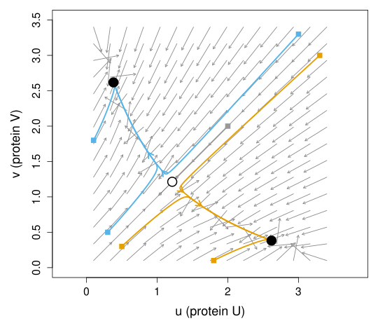
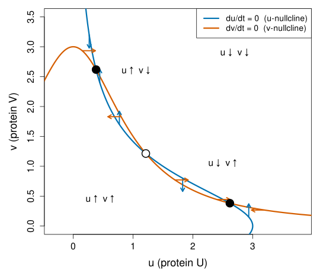
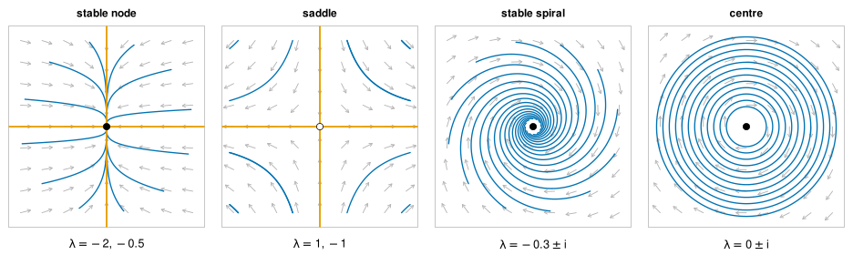
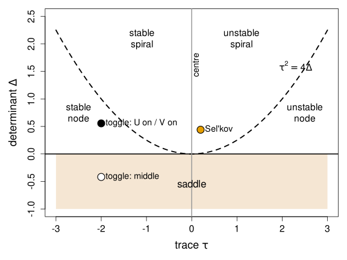
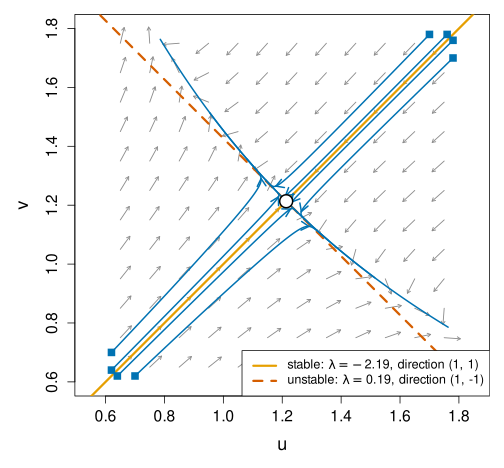
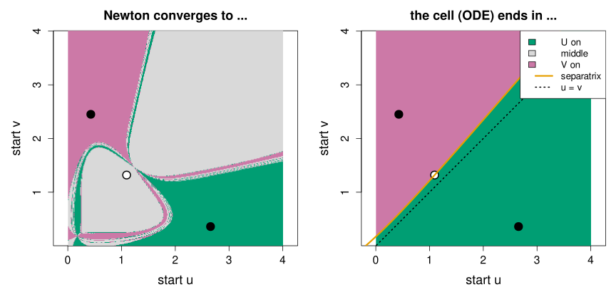
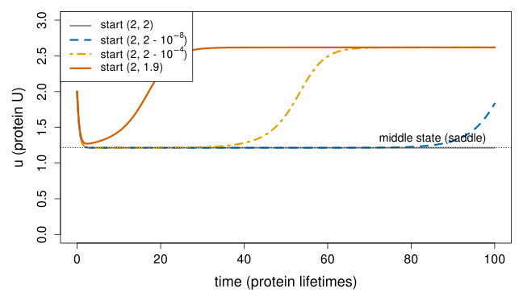
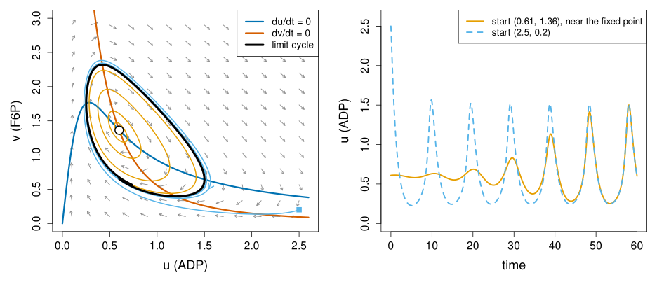
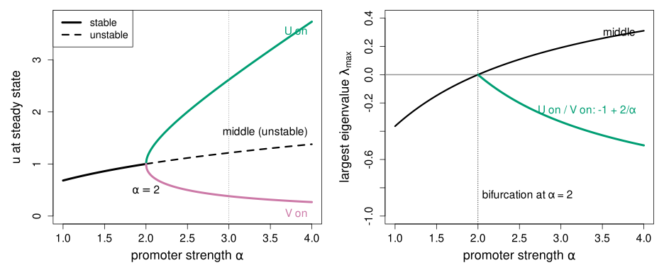

## About this lecture {.smaller}

In *Newton for systems of equations* Newton found the three steady states of the genetic toggle switch. It found the **unstable** middle one most often. Today we ask the questions a biologist cares about: **which steady states are stable, and where does a cell starting at a given point end up?**

- The **phase plane**: draw the flow of a two-variable ODE instead of its time course. **Nullclines** and **fixed points**.
- **Linearisation**: near a fixed point the ODE behaves like $d\boldsymbol\delta/dt = J\boldsymbol\delta$. The **eigenvalues of the Jacobian** decide stability: node, saddle, spiral, centre.
- The **separatrix** of a saddle is the boundary between the basins of attraction, computed by integrating **backwards in time**.
- **Limit cycles**: oscillations with no stable fixed point (glycolysis in yeast). One slide on **bifurcation diagrams**.
- Failures: a simulation that stops at a saddle; eigenvalues with real part $\approx 0$.

::: notes
This unit ties together three earlier ones: the Jacobian and the toggle switch from Newton for systems of equations, eigenvalues from Part 5 (Power iteration and friends, How eigen() works, and big problems), and the ODE solvers of this part (Initial value problems and Euler's method, Runge–Kutta and adaptive step size). The genuinely new idea is linearisation of an ODE around a fixed point: the Jacobian we used for Newton steps now tells us how small perturbations grow or decay. We keep the toggle switch with alpha = 3, n = 2 exactly as before, so all numbers can be compared.
:::

## Where we left the toggle switch {.smaller}

$$\frac{du}{dt} = \frac{\alpha}{1 + v^{2}} - u, \qquad \frac{dv}{dt} = \frac{\alpha}{1 + u^{2}} - v, \qquad \alpha = 3$$

| state | $(u, v)$ | Newton's basin on $[0,4]^2$ |
|---|---|---|
| U on | $(2.618, 0.382)$ | 21 % |
| middle | $(1.213, 1.213)$ | **57 %** |
| V on | $(0.382, 2.618)$ | 21 % |

- Newton finds **where** $\mathbf F = \mathbf 0$. It does not know which states a cell can actually sit in.
- A real cell is never exactly at a steady state: molecules are noisy. A state matters only if **small pushes die out**: it must be **stable**.
- Two numerical tools answer this: **simulation** (deSolve) and **eigenvalues** of $J$ (`eigen`).

::: notes
One-slide recap of Newton for systems of equations: the model, the three steady states and the basin shares from that unit. The middle state is a perfectly good root of F, found with quadratic convergence, but a cell placed there would drift away with the first bit of noise. Today we make "drift away" precise. Keep the numbers: U on is (2.618, 0.382), the middle state is (1.2134, 1.2134).
:::

## The phase plane {.smaller}

:::: {.columns}
::: {.column width="52%"}
{width="100%"}
:::
::: {.column width="48%"}
- Each point $(u, v)$ is a **state** of the cell. The ODE gives a **velocity** $(du/dt,\ dv/dt)$ there: the grey arrows.
- A **trajectory** follows the arrows. Squares: starts; coloured curves: solutions of the ODE.
- Time is hidden: we see **where** the cell goes, not how fast.
- Black dots: stable states. White: the middle state. Orange starts end in U on, blue in V on, the grey one ($u_0 = v_0$) in the middle.
:::
::::

::: notes
The phase plane replaces two time courses u(t), v(t) by one curve in the (u, v) plane. The arrows are the right-hand side of the ODE, normalised to equal length so that the direction is readable. Two trajectories that start close to each other, at (0.5, 0.3) and (0.3, 0.5), go to opposite states: the one with slightly more U ends with U on. The grey trajectory starts on the diagonal and, by symmetry, stays on it and ends in the middle state: a simulation can end at an unstable state if it starts exactly on the right curve. Trajectories never cross (the ODE has one velocity per point), which is what makes the plane picture so informative in two dimensions.
:::

## Trajectories with `deSolve::ode` {.smaller}

```r
library(deSolve)
alpha <- 3; n <- 2
toggle <- function(t, x, parms) {
  u <- x[1]; v <- x[2]
  list(c(alpha / (1 + v^n) - u,      # du/dt
         alpha / (1 + u^n) - v))     # dv/dt
}
times <- seq(0, 20, by = 0.1)
out <- ode(y = c(u = 0.5, v = 0.3), times = times, func = toggle, parms = NULL)
out[c(1, 11, 51, 201), ]
#      time        u         v
# [1,]    0 0.500000 0.3000000
# [2,]    1 1.323446 0.9689792
# [3,]    5 1.628533 0.8722946
# [4,]   20 2.587075 0.3938494
```

- [`ode`](https://search.r-project.org/CRAN/refmans/deSolve/html/ode.html) (default method `lsoda`, adaptive step) wants `func(t, x, parms)` returning a **list**. Plot `out[, "u"]` against `out[, "v"]` for the phase plane.

::: notes
Same right-hand side as F in Newton for systems of equations, wrapped in deSolve's calling convention: time first, state second, parameters third, and the derivatives returned inside a list (deSolve allows extra outputs in the list). The default solver lsoda switches automatically between a non-stiff Adams method and a stiff BDF method; Runge–Kutta and adaptive step size and Stiffness and implicit methods explain what that means. At t = 20 the trajectory is close to, but not yet at, U on (2.618, 0.382): approach to a steady state is exponential, so the last digits take a while. Python: scipy.integrate.solve_ivp; Rust: the ode_solvers crate (exercise).
:::

## Nullclines: where one variable stands still {.smaller}

:::: {.columns}
::: {.column width="50%"}
{width="100%"}
:::
::: {.column width="50%"}
- **u-nullcline** $du/dt = 0$: $u = 3/(1 + v^2)$. On it the flow is **vertical**.
- **v-nullcline** $dv/dt = 0$: $v = 3/(1 + u^2)$. On it the flow is **horizontal**.
- **Fixed points** (steady states) = where they **cross**.
- The nullclines cut the plane into regions with a fixed **sign pattern**: below both, $u$ and $v$ grow; above both, both shrink. In the thin lenses, the flow points **away** from the middle state.
:::
::::

::: notes
The nullclines are the two curves from Newton for systems of equations (F1 = 0 and F2 = 0), now read as the places where one concentration momentarily stops changing. Checking the sign of du/dt on each side is a pen-and-paper exercise: at (0, 0), du/dt = 3 > 0. Follow the arrows on the nullclines near the middle state: on both sides they point away from it along the lenses and towards the outer states. That already suggests the middle state is unstable, before any eigenvalue. Nullclines are the fastest sketch of a two-variable model and the first thing to draw for any new model.
:::

## Stability in one variable {.smaller}

Logistic growth (the running OD example, $r = 0.8$ h$^{-1}$, $K = 1.2$): $\dfrac{dN}{dt} = f(N) = rN\left(1 - \dfrac{N}{K}\right)$.

- Fixed points: $f(N^*) = 0$, so $N^* = 0$ or $N^* = K$.
- Push a little: $N = N^* + \delta$. Taylor: $f(N^* + \delta) \approx \underbrace{f(N^*)}_{0} + f'(N^*)\,\delta$, so
$$\frac{d\delta}{dt} \approx f'(N^*)\,\delta \quad\Rightarrow\quad \delta(t) \approx \delta_0\, e^{f'(N^*)\,t}$$
- $f'(N) = r(1 - 2N/K)$: $f'(0) = 0.8 > 0$, **unstable** (a few cells grow); $f'(1.2) = -0.8 < 0$, **stable** (a perturbation of the plateau halves every $\ln 2/0.8 = 0.87$ h).

**Rule:** $f'(N^*) < 0$ stable, $f'(N^*) > 0$ unstable, $f'(N^*) = 0$ undecided.

::: notes
The one-variable case contains the whole idea. Near a fixed point the right-hand side is approximately linear, and a linear ODE d delta/dt = lambda delta has the solution delta_0 exp(lambda t). The sign of lambda decides growth or decay; its size sets the speed. The relaxation time 1/|lambda| = 1.25 h for the plateau. When f' = 0 the linear term vanishes and the quadratic term decides: the linearisation is inconclusive, a case we meet again at the end. The logistic parameters are the shared running example from Convergence and cost.
:::

## Linearisation in two variables {.smaller}

Push the toggle away from a fixed point $\mathbf x^*$: $\mathbf x = \mathbf x^* + \boldsymbol\delta$. Exactly as for Newton,

$$\frac{d\boldsymbol\delta}{dt} = \mathbf F(\mathbf x^* + \boldsymbol\delta) \approx \underbrace{\mathbf F(\mathbf x^*)}_{\mathbf 0} + J(\mathbf x^*)\,\boldsymbol\delta \quad\Rightarrow\quad \boxed{\frac{d\boldsymbol\delta}{dt} \approx J\,\boldsymbol\delta}$$

At U on, $(2.618, 0.382)$:

$$J = \begin{pmatrix} -1 & -1.745 \\ -0.255 & -1 \end{pmatrix}: \qquad
\begin{aligned}
\dot\delta_u &= -\delta_u - 1.745\,\delta_v\\
\dot\delta_v &= -0.255\,\delta_u - \delta_v
\end{aligned}$$

- Same $J$ as in *Newton for systems of equations*; a new use. Newton **solves** $J\boldsymbol\delta = -\mathbf F$; stability asks how $e^{Jt}$ **acts** on $\boldsymbol\delta$.
- The two equations are **coupled**: $\delta_v$ feeds $\delta_u$. To see growth or decay we need to uncouple them.

::: notes
The derivation is the linear approximation F(x + delta) ≈ F(x) + J delta from Newton for systems of equations, applied at a point where F is zero. Read the entries as biology: -1 on the diagonal is degradation; -1.745 says a bit of extra V strongly reduces production of U (V = 0.38 is on the steep part of its Hill curve); -0.255 says extra U barely changes V's production (U = 2.6 is far above threshold). Is the state stable? Not obvious from the entries: both diagonals are negative, but the off-diagonals couple the variables. Eigenvectors uncouple them.
:::

## Eigenvalues decide {.smaller}

If $J\mathbf v = \lambda\mathbf v$, then $\boldsymbol\delta(t) = e^{\lambda t}\,\mathbf v$ solves $\dot{\boldsymbol\delta} = J\boldsymbol\delta$ (check: both sides equal $\lambda e^{\lambda t}\mathbf v$). Any start is a mix:

$$\boldsymbol\delta(t) = c_1\, e^{\lambda_1 t}\,\mathbf v_1 + c_2\, e^{\lambda_2 t}\,\mathbf v_2$$

At U on: $\lambda_1 = -5/3$, $\mathbf v_1 = (0.934, 0.357)$; $\lambda_2 = -1/3$, $\mathbf v_2 = (0.934, -0.357)$.

- Both negative: **every** small push dies out. U on is **stable**.
- The **slowest** decay, $e^{-t/3}$, sets the recovery time: a perturbation halves every $3\ln 2 = 2.1$ protein lifetimes.
- **Rule:** stable if **all** eigenvalues have $\mathrm{Re}\,\lambda < 0$; unstable if **any** has $\mathrm{Re}\,\lambda > 0$.

::: notes
This is the reason eigenvalues were worth a whole Part. Along an eigenvector the coupled system acts like the one-variable case: the matrix only stretches the vector by lambda. Write the start as a combination of the two eigenvectors and each part evolves independently. For complex eigenvalues lambda = a ± ib, e^{lambda t} = e^{at}(cos bt ± i sin bt): the real part decides growth or decay, the imaginary part gives rotation. The recovery time is a measurable prediction: after a pulse of inducer that slightly perturbs the U-on state, the cell returns with a time constant of 3 protein lifetimes. Exact values: tau = -2, det = 5/9, so lambda = -1 ± 2/3 (exercise).
:::

## The zoo of two-variable fixed points {.smaller}

{width="100%"}

| eigenvalues | type | stable? |
|---|---|---|
| real, both $< 0$ | stable node | yes |
| real, opposite signs | **saddle** | no (one direction attracts, one repels) |
| complex $a \pm ib$, $a < 0$ | stable spiral (damped oscillation) | yes |
| complex $\pm ib$, $a = 0$ | centre | undecided by linearisation |

::: notes
Four linear systems dx/dt = A x, one per panel, with their eigenvalues below. Orange lines in the node and the saddle are the eigenvector directions: trajectories run straight along them. In the node, trajectories come in tangent to the slow direction (eigenvalue -0.5), the vertical one here. In the saddle, the horizontal eigenvector (lambda = 1) repels and the vertical one (lambda = -1) attracts: almost every trajectory comes in and then leaves. Spirals arise from complex eigenvalues; the imaginary part is the angular speed. Positive real parts give the unstable versions of node and spiral (arrows reversed). A centre is a borderline case: for the nonlinear system, small higher-order terms decide between a slow inward or outward spiral.
:::

## A 2 × 2 shortcut: trace and determinant {.smaller}

:::: {.columns}
::: {.column width="52%"}
{width="100%"}
:::
::: {.column width="48%"}
For $J = \begin{pmatrix} a & b \\ c & d\end{pmatrix}$: $\tau = a + d$, $\Delta = ad - bc$,

$$\lambda_{1,2} = \frac{\tau \pm \sqrt{\tau^2 - 4\Delta}}{2}$$

- $\Delta < 0$: **saddle**.
- $\Delta > 0$, $\tau < 0$: **stable**; $\tau > 0$: unstable.
- $\tau^2 < 4\Delta$: complex, a **spiral**.

Toggle, U on: $\tau = -2$, $\Delta = 0.556$. Middle: $\tau = -2$, $\Delta = -0.419$ → saddle.
:::
::::

::: notes
The eigenvalues of a 2 by 2 matrix are the roots of lambda^2 - tau lambda + Delta = 0 (recap from Power iteration and friends). Delta is the product of the eigenvalues, tau their sum. A negative product means opposite signs: a saddle, whatever the trace. With positive product, both have the sign of the trace. The dashed parabola separates real from complex eigenvalues. The middle state of the toggle has det J = -0.4186, the number we computed in Newton for systems of equations, so it is a saddle. The Sel'kov point (orange) comes later in this lecture. This shortcut is only for 2 by 2; for more variables we need eigen().
:::

## The toggle's three states, classified {.smaller}

```r
J <- function(x) {
  u <- x[1]; v <- x[2]
  matrix(c(-1, -alpha * n * v^(n - 1) / (1 + v^n)^2,
           -alpha * n * u^(n - 1) / (1 + u^n)^2, -1), nrow = 2, byrow = TRUE)
}
states <- rbind(U_on   = c(2.618034, 0.381966),
                middle = c(1.213412, 1.213412),
                V_on   = c(0.381966, 2.618034))
t(apply(states, 1, function(x) eigen(J(x))$values))
#              [,1]       [,2]
# U_on   -1.6666667 -0.3333333
# middle  0.1910584 -2.1910584
# V_on   -1.6666667 -0.3333333
```

- U on and V on: stable nodes. Middle: a **saddle**, $\lambda = 0.191 > 0$: unstable. Two stable states = **bistable**.
- [`eigen`](https://stat.ethz.ch/R-manual/R-devel/library/base/html/eigen.html) returns complex numbers when needed; test `Re(values)`.

::: notes
The Jacobian is exactly the one from Newton for systems of equations. eigen applies the QR algorithm (How eigen() works, and big problems) and works for any size. The steady states are rounded to 6 digits here; the eigenvalues change only in the 7th digit, because eigenvalues of this small matrix are well conditioned. This is the classification that Newton could not give: the root found most often, the middle state, is unstable, and a cell never sits there. Mind the order: for a non-symmetric matrix eigen sorts by decreasing modulus (U on: -1.67 before -0.33); at the middle state J happens to be symmetric, so eigen sorts by decreasing value (0.19 first). Never read stability from values[1]; use max(Re(values)).
:::

## The saddle up close {.smaller}

:::: {.columns}
::: {.column width="50%"}
{width="100%"}
:::
::: {.column width="50%"}
```r
eigen(J(states["middle", ]))$vectors
#            [,1]      [,2]
# [1,] -0.7071068 0.7071068
# [2,]  0.7071068 0.7071068
```

- $\lambda = 0.19$ along $(1, -1)$: **more U, less V** grows. The cell **decides**.
- $\lambda = -2.19$ along $(1, 1)$: changing both equally decays.
- Trajectories come in along the diagonal and leave along $(1, -1)$, towards U on or V on.
:::
::::

::: notes
The eigenvectors carry the biology. The unstable direction (1, -1) is "one protein up, the other down": a small imbalance is amplified by mutual repression, which is the switch deciding. The stable direction (1, 1) is "both up or both down": that is corrected by degradation. The figure shows trajectories starting near the diagonal: they slide in along the orange line towards the saddle, then turn and leave along the dashed red line. The eigenvectors are the columns of $vectors, normalised to length 1, in the same order as $values (0.19 first); the sign of an eigenvector is arbitrary.
:::

## Eigenvalues of big networks {.smaller}

```r
A <- J(states["U_on", ])
eigen(A)$values                  # sorted by |lambda| for non-symmetric A
# [1] -1.6666667 -0.3333333
power_it <- function(B, k = 100) {
  x <- c(1, 0)
  for (i in 1:k) { x <- B %*% x; x <- x / sqrt(sum(x^2)) }
  sum(x * (B %*% x))             # Rayleigh quotient
}
power_it(A)                      # largest |lambda|: says nothing about stability
# [1] -1.666667
power_it(A + 2 * diag(2)) - 2    # shift: the rightmost eigenvalue now dominates
# [1] -0.3333333
```

- Stability needs the eigenvalue with the **largest real part**, not the largest $|\lambda|$ that power iteration finds (*Power iteration and friends*).
- 20 000 genes: do not call `eigen` ($O(n^3)$). Use a sparse iterative (Arnoldi) method for the rightmost eigenvalue: `RSpectra::eigs(J, k = 1, which = "LR")` (*How `eigen()` works, and big problems*).

::: notes
Two lessons from Part 5. First, Power iteration and friends finds the eigenvalue of largest modulus. For stability that is the wrong one: here -5/3 is largest in size, but -1/3 is the eigenvalue that decides how slowly perturbations die out and which one would first cross zero. A shift B = A + cI moves all eigenvalues right by c; once they are all positive and real, the rightmost is also the largest. Complex eigenvalues make this harder, which is why library codes use Arnoldi with "largest real part" selection (How eigen() works, and big problems). Second, the same ordering trap applies to eigen() for non-symmetric matrices: values[1] is the largest in modulus. Always compute max(Re(values)).
:::

## The separatrix: the edge between two fates {.smaller}

The saddle's **stable direction** continues as a curve, the **separatrix**, between the two basins. Trace it by running the ODE **backwards** from the saddle along $\mathbf v_{\text{stable}}$. Biased switch ($\alpha_v = 2.9$):

```r
library(rootSolve)
au <- 3; av <- 2.9
toggle2 <- function(t, x, parms)
  list(c(au / (1 + x[2]^2) - x[1], av / (1 + x[1]^2) - x[2]))
xs <- multiroot(function(x) toggle2(0, x, NULL)[[1]], start = c(1, 1.3))$root
e  <- eigen(jacobian.full(y = xs, func = toggle2))    # FD Jacobian
e$values
# [1] -2.176727  0.176727
vs <- e$vectors[, e$values < 0]                       # stable direction
tb <- seq(0, -7, by = -0.01)                          # backwards in time
up   <- ode(y = xs + 1e-6 * vs, times = tb, func = toggle2, parms = NULL)
down <- ode(y = xs - 1e-6 * vs, times = tb, func = toggle2, parms = NULL)
```

::: notes
Why backwards? Forwards in time, the stable direction attracts: trajectories near the separatrix come towards the saddle, so we cannot follow the separatrix away from it. Reversing time turns the attracting direction into a repelling one, so a start a distance 1e-6 from the saddle along v_stable runs out along the separatrix. Two runs, one for each side. In the symmetric switch the separatrix is the diagonal u = v (by symmetry), but with alpha_v = 2.9 the saddle moves to (1.094, 1.320) and the separatrix bends: no symmetry argument helps, and we need this computation. jacobian.full from rootSolve gives a finite-difference Jacobian of a deSolve-style function. Note the selection e$values < 0: here eigen lists the negative eigenvalue first.
:::

## Where Newton goes ≠ where the cell goes {.smaller}

{width="90%" fig-align="center"}

- Left: Newton's basins for the biased switch (the middle state takes 57 %). Right: the fate of the ODE from each start, by simulation: U on 58 %, V on 42 %. The orange separatrix from the backward runs lies **exactly** on the boundary.
- Newton's basins are a property of the **algorithm**; the ODE's basins are a property of the **cell**.

::: notes
This is the contrast promised in Newton for systems of equations, now for the biased switch. Left: each start coloured by the root Newton converges to: curved regions, thin interleaved bands, and the unstable middle state as the most common answer. Right: each start simulated to t = 100 (vectorised RK4, 90 000 starts) and coloured by where it ends; the boundary is a single smooth curve, and it coincides with the separatrix computed from just two backward runs. That is the check: two independent computations agree. A 3 % weaker V promoter shifts the boundary above the diagonal: more starts end in U on. The dotted diagonal is where the boundary would be in the symmetric switch.
:::

## Failure: the simulation stops at the saddle {.smaller}

:::: {.columns}
::: {.column width="55%"}
{width="100%"}
:::
::: {.column width="45%"}
```r
ode(y = c(u = 2, v = 2), times = c(0, 20, 100),
    func = toggle, parms = NULL)
#   time        u        v
# 1    0 2.000000 2.000000
# 2   20 1.213412 1.213412
# 3  100 1.213412 1.213412
```

- A start **on** the separatrix ($u = v$) converges to the saddle. A start $10^{-8}$ off stays there for $\approx 100$ time units.
- "The simulation settled" does not mean "stable".
- **Check:** eigenvalues at the end point; restart from a perturbed end point.
:::
::::

::: notes
A simulation run to "steady state" is a popular way to find steady states. It fails here in two ways. Starting exactly on the stable manifold, it converges, correctly, to the unstable state: the diagonal is invariant in the symmetric model, and floating-point rounding keeps u and v exactly equal. Starting very close, the trajectory spends a long time near the saddle, because the push away grows only like e^{0.19 t}: from 1e-4 it takes about ln(1e4)/0.19 ≈ 48 time units, from 1e-8 about twice that. Someone who stops at t = 20 and reads off (1.2134, 1.2134) reports an unstable state as "the steady state". Symmetric models and symmetric initial conditions (all genes equal) make this more common than one would think.
:::

## Oscillations: glycolysis in yeast {.smaller}

Yeast cells and extracts show **oscillating** NADH and ADP levels, with periods of about a minute (Chance et al. 1964; Hess & Boiteux 1971). Sel'kov's model (1968), dimensionless:

$$\frac{du}{dt} = -u + a v + u^2 v, \qquad \frac{dv}{dt} = b - a v - u^2 v, \qquad a = 0.08,\ b = 0.6$$

- $v$ = fructose-6-phosphate (F6P), fed in at rate $b$. $u$ = ADP, removed at rate 1.
- $u^2 v$: the enzyme phosphofructokinase turns F6P into ADP and is **activated by ADP**: positive feedback.
- One fixed point, by hand: $u^* = b = 0.6$, $v^* = b/(a + b^2) = 1.364$.

Circadian clocks and the cell-cycle oscillator are larger models, but analysed the same way: find the fixed point, find it **unstable**, look for a cycle.

::: notes
Glycolytic oscillations were among the first biochemical oscillations observed. Sel'kov's two-variable model keeps only the key step: PFK, the enzyme that converts F6P to fructose bisphosphate, is allosterically activated by its downstream product ADP. Product activation plus substrate depletion gives a relaxation oscillation. The equations are in the dimensionless form popularised by Strogatz (Nonlinear dynamics and chaos, section 7.3). Fixed point: add the two equations to get -u + b = 0, so u = b; then the second gives v = b/(a + b^2). The same programme (unstable fixed point, then a closed orbit) underlies models of circadian clocks (Goldbeter) and the embryonic cell cycle (Novák–Tyson), and the repressilator.
:::

## An unstable spiral {.smaller}

```r
a <- 0.08; b <- 0.6
selkov <- function(t, x, parms) {
  u <- x[1]; v <- x[2]                   # u = ADP, v = F6P
  list(c(-u + a * v + u^2 * v,
          b - a * v - u^2 * v))
}
Jsel <- function(x) {
  u <- x[1]; v <- x[2]
  matrix(c(-1 + 2 * u * v,  a + u^2,
           -2 * u * v,     -(a + u^2)), nrow = 2, byrow = TRUE)
}
eigen(Jsel(c(b, b / (a + b^2))))$values
# [1] 0.09818182+0.6560185i 0.09818182-0.6560185i
```

- $\tau = 0.196 > 0$, $\Delta = 0.44 > 0$, $\tau^2 < 4\Delta$: **unstable spiral**. Perturbations rotate and **grow** like $e^{0.098\,t}$.
- The flow points inwards far away (substrate is bounded), outwards near the fixed point. In between, trajectories must circle: a **limit cycle**.

::: notes
Real part 0.098 > 0: unstable. Imaginary part 0.656: rotation with angular frequency 0.656, i.e. a period of 2 pi / 0.656 = 9.58 near the fixed point. Since nothing escapes to infinity (one can draw a box that trajectories enter but never leave) and the only fixed point inside repels, the Poincaré–Bendixson theorem says trajectories must approach a closed orbit. That theorem holds in two dimensions only; in three or more dimensions trajectories can also be chaotic. We do not prove anything here: we simulate.
:::

## The limit cycle {.smaller}

{width="95%" fig-align="center"}

- From **inside** (orange, near the fixed point) the spiral grows; from **outside** (blue) the trajectory shrinks. Both end on the **same** closed orbit (black).
- Its size and period are set by the model, **not** by the start: a property a biologist can measure.

::: notes
Left: the nullclines (blue: du/dt = 0, v = u/(a + u^2); red: dv/dt = 0, v = b/(a + u^2)) cross once, at the white unstable fixed point. Right: u(t) from the two starts. After about 50 time units the two runs are on the same cycle, shifted only in phase. That is what distinguishes a limit cycle from the closed orbits of a centre, where every start gives a different amplitude. Stability of the cycle as a whole is decided by Floquet multipliers, the eigenvalues of the map "go once around the cycle"; we only check it by simulation.
:::

## Measuring the cycle {.smaller}

```r
out <- ode(y = c(u = 0.61, v = 1.36), times = seq(0, 100, by = 0.01),
           func = selkov, parms = NULL)
late <- out[out[, "time"] > 60, ]                 # drop the transient
range(late[, "u"])                                # amplitude
# [1] 0.2452569 1.5175375
up <- which(diff(sign(late[, "u"] - b)) > 0)      # u crosses b upwards
diff(late[up, "time"])                            # period
# [1] 9.62 9.63 9.62
```

- Period $\approx 9.62$ (time units of ADP turnover). Successive periods agree: the transient is over.
- **Checks:** a second start gives the same range and period; halving `rtol`/`atol` changes nothing in the shown digits; the linear guess $2\pi/0.656 = 9.58$ is only close because we are near the onset of oscillation.

::: notes
The period is measured from successive upward crossings of the line u = b. The output grid of 0.01 limits the resolution to about 0.01; linear interpolation between grid points gives 9.6226. Discard the transient: the run from near the fixed point takes about 40 time units to grow onto the cycle. In the exercise students check the period against a start from outside the cycle and against tighter tolerances. Detecting oscillations automatically (in a parameter scan) is a common task; the robust check is that the max and min of late values differ by much more than the solver tolerance.
:::

## Failure: $\mathrm{Re}\,\lambda \approx 0$ {.smaller}

At $\alpha = 2$ the three toggle states merge at $(1, 1)$:

:::: {.columns}
::: {.column width="52%"}
```r
alpha <- 2
F <- function(x) toggle(0, x, NULL)[[1]]
eigen(J(c(1, 1)))$values               # exact state
# [1]  0 -2
ss <- multiroot(F, start = c(3, 0.5))$root
ss                                     # J singular at root
# [1] 1.0017321 0.9982688
eigen(jacobian.full(y = ss, func = toggle))$values
# [1] -1.999998e+00 -1.964308e-06
```
:::
::: {.column width="48%"}
| $\alpha$ | slowest $\lambda$ $= -1 + 2/\alpha$ | time to 1 % | $u(100)$ vs steady |
|---|---|---|---|
| 3 | $-0.333$ | 14 | 2.6180 vs 2.6180 |
| 2.1 | $-0.048$ | 97 | 1.3717 vs 1.3702 |
| 2.01 | $-0.005$ | 926 | 1.1686 vs 1.1051 |
:::
::::

- $\lambda \approx 0$: linearisation cannot decide, and an error of $10^{-6}$ in the state or in $J$ can flip the sign. Simulations relax **very slowly** ("critical slowing down").

::: notes
Two problems meet at a bifurcation. Newton loses quadratic convergence because J is singular at the root (as in Newton for systems of equations), so multiroot stops at its tolerance with an error of 0.002. The eigenvalue computed there, -2e-6, is a rounding-level number whose sign means nothing. Even with the exact state (1, 1) the eigenvalue is exactly 0 and the linearisation is inconclusive: the nonlinear terms decide (here, stable, but with algebraic not exponential decay). Near alpha = 2 the slowest eigenvalue -1 + 2/alpha is close to zero, so a simulation run for 100 time units is still far from the steady state. Check: compare |Re lambda| with the error you expect in J (about 1e-8 for a finite-difference J) and in the state; simulate much longer than 5/|lambda|.
:::

## Outlook: following steady states as α changes {.smaller}

:::: {.columns}
::: {.column width="58%"}
{width="100%"}
:::
::: {.column width="42%"}
- **Bifurcation diagram:** steady states against a parameter, solid = stable, dashed = unstable.
- At $\alpha = 2$ the middle branch loses stability and two stable branches appear: **bistability begins** (a pitchfork).
- **Numerical continuation:** step $\alpha$, use the previous state as Newton's start (predictor), correct with Newton, compute eigenvalues. Detect bifurcations where $\mathrm{Re}\,\lambda$ crosses 0.
- Tools: AUTO, MatCont, PyDSTool, BifurcationKit.jl.
:::
::::

::: notes
One-slide outlook. The left panel is what Gardner et al. needed: the range of promoter strengths for which the circuit is a switch. Right: the largest eigenvalue on each branch; the bifurcation is where it crosses zero. Continuation software does more than our naive loop: it parametrises the branch by arclength so that it can go around folds (where the branch turns back and the naive loop fails because J is singular), and it detects Hopf bifurcations, where a pair of complex eigenvalues crosses the imaginary axis and a limit cycle is born. For the Sel'kov model, decreasing b from 0.6 to about 0.4 brings the real part of the eigenvalues back below zero (exercise), and the oscillation disappears.
:::

## Checklist: is this steady state real?

- **Find all** fixed points: nullclines for two variables, Newton from many starts for more.
- **Classify each:** eigenvalues of $J$ at the fixed point; stable iff all $\mathrm{Re}\,\lambda < 0$. Use $\max(\mathrm{Re}\,\lambda)$, not `values[1]`.
- **Is $|\mathrm{Re}\,\lambda|$ large** compared with the error in $J$ and in the state? If not, linearisation cannot decide.
- **Do not trust "the simulation stopped"**: check eigenvalues there, restart from a perturbed point, run longer than $5/|\mathrm{Re}\,\lambda|$.
- **Basins:** a separatrix from backward runs, checked against a grid of forward simulations.
- **Oscillations:** unstable fixed point + bounded flow → look for a limit cycle; check period and amplitude are independent of the start and the tolerances.

::: notes
A practical list for any ODE model in a paper or a thesis. The first two items are the minimum: list the steady states and their stability. Most mistakes in practice come from the third and fourth: a borderline eigenvalue reported as stable, or a simulation endpoint reported as a steady state.
:::

## Summary {.smaller}

- **Phase plane**: the flow of a two-variable ODE as arrows and trajectories. **Nullclines** ($\dot u = 0$, $\dot v = 0$) cross at **fixed points**.
- **Linearisation**: near $\mathbf x^*$, $\dot{\boldsymbol\delta} \approx J(\mathbf x^*)\boldsymbol\delta$, solved by $e^{\lambda t}\mathbf v$. **Stable iff all $\mathrm{Re}\,\lambda < 0$.** $2\times2$: trace and determinant. Node, saddle, spiral, centre.
- Toggle switch ($\alpha = 3$): U on and V on are stable nodes ($\lambda = -5/3, -1/3$); the middle state is a **saddle** ($\lambda = 0.19, -2.19$).
- The **separatrix** (stable manifold of the saddle) separates the basins. Compute it by integrating **backwards** from the saddle. The cell's basins are not Newton's basins.
- **Limit cycle**: an unstable spiral in a bounded flow. Sel'kov glycolysis: period 9.62.
- Rightmost eigenvalue, not largest $|\lambda|$. Failures: simulations that stall at saddles; $\mathrm{Re}\,\lambda \approx 0$ near a **bifurcation** ($\alpha = 2$).
- Tools: `deSolve::ode` / `solve_ivp` / `ode_solvers`; `eigen` / `np.linalg.eigvals` / `nalgebra`.

**Next:** *Stochastic simulation*: when molecule numbers are small, noise kicks the switch across the separatrix.

::: notes
Recap the chain: fixed point (Newton), Jacobian (Newton for systems), eigenvalues (Part 5), trajectories (Part 8 solvers). The phase plane is where they meet. Next unit: Stochastic simulation, where noise makes the cell jump between the two stable states of the switch from time to time; the separatrix and the saddle decide how often.
:::
