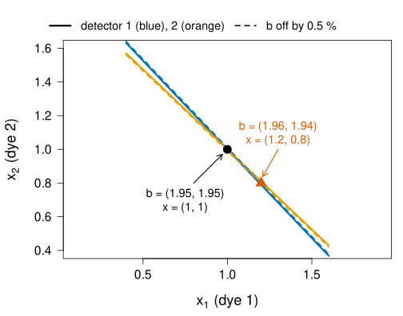
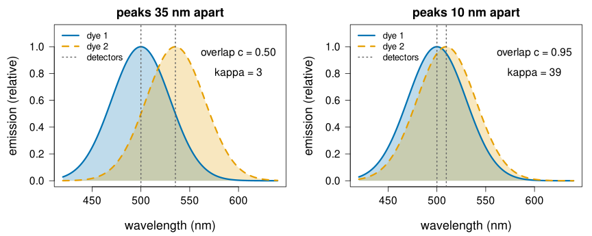
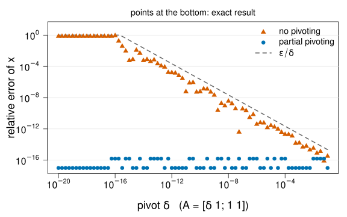
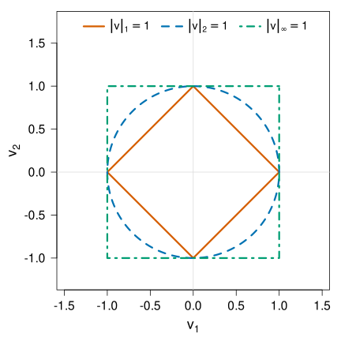
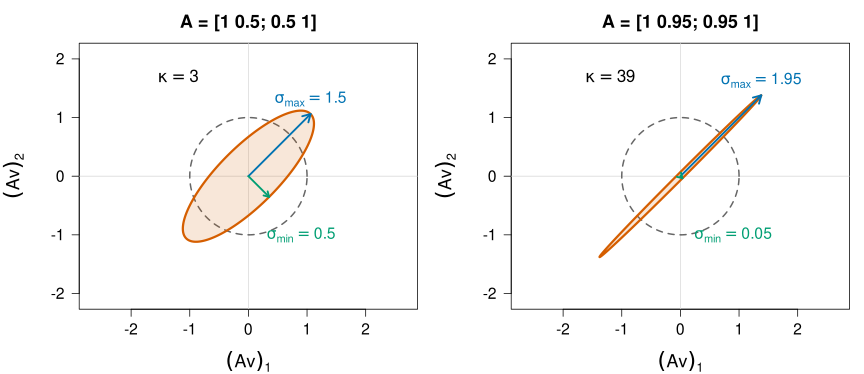
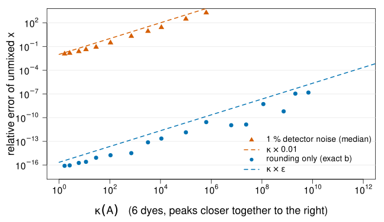
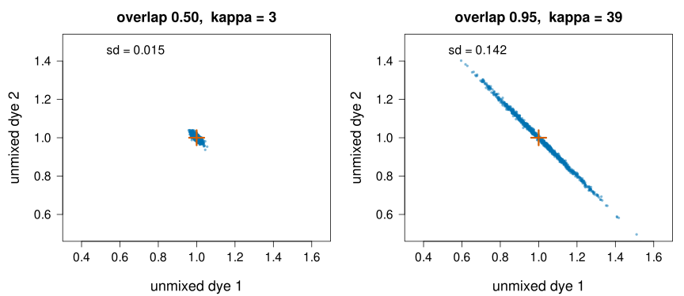

## About this lecture {.smaller}

In [*Gaussian elimination as LU*](../lu/lec.qmd) we solved $A\mathbf x = \mathbf b$ by
elimination and assumed every step was fine. Today: two different ways
the answer can still be wrong.

- **The algorithm's fault.** Elimination divides by the pivot. A **tiny pivot**
  destroys the answer; **partial pivoting** (swapping rows) fixes it.
- **The problem's fault.** Some systems amplify errors in $\mathbf b$ whatever
  the algorithm. To measure this we need sizes of vectors and matrices:
  **norms** ($1$, $2$, $\infty$).
- The **condition number** $\kappa(A)$: lose about $\log_{10}\kappa$ digits.
- **Residual vs error**: a small residual does not mean a small error.
- Biology: **spectral unmixing** in flow cytometry. Dyes with overlapping
  spectra give an ill-conditioned matrix, and detector noise is amplified.

::: notes
This lecture has the same two-source structure as Error, conditioning and
stability in Part 1: an unstable algorithm (elimination without pivoting) and an
ill-conditioned problem (overlapping dyes). The cures differ: the first is fixed
by changing the algorithm (pivoting, which every library already does); the
second only by changing the experiment (the dyes or the detectors). We assume LU
from the previous unit: elimination, multipliers, forward and back substitution.
:::

## Where we left off: two dyes {.smaller}

:::: {.columns}
::: {.column width="50%"}
At the end of [*Error, conditioning and stability*](../error-conditioning/lec.qmd):

```r
A <- matrix(c(1,    0.95,
              0.95, 1   ), nrow = 2, byrow = TRUE)
solve(A, c(1.95, 1.95))
# [1] 1 1
solve(A, c(1.96, 1.94))             # b off by 0.5 %
# [1] 1.2 0.8
kappa(A, exact = TRUE)
# [1] 39
```

- A 0.5 % change in the detector readings moves the dye amounts by 20 %.
- Today: why 39, what $\kappa$ measures, and what to do about it.
:::
::: {.column width="50%"}
{width="100%"}
:::
::::

::: notes
Pick up the teaser with the same numbers. Each equation is a line in the (x1, x2)
plane; the two lines are nearly parallel, so their intersection slides a long way
when either one moves a little. By the end of the lecture students can compute
the 39 by hand and explain why the perturbation (0.01, -0.01) was the worst
possible one.
:::

## Spectral unmixing is $A\mathbf x = \mathbf b$ {.smaller}

:::: {.columns}
::: {.column width="40%"}
- Each dye emits over a **range** of wavelengths. Each detector sees light from
  **several** dyes.
- $A_{ij}$ = signal in detector $i$ per unit of dye $j$ (measured from
  single-stained controls).
- $\mathbf b$ = detector readings for one cell; $\mathbf x$ = dye amounts.
- Solve $A\mathbf x = \mathbf b$ for **every cell**: millions of times.
:::
::: {.column width="60%"}
{width="100%"}
:::
::::

Two dyes, detectors at the two peaks: $A = \begin{pmatrix}1 & c\\ c & 1\end{pmatrix}$,
overlap $c$. Close peaks give $c = 0.95$, our matrix.

::: notes
Flow cytometry compensation and spectral unmixing are the same linear algebra.
Classic compensation uses one detector per dye; spectral cytometers use 30 to 60
detectors and solve a least-squares problem (Part 4). We keep it square here: as
many detectors as dyes. The spectra are Gaussian with width 30 nm, a toy model
of real emission spectra. With peaks 35 nm apart, detector 1 sees half as much of
dye 2 as of dye 1 (c = 0.5); 10 nm apart, 95 % (c = 0.95). The same algebra
appears in fluorescence microscopy (linear unmixing of spectral images) and in
compensation matrices for older cytometers.
:::

## Recap: elimination as LU {.smaller}

Row 2 minus $m = a_{21}/a_{11}$ times row 1 (the **pivot** is $a_{11}$):

$$\begin{pmatrix}1 & 0.95\\ 0.95 & 1\end{pmatrix}
\;\xrightarrow{\;m = 0.95\;}\;
\begin{pmatrix}1 & 0.95\\ 0 & 1 - 0.95^2\end{pmatrix}
= \begin{pmatrix}1 & 0.95\\ 0 & 0.0975\end{pmatrix} = U,
\qquad L = \begin{pmatrix}1 & 0\\ 0.95 & 1\end{pmatrix}$$

- $A = LU$. Solve $L\mathbf y = \mathbf b$ (forward), then $U\mathbf x = \mathbf y$ (back).
- Each step divides by a pivot $u_{kk}$. Nothing so far checks its **size**.
- Cost $\tfrac23 n^3$ for the factorisation, $2n^2$ per right-hand side
  (from [*Gaussian elimination as LU*](../lu/lec.qmd)).

::: notes
One-slide recap only; the previous unit did this properly. The point to carry
forward: the multipliers are entries divided by the pivot, and back substitution
divides by the pivots again. If a pivot is zero the method stops; if it is tiny,
we will see that it silently returns garbage. Note that the second pivot 0.0975
is already small: the near-singularity of A shows up in U.
:::

## A zero pivot, a tiny pivot {.smaller}

```r
solve_nopivot <- function(A, b) {
  n <- nrow(A)
  for (k in 1:(n - 1)) for (i in (k + 1):n) {
    m <- A[i, k] / A[k, k]                 # multiplier
    A[i, ] <- A[i, ] - m * A[k, ];  b[i] <- b[i] - m * b[k]
  }
  backsolve(A, b)                          # back substitution
}
solve_nopivot(matrix(c(0, 1, 1, 0.3), 2, byrow = TRUE), c(1, 1.3))
# Error in backsolve(A, b) : singular matrix in 'backsolve'. First zero in diagonal [1]
A1 <- matrix(c(1e-20, 1, 1, 1), 2, byrow = TRUE)
solve_nopivot(A1, c(1, 2))
# [1] 0 1
solve(A1, c(1, 2))
# [1] 1 1
```

- Zero pivot: dye 1 gives no signal in detector 1 (the order of detectors is
  arbitrary). The multiplier is $1/0$; the method stops.
- Tiny pivot: **no warning**, and $x_1 = 0$ instead of $1$.

::: notes
backsolve (https://stat.ethz.ch/R-manual/R-devel/library/base/html/backsolve.html)
solves an upper triangular system by back substitution. The zero-pivot case is
realistic: the rows of A are just the detectors in some order, and nothing
guarantees that detector 1 sees dye 1. Both matrices are perfectly well
conditioned (we will compute kappa about 2.6 for A1): the problem is easy, the
algorithm fails. That is instability. solve() gets it right because it pivots.
:::

## What went wrong {.smaller}

With $\delta = 10^{-20}$: multiplier $m = 1/\delta = 10^{20}$.

$$\begin{pmatrix}\delta & 1 & \mid & 1\\ 1 & 1 & \mid & 2\end{pmatrix}
\;\to\;
\begin{pmatrix}\delta & 1 & \mid & 1\\ 0 & 1 - 10^{20} & \mid & 2 - 10^{20}\end{pmatrix}
\;\approx\;
\begin{pmatrix}\delta & 1 & \mid & 1\\ 0 & -10^{20} & \mid & -10^{20}\end{pmatrix}$$

- $1 - 10^{20}$ rounds to $-10^{20}$: the **1** and the **2** of row 2 are lost
  (they are below the gap between doubles near $10^{20}$).
- $x_2 = 1$ (fine), then $x_1 = (1 - x_2)/\delta = 0/\delta = 0$:
  **catastrophic cancellation**, divided by a tiny number.
- The computed $L$ and $U$ belong to a different matrix: $LU$ has $0$ where
  $A$ has $1$ in position $(2,2)$.

::: notes
Do this on the board. The huge multiplier copies row 1, scaled by 1e20, into
row 2 and swamps what row 2 contained. The second equation is effectively
replaced by a multiple of the first, so the information that x1 + x2 = 2 is
gone. Back substitution then cancels 1 - 1 = 0. Check LU: L = [1 0; 1e20 1],
U = [1e-20 1; 0 -1e20], LU = [1e-20 1; 1 0]. The (2,2) entry 1 has vanished:
the backward error is 100 %, which is the precise meaning of "unstable".
:::

## Error grows like $\varepsilon/\delta$

{width="62%" fig-align="center"}

- Without pivoting the error is about $\varepsilon/\delta$: every factor 10
  smaller pivot costs one digit. Below $\delta \approx 10^{-16}$: all lost.
- With pivoting: full accuracy for every $\delta$. The problem was never hard.

::: notes
The experiment: A = [delta 1; 1 1], b = (1, 2), exact solution known in closed
form, relative error of each method. The orange triangles follow the dashed
line epsilon/delta, the error-vs-parameter plot for this failure. The blue dots
sit at rounding level (points at the bottom are exact). A pivot of 1e-8, which is
not exotic in a larger matrix after a few elimination steps, already costs half
the digits.
:::

## Partial pivoting {.smaller}

Before eliminating column $k$, **swap rows** so the entry of largest absolute
value in that column (on or below the diagonal) becomes the pivot.

$$\begin{pmatrix}\delta & 1 & \mid & 1\\ 1 & 1 & \mid & 2\end{pmatrix}
\;\xrightarrow{\text{swap}}\;
\begin{pmatrix}1 & 1 & \mid & 2\\ \delta & 1 & \mid & 1\end{pmatrix}
\;\xrightarrow{m = \delta}\;
\begin{pmatrix}1 & 1 & \mid & 2\\ 0 & 1 - \delta & \mid & 1 - 2\delta\end{pmatrix}$$

- Now $x_2 = (1-2\delta)/(1-\delta) \approx 1$, $x_1 = 2 - x_2 \approx 1$. Correct.
- Every multiplier satisfies $|m| \le 1$, so no row is scaled up and swamps
  another.
- Swapping rows = reordering the equations (detectors). The solution does not change.

::: notes
The rule is simple and cheap: one search down a column per step, O(n^2) in
total, nothing next to the O(n^3) elimination. Bounded multipliers mean the
entries of U cannot grow much in practice, which is what keeps the rounding
errors small. "Partial" because only rows are swapped; complete pivoting also
swaps columns and is rarely worth it.
:::

## Partial pivoting in code {.smaller}

```r
solve_pivot <- function(A, b) {
  n <- nrow(A)
  for (k in 1:(n - 1)) {
    p <- which.max(abs(A[k:n, k])) + k - 1   # largest entry in column k
    A[c(k, p), ] <- A[c(p, k), ];  b[c(k, p)] <- b[c(p, k)]   # swap rows
    for (i in (k + 1):n) {
      m <- A[i, k] / A[k, k]                 # now |m| <= 1
      A[i, ] <- A[i, ] - m * A[k, ];  b[i] <- b[i] - m * b[k]
    }
  }
  backsolve(A, b)
}
solve_pivot(A1, c(1, 2))
# [1] 1 1
```

- Three extra lines. [`solve()`](https://stat.ethz.ch/R-manual/R-devel/library/base/html/solve.html)
  calls LAPACK (`dgesv`), which does exactly this, in optimised code.

::: notes
which.max returns the position within the sub-column k:n, so we add k - 1 to get
the row number. The swap uses R's vector indexing: A[c(k, p), ] <- A[c(p, k), ]
exchanges two rows in one line. Students write this themselves in the exercise
(C2) and compare with solve(). Python: scipy.linalg.lu_factor / lu_solve and
numpy.linalg.solve use the same LAPACK routine.
:::

## $PA = LU$ {.smaller}

The row swaps are recorded in a **permutation matrix** $P$ (the identity with
its rows reordered):

$$PA = LU, \qquad A\mathbf x = \mathbf b \;\Longleftrightarrow\; L U\mathbf x = P\mathbf b.$$

- Factor once ($\tfrac23 n^3$), then for each cell: permute $\mathbf b$,
  forward and back substitute ($2n^2$).
- Partial pivoting is **backward stable in practice**: the computed $\mathbf x$
  is the exact solution of $(A + \Delta A)\mathbf x = \mathbf b$ with
  $\|\Delta A\| \approx \varepsilon \|A\|$. (Rare matrices defeat it; they almost
  never occur in applications.)
- So after pivoting, any remaining error is the **problem's**. To measure it we
  need the size of a vector and of a matrix.

::: notes
In R, Matrix::lu returns the factorisation with P, L and U (expand() gives the
three matrices); in Python scipy.linalg.lu. The backward-stability statement is
the matrix version of "the answer is exact for a nearby input" from Error,
conditioning and stability. The famous exception (Wilkinson's matrix, entries of
U growing like 2^n) is a curiosity; LAPACK and every statistics package rely on
partial pivoting. Transition: the 2-dye system was solved by a pivoting solve()
and still moved by 20 %. That is conditioning, and we now build the tools to
measure it.
:::

## Pivoting does not rescue the two dyes {.smaller}

```r
solve_pivot(A, c(1.96, 1.94))     # A = [1 0.95; 0.95 1]
# [1] 1.2 0.8
```

- Same answer as `solve()`: it is the **exact** solution of the perturbed system.
- The algorithm is innocent. The **problem** amplifies the 0.5 % change in
  $\mathbf b$ to 20 % in $\mathbf x$.
- To say "0.5 %" and "20 %" for **vectors**, we need a size: a **norm**.

::: notes
A short bridge slide. No pivoting is needed here (0.95 < 1, so no swap), and the
arithmetic is accurate to 16 digits. What is uncertain is the data b: detector
readings have 1 % or worse noise. So the question becomes: how much can the
solution move, relative to its size, when b moves by a given relative amount?
:::

## Vector norms {.smaller}

A **norm** $\|\mathbf v\|$ is a length. Three common ones, for $\mathbf v = (3, -4, 12)$:

| name | formula | value |
|---|---|---|
| 1-norm | $\|\mathbf v\|_1 = \sum_i \lvert v_i\rvert$ | $3 + 4 + 12 = 19$ |
| 2-norm (Euclidean) | $\|\mathbf v\|_2 = \sqrt{\sum_i v_i^2}$ | $\sqrt{9 + 16 + 144} = 13$ |
| $\infty$-norm (max) | $\|\mathbf v\|_\infty = \max_i \lvert v_i\rvert$ | $12$ |

```r
v <- c(3, -4, 12)
c(sum(abs(v)), sqrt(sum(v^2)), max(abs(v)))
# [1] 19 13 12
```

- Always $\|\mathbf v\|_\infty \le \|\mathbf v\|_2 \le \|\mathbf v\|_1$, and they
  differ by at most a factor $n$. For error sizes, any of them will do.
- **Relative error** of a vector: $\|\hat{\mathbf x} - \mathbf x\| / \|\mathbf x\|$.

::: notes
All three are "lengths": zero only for the zero vector, scale with |c| when the
vector is multiplied by c, and obey the triangle inequality. The 1-norm is the
total (e.g. total absolute error over all dyes), the 2-norm the ordinary
distance, the infinity-norm the worst single component. For a vector of n
numbers they differ by at most a factor n, so "small" means the same in all of
them for small n. R's norm() wants a matrix; norm(v, "2") happens to work for a
vector, the others need as.matrix(v). Python: np.linalg.norm(v, 1), (v), (v,
np.inf).
:::

## Unit balls

:::: {.columns}
::: {.column width="45%"}
{width="100%"}
:::
::: {.column width="55%"}
All vectors of norm 1, in 2D:

- $\|\cdot\|_1$: a diamond. $\|\cdot\|_2$: a circle. $\|\cdot\|_\infty$: a square.
- Teaser: $\Delta\mathbf b = (0.01, -0.01)$, $\mathbf b = (1.95, 1.95)$.
  In the 2-norm $\|\Delta\mathbf b\|_2/\|\mathbf b\|_2 = 0.01/1.95 = 0.51\,\%$.
- $\Delta\mathbf x = (0.2, -0.2)$, $\mathbf x = (1, 1)$:
  $\|\Delta\mathbf x\|_2/\|\mathbf x\|_2 = 20\,\%$.
- Ratio: $0.2 / 0.005128 = 39$.
:::
::::

::: notes
The picture explains the name of the infinity-norm (the limit of the p-norm as p
grows) and makes the inequalities visible: the diamond sits inside the circle,
which sits inside the square. In the teaser both relative changes happen to be
the same in all three norms, because all components have the same size. The
ratio 39 is exactly kappa: the teaser perturbation is the worst case, as we will
see.
:::

## Matrix norms {.smaller}

How much can $A$ **stretch** a vector? $\;\|A\| = \max_{\mathbf v \ne 0} \dfrac{\|A\mathbf v\|}{\|\mathbf v\|}$

| norm | formula | $A = \begin{pmatrix}1 & 0.95\\0.95 & 1\end{pmatrix}$ |
|---|---|---|
| $\|A\|_1$ | largest absolute **column** sum | $1.95$ |
| $\|A\|_\infty$ | largest absolute **row** sum | $1.95$ |
| $\|A\|_2$ | largest stretch $\sigma_{\max}$ | $1.95$ |

```r
c(norm(A, "1"), norm(A, "I"), norm(A, "2"))
# [1] 1.95 1.95 1.95
svd(A)$d                           # singular values: all stretch factors
# [1] 1.95 0.05
```

- $\sigma_{\max}$, $\sigma_{\min}$: the largest and smallest **singular values**.
  For a symmetric matrix they are the absolute eigenvalues (here $1.95$ and $0.05$).

::: notes
The definition is "induced by the vector norm": the largest factor by which A
can lengthen any vector. For the 1 and infinity norms there are exact formulas
students can do by hand (column sums, row sums). The 2-norm needs the singular
values, which we only use as numbers here; The SVD, rank deficiency and
regularisation (Part 4) explains them. For a symmetric A, the eigenvalues are
1 + 0.95 and 1 - 0.95, eigenvectors (1, 1) and (1, -1). [norm()](https://stat.ethz.ch/R-manual/R-devel/library/base/html/norm.html)
in R takes type "1", "I" (infinity), "2" or "F" (Frobenius, not induced).
:::

## A matrix turns a circle into an ellipse

{width="95%" fig-align="center"}

- Longest axis $\sigma_{\max}$, shortest $\sigma_{\min}$. With overlap 0.95, the
  direction $(1, -1)$ (**dye 1 minus dye 2**) is squashed to $0.05$.
- Solving $A\mathbf x = \mathbf b$ undoes this: it **stretches** that direction by
  $1/\sigma_{\min} = 20$.

::: notes
The dashed circle is all unit vectors; the orange ellipse is A times them. For
c = 0.5 the ellipse is fat; for c = 0.95 it is almost a line segment along
(1, 1): the detectors see the sum of the dyes well and the difference hardly
at all. Inverting A must blow the thin direction back up, by 1/0.05 = 20, and
any noise that lies in that direction is blown up with it. That is the whole
story of ill-conditioning in one picture.
:::

## The condition number of a matrix {.smaller}

$$\kappa(A) = \|A\|\,\|A^{-1}\| \;\overset{\text{2-norm}}{=}\; \frac{\sigma_{\max}}{\sigma_{\min}}$$

If $A\mathbf x = \mathbf b$ and $A(\mathbf x + \Delta\mathbf x) = \mathbf b + \Delta\mathbf b$, then

$$\frac{\|\Delta \mathbf x\|}{\|\mathbf x\|} \;\le\; \kappa(A)\,\frac{\|\Delta \mathbf b\|}{\|\mathbf b\|}.$$

- Why: $\Delta\mathbf x = A^{-1}\Delta\mathbf b$, so $\|\Delta\mathbf x\| \le \|A^{-1}\|\,\|\Delta\mathbf b\|$;
  and $\|\mathbf b\| \le \|A\|\,\|\mathbf x\|$. Divide.
- Same idea as $\kappa = |x f'/f|$ in [*Error, conditioning and stability*](../error-conditioning/lec.qmd): amplification of **relative** errors.
- $\kappa \ge 1$ always. $\kappa = 1$: no amplification. $A$ singular: $\kappa = \infty$.

::: notes
Two lines of algebra, both from the definition of the matrix norm. The bound is a
worst case: equality needs b in the most stretched direction and Delta b in the
least stretched one. Errors in A itself (the reference spectra are measured too)
obey a similar bound with the same kappa, to first order. kappa depends on the
norm, but only by a modest factor; "kappa = 39 or 40" is what matters, not the
digits.
:::

## Two dyes by hand: $\kappa = 39$ {.smaller}

$$A^{-1} = \frac{1}{1 - 0.95^2}\begin{pmatrix}1 & -0.95\\ -0.95 & 1\end{pmatrix}
= \begin{pmatrix}10.26 & -9.74\\ -9.74 & 10.26\end{pmatrix}$$

- $\|A\|_\infty = 1.95$, $\|A^{-1}\|_\infty = 10.26 + 9.74 = 20$, so
  $\kappa_\infty = 1.95 \times 20 = 39$.
- 2-norm: $\sigma_{\max}/\sigma_{\min} = 1.95/0.05 = 39$. Overlap $c$:
  $\kappa = \dfrac{1 + c}{1 - c}$.
- **Worst case**: $\mathbf b \propto (1, 1)$ (both dyes, the stretched direction),
  $\Delta\mathbf b \propto (1, -1)$ (anti-correlated detector errors). The teaser
  was exactly this: amplification **39**.
- Noise along $(1, 1)$ is not amplified at all (factor 1).

::: notes
Everything here is pen and paper; the exercise repeats it. Point out that the
inverse has large entries of opposite sign: the unmixed dye 1 is about 10 times
detector 1 minus 10 times detector 2, a difference of two large, nearly equal
numbers. That is cancellation again, and it is built into the problem, not the
algorithm. kappa = (1 + c)/(1 - c): c = 0.5 gives 3, c = 0.9 gives 19,
c = 0.99 gives 199.
:::

## Computing $\kappa$ in R {.smaller}

```r
kappa(A, exact = TRUE)          # 2-norm, from the singular values
# [1] 39
kappa(A)                        # default: a fast estimate
# [1] 39.95
1 / rcond(A)                    # 1-norm estimate, from the LU factors
# [1] 39
```

- [`kappa()`](https://stat.ethz.ch/R-manual/R-devel/library/base/html/kappa.html)
  without `exact = TRUE` is an **estimate**, good to a small factor; enough for
  counting digits.
- `exact = TRUE` costs an SVD ($O(n^3)$, a few times dearer than `solve()`).
  `rcond()` costs only $O(n^2)$ once the LU factors exist.
- Python: `np.linalg.cond(A)`; Rust (nalgebra): `singular_values()`, max / min.

::: notes
Three routes to the same number. The default kappa() works from a QR
factorisation and a triangular estimate; it is off by 2 % here, which never
matters for the digits rule. rcond is the reciprocal condition number in the
1-norm, estimated by LAPACK from the LU factors; a value near
.Machine$double.eps (about 1e-16) means "numerically singular", and solve()
itself refuses with "system is computationally singular: reciprocal condition
number = ..." when it falls below that. Never compute kappa as
norm(A) * norm(solve(A)) for a large matrix: forming the inverse is wasteful.
:::

## Rule of thumb: lose $\log_{10}\kappa$ digits

{width="72%" fig-align="center"}

- Six dyes, peaks moved closer: $\kappa$ from 1.6 to $10^{10}$. Blue: only
  rounding ($\le \kappa\varepsilon$). Orange: 1 % noise ($\approx \kappa \times 0.01$).
- 16 digits survive $\kappa = 10^6$; **2-digit data** survive only $\kappa \lesssim 10$.

::: notes
The panel: 6 Gaussian spectra of width 30 nm, peaks spaced 60 nm down to 4 nm,
detectors at the peaks. Exact abundances x = (5, 1, 3, 2, 4, 1), b = A x
computed in double precision, then solve(). The blue points lose about log10
kappa digits from 16, below the kappa times epsilon line because the bound is a
worst case. The orange points add 1 % multiplicative noise to every detector
(median over 200 noise draws) and follow kappa times 0.01: with kappa = 100 the
unmixed values are off by 100 %. This is the asymmetry from Part 1 again:
rounding errors need a huge kappa to hurt, measurement errors only a modest one.
:::

## Residual vs error {.smaller}

The **residual** $\mathbf r = \mathbf b - A\hat{\mathbf x}$ is computable; the
**error** $\hat{\mathbf x} - \mathbf x$ is not (we do not know $\mathbf x$).

```r
b <- c(1.95, 1.95); x <- c(1, 1)                   # true dye amounts
rel <- function(u, v) sqrt(sum((u - v)^2)) / sqrt(sum(v^2))
xa <- c(1.2, 0.8); xb <- c(1.01, 1.01)             # two candidate answers
c(resid = rel(A %*% xa, b), error = rel(xa, x))
#       resid       error
# 0.005128205 0.200000000
c(resid = rel(A %*% xb, b), error = rel(xb, x))
# resid error
#  0.01  0.01
```

- `xa` has the **smaller** residual but a 20 times larger error.
- Bound: $\dfrac{\|\hat{\mathbf x} - \mathbf x\|}{\|\mathbf x\|} \le \kappa(A)\,\dfrac{\|\mathbf r\|}{\|\mathbf b\|}$.

::: notes
The residual measures how well x-hat fits the equations; the error, how close it
is to the truth. With an ill-conditioned A they disagree: xa = (1.2, 0.8) changes
x in the squashed direction (1, -1), which A hardly sees, so the fit stays good.
xb changes x in the stretched direction (1, 1), which A sees fully. The bound
is the same as before with Delta b replaced by the residual: x-hat is the exact
solution for b - r. So a small residual guarantees a small error only when kappa
is small.
:::

## A stable solver always has a small residual {.smaller}

```r
panel <- function(n, spacing, width = 30) {     # Gaussian spectra
  peak <- 500 + spacing * (0:(n - 1))           # dye peaks = detectors (nm)
  outer(peak, peak, function(d, p) exp(-(d - p)^2 / (2 * width^2)))
}
P <- panel(6, 6); xt <- c(5, 1, 3, 2, 4, 1)     # 6 dyes, peaks 6 nm apart
b6 <- drop(P %*% xt);  xh <- solve(P, b6)
c(kappa = kappa(P, exact = TRUE), resid = rel(P %*% xh, b6), error = rel(xh, xt))
#        kappa        resid        error
# 1.141239e+08 1.431645e-16 5.182116e-09
```

- Residual at rounding level: `solve()` did its job (**backward stable**).
- Error $\approx 10^{8}\times$ larger: that is $\kappa$, the **problem**.
- **Check**: residual tells you about the **algorithm**; $\kappa$ tells you about the **problem**.

::: notes
This is the practical consequence of backward stability: pivoted LU returns an
x-hat whose residual is about epsilon times norm(A) norm(x-hat), whatever kappa
is. So checking the residual of solve() output is a test of the solver (and
of bugs in your own code), not of the answer's accuracy. Here the error is
5e-9, eight digits lost out of 16, as log10(1.1e8) = 8.06 predicts. outer()
builds the matrix of spectrum values: entry (i, j) is dye j's emission at
detector i.
:::

## Detector noise in unmixed cells

{width="88%" fig-align="center"}

- 1000 cells, both dyes at 1 unit, 1 % detector noise. Overlap 0.95: spread
  $\times 9.5$, along **dye 1 $-$ dye 2**.
- Cytometrists call this **spillover spreading**: populations smear out after unmixing.

::: notes
The same noise draws unmixed with c = 0.5 (kappa 3) and c = 0.95 (kappa 39). The
sd of the unmixed dye 1 goes from 0.015 to 0.142. The per-component factor is
the 2-norm of a row of A^-1 (1.49 and 14.2, times the noise sd 0.01), smaller
than kappa because kappa is the worst case over all directions. Note the shape:
the cloud is stretched along (1, -1), exactly the squashed direction of the
ellipse. Real data show this as diagonal smears and negative values in unmixed
plots, a familiar sight to anyone who has run a large spectral panel.
:::

## Try it: overlap, $\kappa$ and spreading

```{=html}
<link rel="stylesheet" href="../demos/dist/demo.css">
<div data-demo="unmixing" data-c="0.95" data-noise="0.01" data-db="0 0"></div>
<script src="../demos/dist/unmixing.js"></script>
```

::: notes
Two dyes, Gaussian spectra of width 30 nm, detectors at the peaks, A = [1 c; c 1], computed live. Left: the spectra; the dot is c, dye 2's signal in detector 1. Middle: detector readings of 400 cells with 1 unit of each dye and noise sd 0.01, plus one red cell you can drag. Right: the unmixed amounts, with the two equations of the red cell as lines. Start at c = 0.95 and click Delta b = (+0.01, -0.01): the dashed lines move a little, their crossing jumps to (1.2, 0.8), relative changes 0.51 % and 20 %, amplification 39 = kappa: the teaser. Click (+0.01, +0.01): amplification 1. Drag the red point round the circle: the amplification swings between 1 and 39, never above. Back to Delta b = 0, untick "lines": the round cloud in the middle becomes a thin ellipse along dye 1 minus dye 2, sd of dye 1 = 0.14, 14 times the detector noise. Click c = 0.5 (kappa 3, sd 0.015), then 0.99 (kappa 199, sd 0.7, many cells off the plot). Finish by moving the noise slider: the cloud scales with the noise, but its shape and the factor 14 only change with c, the choice of dyes.
:::

## What to do about an ill-conditioned unmixing {.smaller}

| peak spacing (6 dyes, width 30 nm) | 60 nm | 30 nm | 20 nm | 10 nm | 5 nm |
|---|---|---|---|---|---|
| $\kappa$ | 1.6 | 29 | 705 | $6.4\times10^5$ | $7.2\times10^8$ |

```r
sapply(c(60, 30, 20, 10, 5), function(s) kappa(panel(6, s), exact = TRUE))
# [1] 1.644646e+00 2.876870e+01 7.053382e+02 6.373920e+05 7.210988e+08
```

- No algorithm helps; change the **problem**. Choose dyes with distinct spectra
  (panel design tools report the condition number of the spectra matrix,
  e.g. a "complexity index").
- **More detectors than dyes** (spectral cytometers): least squares,
  [*Least squares: normal equations vs QR*](../least-squares-qr/lec.qmd) (Part 4).
- Accept a little bias for less noise: **regularisation**,
  [*The SVD, rank deficiency and regularisation*](../svd/lec.qmd).

::: notes
The table is the panel designer's view of conditioning: kappa grows extremely
fast as peaks crowd together, because neighbouring columns of A become nearly
parallel. Cytek's panel-design software reports a "complexity index", which is
the condition number of the matrix of reference spectra; panels are designed to
keep it low. The two numerical remedies (more measurements, regularisation) are
the subject of Part 4. Pivoting, higher precision or a different solve routine do
not help: the amplification is in the problem.
:::

## Checklist: solving $A\mathbf x = \mathbf b$ {.smaller}

1. **Use the library** (`solve`, `np.linalg.solve`, nalgebra `lu().solve`): it
   pivots. Your own elimination without pivoting can fail silently.
2. **Compute $\kappa$** (`kappa(A)`, `1/rcond(A)`, `np.linalg.cond`). Expect to
   lose $\log_{10}\kappa$ digits **of your data's accuracy**.
3. **Residual small** but answer odd? Then the problem is ill-conditioned; a
   small residual does not certify the answer.
4. **Perturb $\mathbf b$** by its noise level and re-solve: the spread of
   $\mathbf x$ is your real uncertainty.
5. `solve()` error "computationally singular": $\kappa \gtrsim 10^{16}$. Do not
   just switch to a different solver; rethink the model.

::: notes
These are the habits to take away. Step 4 is the matrix version of kappa_num from
Part 1: nudging the input and watching the output works for any pipeline, and it
gives the error in the directions your noise actually has, not the worst case.
Step 5: switching to a pseudo-inverse or a generalised inverse to silence the
error does not create information that the measurements do not contain.
:::

## Summary {.smaller}

- Elimination divides by pivots. **Tiny pivot** without pivoting: error
  $\approx \varepsilon/\delta$, silently. **Partial pivoting** (largest entry
  in the column, $|m| \le 1$) gives $PA = LU$ and is backward stable in practice;
  `solve()` does it.
- **Vector norms**: $\|\cdot\|_1$ (sum), $\|\cdot\|_2$ (length), $\|\cdot\|_\infty$ (max).
  **Matrix norm**: largest stretch; column sums, row sums, $\sigma_{\max}$.
- **Condition number** $\kappa(A) = \|A\|\|A^{-1}\| = \sigma_{\max}/\sigma_{\min}$:
  relative error in $\mathbf x$ $\le \kappa \times$ relative error in $\mathbf b$.
  Lose about $\log_{10}\kappa$ digits.
- **Residual vs error**: a stable solver gives a tiny residual; the error can still
  be $\kappa$ times larger.
- Two dyes with overlap $c$: $\kappa = (1+c)/(1-c)$; $c = 0.95$ gives 39 and a
  tenfold spread of unmixed cells. Cure the **experiment**, not the algorithm.
- Next, [*Structure: symmetric, banded, sparse*](../structured-sparse/lec.qmd): faster solves when $A$ has
  structure.

::: notes
Recap the two failure types once more: pivoting fixes the algorithm, nothing
fixes the problem except better data or a different question. The next unit
keeps the same LU machinery but exploits structure (Cholesky for symmetric
positive definite matrices, banded and sparse matrices). Conditioning returns in
Part 4 (least squares squares kappa in the normal equations) and in
Identifiability and uncertainty of fitted parameters (Part 9).
:::
