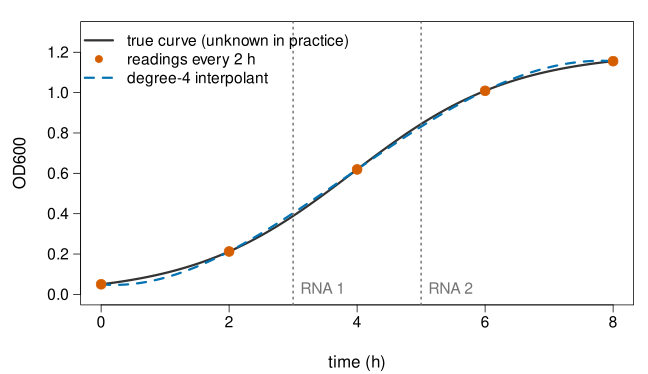
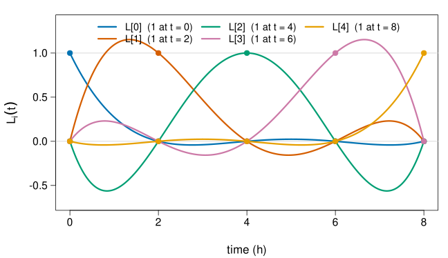
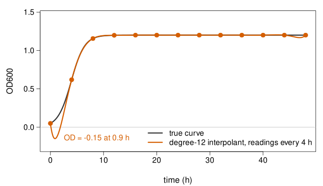
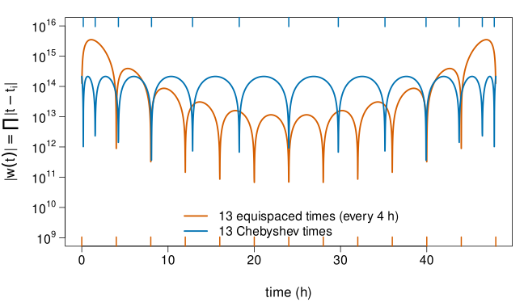
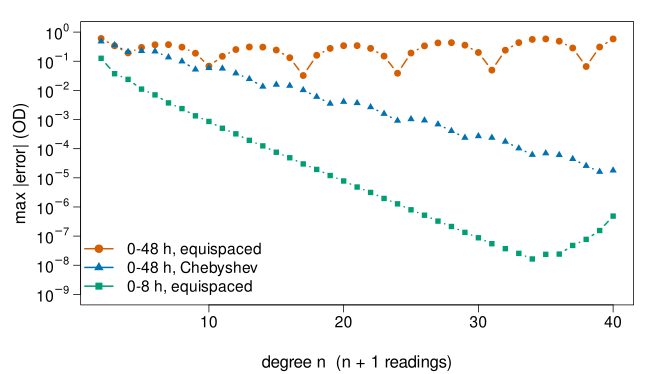
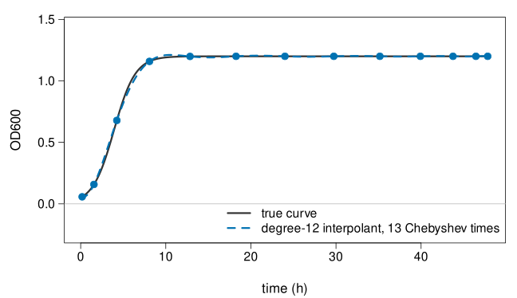
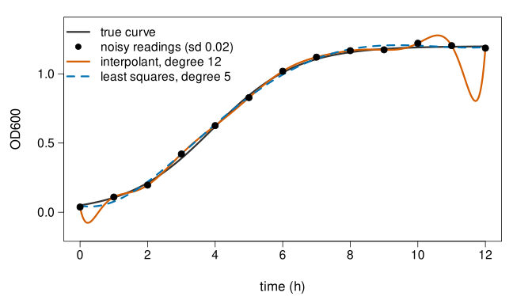
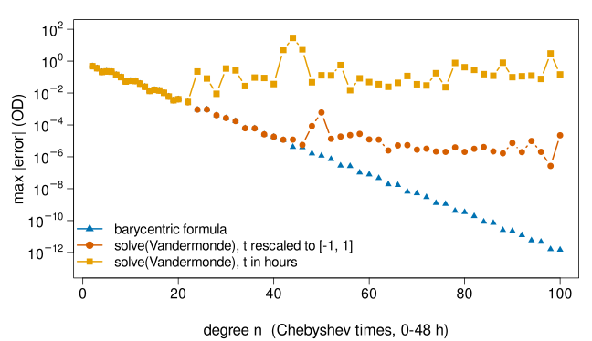

## About this lecture

Measurements come at a few time points; questions are asked in between. This lecture is about drawing **one polynomial through all the points**, and about when that is a bad idea.

- Through $n+1$ points there is exactly **one** polynomial of degree $\le n$. Three ways to write it: **monomial** (Vandermonde), **Lagrange**, **Newton** (divided differences).
- The **interpolation error** has a formula: a derivative of the curve times the **node polynomial** $\prod (t - t_i)$.
- With **equally spaced** time points, a high degree makes things **worse**, not better: the **Runge phenomenon**. **Chebyshev** points fix it.
- Interpolation reproduces **noise** exactly; with noisy data, **fit** instead (least squares).
- Evaluate with the **barycentric** formula, not with monomial coefficients.

::: notes
This opens Part 6. The question is very practical: a plate reader or a sampling schedule gives values at a few times, and we need values in between, for example the OD at the moment an RNA sample was taken. A polynomial through the points is the oldest answer. It works well for a few points close together and fails badly for many points spread out, and the lecture shows both, with the error formula that explains the difference. The practical alternative, piecewise polynomials, is the next lecture, Splines.
:::

## A biology problem first {.smaller}

{width="62%" fig-align="center"}

- A culture is read every 2 h (red). RNA was extracted at **3 h** and **5 h**, between readings. What was the OD then?
- The truth is our logistic curve, $N(t) = K/(1 + (K/N_0 - 1)e^{-rt})$, $K = 1.2$, $N_0 = 0.05$, $r = 0.8$ per hour. In the lab you only have the dots.
- The same question for a gene-expression time course: values at 0, 1, 2, 4, 8 h, and you want 3 h.

::: notes
The running OD curve from Convergence and cost. We use the formula as ground truth so that every error in this lecture can be measured exactly; with real data it cannot be. The blue dashed curve is the degree-4 polynomial through the five readings, and by eye it is almost on the truth. The rest of the lecture asks how good "almost" is, and what happens with more readings over a longer run.
:::

## One polynomial through all the points {.smaller}

$n+1$ readings at distinct times $t_0, \dots, t_n$ → exactly **one** polynomial $p(t) = c_0 + c_1 t + \dots + c_n t^n$ with $p(t_i) = y_i$. Two points: a line; three: a parabola.

The conditions $p(t_i) = y_i$ are a **square** linear system with the **Vandermonde** matrix:

```r
K <- 1.2; N0 <- 0.05; r <- 0.8
od <- function(t) K / (1 + (K / N0 - 1) * exp(-r * t))
t <- c(0, 2, 4, 6, 8);  y <- od(t)          # 5 readings
V  <- outer(t, 0:4, "^")                    # columns 1, t, t^2, t^3, t^4
cf <- solve(V, y)                           # coefficients c0 ... c4
p  <- function(x) drop(outer(x, 0:4, "^") %*% cf)
p(c(3, 5));  od(c(3, 5))
# [1] 0.4026258 0.8312495                   # interpolant
# [1] 0.3887883 0.8443214                   # truth
```

- Off by +0.014 and −0.013 OD, about 3 %. Not bad for a guess between readings.
- This is the polynomial fit of *Least squares: normal equations vs QR* with as many coefficients as points: the residuals are **zero**.

::: notes
Interpolation means the curve passes exactly through every data point. The Vandermonde matrix is the same matrix as in the least-squares lecture, but square now, so solve() gives the unique solution. Uniqueness: if two polynomials of degree n agreed at n+1 points, their difference would be a polynomial of degree n with n+1 roots, so it is zero. The coefficients are not the point; the values in between are. We come back to the danger of this route: with times in hours and many points, V is badly conditioned.
:::

## Lagrange form {.smaller}

Build $p$ from **basis polynomials** $L_i(t)$ that are 1 at $t_i$ and 0 at every other node:

$$L_i(t) = \prod_{j \ne i} \frac{t - t_j}{t_i - t_j}, \qquad p(t) = \sum_{i=0}^{n} y_i\, L_i(t).$$

No linear system to solve. By hand, nodes $t = 2, 4, 6$, evaluate at $t = 3$:

$$L_0(3) = \tfrac{(3-4)(3-6)}{(2-4)(2-6)} = \tfrac{3}{8}, \quad L_1(3) = \tfrac{(3-2)(3-6)}{(4-2)(4-6)} = \tfrac{3}{4}, \quad L_2(3) = \tfrac{(3-2)(3-4)}{(6-2)(6-4)} = -\tfrac{1}{8}$$

$$p(3) = \tfrac38(0.2126) + \tfrac34(0.6193) - \tfrac18(1.0090) = 0.4181 \qquad (\text{truth } 0.3888)$$

- The weights $L_i(3)$ add up to 1: interpolating a constant gives the constant back.
- A **negative** weight ($-\tfrac18$): the value at 3 h is pulled *down* by the reading at 6 h.

::: notes
Do this on the board. Each L_i is a product of n linear factors, so it has degree n, it vanishes at every other node, and the denominator makes it 1 at its own node. The sum of y_i L_i then passes through every point. The weights summing to 1 is a good check of hand arithmetic. Negative weights appear as soon as we extrapolate the trend from points further away; with many nodes they become large, and that is where the trouble of this lecture starts. The quadratic misses by 0.03, more than the degree-4 interpolant on the previous slide: here we used only three readings.
:::

## The Lagrange basis

{width="85%" fig-align="center"}

- $L_i$ is 1 at its own node and 0 at the others; in between it is free to swing.
- Near the ends of the interval the swings are larger. Remember this picture for the Runge slides.

::: notes
The five basis polynomials for the nodes 0, 2, 4, 6, 8. The interpolant is a weighted sum of these curves with the readings as weights. The basis polynomials of the end nodes (blue and yellow) are small in the middle, but the inner ones swing below zero and above one near the ends. With 13 equispaced nodes the largest of them reaches 18, and any error in the readings is multiplied by them.
:::

## Lagrange in R {.smaller}

```r
lagrange <- function(x, y, xx) {
  sapply(xx, function(z) {
    L <- sapply(seq_along(x), function(i) prod((z - x[-i]) / (x[i] - x[-i])))
    sum(L * y)
  })
}
lagrange(t, y, c(3, 5))
# [1] 0.4026258 0.8312495               # the same polynomial as solve(V, y)
```

- `x[-i]` is R for "all elements except the $i$-th".
- Cost: each $L_i(z)$ is a product of $n$ factors, so **$O(n^2)$ per evaluation point**. Adding a reading means starting over.
- Same numbers as the Vandermonde route: **one** polynomial, different ways of writing it.

::: notes
Six lines, written straight from the formula. It is the form for understanding and for proofs; as an algorithm it is slow (n^2 per point) and has to be recomputed from scratch when a new reading arrives. Newton's form fixes the second issue, and the barycentric form at the end of the lecture fixes the first one. Note the agreement to all printed digits with solve(V, y): for five points the conditioning of V is not yet a problem.
:::

## Newton form {.smaller}

Write $p$ so that each new node adds **one term**:

$$p(t) = a_0 + a_1(t - t_0) + a_2(t - t_0)(t - t_1) + \dots + a_n(t - t_0)\cdots(t - t_{n-1}).$$

The coefficients are **divided differences**: $f[t_i] = y_i$ and

$$f[t_i, \dots, t_{i+k}] = \frac{f[t_{i+1}, \dots, t_{i+k}] - f[t_i, \dots, t_{i+k-1}]}{t_{i+k} - t_i}, \qquad a_k = f[t_0, \dots, t_k].$$

- $f[t_0, t_1] = \dfrac{y_1 - y_0}{t_1 - t_0}$ is a slope; $f[t_0, t_1, t_2]$ is a change of slope, about $f''/2$.
- In general $f[t_0, \dots, t_k] = f^{(k)}(\xi)/k!$ for some $\xi$ between the nodes: a **derivative estimate** from data.

::: notes
The Newton form is built like a Taylor polynomial, but with differences instead of derivatives. Point out that the first divided difference is just the finite-difference slope from Convergence and cost, and the second is half a second derivative. This link (divided difference = scaled derivative at some point) is what gives the error formula two slides on. The recursion is a triangular table, next slide.
:::

## Divided differences by hand {.smaller}

Readings at $t = 2, 4, 6, 8$ (rounded to 4 digits):

| $t_i$ | $y_i$ | 1st | 2nd | 3rd |
|---|---|---|---|---|
| 2 | **0.2126** | | | |
| | | $\frac{0.6193 - 0.2126}{4 - 2} = $ **0.20335** | | |
| 4 | 0.6193 | | $\frac{0.19485 - 0.20335}{6 - 2} = $ **−0.002125** | |
| | | 0.19485 | | $\frac{-0.0303625 + 0.002125}{8 - 2} = $ **−0.004706** |
| 6 | 1.0090 | | −0.0303625 | |
| | | 0.07340 | | |
| 8 | 1.1558 | | | |

$p(3) = 0.2126 + 0.20335(1) - 0.002125(1)(-1) - 0.004706(1)(-1)(-3) = 0.4040$ (truth 0.3888)

- The first three terms are the quadratic through 2, 4, 6: $0.4181$, as on the Lagrange slide.
- The 4th reading added **one term** ($-0.0141$) and changed nothing else.

::: notes
Fill in the table column by column on the board. Each entry is (entry below-left minus entry above-left) divided by the spread of the times it covers. The top diagonal (bold) holds the Newton coefficients. The point to stress is that the quadratic is a sub-sum of the cubic: adding a reading appends one more column and one more term. That is why Newton's form suits data that arrive one at a time. The cubic is better than the quadratic at 3 h, but not as good as the degree-4 interpolant that also uses the reading at 0 h.
:::

## Newton in R {.smaller}

```r
divdiff <- function(x, y) {           # returns f[x0], f[x0,x1], ..., f[x0..xn]
  n <- length(x); a <- y
  for (k in 2:n)
    for (i in n:k) a[i] <- (a[i] - a[i - 1]) / (x[i] - x[i - k + 1])
  a
}
newton_eval <- function(x, a, xx) {   # nested multiplication, like Horner
  n <- length(a); p <- a[n]
  for (k in (n - 1):1) p <- a[k] + (xx - x[k]) * p
  p
}
newton_eval(t, divdiff(t, y), c(3, 5))
# [1] 0.4026258 0.8312495
```

- The table costs $O(n^2)$ **once**; each evaluation is then $O(n)$.
- Same polynomial again, as it must be.

::: notes
divdiff overwrites the column in place, running i backwards so that the values still needed are not overwritten yet. newton_eval nests the products: a0 + (t - t0)(a1 + (t - t1)(a2 + ...)), the same trick as Horner's rule for ordinary polynomials. It works with vectors xx directly. In the exercise students build the table by hand and check it with this code.
:::

## How large is the error? {.smaller}

If the true curve $f$ has $n+1$ derivatives, then for every $t$ there is a $\xi$ between the nodes and $t$ with

$$f(t) - p(t) = \underbrace{\frac{f^{(n+1)}(\xi)}{(n+1)!}}_{\text{the curve}} \; \underbrace{(t - t_0)(t - t_1)\cdots(t - t_n)}_{\text{node polynomial } w(t):\ \text{the sampling}}$$

- One more derivative than the degree: a polynomial of degree $\le n$ is reproduced **exactly** ($f^{(n+1)} = 0$).
- $w(t)$ is zero at the nodes and depends only on **where** you sampled. You control it; you do not control $f$.
- Same shape as Taylor's remainder (*Convergence and cost*): Taylor has all $n+1$ factors equal to $(t - t_0)$.

::: notes
This is the key formula of the lecture, stated without proof (it follows from Rolle's theorem applied n+1 times; the textbooks have it in half a page). Read it as a product of two parts. The derivative part is a property of the biology: a smooth curve has modest high derivatives, a sharp switch has huge ones. The node polynomial is a property of the experimental design. We cannot know xi, so in practice we bound the derivative by its maximum. Make the link to Taylor explicit: the Taylor polynomial is the limit where all nodes coincide.
:::

## The error formula with numbers {.smaller}

**Linear** interpolation between the readings at 2 h and 4 h, at $t = 3$:

$$f(3) - p(3) = \frac{f''(\xi)}{2}(3-2)(3-4) = -\frac{f''(\xi)}{2}, \quad f''(3) = 0.0592 \;\Rightarrow\; \approx -0.0296$$

Actual: $p(3) = (0.2126 + 0.6193)/2 = 0.4160$, truth $0.3888$, error $-0.0272$. ✓

**Degree 4** through $t = 0, 2, 4, 6, 8$, with $\max |f^{(5)}| = 0.0983$ on $[0, 8]$:

| $t$ | $w(t)$ | bound $\frac{0.0983}{120}\,\lvert w(t)\rvert$ | actual $\lvert f - p\rvert$ |
|---|---|---|---|
| 3 (middle) | $3\cdot1\cdot(-1)(-3)(-5) = -45$ | 0.037 | 0.014 |
| 1 (near the end) | $1\cdot(-1)(-3)(-5)(-7) = 105$ | 0.086 | (exercise) |

- The bound holds; it is pessimistic because it uses the **largest** derivative.
- The same nodes are **2.3 times** worse near the ends: $|w|$ is larger there.

::: notes
f''(3) = 0.0592 is the same second derivative as in Convergence and cost, where it set the error constant of the forward difference. For linear interpolation the error at the midpoint is h^2/8 times f'', here 4/8 times 0.059 = 0.030. For degree 4 the fifth derivative was computed with R's D() (the exercise shows how). The actual error at 1 h is left as an exercise. The important observation is in the w column: the node polynomial is larger near the ends. With 5 nodes the factor is 2.3; with 13 nodes it is about 300, next slides.
:::

## A longer run: 48 h, a reading every 4 h {.smaller}

{width="60%" fig-align="center"}

- 13 readings, so a degree-12 interpolant. It passes through every reading, and dips to **OD = −0.15** at 0.9 h: a negative cell density.
- It also wiggles in stationary phase near 44–48 h. In the middle it is fine.
- This is the **Runge phenomenon** (Carl Runge, 1901).

::: notes
Same culture, a longer experiment, a typical plate-reader overnight run. Every reading is exact (no noise at all) and the interpolant still produces nonsense between the first two readings. The largest error, 0.25 OD, is right at the start, in lag phase, which is often exactly the part a biologist cares about (lag time). The classic textbook example is Runge's function 1/(1 + 25 x^2) on [-1, 1], which the exercise reproduces. The cause is the same: equally spaced nodes and a function whose derivatives grow fast.
:::

## Why the ends? The node polynomial {.smaller}

{width="64%" fig-align="center"}

- Equispaced (red): $|w(t)|$ is about **300 times** larger between the first two readings than in the middle.
- The error is $|f^{(13)}(\xi)|/13! \times |w(t)|$: the same derivative factor, multiplied by a much larger $w$ at the ends.
- Chebyshev times (blue, ticks on top) are **crowded towards the ends**, and $|w|$ is level across the whole run.

::: notes
Log scale on the y axis. Each dip is a node, where w is zero. For equispaced nodes the arches grow towards both ends by orders of magnitude; this is a property of equal spacing, true for any curve. The Chebyshev arches all have the same height: that is the defining property of Chebyshev points, they make the largest value of |w| as small as possible. The derivative part also matters: the logistic has large high derivatives (its complex singularity is close to the steep part), which is why the 0-8 h run did not show the effect.
:::

## More readings make it worse {.smaller}

{width="62%" fig-align="center"}

- **0–8 h, equispaced** (green): error falls with $n$, by a factor $\approx 1.6$ per extra reading, until rounding sets in near $10^{-8}$.
- **0–48 h, equispaced** (red): error jumps between 0.03 and 0.6 OD and **does not converge**.
- **0–48 h, Chebyshev** (blue): falls steadily, $2\times10^{-5}$ at $n = 40$.

::: notes
The error-vs-n plot for this method, on a log axis. Green: short interval relative to the curve's steep part, so the error formula's derivative factor is beaten by the (n+1)! in the denominator, and the polynomial converges, geometrically. Its upturn after n = 34 is rounding error amplified by the large basis polynomials of equispaced nodes: a second, independent reason to avoid high degree with equal spacing. Red: on the long run the node polynomial wins; the error oscillates and grows for larger n. Blue: the same curve and the same number of readings, only the times moved. Check for students: if adding readings does not reduce the change in your interpolant, you are in the red regime.
:::

## Chebyshev nodes {.smaller}

On $[-1, 1]$: $x_k = \cos\!\left(\dfrac{(2k+1)\pi}{2n+2}\right)$, $k = 0, \dots, n$. On $[a, b]$: $t_k = \tfrac{a+b}{2} - \tfrac{b-a}{2}\,x_k$.

They are the projections of **equally spaced points on a semicircle**, so they crowd at the ends.

```r
n <- 12; k <- 0:n
tc <- 24 - 24 * cos((2 * k + 1) * pi / (2 * n + 2))   # 13 times in [0, 48] h
round(tc, 2)
#  [1]  0.17  1.56  4.25  8.09 12.85 18.26 24.00 29.74 35.15 39.91 43.75 46.44
# [13] 47.83
```

- They minimise $\max |w(t)|$: the smallest possible value is $2\left(\tfrac{b-a}{4}\right)^{n+1}$.
- For a smooth curve the error then falls **geometrically** with $n$.

::: notes
Draw a semicircle over [-1, 1], mark n+1 equally spaced angles, drop them to the axis. These are Chebyshev points of the first kind, the zeros of the Chebyshev polynomial T_{n+1}; the second kind (extreme points, cos(k pi / n)) includes the endpoints and is equally good. numpy has chebpts1 and chebpts2. Experimental-design reading: sample densely at the beginning and end of the run and sparsely in the middle. That is rarely how anyone designs a growth experiment, which is the honest limitation of this fix.
:::

## Chebyshev times on the same run {.smaller}

{width="60%" fig-align="center"}

- Same 13 readings' worth of effort, same degree 12. Largest error **0.039** OD instead of 0.25, no negative OD.
- In practice you rarely choose the times freely. With the times you have, use **low degree, locally**: a line between neighbours ([`approx`](https://stat.ethz.ch/R-manual/R-devel/library/stats/html/approxfun.html)), or the cubic **splines** of the next lecture.

```r
approx(t, y, xout = c(3, 5))$y        # piecewise linear, 0-8 h readings
# [1] 0.4159873 0.8141777             # errors 0.027, -0.030
```

::: notes
The remaining error of 0.039 is at the end of the steep rise, near 6 h, where Chebyshev points are already sparse; with more Chebyshev points it keeps falling (blue curve two slides back). approx is base R's piecewise linear interpolation; it can never overshoot the readings, which is its great virtue. Its error is h^2/8 times max |f''| per interval, from the error formula with n = 1. Splines (next lecture) keep the locality and add smoothness.
:::

## Interpolation vs fitting {.smaller}

{width="58%" fig-align="center"}

- Hourly readings over 12 h with plate-reader noise (sd 0.02 OD). The degree-12 interpolant goes **through the noise** and swings to 0.39 OD off near the ends.
- A degree-5 **least-squares** fit (blue) ignores the noise: error 0.032. Without noise, the interpolant's error was only 0.008.

::: notes
Interpolation assumes the readings are exact. Real readings are not. Each reading's error is multiplied by the corresponding basis polynomial L_i, and for 13 equispaced points the largest single L_i reaches 18 near the ends, and the sum of all |L_i| (the Lebesgue constant) reaches 89; for 13 Chebyshev points it is only 2.6. That turns noise of 0.02 into swings of 0.4. A fit with fewer coefficients than points averages the noise out instead. Choosing the degree of a fit is a bias-variance question; the next lecture, Splines, makes it explicit with smoothing splines.
:::

## Interpolation vs fitting in R {.smaller}

```r
set.seed(1)
t12 <- 0:12                                  # hourly for 12 h
y12 <- od(t12) + rnorm(13, sd = 0.02)        # plate-reader noise
f_int <- lm(y12 ~ poly(t12, 12))             # 13 coefficients: interpolation
f_fit <- lm(y12 ~ poly(t12, 5))              # 6 coefficients: least squares
max(abs(resid(f_int)))
# [1] 0                                       # passes through every point
tt <- seq(0, 12, by = 0.01)
max(abs(predict(f_int, data.frame(t12 = tt)) - od(tt)))
# [1] 0.3937819
max(abs(predict(f_fit, data.frame(t12 = tt)) - od(tt)))
# [1] 0.03161686
```

- [`poly()`](https://stat.ethz.ch/R-manual/R-devel/library/stats/html/poly.html) builds **orthogonal** columns (a QR of the Vandermonde matrix), so even degree 12 is well conditioned.
- Zero residuals are a warning sign, not a success: the model has as many parameters as data.

::: notes
lm with as many coefficients as points is interpolation; with fewer it is least squares, exactly as in Least squares: normal equations vs QR. Using poly() rather than raw powers is what makes degree 12 possible at all (next slide). The diagnostic: compare the interpolant with a lower-degree fit; if they differ by much more than the measurement noise between the points, the interpolant is chasing noise.
:::

## Monomial coefficients lose digits {.smaller}

{width="56%" fig-align="center"}

```r
t48 <- seq(0, 48, by = 4)
solve(outer(t48, 0:12, "^"), od(t48))
# Error in solve.default(...) :
#   system is computationally singular: reciprocal condition number = 5.66168e-23
```

- In hours, $t^{12}$ reaches $48^{12} \approx 10^{20}$: $\kappa(V) \approx 8\times10^{20}$. R refuses from $n = 9$; forced (`tol = 0`, or numpy, which never refuses) the values go wrong from $n \approx 22$ (orange).
- Rescaled to $[-1, 1]$ (red) it lasts longer but **stalls** near $10^{-5}$. Barycentric (blue) reaches $10^{-12}$.

::: notes
Even at Chebyshev nodes, the monomial basis is a bad basis: the Vandermonde matrix's condition number grows exponentially with n, as in the least-squares lecture. Orange: times in hours, forced through with solve(..., tol = 0); R's default solve gives up already at n = 9, which is cautious, because LU still reproduces the readings well (a small residual) for a while. From n of about 22 the values between readings are garbage. Red: rescaled to [-1, 1], also forced; the error follows the true interpolation error down to about 1e-5 and then stalls and wanders: kappa(V) reaches 1e18 to 1e19, so the coefficients have essentially no correct digits, and only the cancellation between them keeps the values roughly right. Blue: the same polynomial evaluated with the barycentric formula, which never forms coefficients; it reaches 1e-12. The problem is not the polynomial but how it is represented.
:::

## The barycentric form: the stable way to evaluate {.smaller}

Divide the Lagrange form by the Lagrange form of the constant 1:

$$p(t) = \frac{\displaystyle\sum_j \frac{w_j\, y_j}{t - t_j}}{\displaystyle\sum_j \frac{w_j}{t - t_j}}, \qquad w_j = \frac{1}{\prod_{k \ne j}(t_j - t_k)} \quad \left(\text{Chebyshev: } w_j = (-1)^j \sin\tfrac{(2j+1)\pi}{2n+2}\right)$$

```r
bary_weights <- function(x) sapply(seq_along(x), function(j) 1 / prod(x[j] - x[-j]))
bary_eval <- function(x, y, w, xx) sapply(xx, function(z) {
  d <- z - x
  if (any(d == 0)) return(y[d == 0])          # z is a node
  sum(w * y / d) / sum(w / d)
})
bary_eval(t, y, bary_weights(t), c(3, 5))
# [1] 0.4026258 0.8312495
```

- Weights $O(n^2)$ once, then **$O(n)$ per point**; a new reading updates the weights in $O(n)$.
- Rounding errors in numerator and denominator largely **cancel**: accurate to $\approx\varepsilon$ times the Lebesgue constant. Python: `scipy.interpolate.BarycentricInterpolator`.

::: notes
The trick: the weights w_j do not depend on t, and dividing by the same sum for y = 1 makes any common scaling of the weights cancel, which is why the simple Chebyshev formula (scaled weights) works. Higham (2004) proved the formula is numerically stable for nodes with a small Lebesgue constant such as Chebyshev points. This is what serious software does: scipy's BarycentricInterpolator, and Chebfun in MATLAB, which routinely interpolates with degree 1000 at Chebyshev points. In R there is pracma::barylag; the five lines above are enough. Note the guard for t equal to a node, where the formula would divide by zero.
:::

## Checklist: is my interpolant trustworthy? {.smaller}

1. **Plot it on a fine grid**, not only at the readings. Values outside the biology (negative OD, OD above the plateau) → Runge or noise.
2. **Leave one reading out**, interpolate from the rest, compare at the left-out time: the difference estimates the error.
3. **Change the degree** (drop the end readings, or add one): if the answer between readings changes a lot, do not trust it.
4. **Noisy readings?** Do not interpolate: fit (least squares, lower degree) or smooth (*Splines*).
5. **Never extrapolate** a polynomial beyond the first or last reading: $|w(t)|$ grows like $|t|^{n+1}$ outside.
6. **Evaluate stably**: barycentric formula or `poly()`; not `solve()` on raw powers.

::: notes
Each item maps to a slide. Item 2 is the practical version of the error formula: with real data we do not know the truth, but leave-one-out tells us how much the answer depends on each reading. Item 5 deserves emphasis: outside the readings every factor of w grows, and a degree-12 polynomial goes to plus or minus infinity like t^12. Extrapolating a growth curve with a polynomial is a common error in lab spreadsheets (Excel's trendline "polynomial order 6").
:::

## Summary {.smaller}

- $n+1$ readings → one interpolating polynomial of degree $\le n$. **Monomial** (Vandermonde), **Lagrange** ($\sum y_i L_i$) and **Newton** (divided differences) are three ways to write the same polynomial.
- Error: $f(t) - p(t) = \dfrac{f^{(n+1)}(\xi)}{(n+1)!}\prod (t - t_i)$: a property of the **curve** times a property of the **sampling**.
- **Equispaced** readings: $|w|$ explodes near the ends, so a high degree **diverges** (Runge): a 48-h run read every 4 h gives a negative OD.
- **Chebyshev** times (crowded at the ends) keep $|w|$ level; the error then falls geometrically.
- Readings are noisy: interpolation copies the noise and amplifies it; **fit** with fewer parameters instead.
- Evaluate with the **barycentric** formula; raw powers of $t$ are badly conditioned.

**Next:** *Splines*: low-degree pieces joined smoothly, the practical answer for real sampling times.

::: notes
Recap the three messages: one polynomial, three representations; the error formula with its two factors; and the practical conclusion that high-degree global polynomials on equispaced or noisy data are a bad idea. The next lecture keeps polynomials but uses them locally: piecewise cubics (splines) through the same readings, and smoothing splines for noisy ones, with the growth rate as the derivative of the smoothed OD curve.
:::
