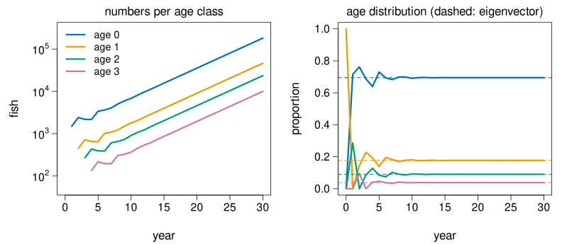
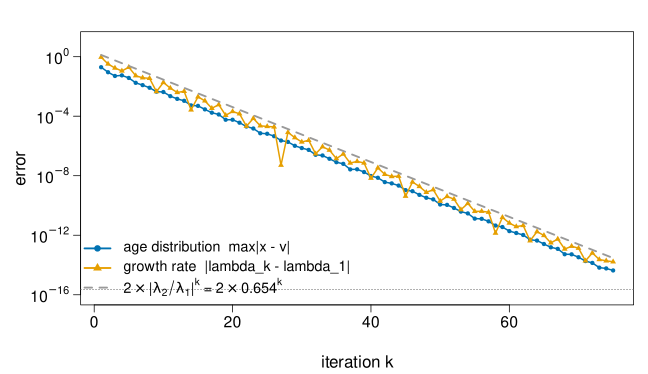
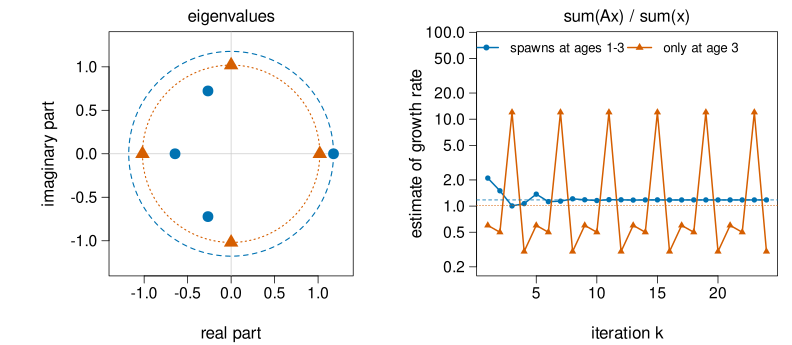
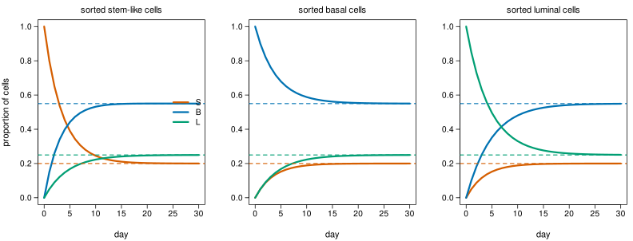
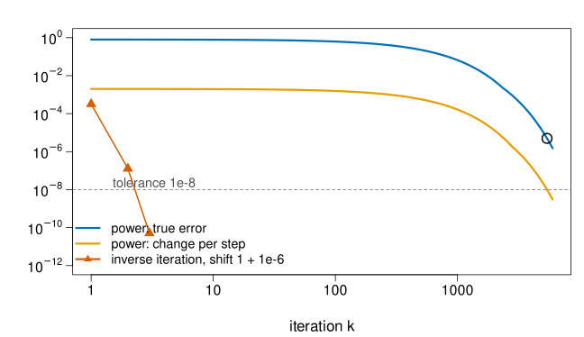
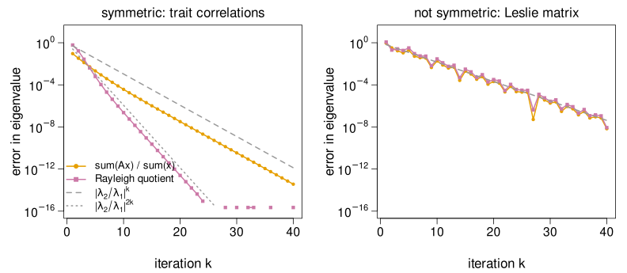

## About this lecture {.smaller}

A population model that is run forward year after year computes, without being asked, the **dominant eigenvalue** and **eigenvector** of its matrix. This lecture turns that observation into an algorithm and asks when it works.

- **Power iteration**: multiply by $A$ again and again, and **normalise**. The direction settles on the dominant eigenvector, the scale factor on the dominant eigenvalue.
- **Convergence rate** $|\lambda_2/\lambda_1|$: linear convergence, fast or hopelessly slow depending on the second eigenvalue. It fails when $|\lambda_2| = |\lambda_1|$.
- **Rayleigh quotient**: a better eigenvalue estimate from the same vector (twice the digits for symmetric matrices).
- **Inverse iteration and shifts**: iterate with $(A - \sigma I)^{-1}$ to find the eigenvalue **nearest** $\sigma$, in a few steps.
- Biology: a **Leslie matrix** (long-term growth rate and stable age distribution of a fish population) and the **stationary distribution** of a Markov chain of cell states.

::: notes
This opens Part 5. Students have met eigenvalues in a first linear algebra course (characteristic polynomial of a 2 x 2), and the svd unit used eigen() in passing. Here we build the simplest eigenvalue algorithm by hand, in ten lines, the way the course builds every method first. The point that makes this unit easy to motivate: ecologists projecting a Leslie matrix and biologists simulating a Markov chain are already running power iteration. The numerical analysis is about how fast it converges, how to tell when it has, and what to do when it is too slow. How eigen() itself works (the QR algorithm) and Krylov methods for large problems are the next unit, How eigen() works, and big problems.
:::

## A biology problem: a stocked lake {.smaller}

A lake is stocked with 1000 one-year-old fish. Each year, fish of age $i$ survive to age $i+1$ with probability $s_i$, and produce $F_i$ offspring that are counted next year as age 0.

{width="88%" fig-align="center"}

- After a few wobbly years every age class grows by the **same factor**, about 1.177 per year.
- The **proportions** in the age classes settle at 69 %, 18 %, 9 %, 4 %, whatever the starting stock.
- What are these two numbers, how fast are they reached, and when are they not reached at all?

::: notes
Start with the picture, not the algebra. Left: numbers per age class on a log scale; after about ten years all four lines are parallel straight lines, so each class grows by the same factor every year. Right: the proportions, with wild swings in the first years (the stocked cohort moving through the age classes) that die out. Fisheries and conservation biologists want exactly these two numbers: the long-term growth rate lambda (is the population viable? lambda > 1 grows) and the stable age distribution (what a survey at equilibrium should find). They also care about the transient: how long until the wobbles are gone. All three are eigen-questions.
:::

## The Leslie matrix {.smaller}

Write the numbers in age classes 0–3 as a vector $\mathbf n_t$. One year later, $\mathbf n_{t+1} = L\,\mathbf n_t$:

$$
L = \begin{pmatrix} 0 & 1.5 & 4 & 5 \\ 0.3 & 0 & 0 & 0 \\ 0 & 0.6 & 0 & 0 \\ 0 & 0 & 0.5 & 0 \end{pmatrix}
\quad \begin{array}{l} \leftarrow \text{offspring } F_i \text{ per fish of age } i \\ \leftarrow \text{survival } s_0 \\ \leftarrow s_1 \\ \leftarrow s_2 \end{array}
$$

```r
L <- matrix(0, 4, 4)
L[1, ] <- c(0, 1.5, 4, 5)                  # offspring per fish of each age
L[cbind(2:4, 1:3)] <- c(0.3, 0.6, 0.5)     # survival to the next age
n <- c(0, 1000, 0, 0)                      # stock 1000 one-year-olds
for (t in 1:30) n <- L %*% n
round(drop(n))
# [1] 180810  46072  23479   9971
sum(L %*% n) / sum(n)                      # growth of the total in year 31
# [1] 1.177361
```

::: notes
A Leslie matrix (P. H. Leslie, 1945) has fertilities in the first row and survival probabilities on the subdiagonal, zeros elsewhere. Read row 1: next year's age-0 fish are 1.5 per one-year-old plus 4 per two-year-old plus 5 per three-year-old. Rows 2-4: the survivors move one class down. Nobody survives past age 3. %*% is R's matrix product; drop() turns the 4 x 1 matrix back into a vector. The numbers are made up but of a realistic shape for a short-lived fish. The same structure, with hundreds of size classes instead of four ages, is an integral projection model; we come back to that at the end.
:::

## Recap: eigenvalues of a 2 × 2 {.smaller}

A two-age-class plant: $L = \begin{pmatrix} 1 & 1 \\ 0.75 & 0 \end{pmatrix}$. An **eigenvector** $\mathbf v \ne \mathbf 0$ satisfies $L\mathbf v = \lambda\mathbf v$; the **eigenvalues** solve $\det(L - \lambda I) = 0$:

$$\det\begin{pmatrix} 1-\lambda & 1 \\ 0.75 & -\lambda \end{pmatrix} = \lambda^2 - \lambda - 0.75 = (\lambda - 1.5)(\lambda + 0.5) = 0$$

| | $\lambda_1 = 1.5$ | $\lambda_2 = -0.5$ |
|---|---|---|
| solve $(L - \lambda I)\mathbf v = \mathbf 0$ | $-0.5v_1 + v_2 = 0$ | $1.5v_1 + v_2 = 0$ |
| eigenvector | $\mathbf v_1 = (2, 1)$ | $\mathbf v_2 = (2, -3)$ |
| check | $L\mathbf v_1 = (3, 1.5) = 1.5\,\mathbf v_1$ | $L\mathbf v_2 = (-1, 1.5) = -0.5\,\mathbf v_2$ |

- Biology: the population grows by **1.5** per year in the long run, with juveniles : adults = **2 : 1** (67 % juveniles).
- Any multiple of $\mathbf v$ is also an eigenvector: we choose the scaling (here, proportions summing to 1).

::: notes
One-slide recap of first-course linear algebra. The characteristic polynomial works for 2 x 2 and 3 x 3 by hand; for 4 x 4 and up it is no longer how anyone computes eigenvalues (finding the roots of a high-degree polynomial is badly conditioned anyway; How eigen() works, and big problems shows what libraries do instead). Keep this matrix: we use it on the next slide to see why repeated multiplication finds lambda_1, and in the exercise by hand. Note lambda_2 is negative: the second eigenvector has a negative entry, so it is not a population, only a pattern of deviations.
:::

## Why repeated multiplication finds $\lambda_1$ {.smaller}

Write the start as a combination of eigenvectors: $\mathbf x_0 = (1, 0) = \tfrac38(2, 1) + \tfrac18(2, -3)$. Each multiplication by $L$ multiplies each part by its own eigenvalue:

$$L^k\mathbf x_0 = \tfrac38\,(1.5)^k\,(2, 1) + \tfrac18\,(-0.5)^k\,(2, -3) \;=\; (1.5)^k\Big[\tfrac38(2,1) + \tfrac18\big(-\tfrac13\big)^k(2,-3)\Big]$$

| $k$ | $L^k\mathbf x_0$ | total ratio | error in $\lambda$ |
|---|---|---|---|
| 1 | $(1, 0.75)$ | 1.75 | $+0.25$ |
| 2 | $(1.75, 0.75)$ | 1.4286 | $-0.071$ |
| 3 | $(2.5, 1.3125)$ | 1.525 | $+0.025$ |
| 4 | $(3.8125, 1.875)$ | 1.4918 | $-0.0082$ |

- The $\mathbf v_2$ part shrinks **relative** to the $\mathbf v_1$ part by $|\lambda_2/\lambda_1| = \tfrac13$ per step; the error shrinks by about 3 per step and flips sign (because $\lambda_2 < 0$).
- This needs $|\lambda_1| > |\lambda_2|$ and a start with **some** $\mathbf v_1$ in it.

::: notes
This is the whole theory of the power method in one 2 x 2 example. "Total ratio" is sum(L^k x0) / sum(L^(k-1) x0), the growth factor of the total population. Its error alternates in sign because (-1/3)^k alternates. For an n x n matrix with n independent eigenvectors the same argument gives L^k x0 = sum c_i lambda_i^k v_i, dominated by the largest |lambda_i| as long as c_1 is not 0. For a nonnegative Leslie or Markov matrix any nonnegative, nonzero start has c_1 > 0, so the condition is automatic there.
:::

## Power iteration {.smaller}

Repeat:

1. $\mathbf y = A\mathbf x_k$ (one matrix–vector product, $2n^2$ operations)
2. eigenvalue estimate $\lambda^{(k)}$ from $\mathbf x_k$ and $\mathbf y$
3. **normalise**: $\mathbf x_{k+1} = \mathbf y / \|\mathbf y\|$

**Why normalise?** $A^k\mathbf x$ grows or shrinks like $\lambda_1^k$. For the fish ($\lambda_1 = 1.18$):

```r
x <- c(0, 1, 0, 0)
for (k in 1:5000) x <- L %*% x             # no normalisation
drop(x)
# [1] NaN NaN NaN NaN                      # 1.18^5000 overflows, then Inf - Inf
x <- c(0, 1, 0, 0)
for (k in 1:5000) x <- (0.5 * L) %*% x     # a declining population
drop(x)
# [1] 0 0 0 0                              # underflow
```

For a nonnegative matrix (Leslie, Markov) the natural norm is the **sum**: $\mathbf x$ holds **proportions**, and $\lambda^{(k)} = \mathrm{sum}(A\mathbf x_k)$ is the growth of the total.

::: notes
Normalising does not change the direction, only the length, and the direction is what converges. Overflow needs about 709.8 / log(1.177) = 4346 steps here, so it is not the first problem a student hits, but a population with lambda = 3 overflows after 650 steps and a large matrix with lambda_1 = 1000 after about 100. The NaN comes from Inf * 0 in the matrix product (the zeros of L times infinite entries). Any norm will do: the 2-norm is the default for general matrices (next slides), the max-norm is common in textbooks, the sum is natural when all entries are nonnegative. Each gives the same direction, scaled differently.
:::

## Power iteration in R {.smaller}

```r
power_it <- function(A, x, tol = 1e-10, maxit = 1000) {
  x <- x / sum(x)
  for (k in 1:maxit) {
    y <- drop(A %*% x)
    lambda <- sum(y)                     # growth factor of the total
    r <- sqrt(sum((y - lambda * x)^2))   # residual ||Ax - lambda x||
    x <- y / lambda                      # normalise: proportions
    if (r < tol) break
  }
  list(lambda = lambda, x = x, k = k, r = r)
}
```

- Stop on the **residual** $\|A\mathbf x - \lambda\mathbf x\|$: it is zero exactly for an eigenpair, and it is cheap (we have $A\mathbf x$ already).
- Always return the iteration count and the residual, so the caller can see whether it converged.

::: notes
Ten lines, one matrix-vector product per step. drop() turns the one-column matrix from %*% into a plain vector. The residual uses the old x and the new y, so it costs nothing extra. Why the residual and not the change between iterates: we will see a case where the change is tiny and the answer is still wrong. The convergence check matters more than usual here, because power iteration can fail silently (two slides on).
:::

## Power iteration on the fish {.smaller}

```r
out <- power_it(L, c(0, 1, 0, 0))          # start: one-year-olds only
out$lambda;  round(out$x, 4);  out$k
# [1] 1.177359
# [1] 0.6945 0.1770 0.0902 0.0383
# [1] 55
ev <- eigen(L)
ev$values[1]
# [1] 1.177359+0i
v <- Re(ev$vectors[, 1]);  round(v / sum(v), 4)
# [1] 0.6945 0.1770 0.0902 0.0383
```

- Long-term growth **17.7 % per year**; at equilibrium 69 % of the fish are age 0.
- [`eigen`](https://stat.ethz.ch/R-manual/R-devel/library/base/html/eigen.html) agrees. It returns **complex** numbers (`+0i`) because a nonsymmetric matrix can have complex eigenvalues, and an eigenvector of length 1 with arbitrary sign: rescale before interpreting.

::: notes
The answer: lambda_1 = 1.177, the population grows 17.7 % per year in the long run; 69.5 % of the fish are age 0 at equilibrium. eigen() computes all four eigenvalues with a completely different algorithm (next unit) and agrees to all printed digits. Its eigenvector is scaled to length 1 and may come with a minus sign, so always rescale before interpreting (v / sum(v)). Re() drops the zero imaginary part. 55 iterations: why that many is the next slide.
:::

## How fast? $|\lambda_2 / \lambda_1|$ per step {.smaller}

{width="62%" fig-align="center"}

- The fish: $|\lambda_2/\lambda_1| = 0.770/1.177 = 0.654$. **Linear convergence**: the error falls by $0.654$ per step, a slope of $\log_{10} 0.654 = -0.18$: about **5.4 steps per digit**, 55 steps for $10^{-10}$.
- $\lambda_2$ is complex here, so the error wiggles (the transient oscillation in the age distribution), but the envelope is $|\lambda_2/\lambda_1|^k$.
- Biology: $\lambda_1/|\lambda_2| = 1.53$ is the **damping ratio**: how fast a population forgets its initial age structure.

::: notes
Error against iteration on a log scale, as for every iterative method in the course (Convergence and cost). The dashed line has the predicted slope; both errors follow it. Note the eigenvalue error and the eigenvector error converge at the same rate here; that changes for symmetric matrices (Rayleigh quotient, later). The rate comes straight from the 2 x 2 argument: the second-largest term shrinks by lambda_2/lambda_1 relative to the first. Ecologists use the damping ratio rho = lambda_1/|lambda_2| (Caswell, Matrix Population Models) to say how long transients last: the distance to the stable age distribution falls like rho^(-t). The same number is the convergence rate of the numerical method: as in Bisection and fixed-point iteration, "the population settles" and "the iteration converges" are the same statement.
:::

## Try it: power iteration

```{=html}
<link rel="stylesheet" href="../demos/dist/demo.css">
<div data-demo="poweriter" data-preset="plant" data-k="0" data-edit="0"></div>
<script src="../demos/dist/poweriter.js"></script>
```

::: notes
Power iteration computed live in the browser. Start with the 2 x 2 plant of the recap slide, start vector "class 1". Left: the plane with the two eigen-directions dashed (v1 blue, v2 red), the iterates on the unit circle, A x_k in green. Click step +1 four times: the estimates are 1.75, 1.4286, 1.525, 1.4918 (the table two slides back), and x_k lands on alternate sides of v1 because lambda_2 = -0.5 flips the sign of the v2 part. Right: the error falls along the dashed line with slope |lambda_2/lambda_1| = 1/3; press +10 twice: below 1e-10 at k = 20. Drag the start circle close to the red line: the first steps barely move (little v1 in the start), then the same slope. Switch to fish: the bars approach the dashed stable age distribution (0.694, 0.177, 0.090, 0.038), rate 0.654, the error wiggles because lambda_2 is complex. Then semelparous fish and play: one age class full, moving one class per step, the estimate cycles 0.6, 0.5, 12, 0.3, the error is flat, and the readout warns that four eigenvalues share the largest modulus. That is the next slide. If time allows: cell states, inverse iteration, sigma = 0.82 finds 0.8 in 20 steps, sigma = 0.77 finds 0.75 instead.
:::

## When it fails: $|\lambda_2| = |\lambda_1|$ {.smaller}

A salmon-like fish that spawns **once**, at age 3, and dies: first row $(0, 0, 0, 12)$.

{width="62%" fig-align="center"}

```r
Ls <- L;  Ls[1, ] <- c(0, 0, 0, 12)        # spawn once at age 3, then die
Mod(eigen(Ls)$values)                      # Mod = |lambda|
# [1] 1.019427 1.019427 1.019427 1.019427
out <- power_it(Ls, c(0, 1, 0, 0), maxit = 200);  c(out$k, out$r)
# [1] 200.0000000   0.4242641                # hit maxit; residual not small
```

::: notes
Four eigenvalues of equal modulus, lambda^4 = 12 x 0.3 x 0.6 x 0.5 = 1.08, spread evenly around a circle. No eigenvalue dominates, so nothing converges: the estimate cycles 0.6, 0.5, 12, 0.3 forever, because the stocked cohort only reproduces every fourth year. This is real biology: pink salmon live exactly two years, and odd-year and even-year runs in the same river are separate populations with different sizes; periodical cicadas emerge every 13 or 17 years. Mathematically the matrix is "imprimitive" (Perron-Frobenius theorem: a nonnegative matrix is guaranteed a strictly dominant positive eigenvalue only if some power of it has all entries positive). The check: the residual does not fall, and maxit is reached. Never return the last estimate without that check. The long-run growth over a full cycle is still well defined: lambda^4 = 1.08 per four years.
:::

## A Markov chain of cell states {.smaller}

Cancer cells switch between **stem-like** (S), **basal** (B) and **luminal** (L) states. Row $i$ of $P$ holds the probabilities that a cell in state $i$ is in each state one day later:

:::: {.columns}
::: {.column width="40%"}
$$P = \begin{pmatrix} 0.80 & 0.15 & 0.05 \\ 0.05 & 0.90 & 0.05 \\ 0.05 & 0.10 & 0.85 \end{pmatrix}$$

- Rows sum to 1.
- Proportions $\mathbf p$ (a row vector): $\mathbf p_{t+1} = \mathbf p_t P$.
- **Stationary distribution**: $\boldsymbol\pi P = \boldsymbol\pi$, i.e. $P^T\boldsymbol\pi^T = 1\cdot\boldsymbol\pi^T$: an eigenvector of $P^T$ with $\lambda = 1$.
:::
::: {.column width="60%"}
{width="100%"}
:::
::::

Sorting any one state and letting it grow gives the **same** equilibrium mix (dashed): 20 % S, 55 % B, 25 % L.

::: notes
This is the "phenotypic equilibrium" of Gupta et al. (2011, Cell): breast cancer cell lines sorted into stem-like, basal and luminal subpopulations each regenerated the original mix within days, and a three-state Markov chain explained it. Our P is illustrative, not their fitted matrix. The largest eigenvalue of a stochastic matrix is exactly 1 (P times the ones vector is the ones vector, so 1 is an eigenvalue of P and hence of P^T), and for a chain where every state can reach every other and the chain is not periodic, all other eigenvalues have modulus < 1. Same Perron-Frobenius story as the Leslie matrix. R convention: p is a row vector and we multiply p %*% P; that is power iteration with P^T.
:::

## Power iteration on the chain {.smaller}

Simulating the cell population **is** power iteration. The sum stays 1, so no normalisation is needed.

```r
P <- matrix(c(0.80, 0.15, 0.05,
              0.05, 0.90, 0.05,
              0.05, 0.10, 0.85), 3, byrow = TRUE,
            dimnames = list(c("S", "B", "L"), c("S", "B", "L")))
p <- c(1, 0, 0)                            # start: sorted stem-like cells
for (day in 1:60) p <- p %*% P
round(p, 6)
#        S    B    L
# [1,] 0.2 0.55 0.25
eigen(t(P))$values
# [1] 1.00 0.80 0.75
```

- Rate $|\lambda_2/\lambda_1| = 0.8$: about 10 steps per digit; the deviation from equilibrium **halves every 3.1 days** ($\log 0.5/\log 0.8$).
- So $\lambda_2$ is a biological quantity too: the **relaxation time** of the cell population after a perturbation.

::: notes
For a Markov chain lambda_1 = 1 is known, so the rate is just |lambda_2|. 0.8^60 = 1.5e-6, enough for 6 printed digits. 1/log10(1/0.8) = 10.3 steps per digit. The relaxation time is what you would measure in the sorting experiment: how many days until the mix is back within 1 % of equilibrium (log 0.01 / log 0.8 = 20.6 days). Note t(P): R's eigen gives right eigenvectors (columns), so the stationary distribution is an eigenvector of the transpose. Python users: np.linalg.eig(P.T).
:::

## When it fails: slow switching {.smaller}

A second cell line switches state **100 times less often**: $P_\text{slow} = I + 0.01\,(P - I)$. Same $\boldsymbol\pi$, but $\lambda_2 = 0.998$.

:::: {.columns}
::: {.column width="50%"}
```r
Pslow <- diag(3) + 0.01 * (P - diag(3))
p <- c(1, 0, 0)
for (k in 1:1e5) {
  p_new <- drop(p %*% Pslow)
  change <- max(abs(p_new - p))
  p <- p_new
  if (change < 1e-8) break
}
k;  change
# [1] 5406
# [1] 9.989544e-09
max(abs(p - c(0.2, 0.55, 0.25)))
# [1] 4.984782e-06           # 500 x tol
```
:::
::: {.column width="50%"}
{width="100%"}
:::
::::

- Each step moves by only $(1 - \lambda_2) = 0.002$ times the remaining error, so a **small change is not a small error**: error $\approx$ change $\cdot\,\lambda_2/(1-\lambda_2)$ = change $\times 500$.
- **Check:** estimate $\lambda_2$ from the ratio of successive changes; if it is near 1, distrust the stopping rule (and use the red line: inverse iteration, coming up).

::: notes
This is the classic false convergence of a slowly converging linear iteration, the same as in Bisection and fixed-point iteration when |g'| is close to 1. 5406 iterations, and still only 5 correct digits, while the stopping rule claims 8. The geometric series argument: if each step's change is c times the previous, the remaining error is change x c/(1-c). The ratio of successive changes is a cheap estimate of c. Biologically, rare switching is common (epigenetic states that persist for many divisions), and a Markov model of it is exactly this kind of nearly-decomposable, slowly mixing chain. The orange line in the figure (the change) is 500 times below the blue line (the error) the whole time.
:::

## The Rayleigh quotient {.smaller}

For any nonzero $\mathbf x$, the best single number $\lambda$ with $A\mathbf x \approx \lambda\mathbf x$ (least squares) is the **Rayleigh quotient**

$$R(\mathbf x) = \frac{\mathbf x^T A\mathbf x}{\mathbf x^T\mathbf x}, \qquad R(\mathbf v) = \lambda \text{ exactly for an eigenvector } \mathbf v.$$

General power iteration (any real matrix): 2-norm, Rayleigh quotient as the estimate.

```r
power_rq <- function(A, x, tol = 1e-10, maxit = 1000) {
  x <- x / sqrt(sum(x^2))
  for (k in 1:maxit) {
    y <- drop(A %*% x)
    lambda <- sum(x * y)                 # Rayleigh quotient (x has length 1)
    r <- sqrt(sum((y - lambda * x)^2))   # residual
    x <- y / sqrt(sum(y^2))
    if (r < tol) break
  }
  list(lambda = lambda, x = x, k = k, r = r)
}
```

::: notes
Where the formula comes from: minimise ||Ax - lambda x||^2 over the single number lambda; this is least squares with one column x and right-hand side Ax (Least squares: normal equations vs QR), and the normal equation is x^T x lambda = x^T A x. Unlike the sum, it works for matrices with negative entries and negative eigenvalues, and it carries the sign of lambda. sum(x * y) is the dot product x^T y; crossprod(x, y) does the same. This version is what a textbook calls "the" power method.
:::

## Rayleigh quotient: twice the digits for symmetric $A$ {.smaller}

{width="85%" fig-align="center"}

- Left: correlation matrix of three fish traits ($\lambda = 1.607, 0.811, 0.581$; ratio 0.505). If $\mathbf x$ is off by $\delta$, $R(\mathbf x)$ is off by about $\delta^2$: the eigenvalue converges like $|\lambda_2/\lambda_1|^{2k}$, the vector still like $|\lambda_2/\lambda_1|^{k}$.
- Right: for the (nonsymmetric) Leslie matrix there is no gain.

::: notes
For symmetric A the eigenvectors are orthogonal, so with x = v1 + delta v2 (unit eigenvectors), R(x) = (lambda1 + delta^2 lambda2)/(1 + delta^2) = lambda1 - delta^2 (lambda1 - lambda2) + ...: the first-order term cancels. For nonsymmetric matrices the eigenvectors are not orthogonal and the cross term survives, so the error stays first order. The correlation matrix is C = (1, .4, .3; .4, 1, .2; .3, .2, 1) for body length, body depth and fin length (made up). Its leading eigenvector (0.63, 0.58, 0.51) is the overall "size" axis: the first principal component, which is where How eigen() works, and big problems starts. The flat dots at 1e-16 on the left are rounding: the Rayleigh quotient has reached machine precision after 25 steps while the sum ratio needs about 50.
:::

## Inverse iteration {.smaller}

If $A\mathbf v = \lambda\mathbf v$, then $(A - \sigma I)^{-1}\mathbf v = \dfrac{1}{\lambda - \sigma}\,\mathbf v$: same eigenvectors, eigenvalues $1/(\lambda_i - \sigma)$.

The eigenvalue **closest to the shift** $\sigma$ becomes the **largest**. Power iteration on $(A - \sigma I)^{-1}$ finds it, at rate

$$\frac{|\lambda_\text{nearest} - \sigma|}{|\lambda_\text{next nearest} - \sigma|}$$

The 2 × 2 plant ($\lambda = 1.5, -0.5$):

| shift $\sigma$ | eigenvalues of $(L - \sigma I)^{-1}$ | finds | rate |
|---|---|---|---|
| none (power iteration) | — | 1.5 | $0.5/1.5 = 0.33$ |
| $\sigma = 1.4$ | $1/0.1 = 10$, $\ 1/(-1.9) = -0.53$ | 1.5 | $0.1/1.9 = 0.053$ |
| $\sigma = 0$ | $1/1.5 = 0.67$, $\ 1/(-0.5) = -2$ | $-0.5$ | $0.5/1.5 = 0.33$ |
| $\sigma = -0.4$ | $1/1.9 = 0.53$, $\ 1/(-0.1) = -10$ | $-0.5$ | $0.1/1.9 = 0.053$ |

::: notes
Two ideas in one. Inverting turns smallest into largest; shifting moves which eigenvalue is "smallest". A good shift (close to the eigenvalue you want, far from the others) gives a rate near 0: a few iterations suffice. We never form the inverse (Gaussian elimination as LU: never solve(A) %*% b); each step solves a linear system (A - sigma I) y = x. sigma = 0 is plain inverse iteration and finds the eigenvalue of smallest modulus. Which eigenvalue you get depends only on the shift, not on which one you wanted: that is the failure mode we see two slides on.
:::

## Inverse iteration in R {.smaller}

```r
inv_it <- function(A, sigma, x, tol = 1e-12, maxit = 100) {
  M <- A - sigma * diag(nrow(A))
  for (k in 1:maxit) {
    y <- solve(M, x)                       # one linear solve per step
    x <- y / sqrt(sum(y^2))
    Ax <- drop(A %*% x)
    lambda <- sum(x * Ax)                  # Rayleigh quotient with A itself
    r <- sqrt(sum((Ax - lambda * x)^2))
    if (r < tol) break
  }
  list(lambda = lambda, x = x, k = k, r = r)
}
```

- Each step is a solve with the **same** matrix: **factor once** ($\tfrac23 n^3$), then each step costs only $2n^2$ (forward and back substitution). In R: [`Matrix::lu`](https://search.r-project.org/CRAN/refmans/Matrix/html/lu-methods.html); here `solve` refactors each time, which is fine for $n = 3$.
- The eigenvalue is read off with the Rayleigh quotient of $A$, not of $(A-\sigma I)^{-1}$.

::: notes
Same skeleton as power_rq; the only change is solve(M, x) instead of A %*% x. Factor once, solve many times is the lesson of Gaussian elimination as LU; for an n = 2000 matrix that is the difference between 5e9 operations per step and 8e6. Python: scipy.linalg.lu_factor once, lu_solve each step. We could also get lambda from the growth factor mu of the inverse iteration (lambda = sigma + 1/mu), but the Rayleigh quotient of A is simpler and does not need to track the sign.
:::

## A shift near 1 fixes the slow chain {.smaller}

We **know** $\lambda_1 = 1$ for a Markov chain, so shift just above it: rate $\approx 10^{-6}/0.002 = 5\times10^{-4}$.

```r
out <- inv_it(t(Pslow), sigma = 1 + 1e-6, x = c(1, 0, 0))
out$k
# [1] 3
print(out$x / sum(out$x), digits = 15)
#                 S                 B                 L
# 0.200000000051137 0.549999999980061 0.249999999968802
```

| iteration | 1 | 2 | 3 |
|---|---|---|---|
| error, inverse iteration | $3.2\times10^{-4}$ | $1.3\times10^{-7}$ | $5.1\times10^{-11}$ |
| error, power iteration | $0.80$ | $0.80$ | $0.80$ (still $5\times10^{-6}$ after 5406 steps) |

Each step gains $\log_{10}(1/5\times10^{-4}) \approx 3.3$ digits.

::: notes
Three linear solves against 5406 matrix-vector products, and the answer is better. Rescale to proportions at the end (x / sum(x)), because inverse iteration normalises in the 2-norm. The table is the red line in the slow-chain figure. This is how stationary distributions of large chains are computed in practice when the chain mixes slowly; for huge sparse chains the solve itself is done iteratively, but the idea is the same.
:::

## Shift exactly at the eigenvalue? {.smaller}

$A - \lambda I$ is **singular** when $\lambda$ is an eigenvalue. Is that a problem?

```r
solve(t(P) - diag(3), c(1, 0, 0))          # shift exactly 1
# Error: system is computationally singular: reciprocal condition number = 3.46945e-17
y <- solve(t(P) - (1 + 1e-15) * diag(3), c(1, 0, 0))
y
#             S             B             L
# -1.847631e+14 -5.080984e+14 -2.309538e+14
print(y / sum(y), digits = 15)
#                 S                 B                 L
# 0.200000000000003 0.549999999999998 0.249999999999999
```

- $\kappa \approx 10^{16}$, so $\mathbf y$ is huge and inaccurate, but the error lies almost entirely **along the eigenvector**, which is what we want. One step, 14 digits.
- R's `solve` refuses an *exactly* singular matrix; nudge the shift by a tiny amount.

::: notes
This surprises everyone who has learnt "never solve an ill-conditioned system" (Pivoting, norms and conditioning). The huge solution is exactly what we want: (A - sigma I)^{-1} has one eigenvalue of size 1e15 and the others of size 5-10, so whatever the rounding errors, the result points along the eigenvector. Normalisation throws the size away. numpy's solve does not check the condition number and returns a huge vector for the exact shift as well; R checks rcond against machine epsilon and stops. Do not use this argument for linear systems in general: it works here only because we want the direction, not the vector.
:::

## Other eigenvalues: shift near the one you want {.smaller}

$\lambda_2$ of the cell-state chain sets the relaxation time. Shift near it:

```r
o <- inv_it(t(P), sigma = 0.82, x = c(1, 0, 0));  o$k;  o$lambda;  round(o$x, 4)
# [1] 21
# [1] 0.8
#       S       B       L
#  0.0000 -0.7071  0.7071
o <- inv_it(t(P), sigma = 0.77, x = c(1, 0, 0));  o$k;  o$lambda
# [1] 58
# [1] 0.75                                   # not the one we wanted!
```

- The slowest deviation from equilibrium is an **exchange between B and L** (sums to 0: not a population, a pattern).
- **Failure:** the shift picks the **nearest** eigenvalue. 0.77 is nearer to 0.75 than to 0.8. With close eigenvalues the rate is poor (here 0.29 and 0.67).
- **Check:** for a small matrix, compare with `eigen()`; for a big one, try several shifts and see which eigenvalues you get.

::: notes
The eigenvector of P^T for lambda = 0.8 is (0, -1, 1)/sqrt(2): starting from any mix, the last deviation to disappear is a surplus of basal cells balanced by a deficit of luminal ones (or vice versa). That is a biological prediction: if you sort a population that is too luminal, it relaxes more slowly than one that is too stem-like (lambda_3 = 0.75, eigenvector (1, -1, 0)). Rates: |0.8 - 0.82| / |0.75 - 0.82| = 0.29 and |0.75 - 0.77| / |0.8 - 0.77| = 0.67, which match 21 and 58 iterations to 1e-12. Finding several eigenvalues reliably is what deflation and the QR algorithm do (next unit).
:::

## Rayleigh quotient iteration {.smaller}

Use the current Rayleigh quotient as the shift, updated every step. Trait correlation matrix $C$, start $(1, 1, 1)$:

| step | shift $\sigma_k = R(\mathbf x_k)$ | residual |
|---|---|---|
| 0 | 1.600000000000001 | 0.082 |
| 1 | 1.607466805519397 | 0.00069 |
| 2 | 1.607467358251512 | $4.4\times10^{-10}$ |

- For symmetric $A$ the error is **cubed** each step (0.08 → $7\times10^{-4}$ → $4\times10^{-10}$); full precision in 2–3 steps.
- Costs a **new factorisation** every step ($\tfrac23 n^3$ each).
- **Failure:** start $(1, 0, 0)$ converges, just as fast, to $\lambda_2 = 0.8113$: RQI finds the eigenvalue nearest the start, not the largest.
- One more step and $C - \sigma I$ is singular to machine precision: R's `solve` stops with an error. **Stop on the residual first.**

::: notes
Rayleigh quotient iteration combines the two ideas of the lecture: the Rayleigh quotient is the best eigenvalue estimate, and a shift at the best estimate gives the fastest inverse iteration. For symmetric matrices the convergence is cubic, faster than Newton's quadratic convergence (Newton and secant methods). For nonsymmetric matrices it is quadratic. The price is a factorisation per step, which is why it is used for refinement of a few eigenpairs, not as a general method. The QR algorithm inside eigen() uses shifts chosen in much the same spirit (next unit). The code is in the exercise (C7).
:::

## Power iteration or `eigen()`? {.smaller}

| | `eigen()` | power / inverse iteration |
|---|---|---|
| finds | **all** eigenvalues (and vectors) | **one**: largest, or nearest a shift |
| cost | $\approx 10n^3$–$25n^3$, memory $n^2$ | one $A\mathbf x$ ($2n^2$, or $2\cdot$nnz if sparse) or one solve per step |
| fish, $n = 4$ | instant | instant |
| size-structured model, $n = 2000$ | 17 s | 0.3 s (40 steps) |
| sparse chain, $n = 10^6$ states | needs $8$ TB for $A$ alone | one sparse product per step |
| fails when | (rarely; next unit) | $|\lambda_2| \approx |\lambda_1|$, or shift near two eigenvalues |

For a matrix you can hold dense, `eigen()` is the default. Write power iteration when you need **one** eigenpair of a **big** or **sparse** matrix, or when the iteration *is* the model.

::: notes
The n = 2000 row is an integral projection model (IPM): a Leslie-type matrix over 2000 body-size classes, with growth spreading each class over its neighbours. Timings from one run on a multi-core desktop; your numbers will differ, the ratio will not by much. eigen() computes 2000 complex eigenvalues, power iteration needed 40 steps because this IPM has |lambda_2/lambda_1| = 0.63. Sparse chains of 10^6 states (gene-regulatory state spaces, PageRank-like problems on cell-cell graphs) cannot be stored dense at all. The professional tools for a few eigenpairs of huge matrices (Arnoldi/Lanczos: RSpectra, irlba, scipy.sparse.linalg.eigs) start from the same idea and are the topic of How eigen() works, and big problems.
:::

## Checklist: eigenvalues by iteration

- **No convergence after maxit**, estimates cycling → $|\lambda_2| = |\lambda_1|$ (periodic life cycle, imprimitive matrix). Check `Mod(eigen(A)$values)` on a small version.
- **Slow convergence** → estimate the rate from successive changes; true error $\approx$ change $\cdot\,c/(1-c)$. Use a **shift** and inverse iteration.
- **Stop on the residual** $\|A\mathbf x - \lambda\mathbf x\|$, never only on the change.
- **Normalise** every step (sum for proportions, 2-norm otherwise), or $\lambda^k$ overflows.
- **Inverse iteration** returned an unexpected eigenvalue → it found the one **nearest the shift**.
- **Interpret eigenvectors after rescaling**: `eigen()` returns unit length with an arbitrary sign.

::: notes
Each line is a failure from this lecture with its check. In biology the first two are the common ones: periodic life cycles and rare transitions between states. The last is the most common mistake in practice: reading a stable age distribution of (-0.96, -0.24, ...) straight from eigen() and wondering about the minus signs.
:::

## Summary {.smaller}

- Repeated multiplication $\mathbf x \leftarrow A\mathbf x / \|A\mathbf x\|$ converges to the **dominant eigenvector**; projecting a population or simulating a Markov chain is exactly this.
- **Leslie matrix**: $\lambda_1$ = long-term growth rate, $\mathbf v_1$ = stable age distribution. **Markov chain**: $\lambda_1 = 1$, eigenvector of $P^T$ = stationary distribution.
- Error falls by $|\lambda_2/\lambda_1|$ per step (linear convergence): $\lambda_2$ is also the biology of **transients** (damping ratio, relaxation time).
- Fails when $|\lambda_2| = |\lambda_1|$; crawls when the ratio is near 1, and a small change per step is then not a small error. **Stop on the residual.**
- **Rayleigh quotient** $\mathbf x^TA\mathbf x/\mathbf x^T\mathbf x$: best eigenvalue estimate; error $\delta^2$ for symmetric $A$.
- **Inverse iteration** with shift $\sigma$: finds the eigenvalue nearest $\sigma$ at rate $|\lambda - \sigma|/|\lambda' - \sigma|$; factor once. A shift *at* the eigenvalue is fine.

**Next:** [*How `eigen()` works, and big problems*](../eigen-algorithms/lec.qmd): all eigenvalues at once (the QR algorithm), and a few eigenvalues of a large sparse matrix (PCA of 20 000 cells).

::: notes
Two biological matrices, one algorithm, three improvements (Rayleigh quotient, shift, inverse) and two failures (equal moduli, slow convergence). The next unit explains what eigen() does internally, why symmetric problems are easier and better conditioned than nonsymmetric ones, and how Krylov methods (Lanczos, irlba) find the top principal components of a cell x gene matrix without ever forming the covariance matrix.
:::
