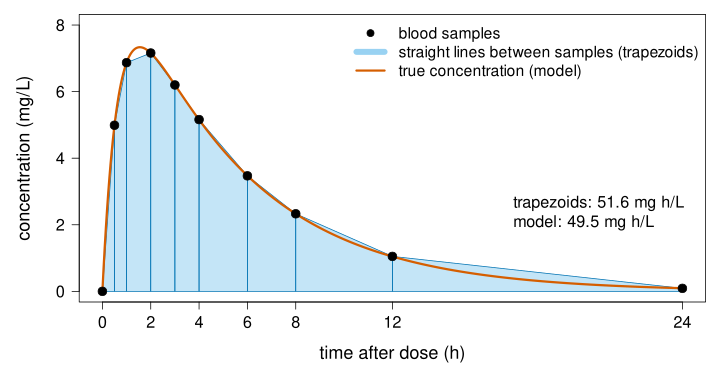
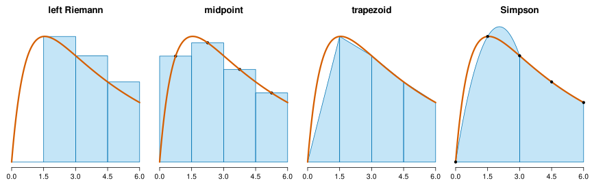
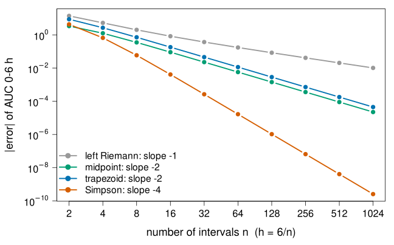
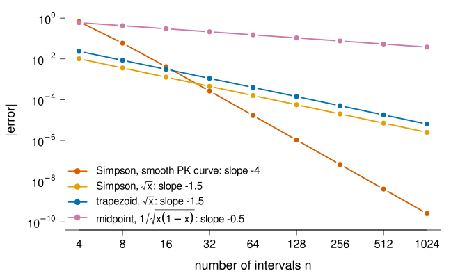
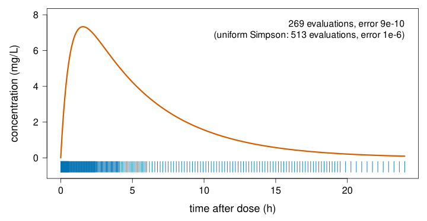
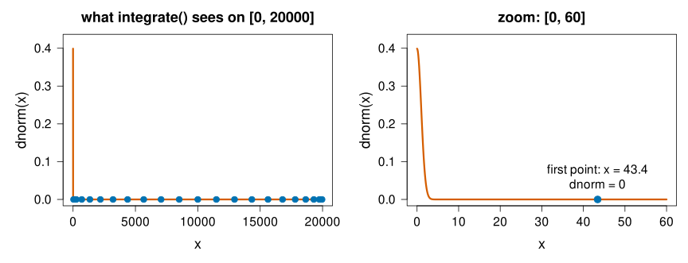
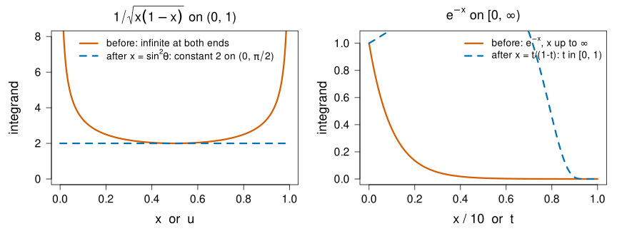
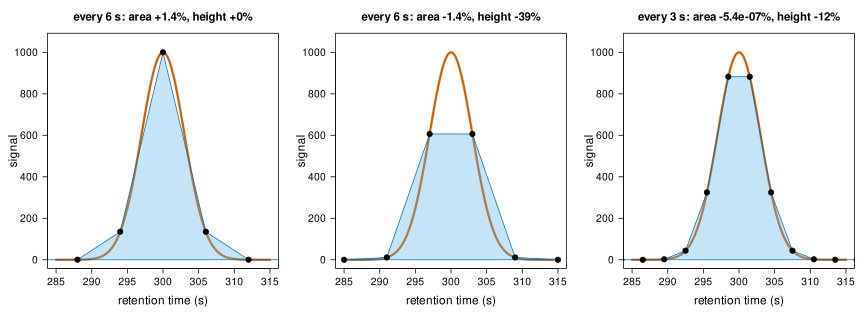
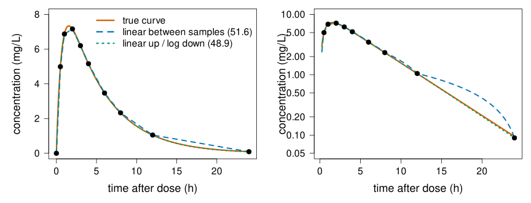

## About this lecture {.smaller}

In [*Why numerical analysis?*](../intro/lec.qmd) `integrate(dnorm, 0, 20000)` returned 0, with an error estimate of 0. This lecture explains why, and how integrals are computed.

- An integral is an **area**. Every method adds up **finitely many** function values with weights: $\int_a^b f(x)\,dx \approx \sum_i w_i f(x_i)$.
- **Riemann**, **trapezoid** and **Simpson** rules, made **composite**; their **order** read off a log–log plot. Order needs a **smooth** integrand.
- **Romberg** (Richardson again), **adaptive** quadrature and **Gaussian** quadrature: what `integrate` and `scipy.integrate.quad` do inside.
- Why a library misses a peak, and the fixes: **split** the interval, **transform** it, **give the scale**. Infinite intervals and singularities by **substitution**.
- Biology: **AUC** in pharmacokinetics from blood samples, **peak areas** in chromatography and mass spectrometry, **normalising** a probability density.

::: notes
Two kinds of integration problem appear in biology. Either we have samples (a concentration measured at 10 time points, a chromatogram sampled by a detector) and we must integrate data, or we have a formula (a model, a density) and can evaluate it wherever we like. The first kind fixes the points; the second lets the method choose them. Most of the lecture is about the second kind, but we start and end with data. The thread through the whole lecture: a rule only sees the function at the points it samples. Everything between the points is an assumption.
:::

## A biology problem first {.smaller}

An oral drug, 500 mg. Ten blood samples over 24 h. The **area under the curve** (AUC, mg·h/L) measures total exposure; bioequivalence of two formulations is judged on the ratio of their AUCs (accepted range 80–125 %).

```r
t_h  <- c(0, 0.5, 1, 2, 3, 4, 6, 8, 12, 24)                         # hours
conc <- c(0, 4.99, 6.87, 7.16, 6.20, 5.16, 3.47, 2.33, 1.05, 0.09)  # mg/L
auc_trap <- function(t, y) sum(diff(t) * (head(y, -1) + tail(y, -1)) / 2)
auc_trap(t_h, conc)
# [1] 51.6175
model <- function(t) 500 / 50 * 1.5 / 1.3 * (exp(-0.2 * t) - exp(-1.5 * t))
integrate(model, 0, 24)
# 49.52521 with absolute error < 1e-07
```

- The data are the model rounded to 2 decimals, so the true AUC is 49.53. Straight lines between samples give **4 % too much**. Why, and which method should we trust?

::: notes
The model is the standard one-compartment model with first-order absorption: dose 500 mg, volume 50 L, absorption rate 1.5 per hour, elimination rate 0.2 per hour (half-life 3.5 h). We generated the data from it, so we know the right answer; in a real study you do not. The sum is the trapezoid rule, which we build on the next slides. diff(t) gives the interval widths, head(y, -1) drops the last value and tail(y, -1) drops the first, so the two vectors are the left and right ends of each interval. A 4 % bias is inside the 80-125 % window, but it is systematic: a formulation that is absorbed faster gets a different bias.
:::

## Where the 4 % comes from

{width="70%" fig-align="center"}

- Between 12 h and 24 h the straight line lies far **above** the curve: the curve **bends upwards** (convex), the chord cuts across.
- Near the peak the line lies **below**. The errors partly cancel; here the tail wins.

::: notes
A rule only knows the function at the sample points. Between them the trapezoid rule assumes a straight line. Where the true curve bends, the line is wrong, and the error is largest where the gap between samples is wide and the curvature is large: 12 to 24 h is a 12 h gap on an exponential decline. We come back to this at the end, with the linear-up/log-down rule that pharmacokineticists use.
:::

## Integrals as sums: four rules

{width="100%" fig-align="center"}

Split $[a, b]$ into $n$ intervals of width $h = (b-a)/n$. Within each interval, replace $f$ by something simple:

- **Left Riemann**: a constant, $f$ at the left end. **Midpoint**: a constant, $f$ at the middle.
- **Trapezoid**: a straight line through both ends. **Simpson**: a parabola through both ends and the middle.

::: notes
This is the AUC from 0 to 6 h of the drug model, with h = 1.5 h. The Riemann sum is the definition of the integral from the first calculus course: let h go to 0 and the sum converges to the integral. All four rules have the form sum of weights times function values; they differ only in the weights and in where f is evaluated. Note the Simpson panel: a parabola through 0, 1.5 and 3 h overshoots the peak. With few points, a higher-order rule is not automatically better.
:::

## The trapezoid rule

One interval: the area of a trapezoid, $\int_{x_0}^{x_1} f\,dx \approx \tfrac{h}{2}\,(f_0 + f_1)$.

Composite: add up $n$ of them. Inner points are shared by two trapezoids:

$$T(h) = h\left(\tfrac12 f_0 + f_1 + f_2 + \dots + f_{n-1} + \tfrac12 f_n\right)$$

**By hand**, the first two samples of the drug data ($h = 0.5$ h; 0, 4.99, 6.87 mg/L):

$$T = 0.5\,(\tfrac12 \cdot 0 + 4.99 + \tfrac12 \cdot 6.87) = 0.5 \cdot 8.425 = 4.2125 \text{ mg·h/L}$$

On **data** the intervals can have different widths; then add $\tfrac{h_i}{2}(f_{i-1} + f_i)$ one interval at a time, as `auc_trap` does.

::: notes
The weights are h/2, h, h, ..., h, h/2. Do the hand example on the board. The exact AUC from 0 to 1 h of the model is 4.48, so the trapezoid gives 6 % too little here: the curve bends downwards (concave) during absorption, and the chord lies under it. The composite rule with equal spacing is what we use when we can choose the points (a formula); with data we take the points we have.
:::

## Trapezoid on a formula: halve $h$ {.smaller}

```r
trap <- function(f, a, b, n) {
  x <- seq(a, b, length.out = n + 1);  h <- (b - a) / n
  y <- f(x)
  h * (sum(y) - (y[1] + y[n + 1]) / 2)
}
exact <- 32.6243601574044                  # AUC 0-6 h of the model
err <- sapply(c(4, 8, 16, 32), function(n) trap(model, 0, 6, n) - exact)
err
# [1] -2.69839410 -0.71902293 -0.18284181 -0.04590877
err[-4] / err[-1]
# [1] 3.752862 3.932486 3.982721
```

- Halving $h$ divides the error by **4**: error $\approx C h^2$, **order 2**.
- Theory: $T(h) - I = \tfrac{(b-a)\,h^2}{12} f''(\xi)$ for some $\xi$ in $[a, b]$. Concave ($f'' < 0$): too small; convex ($f'' > 0$): too large.

::: notes
The exact value comes from the closed-form integral of the model. Here, from 0 to 6 h, the curve is mostly concave and the rule underestimates; from 0 to 24 h with sparse samples the convex tail dominated and the rule overestimated. The error formula is the same idea as the Taylor remainder in Convergence and cost: the error of a straight-line fit over an interval of width h is about f'' h^2 / 8 at worst, integrated over the interval and summed over n = (b-a)/h intervals. Ratios approaching 4 = 2^2 is the experimental check of order 2.
:::

## Simpson's rule {.smaller}

A parabola through three equally spaced points $x_0, x_1, x_2$ integrates to

$$\int_{x_0}^{x_2} f\,dx \approx \tfrac{h}{3}\,(f_0 + 4 f_1 + f_2)$$

Composite (even $n$): weights $\tfrac{h}{3}(1, 4, 2, 4, 2, \dots, 4, 1)$.

```r
simpson <- function(f, a, b, n) {          # n must be even
  x <- seq(a, b, length.out = n + 1);  h <- (b - a) / n
  w <- c(1, rep(c(4, 2), n / 2 - 1), 4, 1)
  h / 3 * sum(w * f(x))
}
err <- sapply(c(4, 8, 16, 32), function(n) simpson(model, 0, 6, n) - exact)
err[-4] / err[-1]
# [1] 11.21479 14.39510 15.56133
```

- Ratios approach **16** $= 2^4$: **order 4**. Same function values as the trapezoid, other weights.
- Bonus: Simpson is exact for **cubics**, not just parabolas (the exercise checks it by hand).

::: notes
Derivation sketch: put x1 = 0 and fit p(x) = A + Bx + Cx^2 through (-h, f0), (0, f1), (h, f2). The integral from -h to h is 2Ah + 2Ch^3/3, and solving for A and C gives h/3 (f0 + 4 f1 + f2). Exactness for cubics is a lucky symmetry: the x^3 term integrates to zero over the symmetric interval. That is why the order is 4 and not 3. Ratios of 11, 14, 15.6 converge to 16 only for small h; at h = 1.5 the parabola cannot follow the absorption peak.
:::

## Reading the order off a log–log plot

{width="50%" fig-align="center"}

```r
n <- 2^(2:10)
e_trap <- sapply(n, function(k) abs(trap(model, 0, 6, k) - exact))
coef(lm(log(e_trap) ~ log(n)))[2]
#    log(n)
# -1.989719
```

::: notes
Same plot as in Convergence and cost: error against n on log-log axes is a straight line with slope minus the order. Left Riemann: order 1. Midpoint and trapezoid: order 2, with the midpoint error about half the trapezoid error and of opposite sign (one is too small, the other too large). Simpson: order 4; 1000 intervals give 10 digits. With these orders you can predict how many points you need: to go from error 1e-4 to 1e-8 the trapezoid needs 100 times more points, Simpson 10 times.
:::

## Failure: order needs smoothness {.smaller}

{width="46%" fig-align="center"}

- $\sqrt{x}$ has an infinite slope at 0: trapezoid **and** Simpson drop to order **1.5**. $1/\sqrt{x(1-x)}$ is infinite at both ends: the midpoint rule crawls at order 0.5 (and the trapezoid gives `NaN`).
- **Check:** halve $h$ and compute $\log_2$ of the error ratio (or of the ratio of successive differences, if the answer is unknown). If it is not the promised order, the integrand is **not smooth**: a kink, a jump, an infinite slope.

::: notes
The error formulas assume f'' (trapezoid) or f'''' (Simpson) exists and is bounded. sqrt(x) has f'' infinite at 0, so near 0 both rules make an error of order h^1.5 in the first interval, and that error dominates. Kinks are common in biology: a drug infusion that stops at t = 1 h gives a concentration with a kink there; a threshold model has a jump. The fix is to put a grid point at the kink (split the interval there) or to remove the singularity with a substitution, which we do later. Without the exact answer, use three estimates with h, h/2, h/4: the ratio (T(h) - T(h/2)) / (T(h/2) - T(h/4)) approaches 2^p.
:::

## Recap: Richardson extrapolation {.smaller}

From [*Numerical differentiation*](../finite-differences/lec.qmd): if an estimate has error $\approx C h^2$, two estimates cancel the $h^2$ term.

$$T(h) \approx I + C h^2, \quad T(h/2) \approx I + C h^2/4 \quad\Rightarrow\quad I \approx \frac{4\,T(h/2) - T(h)}{3}$$

```r
T16 <- trap(model, 0, 6, 16);  T32 <- trap(model, 0, 6, 32)
c(T16, T32) - exact
# [1] -0.18284181 -0.04590877
(4 * T32 - T16) / 3 - exact
# [1] -0.0002644228
simpson(model, 0, 6, 32) - exact
# [1] -0.0002644228
```

- One extrapolation turns two trapezoids into **Simpson**, exactly. The new error is $O(h^4)$.

::: notes
In Numerical differentiation we combined two central differences with steps h and h/2 to cancel the h^2 term. The same arithmetic works for any estimate whose error is a power series in h. For the trapezoid the error expansion contains only even powers h^2, h^4, h^6, ... (the Euler-Maclaurin formula), so we can repeat the trick. That repetition is Romberg's method. Point out that we got 3 more digits from the same 33 function values.
:::

## Romberg integration {.smaller}

Halve $h$ again and again, and extrapolate column by column: column $j$ removes the $h^{2j}$ term.

```r
romberg <- function(f, a, b, k) {
  R <- matrix(NA, k, k)
  for (i in 1:k) {
    R[i, 1] <- trap(f, a, b, 2^(i - 1))          # h halved each row
    for (j in seq_len(i - 1) + 1)                # Richardson, column by column
      R[i, j] <- R[i, j-1] + (R[i, j-1] - R[i-1, j-1]) / (4^(j-1) - 1)
  }
  R
}
signif(abs(romberg(model, 0, 6, 6) - exact), 2)[6, ]
# [1] 4.6e-02 2.6e-04 7.7e-06 8.7e-07 2.9e-07 2.0e-07
```

- With the same 33 function values: trapezoid error $5\times10^{-2}$, Romberg $2\times10^{-7}$.
- **Fails** when the error is not a series in $h^2$: for $\sqrt{x}$ the last row only improves from $1\times10^{-3}$ to $4\times10^{-4}$. And on **data** you cannot halve $h$.

::: notes
Each row halves h, so row i uses 2^(i-1) + 1 points; reusing the old points makes each new row cost only the new midpoints (our simple version recomputes them). The last row shows the gain per column. Gains slow down in later columns here because h is still large compared with the absorption time scale (1/1.5 h). For sqrt(x) the error has a term h^1.5 that Richardson does not know about, so extrapolation removes the wrong term (exercise). For measured data, the sample times are fixed, and extrapolating noisy values amplifies the noise, the same problem as with difference quotients of noisy data in Numerical differentiation.
:::

## Adaptive quadrature: points where they are needed {.smaller}

Estimate the error on each piece from **two** rules; split only the pieces where they disagree.

```r
adapt <- function(f, a, b, fa, fm, fb, tol) {
  m <- (a + b) / 2;  fl <- f((a + m) / 2);  fr <- f((m + b) / 2)
  S1 <- (b - a) / 6 * (fa + 4 * fm + fb)                    # 1 Simpson panel
  S2 <- (b - a) / 12 * (fa + 4 * fl + 2 * fm + 4 * fr + fb)  # 2 panels
  if (abs(S2 - S1) < 15 * tol) return(S2 + (S2 - S1) / 15)  # accept
  adapt(f, a, m, fa, fl, fm, tol / 2) + adapt(f, m, b, fm, fr, fb, tol / 2)
}
adapt(model, 0, 24, model(0), model(12), model(24), 1e-6) - 49.5252069010181
# [1] -8.981687e-10
```

- $S_2 - S_1 \approx 15 \times$ (error of $S_2$): the same Richardson idea gives a free **error estimate**.
- The function **calls itself** on each half (recursion) until every piece passes.

::: notes
Simpson's error is C h^4. Halving h divides it by 16, so S1 - S2 is about 15 times the error of S2. If that is below the tolerance (times 15), accept the piece, and add the Richardson correction (S2 - S1)/15 for free. Otherwise split the interval in two and give each half half the tolerance. Passing fa, fm, fb down means no point is evaluated twice. This is about 10 lines and is a fair model of what library routines do, minus the bookkeeping. Recursion may be new to some students: a function that calls itself on a smaller problem, with a stopping rule (the accept line).
:::

## Where adaptive quadrature puts its points

{width="68%" fig-align="center"}

- Dense where the curve bends sharply (absorption, first 2 h), sparse in the slow tail.
- **Failure:** the first 5 points decide where to look. If all of them miss a narrow feature, $S_1 = S_2$ and the piece is accepted. Next: the library version of that failure.

::: notes
The ticks at the bottom are the 269 evaluation points. Uniform Simpson needs 513 points for an error of 1e-6, while the adaptive version reaches 9e-10 with 269. The gain is bigger the more uneven the integrand: a spike, a narrow peak, a fast transient. And the failure is the price: the adaptive rule trusts its own error estimate, which is computed from the same few points. If those points do not see a feature, nothing tells the method to look. The exercise builds a chromatogram on which our adapt returns 0.
:::

## Gaussian quadrature: choose the points too {.smaller}

So far the points were equally spaced. Choosing **where** to evaluate as well as the weights doubles the power: $n$ points integrate polynomials up to degree $2n - 1$ exactly.

| $n$ | points on $[-1, 1]$ | weights | exact up to degree |
|---|---|---|---|
| 2 | $\pm 1/\sqrt{3} = \pm 0.5774$ | 1, 1 | 3 |
| 3 | $0,\ \pm\sqrt{3/5} = \pm 0.7746$ | 8/9, 5/9, 5/9 | 5 |

```r
x3 <- c(-sqrt(3/5), 0, sqrt(3/5));  w3 <- c(5, 8, 5) / 9      # on [-1, 1]
3 * sum(w3 * model(3 + 3 * x3)) - exact                       # map to [0, 6]
# [1] 0.3688888
```

- 3 points: error 0.37 (trapezoid with 3 points: 8.8). 10 points: $7\times10^{-12}$ (trapezoid: 0.57).
- Points for any $n$: `pracma::gaussLegendre(n, a, b)` in R, `numpy.polynomial.legendre.leggauss` in Python.

::: notes
Gauss-Legendre points are the roots of Legendre polynomials; we do not derive them. To use them on [a, b], map x in [-1, 1] to (a+b)/2 + (b-a)/2 x and multiply the weights by (b-a)/2; here (b-a)/2 = 3. For smooth functions Gaussian quadrature is very efficient, which is why libraries use it on each piece. The catch: the points of the n-point rule and the 2n-point rule are different, so you cannot reuse points to estimate the error. Gauss-Kronrod rules fix that: they add n+1 points to an n-point Gauss rule, so the difference between the two is an error estimate. QUADPACK uses 10 Gauss points plus 11 Kronrod points: 21 points.
:::

## What `integrate`, `quad` and `quadrature` do {.smaller}

| | R [`integrate`](https://stat.ethz.ch/R-manual/R-devel/library/stats/html/integrate.html) | Python [`scipy.integrate.quad`](https://docs.scipy.org/doc/scipy/reference/generated/scipy.integrate.quad.html) | Rust `quadrature` crate |
|---|---|---|---|
| library | QUADPACK (QAGS, QAGI) | QUADPACK (QAGS, QAGI) | double-exponential (tanh–sinh) |
| per piece | 21-point Gauss–Kronrod | 21-point Gauss–Kronrod | points packed towards the ends |
| adaptive | bisect the worst piece; extrapolate | same | refine the whole rule |
| infinite limits | transform to $(0, 1]$ | same | no: substitute yourself |
| tolerance | `rel.tol` = `abs.tol` $\approx 1.2\times10^{-4}$ | `epsrel` = `epsabs` $= 1.5\times10^{-8}$ | target absolute error |

- All return a value **and an error estimate**. The estimate comes from the same points as the value.
- Stopping rule: stop when the estimated error < max(`abs.tol`, `rel.tol` × |value|). An integral **smaller than `abs.tol`** is accepted at once.

::: notes
QUADPACK is a Fortran library from 1983 (Piessens, de Doncker and others) and is still what R and SciPy call. QAGS starts with one 21-point Gauss-Kronrod rule on [a, b]; if the error estimate is too large it bisects the piece with the largest error, and repeats, up to subdivisions = 100 pieces. It also applies an extrapolation (Wynn's epsilon algorithm) to the sequence of results, which is what lets it handle endpoint singularities. QAGI maps an infinite interval to (0, 1] with x = (1 - t)/t and uses a 15-point rule. The Rust crate is a port of John D. Cook's double-exponential code; it also offers Clenshaw-Curtis. The last bullet is a trap we meet when normalising a density.
:::

## Why `integrate(dnorm, 0, 20000)` is 0 {.smaller}

```r
seen <- NULL
spy <- function(x) { seen <<- c(seen, x); dnorm(x) }   # record every x asked for
integrate(spy, 0, 20000)
# 0 with absolute error < 0
length(seen);  round(sort(seen)[1:4], 1)
# [1] 21
# [1]   43.4  260.9  698.4 1349.4
```

{width="56%" fig-align="center"}

- The 21 points lie at 43.4 and beyond, where `dnorm` underflows to **exactly 0**. Gauss and Kronrod agree (both 0), so the error estimate is 0 and QAGS **stops**.

::: notes
This is the full explanation of the example in Why numerical analysis. The outermost Kronrod point on [-1, 1] is at 0.99566, so on [0, 20000] it sits at 10000 * (1 - 0.99566) = 43.4. dnorm(43.4) is about e^-943, far below the smallest double (How computers store numbers), so it is 0. Twenty-one zeros: the 10-point Gauss estimate and the 21-point Kronrod estimate agree perfectly, the error estimate is 0, and there is no reason to subdivide. The <<- operator assigns to the variable outside the function, so seen collects every x. In Python, use a list and append inside the function.
:::

## Three fixes, and the check {.smaller}

```r
integrate(dnorm, 0, 10)$value + integrate(dnorm, 10, 20000)$value  # split
# [1] 0.5
integrate(dnorm, 0, Inf)                                          # transform
# 0.5 with absolute error < 4.7e-05
integrate(dnorm, 0, 20)                                           # give the scale
# 0.5 with absolute error < 3.7e-05
integrate(dnorm, 0, 5000)                                         # the check
# 2.326323e-06 with absolute error < 4.6e-06
```

- **Split** at the feature; **transform** (an infinite interval is mapped so that its points spread over many scales); **give the scale**: limits where the function lives.
- **Check:** change the limits or the tolerance a little; the answer must not move. An error estimate as large as the value is a warning.
- The Rust crate packs its points at the ends, so it finds the peak at 0, but returns **0** for a peak at 5000 in $[0, 20000]$. Every finite rule can miss a narrow peak.

::: notes
Splitting works because the piece [0, 10] has points near 0. The infinite version works because QAGI maps (0, Inf) to (0, 1] and the 15 points then land at x between 0.004 and 233. Giving the scale: the normal density is negligible beyond 10 standard deviations. The check line is the useful habit: 5000 is not a silly upper limit, and the answer is wrong without being 0 - but the error estimate is larger than the value. Comparing answers with different limits catches it. The last bullet refers to the Rust solution of C5 in Why numerical analysis: different rules miss different things.
:::

## Try it: where the points land

```{=html}
<link rel="stylesheet" href="../demos/dist/demo.css">
<div data-demo="quadlab" data-tab="adaptive" data-afn="dnorm" data-method="gk" data-l="20000" data-fn="pk" data-rule="simp" data-n="8"></div>
<script src="../demos/dist/quadlab.js"></script>
```

::: notes
Computed live in the browser: a 21-point Gauss-Kronrod routine that follows QUADPACK with R's default tolerances, so it gives R's numbers digit for digit. Start at dnorm on [0, 20000]: the ticks under the axis are the 21 points, the zoom on the right shows the first one at 43.4, the readout says 0 with error estimate 0, flagged as a silent failure. Click 2000: the first pass sees the peak, the routine bisects towards 0, 0.5. Click 4300: the first pass misses, but QUADPACK bisects once (it does not trust a first-pass error estimate that has hit its cap), the half [0, 2150] has a point at 4.7, and the answer is 0.5. Click 4400 and 5000: the one bisection still misses, 5.7e-5 and 2.3e-6 (error estimate 4.6e-6, as integrate(dnorm, 0, 5000)). So the full routine works up to about 4300; the '5 sigma' rule of exercise B5, about 2300, only predicts the first pass. Back to 20000 and tick "split at x = 10": 0.5 with 42 evaluations. Then switch to adaptive Simpson: it returns 0.5 for every L, because its first point is the endpoint 0. Switch the integrand to the chromatogram peak at 340 s: adaptive Simpson now stops after 5 evaluations with 0, and 60 initial pieces fix it. Use start over and step on the PK model to show the bisection piece by piece. If time allows, tab (a): the PK curve with trapezoid and Simpson, n = 4 to 32, the log-log plot with slopes 2 and 4, then the infusion with its kink (Simpson drops to order 3, and n = 12 puts a point on the kink).
:::

## Infinite intervals: substitute {.smaller}

$\int_0^\infty f(x)\,dx$ with $x = \dfrac{t}{1-t}$: $t \in [0, 1)$ covers $x \in [0, \infty)$, and $dx = \dfrac{dt}{(1-t)^2}$.

$$\int_0^\infty e^{-x}\,dx = \int_0^1 \frac{e^{-t/(1-t)}}{(1-t)^2}\,dt = 1$$

{width="54%" fig-align="center"}

```r
integrate(function(x) dnorm(x, mean = 5000), 0, Inf)
# 0 with absolute error < 0
```

- The transform fixes the **range**, not the **scale**: its points reach only $x \approx 233$. A peak at 5000 is missed. Give the scale: `integrate(..., 4950, 5050)` returns 1.

::: notes
Right panel: the transformed integrand on [0, 1) is smooth and goes to 0 at t = 1, so any finite rule works. R uses x = (1 - t)/t instead, which maps t in (0, 1] to x in [0, Inf); the idea is the same. The transform assumes the interesting part of f is near x = 1, where t = 0.5. If f lives at x = 5000, its interesting part sits in a tiny piece of t near 1. Distributions with a known location (a posterior centred at its mode, a peak at a known retention time) should be integrated around that location.
:::

## Singularities: substitute again {.smaller}

The Jeffreys prior for a proportion (e.g. an allele frequency) is $\propto 1/\sqrt{x(1-x)}$, infinite at both ends. Its normalising constant is $\int_0^1 \frac{dx}{\sqrt{x(1-x)}} = \pi$.

```r
jeff <- function(x) 1 / sqrt(x * (1 - x))
jeff(0)
# [1] Inf                                      # trapezoid: NaN
mid <- function(f, a, b, n) { h <- (b - a) / n;  h * sum(f(a + (1:n - 0.5) * h)) }
sapply(c(16, 256, 4096), function(n) mid(jeff, 0, 1, n)) - pi
# [1] -0.30148615 -0.07559745 -0.01890285     # order 0.5
integrate(jeff, 0, 1)
# 3.141593 with absolute error < 9.4e-06
```

- **Substitute** $x = \sin^2\theta$: $dx = 2\sin\theta\cos\theta\,d\theta$ and $\sqrt{x(1-x)} = \sin\theta\cos\theta$, so the integral is $\int_0^{\pi/2} 2\,d\theta = \pi$. Smooth (here constant).
- For a single $1/\sqrt{x}$ at 0: $x = u^2$ turns $\int_0^1 \frac{g(x)}{\sqrt{x}}dx$ into $\int_0^1 2\,g(u^2)\,du$.

::: notes
An integrable singularity: the integrand is infinite, the area finite. Rules that evaluate at the endpoints fail outright (Inf times a weight). Open rules like the midpoint rule work, slowly: 4096 points for 2 digits. integrate copes because QUADPACK's extrapolation is designed for endpoint singularities, and its Gauss-Kronrod points never touch the endpoints. Substitution is the robust fix: it is pen-and-paper work that makes any rule fast. The same appears in densities: a Gamma density with shape below 1 (waiting times between transcriptional bursts are sometimes fitted with one) is infinite at 0.
:::

## Biology: normalising a probability density {.smaller}

Posterior for the UMI rate $\lambda$ of the zero-truncated Poisson model ([*Newton and secant methods*](../newton/lec.qmd); 100 cells, flat prior). The density is $\propto L(\lambda)$, and we need $Z = \int_0^\infty L\,d\lambda$.

```r
loglik <- function(l) 173 * log(l) - 100 * l - 100 * log1p(-exp(-l))
L <- function(l) exp(loglik(l))
sapply(c(10, 100, Inf), function(b) integrate(L, 0, b)$value)
# [1] 4.450271e-24 3.226339e-26 4.708206e-24        # three answers!
g <- function(l) exp(loglik(l) - loglik(1.2184695))   # scaled: max = 1
sapply(c(10, 100, Inf), function(b) integrate(g, 0, b)$value)
# [1] 0.3322104 0.3322104 0.3322104
```

- $L \approx 10^{-23}$ is far below `abs.tol` $\approx 10^{-4}$: `integrate` accepts its first rough answer. **Scale the values**: divide by the maximum (log scale, as in [*How computers store numbers*](../floating-point/lec.qmd)); $\log Z = \log L_{\max} + \log 0.3322$.
- **Scale the axis** too: `integrate(g, 0, 1000)` gives $2\times10^{-9}$. The peak (width 0.13) is invisible at that scale.

::: notes
This is the situation in Bayesian work and in likelihood-based model comparison: a likelihood is a tiny number, and its integral is a normalising constant or a marginal likelihood. Two scale problems. First the values: the absolute tolerance is a fixed number, so an integrand of size 1e-23 meets it with any answer. Python's quad has the same problem (epsabs = 1.5e-8). Subtracting the maximum log-likelihood makes the peak height 1, and all limits now agree. Second the axis: with 10000 cells the posterior would be 10 times narrower, and even (0, 100) misses it (exercise). The cure is to integrate over the mode plus or minus 10 standard errors, using the standard error from Newton and secant methods.
:::

## Biology: chromatography and mass-spec peak areas {.smaller}

{width="88%" fig-align="center"}

- A peak (Gaussian, $\sigma = 3$ s) sampled by the detector every $h$ seconds; area by the trapezoid rule.
- Every 6 s ($h = 2\sigma$, 2–3 points across the peak): area within **1.4 %**, but the **height** is off by up to 39 %. Every 3 s: area exact to $5\times10^{-9}$, height still off by up to 12 %.
- Area is far more robust than height. Real errors come from **noise**, the **baseline** and **overlapping peaks** (fit a sum of peak shapes: a nonlinear least-squares problem, [*Nonlinear least squares and ODE fitting*](../nonlinear-least-squares/lec.qmd)).

::: notes
Quantification in LC-MS and HPLC uses peak areas. The trapezoid rule on a full peak that starts and ends at baseline is far more accurate than the h^2 rule suggests: its error depends on the derivatives at the two ends (Euler-Maclaurin), and for a peak those are all zero. The error then falls faster than any power of h, here exp(-2 pi^2 sigma^2 / h^2). The height depends on whether a sample lands on the apex, so it jumps with the sampling phase. The usual advice of 8 to 10 points across a peak is about noise, peak detection and shape, not the integration rule. This is why software integrates peaks rather than using heights, and why the baseline subtraction step deserves more attention than the rule.
:::

## Biology: AUC with linear-up / log-down {.smaller}

After the peak, concentrations fall roughly **exponentially**. Interpolate $\log C$ linearly there; the area of an exponential segment is $\dfrac{(C_1 - C_2)\,\Delta t}{\ln(C_1 / C_2)}$.

```r
auc_lul <- function(t, y) {
  dt <- diff(t);  y1 <- head(y, -1);  y2 <- tail(y, -1)
  lin <- dt * (y1 + y2) / 2                     # rising or flat: trapezoid
  logd <- dt * (y1 - y2) / log(y1 / y2)         # falling: exponential decay
  sum(ifelse(y2 < y1 & y2 > 0, logd, lin))
}
auc_lul(t_h, conc)
# [1] 48.91575                                  # linear: 51.6175, true: 49.52521
```

{width="50%" fig-align="center"}

::: notes
This is a domain-specific rule: it builds in what pharmacokineticists know about the shape of the curve, the same way the substitution builds in what we know about a singularity. On the log-scale panel the elimination phase is a straight line, so the log-down interpolation (green) follows it, while linear interpolation (blue) bulges far above it between 12 and 24 h. Here linear-up/log-down errs by -1.2 % instead of +4.2 %; the remaining error is in the absorption phase, where both rules use straight lines and the samples are too sparse. Non-compartmental analysis software (for example Phoenix WinNonlin or the R package PKNCA) offers both rules; check which one a report used.
:::

## Data or model? AUC to infinity {.smaller}

Total exposure is $\mathrm{AUC}_{0-\infty}$. Extrapolate the tail with the terminal slope $\lambda_z$: $\int_{t_\text{last}}^\infty C_\text{last}\,e^{-\lambda_z (t - t_\text{last})}\,dt = C_\text{last}/\lambda_z$.

```r
last <- 8:10                                    # terminal phase: 8, 12, 24 h
lz <- -coef(lm(log(conc[last]) ~ t_h[last]))[[2]]
lz
# [1] 0.2036783
auc_lul(t_h, conc) + conc[10] / lz              # AUC 0-infinity
# [1] 49.35762
500 / 50 / 0.2                                  # model: Dose / (V ke)
# [1] 50
```

- **Data route** (non-compartmental): no model, but error from sparse sampling. **Model route**: fit, then integrate exactly; but only as right as the model.
- **Check:** compare the two; the extrapolated part should be small (< 20 % of the total). Here: $0.09/0.204 = 0.44$, under 1 %.

::: notes
The terminal slope is a straight-line fit to log concentration over the last points (Least squares: normal equations vs QR). Extrapolation to infinity is the infinite-interval problem again, solved analytically because we assume an exponential tail. The model route needs a fit (Part 9) and then the integral is either closed form (here Dose/(V ke) = 50) or a call to integrate on a smooth function, which is easy. Disagreement between the two routes points to either sparse sampling (data route) or a wrong model (model route). Regulators accept the data route; the 20 % rule of thumb protects against a result that is mostly extrapolation.
:::

## Checklist: detecting integration trouble

- **Plot the integrand** over the whole interval before integrating. Is there a narrow peak, a kink, a singularity?
- **Change the limits** (and `rel.tol`) a little: the answer must not move.
- **Error estimate ≳ value**, or exactly 0 → distrust the result.
- **Tiny values** (likelihoods): scale to a maximum of 1 first; `abs.tol` is absolute.
- **Wide interval, narrow feature** → split at the feature or integrate around it.
- **Order lower than promised** on a halving test → not smooth: split at the kink or substitute.
- **Data**: the rule assumes a shape between samples. Sparse samples where the curve bends are the main error.

::: notes
A list to keep next to the keyboard. Each item is one of the failures in this lecture: the dnorm example (plot, change limits), the posterior (tiny values, wide interval), sqrt and the Jeffreys prior (order test), the AUC tail (shape between samples). Note that none of these produce an error or a warning: integrate and quad return a number in every case.
:::

## Summary {.smaller}

- Every quadrature rule is $\sum_i w_i f(x_i)$: it **sees only the points** it samples.
- Composite rules: left Riemann order 1, **trapezoid** and midpoint order 2, **Simpson** order 4. Read the order off a log–log plot; it needs a **smooth** integrand.
- **Romberg** = repeated Richardson on the trapezoid. **Adaptive** quadrature splits where two rules disagree. **Gaussian** quadrature chooses the points: $n$ points, degree $2n-1$.
- `integrate` / `quad`: 21-point Gauss–Kronrod, bisect the worst piece. They can **miss** a narrow feature with a confident error estimate of 0. Fixes: **split**, **transform**, **give the scale**.
- Infinite intervals and singularities: **substitute** ($x = t/(1-t)$, $x = u^2$, $x = \sin^2\theta$).
- Biology: AUC from samples (trapezoid, linear-up/log-down, extrapolation $C_\text{last}/\lambda_z$), peak areas (robust; heights are not), normalising a density (scale first).

**Next:** [*Random numbers and Monte Carlo*](../monte-carlo/lec.qmd), for integrals in many dimensions, where grids are hopeless.

::: notes
Recap: rules, orders, the three improvements (Romberg, adaptive, Gauss), and the library failure with its three fixes. In one dimension these methods are hard to beat. In ten dimensions a grid with 10 points per axis already needs 10^10 evaluations; that is where Monte Carlo takes over, with an error of 1/sqrt(N) whatever the dimension.
:::
