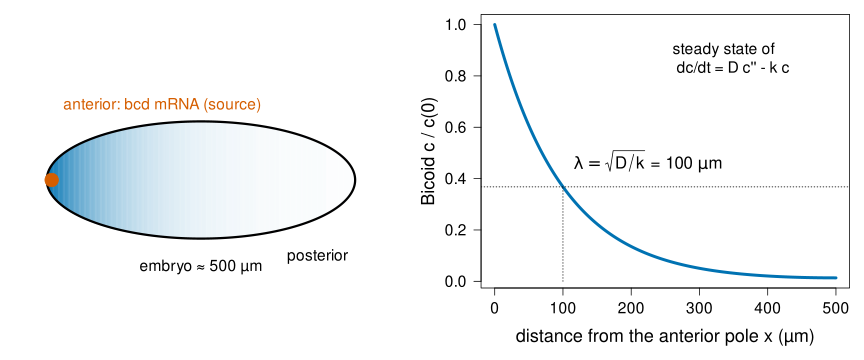
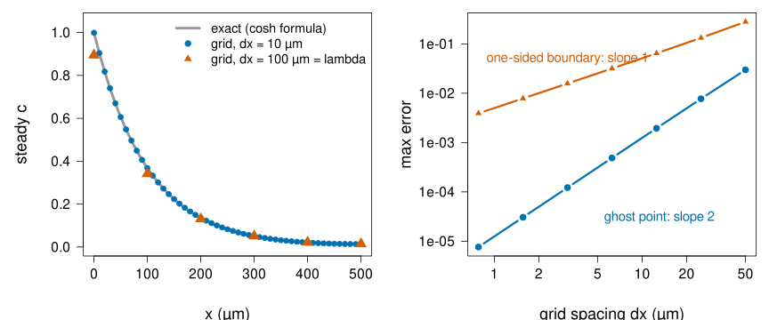
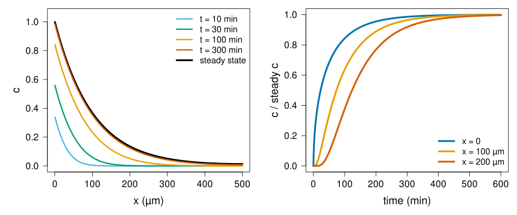
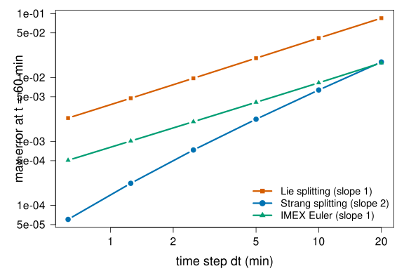
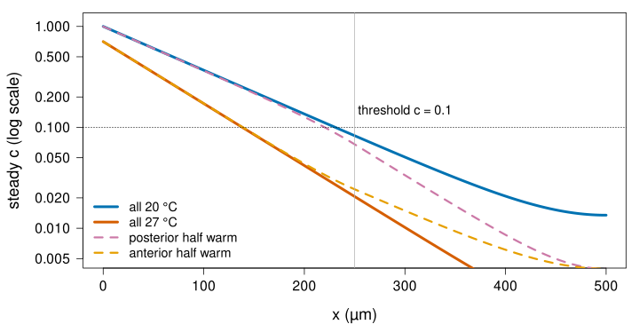
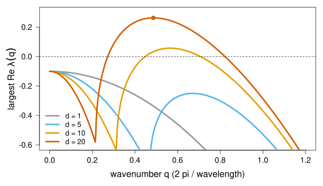
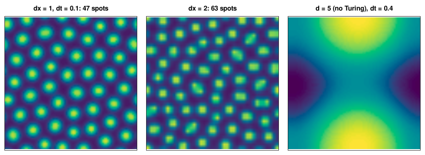

## About this lecture {.smaller}

So far in Part 10 molecules only **moved**. In an embryo they are also **made** and **destroyed**: $\partial c/\partial t = D\,\partial^2 c/\partial x^2 + f(c)$. The reaction term $f$ changes what the equation can do.

- **Synthesis–diffusion–degradation**: a source and first-order decay give an exponential gradient with **decay length** $\lambda = \sqrt{D/k}$. We check the grid against the exact solution.
- **IMEX** (diffusion implicit, reaction explicit) and **operator splitting**: two ways to treat the two terms differently. Each has its own error and its own failure.
- **Turing patterns**: two species, a uniform state that is stable without diffusion becomes unstable **with** it. Eigenvalues of a 2 × 2 matrix per wavenumber say which wavelengths grow.
- A **2D simulation** in a few seconds, and the checks that separate a real pattern from a **numerical artefact**.
- Biology: the **Bicoid** gradient and the temperature-step experiment [M1]; embryo trap arrays [M3]; **Fgf8** in zebrafish [M4].

::: notes
The last core unit of the course, and the one that uses the most earlier material: the tridiagonal Thomas solver (Part 3), stiffness and implicit steps (Part 8), eigenvalues and the phase plane (Parts 5 and 8), the FFT (Part 6). Time units in this lecture are minutes, to match the morphogen in a row of cells from Structure: symmetric, banded, sparse; lengths are µm. All data are synthetic: the model plus noise. Literature values are quoted as approximate orders of magnitude; check them against the papers before using them.
:::

## Biology: the Bicoid gradient {.smaller}

{width="80%" fig-align="center"}

- *bicoid* mRNA sits at the **anterior pole** of the Drosophila egg. The protein spreads and is degraded: high at the head end, low at the tail. Target genes read the concentration as **position**.
- Reported values (approximate): decay length $\approx 100$ µm, about 1/5 of the 500 µm egg; protein lifetime tens of minutes; $D$ from about 0.3 µm²/s (FRAP) to about 7 µm²/s (FCS).

::: notes
Bicoid is the textbook morphogen. The decay length of about 100 µm (roughly 20 % of egg length) is widely reported (e.g. Houchmandzadeh et al. 2002; Gregor et al. 2007). Diffusion coefficients disagree by a factor of about 20 depending on the method (FRAP in Gregor et al. 2007, about 0.3 µm^2/s; FCS in Abu-Arish et al. 2010, about 7 µm^2/s), which is part of a long debate about how the gradient forms. These are not on our source list; treat them as approximate and check before quoting. Our running numbers, D = 100 µm^2/min (1.7 µm^2/s) and k = 0.01 per min (lifetime 100 min), are Bicoid-like in spirit: they give the right decay length, not a fitted model.
:::

## Recap: what you already have {.smaller}

:::: {.columns}
::: {.column width="50%"}
**Morphogen in a row of cells** (*Structure: symmetric, banded, sparse*):

- exchange rate 1 per min, decay $k = 0.01$ per min, source in cell 1,
- a tridiagonal system, solved by `thomas(a, b, c, d)` in $O(n)$,
- decay length $\sqrt{D/k} = 10$ cells.
:::
::: {.column width="50%"}
**Diffusion on a grid** (*The diffusion (heat) equation by finite differences*, *Implicit schemes and the method of lines*):

- nodes $x_i = i\,\Delta x$, stencil $(1, -2, 1)/\Delta x^2$, **ghost points** for no flux,
- FTCS needs $D\,\Delta t/\Delta x^2 \le 1/2$,
- backward Euler: no step limit, one Thomas solve per step.
:::
::::

**Today:** the row of cells **is** a diffusion grid with $\Delta x$ = one cell. With $\Delta x = 10$ µm, exchange at 1 per min means $D = 1 \cdot 10^2 = 100$ µm²/min.

::: notes
One slide only; all of this was taught in its own unit. The link in the last line is worth a moment: the compartment model "each cell passes morphogen to its neighbour at rate D_cell" and the finite-difference grid "D/dx^2 times the second difference" are the same equations with D_cell = D/dx^2. So a cell-based model is a finite-difference (finite-volume) discretisation with the grid fixed by the biology, and the decay length of 10 cells is 100 µm.
:::

## Adding a reaction term {.smaller}

Mass balance per slice, now with production and decay:

$$\frac{\partial c}{\partial t} = \underbrace{D\,\frac{\partial^2 c}{\partial x^2}}_{\text{diffusion}} \; \underbrace{-\,k\,c}_{\text{decay}}, \qquad 0 < x < L$$

- **Source**: an influx $j$ at the anterior pole, $-D\,\partial c/\partial x = j$ at $x = 0$. **Wall** at the posterior pole: $\partial c/\partial x = 0$ at $x = L$.
- Numbers: $D = 100$ µm²/min, $k = 0.01$ per min, $L = 500$ µm; $j$ is chosen so that $c(0) \approx 1$.
- Steady state: $D\,c'' = k\,c$. Solutions $e^{\pm x/\lambda}$ with
$$\lambda = \sqrt{D/k} = \sqrt{100/0.01} = 100 \ \text{µm}.$$

::: notes
The reaction term is local: it involves only c at the same point. Diffusion couples neighbours; reaction does not. That difference is what IMEX and splitting exploit later. Exact steady state with these boundary conditions: c(x) = (j lambda / D) cosh((L - x)/lambda) / sinh(L/lambda). With j = D/lambda = 1 µm/min (in units of concentration) this gives c(0) = coth(5) = 1.0001. In the infinite embryo it is simply e^{-x/lambda}. Students who did the exercise in Structure: symmetric, banded, sparse saw the discrete version: c[11]/c[1] = 0.368, one decay length.
:::

## The decay length $\lambda = \sqrt{D/k}$ {.smaller}

A molecule lives about $1/k$ and moves about $\sqrt{2D/k}$ in that time: the gradient reaches about $\lambda$ before it is degraded.

| | $D$ | $1/k$ (lifetime) | $\lambda$ |
|---|---|---|---|
| our running example | 100 µm²/min | 100 min | 100 µm |
| Bicoid (approx.) | 0.3–7 µm²/s | 30–50 min | ≈ 100 µm |
| Fgf8, zebrafish [M4] (approx.) | ≈ 50 µm²/s | ≈ 13 min (inferred) | ≈ 200 µm |

- $c$ falls by $e$ every $\lambda$. A threshold $c_T$ is crossed at $x_T = \lambda\ln(c_0/c_T)$: for $c_0/c_T = 10$, $x_T = 230$ µm.
- $\lambda$ depends on the **ratio** $D/k$. Double both: same gradient, formed twice as fast.

::: notes
Only two of D, k, lambda need to be measured; the third follows. For Bicoid, lambda = 100 µm and a 50 min lifetime would need D = 1e4 / 3000 = 3.3 µm^2/s, between the FRAP and FCS values: this arithmetic is part of the debate. The Fgf8 row is approximate: an FCS diffusion coefficient of order 50 µm^2/s and a decay length of order 200 µm were reported by Yu et al. 2009 [M4]; the lifetime 200^2/50 = 800 s is our inference, not a quoted number. The last bullet matters for the temperature experiment later: if every rate scales by the same factor, the steady gradient does not change.
:::

## Steady state on the grid

```r
D <- 100; k <- 0.01; L <- 500               # µm^2/min, 1/min, µm
lam <- sqrt(D / k); j <- D / lam            # lambda = 100 µm, c(0) close to 1
N <- 50; dx <- L / N; x <- (0:N) * dx; r <- D / dx^2
lo <- c(0, rep(-r, N - 1), -2 * r)          # -D c'' with ghost points:
di <- rep(2 * r, N + 1)                     #   both end rows get a 2
up <- c(-2 * r, rep(-r, N - 1), 0)
src <- c(2 * j / dx, rep(0, N))             # the influx enters via the ghost point
cs <- thomas(lo, di + k, up, src)           # (-D c'' + k c) = src
exact <- j * lam / D * cosh((L - x) / lam) / sinh(L / lam)
max(abs(cs - exact))
# [1] 0.001247396
```

- Ghost point at $x = 0$: $c_{-1} = c_1 + 2\Delta x\, j/D$ (the slope is $-j/D$). At $x = L$: $c_{N+1} = c_{N-1}$.

::: notes
The same three-diagonal layout as in Implicit schemes and the method of lines: lo, di, up are the diagonals of minus D times the second difference, so a steady solve adds k to the diagonal and an implicit step uses 1 + dt times the diagonals. The ghost point at the source end: the central difference (c_1 - c_{-1})/(2 dx) = -j/D gives c_{-1}; substituting into the stencil at node 0 doubles the coupling to c_1 and adds 2 j / dx to the right-hand side. thomas() is the function from Structure: symmetric, banded, sparse, unchanged. The matrix is not symmetric (the 2 in the end rows), but it is diagonally dominant, so Thomas without pivoting is safe.
:::

## Check against the exact solution {.smaller}

{width="88%" fig-align="center"}

- Ghost point: error falls **4×** per halving of $\Delta x$ (order 2). With $\Delta x = \lambda$ (orange) the shape is still right to about 10 %.
- **Failure:** the one-sided boundary $(c_1 - c_0)/\Delta x = -j/D$ is only **first order**, and it breaks the **mass balance**: $k\int c\,dx$ should equal $j$; at $\Delta x = 50$ µm it is $1.32\,j$.

::: notes
Two independent checks, as in Structure: symmetric, banded, sparse. The convergence check needs an exact solution, which we have here and rarely have in practice. The mass balance does not: at steady state everything that comes in must be degraded, k times the integral of c (trapezoid rule) equals j. With the ghost point this holds to rounding error on every grid; with the one-sided boundary it is off by 81 % at dx = 100 and 32 % at dx = 50. The lesson generalises: one sloppy first-order boundary row spoils a second-order scheme everywhere. A grid with dx = lambda is far too coarse for a quantitative answer, but it still gives the shape: the decay length sets the resolution needed, as the wavelength will for Turing patterns.
:::

## How fast does the gradient form? {.smaller}

{width="88%" fig-align="center"}

- Start from $c = 0$. Near the source the gradient is ready in about $1/k$; further away it takes longer.
- **Local accumulation time** $\tau(x) = \int_0^\infty \bigl(1 - c(x,t)/c_s(x)\bigr)\,dt$. Numerically: 50.2, 100.0, 150.3 min at $x = 0, 100, 200$ µm. Formula for a long embryo: $(1 + x/\lambda)/(2k) = 50, 100, 150$ min.

::: notes
Profiles from IMEX Euler (next slides) with dt = 1 min. Right: c divided by its steady value at three positions. The accumulation time is the area above the curve: a mean time to reach steady state, defined without choosing a threshold such as 90 %. The formula (1 + x/lambda)/(2k) for a semi-infinite domain with a constant influx is from Berezhkovskii, Sample and Shvartsman (2010); our numbers, computed with dt = 0.5 min and the trapezoid rule (exercise C2), agree to within 0.3 %. Biology: the gradient is not instantaneous. With a lifetime of 100 min the posterior part needs hours; for the real Bicoid gradient the lifetime and so the formation time are thought to be shorter. Whether the gradient is at steady state when it is read is a real question in the field.
:::

## Two terms, two time scales {.smaller}

Euler on the method-of-lines system $\mathbf c' = -K_D\mathbf c - k\,\mathbf c + \mathbf s$ must be stable for **both** parts:

| part | fastest rate | Euler needs | here ($\Delta x = 10$ µm) |
|---|---|---|---|
| diffusion | $4D/\Delta x^2$ | $\Delta t \le \Delta x^2/(2D)$ | 0.5 min; at $\Delta x = 1$ µm: 0.005 min |
| decay | $k$ | $\Delta t \le 2/k$ | 200 min |
| fast receptor binding | $\approx 1$ per s | $\Delta t \le 2$ s | |

- Diffusion on a fine grid is **stiff** (*Stiffness and implicit methods*): treat it implicitly. That is a **linear**, tridiagonal solve.
- Reactions are often **nonlinear** (Hill functions, $u^2v$) but **local**. Fully implicit means a Newton solve with the coupled Jacobian every step.
- Idea: implicit where it is cheap and needed, explicit where it is not.

::: notes
K_D is the positive diffusion matrix (lo, di, up). The table is the stability limit of Euler, h |lambda| <= 2, for each part separately. For the Bicoid model the reaction is slow and linear, so it would be fine to do everything implicitly (backward Euler with k on the diagonal, as in Implicit schemes and the method of lines). The point is the general case: with a nonlinear reaction, backward Euler on the whole system needs Newton for systems of equations at every step, with a Jacobian that couples the diffusion band and the reaction. The receptor-binding row is an order of magnitude only: binding to abundant receptors can be much faster than degradation, and then the reaction is the stiff part.
:::

## IMEX Euler: diffusion implicit, reaction explicit {.smaller}

$$\frac{\mathbf c^{n+1} - \mathbf c^{n}}{\Delta t} = -K_D\,\mathbf c^{n+1} + \mathbf f(\mathbf c^{n}) + \mathbf s \quad\Longrightarrow\quad (I + \Delta t\,K_D)\,\mathbf c^{n+1} = \mathbf c^n + \Delta t\,\bigl(\mathbf f(\mathbf c^n) + \mathbf s\bigr)$$

```r
imex <- function(c, dt, nsteps, f) {          # f(c): reaction, explicit
  for (n in seq_len(nsteps))
    c <- thomas(dt * lo, 1 + dt * di, dt * up, c + dt * (f(c) + src))
  c
}
f <- function(c) -k * c                       # linear decay
for (dt in c(1, 10, 50))                      # run to t = 5000 min, compare with cs
  print(max(abs(imex(rep(0, N + 1), dt, 5000 / dt, f) - cs)))
# [1] 2.38698e-14
# [1] 1.121325e-14
# [1] 1.076916e-14
```

- One Thomas solve per step, any $f$, no Newton; order 1. The steady state is **exact** for every $\Delta t$ ($\Delta t$ cancels at a fixed point).

::: notes
The left-hand matrix is the same as for backward Euler on pure diffusion, so the Thomas call is the one from Implicit schemes and the method of lines. The reaction only enters the right-hand side, evaluated at the old values, so it can be anything: a Hill function, a two-species reaction, a lookup table. In the loop, the IMEX run to t = 5000 min reaches the steady state of the grid to rounding error, with a step of 1, 10 or even 50 minutes. That is a useful property (the long-time answer does not depend on the step), but it also means a large step can hide a wrong transient. IMEX stands for implicit-explicit; higher-order versions (IMEX Runge–Kutta, SBDF2) exist.
:::

## When IMEX fails {.smaller}

One Fourier mode $e^{iqx}$, with linear decay $f = -kc$: each step multiplies it by

$$G(q) = \frac{1 - k\,\Delta t}{1 + D q^2\,\Delta t}.$$

- The denominator $\ge 1$: the diffusion part never limits $\Delta t$.
- The numerator is **Euler on the reaction**: $|1 - k\Delta t| \le 1$ needs $\Delta t \le 2/k$, and the uniform mode ($q = 0$) gets **no help** from diffusion.
- Fast receptor binding at 1 per s: IMEX needs $\Delta t \le 2$ s, as slow as explicit diffusion on a 30 µm grid.
- **Check:** compute $\Delta t\,\lambda$ for the eigenvalues $\lambda$ of the reaction Jacobian, and stay inside Euler's stability region ($|1 + \Delta t\lambda| \le 1$).

::: notes
A Fourier mode is an eigenvector of the diffusion matrix (with periodic boundaries exactly, otherwise approximately), so the scheme acts on it as on a scalar: the implicit factor 1/(1 + D q^2 dt) times the explicit factor 1 - k dt. Stiff reactions are therefore the weak point of IMEX. Remedies: treat the stiff reaction implicitly too (it is local, so this is a small Newton solve per grid point, not a big coupled one), or split the operators and solve the reaction exactly or with a stiff ODE solver. The same check reappears for the Turing model, where the reaction eigenvalues are complex: -0.1 ± 0.995i.
:::

## Operator splitting {.smaller}

Write $\mathbf c' = \mathcal A\mathbf c + \mathcal B\mathbf c$ with $\mathcal A$ = diffusion (with the influx), $\mathcal B$ = reaction. Solve each part **on its own**, one after the other:

- **Lie** splitting: $\Delta t$ of diffusion, then $\Delta t$ of reaction.
- **Strang** splitting: $\Delta t/2$ reaction, $\Delta t$ diffusion, $\Delta t/2$ reaction.

```r
for (s in 1:nsteps) {                     # both parts done exactly here
  lie    <- exp(-kx * dt) * diffuse(lie, dt)
  strang <- exp(-kx * dt / 2) * diffuse(exp(-kx * dt / 2) * strang, dt)
}
```

- Each sub-problem gets its best solver: diffusion by a tridiagonal solve (or FFT), the decay **exactly**, a stiff reaction by an ODE solver per grid point.

::: notes
kx is the decay rate at each grid point (it varies along the embryo later). diffuse(c, dt) solves the pure diffusion problem with the influx for time dt. To see the splitting error alone, we do it exactly here with the matrix exponential of the 51 x 51 diffusion matrix (Matrix::expm in R, scipy.linalg.expm, nalgebra's exp in the exercise); in practice it is a backward Euler or Crank–Nicolson step with Thomas. The reaction step is a set of independent scalar ODEs, one per grid point; for c' = -k c it is a multiplication by exp(-k dt). Splitting is how many large simulation codes are organised: diffusion, reaction, and in Flow plus diffusion also advection, each by its own method.
:::

## The splitting error {.smaller}

:::: {.columns}
::: {.column width="52%"}
{width="100%"}
:::
::: {.column width="48%"}
- Error at $t = 60$ min against the exact solution of the grid ODEs. Lie: slope 1. Strang: slope 2 (for small steps). IMEX: slope 1.
- Exact sub-steps, still an error: doing $\mathcal A$ then $\mathcal B$ is not doing both at once unless they **commute**, $\mathcal{AB} = \mathcal{BA}$.
- Here they do not: the influx at $x = 0$ is decayed only in the reaction step. With no source and uniform $k$ the error is $10^{-15}$ (exercise).
:::
::::

::: notes
For matrices, e^{(A+B)h} = e^{Ah} e^{Bh} only if AB = BA; the leading error per step is h^2/2 (AB - BA), so Lie is first order globally. Strang is symmetric and the h^2 term cancels: second order. Here the Strang slope approaches 2 only for small steps (the ratio between the last two points is 3.7): at large steps the stiff diffusion modes and the boundary source reduce the order, a known effect. When do the parts commute? Uniform decay k I commutes with any diffusion matrix, so a pure decay problem has no splitting error at all. A spatially varying k(x) or a localised source breaks it. That includes the temperature step on the next slide. Check in practice: halve dt and compare, exactly as for any time stepper.
:::

## A temperature step across the embryo [M1] {.smaller}

:::: {.columns}
::: {.column width="55%"}
{width="100%"}
:::
::: {.column width="45%"}
Lucchetta et al. held a Drosophila embryo between two laminar streams at different temperatures (about 20 and 27 °C), so its halves develop at different speeds [M1].

- Model (synthetic, **assumed**): $k$ doubles in the warm half; $D$, $j$ unchanged.
- Where is $c = 0.1$? All cold: 230.7 µm. All warm: 138.3 µm. Posterior warm: 220.2 µm. Anterior warm: 138.9 µm.
- $k(x)$ varies, so Lie splitting has an error; IMEX and a steady solve do not care.
:::
::::

::: notes
The experiment is described in Implicit schemes and the method of lines, which computes the temperature inside the embryo: the step is sharp, so modelling k as a step function is reasonable. The factor 2 for k over 7 degrees is an assumption (a Q10 of about 2.7), not a measurement, and we ignore the smaller change of D (about 20 % from the lower viscosity of warm water). In this toy model the threshold position is set almost entirely by the anterior half, where the gradient is high: warming the posterior moves it by 10 µm, warming the anterior by 92 µm. What the real embryo does, and how the patterning network compensates, is the subject of the paper [M1]; our model only shows how to ask the question quantitatively. The steady solve is the same Thomas call with a k vector on the diagonal.
:::

## Measuring gradients in many embryos {.smaller}

- **Embryo trap arrays** [M3]: a microfluidic array that holds many Drosophila embryos upright, so the **Dorsal** gradient around the embryo's circumference can be imaged in hundreds of embryos at once. Many embryos → a **distribution** of gradient shapes, not one curve.
- **Fgf8 in zebrafish** [M4]: a source–sink gradient. FCS gave a diffusion coefficient (order 50 µm²/s); the profile gave $\lambda$ (order 200 µm). Then $k = D/\lambda^2 \approx 1.3\cdot10^{-3}$ per s: degradation inferred, not measured. Blocking receptor-mediated uptake (endocytosis) **flattens** the gradient, as $\lambda = \sqrt{D/k}$ predicts.
- Exercise (synthetic): fit $\lambda$ to 20 noisy profiles by a straight line through $\log c$: $200.3 \pm 12.2$ µm. With a background of 0.05 added: **229.9** µm. The log fit is biased by any offset.

::: notes
Both papers are on our source list but were only read at abstract level; quote the numbers as orders of magnitude. The trap array paper [M3] imaged the Dorsal nuclear gradient, which is formed by a different mechanism (nuclear import downstream of Toll signalling), so the SDD model does not apply directly; the point here is the data: one profile per embryo, many embryos, and the need to fit each one. The circumference is a ring, so a model of it would use periodic boundary conditions, as the 2D Turing simulation below does. For Fgf8, the source-sink picture is: freely diffusing molecules from a local source, removed by receptor-mediated endocytosis in the target cells. The fit in the exercise is linear least squares from Part 4; the bias from a background offset is a classic failure: always subtract the background (or fit it as a parameter, Part 9) before taking logs.
:::

## Turing's idea: diffusion can destabilise {.smaller}

Two species, an activator $u$ and a substrate $v$ (Schnakenberg model, dimensionless):

$$\frac{\partial u}{\partial t} = a - u + u^2 v + \nabla^2 u, \qquad \frac{\partial v}{\partial t} = b - u^2 v + d\,\nabla^2 v$$

- $a = 0.1$, $b = 0.9$: uniform steady state $u^* = a + b = 1$, $v^* = b/(a+b)^2 = 0.9$.
- Without diffusion it is **stable**: Jacobian $J = \begin{pmatrix} 0.8 & 1 \\ -1.8 & -1 \end{pmatrix}$, trace $-0.2$, det $1$ (*Equilibria, stability and the phase plane*).
- With $v$ diffusing $d$ times faster than $u$: some wavelengths **grow**. Spots or stripes appear from noise.

::: notes
Turing (1952) showed that diffusion, which on its own smooths everything, can make a stable uniform state unstable when two species diffuse at different rates: local activation, long-range inhibition (or depletion). Here u makes more of itself (u^2 v) and uses up v; v diffuses fast, so a local peak of u drains v from a wide surrounding region and suppresses u there. Turing-type mechanisms have been proposed for digit spacing, hair and feather follicles and fish skin stripes; for most, whether the real molecules behave like the model is debated. We use Schnakenberg because its algebra is simple, not as a model of a specific tissue. Length and time are dimensionless: D_u = 1 sets the length unit.
:::

## Linear stability, one wavelength at a time {.smaller}

Perturb the uniform state by $\boldsymbol\delta(t)\cos(qx)$. Then $\nabla^2 \to -q^2$, and

$$\frac{d\boldsymbol\delta}{dt} = \bigl(J - q^2\,\mathrm{diag}(1, d)\bigr)\,\boldsymbol\delta \qquad\text{a 2 × 2 matrix for each } q.$$

```r
J <- matrix(c(0.8, -1.8, 1, -1), 2)                 # column-wise
growth <- function(q, d) max(Re(eigen(J - q^2 * diag(c(1, d)))$values))
q <- seq(0, 1.5, by = 0.001)
g <- sapply(q, growth, d = 20)
range(q[g > 0]); q[which.max(g)]; 2 * pi / q[which.max(g)]
# [1] 0.272 0.822
# [1] 0.487
# [1] 12.90182
```

- Unstable for $0.272 < q < 0.822$; fastest growth at wavelength $\approx 12.9$, rate 0.263.

::: notes
cos(qx) is an eigenfunction of the second derivative with eigenvalue -q^2, so each wavelength evolves independently in the linearised problem, the same idea as the Fourier modes of the diffusion equation in The diffusion (heat) equation by finite differences. For each q we need the eigenvalues of a 2 x 2 matrix: exactly the phase-plane test from Equilibria, stability and the phase plane, now repeated for every wavelength. The curve of the largest real part against q is the dispersion relation. The pattern that emerges from small random noise is dominated, at first, by the fastest-growing wavelength. Python: numpy.linalg.eigvals; in the exercise Rust uses the trace-determinant formula.
:::

## The dispersion relation {.smaller}

:::: {.columns}
::: {.column width="55%"}
{width="100%"}
:::
::: {.column width="45%"}
- $d = 1$, $5$: every $q$ decays. $d = 10, 20$: a **band** of unstable wavelengths.
- Trace of $J - q^2\,\mathrm{diag}(1, d)$ is $-0.2 - q^2(1 + d) < 0$ always, so instability needs $\det < 0$: a **real** eigenvalue crossing 0, a pattern that **stands still**.
- $\det = d\,q^4 - (0.8d - 1)\,q^2 + 1$. Negative for some $q$ only if $d > d_c = 8.57$.
:::
::::

::: notes
Trace-determinant classification from Equilibria, stability and the phase plane: with negative trace, the only way to an unstable eigenvalue is a negative determinant, which makes one eigenvalue real and positive: a saddle in the (delta_u, delta_v) plane for that wavelength. The kinks in the curves are where the two eigenvalues change from a complex pair to two real ones. The determinant is a quadratic in q^2; its minimum is negative when (0.8 d - 1)^2 > 4 d, i.e. d > 8.57 (exercise B5). So the substrate must diffuse at least 8.6 times faster than the activator: the classic difficulty of Turing models, since similar-sized proteins diffuse at similar rates.
:::

## A 2D simulation: IMEX with the FFT

```r
N <- 80; dx <- 1; dt <- 0.1; d <- 20; a <- 0.1; b <- 0.9   # periodic 80 x 80
s <- 4 / dx^2 * sin(pi * (0:(N - 1)) / N)^2
kap <- outer(s, s, "+")              # five-point Laplacian in Fourier space
z <- lcg(2 * N^2) - 0.5              # small noise (same numbers in Python, Rust)
u <- matrix(1 + 0.02 * z[1:N^2], N); v <- matrix(0.9 + 0.02 * z[-(1:N^2)], N)
solve_diff <- function(w, Dw)        # solves (I - dt Dw Laplacian) w_new = w
  Re(fft(fft(w) / (1 + dt * Dw * kap), inverse = TRUE)) / N^2
for (n in 1:2000) {                  # to t = 200
  f <- a - u + u^2 * v; g <- b - u^2 * v                   # reaction: explicit
  u <- solve_diff(u + dt * f, 1); v <- solve_diff(v + dt * g, d)   # diffusion: implicit
}
```

- Periodic grid: [`fft`](https://stat.ethz.ch/R-manual/R-devel/library/stats/html/fft.html) diagonalises the five-point Laplacian, so the implicit solve is a **division**. 2 s in R.

::: notes
The same IMEX Euler as in 1D; only the linear solve differs. On a periodic grid the eigenvectors of the five-point Laplacian (Steady state in two dimensions) are the 2D Fourier modes, with eigenvalues -(4/dx^2)(sin^2(pi k/N) + sin^2(pi l/N)): that is kap. So: transform, divide each coefficient by 1 + dt D kap, transform back. Cost O(N^2 log N) per step, much cheaper than a sparse solve. With walls instead of periodic edges one would use a sparse direct solve (Steady state in two dimensions) or a cosine transform. Explicit FTCS would need dt <= dx^2/(4 d) = 0.0125 for v: 16 000 steps instead of 2000. lcg is a tiny random number generator (Park–Miller) defined in the exercise so that all three languages start from the same noise; R's runif would do as well. fft in R does the 2D transform of a matrix; Python numpy.fft.fft2.
:::

## The pattern forms

{width="100%"}

- From 1 % noise: a mixture of wavelengths at $t = 10$, spots by $t = 30$, a nearly hexagonal array of **47 spots** at $t = 200$.

::: notes
u on the 80 x 80 periodic domain. At t = 10 the perturbation has grown from 0.01 to about 0.03 in amplitude and already shows the preferred length scale; this is the linear regime, where the dispersion relation applies. By t = 30 the nonlinear terms limit the growth and spots form; between t = 30 and 200 the spots rearrange slowly into a nearly regular array. The final spot spacing (about 12, as 47 spots in a box of side 80 suggest) is close to, but need not equal, the fastest linear wavelength 12.9: the nonlinear dynamics select the final spacing. The exact arrangement of spots depends on the initial noise; the spacing does not.
:::

## Pattern or artefact?

{width="100%"}

- $\Delta x = 1$ and $0.5$: 47 and 46 spots. $\Delta x = 2$: **63** spots, smaller and blocky. Only 6 grid points per wavelength: the **grid** changed the answer.
- Right: $d = 5$ has **no** Turing instability, yet $\Delta t = 0.4$ produces large blobs. With $\Delta t = 0.1$: uniform, as theory says.

::: notes
Left and middle: same model, same time step, different grids. Halving dx from 1 to 0.5 changes the spot count by one (the noise is laid out differently on a different grid, so the exact count wanders slightly); going from 1 to 2 changes it by a third. The five-point Laplacian underestimates q^2 for short waves (by 7 % at the fastest wavelength with dx = 2), which shifts the band, and spots only 3-4 points wide are badly resolved. Right: a parameter set that cannot make a Turing pattern, with an IMEX step that is too large for the reaction (next slide). It is not even stationary: it oscillates in time. A student who varied only d would conclude that d = 5 makes patterns.
:::

## Why the time step made a pattern {.smaller}

```r
for (dt in c(0.1, 0.2, 0.4))                  # Euler factor of the q = 0 mode
  print(max(Mod(eigen(diag(2) + dt * J)$values)))
# [1] 0.9949874
# [1] 1
# [1] 1.03923
```

- The reaction Jacobian has eigenvalues $-0.1 \pm 0.995i$: a weakly damped oscillator. Euler is stable on it only for $\Delta t < 0.2$ (*Initial value problems and Euler's method*).
- Long waves get almost no damping from implicit diffusion, so they grow by 4 % per step: the "pattern" is the **time step**.
- **Check:** the pattern must not change when $\Delta t$ is halved, and $|1 + \Delta t\lambda| \le 1$ for the reaction eigenvalues. (For $d = 20$: 48, 48, 47, 47 spots at $\Delta t = 0.4, 0.2, 0.1, 0.05$.)

::: notes
|1 + dt lambda|^2 = (1 - 0.1 dt)^2 + 0.99 dt^2 = 1 - 0.2 dt + dt^2, below 1 only for dt < 0.2. The table shows the real pattern (d = 20) is robust: from dt = 0.4 to 0.05 the spot count changes by at most one, because the Turing modes grow much faster than the spurious oscillation. So the same too-large step is harmless in one parameter regime and creates a pattern in another. That is why the check is "refine and compare", applied to every result you report, not just once. The general rule: a pattern whose wavelength or existence depends on dx or dt is a property of the method, not of the model.
:::

## Before you trust a reaction–diffusion simulation {.smaller}

- **Resolution**: at least ~10 grid points per decay length or per pattern wavelength. Refine $\Delta x$; the answer (threshold position, spot spacing, spot count) must not move.
- **Time step**: halve $\Delta t$; nothing should change. Explicit reaction: $|1 + \Delta t\lambda| \le 1$ for the reaction eigenvalues; explicit diffusion: $D\Delta t/\Delta x^2 \le 1/2$ (1D), $\le 1/4$ (2D).
- **Exact solutions and invariants**: steady state vs $\lambda = \sqrt{D/k}$ formula; mass balance $k\int c = j$; uniform state unchanged without noise.
- **Linear theory**: the band of growing wavelengths from the 2 × 2 eigenvalues should match the early pattern. A pattern where theory says none: suspect the method.
- **Boundaries**: second-order (ghost points); periodic vs walls changes the pattern near edges.
- **Splitting**: Lie is first order even with exact sub-steps; prefer Strang, or check with a smaller $\Delta t$.

::: notes
These are the checks of the unit, collected. Most need no exact solution: mass balance, refinement in dx and dt, and comparison with linear theory. The linear theory check is the reaction-diffusion version of "check against a simpler model": the dispersion relation is cheap (2 x 2 eigenvalues) and tells you which wavelengths can grow at all. A grid-scale checkerboard (wavelength 2 dx) is the signature of an unstable explicit diffusion step, as in The diffusion (heat) equation by finite differences; the right panel of the artefact slide shows that a too-large reaction step can produce smooth, convincing-looking structures instead.
:::

## Summary {.smaller}

- Reaction–diffusion: $\partial c/\partial t = D\,\nabla^2 c + f(c)$. **Synthesis–diffusion–degradation** gives an exponential gradient with **decay length** $\lambda = \sqrt{D/k}$: 100 µm for our Bicoid-like numbers.
- On the grid: ghost-point boundaries (order 2), one **Thomas** solve. Checks: exact cosh solution, **mass balance** $k\int c = j$, refinement. A one-sided boundary is order 1 and breaks mass balance.
- **IMEX Euler**: diffusion implicit (no step limit), reaction explicit (any $f$, no Newton). Limited by Euler on the reaction: $\Delta t \le 2/k$; the steady state is exact for any $\Delta t$.
- **Splitting**: Lie (order 1), Strang (order 2); an error even with exact sub-steps, unless the parts commute (they do not with a source or $k(x)$).
- **Turing**: per wavenumber, eigenvalues of $J - q^2\,\mathrm{diag}(D_u, D_v)$. Here a band of growing wavelengths for $d > 8.57$.
- **Artefacts**: a too-coarse grid changes the spot count (63 vs 47); a too-large $\Delta t$ makes a "pattern" where there is none. Refine both.

::: notes
The technical summary of the unit. Every item has a check attached; the artefact slide is the one to remember. The next slide closes the course as a whole.
:::

## What you can now do {.smaller}

- **Numbers** (Part 1): predict rounding, overflow and cancellation; read the order of a method off a log–log error plot.
- **Equations** (Parts 2–4): solve nonlinear equations and linear systems, use structure (banded, sparse), know when a fit or a solve is ill-conditioned.
- **Eigenvalues and approximation** (Parts 5–7): compute eigenvalues and the SVD, interpolate, differentiate and integrate numerically, use the FFT.
- **Dynamics** (Part 8): integrate ODEs with step-size control, recognise stiffness, classify steady states.
- **Fitting** (Part 9): optimise, fit models to data, and ask whether the parameters are identifiable.
- **Space** (Part 10): turn a PDE into a grid, choose explicit or implicit time stepping, and check the result.
- Above all: **every method can fail**, and you know the check that catches it: an exact case, a refinement, an invariant, a second method.

::: notes
A one-slide wrap-up of the whole course. The common thread is the last bullet: each unit paired a method with a biological problem, showed it working, showed it failing, and gave the check. That habit transfers to any numerical tool, including ones this course did not cover. Part 11 (Further reading) has two optional decks for those who want to go further: Beyond rectangles: finite elements and flow, and Iterative linear solvers in depth.
:::
