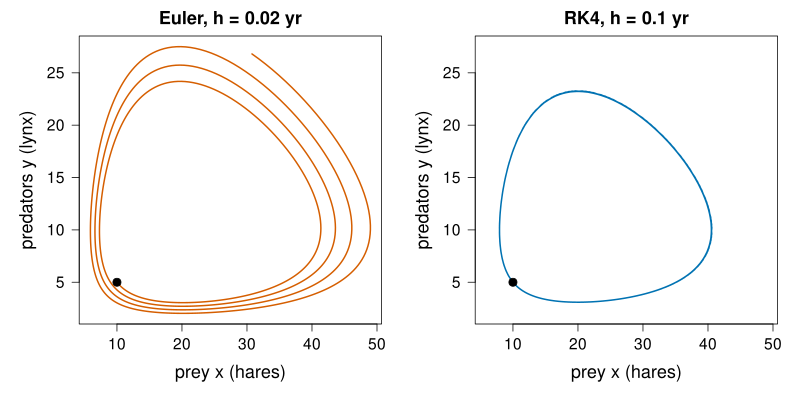
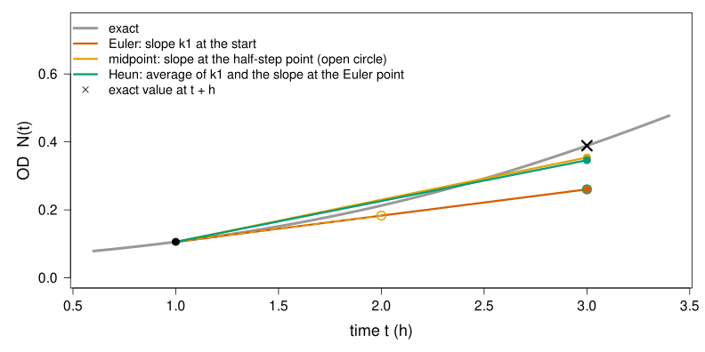
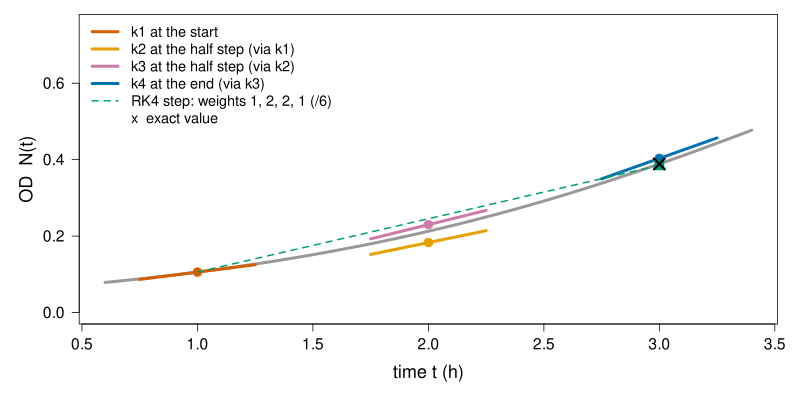
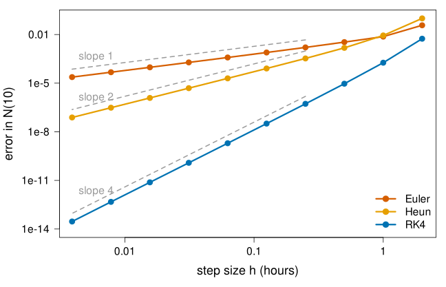
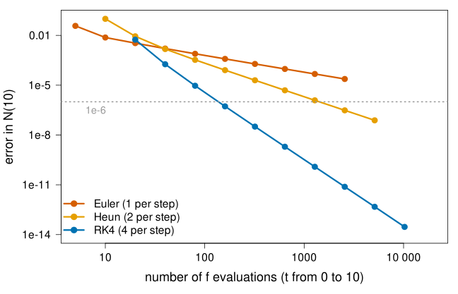
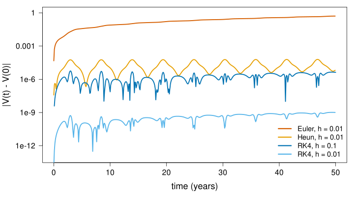
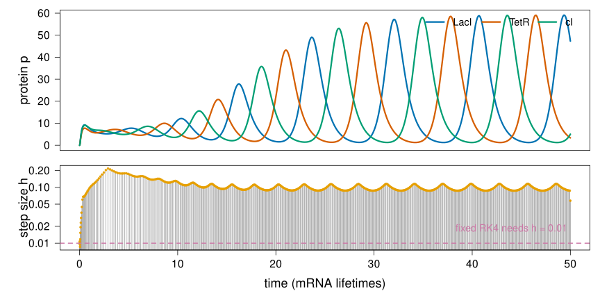
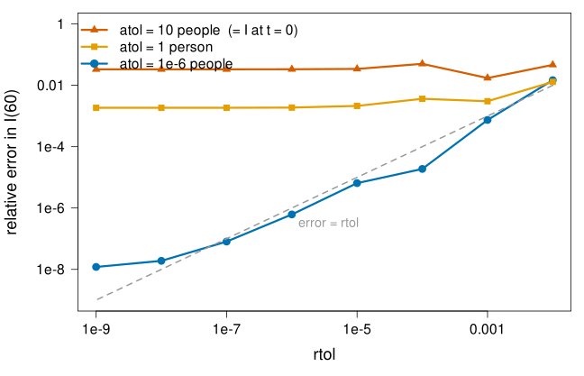
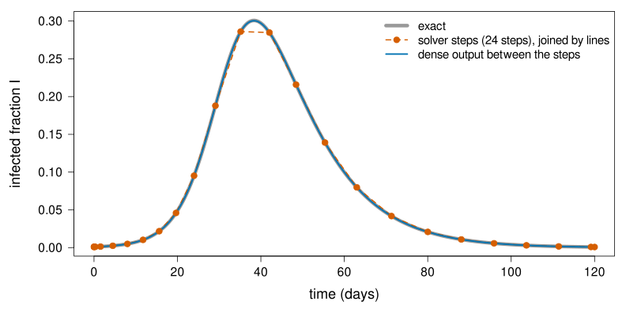
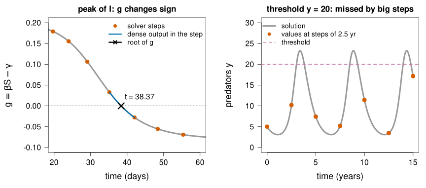

## About this lecture

Euler's method is order 1: ten times more accuracy costs ten times more steps. This lecture is about the methods that the ODE solvers you call actually use.

- **Runge–Kutta** methods take several slope evaluations per step and combine them: midpoint and Heun (order 2), the classical **RK4** (order 4).
- The order is read off a **log–log plot**; the price is the number of **function evaluations**.
- **Adaptive step size:** two estimates of different order in one step give an **error estimate** for free; the step is accepted or rejected and the next step size chosen from it (Dormand–Prince, behind `ode45`, `RK45`, `Dopri5`).
- What `rtol` and `atol` mean, **dense output**, and **events** (stop when the epidemic peaks).
- Biology: **predator–prey** cycles (a conserved quantity shows the error) and the **repressilator**, a synthetic genetic oscillator.

::: notes
This unit turns the hand-written Euler of the previous unit into the methods inside deSolve::ode and scipy's solve_ivp. Two ideas: (1) more slope evaluations per step buy a much higher order, (2) comparing two methods in the same step gives an error estimate, which lets the solver choose its own step. The second idea is what "adaptive" means, and it is why students can call ode() without ever choosing h. The price is that they choose tolerances instead, and those need to be understood.
:::

## Recap: Euler's method {.smaller}

From *Initial value problems and Euler's method*: to solve $y' = f(t, y)$, $y(t_0) = y_0$, step along the slope at the start of each step,

$$y_{n+1} = y_n + h\, f(t_n, y_n).$$

Logistic growth of an OD culture, $N' = rN(1 - N/K)$ with $r = 0.8$ per hour, $K = 1.2$, $N_0 = 0.05$:

| $h$ (hours) | 1 | 0.5 | 0.25 | 0.125 |
|---|---|---|---|---|
| Euler: error in $N(10)$ | $7.5\times10^{-3}$ | $3.4\times10^{-3}$ | $1.6\times10^{-3}$ | $7.8\times10^{-4}$ |

- Halve $h$, halve the error: the global error is $\propto h$, **order 1**.
- An error of $10^{-6}$ needs about $60\,000$ steps. Accuracy is expensive.
- The slope at the start of the step is used for the whole step, but the slope **changes** during the step.

::: notes
One slide of recap; the Euler unit has the details (local error h^2, global error h, instability for large h). The numbers are the same logistic running example as in the Euler unit. The last bullet is the idea for the whole first half: use better slopes. The 60 000 steps are measured (see the cost slide later), not estimated.
:::

## A biology problem first: predators and prey {.smaller}

Hares $x$ and lynx $y$ (Lotka–Volterra): $\quad x' = a x - b x y, \qquad y' = c x y - d y$,
with $a = 1$, $b = 0.1$, $c = 0.075$, $d = 1.5$ per year, $x_0 = 10$, $y_0 = 5$.

{width="72%" fig-align="center"}

- The true solution is a **closed orbit**: the populations cycle for ever. Euler ($h = 0.02$, 1000 steps over 20 years) spirals **outwards**, predicting ever larger booms and busts.
- RK4 with **5 times larger** steps closes the orbit to plotting accuracy.

::: notes
The model has a conserved quantity (next slides), so every orbit is closed. Euler always adds a little energy per cycle on an oscillator (the Euler unit showed the same on a 24-hour oscillator). A biologist reading the left plot would conclude that the system is unstable and that the populations will crash. That conclusion is an artefact of the method. The right plot uses fewer function evaluations (200 steps of 4 evaluations = 800 versus 1000) and is right.
:::

## Better slopes: midpoint and Heun {.smaller}

{width="70%" fig-align="center"}

- **Midpoint:** take a half Euler step, evaluate the slope **there**, use that slope for the whole step: $k_1 = f(t_n, y_n)$, $k_2 = f(t_n + \tfrac h2, y_n + \tfrac h2 k_1)$, $y_{n+1} = y_n + h k_2$.
- **Heun:** take a full Euler step, evaluate the slope at the end, use the **average**: $k_2 = f(t_n + h, y_n + h k_1)$, $y_{n+1} = y_n + \tfrac h2 (k_1 + k_2)$.
- Both cost **2** evaluations of $f$ per step and are **order 2**: halve $h$, the error drops by 4.

::: notes
The picture uses a big step (h = 2 hours from t = 1) so that the slopes are visible. Midpoint is the rectangle rule with the midpoint value; Heun is the trapezoid rule, both from the quadrature unit, applied to the slope. Neither knows the true slope at the midpoint or the end, so each first guesses the point with an Euler step. Heun is also called the improved Euler or explicit trapezoid method; some books call midpoint "RK2". Both are second order because the Euler guess only needs to be first-order accurate: its error enters multiplied by h.
:::

## Midpoint and Heun in R {.smaller}

```r
midpoint_step <- function(f, t, y, h) {
  k1 <- f(t, y)
  k2 <- f(t + h / 2, y + h / 2 * k1)
  y + h * k2
}
heun_step <- function(f, t, y, h) {
  k1 <- f(t, y)
  k2 <- f(t + h, y + h * k1)
  y + h / 2 * (k1 + k2)
}
f <- function(t, N) 0.8 * N * (1 - N / 1.2)       # logistic, r = 0.8, K = 1.2
c(midpoint_step(f, 0, 0.05, 1), heun_step(f, 0, 0.05, 1))
# [1] 0.1021440 0.1018991
```

- One step of $h = 1$ hour from $N_0 = 0.05$. Exact: $N(1) = 0.1058708$; Euler gives $0.0883333$.
- Errors: Euler $-0.0175$, midpoint $-0.0037$, Heun $-0.0040$. Each function works unchanged for **systems** (`y` a vector).

::: notes
A step function takes f, the current time and state, and the step size, and returns the new state. Written this way, the same function works for a scalar ODE and for a system, because R's arithmetic is vectorised: y + h * k1 is a vector when y is. One step is not yet the order, but already shows a factor 4 to 5 improvement for one extra evaluation.
:::

## The classical Runge–Kutta method (RK4) {.smaller}

{width="62%" fig-align="center"}

$$\begin{aligned}
k_1 &= f(t_n, y_n), & k_2 &= f(t_n + \tfrac h2,\, y_n + \tfrac h2 k_1),\\
k_3 &= f(t_n + \tfrac h2,\, y_n + \tfrac h2 k_2), & k_4 &= f(t_n + h,\, y_n + h k_3),
\end{aligned}
\qquad y_{n+1} = y_n + \tfrac h6 (k_1 + 2k_2 + 2k_3 + k_4)$$

- Four slopes: start, midpoint twice, end. The weights $1, 2, 2, 1$ (over 6) are **Simpson's rule** for the slope.
- Error per step $\propto h^5$, global error $\propto h^4$: **order 4**, for 4 evaluations per step.

::: notes
Each stage uses the previous stage's slope to guess the next point: k2 from k1, k3 from k2, k4 from k3. If f does not depend on y, RK4 is exactly Simpson's rule (from the quadrature unit) with the midpoint value counted twice. The weights are chosen so that the Taylor series of the step matches the true solution up to h^4. Deriving them is tedious algebra; we do not do it. RK4 was published by Kutta in 1901 and is still the default fixed-step method in many codes.
:::

## One RK4 step by hand {.smaller}

Logistic: $f(N) = 0.8\, N(1 - N/1.2)$, $N_0 = 0.05$, $h = 1$.

| stage | where | point $N$ | slope $k = f(N)$ |
|---|---|---|---|
| $k_1$ | $t = 0$ | $0.05$ | $0.0383333$ |
| $k_2$ | $t = 0.5$ | $0.05 + 0.5\cdot 0.0383333 = 0.0691667$ | $0.0521440$ |
| $k_3$ | $t = 0.5$ | $0.05 + 0.5\cdot 0.0521440 = 0.0760720$ | $0.0569996$ |
| $k_4$ | $t = 1$ | $0.05 + 1\cdot 0.0569996 = 0.1069996$ | $0.0779671$ |

$$N_1 = 0.05 + \tfrac16 (0.0383333 + 2\cdot0.0521440 + 2\cdot0.0569996 + 0.0779671) = 0.1057646$$

- Exact $N(1) = 0.1058708$: error $-1.1\times10^{-4}$, against $-1.8\times10^{-2}$ for Euler. **160 times smaller** for 4 times the work.

::: notes
Do this on the board or let students do it with a calculator. Point out that each point is built from the previous slope (the "via" column in the figure). The exercise has the same by-hand step on drug clearance, where the numbers are rounder.
:::

## RK4 in R, and its order {.smaller}

```r
rk4_step <- function(f, t, y, h) {
  k1 <- f(t, y)
  k2 <- f(t + h / 2, y + h / 2 * k1)
  k3 <- f(t + h / 2, y + h / 2 * k2)
  k4 <- f(t + h, y + h * k3)
  y + h / 6 * (k1 + 2 * k2 + 2 * k3 + k4)
}
rk_solve <- function(step, f, t0, y0, h, n) {      # n fixed steps of any method
  t <- t0 + (0:n) * h
  Y <- matrix(0, n + 1, length(y0)); Y[1, ] <- y0
  for (i in 1:n) Y[i + 1, ] <- step(f, t[i], Y[i, ], h)
  list(t = t, y = Y)
}
```

```r
exact <- function(t) 1.2 / (1 + (1.2 / 0.05 - 1) * exp(-0.8 * t))
hs  <- 2^(0:-6)
err <- sapply(hs, function(h) abs(rk_solve(rk4_step, f, 0, 0.05, h, 10 / h)$y[10 / h + 1] - exact(10)))
log2(err[-7] / err[-1])                            # halving h divides error by 2^p
# [1] 4.306050 4.121972 4.053037 4.024455 4.011698 4.005742
```

::: notes
rk_solve is the Euler driver from the previous unit with the step function as an argument, so Euler, Heun, midpoint and RK4 all plug in. The order check: if error = C h^p, halving h divides the error by 2^p, so log2 of the ratio is p. It tends to 4. On a log-log plot (next slide) this is the slope. 15 lines of R are all of RK4; the library solvers add error control, not a fundamentally different idea.
:::

## Reading the order off a log–log plot

{width="66%" fig-align="center"}

- Error in $N(10)$ against $h$: straight lines with slope **1** (Euler), **2** (Heun), **4** (RK4).
- At $h = 1/256$ RK4 reaches $10^{-14}$; below that rounding error takes over.

::: notes
Order is a statement about small h: for h = 2 Heun is worse than Euler, and the lines only become straight once h is small enough (the asymptotic regime from convergence-cost). The grey dashed lines are reference slopes. The exercise reproduces this plot. A student who implements RK4 with a typo (wrong weight, k3 built from k1) usually gets a method that still converges but with slope 1 or 2: the order plot is the test that catches it.
:::

## Cost per step versus accuracy

{width="60%" fig-align="center"}

- The real cost is the number of evaluations of $f$ (each can be a large model). For an error of $10^{-6}$ in $N(10)$: Euler about **61 000**, Heun about **1 400**, RK4 about **140**.
- Higher order wins as soon as you want more than 2–3 digits. Beyond order 4–5 the gain is small for typical biology tolerances.

::: notes
Same data as the previous plot, but the x axis is now work. At the very coarse end, Euler is cheapest: if one digit is enough, anything works. The numbers for 1e-6 were found by increasing the number of steps until the error dropped below 1e-6. Higher-order explicit methods (Dormand-Prince 8, DOP853 in scipy and ode_solvers) pay off for very tight tolerances, e.g. orbital mechanics; for biology, order 4-5 is the usual sweet spot.
:::

## Predator–prey: watch the conserved quantity {.smaller}

Along every true orbit $V(x, y) = c x - d \ln x + b y - a \ln y$ stays **constant** (check: $dV/dt = 0$, exercise). A numerical solution should keep it constant too.

{width="58%" fig-align="center"}

- Over 50 years: Euler ($h = 0.01$) drifts by $0.51$, Heun ($h = 0.01$) by $6\times10^{-5}$, RK4 ($h = 0.1$) by $6\times10^{-6}$.
- Even RK4 drifts slowly. **Check:** when the model has a conserved quantity (total mass, total population), monitor it.

::: notes
V plays the role of energy. Euler's drift is systematic (always upwards, the spiral), the RK4 error oscillates with each cycle and grows slowly. No standard Runge-Kutta method conserves V exactly; special "symplectic" or conservative methods exist but are beyond this course. For SIR, S + I + R = N is conserved, and all Runge-Kutta methods keep linear invariants like that exactly (up to rounding), which is why it is a weak check there. Nonlinear invariants like V are a strong check.
:::

## The repressilator {.smaller}

Elowitz & Leibler (2000): three repressors in a ring, LacI ⊣ TetR ⊣ cI ⊣ LacI, built in *E. coli*. Standard dimensionless model (time in mRNA lifetimes):

$$m_i' = -m_i + \frac{\alpha}{1 + p_j^{\,n}} + \alpha_0, \qquad p_i' = -\beta\,(p_i - m_i), \qquad (i, j) = (1,3), (2,1), (3,2)$$

with $\alpha = 216$, $\alpha_0 = 0.216$ (leak), $\beta = 5$ (protein/mRNA lifetime ratio), $n = 2$; start $m = (1, 0, 0)$, $p = (0, 0, 0)$.

```r
alpha <- 216; alpha0 <- 0.216; beta <- 5; n <- 2
repress <- function(t, y) {
  m <- y[1:3]; p <- y[4:6]
  prep <- p[c(3, 1, 2)]                   # m1 repressed by p3, m2 by p1, m3 by p2
  c(-m + alpha / (1 + prep^n) + alpha0, -beta * (p - m))
}
```

::: notes
m_i is the mRNA and p_i the protein of gene i, both scaled. alpha is the maximal transcription rate, alpha0 the leaky rate with full repression, beta the ratio of mRNA to protein lifetime. With these values the steady state is unstable and the system settles on a limit cycle (phase-plane unit). The protein levels swing between about 1 and 60, with a period of about 8.7 mRNA lifetimes. Six equations, nonlinear, no exact solution: a realistic test case.
:::

## One step size for the whole run? {.smaller}

{width="76%" fig-align="center"}

- Top: fixed-step RK4 with $h = 0.2$ (dashed) looks like an oscillation but **drifts out of phase**: at $t = 50$ LacI is $59$ instead of $47$.
- Bottom: an adaptive solver (Dormand–Prince, error $\approx 10^{-6}$ per step) chooses **tiny steps at the start** ($h \approx 0.01$) and $0.06$–$0.2$ later, varying within each cycle.
- Fixed-step RK4 needs $h \approx 0.006$ (about 30 000 evaluations) for the accuracy ($3\times10^{-4}$ at $t = 50$) the adaptive solver gets with 3 000.

::: notes
Two problems with a fixed step: you do not know which h is good enough without trying several, and one h must be small enough for the hardest part of the run (here the start, where the mRNA jumps up within a fraction of a time unit). The adaptive solver needs neither: it is told an error per step, and finds the step itself. Part of the gain in the last bullet is the higher order (5 against 4), part is that the step follows the solution. The dashed curve is a confident wrong answer: it has the right shape and the right period roughly, but wrong timing. The check is the same as always: halve h (or tighten the tolerance) and see if the answer changes.
:::

## Estimating the error for free: embedded pairs {.smaller}

Heun's first stage **is** an Euler step. One step, two answers, no extra work:

$$y^{\text{low}} = y_n + h k_1 \;\;(\text{order 1}), \qquad y^{\text{high}} = y_n + \tfrac h2 (k_1 + k_2) \;\;(\text{order 2}), \qquad \text{err} \approx |y^{\text{high}} - y^{\text{low}}|$$

Logistic, one step $h = 1$ from $N_0 = 0.05$:

| | value | true error |
|---|---|---|
| $y^{\text{low}}$ (Euler) | $0.0883333$ | $-0.0175$ |
| $y^{\text{high}}$ (Heun) | $0.1018991$ | $-0.0040$ |
| estimate $\lvert y^{\text{high}} - y^{\text{low}}\rvert$ | $0.0136$ | |

- The difference estimates the error of the **lower**-order answer (right size: $0.0136$ vs $0.0175$). Solvers keep the higher-order answer, which is better still (**local extrapolation**).
- Such a pair sharing its stages is an **embedded pair**, written e.g. 2(1).

::: notes
The trick: if the high-order answer is much more accurate than the low-order one, their difference is essentially the error of the low-order one. That is a free, honest estimate of the local error. Using it to control the step of the high-order answer is slightly conservative, which is fine. Step doubling (one step of h versus two of h/2) gives the same kind of estimate but costs more evaluations; that is why embedded pairs won.
:::

## Accept, reject, choose the next step {.smaller}

```r
adapt_heun <- function(f, t, y, tend, h, rtol = 1e-6, atol = 1e-9) {
  while (t < tend) {
    h   <- min(h, tend - t)                    # do not step past the end
    k1  <- f(t, y); k2 <- f(t + h, y + h * k1)
    ylo <- y + h * k1                          # Euler, order 1
    yhi <- y + h / 2 * (k1 + k2)               # Heun, order 2
    sc  <- atol + rtol * pmax(abs(y), abs(yhi))
    err <- sqrt(mean(((yhi - ylo) / sc)^2))    # scaled error: 1 = just acceptable
    if (err <= 1) { t <- t + h; y <- yhi }     # accept; otherwise retry
    h <- h * min(5, max(0.2, 0.9 * err^(-1/2)))
  }
  y
}
```

- Local error of the low-order answer $\propto h^{2}$, so to hit $\text{err} = 1$ scale $h$ by $\text{err}^{-1/2}$; $0.9$ is a safety factor, and $h$ changes by at most $\times 5$ or $\div 5$.
- Logistic from $h = 1$ with `rtol = 1e-3`: first step $\text{err} = 133$, **rejected**, retried with $h = 0.2$; error in $N(10)$ $2.7\times10^{-4}$ (83 steps, 5 rejected). With `rtol = 1e-6`: $3.4\times10^{-7}$ (2526 steps).

::: notes
This is the whole idea of an adaptive solver in 12 lines. The scaled error compares the error estimate to the allowed error sc (next slides explain rtol and atol); err <= 1 means within tolerance. Whether accepted or rejected, the next h is chosen from the same formula: after a good step it grows, after a bad step it shrinks. For an embedded pair whose low-order member has order q, the exponent is -1/(q+1); for Dormand-Prince 5(4) it is -1/5. The numbers come from the logistic example with h = 1 initially, atol = 1e-9 and rtol = 1e-3: sc = 1.02e-4 for the first step, the estimate 0.0136 is 133 times too large, and 0.9 * 133^(-1/2) = 0.078 is clipped to the minimum factor 0.2.
:::

## Try it: four slopes, then adaptive steps

```{=html}
<link rel="stylesheet" href="../demos/dist/demo.css">
<div data-demo="rkstep" data-tab="adapt" data-model="logistic" data-method="rk4" data-h="1" data-system="lv" data-pair="dp" data-logtol="-3"></div>
<script src="../demos/dist/rkstep.js"></script>
```

::: notes
Live in the browser; the adaptive solver is the controller of the previous slide with Dormand-Prince 5(4), first step 0.01, rtol = atol. Start on predator-prey at rtol 1e-3: 67 accepted steps, 19 rejected (red crosses), 517 f evaluations; the dots in (c) are sparse, the orbit in (e) is a polygon that wanders off the grey reference, V drifts by 0.032. Point at panel (d): long steps (about 1.4 years) when both populations are low, short ones when they are high and changing fast; the crosses come just after the step has grown too far. Click 1e-6: 229 steps, drift 2e-6, the orbit closes. Switch to the repressilator at 1e-6 and compare the three pairs: Heun-Euler 39 000 steps, Bogacki-Shampine 1700, Dormand-Prince 492 (the same as deSolve's ode45 to within 1 %). Heun-Euler at 1e-9 gives up after 150 000 attempts. If there is time, go back to the first tab: RK4 on the logistic curve with h = 1, press "next stage" four times to build k1..k4 (the table of "One RK4 step by hand"), then show panel (b) against h (slopes 1, 2, 4) and against f evaluations (RK4 about 140 evaluations for 1e-6, Euler about 60 000).
:::

## Dormand–Prince 5(4): `ode45`, `RK45`, `Dopri5` {.smaller}

The standard adaptive explicit solver (Dormand & Prince, 1980):

- **7 stages** give an order-5 and an order-4 answer; their difference is the error estimate. The order-5 answer is kept.
- **FSAL** ("first same as last"): the 7th stage is $f$ at the new point, i.e. the next step's $k_1$, so a step costs **6** new evaluations.
- Same controller as on the previous slide with exponent $-1/5$, plus a **dense-output** formula (later slide).
- R: `deSolve::ode(..., method = "ode45")`; Python: `scipy.integrate.solve_ivp(..., method = "RK45")` (the default); Rust: `ode_solvers::Dopri5`; MATLAB: `ode45`.
- Lower-order pair `ode23` / `RK23` (Bogacki–Shampine 3(2)) for loose tolerances, `DOP853` for very tight ones.

::: notes
Students do not need the 7-stage coefficient table; the exercise and the figure script contain it. What matters: it is the same embedded-pair idea, with a better pair. deSolve's ode45 and scipy's RK45 use the same Dormand-Prince coefficients, but different defaults for tolerances and first step, so they do not take identical steps. The exercise compares them.
:::

## `rtol` and `atol`: what they mean {.smaller}

The allowed error per step in component $i$ is

$$\text{sc}_i = \texttt{atol} + \texttt{rtol}\cdot |y_i|, \qquad \text{accept if } \sqrt{\tfrac1m \textstyle\sum_i (\text{err}_i/\text{sc}_i)^2} \le 1.$$

- `rtol` = relative: `rtol = 1e-6` asks for about 6 correct digits **per step** in large components.
- `atol` = absolute floor: when $|y_i| \ll$ `atol`/`rtol`, the allowed error is `atol`, whatever the size of $y_i$.
- SIR in people ($S = 9990$, $I = 10$) with `rtol = 1e-3`, `atol = 1e-6`: allowed error in $S$ $\approx 10$ people, in $I$ $\approx 0.01$.
- `atol` has the **units of $y$**: change from head counts to fractions of the population and `atol` must change too.
- Defaults differ: deSolve `rtol = atol = 1e-6`; `solve_ivp` `rtol = 1e-3`, `atol = 1e-6`; `ode_solvers` has none (you give both).

::: notes
The combination is the standard one (Hairer, Norsett and Wanner; also scipy and deSolve). In words: atol says "below this size I do not care about this variable", rtol says "how many digits I want". If a variable lives on a small scale (a concentration in nM given in M, a few infected people out of millions given as fractions), atol must be much smaller than that scale, or the solver is allowed to get it wholly wrong. scipy's default rtol = 1e-3 is loose: 3 digits per step, often fewer for the answer. Always set tolerances explicitly.
:::

## When `atol` is too large {.smaller}

SIR from 10 infected people; "`atol = 10` people seems harmless in a town of 10 000". Dormand–Prince, error in $I$ at day 60.

{width="60%" fig-align="center"}

- With `atol = 10` the error is stuck at **3–5%**, with `atol = 1` at **0.2%**, however small `rtol` is: early on $I \lesssim$ `atol`, so the solver may get $I$ wrong by 100% there, and the epidemic grows from a wrong seed.
- **Check:** set `atol` well below the smallest value you care about in each variable (here $10^{-12}$), or rescale the variables.

::: notes
The early exponential phase decides when the epidemic peaks. With atol = 10 the solver takes large steps while I is around 10 people, the relative error in I is of order 1, and that error is then amplified by the exponential growth. The same failure appears in fractions with atol = 1e-3 (or with atol = 1e-6 for a pathogen seeded at one in a million). The blue line shows the healthy behaviour: the achieved error roughly follows rtol (one to a few times rtol). deSolve accepts a vector atol, one per variable; so does solve_ivp.
:::

## The tolerance is per step: check by tightening {.smaller}

Repressilator, LacI protein $p_1$ at $t = 50$, deSolve `ode45` with `rtol = atol`:

| tolerance | $10^{-3}$ | $10^{-4}$ | $10^{-5}$ | $10^{-6}$ | $10^{-7}$ | $10^{-8}$ |
|---|---|---|---|---|---|---|
| $p_1(50)$ | 46.84193 | 47.37103 | 47.33335 | 47.33575 | 47.33596 | 47.33599 |
| steps | 159 | 217 | 317 | 487 | 760 | 1190 |

- The tolerance controls the error **per step**. Errors add up (and in an oscillator, shift the phase), so the answer can be worse than the tolerance.
- **Check:** solve again with 10–100 times smaller tolerances and keep only the digits that agree. Here `1e-6` gives 4 correct digits.
- Ten times tighter costs about $10^{1/5} \approx 1.6$ times more steps (order 5).

::: notes
This is the single most useful habit with ODE solvers: run twice with different tolerances. It costs one extra solve and detects almost every tolerance problem, including the atol one on the previous slide. The step counts grow by about 1.5 per factor 10: the payoff of a fifth-order method. Reference value 47.335989 from rtol = 1e-12.
:::

## Dense output {.smaller}

{width="66%" fig-align="center"}

- Adaptive steps are large where the solution is smooth: 24 steps for the whole epidemic (`rtol = 1e-4`). Joined by straight lines they **cut the peak**.
- **Dense output:** a polynomial through each step, built from the stages already computed, gives the solution at any $t$ at no extra cost. `solve_ivp(..., t_eval=, dense_output=True)` uses it.
- deSolve instead limits the step to the spacing of `times` (`hmax`) and starts there (`hini`): ask for a fine enough `times` grid.

::: notes
Two separate grids: the steps the solver takes for accuracy, and the times at which you want output. Dense output decouples them. In scipy, t_eval does not change the steps. In deSolve, the default hmax is the largest gap in times and the first step is hmax, so a very coarse times vector (e.g. c(0, 160)) can let ode45 take one huge first step and miss the dynamics; a fine times vector makes it take more steps than needed. Also note: the maximum of the output is only as accurate as the output grid: with a daily grid, max(I) misses the true peak by 1.7 people.
:::

## deSolve: `"rk4"` versus `"ode45"` {.smaller}

```r
library(deSolve)
beta <- 0.3; gamma <- 0.1; N <- 10000             # per day; as in the Euler unit
sir <- function(t, y, parms) {
  S <- y[1]; I <- y[2]
  list(c(-beta * S * I / N, beta * S * I / N - gamma * I, gamma * I))
}
y0 <- c(S = 9990, I = 10, R = 0)
times <- 0:160
out4  <- ode(y0, times, sir, parms = NULL, method = "rk4")    # fixed h = 1
out45 <- ode(y0, times, sir, parms = NULL, method = "ode45")  # rtol = atol = 1e-6
c(max(out4[, "I"]), max(out45[, "I"]))
# [1] 3006.227 3006.230
```

- [`ode`](https://search.r-project.org/CRAN/refmans/deSolve/html/ode.html) wants `func(t, y, parms)` returning a **list**. Exact peak: $3007.961$; both miss it by $1.7$ people because of the **daily grid**, not the solver.
- `"rk4"` steps **from output time to output time**: the repressilator with `times = 0:50` gives $p_1(50) = 3\times10^{58}$. [`diagnostics(out45)`](https://search.r-project.org/CRAN/refmans/deSolve/html/diagnostics.html) shows steps and evaluations (here 160 and 962).

::: notes
The function signature differs from our hand-written f(t, y): deSolve passes parms and wants a list whose first element is the derivative vector. The fixed-step methods ("euler", "rk4") in deSolve use the times vector as the step grid unless hini is given; a coarse output grid then silently means a coarse step, and RK4 with h = 1 on the repressilator blows up. ode45 is the safer default. With the daily grid, ode45 is capped at h = 1 here, hence 160 steps; with times = c(0, 160) it takes 67. The exact peak comes from the formula I_max = S0 + I0 - (N gamma/beta)(1 + ln(beta S0 / (gamma N))) from the Euler unit.
:::

## Events: stop at the epidemic peak {.smaller}

An **event** is a time where some function $g(t, y)$ crosses zero. The solver checks the sign of $g$ after every step and, when it changes, finds the root on the dense output.

$I$ peaks when $dI/dt = (\beta S/N - \gamma) I = 0$, i.e. $g = \beta S/N - \gamma = 0$ ($S = N/3$).

```r
peak <- function(t, y, parms) beta * y[1] / N - gamma      # g(t, y)
out <- ode(y0, times, sir, parms = NULL, method = "lsoda", rootfunc = peak)
attributes(out)$troot                                       # stops at the root
# [1] 38.35532
tail(out, 1)
#           time        S       I        R
# [40,] 38.35532 3333.333 3007.96 3658.707
```

- The peak, $3007.96$, now agrees with the exact $3007.961$; peak time $38.36$ days.
- In deSolve, `rootfunc` works with `lsoda`/`lsode`/`radau`, not `ode45` (`lsoda` is explained in *Stiffness and implicit methods*). Python: `solve_ivp(..., events=g)` with `g.terminal`, `g.direction`.

::: notes
Other examples: a population falling below an extinction threshold, a concentration reaching a toxic level, a cell reaching division size (then reset the state and restart: deSolve's events argument does that). In deSolve, giving rootfunc without an events list stops at the first root; events = list(root = TRUE) with terminalroot controls this. ode45 in deSolve has no root finding, which is why we switch to lsoda here: for this non-stiff problem it behaves like an Adams (multistep) method. The exercise does the same with solve_ivp and ode_solvers.
:::

## How events are found, and missed {.smaller}

{width="80%" fig-align="center"}

- Left: $g$ changes sign between two steps; a root finder on the dense output (*Bisection and fixed-point iteration*, *Newton and secant methods*) places it inside the step.
- Right: if $g$ changes sign **twice** within one step, the solver sees no change and the event is **missed**.
- **Check:** limit the step (`hmax`, `max_step`) to below the shortest excursion you care about, or make $g$ an extremum (e.g. $dy/dt$) that changes sign once.

::: notes
The left panel uses a real Dormand-Prince run at rtol = 1e-4 and a cubic interpolant inside the step; the root at 38.37 is 0.02 days from the exact 38.355, consistent with the loose tolerance. The right panel is schematic: points every 2.5 years on the true predator curve. A solver whose steps happen to land like that would not report that the lynx population exceeded 20. Adaptive steps make this less likely (they shorten during fast change) but do not exclude it.
:::

## Checklist: detecting trouble with an ODE solver

- **Answer depends on the tolerance** → tighten `rtol` and `atol` 10–100 times and keep only the digits that agree.
- **Small variables** (rare cells, nM concentrations, the first few infected) → `atol` far below their scale, per variable if needed.
- **Conserved quantity drifts** (total mass, Lotka–Volterra $V$) → tighter tolerance or higher-order method.
- **Fixed-step method** → halve $h$; on a log–log plot the error must fall with the expected slope.
- **Peak or threshold from the output grid** → use an event, or a finer output grid.
- **Huge number of steps or a warning about steps** → maybe stiff: see *Stiffness and implicit methods*.

::: notes
Each item is a failure from this lecture: the repressilator table, the atol floor, the predator-prey drift, the order plot, the grid-limited peak and the missed event. The last item points forward: if an explicit adaptive solver takes millions of tiny steps on a problem whose solution is smooth, the step is limited by stability, not accuracy. That is stiffness, the next unit.
:::

## Summary {.smaller}

- Runge–Kutta methods combine several slopes per step: **midpoint/Heun** (2 evaluations, order 2), **RK4** (4 evaluations, order 4). Read the order off a log–log plot of error vs $h$.
- Measure cost in **function evaluations**: for more than 2–3 digits, higher order is much cheaper.
- An **embedded pair** gives an error estimate per step; the solver **accepts or rejects** and sets the next $h \propto \text{err}^{-1/(q+1)}$. Dormand–Prince 5(4) = `ode45` / `RK45` / `Dopri5`.
- Allowed error per step $=$ `atol` $+$ `rtol` $\cdot|y|$. Tolerances are **per step**: check by tightening. `atol` must be below the scale of every variable.
- **Dense output** gives values between steps; **events** locate threshold crossings and peaks.

**Next:** *Stiffness and implicit methods*, where explicit methods, adaptive or not, need absurdly small steps.

::: notes
Recap the two ideas (more stages = higher order; embedded pairs = error control) and the practical rules (set tolerances, check by tightening, use events). The next unit shows a kind of problem, stiff kinetics, where ode45 is correct but uselessly slow, and implicit methods are needed.
:::
