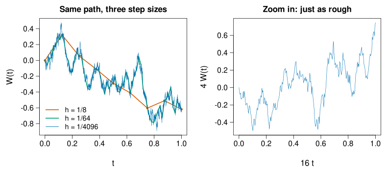
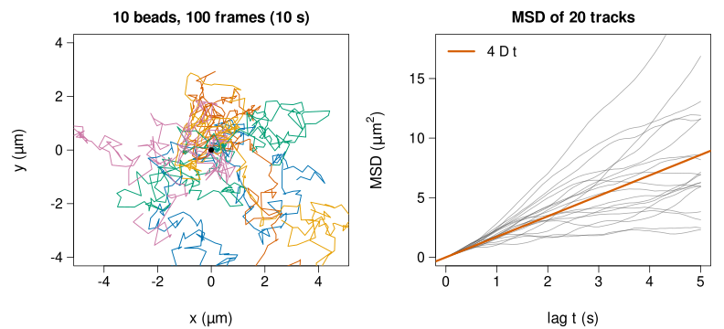
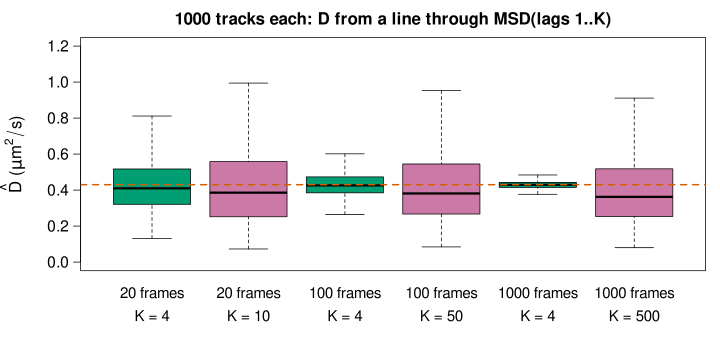
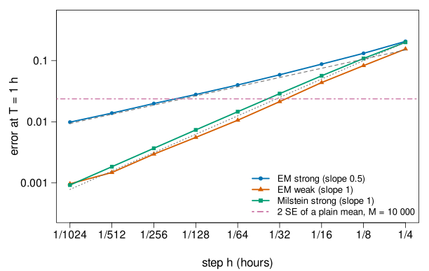
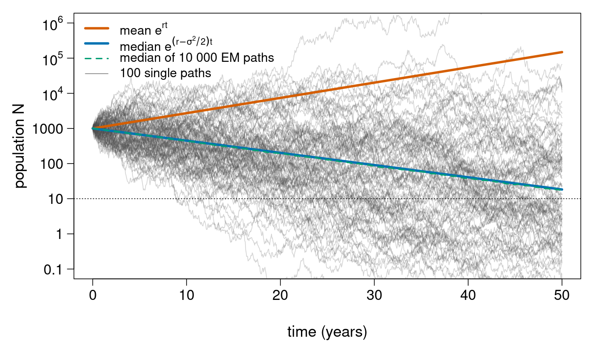
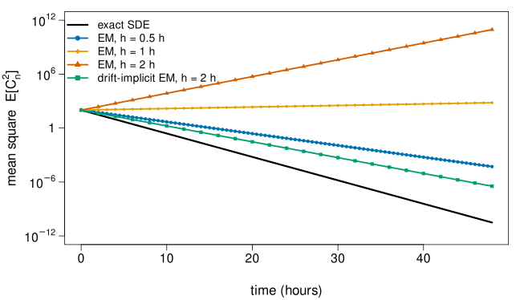
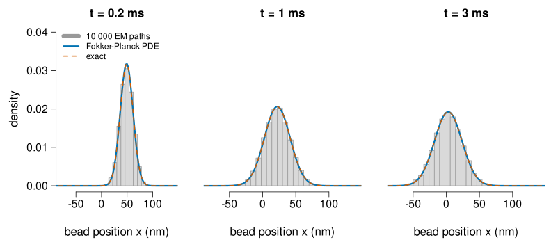

## About this lecture {.smaller}

An ODE with a random kick in every time step: $\;dX = f(X)\,dt + g(X)\,dW$. One method, **Euler–Maruyama**, and the ways it goes wrong.

- **Brownian motion** $W(t)$: a random walk with steps of size $\sqrt h$. Rough paths without a derivative.
- Biology: a bead or a cell diffusing in a **microchannel**: estimate $D$ from its track (mean squared displacement).
- **Euler–Maruyama**: an Euler step plus a normal kick. Test problem: a bead in an **optical trap** (Ornstein–Uhlenbeck).
- Two kinds of error: **strong** (single paths, order ½) and **weak** (averages, order 1). A classic bug that breaks the first.
- The **Itô surprise**: a population whose mean grows, while the typical population dies out. **Milstein**: one extra term.
- Failures: negative values and `NaN`; blow-up at a step that is fine for the ODE. The **Fokker–Planck** PDE for the histogram.

::: notes
This unit follows Stochastic simulation and takes up the one slide there on Euler-Maruyama. There SDEs appeared as an approximation of the master equation for many molecules. Here they are models in their own right: thermal motion of beads and cells, noisy environments, noisy membrane voltage. We treat only as much Itô calculus as the numerics need, and every fact is shown with a simulation rather than proved. The thread is the same as for ODEs: one method, its order measured on a log-log plot, its stability, and the checks that catch the failures.
:::

## Recap: noise beyond molecule counts {.smaller}

In [*Stochastic simulation*](../gillespie/lec.qmd) the **chemical Langevin equation** $dm = (k - \delta m)\,dt + \sqrt{k + \delta m}\;dW$ was solved with one line:

```r
k <- 10; delta <- 1; h <- 0.01; m <- 10          # per hour; one step from m = 10
m <- m + (k - delta * m) * h + sqrt((k + delta * m) * h) * rnorm(1)   # Euler-Maruyama
```

There it was an approximation of the SSA for many molecules. Continuous noise also appears directly:

| system | variable $X$ | noise from |
|---|---|---|
| bead or cell in a microchannel | position (µm) | thermal collisions (Brownian motion) |
| bead in an optical trap | position (nm) | the same, pulled back to the centre |
| population in a fluctuating environment | number $N$ | good and bad years: a random growth rate |
| neuron below threshold | membrane voltage | many random synaptic inputs |

::: notes
Stochastic simulation had a slide with Euler-Maruyama and stated without detail that its order is 1/2 for paths and 1 for averages; its exercise listed SDE theory as not covered. This is that theory, at the level needed to simulate correctly. The four rows are the examples of this lecture (the neuron only in passing: the leaky integrate-and-fire neuron with noisy input is an Ornstein-Uhlenbeck process for the voltage). In each case the noise is not a small number effect: a 1 µm bead is hit by water molecules all the time, and the sum of those hits is a continuous random force.
:::

## Brownian motion: the limit of a random walk

{width="90%" fig-align="center"}

- $W(0) = 0$; increments $W(t + h) - W(t) \sim N(0, h)$, **independent** of the past. Variance grows like $t$.
- Refine the step: the path gets rougher, not smoother. Zoomed in, it looks the same: **no derivative** anywhere.

::: notes
Left: one Brownian path on a fine grid (4096 steps, blue), and the same path seen only every 64 or 512 fine steps. A coarse path is the fine path sampled; that fact matters for the convergence test later. Right: the first sixteenth of the path, stretched by 16 in time and 4 in space: statistically the same picture (self-similarity). An ODE solution looks like a straight line when you zoom in far enough; Brownian motion never does. So dW/dt does not exist, and an SDE is written with differentials dX = f dt + g dW, which is short for the integral form X(t) = X(0) + integral of f dt + integral of g dW.
:::

## Why steps of size $\sqrt h$ {.smaller}

Walk $1/h$ steps of $\pm a$ to $t = 1$, for 2000 walkers. Which step size $a$ gives a sensible limit?

```r
set.seed(1)
for (h in c(0.1, 0.01, 0.001)) {        # 1/h steps of size +-a, 2000 walkers, to t = 1
  steps <- matrix(sample(c(-1, 1), 2000 / h, replace = TRUE), ncol = 2000)
  cat(sprintf("h = %-5g  var W(1): a = h %.4f, a = sqrt(h) %.4f\n", h,
              var(colSums(h * steps)), var(colSums(sqrt(h) * steps))))
}
# h = 0.1    var W(1): a = h 0.1002, a = sqrt(h) 1.0022
# h = 0.01   var W(1): a = h 0.0104, a = sqrt(h) 1.0402
# h = 0.001  var W(1): a = h 0.0010, a = sqrt(h) 1.0393
```

- Variances of independent steps **add**: $\frac1h \cdot a^2$. Steps $a = h$: variance $h \to 0$, no motion. Steps $a = \sqrt h$: variance 1 for every $h$.
- The slope of one step, $\sqrt h / h = 1/\sqrt h$, grows without bound as $h \to 0$: no derivative.

::: notes
This is the whole reason for the square roots in this lecture. The sum of n independent steps has variance n a^2; with n = t/h steps we need a^2 proportional to h for a finite, non-zero variance at time t. By the central limit theorem the sum is then normal whatever the step distribution, so we may as well use normal steps of standard deviation sqrt(h) from the start: dW = sqrt(h) * rnorm(1). Steps of size h give an ODE in the limit (no noise at all); steps larger than sqrt(h) give infinite variance. The same scaling is behind the diffusion length sqrt(2 D t) of The diffusion (heat) equation by finite differences.
:::

## A bead in a microchannel {.smaller}

A bead of radius $a = 0.5$ µm in water, filmed at 10 frames per second. Each coordinate does a random walk with
$$x(t + \Delta t) = x(t) + \sqrt{2D\,\Delta t}\;Z, \qquad \text{MSD}(t) = \mathrm E\,|\mathbf r(t) - \mathbf r(0)|^2 = 2dDt \;\;(d = \text{dimensions}).$$

**Stokes–Einstein:** $D = \dfrac{k_B T}{6\pi\eta a} = \dfrac{4.05 \times 10^{-21}\ \text{J}}{6\pi \cdot 1.0 \times 10^{-3}\ \text{Pa s} \cdot 0.5 \times 10^{-6}\ \text{m}} = 0.43$ µm²/s (20 °C).

{width="72%" fig-align="center"}

::: notes
k_B T at 20 °C is 1.38e-23 J/K times 293 K = 4.05e-21 J (about 4 pN nm), and the viscosity of water at 20 °C is about 1.0 mPa s (lower at 37 °C, and higher in medium with serum). So a 1 µm bead moves about sqrt(4 D t) = 1.3 µm in one second, 4 µm in ten. Particle tracking measures D, and with Stokes-Einstein the size of a particle or the viscosity of the medium; the same analysis applied to cells or vesicles tells whether they move by diffusion (MSD linear in t), are confined (MSD levels off) or are transported (MSD grows like t^2). Right: the MSD curves of 20 tracks of 100 frames, computed from each single track. They follow 4 D t at small lags and fan out at large lags.
:::

## $D$ from the MSD in R {.smaller}

```r
D <- 0.43; dt <- 0.1; n <- 100                   # µm^2/s, s per frame, frames
set.seed(1)
xy <- apply(matrix(rnorm(2 * n, sd = sqrt(2 * D * dt)), n), 2, cumsum)  # x, y
msd <- function(xy, K) sapply(1:K, function(k)   # mean squared displacement, lag k
  mean(rowSums((xy[-(1:k), ] - xy[1:(nrow(xy) - k), ])^2)))
lag <- (1:10) * dt
fit <- lm(msd(xy, 10) ~ 0 + lag)                 # straight line through 0
coef(fit) / 4                                    # 2D: MSD = 4 D t
#       lag
# 0.3773289
```

- One track uses **every** pair of frames $k$ apart: 99 displacements at lag 1, 90 at lag 10.
- [`lm`](https://stat.ethz.ch/R-manual/R-devel/library/stats/html/lm.html) with `~ 0 + lag`: least squares for the slope of a line through the origin. True value 0.43; this track gives 0.38.

::: notes
The simulated track is the exact solution of dX = sqrt(2D) dW sampled every frame: there is no discretisation error here, only randomness. rowSums adds the x and y squared displacements. The fit is the least-squares problem of Least squares: normal equations vs QR with one column. With a line through the origin the slope is sum(t * MSD) / sum(t^2), which is what the by-hand exercise B6 computes. Real data have localisation error: each position is measured with an error of standard deviation s, which adds 4 s^2 to every MSD value. Then fit with an intercept (~ lag), and the intercept estimates the localisation error.
:::

## Short tracks, long lags {.smaller}

{width="72%" fig-align="center"}

- Fit the first $K = 4$ lags: sd of $\hat D$ is 0.155 (20 frames), 0.065 (100), 0.020 (1000). Long tracks pay off.
- Fit up to half the track: sd about 0.24 **whatever the length**. Few independent intervals at large lags, all correlated.
- With flow along $x$ ($u = 5$ µm/s), the 2D MSD gains $u^2t^2$: $\hat D = 2.5$ instead of 0.43. Use the coordinate across the flow (MSD $= 2Dt$).

::: notes
Each box is 1000 simulated tracks (seed 2 in the figure script). No estimate is biased on average (means 0.42 to 0.44), but the spread differs by a factor of ten. At lag k, a track of n frames has only about n/k independent displacements, and the MSD values at neighbouring lags share most of their data, so the long-lag points add noise, not information. A common rule is to fit only the first few lags (or a tenth of the track). The flow case is a confident wrong answer: the fit runs, the line is drawn, D is six times too large. The check is to plot the MSD: a curve bending upward means drift, levelling off means confinement. In a microchannel, the coordinate across the flow (or the displacements minus their mean) gives D.
:::

## The SDE and the Euler–Maruyama step {.smaller}

$$dX = \underbrace{f(X)\,dt}_{\text{drift: the ODE}} + \underbrace{g(X)\,dW}_{\text{diffusion: noise strength}}$$

**Euler–Maruyama (EM):** Euler for the drift, plus a normal kick with standard deviation $g\sqrt h$:
$$X_{n+1} = X_n + f(X_n)\,h + g(X_n)\,\Delta W_n, \qquad \Delta W_n = \sqrt h\, Z_n,\; Z_n \sim N(0, 1).$$

By hand: bead in a trap, $f(x) = -\theta x$, $g = \sigma$, with $\theta = 1$ per ms, $\sigma = 30$ nm/$\sqrt{\text{ms}}$, $x_0 = 40$ nm, $h = 0.01$ ms, $Z_0 = -1.2$:
$$x_1 = 40 - 1 \cdot 40 \cdot 0.01 + 30 \cdot \sqrt{0.01} \cdot (-1.2) = 40 - 0.4 - 3.6 = 36.0 \text{ nm}.$$

- With $g = 0$ this is Euler's method from [*Initial value problems and Euler's method*](../euler/lec.qmd). The kick is **much larger** than the drift step: $\sqrt h \gg h$.
- $f$ and $g$ are evaluated at the **start** of the step. That choice matters (Itô, later).

::: notes
Write it on the board next to the Euler step. The drift step is proportional to h, the kick to sqrt(h): with h = 0.01 the kick is ten times larger relative to its coefficient. Over many steps the drift wins on average (the kicks cancel partly), which is why the solution still has a trend. The noise strength g may depend on X (multiplicative noise, as for a population) or not (additive noise, as for the bead). Evaluating g at the start of the step, before the kick is known, is what makes this the Ito interpretation of the SDE; we come back to that with the population example.
:::

## Euler–Maruyama in R {.smaller}

```r
em <- function(f, g, x0, h, n) {                 # Euler-Maruyama, one path
  x <- numeric(n + 1); x[1] <- x0
  for (i in 1:n) x[i + 1] <- x[i] + f(x[i]) * h + g(x[i]) * sqrt(h) * rnorm(1)
  x
}
theta <- 1; D <- 430; sigma <- sqrt(2 * D)       # per ms; nm^2/ms; nm/sqrt(ms)
set.seed(1)
x <- em(function(x) -theta * x, function(x) sigma, x0 = 60, h = 0.01, n = 1e5)
c(x_1ms = x[101], mean = mean(x[-(1:500)]), sd = sd(x[-(1:500)]))
#      x_1ms       mean         sd
# 41.3197639 -0.6940525 19.8094232
```

- The bead starts 60 nm off-centre, relaxes within about $1/\theta = 1$ ms, then jitters with sd $\approx 20$ nm.
- Same bead as before: $D = 0.43$ µm²/s $= 430$ nm²/ms, so $\sigma = \sqrt{2D}$.

::: notes
The function is the whole method; R's loop is fine for 1e5 steps. One path of 1000 ms gives sample mean about 0 and sd about 20, close to the theory on the next slide (sd sqrt(430) = 20.7 nm; one path is a correlated sample, so its sd is uncertain by a few percent). Python: rng.standard_normal(); Rust: rng.sample(StandardNormal) from rand_distr; the exercise has all three. There is no package call here on purpose. Packages exist (sde and Sim.DiffProc in R, sdeint in Python, DifferentialEquations.jl in Julia), but EM is one line and its pitfalls are the subject.
:::

## Test problem: Ornstein–Uhlenbeck {.smaller}

$$dX = -\theta X\,dt + \sigma\,dW: \quad \text{a pull back to 0 at rate } \theta, \text{ plus noise.}$$

- **Optical trap:** a bead held by a laser, $\theta = \kappa/\gamma$ (trap stiffness / friction). Here $\theta = 1$ per ms.
- **Trait evolution:** in phylogenetics a trait under stabilising selection is modelled as OU around an optimum.

**Exact facts** (we use them as tests):

| | formula | trap |
|---|---|---|
| mean | $x_0\,e^{-\theta t}$ | relaxes in $\sim 1$ ms |
| stationary variance | $\dfrac{\sigma^2}{2\theta} = \dfrac{D}{\theta}$ | 430 nm², sd 20.7 nm |
| exact one-step recursion | $X_{n+1} = e^{-\theta h} X_n + \sqrt{\tfrac{\sigma^2}{2\theta}\,(1 - e^{-2\theta h})}\;Z_n$ | any $h$, no error |

::: notes
The OU process is the linear test equation of SDEs, like y' = lambda y for ODEs in Stiffness and implicit methods: linear, solvable exactly, and enough to show stability problems. In an optical trap the force is -kappa x (a spring) and the friction is gamma = 6 pi eta a, so theta = kappa / gamma; with the bead of the previous slides (gamma = 9.4e-9 N s/m) and kappa = 0.01 pN/nm, theta is about 1 per ms. The stationary variance D / theta = k_B T / kappa is equipartition: trap calibration uses exactly this (measure the variance, get kappa). For trait evolution the OU model (Hansen 1997; Butler and King 2004) replaces Brownian motion of a trait along a tree; theta is the strength of selection towards the optimum. The exact recursion follows because the OU solution is a normal distribution at every time, with the mean and variance in the table.
:::

## EM against the exact recursion {.smaller}

```r
ou_var <- function(h, exact = FALSE, n = 2e5) {  # long run of x_{n+1} = a x_n + b Z
  a <- if (exact) exp(-theta * h) else 1 - theta * h
  b <- if (exact) sqrt(D / theta * (1 - a^2)) else sigma * sqrt(h)
  x <- numeric(n); for (i in 2:n) x[i] <- a * x[i - 1] + b * rnorm(1)
  var(x)
}
set.seed(1); h <- c(0.1, 1, 1.5)
rbind(h, em = sapply(h, ou_var), em_theory = sigma^2 / (theta * (2 - theta * h)),
      exact = sapply(h, ou_var, exact = TRUE))
#               [,1]     [,2]      [,3]
# h           0.1000   1.0000    1.5000
# em        447.5699 857.0005 1712.7465
# em_theory 452.6316 860.0000 1720.0000
# exact     420.7343 430.4357  431.1229
```

- EM's stationary variance is $\dfrac{\sigma^2}{\theta(2 - \theta h)}$ (exercise B3): **twice** too large at $\theta h = 1$, infinite at $\theta h = 2$.
- The exact recursion gives 430 for every $h$. **Check:** compare the variance with $\sigma^2/(2\theta)$.

::: notes
EM's error here is not in single steps but in the long-run distribution, the quantity a trap experiment measures. At h = 0.1 ms (theta h = 0.1) the variance is 5% too large; a calibration based on it would give a trap stiffness 5% too low. The theta h = 2 limit is Euler's stability limit for y' = -theta y from Stiffness and implicit methods: the drift factor 1 - theta h must stay inside (-1, 1). For linear problems with additive noise an exact recursion exists and should be used; for anything nonlinear, EM with a step small compared with 1/theta.
:::

## Strong and weak error {.smaller}

Two questions, two error measures, at a final time $T$:

| | measures | needs | EM order |
|---|---|---|---|
| **strong** | $\mathrm E\,\lvert X_n - X(T)\rvert$: is each **path** right? | exact $X(T)$ on the **same** Brownian path | ½ |
| **weak** | $\lvert\mathrm E\,X_n - \mathrm E\,X(T)\rvert$: is the **distribution** right? | exact mean (or any average) | 1 |

Test problem with an exact solution: **geometric Brownian motion**, a population with a noisy growth rate,
$$dN = rN\,dt + \sigma N\,dW, \qquad N(T) = N_0 \exp\!\big((r - \tfrac{\sigma^2}{2})T + \sigma W(T)\big).$$

Here $r = 0.8$ per hour (the growth rate of the OD example), $\sigma = 0.5$ per $\sqrt{\text{hour}}$, $N_0 = 1$, $T = 1$ h.

- Order ½: halve $h$, strong error only $\times 0.71$. Measure it as in [*Convergence and cost*](../convergence-cost/lec.qmd): slope on a log–log plot.

::: notes
Strong error matters when single paths matter: tracking one cell, pathwise coupling, or when the path is input to something else. Weak error matters when only averages and distributions matter, which is most of biology: a mean, a variance, a probability of extinction. EM is a poor path solver (order 1/2, worse than Euler's 1 for ODEs) but a reasonable distribution solver (order 1). The exact solution formula of GBM is the first sign of the Ito correction sigma^2/2 that the population slides explain. Important: the noise here is multiplicative (g = sigma N depends on N). For additive noise, as in the OU trap, EM coincides with the Milstein method of a later slide and has strong order 1; that is why GBM, not OU, is the test for order 1/2.
:::

## Strong error in R: one Brownian path, many step sizes {.smaller}

```r
r <- 0.8; s <- 0.5; N0 <- 1; T <- 1                   # per h, per sqrt(h), relative size
set.seed(1); M <- 10000; nf <- 2^10; hf <- T / nf
dWf <- matrix(sqrt(hf) * rnorm(nf * M), nf)           # fine increments, one column per path
NT <- N0 * exp((r - s^2 / 2) * T + s * colSums(dWf))  # exact N(T) on each path
em_gbm <- function(dW, h) {                           # EM, all M paths at once
  N <- rep(N0, ncol(dW))
  for (i in 1:nrow(dW)) N <- N + r * N * h + s * N * dW[i, ]
  N
}
for (R in c(64, 16, 4, 1)) {                          # coarse step h = R hf
  N <- em_gbm(rowsum(dWf, rep(1:(nf / R), each = R)), R * hf)   # sum R fine increments
  cat(sprintf("h = 1/%-4d strong %.5f  weak %.5f\n", nf / R, mean(abs(N - NT)), abs(mean(N - NT))))
}
# h = 1/16   strong 0.08772  weak 0.04384
# h = 1/64   strong 0.04001  weak 0.01060
# h = 1/256  strong 0.01990  weak 0.00296
# h = 1/1024 strong 0.00987  weak 0.00097
```

- $h$ divided by 4: strong error halves (order ½), weak error divides by about 4 (order 1).

::: notes
The key line is rowsum: the coarse increment over one step of size R hf is the sum of the R fine increments inside it, so every step size sees the same Brownian path and the exact solution NT belongs to that path. The weak error is computed as mean(N - NT) on the same paths. Its expected value is E N_n - E N(T), the weak error, and because N and NT are close on each path, most of the Monte Carlo noise cancels. Comparing with the exact mean exp(r T) instead would drown the small weak errors in Monte Carlo noise (the cost slide). The last weak value is at the edge of what 10 000 paths can resolve. M times nf = 1e7 normals: about 80 MB, a second or two.
:::

## On a log–log plot

{width="68%" fig-align="center"}

- Fitted slopes over $h = 1/1024 \dots 1/4$: EM strong 0.54, EM weak 0.94. Milstein (later) strong 0.98.
- The weak errors below the dashed line could **not** be seen by comparing a plain mean of 10 000 paths with $e^{rT}$.

::: notes
Same data as the previous slide, nine step sizes. The reference lines have slopes 1/2 and 1. The purple line is twice the standard error of a plain Monte Carlo mean of N(T) with M = 10 000 paths (sd of N(T) is 1.19): any weak error below it is invisible unless the noise is cancelled by comparing on the same paths, or M is made much larger. We come back to that on the cost slide.
:::

## A classic bug: fresh noise at every step size {.smaller}

The same loop, but each coarse run draws **new** increments instead of summing the fine ones:

```r
for (R in c(64, 16, 4, 1)) {
  dW <- matrix(sqrt(R * hf) * rnorm(nf / R * M), nf / R)   # BUG: a different path
  N <- em_gbm(dW, R * hf)
  cat(sprintf("h = 1/%-4d strong %.5f  weak %.5f\n", nf / R, mean(abs(N - NT)), abs(mean(N - NT))))
}
# h = 1/16   strong 1.19844  weak 0.05121
# h = 1/64   strong 1.21779  weak 0.01577
# h = 1/256  strong 1.23139  weak 0.02480
# h = 1/1024 strong 1.21985  weak 0.02192
```

- Strong error stuck at 1.2: the distance between two **independent** populations, not a discretisation error.
- Every individual number looks plausible. **Check:** the strong error must fall as $h$ falls; build every coarse increment from the fine ones.

::: notes
This bug is common in convergence tests and in code that compares a coarse and a fine simulation (for example multilevel Monte Carlo): the "exact" and the numerical solution are driven by different noise, so they are two independent random populations and their distance does not shrink. The weak error is now pure Monte Carlo noise of size about 0.02 to 0.05 (sd of N(T) times sqrt(2/M)), so the weak order is lost as well; the distribution itself is fine. The same mistake in a stochastic simulation of a perturbation experiment (treated vs control with different noise) makes small effects invisible: use common random numbers.
:::

## The Itô surprise: mean up, typical path down

Population in a fluctuating environment: $r = 0.1$ per year, $\sigma = 0.6$ per $\sqrt{\text{year}}$, $N_0 = 1000$.

{width="70%" fig-align="center"}

- The **mean** grows like $e^{rt}$. The **median** shrinks like $e^{(r - \sigma^2/2)t}$, because $\sigma^2/2 = 0.18 > r$.
- After 50 years: mean 148 000, median 18; 45% of populations below 10 individuals.

::: notes
Grey: 100 EM paths (h = 0.05 year) on a log scale. Orange: the exact mean, blue: the exact median, green dashed: the median of 10 000 EM paths, on top of the blue line. Every year the population is multiplied by a random factor; the mean of the factors is e^r, but what a single population experiences over many years is the product of the factors, whose typical value is governed by the mean of their logarithms. A few lucky populations explode and carry the mean; most decline. This is the classic result on populations in random environments (Lewontin and Cohen 1969): what matters for persistence is the growth rate of log N, not the mean growth rate. Bet hedging (for example dormant persister cells) is a strategy that lowers the variance of the growth factor at some cost to its mean.
:::

## Where $-\sigma^2/2$ comes from {.smaller}

```r
r <- 0.1; s <- 0.6; N0 <- 1000; h <- 0.01             # per year; 10 years
set.seed(1); N <- rep(N0, 10000)
for (i in 1:1000) N <- N + r * N * h + s * N * sqrt(h) * rnorm(10000)
c(mean = mean(N), exact_mean = N0 * exp(r * 10), median = median(N),
  exact_median = N0 * exp((r - s^2 / 2) * 10), frac_below_N0 = mean(N < N0))
#          mean    exact_mean        median  exact_median frac_below_N0
#     2582.0186     2718.2818      470.1851      449.3290        0.6553
set.seed(1); Z <- rnorm(1e6)
mean(log(1 + r * h + s * sqrt(h) * Z)) / h             # growth rate of log N, per year
# [1] -0.08045312
```

- One step multiplies $N$ by $1 + x$, $x = rh + \sigma\sqrt h Z$. Then $\log(1 + x) \approx x - x^2/2$ and $\mathrm E\,x^2 \approx \sigma^2 h$: $\log N$ grows at $r - \sigma^2/2$.
- That is **Itô's formula** for $\log N$, read off one EM step. A term $\propto (\Delta W)^2 \approx h$ that ODE calculus drops.

::: notes
Simulation agrees with the exact mean (within its standard error, about 160 here) and median; two thirds of the populations are smaller after 10 years than at the start. The second part shows the mechanism numerically: the average log growth per step is r h - sigma^2 h / 2, because the squared kick does not average to zero. In ordinary calculus (dW)^2 would be negligible (order h^2); for Brownian motion it is of order h, exactly like the drift, and that is the whole of Ito calculus we need. One sentence on Stratonovich: if the noise term is evaluated at the midpoint of each step instead of the start, the same equation means something else (the median then grows at r); physicists often use that convention for noise with a short but non-zero correlation time. Which one is right is a modelling question, and the numerical method must match the interpretation; Euler-Maruyama always gives Ito.
:::

## Milstein: one extra term {.smaller}

The $(\Delta W)^2$ term that EM misses, added back:
$$X_{n+1} = X_n + f h + g\,\Delta W_n + \tfrac12\, g\, g'\,\big((\Delta W_n)^2 - h\big), \qquad g' = \frac{dg}{dx}.$$

```r
mil_gbm <- function(dW, h) {                          # GBM: g = s N, g g' = s^2 N
  N <- rep(N0, ncol(dW))
  for (i in 1:nrow(dW)) N <- N + r * N * h + s * N * dW[i, ] + 0.5 * s^2 * N * (dW[i, ]^2 - h)
  N
}
r <- 0.8; s <- 0.5; N0 <- 1                             # back to the strong-error test
for (R in c(64, 16, 4, 1)) {
  dW <- rowsum(dWf, rep(1:(nf / R), each = R))           # same paths as before
  cat(sprintf("h = 1/%-4d EM %.5f  Milstein %.5f\n", nf / R,
              mean(abs(em_gbm(dW, R * hf) - NT)), mean(abs(mil_gbm(dW, R * hf) - NT))))
}
# h = 1/16   EM 0.08772  Milstein 0.05654
# h = 1/64   EM 0.04001  Milstein 0.01462
# h = 1/256  EM 0.01990  Milstein 0.00368
# h = 1/1024 EM 0.00987  Milstein 0.00092
```

- Strong order **1**: ×4 per quartering of $h$ (green line two slides back). For scalar noise only.
- **Additive noise** ($g$ constant, the OU trap): $g' = 0$, Milstein = EM, so EM already has strong order 1 there.

::: notes
The correction has mean zero (E dW^2 = h), so it does not change the weak order; it makes single paths right to order h. By hand (exercise B2): N = 100, h = 0.04, dW = 0.3: EM gives 118.2, Milstein 118.83, exact 119.36. In several dimensions with several noise sources, Milstein needs "Levy areas", double integrals of the Brownian paths that are expensive to simulate; then people live with strong order 1/2 or use special structure. For weak accuracy, there are weak order 2 schemes (and Richardson extrapolation of EM in h). The point for the user: the order depends on the noise. Never use OU or other additive-noise problems to check strong order 1/2 of a code: it will look better than it is.
:::

## Failure 1: negative values and `NaN` {.smaller}

The chemical Langevin equation for a gene with mean 0.5 molecules ($k = 0.5$, $\delta = 1$ per hour):

```r
f <- function(m) 0.5 - m                         # drift: the ODE
g <- function(m) sqrt(0.5 + m)                   # NaN once m < -0.5
set.seed(1)
m <- replicate(2000, em(f, g, 0, h = 0.01, n = 1000)[1001])
mean(is.nan(m))
# [1] 0.064          (Warning: NaNs produced)
g <- function(m) sqrt(max(0.5 + m, 0))           # "fix": clip inside the sqrt
m <- replicate(2000, em(f, g, 0, h = 0.01, n = 1000)[1001])
c(nan = mean(is.nan(m)), negative = mean(m < 0))
#      nan negative
#   0.0000   0.2695
```

- Clipping removes the `NaN`, not the problem: a quarter of the cells end with a **negative** number of molecules.
- A kick of sd $g\sqrt h$ does not know that $X \ge 0$. **Check:** count negatives; for small numbers use the SSA of *Stochastic simulation*.

::: notes
Same result as in Stochastic simulation (8% NaN there, 6% here: different random streams). The same issue appears in any model with noise proportional to sqrt(X): populations with demographic noise, the Cox-Ingersoll-Ross / Feller process in finance. Smaller steps do not cure it, because the exact SDE solution itself (for this g) can reach zero; the scheme then needs a rule at the boundary that matches the model (reflection, absorption), or the model is the wrong one. Multiplicative noise g = sigma N cannot go negative in the exact solution, but EM can: one step multiplies by 1 + r h + sigma sqrt(h) Z, which is negative when Z < -(1 + r h)/(sigma sqrt(h)). With sigma = 0.6 and h = 0.01 that is Z < -16.7, never; with h = 1, Z < -1.8, 3% of steps.
:::

## Failure 2: stable for the ODE, blows up for the SDE {.smaller}

Drug clearance $C' = -0.8\,C$ (Euler: stable for $h < 2.5$ h), with a fluctuating clearance rate: $dC = -kC\,dt + \mu C\,dW$.

```r
k <- 0.8; mu <- 1; C0 <- 10                      # per hour; noise in the clearance rate
set.seed(1)
for (h in c(0.5, 1, 2)) {                        # Euler for the ODE is stable for h < 2.5
  C <- rep(C0, 10000)                            # 10 000 patients, 48 hours
  for (i in 1:(48 / h)) C <- C - k * C * h + mu * C * sqrt(h) * rnorm(10000)
  cat(sprintf("h = %-3g  E[C^2] factor %.2f  median %.1e  max %.1e\n",
              h, (1 - k * h)^2 + mu^2 * h, median(abs(C)), max(abs(C))))
}
# h = 0.5  E[C^2] factor 0.86  median 3.8e-27  max 8.2e-11
# h = 1    E[C^2] factor 1.04  median 2.0e-12  max 1.1e-01
# h = 2    E[C^2] factor 2.36  median 1.1e-01  max 8.2e+05
```

- Exact SDE: $\mathrm E\,C^2 \propto e^{(-2k + \mu^2)t}$ decays. EM: $\mathrm E\,C_n^2$ is multiplied by $(1 - kh)^2 + \mu^2 h$ per step: grows for $h > 0.94$.
- **Mean-square stability** needs a smaller step than the ODE. At $h = 2$: one patient at $8 \times 10^5$ mg/L from 10.

::: notes
The drug clearance example is the one from Initial value problems and Euler's method and Stiffness and implicit methods. The clearance rate fluctuates (blood flow, liver activity): k + mu times white noise. The SDE is mean-square stable when 2 lambda + mu^2 < 0, here -1.6 + 1 = -0.6. The EM factor follows from E (1 - k h + mu dW)^2 = (1 - k h)^2 + mu^2 h, since E dW = 0 and E dW^2 = h (exercise B5); it is below 1 only for h < (2k - mu^2)/k^2 = 0.94 h. The median still decays at h = 2: most patients look fine, a few explode, and every average (a mean concentration, a variance) is dominated by those few. That is the treacherous part: a run with few paths may show nothing wrong.
:::

## The fix: drift-implicit Euler–Maruyama {.smaller}

Treat the drift implicitly, as backward Euler in [*Stiffness and implicit methods*](../stiffness/lec.qmd); keep the noise explicit:
$$C_{n+1} = C_n - k\,h\,C_{n+1} + \mu\,C_n\,\Delta W_n \quad\Rightarrow\quad C_{n+1} = \frac{C_n\,(1 + \mu\,\Delta W_n)}{1 + kh}.$$

{width="58%" fig-align="center"}

- Mean-square factor $\dfrac{1 + \mu^2 h}{(1 + kh)^2} = 0.44$ at $h = 2$: decays, for **every** $h$ here. Accuracy still needs small $h$.

::: notes
The curves are E[C_n^2] of each method, exactly, from the one-step factors (points at the time steps); the black line is the exact SDE. EM at h = 2 grows by 2.36 per step, at h = 1 slowly by 1.04, at h = 0.5 it decays but too slowly; drift-implicit EM at h = 2 decays. A simulation of 10 000 patients gives the same picture with noise (maximum 0.015 at h = 2 instead of 8e5). The noise term cannot be made implicit in the same simple way (dividing by 1 - mu dW can divide by zero); fully implicit schemes need care. For nonlinear drift the implicit step needs a Newton solve per step, as for stiff ODEs. Note what is not fixed: at h = 2 the decay rate is still wrong. Stability first, then accuracy.
:::

## From paths to a PDE: Fokker–Planck {.smaller}

The histogram of many paths has a density $p(x, t)$. It obeys a **drift–diffusion** equation:
$$\frac{\partial p}{\partial t} = -\frac{\partial}{\partial x}\big(f(x)\,p\big) + \frac{\partial^2}{\partial x^2}\Big(\frac{g(x)^2}{2}\,p\Big).$$

The flow-plus-diffusion equation of [*Flow plus diffusion*](../advection-diffusion/lec.qmd), with **velocity $u(x) = f(x)$** and **$D = g^2/2$**:

| SDE (one bead) | Fokker–Planck (many beads) |
|---|---|
| drift $f(x) = -\theta x$: pulled to the centre | flow towards 0 from both sides |
| noise $g = \sigma$, $D = \sigma^2/2 = 430$ nm²/ms | Fick diffusion with the bead's $D$ |
| stationary sd 20.7 nm | steady state: normal, variance $D/\theta$ |

- Simulate paths and **histogram** them, or solve **one PDE** for the density. Same answer, different costs and errors.

::: notes
No derivation: think of many independent beads in the same trap. Each is carried by the drift (an advection with velocity f) and spreads by the noise (diffusion with D = g^2/2). Written in flux form, dp/dt = -d/dx (u p - D dp/dx) when D is constant, the zero-flux steady state u p = D dp/dx gives p proportional to exp(-theta x^2 / (2 D)): a normal with variance D/theta, the same as the stationary OU variance. In general the PDE is in one variable per dimension of X, so it is the method of choice for one or two variables; for many variables (a gene network with ten species) the grid becomes impossible and paths are the only way, as for the master equation in Stochastic simulation.
:::

## Fokker–Planck in R: the advection–diffusion scheme {.smaller}

The trap is moved by 60 nm at $t = 0$: beads start near $x = 60$ nm (sd 5 nm). Fluxes at the cell faces, explicit Euler:

```r
dx <- 2; x <- seq(-100, 160, by = dx)              # nm, grid points
xf <- x[-1] - dx / 2; u <- -theta * xf             # drift velocity at the faces
dt <- 0.002; c(C = max(abs(u)) * dt / dx, r = D * dt / dx^2, P = max(abs(u)) * dx / D)
#         C         r         P
# 0.1590000 0.2150000 0.7395349
p <- dnorm(x, 60, 5)                               # start: beads near 60 nm
for (k in 1:round(1 / dt)) {                       # to t = 1 ms
  F <- u * (head(p, -1) + p[-1]) / 2 - D * diff(p) / dx   # drift + Fick, central
  p <- p - dt / dx * (c(F, 0) - c(0, F))           # no flux through the ends
}
c(mass = sum(p) * dx, mean = sum(x * p) * dx, var = sum((x - sum(x * p) * dx)^2 * p) * dx)
#      mass      mean       var
#   1.00000  22.05068 373.56800
```

- $C + 2r = 0.59 \le 1$, cell Péclet $P = 0.74 < 2$: central is safe. Exact at 1 ms: mean 22.07, variance 375.2.
- Upwind on the same grid adds $D_\text{num} \approx |u|\Delta x/2$: variance 406, 8% too large.

::: notes
The scheme is the one of Flow plus diffusion with two changes: the velocity depends on x (it changes sign at 0), and we write it with fluxes F at the cell faces, so that the probability mass is conserved exactly (the check mass = 1). The stability and accuracy conditions are the same: C + 2r <= 1 for the explicit step, and cell Peclet number below 2 for central differences of the drift, which is the case here because the diffusion is strong. Upwind would be needed only where the drift dominates, and it would smear the density, exactly the numerical diffusion of that unit. The exact OU density: normal with mean 60 e^-t and variance 430 (1 - e^-2t) + 25 e^-2t.
:::

## The PDE and the histogram agree

{width="96%" fig-align="center"}

- Grey: 10 000 EM paths ($h = 0.01$ ms). Blue: the PDE. Orange dashed: the exact normal density.
- The relaxation to the stationary density with variance $D/\theta$ takes about $1/(2\theta) = 0.5$ ms per factor $e$.

::: notes
Three snapshots of the same experiment. The histogram has Monte Carlo noise (bins of 8 nm with about 300 to 1500 paths each, so 3 to 6% noise); the PDE has grid error but no noise; they agree with each other and with the exact OU density. In practice this is how one checks an SDE simulation of a small model: solve the Fokker-Planck equation (or compare with its exact steady state) and overlay. The variance relaxes at rate 2 theta, the mean at rate theta.
:::

## Try it: paths, histogram and step size

```{=html}
<link rel="stylesheet" href="../demos/dist/demo.css">
<div data-demo="sdepaths"></div>
<script src="../demos/dist/sdepaths.js"></script>
```

::: notes
The same OU process computed live: 20 paths on the left with the exact solution for path 1 on the same Brownian path, the histogram against the exact density (the Fokker-Planck solution) on the right. Press play: the histogram relaxes to the stationary normal. Drag h to the largest value: the histogram is far too wide (EM variance 1/(theta(2 - theta h)) = 1.33 instead of 0.5), the weak error. Press "same path, finer step": the mean max error falls by about 2 per halving for OU (additive noise, EM = Milstein), then switch to the GBM preset: about 1.4 for EM, 2 for Milstein. End with the unstable preset theta h = 2.5: the paths blow up although nothing is wrong with the code. The exercise page has four guided questions (Explore).
:::

## Cost: step size and number of paths together {.smaller}

Estimating $\mathrm E\,N(T)$ by EM with step $h$ and $M$ paths:
$$\text{total error} \approx \underbrace{c\,h}_{\text{weak error}} + \underbrace{2\,s/\sqrt M}_{\text{Monte Carlo}}, \qquad \text{work} = M/h \text{ steps}.$$

```r
eps <- c(0.1, 0.01, 0.001)                         # wanted accuracy of E[N(1)]
h <- eps / 2 / 0.71                                # weak error ~ 0.71 h: half the budget
M <- (2 * 1.19 / (eps / 2))^2                      # 2 SE = other half; sd of N(1) = 1.19
signif(rbind(eps, h, M, steps = M / h), 2)
#           [,1]    [,2]    [,3]
# eps   1.0e-01 1.0e-02 1.0e-03
# h     7.0e-02 7.0e-03 7.0e-04
# M     2.3e+03 2.3e+05 2.3e+07
# steps 3.2e+04 3.2e+07 3.2e+10
```

- One more digit costs **1000 times** the work: 10 × smaller $h$, 100 × more paths. A tiny $h$ with few paths, or many paths with a large $h$, wastes work.

::: notes
The constants: for this GBM the weak error of EM is about 0.71 h (exactly N0 e^{rT} r^2 T h / 2 for small h), and the sd of N(T) is e^{rT} sqrt(e^{s^2 T} - 1) = 1.19. Splitting the error budget half and half is a simple rule; optimising the split changes the work by a constant factor only. The Monte Carlo part is the 1/sqrt(N) law of Random numbers and Monte Carlo: two digits less error for a hundred times more paths. Weak order 1 makes the total work grow like eps^-3; a weak order 2 scheme gives eps^-2.5, and multilevel Monte Carlo (many cheap coarse paths, few fine ones, coupled by the shared Brownian path of the strong-error slide) brings it close to eps^-2. In practice: choose h so that the weak error is clearly below the Monte Carlo error you can afford, check it by halving h, and report the MC standard error.
:::

## Checklist: is my SDE simulation right? {.smaller}

- **Test on a known answer**: OU stationary variance $\sigma^2/(2\theta)$, GBM mean $N_0e^{rT}$ and median; for small models, the Fokker–Planck density.
- **Halve $h$**: averages must change by less than their Monte Carlo error. Measure the order on a log–log plot.
- **Strong tests** use the **same** Brownian path at every $h$: sum fine increments, never draw fresh ones. Test order ½ on **multiplicative** noise.
- **Ito**: the mean is not the typical path. Report medians or quantiles, not only means, for multiplicative noise.
- **Positivity**: count negative values and `NaN`; for small copy numbers use the SSA.
- **Stability**: an $h$ that is stable for the ODE may not be for the SDE. Check $\mathrm E X^2$; use drift-implicit EM for stiff drift.
- **Every average has an error bar**: mean $\pm 2$ SE over paths; heavy tails make the SE unreliable.

::: notes
The checks for ODEs carry over (known answers, halving the step, order plots), plus the statistical ones from Random numbers and Monte Carlo and Stochastic simulation. The two SDE-specific traps are the fresh-noise bug and the Ito correction: one breaks convergence tests, the other makes the mean a misleading summary. Seeds: R, numpy and Rust use different generators, so paths differ between languages; compare statistics, as in the exercise.
:::

## Summary {.smaller}

- **Brownian motion**: independent increments $\Delta W \sim N(0, h)$, steps of size $\sqrt h$; rough paths, no derivative. MSD $= 2dDt$ gives $D$; fit short lags of long tracks.
- **SDE** $dX = f\,dt + g\,dW$: drift = the ODE, $g$ = noise strength. **Euler–Maruyama**: $X_{n+1} = X_n + f h + g\sqrt h\,Z$.
- **Strong** error (paths) order ½, **weak** error (averages) order 1, for multiplicative noise; additive noise gives strong order 1. Test with the **same** Brownian path.
- **Itô**: $\log N$ grows at $r - \sigma^2/2$: the mean can grow while typical populations go extinct. **Milstein** adds $\frac12 gg'(\Delta W^2 - h)$: strong order 1.
- Failures: negative values / `NaN`; **mean-square instability** at steps stable for the ODE (fix: drift-implicit EM); variance inflated by large $\theta h$.
- **Fokker–Planck**: the density of many paths solves an advection–diffusion PDE with $u = f$, $D = g^2/2$. Total error = discretisation + Monte Carlo: choose $h$ and $M$ together.

**Next:** Part 9, [*Optimisation in one dimension*](../optimisation-1d/lec.qmd): from simulating models to fitting them.

::: notes
This closes Part 8: deterministic ODEs, then two kinds of noise on top (discrete reactions with the SSA, continuous noise with SDEs). The stochastic models of these two units are what one fits to single-cell or single-particle data; Part 9 starts with fitting deterministic models. Estimating D from MSD was a first example of fitting a stochastic model by least squares.
:::
