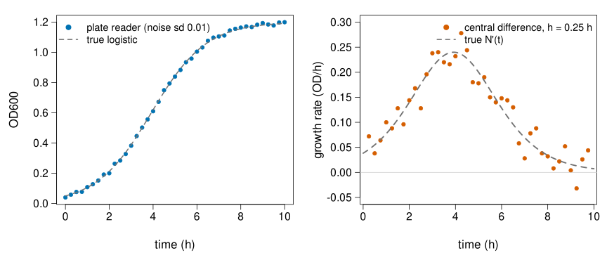
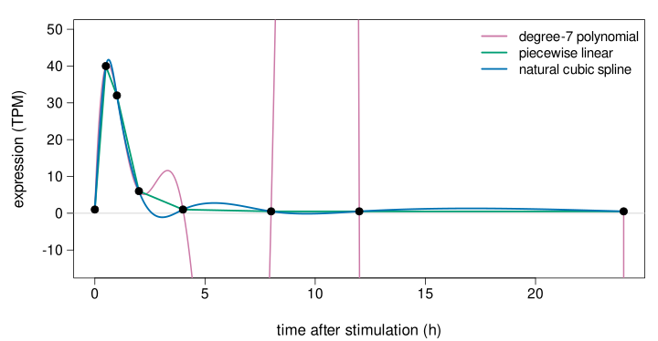
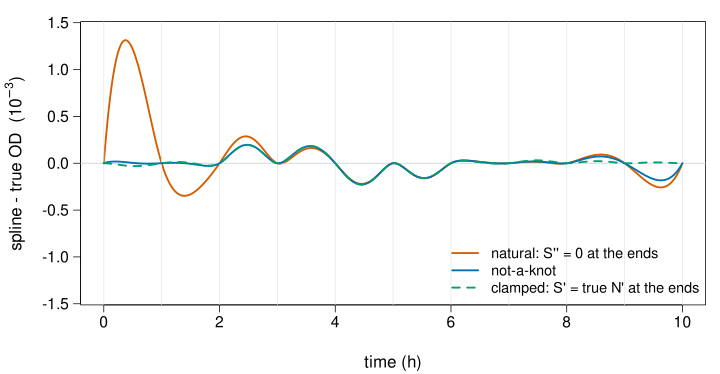
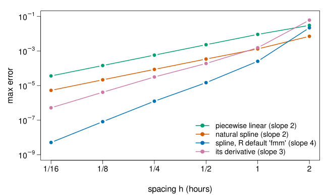
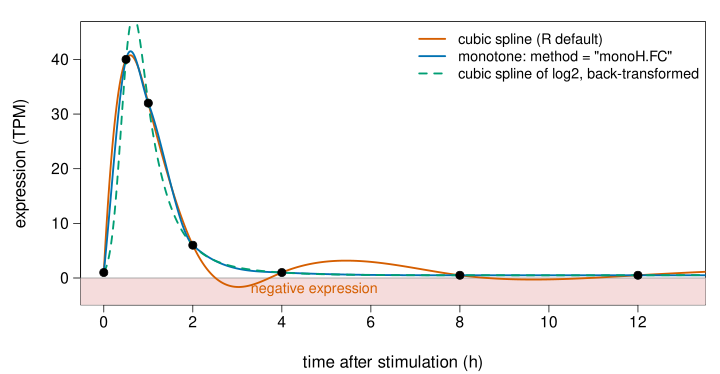
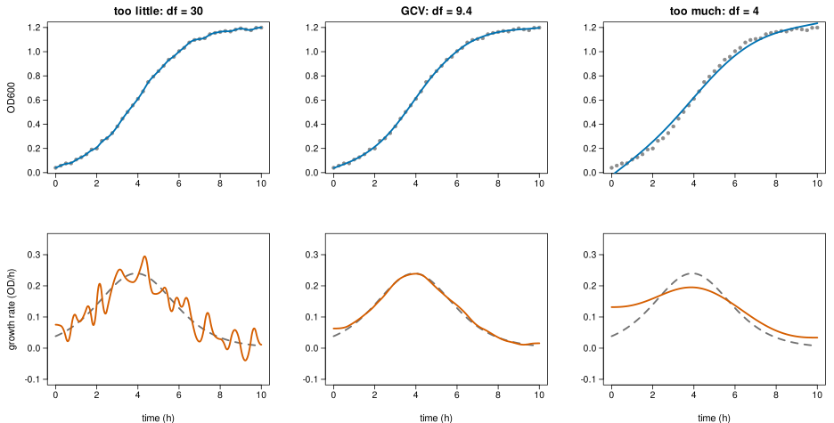
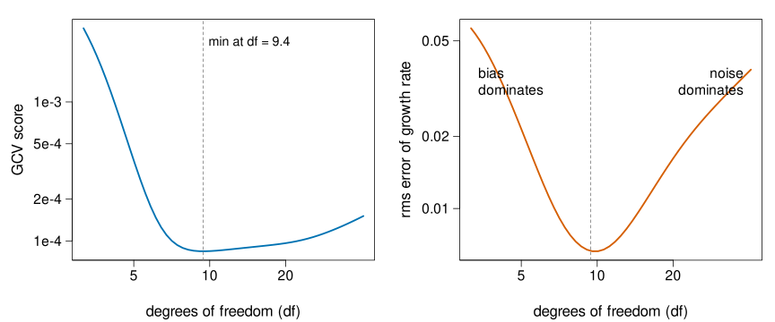
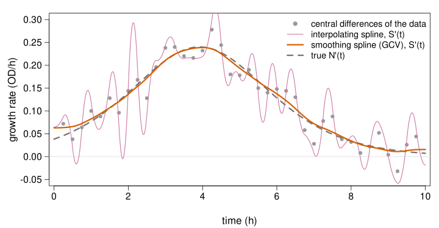
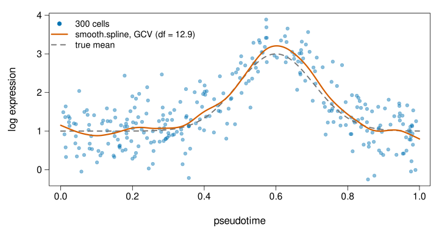
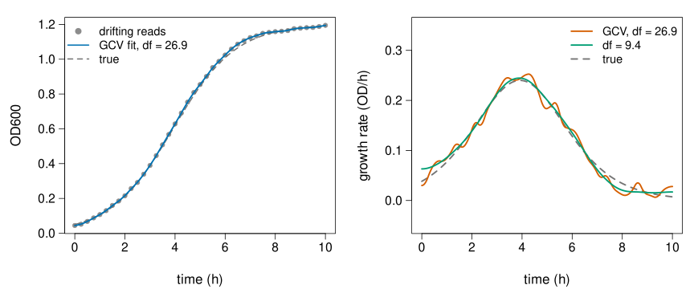

## About this lecture

One polynomial through many points wiggles ([*Polynomial interpolation*](../polynomial-interpolation/lec.qmd)). The cure is to use **many small pieces**, joined smoothly.

- **Piecewise linear**: join the dots. Simple, safe, error $O(h^2)$, but the slope jumps at every point.
- **Cubic splines**: a cubic on each interval, with value, slope and curvature continuous. Finding them means solving a **tridiagonal** system, $O(n)$.
- **Boundary conditions** (natural, not-a-knot, clamped) decide the two missing equations, and R and Python use different defaults.
- **Smoothing splines** do not pass through noisy data. A penalty $\lambda$ trades **bias** against **noise**; GCV chooses $\lambda$ from the data.
- Biology: a gene's expression along a **time course** or **pseudotime**; the **growth rate** as the slope of a smoothed OD curve.

::: notes
This is the practical interpolation unit: splines are what interp1, splinefun, CubicSpline, geom_smooth, and pseudotime trend fitting in single-cell packages use. The previous unit showed why one high-degree polynomial is a bad idea; here we go local. The second half moves from interpolation (pass through the points) to smoothing (do not), which is what you need with real, noisy measurements. The running example is the logistic OD curve from Convergence and cost, now with measurement noise.
:::

## A biology problem first {.smaller}

A plate reader measures OD every 15 min. We want the **growth rate** $N'(t)$, e.g. its maximum.

{width="88%" fig-align="center"}

```r
cd <- (y[3:n] - y[1:(n - 2)]) / 0.5     # central differences, h = 0.25 h
range(cd)                                # true rate lies between 0.007 and 0.24
# [1] -0.032  0.278
```

The OD looks clean (noise sd 0.01), but its differences are noisy: a **negative** growth rate in stationary phase.

::: notes
Same logistic curve as in Convergence and cost: K = 1.2, N0 = 0.05, r = 0.8 per hour, now sampled every 15 minutes with plate-reader noise of sd 0.01, rounded to 3 decimals. In Convergence and cost the only noise was rounding, 1e-16, and the trouble started at h = 1e-8. Here the noise is 1e-2, so it starts at ordinary step sizes. The central difference divides a difference of two noisy numbers by 2h = 0.5: noise sd of the estimate is sqrt(2) * 0.01 / 0.5 = 0.028, about 12 % of the maximum rate. Making h smaller makes it worse, not better. Numerical differentiation (Part 7) treats the finite-difference side (wider stencils, Richardson) on its own simulated run of the same curve, read every 10 minutes with noise sd 0.005, and ends with the smoothing spline of this lecture; here we fit a smooth curve first and differentiate the curve.
:::

## Recap: one polynomial through all points

{width="72%" fig-align="center"}

- 8 time points after stimulation of an immediate-early gene. The **degree-7 polynomial** through them swings down to $-1.6\times10^5$ between the points.
- **Piecewise** methods only look at nearby points: a peak at 0.5 h does not disturb the curve at 12 h.

::: notes
Recap of Polynomial interpolation in one picture. The data: expression in TPM of a gene that spikes 30 minutes after stimulation and returns to baseline, sampled at uneven times, which is typical for time courses (dense early, sparse late). These are the same sampling times as the immediate-early gene of Polynomial interpolation (its exercise C7), but a sharper spike than the smooth fold-change curve used there (which reached -2241 instead of -1.6e5); we use measured-looking TPM values here because the overshoot of a cubic spline (later slide) only shows with a steep drop. The polynomial goes through every point but is useless in between, the Runge phenomenon on uneven points. Piecewise linear (green) and the cubic spline (blue) stay near the data. Note the blue curve dips below zero near 3 hours; that is a failure we come back to.
:::

## Piecewise linear interpolation {.smaller}

On $[x_i, x_{i+1}]$, with $h = x_{i+1} - x_i$, draw the straight line:
$$p(x) = y_i + \frac{y_{i+1} - y_i}{h}\,(x - x_i), \qquad |f(x) - p(x)| \le \frac{h^2}{8}\max |f''|$$

```r
K <- 1.2; N0 <- 0.05; r <- 0.8
od <- function(t) K / (1 + (K / N0 - 1) * exp(-r * t))
approx(c(2, 3), od(c(2, 3)), xout = 2.5)$y      # line between t = 2 and t = 3
# [1] 0.3007089
od(2.5)                                          # true value
# [1] 0.2917783
```

- Error $0.0089$. Bound: $h = 1$, $\max|N''| = 0.0739$ on $[2, 3]$, so $\tfrac18 \cdot 0.0739 = 0.0092$. Halve $h$ → error $\div 4$: **order 2**.
- [`approx`](https://stat.ethz.ch/R-manual/R-devel/library/stats/html/approxfun.html) never overshoots: $p$ always stays between neighbouring data values.
- But the **slope jumps** at every data point. The derivative of a piecewise linear curve is a staircase.

::: notes
The bound comes from the same Taylor argument as the polynomial interpolation error with two points: (x - x_i)(x - x_{i+1}) f''/2, and the product is largest, h^2/4, in the middle. Here the bound is nearly reached because N'' is close to its maximum on this interval. Piecewise linear is the right default when you only need values and cannot afford surprises: it is what approx, np.interp, and plotting with lines do. But for a growth rate we need the slope, and the slope of a piecewise linear interpolant is just the forward difference on each interval: we are back to finite differences.
:::

## Cubic splines: what we ask for {.smaller}

A **cubic spline** $S$ through $(x_1, y_1), \dots, (x_n, y_n)$: on each of the $n - 1$ intervals a cubic, such that

- $S(x_i) = y_i$ (passes through the data),
- $S$, $S'$ and $S''$ are **continuous** at the interior points $x_2, \dots, x_{n-1}$ (no kinks, no jumps in curvature).

**Counting.** $n - 1$ cubics × 4 coefficients $= 4n - 4$ unknowns.

| condition | number |
|---|---|
| each cubic hits both its end points | $2(n-1)$ |
| $S'$ continuous at interior points | $n - 2$ |
| $S''$ continuous at interior points | $n - 2$ |
| **total** | $4n - 6$ |

**Two conditions are missing.** They come from the ends: the **boundary conditions**.

::: notes
A cubic is the lowest degree that can match value, slope and curvature on both sides. The name comes from the draughtsman's spline: a thin flexible strip held by weights at the data points. A strip bends to minimise its bending energy, roughly the integral of the curvature squared, and the natural cubic spline is exactly the curve that minimises the integral of S'' squared among all smooth curves through the points. That fact comes back with smoothing splines. The two missing conditions are a free choice; different choices give different splines, different near the ends.
:::

## Unknowns: the curvatures $M_i = S''(x_i)$ {.smaller}

$S''$ is linear on each interval (a cubic has a linear second derivative). With $A = \dfrac{x_{i+1} - x}{h_i}$, $B = \dfrac{x - x_i}{h_i}$, $h_i = x_{i+1} - x_i$:

$$S(x) = A\,y_i + B\,y_{i+1} + \frac{h_i^2}{6}\Big[(A^3 - A)\,M_i + (B^3 - B)\,M_{i+1}\Big]$$

- At $x_i$: $A = 1, B = 0$, the bracket is 0, so $S = y_i$. Values and $S''$ are continuous **by construction**.
- If all $M_i = 0$ this is piecewise linear: the bracket is the **curvature correction**.
- Only the continuity of $S'$ is left to impose: one equation per interior point.

::: notes
This is the standard trick (as in Numerical Recipes): choose unknowns that make most conditions automatic. Interpolation and continuity of S'' are built in, so only n - 2 slope conditions remain, plus two end conditions: n equations for the n values M_i. A and B are the weights of linear interpolation; they go from 1 to 0 and 0 to 1 across the interval. Students do not need to derive the formula; they need to see that it passes through the points and that M_i is its second derivative there.
:::

## Continuous slope → a tridiagonal system {.smaller}

Setting $S'$ from the left equal to $S'$ from the right at each interior $x_i$ gives

$$h_{i-1}\,M_{i-1} + 2(h_{i-1} + h_i)\,M_i + h_i\,M_{i+1} = 6\left(\frac{y_{i+1} - y_i}{h_i} - \frac{y_i - y_{i-1}}{h_{i-1}}\right)$$

Each equation involves only **three neighbours**. Example: 4 points $(0,0), (1,1), (2,0), (3,1)$, $h = 1$, **natural** ends $M_1 = M_4 = 0$:

$$\begin{pmatrix} 4 & 1 \\ 1 & 4 \end{pmatrix}\begin{pmatrix} M_2 \\ M_3\end{pmatrix} = \begin{pmatrix} 6(-1 - 1) \\ 6(1 + 1)\end{pmatrix} = \begin{pmatrix} -12 \\ 12\end{pmatrix} \quad\Rightarrow\quad M_2 = -4,\; M_3 = 4$$

- **Tridiagonal**, symmetric, and **strictly diagonally dominant**: $2(h_{i-1} + h_i) > h_{i-1} + h_i$.
- So the Thomas algorithm from [*Structure: symmetric, banded, sparse*](../structured-sparse/lec.qmd) solves it in $O(n)$, with no pivoting needed.

::: notes
The right-hand side is 6 times the change in slope of the data at x_i: a second difference. Where the data bend down (point 2) the curvature M is negative; where they bend up, positive. By hand: subtract a quarter of row 1 from row 2: 3.75 M3 = 12 + 3 = 15, M3 = 4, then M2 = (-12 - 4)/4 = -4. That is the Thomas forward sweep and back substitution. Diagonal dominance holds for any spacing, which is why spline codes never pivot. For a million points the solve takes milliseconds.
:::

## A natural spline in R {.smaller}

```r
natural_M <- function(x, y) {                # second derivatives, M_1 = M_n = 0
  n <- length(x); h <- diff(x); s <- diff(y) / h
  hl <- h[-(n - 1)]; hr <- h[-1]             # h_{i-1} and h_i, i = 2..n-1
  c(0, thomas(hl, 2 * (hl + hr), hr, 6 * diff(s)), 0)
}
spline_eval <- function(x, y, M, t) {
  i <- findInterval(t, x, all.inside = TRUE) # which interval is t in?
  h <- x[i + 1] - x[i]; A <- (x[i + 1] - t) / h; B <- (t - x[i]) / h
  A * y[i] + B * y[i + 1] + ((A^3 - A) * M[i] + (B^3 - B) * M[i + 1]) * h^2 / 6
}
natural_M(c(0, 1, 2, 3), c(0, 1, 0, 1))
# [1]  0 -4  4  0
```

- `thomas(a, b, c, d)` is the function from [*Structure: symmetric, banded, sparse*](../structured-sparse/lec.qmd) (sub-, main, super-diagonal, right-hand side; all of length $n$, `a[1]` and `c[n]` unused).
- [`findInterval`](https://stat.ethz.ch/R-manual/R-devel/library/base/html/findInterval.html) finds the interval of each `t` by binary search.

::: notes
Eight lines plus Thomas. diff(s) is the change in slope, the right-hand side. thomas expects four vectors of the same length and ignores a[1] and c[n], so passing hl and hr directly works: the first entry of hl and the last of hr are not used. The exercise adds the derivative formula and the clamped variant. This is the "write it yourself first" step; next slide we compare with the library.
:::

## Check against the library {.smaller}

```r
M <- natural_M(t, y)                          # the 41 noisy OD reads
f <- splinefun(t, y, method = "natural")      # R's natural spline
tt <- seq(0, 10, by = 0.01)
max(abs(spline_eval(t, y, M, tt) - f(tt)))
# [1] 2.220446e-16
f(3.1); f(3.1, deriv = 1)                     # value and slope at 3.1 h
# [1] 0.4073834
# [1] 0.2608974
```

- [`splinefun`](https://stat.ethz.ch/R-manual/R-devel/library/stats/html/splinefun.html) returns a **function**; `deriv = 1, 2, 3` gives the derivatives of the spline.
- Agreement to rounding level: our 8 lines and R's compiled code solve the same tridiagonal system.
- **Check** for your own spline: it passes through the data, and $S'$ from the left equals $S'$ from the right at every $x_i$.

::: notes
splinefun is the function-returning version; spline() returns points on a grid. Note the slope: 0.261 OD per hour at 3.1 h, but the true growth rate there is 0.216. The spline is exact in its arithmetic and still gives a poor slope, because it goes through every noisy point. Keep that in mind; we come back to it after the boundary conditions.
:::

## Boundary conditions: the two missing equations {.smaller}

| name | condition at each end | when to use |
|---|---|---|
| **natural** | $S'' = 0$: $M_1 = M_n = 0$ | no information about the ends |
| **clamped** | $S'$ = a known slope, $f'(x_1)$, $f'(x_n)$ | slope known (e.g. a plateau: $S' = 0$) |
| **not-a-knot** | $S'''$ continuous at $x_2$ and $x_{n-1}$ | default in Python and MATLAB |

- Clamped, left end: $2h_1 M_1 + h_1 M_2 = 6\left(\frac{y_2 - y_1}{h_1} - f'(x_1)\right)$. Still tridiagonal.
- Not-a-knot: the first two pieces are **one** cubic. The system is no longer exactly tridiagonal, but still $O(n)$.
- R's default, `method = "fmm"` (Forsythe, Malcolm, Moler), fits a cubic to the first and last 4 points and matches its $S'''$ at each end.

::: notes
Natural is the free end of the draughtsman's strip: no bending at the ends. It is correct only if the true function has zero curvature at the ends, which is rarely the case. Clamped is best when you really know the slope, and wrong when you guess it: setting S' = 0 at the start of a growth curve that is already growing makes things worse, the exercise shows it. Not-a-knot and fmm both use the data near the end to guess the end behaviour; they give fourth-order accuracy everywhere. R has no clamped option in splinefun; pracma::cubicspline(endp2nd = TRUE, der = ...) does it, or modify the first and last rows of your own system.
:::

## Boundary conditions: what they change

{width="78%" fig-align="center"}

- 11 exact OD values, $h = 1$ h. Away from the ends all three agree.
- **Natural** forces $S''(0) = 0$, but $N''(0) = 0.028$: the error near $t = 0$ is about 4× larger than anywhere else.

::: notes
The error curves are spline minus the true logistic. The interior error has the same shape for all three, because the influence of an end condition decays by a factor of about 3.7 per interval (the ratio of the diagonal to the off-diagonal in the tridiagonal system). Only the first one or two intervals see the difference. Clamped with the true slopes, and not-a-knot, are both accurate at the ends. If what you care about is the start of the growth curve (the lag phase), the boundary condition matters.
:::

## Same data, different defaults {.smaller}

```r
x <- 0:4; y5 <- c(0, 1, 0, 1, 0)
splinefun(x, y5)(0.5)                        # R default: "fmm"
# [1] 1.055556
splinefun(x, y5, method = "natural")(0.5)
# [1] 0.7678571
```

| call | end condition | value at 0.5 |
|---|---|---|
| R `splinefun(x, y)`, `spline()` | fmm | 1.0556 |
| R `splinefun(x, y, method = "natural")` | natural | 0.7679 |
| Python `CubicSpline(x, y)` | not-a-knot | 1.1250 |
| Python `CubicSpline(x, y, bc_type="natural")` | natural | 0.7679 |

**Check:** when an R and a Python result differ near the ends, look at the end conditions first.

::: notes
Wildly oscillating data exaggerate the difference, but the point holds: three defaults, three answers in the first interval, all "correct". In the interior they agree closely. When porting an analysis from MATLAB or Python to R, or comparing with a colleague's numbers, check the end condition. scipy.interpolate.CubicSpline takes bc_type = "natural", "not-a-knot", "clamped" (slope 0), or explicit ((1, slope_left), (1, slope_right)).
:::

## How fast does the error fall?

{width="68%" fig-align="center"}

- Exact OD values on a grid of spacing $h$. Slopes read off as in [*Convergence and cost*](../convergence-cost/lec.qmd): linear $O(h^2)$, cubic spline $O(h^4)$, its derivative $O(h^3)$.
- **Natural** ends drop the spline to $O(h^2)$: the error at $t = 0$ dominates.

::: notes
Halving h: piecewise linear error divides by 4, the fmm spline by 16, the spline's slope by 8. For smooth data a cubic spline with good end conditions is very accurate: at h = 0.25 h (a 15-minute plate reader), the error is 1e-6 OD, far below any measurement noise. The natural spline has the right slope (4) in the interior but the end error is O(h^2) because it imposes a wrong curvature there; its constant is small here because N''(0) is small. This is the error plot every method in the course gets. It assumes exact data. With noisy data, the error does not go to zero as h shrinks, as the next slides show.
:::

## Failure: overshoot {.smaller}

{width="70%" fig-align="center"}

- After a steep drop the cubic **swings below** the data: $-1.6$ TPM at 3 h. Negative expression.
- **Fixes:** a **monotone** interpolant ([`splinefun(method = "monoH.FC")`](https://stat.ethz.ch/R-manual/R-devel/library/stats/html/splinefun.html), Python `PchipInterpolator`), or interpolate $\log_2$ expression and transform back.
- **Check:** plot the interpolant on a fine grid; look for values outside the range of neighbouring data.

::: notes
Continuity of S'' is a strong requirement: a curve that comes down steeply and must flatten out with continuous curvature has to swing past. Piecewise linear never overshoots. A monotone cubic (Fritsch-Carlson in R's monoH.FC, Fritsch-Butland in PCHIP) chooses the slopes at the data points so that each piece stays between its two values; it gives up continuity of S''. Interpolating on the log scale guarantees positive values but can overshoot the peak upwards, here to 48 TPM instead of 40. There is no free lunch: decide which property matters (positivity, monotonicity, smoothness) and check it.
:::

## Interpolating noisy data {.smaller}

An interpolating spline goes through **every** point, noise included.

```r
rms <- function(e) sqrt(mean(e^2))
rate <- function(t) r * od(t) * (1 - od(t) / K)     # true growth rate
rms(cd - rate(t[2:(n - 1)]))                       # central differences
# [1] 0.02427257
f <- splinefun(t, y, method = "natural")
rms(f(t, deriv = 1) - rate(t))                     # slope of interpolating spline
# [1] 0.03827564
```

- The spline's slope is **worse** than plain central differences: it bends to hit every noisy point.
- With exact data the spline was accurate to $10^{-6}$; with noise sd 0.01 it is wrong by 0.04. More points (smaller $h$) do not help.

::: notes
This is the same lesson as in Convergence and cost: dividing differences of noisy numbers by small numbers amplifies noise. There the noise was rounding, 1e-16; here it is the plate reader, 1e-2. The O(h^4) convergence of the previous slide is about the truncation error of the method; it says nothing about noise. To get a good slope we must give up passing through the data.
:::

## Smoothing splines {.smaller}

Among **all** smooth curves $f$, choose the one that minimises

$$\underbrace{\sum_{i=1}^n \big(y_i - f(t_i)\big)^2}_{\text{misfit}} \;+\; \lambda \underbrace{\int \big(f''(t)\big)^2\,dt}_{\text{roughness}}$$

- $\lambda = 0$: only the misfit counts → the **interpolating** natural spline.
- $\lambda \to \infty$: no curvature allowed → the **least-squares straight line**.
- The minimiser is always a **natural cubic spline** with knots at the data points. Finding it is a **banded** linear system ($O(n)$, as before).
- R: [`smooth.spline`](https://stat.ethz.ch/R-manual/R-devel/library/stats/html/smooth.spline.html); Python: `scipy.interpolate.make_smoothing_spline`.

::: notes
Penalised least squares: a misfit term as in Least squares: normal equations vs QR, plus a penalty on roughness. This is the same idea as ridge regularisation in The SVD, rank deficiency and regularisation, with the penalty on curvature instead of on coefficient size. The surprising theorem (Reinsch 1967) is that the best curve is a natural cubic spline, so the infinite-dimensional problem becomes a linear system for n values. In the Reinsch form it is pentadiagonal, (R + lambda Q^T Q) gamma = Q^T y, with R tridiagonal and Q with three non-zeros per column. The exercise builds it in Rust. Units: lambda has units of (OD)^2 times hours^3, so its size depends on the units of t; R rescales t to [0, 1] internally, Python does not, so Python's lam = R's lambda times (range of t)^3.
:::

## The bias–noise trade-off

{width="92%" fig-align="center"}

- **Small $\lambda$** (df = 30): follows the noise; the slope is useless. **Large $\lambda$** (df = 4): too stiff; it cuts the peak growth rate (**bias**).
- **df** (equivalent degrees of freedom): from 2 (a line) to $n$ (interpolation). Easier to read than $\lambda$.

::: notes
Top row: the fitted OD curves; bottom row: their derivatives against the true growth rate (dashed). On the OD scale all three look acceptable, which is why you must look at the quantity you actually want. Too little smoothing: variance (noise) dominates. Too much: bias dominates, the peak rate is flattened and moved, and the start and end are wrong. df is the trace of the hat matrix, the matrix that maps data y to fitted values; for a regression with p parameters it equals p. It is the number you should report with a smoothing spline fit.
:::

## Choosing $\lambda$: cross-validation and GCV {.smaller}

**Leave-one-out CV:** leave point $i$ out, fit, predict $y_i$; minimise the mean squared prediction error. For a smoother with **hat matrix** $A$ ($\hat{\mathbf y} = A\mathbf y$) no refit is needed:
$$\text{CV}(\lambda) = \frac1n \sum_i \left(\frac{y_i - \hat y_i}{1 - A_{ii}}\right)^2, \qquad \text{GCV}(\lambda) = \frac{n\,\text{RSS}}{(n - \text{df})^2}, \quad \text{df} = \operatorname{tr} A$$

```r
fit <- smooth.spline(t, y)                    # lambda chosen by GCV (default)
fit
# Smoothing Parameter  spar= 0.565132  lambda= 0.0001355283 (14 iterations)
# Equivalent Degrees of Freedom (Df): 9.416379
# Penalized Criterion (RSS): 0.002053709
# GCV: 8.4411e-05
```

- GCV replaces each $A_{ii}$ by the average $\text{df}/n$: cheaper, and less sensitive to single points. `cv = TRUE` gives ordinary CV (df = 9.8 here).

::: notes
The idea: a good lambda predicts data you have not used. Leave-one-out needs n refits in principle, but for any linear smoother the left-out residual is the ordinary residual divided by 1 - A_ii, so one fit suffices. GCV (Craven and Wahba 1979) averages the leverages. Check the GCV formula on the output: 41 * 0.002054 / (41 - 9.416)^2 = 8.44e-5. Python's make_smoothing_spline(t, y) with lam = None also uses GCV and gives the same curve. smooth.spline searches over spar, a log-scale reparametrisation of lambda, with a one-dimensional optimiser (as in Optimisation in one dimension).
:::

## GCV against the true error

{width="92%" fig-align="center"}

- Left: GCV score over a grid of $\lambda$ (shown as df). Right: the **true** rms error of the growth rate, which we know only because the data are simulated.
- The GCV minimum (df = 9.4) is near the best df for the slope. That is luck as much as design: GCV optimises the **curve**, not its derivative.

::: notes
Right panel is the bias-noise trade-off as a curve: error falls as df rises from 3 (bias shrinks), then rises again (noise). The bottom of the U is where the two are balanced. GCV is flat over a range of df, which is typical: any df from about 8 to 14 gives a similar fit. For derivatives, the theory says slightly more smoothing than the GCV choice is often better, because differentiation amplifies the noise more than the bias. Report the df you used, and try a few values around it to see that your conclusions do not depend on it.
:::

## Spline lab: interpolate or smooth

```{=html}
<link rel="stylesheet" href="../demos/dist/demo.css">
<div data-demo="splinelab" data-set="gene"></div>
<script src="../demos/dist/splinelab.js"></script>
```

::: notes
Everything is computed live: natural and not-a-knot splines by a Thomas solve, PCHIP, the polynomial through all points, and the smoothing spline by the Reinsch system with GCV. Start with the gene time course: the polynomial (purple) dives off the plot; the natural spline is -1.08 at the probe (3 h), min -1.10. Tick not-a-knot (-1.73) and monotone (stays at 0.5 and above). Then OD, 11 exact values: untick not-a-knot, tick polynomial, panel (b) "change", press + once on the point at t = 5. The spline's change falls by about 4 per interval on the log axis, the polynomial's change is largest at the ends (0.25 at t = 0.5, five times the move). Then OD, 41 noisy reads, panel (b) "slope": the interpolating spline's slope jumps around (max 0.33), the smoothing spline at GCV (df 9.4) peaks at 0.239 at 4.0 h, close to the true 0.24. Drag the lambda slider left (df 38: rough) and right (df 2.6: stiff, peak rate cut to 0.16). If time: pseudotime, push the cell at 0.6 up by 1 and press GCV again: df jumps from 9.4 to 26, GCV chases one outlier.
:::

## Growth rate from the smoothed curve {.smaller}

{width="56%" fig-align="center"}

```r
g <- predict(fit, tf, deriv = 1)$y            # tf: fine grid, 0 to 10 h
c(max(g), tf[which.max(g)])                   # true: 0.24 at 3.92 h
# [1] 0.2388003 4.0100000
```

- RMS error of the growth rate: central differences 0.024, interpolating spline 0.038, **smoothing spline 0.0067**.
- [*Numerical differentiation*](../finite-differences/lec.qmd) repeats this on a denser, less noisy run (every 10 min, sd 0.005): smoothing spline rms 0.0047, a wider difference stencil 0.0053.

::: notes
predict.smooth.spline with deriv = 1 returns the slope of the fitted spline. The maximum growth rate is estimated within 0.5 % and its time within 6 minutes. Note the ends: the smoothing spline is natural, so S'' = 0 at both ends, which biases the slope near t = 0 and t = 10 (visible at the left end). If you have a model, for example the logistic, fitting it directly uses that knowledge and does better (Numerical differentiation fits the logistic to its plate-reader data by maximum likelihood; Nonlinear least squares and ODE fitting, Part 10, treats such fits in general, on a drug-concentration model); a smoothing spline is what you use when you do not want to assume a model.
:::

## Biology: expression along pseudotime

{width="66%" fig-align="center"}

- 300 cells, ordered by **pseudotime**; one gene, noisy. `smooth.spline(pt, ex)`: df = 12.9; peak at pseudotime 0.602 (true 0.6).
- Same tool as the trend fits in single-cell trajectory packages (tradeSeq, Monocle), which fit a spline trend per gene.

::: notes
Pseudotime orders cells along a differentiation trajectory; each gene is a noisy function of pseudotime, with many cells but large cell-to-cell noise. Smoothing splines (or regression splines with fewer knots) are the standard way to get a trend, find where a gene peaks, or test whether it changes along the trajectory. With thousands of cells, smooth.spline uses fewer knots than data points (nknots) to keep the system small; the trade-off is the same. The exercise does this with 40 cells and compares GCV with leave-one-out CV.
:::

## Failure: GCV with correlated noise {.smaller}

{width="84%" fig-align="center"}

- Here the reads **drift** (each error is 0.9 × the previous one plus new noise, as with condensation or settling cells). GCV sees the drift as signal: df = 26.9, a wiggly slope.
- GCV assumes **independent** errors. **Check:** lag-1 correlation of the residuals (`acf`); here $-0.60$. Use replicate wells, or fix df by hand.

::: notes
Correlated errors are common in time series: one well measured repeatedly, or neighbouring cells in pseudotime sharing a batch. GCV cannot tell slow noise from signal, so it undersmooths. The residual check: strongly negative lag-1 correlation means the fit follows the noise (here -0.60; for the GCV fit to the independent-noise OD data of the earlier slides it is -0.19); strongly positive means runs of residuals with the same sign, i.e. bias from oversmoothing. For a real experiment the best check is biological replicates: a smoothing parameter that gives growth rates that differ between replicate wells by more than their noise is too small.
:::

## R and Python {.smaller}

| task | R | Python (scipy) |
|---|---|---|
| piecewise linear | `approx`, `approxfun` | `np.interp` |
| cubic spline | `splinefun(x, y)` (fmm), `method = "natural"` | `CubicSpline(x, y)` (not-a-knot), `bc_type=` |
| clamped | `pracma::cubicspline(endp2nd = TRUE, der =)` | `CubicSpline(bc_type=((1, a), (1, b)))` |
| monotone | `splinefun(method = "monoH.FC")` | `PchipInterpolator` |
| derivative | `f(t, deriv = 1)` | `cs(t, 1)`, `cs.derivative()` |
| smoothing spline | `smooth.spline(x, y)`; `df =`, `lambda =`, `cv = TRUE` | `make_smoothing_spline(x, y, lam=None)` |
| its slope | `predict(fit, t, deriv = 1)` | `fit.derivative()(t)` |

Python's `lam` = R's `lambda` × (range of $x$)$^3$, because R rescales $x$ to $[0, 1]$.

::: notes
The exercise page has every task in R, Python and Rust. In Rust the spline and smoothing spline are hand-written: the tridiagonal solve for the interpolating spline, and a small dense solve with nalgebra for the smoothing spline. Avoid scipy.interpolate.UnivariateSpline with its default s: its smoothing parameter s is a bound on the residual sum of squares, not lambda, and the default depends on assumed weights; it is a frequent source of over- or under-smoothing.
:::

## Checklist

- **Plot on a fine grid**, not only at the data points: overshoot and wiggles hide between them.
- **Values outside the data range** (negative expression, OD above the plateau) → monotone interpolant or a log scale.
- **R and Python disagree near the ends** → compare the end conditions (fmm, not-a-knot, natural).
- **Need a slope from noisy data** → smoothing spline, not interpolation, not raw differences.
- **Report df** (or $\lambda$ and the units of $t$) with every smoothing spline.
- **Check the residuals**: independent-looking noise, no runs, no strong lag-1 correlation.
- **Change df by ±30 %**: conclusions that depend on it are not supported by the data.

::: notes
The list to keep next to the keyboard. The first item catches most interpolation problems. The last item is the sensitivity analysis every smoothing result should come with.
:::

## Summary {.smaller}

- **Piecewise linear**: safe, $O(h^2)$, no overshoot, but a staircase slope.
- **Cubic spline**: cubics with continuous $S, S', S''$. The curvatures $M_i$ solve a **tridiagonal, diagonally dominant** system, $O(n)$ by Thomas. Error $O(h^4)$, slope $O(h^3)$.
- **Boundary conditions** supply the two missing equations: natural ($S'' = 0$, only $O(h^2)$ near the ends), clamped (known slope), not-a-knot / fmm. R and Python **defaults differ**.
- Cubics **overshoot** after steep changes; use a monotone interpolant or a log scale when the sign matters.
- With **noisy** data, interpolation and differences amplify the noise. A **smoothing spline** minimises misfit $+\ \lambda\,\int f''^2$; $\lambda$ trades **bias** against **noise**, chosen by **GCV/CV**; report **df**.
- Growth rate from OD: smoothing spline slope, rms error 0.007 against 0.024 for central differences.

**Next:** [*Fourier series and the FFT*](../fourier-fft/lec.qmd), a global basis of sines and cosines, for periodic signals such as circadian expression.

::: notes
Recap the three ideas: local pieces instead of one polynomial; a banded system makes it cheap; smoothing instead of interpolation when data are noisy. Numerical differentiation (Part 7) returns to the noise amplification of finite differences from the other side. Fourier series are the other classic approximation: global, like polynomials, but well behaved for periodic data, and also a way to smooth a noisy trace by dropping high frequencies.
:::
