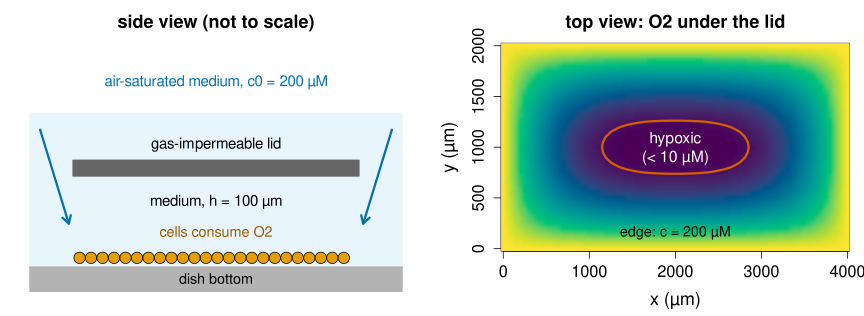
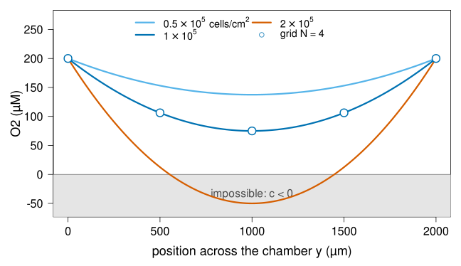
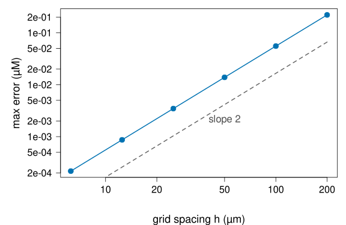
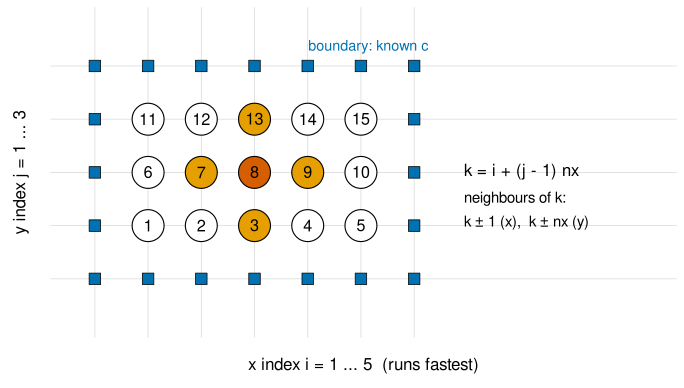
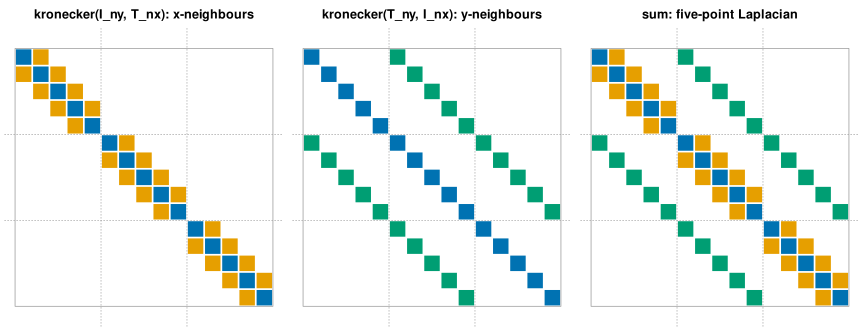
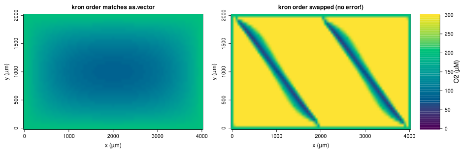
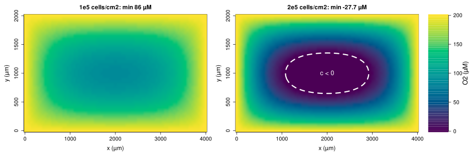
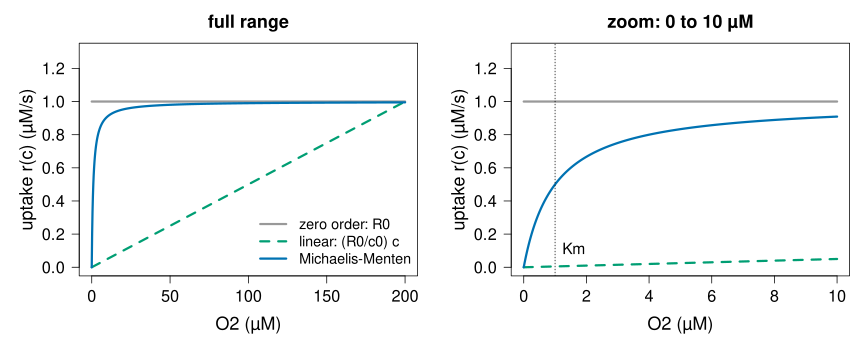
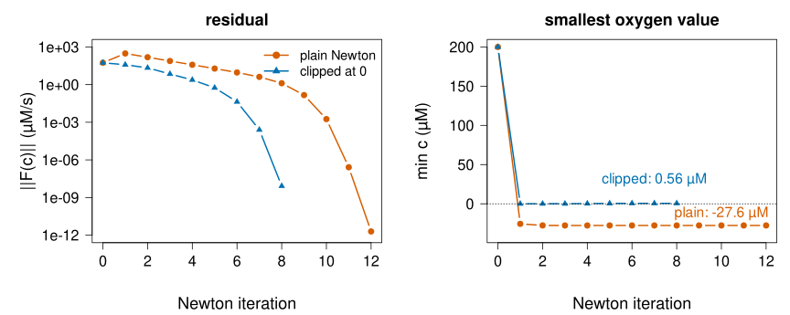
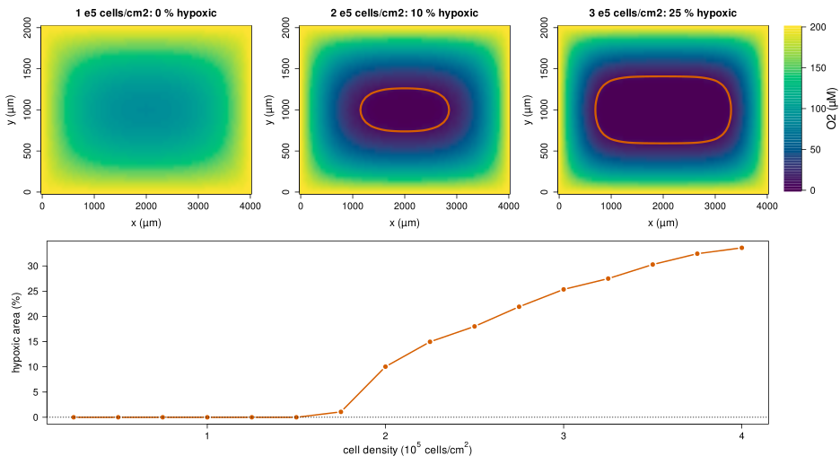

## About this lecture {.smaller}

The last two units followed a concentration in **time** until it settled. Often only the settled state matters: where does the oxygen end up once supply and consumption balance? Then time drops out, and what is left is **one large linear (or nonlinear) system**.

- Steady diffusion with sources and sinks is a **boundary value problem**: $D\,\nabla^2 c = r(c)$ (Poisson; Laplace if $r = 0$). No initial condition, only boundary conditions.
- **1D first**: the $(-1, 2, -1)$ stencil gives a tridiagonal system, solved in $O(n)$.
- **2D**: the **five-point Laplacian**, assembled from 1D pieces with **Kronecker products**, and solved with a **sparse direct solver**.
- **Numbering the grid**: R is column-major, numpy row-major. Get the order wrong and the answer is wrong, with no error message.
- **Nonlinear uptake** (Michaelis–Menten): **Newton**, with Jacobian = Laplacian + a diagonal.
- Biology: **oxygen under a lid** over a cell layer. Where do the cells go hypoxic, and at what cell density?

::: notes
This is the third unit of Part 10. The pieces are all old: the second-difference stencil ([*The diffusion (heat) equation by finite differences*](../diffusion-explicit/lec.qmd)), tridiagonal and sparse solves with fill-in ([*Structure: symmetric, banded, sparse*](../structured-sparse/lec.qmd)), and Newton with a Jacobian ([*Newton for systems of equations*](../newton-systems/lec.qmd)). New today: going from one to two space dimensions, which means turning a 2D grid into one vector, and doing that consistently. Grid: nodes x_i = i h as in The diffusion (heat) equation by finite differences (h is its Δx; here the same h in x and y), unknowns at the interior nodes, a ghost point for a wall (exercise), and in 2D the numbering k = i + (j − 1) n_x. Two deliberate differences from the two earlier diffusion units: the matrix is written as minus the second difference, (D/h²) tridiag(−1, 2, −1) instead of tridiag(1, −2, 1), so that it is symmetric positive definite and Cholesky and CG apply; and oxygen is in µM rather than scaled to 0..1, because the hypoxia threshold and K_m are absolute concentrations. Units µm and s as before.
:::

## Biology: oxygen under a lid {.smaller}

{width="92%" fig-align="center"}

- Cells on the floor of a chamber with a **gas-impermeable lid**. Oxygen enters only from the open **edges** and diffuses inwards; every cell on the way **consumes** some [O1].
- Question: **where** do the cells go hypoxic, and how does that depend on **cell density**?

::: notes
The setting is a simplified version of devices in which cells' own respiration creates the oxygen gradient: a gas-impermeable barrier over a monolayer, with oxygen supplied from the side [O1]. A related approach supplies oxygen from below through a gas-permeable PDMS membrane [O2]. We did not rebuild a specific device: geometry and parameters here are our own round numbers, and every result is computed from the model, not measured (synthetic). Chamber 4 mm x 2 mm seen from above, lid 100 µm above the cells, edges open to air-saturated medium (about 200 µM O2 at 37 °C). The right panel is today's final answer for a dense layer: a hypoxic core. Check numbers against [O1, O2] before using them for anything real: our sources list was compiled from abstracts.
:::

## The model and its numbers {.smaller}

Depth-averaged over the 100 µm gap: oxygen $c(x, y)$ in µM obeys, at steady state,

$$D\left(\frac{\partial^2 c}{\partial x^2} + \frac{\partial^2 c}{\partial y^2}\right) = r(c), \qquad c = c_0 \text{ on the edges.}$$

| quantity | value | status |
|---|---|---|
| $D$ (O₂ in water, 37 °C) | $2\times10^{-9}$ m²/s $= 2000$ µm²/s | standard value |
| $c_0$ (air-saturated medium) | 200 µM | standard value |
| consumption per cell | 50 amol/s ($10$–$100$ is typical) | **order-of-magnitude assumption** |
| cell density $\rho$ | $10^5$ cells/cm² (about confluent) | varied, 0.25–4 × $10^5$ |
| $R_0$ = per cell × $\rho$ / gap | $0.5$ µM/s at $10^5$ cells/cm² | derived |

::: notes
The lid gap is thin compared with the chamber width (100 µm against 2 mm), so oxygen is nearly uniform over the height and we average over it: the cells' uptake per area becomes a volume rate R0 = q rho / h_gap. With q = 50 amol/s = 5e-17 mol/s, rho = 1e5 cells/cm^2 = 1e-3 cells per µm^2 and a 100 µm gap: 5e-20 mol/(s µm^2) / 100 µm = 5e-22 mol/(s µm^3); one µM is 1e-21 mol/µm^3, so R0 = 0.5 µM/s. Per-cell consumption varies by more than a factor 10 between cell types; treat it as an assumption to vary, not a constant. r(c) is the uptake rate; we will try three forms: constant, linear, Michaelis–Menten.
:::

## Recap: three tools you already have {.smaller}

:::: {.columns}
::: {.column width="33%"}
**Second difference** ([*The diffusion (heat) equation by finite differences*](../diffusion-explicit/lec.qmd))

$$\frac{c_{i-1} - 2c_i + c_{i+1}}{h^2} \approx c''(x_i)$$

error $O(h^2)$; boundary values are known numbers.
:::
::: {.column width="33%"}
**Sparse solves** ([*Structure: symmetric, banded, sparse*](../structured-sparse/lec.qmd))

- tridiagonal: $O(n)$ (Thomas)
- sparse: `Matrix::solve`
- 2D grid: some **fill-in** is unavoidable; a good ordering helps.
:::
::: {.column width="33%"}
**Newton** ([*Newton for systems of equations*](../newton-systems/lec.qmd))

$$J(\mathbf c)\,\boldsymbol\delta = -\mathbf F(\mathbf c), \quad \mathbf c \leftarrow \mathbf c + \boldsymbol\delta$$

quadratic convergence near a root; may find the **wrong** root.
:::
::::

::: notes
One slide only. In the diffusion units the stencil was combined with a time step; today there is no time. In Structure: symmetric, banded, sparse, the fill-in demo ended with a 2D grid: 30 x 30 points, A with 4380 non-zeros, the Cholesky factor 27 029 in natural order and 10 231 after reordering. That grid was the five-point Laplacian of today. From Newton for systems of equations: one linear solve per step, and the root found depends on the starting point (the toggle switch had three).
:::

## Steady state = a boundary value problem {.smaller}

Set $\partial c/\partial t = 0$ in the diffusion equation with uptake:

$$\underbrace{\frac{\partial c}{\partial t}}_{=\,0} = D\,\nabla^2 c - r(c) \quad\Longrightarrow\quad D\,\nabla^2 c = r(c), \qquad \nabla^2 c = \frac{\partial^2 c}{\partial x^2} + \frac{\partial^2 c}{\partial y^2}$$

- **Poisson equation** when $r$ does not depend on $c$; **Laplace equation** when $r = 0$.
- No initial condition. The **boundary conditions** alone fix the answer: fixed value (open edge) or no flux (wall).
- Could we just time-step until nothing changes? Explicit 2D with $h = 50$ µm needs $\Delta t \le h^2/(4D) = 0.31$ s, and settling takes $\sim L^2/D$: thousands of steps, $16\times$ more at $h/2$. A steady-state solve is **one** linear system.

::: notes
A boundary value problem (BVP) is the opposite of the initial value problems of Part 8: information comes from the edges, all at once, not from a starting time. The 2D stability limit for FTCS is D dt / h^2 <= 1/4 (twice as strict as in 1D, because each point has four neighbours; derived the same way as in [*The diffusion (heat) equation by finite differences*](../diffusion-explicit/lec.qmd)). Halving h divides dt by 4 and multiplies the number of points by 4, so the cost of time-stepping to steady state grows 16-fold. Implicit time steps ([*Implicit schemes and the method of lines*](../diffusion-implicit/lec.qmd)) would remove the step limit, but if you only want the end state, ask for it directly.
:::

## 1D first: one line across the chamber {.smaller}

A long chamber: only $y$ matters. Grid $y_i = i\,h$, $i = 0, \dots, N$ (nodes as in the 1D chamber, $h = \Delta x$), with $c_0 = c_N = 200$ µM known. At each interior point:

$$\frac{D}{h^2}\bigl(-c_{i-1} + 2c_i - c_{i+1}\bigr) = -R_0, \qquad i = 1, \dots, N-1.$$

By hand, $L = 2000$ µm, $N = 4$ ($h = 500$ µm, $D/h^2 = 0.008$ /s), $R_0 = 0.5$ µM/s. Move known values to the right:

$$\begin{pmatrix} 2 & -1 & 0 \\ -1 & 2 & -1 \\ 0 & -1 & 2 \end{pmatrix}\begin{pmatrix} c_1 \\ c_2 \\ c_3\end{pmatrix} = \begin{pmatrix} 200 - 62.5 \\ -62.5 \\ 200 - 62.5\end{pmatrix} \quad\Rightarrow\quad \mathbf c = (106.25,\ 75,\ 106.25).$$

::: notes
Sign convention: we write the operator as minus the second difference, so the matrix has a positive diagonal and is symmetric positive definite. The two earlier diffusion units wrote tridiag(1, −2, 1), the second difference itself, because there it sat on the right-hand side of an ODE; for a steady solve the minus sign is the natural choice, since Cholesky and CG need a positive definite matrix. It is the pattern of the morphogen row in [*Structure: symmetric, banded, sparse*](../structured-sparse/lec.qmd), without the decay term on the diagonal and with fixed values instead of closed ends. R0 / (D/h^2) = 0.5 / 0.008 = 62.5. Solve by symmetry: c1 = c3, so 2c1 - c2 = 137.5 and -2c1 + 2c2 = -62.5; adding gives c2 = 75, then c1 = 106.25. The known boundary values appear only in the first and last equations: they move to the right-hand side, which is where all the boundary information lives.
:::

## 1D in R {.smaller}

```r
library(Matrix)
lap1 <- function(n) bandSparse(n, k = -1:1,        # tridiag(-1, 2, -1)
  diagonals = list(rep(-1, n - 1), rep(2, n), rep(-1, n - 1)))
D <- 2000; c0 <- 200; R0 <- 0.5     # µm^2/s, µM, µM/s
L <- 2000; N <- 4; h <- L / N; n <- N - 1
A1 <- D / h^2 * lap1(n)
b1 <- rep(-R0, n); b1[c(1, n)] <- b1[c(1, n)] + D / h^2 * c0
as.vector(solve(A1, b1))
# [1] 106.25  75.00 106.25
y <- h * (1:n); c0 - R0 * y * (L - y) / (2 * D)    # exact parabola
# [1] 106.25  75.00 106.25
```

- Exact to the last digit, even with 3 points: the second difference is **exact for parabolas**, and constant uptake gives a parabola.
- [`bandSparse`](https://rdrr.io/cran/Matrix/man/bandSparse.html) + [`solve`](https://rdrr.io/cran/Matrix/man/solve-methods.html): the sparse solver finds the band itself ($O(n)$, as Thomas).

::: notes
The exact solution of D c'' = R0 with c = c0 at both ends is c0 - R0 y (L - y) / (2D): check by differentiating twice. The Taylor error term of the stencil involves the fourth derivative, which is zero for a parabola, so the grid solution is exact at the grid points for any h. That makes this a weak test of a solver: it cannot reveal the order. The next slides give a better test. The thomas function from [*Structure: symmetric, banded, sparse*](../structured-sparse/lec.qmd) would do the same job; we use Matrix because the 2D case needs it anyway.
:::

## Failure: oxygen below zero {.smaller}

{width="68%" fig-align="center"}

- Double the density ($R_0 = 1$ µM/s): $\mathbf c = (12.5,\ -50,\ 12.5)$. The solver is right; the **model** is wrong. Cells cannot consume oxygen that is not there.
- **Check:** `min(c) >= 0` for every concentration. Constant uptake is only valid while $c$ stays well above zero.

::: notes
The numerical method did its job perfectly (exact at the nodes, as on the previous slide). The failure is in the modelling assumption that every cell consumes at its maximal rate R0 regardless of how much oxygen is left. In reality uptake slows down as c approaches zero (Michaelis–Menten, later in this lecture). The depth of the dip is R0 L^2 / (8D): it grows linearly with density and with the square of the chamber width. Setting it equal to c0 gives the largest chamber that stays oxygenated under constant uptake: L = sqrt(8 D c0 / R0) = 2530 µm at 1e5 cells/cm^2.
:::

## Check a solver: exact solution and refinement {.smaller}

:::: {.columns}
::: {.column width="52%"}
{width="100%"}
:::
::: {.column width="48%"}
Test problem with a non-polynomial solution: **linear uptake** $r = k\,c$, $k = R_0/c_0 = 0.0025$ /s:

$$c(y) = c_0\,\frac{\cosh\bigl((y - L/2)/\lambda\bigr)}{\cosh\bigl(L/(2\lambda)\bigr)}, \quad \lambda = \sqrt{D/k} = 894 \text{ µm}.$$

- Add $k$ to the diagonal: `A1 + Diagonal(n, k)`.
- $h = 200 \to 6.25$ µm: max error $0.22 \to 2.2\times10^{-4}$ µM, **slope 2**.
:::
::::

::: notes
Linear (first-order) uptake keeps the system linear and has an exact solution: c'' = c / lambda^2 is solved by cosh, symmetric around the middle. lambda = sqrt(D/k) is the same length scale that appears for morphogens in [*Reaction–diffusion and pattern formation*](../reaction-diffusion/lec.qmd). The error halves twice per halving of h: second order, as the Taylor expansion of the stencil promises. When no exact solution exists (the usual case), refine the grid and watch the changes shrink by 4x: that is the check we use for the 2D oxygen map later.
:::

## Two dimensions: the five-point stencil {.smaller}

Grid $x_i = i\,h$, $y_j = j\,h$ (same $h$ in both directions). Add the two second differences:

$$\nabla^2 c\,(x_i, y_j) \approx \frac{c_{i-1,j} + c_{i+1,j} + c_{i,j-1} + c_{i,j+1} - 4\,c_{i,j}}{h^2}$$

{width="62%" fig-align="center"}

- Each equation links a point (red) to its **four** neighbours (orange). Neighbours on the edge (blue) are known.

::: notes
The five-point Laplacian: the 1D stencil in x plus the 1D stencil in y, with -2 - 2 = -4 in the middle. Its error is again O(h^2). The chamber of the running example is 4000 x 2000 µm; with h = 50 µm there are 79 x 39 = 3081 interior unknowns. The figure shows a toy grid with nx = 5, ny = 3 interior points, and the numbering we use for the rest of the lecture, explained on the next slide.
:::

## One vector from a grid {.smaller}

A solver wants a vector $\mathbf c$ of length $n_x n_y$. Number the points **row of the grid by row**, $x$ running fastest:

$$k = i + (j - 1)\,n_x \qquad (i = 1..n_x,\ j = 1..n_y)$$

- In the toy grid ($n_x = 5$): point $(3, 2)$ is $k = 8$. Its neighbours: $k \pm 1 = 7, 9$ in $x$, and $k \pm n_x = 3, 13$ in $y$.
- In R this is exactly what `as.vector(C)` does to a matrix `C[i, j]` with `nx` rows: R stores matrices **column by column** (column-major), so the first index runs fastest.
- So: keep the field as an $n_x \times n_y$ matrix `C[i, j]` $= c(x_i, y_j)$, and convert with `as.vector(C)` and `matrix(cvec, nx, ny)`.

::: notes
Any numbering works, as long as the matrix and every vector use the same one. This one is natural in R: as.vector stacks the columns of C, so C[1,1], C[2,1], ..., C[nx,1] come first (all x at the first y), then the second column. Neighbours in y are nx apart in the vector: this distance is the bandwidth of the matrix, and it is why the 2D matrix is banded but not tridiagonal. A 1-based formula; in 0-based languages (Python, Rust) it is k = i + j nx with i, j from 0.
:::

## The matrix has blocks {.smaller}

{width="95%" fig-align="center"}

- $x$-neighbours: the 1D matrix $T_{n_x}$ repeated along the diagonal, one block per $y$-row (orange).
- $y$-neighbours: $-1$ at distance $n_x$ from the diagonal (green). The diagonal (blue) gets $2 + 2 = 4$.

::: notes
Pattern of the toy matrix, 15 x 15, without the factor D / h^2. The dotted lines separate the three y-rows of the grid. Left: no coupling between rows, each row is a 1D problem in x. Middle: each point is coupled to the same x-position in the row above and below, a 1D problem in y for each x. Right: the sum, the five-point Laplacian, block tridiagonal. Its rows near the edge have fewer than four off-diagonal entries; the missing neighbours are boundary points and go into the right-hand side. The two pieces have a name: Kronecker products.
:::

## Kronecker products {.smaller}

$A \otimes B$: replace each entry $a_{pq}$ of $A$ by the block $a_{pq} B$. Size: $(m_A m_B) \times (n_A n_B)$.

```r
T3 <- matrix(c(2, -1, 0,  -1, 2, -1,  0, -1, 2), 3)
kronecker(diag(2), T3)              # I_2 (x) T_3: two copies of T_3
#      [,1] [,2] [,3] [,4] [,5] [,6]
# [1,]    2   -1    0    0    0    0
# [2,]   -1    2   -1    0    0    0
# [3,]    0   -1    2    0    0    0
# [4,]    0    0    0    2   -1    0
# [5,]    0    0    0   -1    2   -1
# [6,]    0    0    0    0   -1    2
```

- $I_{n_y} \otimes T_{n_x}$: the $x$-blocks (left panel). $T_{n_y} \otimes I_{n_x}$: each entry of $T_{n_y}$ becomes a multiple of $I_{n_x}$, so the $-1$s sit $n_x$ apart (middle panel).
- With $x$ running fastest: $\;A = \dfrac{D}{h^2}\bigl(I_{n_y} \otimes T_{n_x} + T_{n_y} \otimes I_{n_x}\bigr)$.

::: notes
[kronecker](https://stat.ethz.ch/R-manual/R-devel/library/base/html/kronecker.html) works on dense matrices in base R and on sparse ones with Matrix loaded (the result stays sparse). Python: scipy.sparse.kron; Rust: sprs has a kronecker product too, but in the exercise we build the triplets by hand, which makes the index formula explicit. The order of the two factors is tied to the numbering: the factor on the right acts on the index that runs fastest. With y running fastest (numpy's default, next slides) the formula becomes T_nx (x) I_ny + I_nx (x) T_ny.
:::

## Assembling the 2D matrix in R {.smaller}

```r
Lx <- 4000; Ly <- 2000; h <- 50            # chamber and grid, µm
nx <- Lx / h - 1; ny <- Ly / h - 1         # 79 x 39 interior points
A <- D / h^2 * (kronecker(Diagonal(ny), lap1(nx)) +    # x-neighbours
                kronecker(lap1(ny), Diagonal(nx)))     # y-neighbours
dim(A)
# [1] 3081 3081
nnzero(A)                                  # about 5 per row
# [1] 15169
isSymmetric(A)
# [1] TRUE
```

- Dense, this matrix would hold 9.5 million entries (76 MB); 99.8 % are zero.
- [`Diagonal`](https://rdrr.io/cran/Matrix/man/Diagonal.html) is the sparse identity. Never build the dense one at this size.

::: notes
15169 = 5 x 3081 minus the missing neighbours along the four edges (2 x 79 + 2 x 39 = 236): 15405 - 236 = 15169. Symmetric because the stencil is symmetric (my neighbour's coupling to me equals mine to it). The matrix is also positive definite, like its 1D parts, so Cholesky works. With h = 12.5 µm the chamber has 50 721 unknowns: 20 GB dense, about 3 MB sparse.
:::

## The edges go into the right-hand side {.smaller}

```r
B <- matrix(0, nx, ny)              # B[i, j] belongs to point (x_i, y_j)
B[1, ]  <- B[1, ]  + c0;  B[nx, ] <- B[nx, ] + c0      # left, right edge
B[, 1]  <- B[, 1]  + c0;  B[, ny] <- B[, ny] + c0      # bottom, top edge
b <- D / h^2 * as.vector(B)         # stacks columns: x runs fastest
R0 <- 0.5                           # 1e5 cells/cm^2
C <- matrix(as.vector(solve(A, b - R0)), nx, ny)
range(C)
# [1]  86.14604 198.58301
which(C == min(C), arr.ind = TRUE)  # the centre: x = 2000, y = 1000 µm
#      row col
# [1,]  40  20
```

- A **corner** point has two known neighbours, so it gets $c_0$ twice.
- Sources and sinks enter the same way: subtract the uptake (or add the production) in $\mathbf b$, point by point.

::: notes
Building b as a matrix with the same shape as the grid, then flattening with as.vector, is the safest way: the boundary rows and columns are visible in the code, and the flattening uses the same rule as the matrix. The uptake here is the same R0 everywhere, so subtracting a scalar is enough; a patterned cell layer (cells only in part of the chamber) would subtract a vector R0 * as.vector(cells). A point source (a single cell secreting something) adds its rate divided by the cell area h^2 at one k.
:::

## Check the assembly with a known field {.smaller}

```r
x <- h * (1:nx); y <- h * (1:ny)
U <- outer(sin(pi * x / Lx), sin(pi * y / Ly))      # 0 on all four edges
AU <- D * pi^2 * (1 / Lx^2 + 1 / Ly^2) * U          # exact -D * Laplacian
max(abs(as.vector(A %*% as.vector(U)) - as.vector(AU))) / max(AU)
# [1] 0.0004368497
```

- Small and $O(h^2)$: the matrix applies the Laplacian correctly. With the Kronecker factors in the **wrong order** the same check gives **253.9**.
- Use a field that differs in $x$ and $y$, on a grid with $n_x \ne n_y$. A square grid and a symmetric test field hide orientation bugs.

::: notes
A manufactured solution: pick a smooth function, compute its Laplacian by hand, and compare with A times its grid values. sin(pi x / Lx) sin(pi y / Ly) vanishes on the edges, so no boundary terms are needed, and its Laplacian is -pi^2 (1/Lx^2 + 1/Ly^2) times itself. The relative error 4.4e-4 is about (pi h)^2 / (12 L^2), the Taylor term. This check costs one matrix-vector product and catches most assembly bugs: wrong kronecker order, missing factor D / h^2, wrong sign, wrong grid spacing in one direction. A bug that swaps x and y on a square grid with a field symmetric in x and y is invisible, so test on a rectangle.
:::

## Pitfall: column-major vs row-major {.smaller}

{width="88%" fig-align="center"}

| | flatten `C` (shape $n_x \times n_y$) | runs fastest | matching matrix |
|---|---|---|---|
| R | `as.vector(C)` (column-major) | $i$ ($x$) | $I_{n_y} \otimes T_{n_x} + T_{n_y} \otimes I_{n_x}$ |
| numpy | `C.ravel()` (row-major, default) | $j$ ($y$) | $T_{n_x} \otimes I_{n_y} + I_{n_x} \otimes T_{n_y}$ |
| numpy | `C.ravel(order="F")` | $i$ ($x$) | same as R |

::: notes
Right panel: the same solve with the Kronecker factors in the order that matches numpy's default flattening, while b and the reshaping follow R's column-major rule. Every size matches, nothing warns, and the answer has nothing to do with the chamber: stripes, values above the boundary value of 200 (impossible for a pure sink). This happens in practice when code is translated from Python to R or back, or when a formula is copied from a textbook that numbers y first. Plotting adds a second trap: R's image(x, y, C) puts C[i, j] at (x_i, y_j), while matplotlib's imshow(C) puts rows vertically and starts at the top, so use imshow(C.T, origin="lower") or pcolormesh(x, y, C.T). Rust has no matrix type with a built-in order: you write k = i + nx * j yourself, which is the safest of the three.
:::

## Sparse direct solve {.smaller}

- `solve(A, b)` on a sparse matrix: sparse **LU**. Tell it the matrix is symmetric (`forceSymmetric(A)`) and it uses sparse **Cholesky** (CHOLMOD) with a **fill-reducing ordering**.
- 2D grid, natural order: the band of width $n_x$ fills in. Cholesky factor of the chamber matrix:

| $h$ (µm) | unknowns | nnz($A$) | nnz($L$), natural | nnz($L$), reordered |
|---|---|---|---|---|
| 50 | 3 081 | 15 169 | 240 317 | 43 825 |
| 25 | 12 561 | 62 329 | 1 984 637 | 257 722 |
| 12.5 | 50 721 | 252 649 | 16 129 277 | 1 475 954 |

- At $h = 12.5$ µm one solve took ~3 s as general LU, **0.16 s** with `forceSymmetric`.
- Python: [`scipy.sparse.linalg.spsolve`](https://docs.scipy.org/doc/scipy/reference/generated/scipy.sparse.linalg.spsolve.html). Rust: `sprs` has **no direct solver**; the exercise uses a hand-written conjugate gradient.

::: notes
Natural order: nnz(L) is about (number of unknowns) x nx, because everything inside the band fills in; refining h by 2 multiplies it by 8. Reordering (approximate minimum degree / nested dissection, chosen automatically by Cholesky(A, perm = TRUE) and by solve on a dsCMatrix) cuts it by a factor 5 to 11 here, and the gap grows with the grid. This is the 2D case of the fill-in discussion in [*Structure: symmetric, banded, sparse*](../structured-sparse/lec.qmd). Timings are from one run on one machine and vary; the factor matters, not the seconds. Matrix caches the factorisation inside the matrix object, so repeated solves with the same A are almost free: time a fresh matrix. sprs-ldl (a separate crate, not in our Cargo.toml) would give a sparse Cholesky in Rust; CG needs only matrix-vector products and works because A is SPD. Full treatment of CG and preconditioning: [*Iterative linear solvers in depth*](../iterative-solvers/lec.qmd) (Part 11).
:::

## Oxygen under the lid: constant uptake {.smaller}

{width="95%" fig-align="center"}

- $10^5$ cells/cm²: lowest oxygen 86 µM in the centre. Well oxygenated.
- $2\times10^5$ cells/cm²: centre at **−27.7 µM**. The 1D model said −50: the short edges help a little, but constant uptake is again impossible.

::: notes
Same solve as two slides back, with R0 = 0.5 and R0 = 1 µM/s. The field is lowest in the centre and highest along the edges, rounded in the corners where oxygen arrives from two sides. The 1D profile across the 2 mm direction is the limit of an infinitely long chamber; with a 4 mm chamber the ends still supply some oxygen to the centre, so 2D is less extreme than 1D. Both show the same modelling failure as before: the region inside the dashed line has negative oxygen. We need uptake that slows down when oxygen runs out.
:::

## Three uptake models {.smaller}

{width="88%" fig-align="center"}

- **Zero order** $r = R_0$: linear system, but $c < 0$ possible. **Linear** $r = k c$: linear system, but wrong at high $c$ (here 18× too low at 10 µM).
- **Michaelis–Menten** $r = R_0\,\dfrac{c}{K_m + c}$, $K_m \approx 1$ µM: full rate until oxygen is almost gone, then shuts off. Realistic, but **nonlinear**.

::: notes
Respiration of mammalian cells is saturated down to a few µM O2: the apparent Km of cellular oxygen consumption is of order 1 µM (below 1 µM for the mitochondrial enzyme; we take 1 µM as an assumption). So the zero-order model is good wherever c is well above Km, and wrong only where c gets close to 0, which is exactly the region we care about. The linear model with k = R0 / c0 matches at the edge, but underestimates uptake everywhere inside. A linear model fitted near c = 0 (k = R0 / Km = 1 /s) would overestimate uptake at high c 200-fold. Neither linear model is right over the whole range.
:::

## Michaelis–Menten uptake: Newton {.smaller}

$\mathbf F(\mathbf c) = A\mathbf c + r(\mathbf c) - \mathbf b = \mathbf 0$, with $r$ applied point by point. Its Jacobian:

$$J(\mathbf c) = A + \operatorname{diag}\bigl(r'(c_k)\bigr), \qquad r'(c) = \frac{R_0 K_m}{(K_m + c)^2}.$$

```r
Km <- 1; R0 <- 1                                 # 2e5 cells/cm^2
uptake  <- function(c) R0 * c / (Km + c)         # µM/s
duptake <- function(c) R0 * Km / (Km + c)^2
cv <- rep(c0, nx * ny)                           # start: air-saturated
for (it in 1:30) {
  F <- as.vector(A %*% cv) + uptake(cv) - b      # residual, µM/s
  if (sqrt(sum(F^2)) < 1e-8) break
  J <- A + Diagonal(x = duptake(cv))             # sparse, same pattern as A
  cv <- cv + as.vector(solve(J, -F))
}
```

::: notes
Uptake at point k depends only on c_k, so its derivative contributes only to the diagonal: the Jacobian has exactly the pattern of A, stays sparse and symmetric, and is positive definite (A is, and r' > 0 for c > -Km). So every Newton step is a sparse solve of the same kind as before: the cost of a nonlinear steady state is a handful of linear ones. This is [*Newton for systems of equations*](../newton-systems/lec.qmd) with 3081 unknowns instead of 2. The test uses the residual norm in µM/s; 1e-8 is about 1e-10 relative to the largest terms. Note: this code has a bug of the dangerous kind; see the next slide.
:::

## Failure: a confident wrong answer {.smaller}

:::: {.columns}
::: {.column width="58%"}
{width="100%"}
:::
::: {.column width="42%"}
- Plain Newton converges, quadratically, after 12 steps, to **$\min c = -27.6$ µM**.
- That *is* a root of $\mathbf F$: for $c < -K_m$, $c/(K_m + c) > 0$, so "negative oxygen" is still consumed.
- Step 1 jumps far below 0 (it is the constant-uptake solve), and Newton settles on the spurious root.
- **Fix:** clip, `cv <- pmax(cv + delta, 0)`: 8 steps, $\min c = 0.56$ µM.
- **Check:** `min(c) >= 0` after **every** solve.
:::
::::

::: notes
The residual plot looks perfect for both runs: a small residual tells you that you found a root, not that you found the right one. That lesson is from [*Newton for systems of equations*](../newton-systems/lec.qmd) (the toggle switch had three roots); here the extra root is an artefact of using the formula c/(Km + c) outside the range where it means anything. First step: at c = 200, r' is about 2.5e-5, so J is practically A and the step lands on the constant-uptake answer, -27.7 at the centre. Clipping is the simplest fix (a projected Newton step); starting from c = 0 everywhere also reaches the right root (12 steps). Both give the same field to 4e-9 µM. In code that will be reused, put the min(c) check inside the function and stop with an error.
:::

## Where do the cells go hypoxic? {.smaller}

{width="80%" fig-align="center"}

- Hypoxic (red line: below 10 µM, about 1 % O₂): **none** up to $1.5\times10^5$ cells/cm², then **10 %** of the area at $2\times10^5$, 25 % at $3\times10^5$.
- A threshold: once the centre runs dry, the hypoxic core grows quickly with density.

::: notes
One Newton solve per density (clipped, about 10 steps each). The threshold sits where the constant-uptake centre value would reach zero: under constant uptake the dip is proportional to the density, 114 µM at 1e5 cells/cm^2, so it reaches 200 µM at about 1.75e5 cells/cm^2. Beyond that the cells in the core consume almost nothing (c below Km) and the cells around them consume all incoming oxygen. Practical meaning: the same lid gives a normoxic culture at low density and a hypoxic core at high density, and cells that proliferate during the experiment move from one to the other. The 10 µM threshold is a convention, and the reported area depends on it: at 2e5 cells/cm^2 the demo gives 5.7 %, 10.0 % and 16.3 % of the chamber below 5, 10 and 20 µM. What depends on it much less is the density at which a core first appears: the Michaelis-Menten model (Newton, h = 50 µm) first reaches 20, 10 and 5 µM at 1.62e5, 1.73e5 and 1.80e5 cells/cm^2. The constant-uptake estimate (centre at 200 - 114 rho µM, rho in 1e5 cells/cm^2) gives 1.58e5, 1.67e5 and 1.71e5, slightly early because near the centre the real uptake has already slowed down. So always quote a hypoxic area together with its threshold. Remember that consumption per cell was an assumption: twice the per-cell rate is the same as twice the density.
:::

## Try it: oxygen in the chamber

```{=html}
<link rel="stylesheet" href="../demos/dist/demo.css">
<div data-demo="oxygen2d" data-uptake="constant" data-density="2" data-h="50"></div>
<script src="../demos/dist/oxygen2d.js"></script>
```

::: notes
The same chamber, solved live in the browser by nonlinear SOR (an iterative method: sweep through the grid in the order k, solve each point's equation for its own value, over-relax; Part 11 has the details), warm-started from the previous field. It solves the same equations as the sparse direct solve and Newton, so the numbers match the slides. Start with constant uptake at 2e5 cells/cm^2: min -27.71, grey region where c < 0 (13.7 % of the chamber). Switch to linear kc: no negative values but no hypoxia either, min 82. Switch to Michaelis-Menten: min 0.564, 10.0 % hypoxic, the vermillion contour. Drag the density slider down to 1.75 and up to 3: the core appears near 1.75e5 and grows to 25 %. Back at 1e5 (min 87.19), untick left and right: only the long edges are open and the minimum only drops to 76; tick them again and untick top and bottom instead: half the chamber (49 %) is hypoxic, because the oxygen must now travel 2 mm. Click spheroid at 3e5: 0.7 % of the chamber but 3.4 % of the cells are hypoxic; say which number a biologist wants. End with grid check: the table of the next slide, computed live.
:::

## Is the grid fine enough? {.smaller}

Michaelis–Menten, $2\times10^5$ cells/cm², halving $h$:

| $h$ (µm) | unknowns | Newton steps | min $c$ (µM) | hypoxic area |
|---|---|---|---|---|
| 100 | 741 | 8 | 0.609 | 10.4 % |
| 50 | 3 081 | 8 | 0.564 | 10.0 % |
| 25 | 12 561 | 9 | 0.553 | 9.7 % |
| 12.5 | 50 721 | 9 | 0.551 | 9.5 % |

- `min c` settles quickly (changes shrink ~4× per halving, second order).
- The hypoxic **area** converges slowly: it counts grid points below a threshold, which is only first order. Report it as "about 10 %".
- Newton needs about the same number of steps on every grid.

::: notes
Grid refinement, the check from the 1D slide, now in 2D, where no exact solution is available. The minimum converges as expected: differences 0.045, 0.011, 0.0027, ratio about 4. A thresholded quantity like an area is a step function of the field, so counting points gives an error of the order of one grid cell along the boundary of the region: first order at best and somewhat irregular. Better estimates interpolate the 10 µM contour; for a model with order-of-magnitude parameters, 10 % is all the precision that means anything anyway. Mesh independence of Newton's step count is typical when the starting guess is reasonable.
:::

## Before you trust a steady-state solve {.smaller}

- **Assembly**: apply $A$ to a manufactured field on a grid with $n_x \ne n_y$; error should be $O(h^2)$.
- **Ordering**: one numbering everywhere (matrix, $\mathbf b$, reshaping, plotting). Plot the field: stripes or values outside the boundary range mean an index bug.
- **Physics**: no value below the smallest or above the largest boundary value without a source to explain it; `min(c) >= 0`.
- **Residual and root**: $\|A\mathbf c + r(\mathbf c) - \mathbf b\|$ small *and* the root is physical.
- **Grid refinement**: halve $h$; changes shrink ~4×.
- **Model**: is constant / linear / saturating uptake right for the concentrations that occur? Which numbers are assumptions?

::: notes
The six checks of this unit. The maximum principle (third bullet) holds for diffusion with pure sinks: the field cannot exceed the largest boundary value, which instantly exposed the ordering bug (values above 200). The last bullet is not numerical but it decided the outcome twice today: the constant-uptake model gave impossible negative oxygen, and the Michaelis–Menten formula had a spurious root outside its range of validity.
:::

## Summary {.smaller}

- **Steady diffusion** with uptake is a **boundary value problem**, $D\nabla^2 c = r(c)$: Poisson/Laplace. Only boundary conditions, no time steps; one (sparse) system.
- **1D**: tridiagonal, $O(n)$. **2D**: the five-point Laplacian, $A = \frac{D}{h^2}\bigl(I_{n_y}\otimes T_{n_x} + T_{n_y}\otimes I_{n_x}\bigr)$ with $x$ running fastest; edges go into $\mathbf b$.
- **Numbering**: R `as.vector` is column-major, numpy `ravel` row-major. The Kronecker order must match; test on a rectangle with a manufactured field.
- **Sparse direct solve** with a fill-reducing ordering (`forceSymmetric` + `solve`, `spsolve`). In 2D the band fills in; reordering saves 5–10×.
- **Michaelis–Menten uptake**: Newton, $J = A + \operatorname{diag}(r')$, same sparsity. It can converge to a negative "root": clip and check `min(c) >= 0`.
- Oxygen under a lid: hypoxic core above about $1.75\times10^5$ cells/cm² in our (assumed) setting.

**Next:** [*Flow plus diffusion*](../advection-diffusion/lec.qmd): what changes when the medium moves.

::: notes
Recap the modelling step (steady state, uptake law), the discretisation (stencil, Kronecker assembly, ordering), the solver (sparse direct, Newton) and the failures (negative oxygen from the model, wrong ordering, spurious Newton root). Flow plus diffusion adds an advection term, which makes the matrix non-symmetric; [*Reaction–diffusion and pattern formation*](../reaction-diffusion/lec.qmd) adds production and decay terms and returns to time-dependent problems. Iterative solvers for grids too large for a direct solve (3D) are in [*Iterative linear solvers in depth*](../iterative-solvers/lec.qmd) (Part 11).
:::
