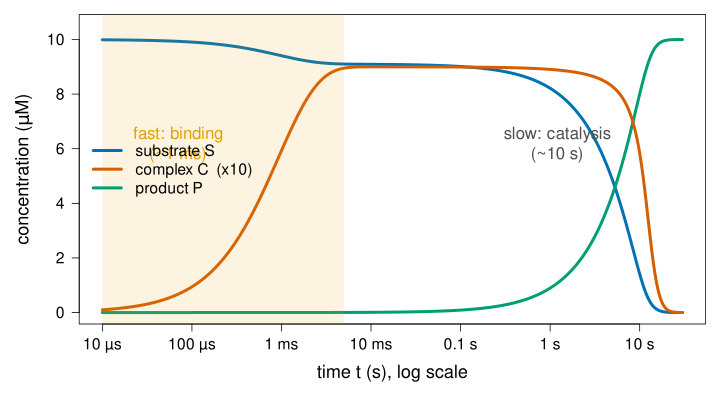
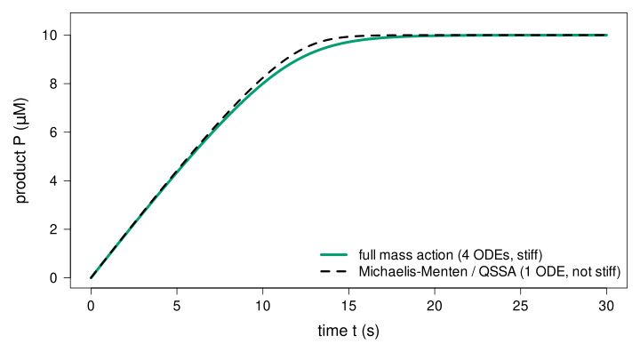
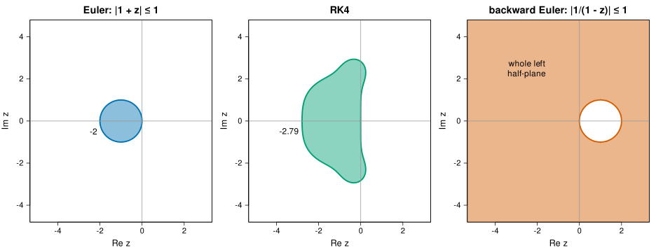
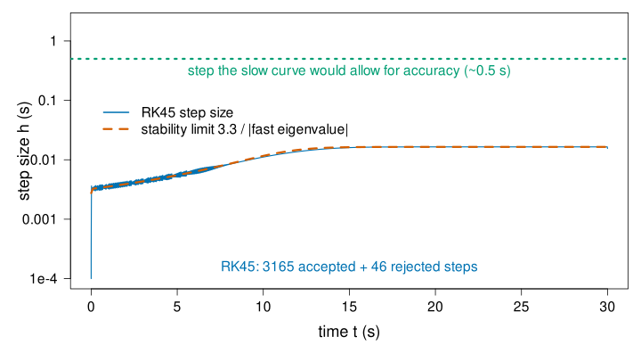
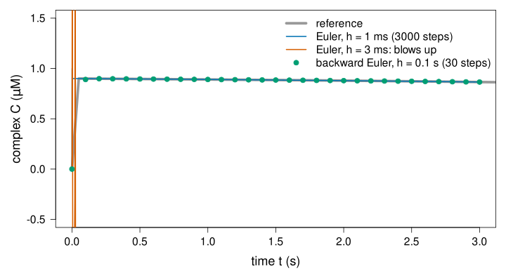
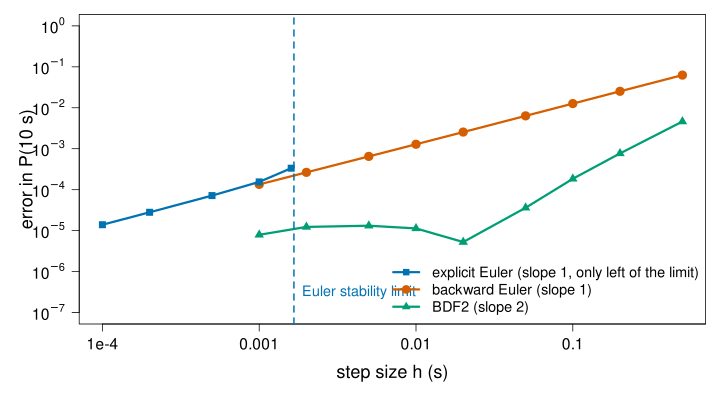
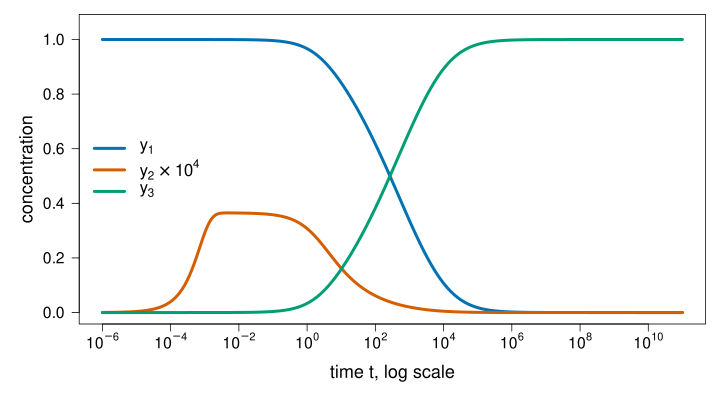
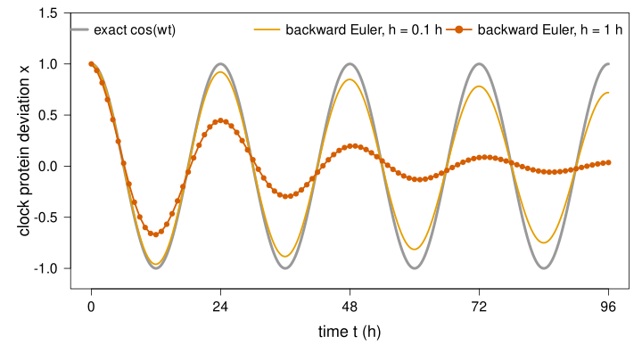

## About this lecture {.smaller}

Some models mix a reaction that is over in a millisecond with one that takes minutes. The fast part is finished almost at once, yet an explicit solver keeps taking millisecond steps to the very end. Such a model is called **stiff**.

- The **test equation** $y' = \lambda y$ and the **stability region** of a method: which step sizes $h$ keep errors from growing.
- **Stiff** = widely separated time scales. The step size of an explicit solver is set by **stability**, not by accuracy; even adaptive RK45 takes thousands of steps.
- **Implicit methods** (backward Euler, BDF, Radau) are stable for any step on decaying problems. The price: a **Newton solve** in every step.
- Library solvers: `lsoda` switches automatically between a non-stiff and a stiff method.
- Biology: **enzyme kinetics** with fast binding and slow catalysis (and its Michaelis–Menten shortcut), and **Robertson's** chemical kinetics problem, the classic stiff test case.

::: notes
This is the third unit of Part 8. Students know Euler (with its instability on drug clearance), RK4 and adaptive RK45 with deSolve::ode and solve_ivp. Here we explain the one situation where those tools break down in practice: they still give the right answer, but take thousands or millions of steps to get it. Many biological models are stiff (any model with fast binding, fast degradation or a fine spatial grid), so this is not an exotic case. The fix, implicit methods, is also the place where Newton for systems (Part 2) and linear solves (Part 3) come back inside an ODE solver.
:::

## A biology problem first {.smaller}

One enzyme, one substrate, mass action: $E + S \rightleftharpoons C \to E + P$.

```r
library(deSolve)
p  <- c(kf = 100, kr = 100, kcat = 1)    # per uM per s, per s, per s
y0 <- c(S = 10, E = 1, C = 0, P = 0)     # uM
times <- seq(0, 30, by = 0.5)            # s
for (m in c("ode45", "lsoda")) {
  tm <- system.time(out <- ode(y0, times, enzyme, p, method = m))
  cat(m, ": steps", attr(out, "istate")[2], "  time", tm[["elapsed"]], "s\n")
}
# ode45 : steps 3585   time 0.288 s
# lsoda : steps 216   time 0.007 s
```

- Same model, same default tolerances, same answer: **17 times more steps** and 40 times the time for the Runge–Kutta solver.
- The solution is a smooth curve over 30 s. Why does RK45 need 3585 steps for it?

::: notes
The model function enzyme is on the next slide. ode45 is the adaptive Dormand–Prince RK45 from Runge–Kutta and adaptive step size; lsoda is the default method of deSolve::ode. attr(out, "istate")[2] is the number of steps the solver took; deSolve's diagnostics(out) prints this and more. Timings are from our laptop and will differ on yours; the step counts will not. With 30 s instead of 3 h of simulated time, or a model with 1000 such reactions, the factor decides whether a parameter fit runs in a minute or a day.
:::

## Fast binding, slow catalysis {.smaller}

:::: {.columns}
::: {.column width="44%"}
```r
enzyme <- function(t, y, p) {
  with(as.list(c(y, p)), {
    bind <- kf * E * S - kr * C   # E + S <-> C
    turn <- kcat * C              # C -> E + P
    list(c(S = -bind, E = -bind + turn,
           C = bind - turn, P = turn))
  })
}
```

- $k_f = 100\ \mu\text{M}^{-1}\text{s}^{-1}$ ($10^8$ per M per s, close to diffusion-limited binding).
- Binding settles in about **1 ms**; the substrate is used up in about **10 s**.
:::
::: {.column width="56%"}
{width="100%"}
:::
::::

::: notes
Four species, four mass-action ODEs. Two conservation laws hold exactly: E + C = 1 (total enzyme) and S + C + P = 10 (total substrate). The figure uses a log time axis so that both time scales are visible: in the first millisecond about 0.9 uM of enzyme binds substrate (C rises to 0.89) while S hardly changes; then for 10 s the complex slowly turns substrate into product. On a linear time axis the fast phase would be invisible: a vertical jump of C at t = 0. That invisible jump is the source of all the trouble.
:::

## The shortcut: Michaelis–Menten {.smaller}

:::: {.columns}
::: {.column width="45%"}
Assume $C$ is always in balance with $S$ (**quasi-steady state**, QSSA: $C' \approx 0$). Then
$$S' = -\frac{V_{\max} S}{K_m + S},$$
$V_{\max} = k_{cat} E_0 = 1\ \mu\text{M/s}$, $K_m = \frac{k_r + k_{cat}}{k_f} = 1.01\ \mu\text{M}$.

- One ODE, **no fast time scale**: ode45 needs 61 steps (one per output interval).
- But it is an **approximation**: $P(10\text{ s}) = 8.24$ vs $8.00$ in the full model (3 %). Good when $E_0 \ll S_0 + K_m$.
:::
::: {.column width="55%"}
{width="100%"}
:::
::::

::: notes
This is the textbook route: remove the fast variable by assuming it is always at its quasi-equilibrium. Mathematically, setting C' = 0 gives C = E0 S / (Km + S), and substituting gives the Michaelis–Menten rate. The QSSA solution misses the first millisecond (the substrate that is bound in C is counted as free) and runs slightly ahead. With E0 = 1 and S0 + Km = 11 the error is a few per cent; with enzyme comparable to substrate (common inside cells, or in signalling cascades) it gets much worse, which the exercise shows. Also, many models have no clean separation into fast and slow variables, or have dozens of fast reactions. Then we want a solver that handles the full model directly. That is what the rest of the lecture builds.
:::

## Recap: Euler's stability limit {.smaller}

From [*Initial value problems and Euler's method*](../euler/lec.qmd): drug clearance $C' = -0.8\,C$.

$$C_{n+1} = C_n + h(-0.8\,C_n) = (1 - 0.8h)\,C_n$$

| $h$ (hours) | 0.5 | 2 | 3 |
|---|---|---|---|
| factor $1 - 0.8h$ | 0.6 | −0.6 | **−1.4** |
| behaviour | decays | oscillates, decays | **blows up** |

- Errors shrink only if $|1 - 0.8h| < 1$, that is $h < 2/0.8 = 2.5$ hours.
- A rate 1000 times faster would need steps 1000 times smaller, **even after that component has decayed to nothing**.

::: notes
One slide only: the instability slide of the Euler unit. The key observation to carry into this lecture: the bound depends on the rate k only, not on how large the solution is or how accurate we want to be. If the model contains one component that decays with rate 1200 per second, Euler needs h < 2/1200 s for the whole simulation, even when that component has long since settled. This is the whole phenomenon of stiffness in one line.
:::

## The test equation $y' = \lambda y$ {.smaller}

Every method, applied to $y' = \lambda y$ with step $h$, multiplies by a fixed factor $R(z)$ per step, where $z = h\lambda$:

| method | one step | $R(z)$ |
|---|---|---|
| Euler | $y_{n+1} = y_n + h\lambda y_n$ | $1 + z$ |
| RK4 | (four stages) | $1 + z + \frac{z^2}{2} + \frac{z^3}{6} + \frac{z^4}{24}$ |

- **Stable** if $|R(z)| \le 1$: errors do not grow. The set of such $z$ is the method's **stability region**.
- Why this tiny equation? Near any state, a system $\mathbf y' = \mathbf f(\mathbf y)$ behaves like $\mathbf y' = J\mathbf y$, and $J$ splits into modes $y' = \lambda y$, one per **eigenvalue** $\lambda$ of the **Jacobian** $J$.
- Every eigenvalue must satisfy $h\lambda \in$ stability region. $\lambda$ can be **complex** (oscillation), so the region lives in the complex plane.

::: notes
The RK4 factor is the Taylor series of e^z cut after the z^4 term: each stage adds one more term. The justification for the test equation is linearisation: f(y) near a point is approximately f(y*) + J (y - y*), the same linearisation that Newton for systems of equations uses, and a linear system with a diagonalisable J decouples into independent scalar equations, one per eigenvalue (Part 5, Power iteration and friends). A real negative lambda is a decaying mode (clearance, binding), a complex lambda with negative real part is a damped oscillation. Do not dwell on the complex plane: for most of this lecture only the negative real axis matters.
:::

## Stability regions

{width="100%"}

- On the negative real axis: Euler needs $h|\lambda| \le 2$, RK4 $h|\lambda| \le 2.79$. Both regions are **bounded**.
- **Backward Euler** (next slides) is stable everywhere except inside the white disc: the whole left half-plane.

::: notes
Shaded = stable. Euler: the disc of radius 1 around -1. RK4: a larger, kidney-shaped region that reaches -2.79 on the real axis and about ±2.83 on the imaginary axis (that is why RK4 is fine for oscillations, unlike Euler). Every explicit method has a bounded stability region: R(z) is a polynomial, and a polynomial grows without bound for large z. Higher order buys a bit more room, never an unlimited amount. Backward Euler, the right panel, is stable for every z with negative real part, whatever the step. The exercise asks you to draw these three regions yourself.
:::

## What "stiff" means {.smaller}

Eigenvalues of the enzyme model's Jacobian at the start (reduced to $S, C$ using $E = 1 - C$):

```r
J <- rbind(c(-100, 1100), c(100, -1101))   # d(S', C') / d(S, C) at S = 10, C = 0
eigen(J)$values
# [1] -1.200917e+03 -8.326972e-02
```

- **Two time scales**: $1/1201 \approx 0.8$ ms (binding) and $1/0.083 \approx 12$ s (catalysis). Ratio $\approx 14\,000$.
- **Stiff**: the fast mode has decayed, yet it still limits an explicit step to $h < 2.79/1201 = 2.3$ ms (RK4). Covering 30 s takes **13 000 steps**.
- Accuracy alone would allow steps of tenths of a second: lsoda's steps reach 0.5 s (the output spacing).

> A problem is stiff when the step size of an explicit method is set by **stability**, not by **accuracy**.

::: notes
The Jacobian entries come from differentiating S' = -kf (1 - C) S + kr C and C' = kf (1 - C) S - (kr + kcat) C at S = 10, C = 0; the exercise does this by hand. Trace -1201 and determinant 100 give the eigenvalues roughly as -1201 and -100/1201. The definition in the box is the practical one; there is no sharp mathematical definition. Stiffness is a property of the problem together with the time span and the tolerance: if you only wanted to simulate the first 5 ms, the problem would not be stiff, because then the fast mode is what you are resolving.
:::

## Try it: the fast eigenvalue sets the step

```{=html}
<link rel="stylesheet" href="../demos/dist/demo.css">
<div data-demo="stiffregion" data-problem="enzyme" data-method="euler" data-logh="-3" data-tol="1e-3" style="max-width: 1120px; margin: 0 auto;"></div>
<script src="../demos/dist/stiffregion.js"></script>
```

::: notes
Left: the plane of z = h lambda with the stability regions of the previous slide, plus the trapezoidal rule (left half-plane); the selected method is shaded. The two handles are h times the enzyme's eigenvalues at t = 0, -0.083 and -1201 per s; right: a linear system with exactly these eigenvalues over 30 s, exact in grey, the method in colour, same h. Start with Euler at h = 1 ms: the fast handle at -1.2 inside the disc, the slow one at the origin. Drag the slider up: at 1.7 ms the fast handle crosses -2 and turns red, the solution blows up within a few dozen steps, while the slow handle has hardly moved. Click RK4 and "h to stability limit": 2.3 ms, and the table says 12 937 steps for 1e-3, the 13 000 of the previous slide; Euler 18 017. Click backward Euler: 257 steps, at any h stable. Set h = 1 s with the log time axis: backward Euler jumps onto the slow curve in one step; the trapezoid is stable too but its fast factor is -0.997, so the fast mode rings for the whole run (error 0.9): the method must also damp, not just stay bounded. If time: the 24-h clock preset, where backward Euler damps the amplitude to 3.5e-4 and RK4 wins.
:::

## Adaptive RK45 cannot escape

{width="80%" fig-align="center"}

- The error controller keeps pushing $h$ up, gets rejected, pushes again: $h$ **rides the stability limit** $3.3/|\lambda_\text{fast}|$ (dashed).
- Adaptivity does not help: it finds the stability limit **by trial and error**, not a way past it.

::: notes
This is our own hand-written Dormand–Prince RK45 (the method in deSolve's ode45 and scipy's RK45) on the enzyme model with rtol = atol = 1e-6. The blue line is the accepted step size, the red dashed line is 3.3 divided by the fast eigenvalue of the Jacobian at that time (3.3 is where the RK45 stability region crosses the negative real axis). They coincide. As substrate is used up, the fast eigenvalue drops from about 1200 to about 200 per second, so the limit grows from 3 ms to 16 ms, but it never gets near the 0.5 s that the smooth curve allows. If the solver steps above the limit, the fast mode starts to grow, the error estimate notices and rejects the step. So the answer is still correct, which is why stiffness often goes unnoticed: it shows up only as slowness.
:::

## Backward Euler {.smaller}

Use the slope at the **end** of the step instead of the start:

$$y_{n+1} = y_n + h\, f(t_{n+1}, y_{n+1})$$

On $y' = \lambda y$: $y_{n+1} = y_n + h\lambda y_{n+1}$, so
$$y_{n+1} = \frac{1}{1 - h\lambda}\, y_n, \qquad R(z) = \frac{1}{1 - z}.$$

```r
z <- -0.8 * c(0.5, 2, 3, 10)            # h * lambda for C' = -0.8 C, h = 0.5, 2, 3, 10
round(rbind(euler = 1 + z, rk4 = 1 + z + z^2/2 + z^3/6 + z^4/24,
            beuler = 1 / (1 - z)), 3)
#         [,1]   [,2]   [,3]    [,4]
# euler  0.600 -0.600 -1.400  -7.000
# rk4    0.670  0.270  0.558 110.333
# beuler 0.714  0.385  0.294   0.111
```

- For **any** $\lambda < 0$ and **any** $h > 0$: $0 < R < 1$. Decay stays decay. (**A-stable**.)
- $y_{n+1}$ appears on **both sides**: each step is an **equation** to solve. That is what "implicit" means.

::: notes
Graphically: Euler follows the tangent at the start of the step, backward Euler picks the end point whose tangent points back to the start. For the linear test equation the equation is trivial to solve. Note the RK4 column at h = 10: factor 110, an explosion, while backward Euler still decays (too fast: e^-8 would be 0.0003, it gives 0.11, so it is stable but not accurate at that step). Like Euler, backward Euler has order 1. A-stable means: the stability region contains the whole left half-plane. Any explicit method fails that.
:::

## Backward Euler by hand {.smaller}

Drug clearance $C' = -0.8\,C$, $C_0 = 10$ mg/L, $h = 3$ hours:

$$C_1 = \frac{C_0}{1 + 0.8\cdot 3} = \frac{10}{3.4} = 2.94, \qquad C_2 = \frac{2.94}{3.4} = 0.865$$

| $t$ (h) | 0 | 3 | 6 |
|---|---|---|---|
| exact $10e^{-0.8t}$ | 10 | 0.907 | 0.082 |
| Euler | 10 | −14 | 19.6 |
| backward Euler | 10 | 2.94 | 0.865 |

- Stable and positive, but **not accurate** at this step: order 1, and $h|\lambda| = 2.4$ is large.
- Stability lets us pick $h$ **for accuracy only**. On a stiff problem that is the win: the fast mode only needs to stay damped, not resolved.

::: notes
Pen-and-paper: the student can check every number. Backward Euler errs in the safe direction for decay (it decays too slowly) but it is not magic: with steps comparable to the fast time scale it is inaccurate for that component. The point for stiff problems: we do not care about the fast component's details after it has decayed; we only need it not to blow up, and backward Euler damps it. The slow component, which we do care about, is resolved accurately by a step chosen for it.
:::

## Implicit = one nonlinear solve per step {.smaller}

For a nonlinear $\mathbf f$, each step must solve for $\mathbf y = \mathbf y_{n+1}$:
$$\mathbf G(\mathbf y) = \mathbf y - \mathbf y_n - h\,\mathbf f(\mathbf y) = \mathbf 0$$

This is a root-finding problem: use **Newton**, from [*Newton for systems of equations*](../newton-systems/lec.qmd).

- Jacobian of $\mathbf G$: $\;I - hJ$, where $J$ is the Jacobian of $\mathbf f$. Newton: solve $(I - hJ)\,\boldsymbol\delta = -\mathbf G(\mathbf y)$, set $\mathbf y \leftarrow \mathbf y + \boldsymbol\delta$.
- Start from $\mathbf y_n$: the previous value is close, so 1–4 iterations suffice.

**By hand** — dimerisation $M' = -kM^2$, $k = 10$, $M_0 = 1$, $h = 0.1$: solve $G(y) = y + h k y^2 - 1 = y + y^2 - 1 = 0$, $G'(y) = 1 + 2y$.

| iteration | 0 | 1 | 2 | 3 |
|---|---|---|---|---|
| $y$ | 1 | $1 - \frac{1}{3} = 0.6667$ | $0.6667 - \frac{0.1111}{2.333} = 0.6190$ | 0.61803 |

::: notes
This is the slide that ties Part 8 back to Part 2. A Newton solve per step, each needing the Jacobian and a linear solve (Gaussian elimination as LU). In one variable the Jacobian of G is 1 - h f'(y). The exact backward Euler value here is (sqrt(5) - 1)/2 = 0.618034, the golden ratio again; the exact ODE solution at t = 0.1 is 1/(1 + kt) = 0.5, so the backward Euler step itself is not very accurate at this h, but Newton solved its equation to 5 digits in 3 iterations. Quadratic convergence: errors 0.38, 0.049, 0.0010, 5e-7.
:::

## Backward Euler with Newton in R {.smaller}

```r
beuler <- function(f, jac, y0, h, n, tol = 1e-10) {
  Y <- matrix(NA, n + 1, length(y0)); Y[1, ] <- y <- y0
  I <- diag(length(y0))
  for (i in 1:n) {
    yold <- y                                     # Newton starts at y_n
    for (k in 1:20) {
      delta <- solve(I - h * jac(y), -(y - yold - h * f(y)))
      y <- y + delta
      if (sqrt(sum(delta^2)) < tol) break
    }
    Y[i + 1, ] <- y
  }
  Y
}
```

- `f(y)` and `jac(y)` are the enzyme rates and their $4\times4$ Jacobian (written out in the exercise).
- The inner loop is `newton_sys` from [*Newton for systems of equations*](../newton-systems/lec.qmd) with $\mathbf F = \mathbf G$, $J_G = I - hJ$.

::: notes
Fourteen lines. The outer loop is time stepping, the inner loop is Newton. For simplicity f does not depend on t (true for our kinetic models). Real codes do not iterate to 1e-10: they stop when the Newton correction is well below the time-stepping error, and they reuse the same Jacobian and its LU factorisation for many steps ("modified Newton"), because forming and factorising J is the expensive part. A production solver also checks whether Newton converges at all, and if not, retries with a smaller h.
:::

## Backward Euler on the enzyme {.smaller}

:::: {.columns}
::: {.column width="55%"}
{width="100%"}
:::
::: {.column width="45%"}
```r
Y <- beuler(f, jac, c(10, 1, 0, 0),
            h = 0.1, n = 300)
round(Y[c(11, 101, 301), ], 4)   # t = 1, 10, 30 s
#        [,1]   [,2]   [,3]   [,4]
# [1,] 8.2154 0.1095 0.8905 0.8941
# [2,] 1.4245 0.4145 0.5855 7.9900
# [3,] 0.0001 0.9999 0.0001 9.9998
```

- 300 steps of 0.1 s; on average 3.4 Newton iterations each.
- Explicit Euler: fine at $h = 1$ ms (30 000 steps), `NaN` at $h = 3$ ms.
- Reference (lsoda): $P(10) = 8.0027$. Backward Euler: $7.9900$.
:::
::::

::: notes
The figure shows the complex C over the first 3 s. Explicit Euler with 1 ms steps tracks the reference; with 3 ms steps it goes negative within a few steps and overflows to NaN. Backward Euler with steps 100 times larger than Euler's stability limit follows the curve. Its first step jumps from C = 0 to the slow curve in one go: it cannot resolve the 1 ms binding phase with a 0.1 s step, and it does not need to. The error 0.013 in P(10) is the order-1 error of backward Euler; halve h and it halves (next slide).
:::

## Error against step size {.smaller}

:::: {.columns}
::: {.column width="60%"}
{width="100%"}
:::
::: {.column width="40%"}
Error in $P$ after 10 s (from $t = 0.1$ s, after the binding transient):

- **Explicit Euler**: order 1, but only **left of the stability limit**. To the right: no answer at all.
- **Backward Euler**: order 1 at **any** $h$.
- **BDF2** (next slide): order 2, still stable at any $h$.
:::
::::

::: notes
Slopes read off as in Convergence and cost: backward Euler loses a factor 10 in h and gains a factor 10 in error, BDF2 gains a factor 100. At h = 0.01 s backward Euler has error 1.3e-3 with 1000 steps. Explicit Euler cannot take that step at all; at h = 1.5 ms, close to its stability limit of 2 ms, it gives 4.8e-4 with 6700 steps. BDF2 reaches 2e-6 at h = 0.01. We started at t = 0.1 s from the reference solution so that the plot shows the order on the smooth part; including the 1 ms transient adds a hump for intermediate h, where the step is comparable to the fast time scale.
:::

## Higher order: BDF {.smaller}

**Backward differentiation formulas**: fit a polynomial through $y_{n+1}, y_n, y_{n-1}, \dots$ and require that its slope at $t_{n+1}$ equals $f(y_{n+1})$.

| order | formula |
|---|---|
| BDF1 = backward Euler | $y_{n+1} - y_n = h f(y_{n+1})$ |
| BDF2 | $y_{n+1} - \tfrac43 y_n + \tfrac13 y_{n-1} = \tfrac23 h f(y_{n+1})$ |

- Still **one** Newton solve per step (Jacobian $I - \tfrac23 hJ$ for BDF2); uses old values instead of extra stages.
- BDF1 and BDF2 are A-stable. BDF3–5 lose a sliver near the imaginary axis (fine for decay, less so for weakly damped oscillations). Above order 6 they are unstable.
- `bdf` in deSolve, `"BDF"` in solve_ivp: orders 1–5, step **and** order chosen automatically (Gear's method).

::: notes
The idea parallels the finite-difference formulas of Numerical differentiation: the left-hand side of BDF2, divided by h, is the one-sided second-order difference approximation of y' at t_{n+1}. A multistep method needs past values, so it starts with BDF1 and builds up order; the exercise checks BDF2's order. Radau (method "radau" in deSolve, "Radau" in solve_ivp) is the other family: an implicit Runge–Kutta method of order 5, stable on the whole left half-plane, with more work per step (three coupled stages, so a 3n by 3n Newton system) but fewer steps.
:::

## What one implicit step costs {.smaller}

| per step | explicit (RK45) | implicit (BDF, Radau) |
|---|---|---|
| evaluations of $\mathbf f$ | 6 | 1–4 per Newton iteration |
| Jacobian $J$ ($n \times n$) | — | analytic, or $n$ extra $\mathbf f$ calls by finite differences |
| linear solve | — | LU of $I - hJ$: $\approx \tfrac23 n^3$ |
| number of steps (stiff) | huge | small |

- Solvers **reuse** $J$ and its LU over many steps; they refactorise only when Newton slows down.
- Large models (gene networks, spatial grids) have **sparse** $J$: banded or sparse LU keeps the cost near $O(n)$.
- **Non-stiff problem: explicit wins.** Use an implicit method only when stiffness makes the explicit one slow.

::: notes
The trade-off: fewer, more expensive steps. For n = 4 the linear algebra is trivial; for a model with 1000 species a dense LU per step costs about 7e8 flops, and the Jacobian 1000 extra f calls. That is why reusing J matters and why deSolve has the stiff solvers lsodes (sparse) and the bandwidth arguments, scipy has jac_sparsity. The cost of LU and the role of sparsity are from Gaussian elimination as LU and Structure: symmetric, banded, sparse. A finite-difference Jacobian is built exactly as in Newton for systems of equations. When the problem is not stiff, an implicit method wastes its Newton solves: RK45 is then the better choice.
:::

## LSODA: switch automatically {.smaller}

LSODA starts with a non-stiff method (**Adams**, explicit-style multistep), watches its step sizes, and switches to **BDF** when it detects stiffness (and back again if it fades).

```r
out <- ode(y0, times, enzyme, p, method = "lsoda")
attr(out, "istate")[15]      # method of the last step: 1 = Adams, 2 = BDF
# [1] 2
attr(out, "rstate")[5]       # time of the last switch (s)
# [1] 0.01679162
```

- Adams through the binding transient (where small steps are needed for **accuracy** anyway), BDF from 17 ms on.
- `diagnostics(out)` prints all counters: steps, $\mathbf f$ calls, Jacobians, method.
- That is why `lsoda` is the **default** of `deSolve::ode`: you do not need to know in advance whether your model is stiff.

::: notes
LSODA is from ODEPACK (Petzold and Hindmarsh, 1983) and still the default in deSolve; scipy's solve_ivp has it as method "LSODA" (its default is RK45, explicit). The switch time 17 ms is a few times the binding time scale: by then the fast mode has decayed and the Adams method's steps would be set by stability. The switching is a heuristic: it estimates the largest eigenvalue from the solver's own data. [diagnostics](https://search.r-project.org/CRAN/refmans/deSolve/html/diagnostics.html) works on the output of every deSolve solver.
:::

## The solvers you can call {.smaller}

```r
ode(y0, times, enzyme, p)                     # lsoda: switches Adams <-> BDF
ode(y0, times, enzyme, p, method = "bdf")     # BDF, orders 1-5
ode(y0, times, enzyme, p, method = "radau")   # implicit Runge-Kutta, order 5
ode(y0, times, enzyme, p, method = "ode45")   # explicit RK45: non-stiff only
```

| [`deSolve::ode`](https://search.r-project.org/CRAN/refmans/deSolve/html/ode.html) | `scipy.integrate.solve_ivp` | type |
|---|---|---|
| `"lsoda"` (default) | `method="LSODA"` | switches non-stiff ↔ stiff |
| `"bdf"` | `method="BDF"` | implicit multistep |
| `"radau"` | `method="Radau"` | implicit Runge–Kutta |
| `"ode45"` | `method="RK45"` (default) | explicit |

- Give the Jacobian (`jacfunc` / `jac=`) if you have it: fewer $\mathbf f$ calls, more reliable Newton.
- Rust's `ode_solvers` crate has **no** stiff solver; its `Dopri5` stops with "stiffness detected". The exercise writes backward Euler with Newton by hand.

::: notes
Note the defaults differ: R defaults to lsoda, which handles stiff problems; Python's solve_ivp defaults to RK45, which does not. A Python user who never changes method= will meet stiffness as "my simulation takes forever". Without a Jacobian, the stiff solvers build one by finite differences, which costs n extra function calls each time. For big sparse problems deSolve has lsodes and ode.1D/ode.2D, scipy has the jac_sparsity argument. In Rust, Dopri5 actually runs a stiffness test every 1000 steps and returns an error when it fires repeatedly; that is honest, but there is no implicit solver to switch to in the crate.
:::

## Robertson's problem {.smaller}

:::: {.columns}
::: {.column width="45%"}
Three species, three reactions (Robertson 1966):
$$A \xrightarrow{0.04} B, \quad B + B \xrightarrow{3\times10^7} C + B, \quad B + C \xrightarrow{10^4} A + C$$

```r
rober <- function(t, y, p) {
  r1 <- 0.04 * y[1]; r2 <- 3e7 * y[2]^2
  r3 <- 1e4 * y[2] * y[3]
  list(c(-r1 + r3, r1 - r2 - r3, r2))
}
```

- Rate constants span **9 orders of magnitude**; $y_1 + y_2 + y_3 = 1$.
- $B$ stays tiny ($\le 3.7\times10^{-5}$) and fast; $A \to C$ takes $10^5$ time units and more.
:::
::: {.column width="55%"}
{width="100%"}
:::
::::

::: notes
H. H. Robertson's 1966 example of an autocatalytic reaction network, and the standard test problem for stiff solvers ever since. It is a chemistry problem, but its structure (one intermediate with a very short lifetime, made and consumed by fast reactions, embedded in a slow overall conversion) is everywhere in biochemistry: reactive intermediates, short-lived complexes, radicals. The plot uses a log time axis from 1e-6 to 1e11 and shows y2 scaled by 1e4. B rises within 1e-3 time units to its quasi-steady level and then follows the slow conversion of A to C, which is still not complete at 1e5.
:::

## Robertson: steps and time {.smaller}

```r
for (m in c("ode45", "lsoda", "bdf", "radau")) {
  tm <- system.time(out <- ode(c(1, 0, 0), c(0, 40), rober, NULL, method = m,
                               hini = 1e-4, maxsteps = 1e5))
  is <- attr(out, "istate")
  cat(m, is[2], "steps", is[3], "f-evals", tm[["elapsed"]], "s  y2:", out[2, 3], "\n")
}
```

```
ode45 59284 steps 377479 f-evals 1.202 s  y2: 8.887885e-06 
lsoda 98 steps 200 f-evals 0.002 s  y2: 9.18632e-06 
bdf 92 steps 188 f-evals 0.002 s  y2: 9.187624e-06 
radau 26 steps 269 f-evals 0.002 s  y2: 9.185542e-06 
```

- **600 times** more steps for RK45, and its $y_2$ is 3 % off: 59 000 steps at the edge of stability pile up error (a tighter `atol` does not cure it).
- To $t = 10^{11}$ (`rtol = 1e-8`): lsoda takes 1595 steps. RK45, held at $h \approx 10^{-3}$, would need about $10^{14}$.

::: notes
The fast eigenvalue at t = 40 is about -3400, so RK45 is limited to h of about 3.3/3400, 1e-3, for the whole run: 40 / 1e-3 is 40 000 steps plus the early phase. The stiff solvers take 26 to 98 steps. Radau takes the fewest steps but each one costs more f calls (three implicit stages). Timings are from our laptop; on a second run ode45 took 2.8 s, the stiff solvers stay at a few milliseconds. ode45 is also less accurate in y2: with atol = 1e-10 it still returns 8.89e-6, so this is not just a loose tolerance; scipy's RK45 gets y2 right with 34 500 steps (exercise), so the deSolve number is a warning rather than a law. deSolve's ode45 needs hini = 1e-4 here: with its automatic first step it can stall on this problem. For the run to 1e11 the stiff solvers' step grows to 1e9 and more; an explicit method stays at 1e-3 for ever.
:::

## When implicit methods mislead {.smaller}

:::: {.columns}
::: {.column width="55%"}
{width="100%"}
:::
::: {.column width="45%"}
The 24-hour oscillator $x'' = -\omega^2 x$ from [*Initial value problems and Euler's method*](../euler/lec.qmd), backward Euler:

- $|R(i\omega h)| = 1/\sqrt{1 + \omega^2 h^2} < 1$: every step **shrinks** the amplitude.
- After 10 days at $h = 1$ h: amplitude $3.5\times10^{-4}$ instead of 1. (Euler: 2850.)
- A biologist would conclude the clock is **damped**. The damping is the method's.
:::
::::

::: notes
Backward Euler's stability region includes the whole imaginary axis and even most of the right half-plane: it damps things that should not decay at all, and even makes growing solutions (y' = +y with h > 2) look like decay. Euler multiplies the amplitude by sqrt(1 + w^2 h^2) per step, backward Euler divides by the same factor: 2850 versus 1/2850. This is the mirror image of the Euler spiral. The fix: higher-order implicit methods (BDF2 damps far less; Radau and the trapezoidal rule better still), smaller steps, and above all a non-stiff method for a non-stiff oscillator. Check: halve the step, and compare with a second method of a different type; a damping that changes with h is numerical.
:::

## Checks for stiff problems {.smaller}

- **Count steps** (`diagnostics`, `attr(out, "istate")`, `sol.nfev`): thousands of steps for a smooth curve, step size flat at a small value → stiff. Switch to `lsoda`, `bdf` or `radau`.
- **Eigenvalues of the Jacobian**: a ratio of $10^3$ or more between the largest and smallest $|\text{Re}\,\lambda|$, over the time span you simulate → stiff.
- **Compare two solvers** of different type and **tighten the tolerances**: the answer must not move.
- **`atol` below the smallest concentration** you care about ($y_2 \approx 10^{-5}$ needs `atol` $\ll 10^{-5}$).
- **Conservation laws** ($E + C$, $S + C + P$, $y_1 + y_2 + y_3$) and **positivity**. A negative $y_2$ in Robertson makes the true ODE blow up: $y_2' \approx -3\times10^7 y_2^2$ drives it to $-\infty$.
- **Newton failures** ("repeated convergence failures", "step size too small"): often a wrong hand-coded Jacobian, or a model with a real singularity.

::: notes
The first check is the cheapest and catches most cases: if a library solver is slow, look at its step count before buying a faster computer. The positivity point is specific to kinetic models with second-order reactions: an explicit step that overshoots zero puts y2 on the wrong side, where the quadratic term pushes it further away; this is how a slightly unstable solver turns into NaN rather than a small error. A wrong analytic Jacobian does not change the answer of an implicit solver (the equation G = 0 is the same) but slows Newton down or makes it fail; check it against a finite-difference Jacobian as in Newton for systems of equations.
:::

## Summary {.smaller}

- **Test equation** $y' = \lambda y$: a method multiplies by $R(h\lambda)$ per step. **Stability region**: $|R| \le 1$. Euler $h|\lambda| \le 2$, RK4 $\le 2.79$: bounded for every explicit method.
- **Stiff**: fast and slow time scales together; the explicit step is set by stability, not accuracy. Adaptive RK45 rides the stability limit: 3585 steps for the enzyme, 59 284 for Robertson to $t = 40$.
- **Backward Euler** $y_{n+1} = y_n + h f(y_{n+1})$: $R = 1/(1-z)$, stable for all decaying modes. Order 1. **BDF2–5** for higher order, **Radau** for implicit RK.
- Implicit = a **Newton solve** per step with Jacobian $I - hJ$: the cost of a step goes up, the number of steps goes down by orders of magnitude.
- **LSODA** switches between Adams and BDF automatically (default in `deSolve::ode`; `method="LSODA"` in `solve_ivp`, whose default RK45 is non-stiff).
- **Failure**: implicit methods damp oscillations that should persist. **Checks**: step counts, Jacobian eigenvalues, two solvers, `atol`, conservation, positivity.

**Next:** [*Equilibria, stability and the phase plane*](../phase-plane/lec.qmd): the same Jacobian eigenvalues decide whether a steady state of the model is stable.

::: notes
Recap. The common thread with the next unit: eigenvalues of the Jacobian. Here they set the time scales and decide whether a solver is stable; there they decide whether a steady state of the biology is stable. The Michaelis–Menten QSSA is the modeller's alternative to an implicit solver: remove the fast variable by hand. Both are legitimate, but only the stiff solver keeps the full model.
:::
