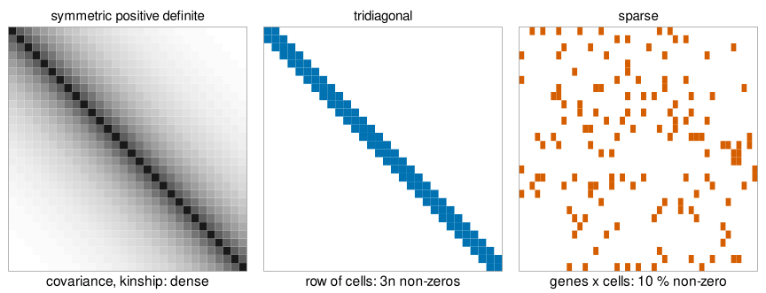
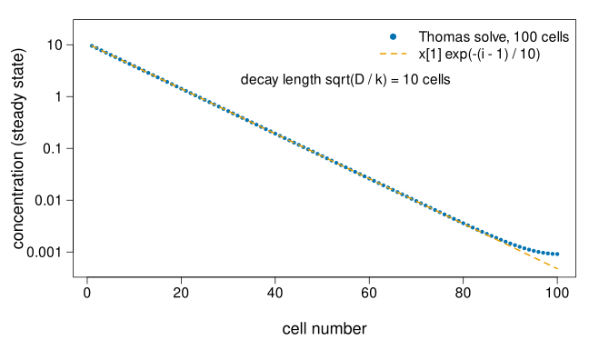
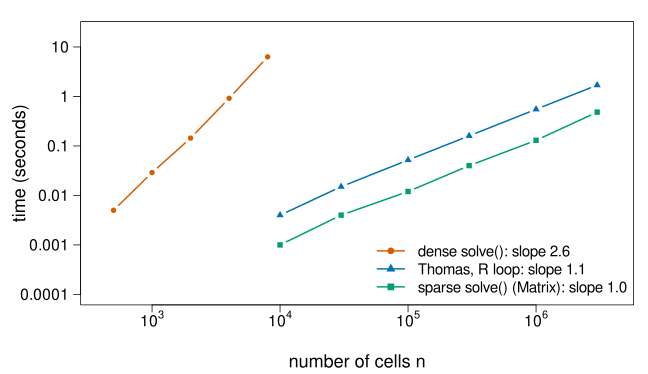
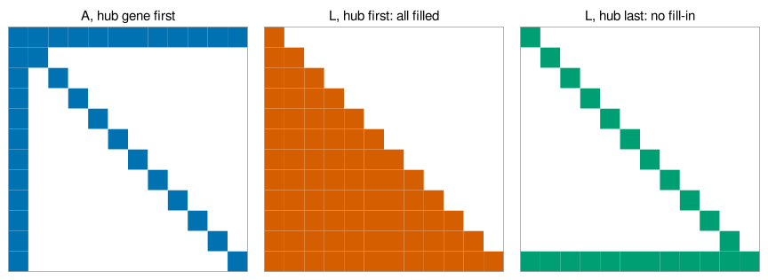
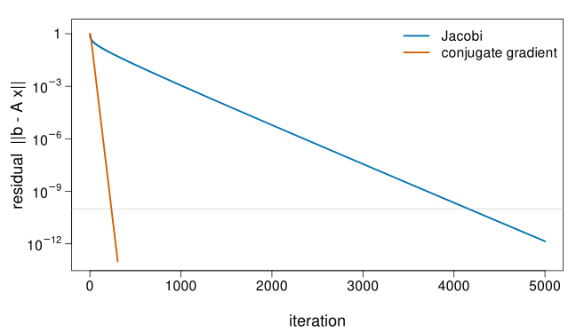

## About this lecture

LU costs $\tfrac23 n^3$ operations and $8n^2$ bytes, whatever the matrix looks like. Most matrices in biology have **structure**, and using it changes the cost by orders of magnitude.

- **Symmetric positive definite** (covariance, kinship, linkage disequilibrium): **Cholesky** $A = LL^T$, half the work of LU, no pivoting, and a free log-determinant.
- **Tridiagonal** (a row of cells exchanging a signal): the **Thomas algorithm** solves in $O(n)$, a million cells in half a second.
- **Sparse** (count matrices, networks, 2D grids): store and compute only the non-zeros, and watch out for **fill-in**.
- A glimpse of **iterative** solvers (Jacobi, conjugate gradient) that only need $A\mathbf{x}$.

::: notes
This unit closes Part 3. The previous two units (Gaussian elimination as LU, and Pivoting, norms and conditioning) treated a general dense matrix. Here the message is: look at your matrix before you solve with it. Three kinds of structure cover most of what biologists meet. The Thomas algorithm written here is reused in Part 10 for implicit diffusion steps, so students should keep their function.
:::

## Three kinds of structure

{width="95%" fig-align="center"}

| structure | biology | what we save |
|---|---|---|
| symmetric positive definite | covariance, kinship, LD | half the work, no pivoting |
| tridiagonal / banded | a row of cells, 1D diffusion | $O(n)$ instead of $O(n^3)$ |
| sparse | counts, networks, 2D grids | memory and work $\propto$ non-zeros |

::: notes
Left: a correlation matrix between 30 markers, darker = larger. Dense, but symmetric and positive definite. Middle: the matrix of a row of 30 cells where each cell talks only to its two neighbours; only three diagonals are non-zero. Right: a small count matrix with 10 % non-zeros, like single-cell data. Each needs a different trick. A general dense solver ignores all of this and pays full price.
:::

## Symmetric positive definite (SPD)

A matrix $A$ is **SPD** if it is symmetric ($A = A^T$) and

$$\mathbf{x}^T A \mathbf{x} > 0 \quad \text{for every } \mathbf{x} \neq \mathbf{0} \qquad \Longleftrightarrow \qquad \text{all eigenvalues} > 0.$$

- **Covariance** $\Sigma$ of gene expression: $\mathbf{x}^T \Sigma \mathbf{x} = \operatorname{Var}(x_1 g_1 + \dots + x_n g_n) \ge 0$. A variance cannot be negative.
- **Kinship / genomic relationship** matrices in mixed models, **LD** (correlation between SNP markers), precision matrices of gene networks.
- Example: $A = \begin{pmatrix} 4 & 2 \\ 2 & 5 \end{pmatrix}$, eigenvalues $6.56$ and $2.44$: SPD.

::: notes
Positive definite means "every weighted combination has positive variance". It is strict (> 0) when no combination of genes is exactly constant; a covariance estimated from too few samples breaks this, and we will see that failure in a few slides. The eigenvalue criterion is the one students can check in code (eigen), but it is expensive; Cholesky itself is the cheap test.
:::

## Cholesky by hand: $A = LL^T$

Look for a lower-triangular $L$ with $A = LL^T$:

$$\begin{pmatrix} 4 & 2 \\ 2 & 5 \end{pmatrix} = \begin{pmatrix} \ell_{11} & 0 \\ \ell_{21} & \ell_{22} \end{pmatrix} \begin{pmatrix} \ell_{11} & \ell_{21} \\ 0 & \ell_{22} \end{pmatrix} = \begin{pmatrix} \ell_{11}^2 & \ell_{11}\ell_{21} \\ \ell_{11}\ell_{21} & \ell_{21}^2 + \ell_{22}^2 \end{pmatrix}$$

Match entry by entry:

- $\ell_{11} = \sqrt{4} = 2$
- $\ell_{21} = 2 / \ell_{11} = 1$
- $\ell_{22} = \sqrt{5 - \ell_{21}^2} = \sqrt{4} = 2$

$$L = \begin{pmatrix} 2 & 0 \\ 1 & 2 \end{pmatrix}$$

::: notes
Do this on the board. Cholesky is LU for symmetric matrices with the diagonal split evenly between the two factors: U = L transpose, so only one factor has to be computed and stored. Note the square roots: the numbers under them must be positive. That is exactly where a non-SPD matrix is caught.
:::

## The Cholesky algorithm {.smaller}

Column by column, $j = 1, \dots, n$:

$$\ell_{jj} = \sqrt{a_{jj} - \textstyle\sum_{k<j} \ell_{jk}^2}, \qquad \ell_{ij} = \Big(a_{ij} - \textstyle\sum_{k<j} \ell_{ik}\ell_{jk}\Big) \Big/ \ell_{jj} \quad (i > j)$$

- Cost $\approx \tfrac13 n^3$: **half** of LU. Memory: one triangle.
- **No pivoting needed**: for an SPD matrix the number under every square root is positive, and the entries of $L$ cannot grow ($\ell_{ij}^2 \le a_{ii}$). Cholesky is stable.
- If a square root of a number $\le 0$ is needed, $A$ is **not** SPD. Cholesky is the cheapest test for positive definiteness.

| | LU (partial pivoting) | Cholesky |
|---|---|---|
| works for | any non-singular $A$ | SPD $A$ only |
| operations | $\tfrac23 n^3$ | $\tfrac13 n^3$ |
| pivoting | needed | not needed |

::: notes
The formulas are the 2 x 2 case generalised: the diagonal entry is what is left of a_jj after subtracting the squares already used, and each entry below it is what is left of a_ij, divided by the diagonal. The bound l_ij^2 <= a_ii comes from row i of A = L L^T: a_ii is the sum of squares of row i of L. So no element growth, which is the stability problem that pivoting fixes for LU (Pivoting, norms and conditioning). Students do a 3 x 3 by hand in the exercise.
:::

## Cholesky in R {.smaller}

```r
A <- matrix(c(4, 2, 2, 5), nrow = 2)
R <- chol(A)                    # upper triangular, A = t(R) %*% R
R
#      [,1] [,2]
# [1,]    2    1
# [2,]    0    2
b <- c(2, 9)
y <- forwardsolve(t(R), b)      # solve L y = b   (L = t(R))
x <- backsolve(R, y)            # solve R x = y
x
# [1] -0.5  2.0
```

- [`chol()`](https://stat.ethz.ch/R-manual/R-devel/library/base/html/chol.html) returns the **upper** factor $R = L^T$. Python's `np.linalg.cholesky` returns the **lower** $L$: same numbers, transposed.
- [`forwardsolve` / `backsolve`](https://stat.ethz.ch/R-manual/R-devel/library/base/html/backsolve.html): two triangular solves, $O(n^2)$ each. Factor once, solve for many $\mathbf{b}$.

::: notes
The R/Python difference in which triangle is returned is a classic source of bugs when translating code. Check with crossprod(R) or t(R) %*% R that you get A back. Same pattern as LU: one expensive factorisation, then cheap triangular solves for each new right-hand side.
:::

## Biology: the log-likelihood needs $\log\det\Sigma$ {.smaller}

A multivariate normal log-likelihood (mixed models, GWAS, phylogenetic regression) contains $-\tfrac12 \log\det\Sigma - \tfrac12 (\mathbf{y}-\boldsymbol\mu)^T \Sigma^{-1} (\mathbf{y}-\boldsymbol\mu)$.

```r
n <- 2000
S <- 0.9^abs(outer(1:n, 1:n, "-"))  # correlation of SNP markers (LD)
det(S)
# [1] 0
R <- chol(S)
2 * sum(log(diag(R)))           # log det S
# [1] -3319.802
(n - 1) * log(1 - 0.9^2)        # exact, for this matrix
# [1] -3319.802
```

- $\det\Sigma = \det(L)^2 = \prod_i \ell_{ii}^2$, so $\log\det\Sigma = 2\sum_i \log \ell_{ii}$: a **sum of logs**, as for likelihoods.
- The determinant itself is $e^{-3320}$: it **underflows** to 0.
- The quadratic term is two triangular solves with the same $L$. Never form $\Sigma^{-1}$.

::: notes
This is the floating-point lesson again (How computers store numbers): a product of many numbers below 1 underflows, the sum of their logs does not. The matrix 0.9^|i-j| is the correlation between equally spaced markers when LD decays exponentially with distance; its determinant is known exactly, (1 - rho^2)^(n-1), which lets us check. Mixed-model software (lme4, GCTA, REML in general) evaluates exactly these two terms by Cholesky, many times during the optimisation. determinant(S, logarithm = TRUE) also works; it uses LU.
:::

## Simulating correlated traits {.smaller}

If $\mathbf{z}$ has independent $N(0,1)$ entries, then $\mathbf{y} = L\mathbf{z}$ has covariance $LL^T = \Sigma$.

```r
Sigma <- matrix(c(4, 2, -2,  2, 10, 2,  -2, 2, 6), nrow = 3)
R <- chol(Sigma)
set.seed(1)
Z <- matrix(rnorm(3 * 1e5), nrow = 3)     # independent N(0, 1)
Y <- t(R) %*% Z                            # 1e5 correlated samples
round(cov(t(Y)), 2)
#       [,1]  [,2]  [,3]
# [1,]  4.01  2.00 -2.00
# [2,]  2.00 10.01  1.99
# [3,] -2.00  1.99  5.99
```

- This is how phenotypes with a given kinship, or expression with a given gene covariance, are simulated.
- $\operatorname{Cov}(L\mathbf{z}) = L \operatorname{Cov}(\mathbf{z}) L^T = L I L^T = \Sigma$.

::: notes
Simulation is the other daily use of Cholesky. To simulate a trait in 1000 related individuals with kinship K and heritability h2, take Sigma = h2 K + (1 - h2) I and multiply its Cholesky factor by a vector of standard normals. MASS::mvrnorm uses an eigendecomposition instead, which also works for semidefinite matrices but costs more. The L of this Sigma is (2,0,0; 1,3,0; -1,1,2), which students compute by hand in the exercise.
:::

## When Cholesky fails: not positive definite {.smaller}

Covariance of 10 genes estimated from only 5 samples:

```r
set.seed(1)
X <- matrix(rnorm(5 * 10), nrow = 5)       # 5 samples x 10 genes
C <- cov(X)                                # 10 x 10, rank <= 4
try(chol(C))
# Error in chol.default(C) : the leading minor of order 5 is not positive
signif(eigen(C, symmetric = TRUE)$values, 2)
#  [1]  4.9e+00  1.8e+00  1.0e+00  2.6e-01  1.2e-16  3.8e-17  3.1e-17  5.0e-18
#  [9] -7.2e-17 -6.5e-16
dim(chol(C + 0.1 * diag(10)))              # ridge / shrinkage: SPD again
# [1] 10 10
```

- With fewer samples than genes the covariance is only **semi**definite: six eigenvalues are 0, and rounding makes some slightly negative.
- **Check:** `chol()` fails, or the smallest eigenvalue is $\le 0$ (relative to the largest).
- **Fixes:** more samples, **shrinkage** $C + \lambda I$, or a model with an error term ($\sigma_g^2 K + \sigma_e^2 I$).

::: notes
This is the everyday failure. Any covariance or kinship matrix estimated from fewer observations than variables (genes > samples, individuals > SNPs) is singular. R's error message names the column where the square root of a non-positive number was needed: here 5, because the first four columns use up the rank. Also common: a correlation matrix assembled from pairwise-complete observations can have truly negative eigenvalues. Shrinkage (adding lambda I) is what limma, glasso and similar tools do; mixed models are safe because the residual variance adds a multiple of I. Ill-conditioning is the milder form: chol succeeds but the solve loses log10(kappa) digits (Pivoting, norms and conditioning).
:::

## Biology: a morphogen in a row of cells {.smaller}

A source cell (cell 1) makes a morphogen; each cell exchanges it with its **two neighbours** (rate $D$) and degrades it (rate $k$). At steady state, for cell $i$:

$$0 = D(c_{i-1} - c_i) + D(c_{i+1} - c_i) - k\,c_i + s_i \;\;\Longrightarrow\;\; -D\,c_{i-1} + (2D + k)\,c_i - D\,c_{i+1} = s_i$$

For 5 cells ($D = 1$, $k = 0.01$ per minute, $s_1 = 1$; the end cells have only one neighbour):

$$\begin{pmatrix} 1.01 & -1 & & & \\ -1 & 2.01 & -1 & & \\ & -1 & 2.01 & -1 & \\ & & -1 & 2.01 & -1 \\ & & & -1 & 1.01 \end{pmatrix} \begin{pmatrix} c_1 \\ c_2 \\ c_3 \\ c_4 \\ c_5 \end{pmatrix} = \begin{pmatrix} 1 \\ 0 \\ 0 \\ 0 \\ 0 \end{pmatrix}$$

- **Tridiagonal**: $3n - 2$ non-zeros out of $n^2$. Also symmetric and positive definite.
- An embryo axis has ~100 cells; a tissue model or a fine 1D grid has $10^4$–$10^6$.

::: notes
This is a compartment model, not yet a PDE: each cell is one well-mixed box. Part 10 (The diffusion (heat) equation by finite differences) arrives at exactly the same matrix from the diffusion equation on a grid, and then needs one such solve per time step. The numbers are Bicoid-like in spirit: lifetime 1/k = 100 minutes, exchange once a minute, which gives a decay length of about sqrt(D/k) = 10 cells. Diagonal dominance: 2.01 > 1 + 1. We will need that.
:::

## Elimination on a band: the Thomas algorithm {.smaller}

Store the three diagonals as vectors: $a_i$ (below), $b_i$ (diagonal), $c_i$ (above), right-hand side $d_i$.

**Forward sweep** ($i = 2, \dots, n$): eliminate $a_i$ with the row above.
$$w = a_i / b_{i-1}, \qquad b_i \leftarrow b_i - w\,c_{i-1}, \qquad d_i \leftarrow d_i - w\,d_{i-1}$$

**Back substitution**:
$$x_n = d_n / b_n, \qquad x_i = (d_i - c_i\,x_{i+1}) / b_i \quad (i = n-1, \dots, 1)$$

- This is LU, but every row has only one entry to eliminate and nothing appears outside the band: about $8n$ operations and $4n$ numbers of memory.
- Any **banded** matrix (bandwidth $p$) works the same way: $O(np^2)$ operations, no fill outside the band (without pivoting).

::: notes
Named after L. H. Thomas (1949); in numerical linear algebra it is just "tridiagonal LU without pivoting". The modified b_i are the pivots, the w are the entries of L. Count the work: the forward sweep is 1 division, 2 multiplications and 2 subtractions per row, back substitution 1 multiplication, 1 subtraction, 1 division: about 8n. Compare 2/3 n^3: for n = 1e6, 8e6 against 7e17 operations. The exercise does a 4-cell example by hand.
:::

## Thomas in R

```r
thomas <- function(a, b, c, d) {
  n <- length(d)
  for (i in 2:n) {                 # forward sweep: eliminate a[i]
    w <- a[i] / b[i - 1]
    b[i] <- b[i] - w * c[i - 1]
    d[i] <- d[i] - w * d[i - 1]
  }
  x <- numeric(n)
  x[n] <- d[n] / b[n]
  for (i in (n - 1):1)             # back substitution
    x[i] <- (d[i] - c[i] * x[i + 1]) / b[i]
  x
}
```

Convention: all four vectors have length $n$; `a[1]` and `c[n]` are not used.

::: notes
Twelve lines. Keep this function: Part 10 calls it once per time step for implicit diffusion (Implicit schemes and the method of lines). R passes vectors by value, so changing b and d inside the function does not change the caller's vectors. In Python the same code would overwrite the caller's arrays unless you copy them first; the exercise does that.
:::

## The gradient, and how to check it {.smaller}

:::: {.columns}
::: {.column width="55%"}
{width="100%"}
:::
::: {.column width="45%"}
```r
n <- 100; D <- 1; k <- 0.01
a <- c(0, rep(-D, n - 1))
cc <- c(rep(-D, n - 1), 0)
b <- c(D + k, rep(2*D + k, n - 2), D + k)
s <- c(1, rep(0, n - 1))
x <- thomas(a, b, cc, s)
x[11] / x[1]      # about exp(-1)
# [1] 0.3680326
k * sum(x)        # decay = production
# [1] 1
```
:::
::::

- **Checks:** the residual `max(abs(A %*% x - s))` is $1.8\times10^{-15}$; total degradation equals production; the decay length matches $\sqrt{D/k} = 10$ cells.

::: notes
Three independent checks, each cheap. The residual check works for any linear system and costs one matrix-vector product. The mass balance is a biology check: at steady state everything produced is degraded, so k times the total amount equals the production rate 1. The decay length is the analytical result for an infinite row; it fails near cell 100 because the last cell has no neighbour to pass the morphogen on to (no-flux end), which is the upturn in the plot.
:::

## $O(n)$ against $O(n^3)$

{width="72%" fig-align="center"}

- Dense `solve()` at 8000 cells: 6 s. At $10^6$ cells ($125\times$ more): $6\cdot 125^{2.6}$ to $6 \cdot 125^3$ s, i.e. weeks to months, and **8 TB** of memory.
- Thomas, even as an interpreted R loop: $10^6$ cells in 0.55 s.

::: notes
The slopes are read off as in Convergence and cost. The dense solver ignores the zeros and pays n^3; its slope here is a bit below 3 because the small sizes are dominated by overheads. Thomas is a plain R loop, so it has a large constant, but its slope is 1. The green line is Matrix's sparse solver, which recognises the band and runs in compiled code: the same O(n), a smaller constant. Python users get the same from scipy.linalg.solve_banded.
:::

## When Thomas fails: no pivoting {.smaller}

```r
a <- c(0, 1, 1); b <- c(1, 1, 1); cc <- c(1, 1, 0); d <- c(1, 2, 3)
thomas(a, b, cc, d)        # 2nd pivot: 1 - 1 * 1 = 0
# [1] NaN NaN NaN
solve(matrix(c(1, 1, 0,  1, 1, 1,  0, 1, 1), 3), d)   # pivots: fine
# [1] -1  2  1
```

- The matrix is not singular, but the second pivot $b_2 - (a_2/b_1)c_1$ is exactly 0. A tiny pivot instead of 0 gives a **confident wrong answer**.
- **Safe when** the matrix is **diagonally dominant**, $|b_i| \ge |a_i| + |c_i|$ (strictly in at least one row), or SPD. Both hold for diffusion and exchange problems: $2.01 > 1 + 1$.
- **Check:** diagonal dominance before, residual $\max|A\mathbf{x} - \mathbf{d}|$ after.

::: notes
Thomas is elimination without pivoting, so it inherits the failure of no-pivoting LU from Pivoting, norms and conditioning. In practice the matrices from diffusion, heat and compartment exchange are diagonally dominant (each cell loses at least as much as it passes on), and then every pivot stays away from zero. Problems with strong flow (advection, Part 10) can lose diagonal dominance; then use a banded solver with pivoting (LAPACK dgbsv, which is what scipy.linalg.solve_banded calls) or the sparse solve.
:::

## Recap: sparse storage {.smaller}

From *Convergence and cost*:

- Dense: **8 bytes per entry**. A 20 000 genes × 100 000 cells count matrix = 16 GB.
- Single-cell count matrices are **> 90 % zeros**. Compressed sparse column (**CSC**) keeps each non-zero's value (8 bytes) and row index (4 bytes), plus one pointer per column: **~12 bytes per non-zero**. At 10 % non-zero: 2.4 GB.
- **Centring** each gene turns every zero into $-\text{mean}$: dense again, silently.

This unit: what CSC looks like inside, which operations keep sparsity, and which destroy it.

::: notes
One slide only: the numbers were derived in Convergence and cost. The point to add here is that it is not only centring: some linear algebra operations (the inverse, elimination in the wrong order) also turn a sparse matrix dense.
:::

## Inside CSC {.smaller}

:::: {.columns}
::: {.column width="45%"}
4 genes × 4 cells:

$$M = \begin{pmatrix} 3 & 0 & 0 & 2 \\ 0 & 5 & 0 & 0 \\ 1 & 0 & 0 & 0 \\ 0 & 0 & 0 & 7 \end{pmatrix}$$

Read the non-zeros **column by column**:

| entry | 1 | 2 | 3 | 4 | 5 |
|---|---|---|---|---|---|
| `x` (value) | 3 | 1 | 5 | 2 | 7 |
| `i` (row, from 0) | 0 | 2 | 1 | 0 | 3 |

`p` = 0 2 3 3 5: column $j$ owns entries `p[j]` to `p[j+1] - 1` (counting from 0).
:::
::: {.column width="55%"}
```r
library(Matrix)
M <- sparseMatrix(i = c(1, 3, 2, 1, 4),
                  j = c(1, 1, 2, 4, 4),
                  x = c(3, 1, 5, 2, 7),
                  dims = c(4, 4))
M@x
# [1] 3 1 5 2 7
M@i
# [1] 0 2 1 0 3
M@p
# [1] 0 2 3 3 5
```
:::
::::

- Cell 3 is empty: `p[3] = p[4]`. Column sums (library sizes) and $M\mathbf{v}$ touch each non-zero once: $O(\text{nnz})$.

::: notes
The three slots of a dgCMatrix are exactly the three arrays of CSC; scipy.sparse.csc_matrix has .data, .indices, .indptr, and sprs in Rust has data(), indices(), indptr(). Indices start at 0 in all three, even in R. The pointer array has one more entry than there are columns; the last entry is nnz. Reading a column is fast (a contiguous slice), reading a row means searching every column, which is why the orientation matters: R and Seurat store genes x cells, so each cell is a column. sparseMatrix(i, j, x) builds the matrix from triplets (the "coordinate" format, as in a Matrix Market .mtx file from Cell Ranger).
:::

## Sparse solves in R {.smaller}

```r
library(Matrix)
n <- 1e6; D <- 1; k <- 0.01
A <- bandSparse(n, k = -1:1, diagonals = list(rep(-D, n - 1),
                c(D + k, rep(2 * D + k, n - 2), D + k), rep(-D, n - 1)))
s <- c(1, rep(0, n - 1))
nnzero(A)
# [1] 2999998
format(object.size(A), units = "MB")
# [1] "38.1 Mb"
system.time(x <- solve(A, s))["elapsed"]
# elapsed
#   0.498
```

- [`bandSparse`](https://rdrr.io/cran/Matrix/man/bandSparse.html), [`sparseMatrix`](https://rdrr.io/cran/Matrix/man/sparseMatrix.html) build sparse matrices; [`solve`](https://rdrr.io/cran/Matrix/man/solve-methods.html) on them calls a **sparse** direct solver (sparse LU, or sparse Cholesky for a symmetric matrix).
- 38 MB instead of 8 TB. The sparse solver found the band by itself.

::: notes
Same morphogen system, one million cells. The Matrix package dispatches on the class: a dgCMatrix gets a sparse LU (from the CSparse / UMFPACK family), a symmetric dsCMatrix gets CHOLMOD's sparse Cholesky. In Python: scipy.sparse.diags to build, scipy.sparse.linalg.spsolve to solve. A sparse direct solver does what Thomas does, for any sparsity pattern: it eliminates and only stores what becomes non-zero.
:::

## Failure: the inverse of a sparse matrix is dense

```r
n <- 100
A <- bandSparse(n, k = -1:1, diagonals = list(rep(-1, n - 1),
                c(1.01, rep(2.01, n - 2), 1.01), rep(-1, n - 1)))
nnzero(A)
# [1] 298
nnzero(solve(A))
# [1] 10000
```

- Every cell influences every other cell, so $A^{-1}$ has **no zeros**. At $10^6$ cells: 8 TB.
- **Rule:** `solve(A, b)`, never `solve(A) %*% b`. The factors of a band matrix stay sparse; the inverse does not.

::: notes
The same rule as in Gaussian elimination as LU (never compute the inverse to solve a system), but for sparse matrices the penalty is not just a factor 3 in time: it is the difference between 38 MB and 8 TB. Biologically the dense inverse makes sense: a source in any cell raises the steady-state level in every other cell a little, so column j of the inverse, the response to a source in cell j, has no zeros.
:::

## Fill-in: when elimination creates non-zeros {.smaller}

A gene network with one **hub** gene connected to all others (precision matrix, an arrow shape):

{width="85%" fig-align="center"}

- **Hub first**: eliminating row 1 adds a multiple of it to every other row, so every zero below fills in. $L$ is full.
- **Hub last**: nothing to fill. $L$ has $2n - 1$ non-zeros. Same matrix, renumbered.

::: notes
Fill-in: a zero of A that becomes non-zero in L. Elimination of variable 1 connects all its neighbours to each other (in graph language, it makes the neighbours a clique). If variable 1 is the hub, every gene becomes linked to every other: dense. If the hub is eliminated last, each leaf only connects to the hub, which is already linked to everyone. A precision (inverse covariance) matrix is sparse when genes are conditionally independent given the others; a star network with a transcription factor at the centre gives this arrow shape. Students draw this by hand in the exercise with a 4 x 4.
:::

## Ordering matters: let the solver choose {.smaller}

```r
arrow <- function(n, hub) {               # hub gene linked to all others
  A <- Diagonal(n, 2); A[hub, ] <- 1; A[, hub] <- 1; A[hub, hub] <- n
  forceSymmetric(A)
}
n <- 1000
nnzero(chol(arrow(n, hub = 1)))           # hub first
# [1] 500500
nnzero(chol(arrow(n, hub = n)))           # hub last
# [1] 1999
L <- Cholesky(arrow(n, hub = 1), perm = TRUE)   # let Matrix reorder
nnzero(as(L, "Matrix"))
# [1] 1999
```

- A **fill-reducing ordering** (AMD, nested dissection) renumbers the unknowns before factorising. [`Cholesky(A, perm = TRUE)`](https://rdrr.io/cran/Matrix/man/Cholesky-methods.html) and `solve` do this by default.
- On a 30 × 30 grid (2D diffusion): $A$ has 4380 non-zeros, $L$ 27 029 in natural order, 10 231 reordered. In 2D and 3D some fill-in is unavoidable.

::: notes
Finding the ordering with least fill-in is NP-hard, but heuristics (approximate minimum degree, nested dissection) do very well. The arrow example: the ordering puts the hub last (L@perm ends with 0, the 0-based index of the hub). The 2D grid is the five-point Laplacian of Steady state in two dimensions (Part 10); there the band of width 30 fills completely in natural order. In 3D the fill-in grows faster still, which is when iterative solvers become necessary. Check: nnzero of the factor, compared to nnzero of A.
:::

## A glimpse of iterative solvers {.smaller}

Instead of factorising, improve a guess using only products $A\mathbf{x}$: $O(\text{nnz})$ per step, no fill-in.

**Jacobi:** solve each equation for its own unknown, using the old values of the others: $\mathbf{x} \leftarrow \mathbf{x} + D^{-1}(\mathbf{b} - A\mathbf{x})$, $D$ = diagonal of $A$.

```r
# A, s: the morphogen system for 1000 cells, built as before
x <- numeric(1000); dA <- diag(A)
for (it in 1:10000) {
  r <- s - (A %*% x)[, 1]               # residual: O(nnz) work
  if (sqrt(sum(r^2)) < 1e-10) break
  x <- x + r / dA                       # Jacobi update
}
it
# [1] 4159
```

- **Conjugate gradient** (CG, for SPD $A$) picks a better direction each step: about 240 iterations here instead of about 4160.

::: notes
The motivation: for a 3D grid or a huge network, even a sparse factorisation fills in too much. Iterative methods never form L, they only multiply by A. Jacobi is the simplest: each cell updates its concentration from its neighbours' current values. CG is the standard method for SPD systems; its convergence depends on the condition number (about sqrt(kappa) iterations per digit). Full treatment, with Gauss-Seidel, GMRES and preconditioning, is in Iterative linear solvers in depth (Part 11). The exercise writes both in about 10 lines each.
:::

## Iterative solvers: convergence and failure {.smaller}

:::: {.columns}
::: {.column width="55%"}
{width="100%"}
:::
::: {.column width="45%"}
Jacobi on $\begin{pmatrix}1&2\\2&1\end{pmatrix}\mathbf{x} = \begin{pmatrix}3\\3\end{pmatrix}$:

```r
A2 <- matrix(c(1, 2, 2, 1), 2)
x <- c(0, 0)
for (it in 1:5) {
  r <- c(3, 3) - A2 %*% x
  cat(sqrt(sum(r^2)), "")
  x <- x + r / diag(A2)
}
# 4.242641 8.485281 16.97056 33.94113 67.88225
```
:::
::::

- Jacobi gains digits at a fixed rate (**linear** convergence, slope on the log plot); CG is much steeper.
- **Jacobi diverges** unless (roughly) $A$ is diagonally dominant; **CG** needs SPD.
- **Check:** always monitor the residual; stop on a tolerance, and report if the iteration limit was hit.

::: notes
Error vs iteration on a log scale, as for every iteration in the course (Convergence and cost). Jacobi's rate is set by the largest eigenvalue of I - D^-1 A, here 0.995: about 460 iterations per digit. With less degradation (smaller k) it gets even slower, which is why plain Jacobi is never used on its own. The 2 x 2 example has the exact solution (1, 1) but the residual doubles each step: the iteration matrix has eigenvalue -2. A small residual is still not a small error when A is ill-conditioned (Pivoting, norms and conditioning): in the 1000-cell run the error is 8e-10 for a residual of 1e-10.
:::

## Which solver?

| your matrix | use | R | cost |
|---|---|---|---|
| dense, general | LU with pivoting | `solve(A, b)` | $\tfrac23 n^3$ |
| dense, SPD | Cholesky | `chol`, `backsolve` | $\tfrac13 n^3$ |
| tridiagonal / banded | Thomas / band LU | hand-written, `Matrix::solve` | $O(n)$ |
| sparse, moderate size | sparse direct + ordering | `Matrix::solve`, `Cholesky` | depends on fill-in |
| sparse, huge (3D, networks) | iterative (CG, ...) | packages; *Iterative linear solvers in depth* | $O(\text{nnz})$ per step |

**Checks:** symmetric? `isSymmetric(A)`. SPD? `chol` succeeds. Sparse? `nnzero(A) / length(A)`. After: residual, and `nnzero` of the factor.

::: notes
The decision is made by looking at the matrix, not at the problem name. In practice: if R's Matrix package or scipy.sparse holds the matrix, solve() and spsolve() already choose a sparse direct method with a good ordering, and that is the right default up to millions of unknowns in 1D and 2D. Iterative methods are for when that runs out of memory.
:::

## Summary {.smaller}

- **SPD** matrices (covariance, kinship, LD): **Cholesky** $A = LL^T$, $\tfrac13 n^3$, no pivoting. $\log\det A = 2\sum\log\ell_{ii}$ avoids underflow; $L\mathbf{z}$ simulates correlated traits. `chol` failing means "not positive definite" (too few samples): shrink with $+\lambda I$.
- **Tridiagonal** (row of cells, 1D diffusion): **Thomas algorithm**, $\approx 8n$ operations. No pivoting, so check **diagonal dominance** and the **residual**.
- **Sparse**: CSC stores value + row index per non-zero plus column pointers. Work and memory scale with nnz, until an operation makes the matrix dense: centring, **the inverse**, or **fill-in** in a bad elimination order.
- **Fill-in** depends on the ordering: hub last, or let `Cholesky(perm = TRUE)` choose.
- **Iterative** solvers need only $A\mathbf{x}$: Jacobi (slow, needs diagonal dominance), CG (SPD). Monitor the residual.

**Next:** Part 4, *Least squares: normal equations vs QR*, where $X^TX$ is SPD and Cholesky returns, along with its accuracy problem.

::: notes
Three structures, three tools, and for each the failure and the check. Where they come back: Cholesky in least squares (the normal equations, next unit) and in model fitting (Part 9); Thomas in implicit diffusion (Part 10); sparse matrices in PCA of single-cell data (How eigen() works, and big problems) and in 2D steady states (Part 10); iterative solvers in Iterative linear solvers in depth.
:::
