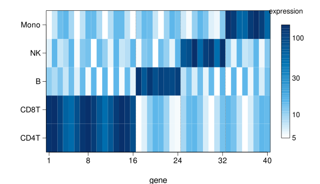
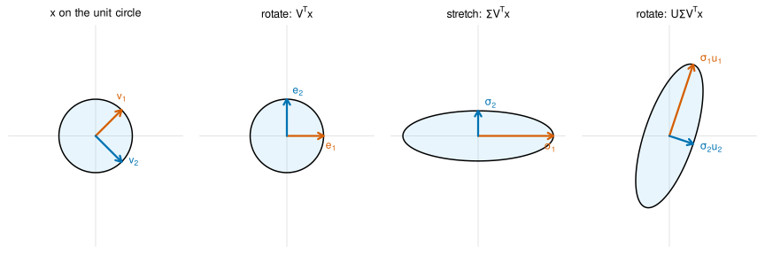
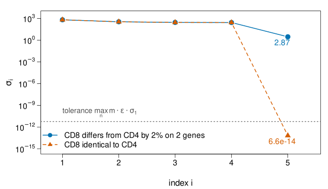
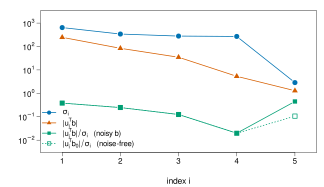
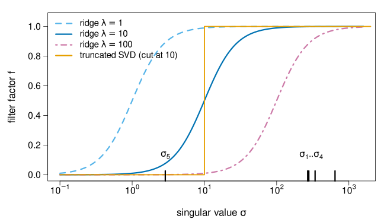
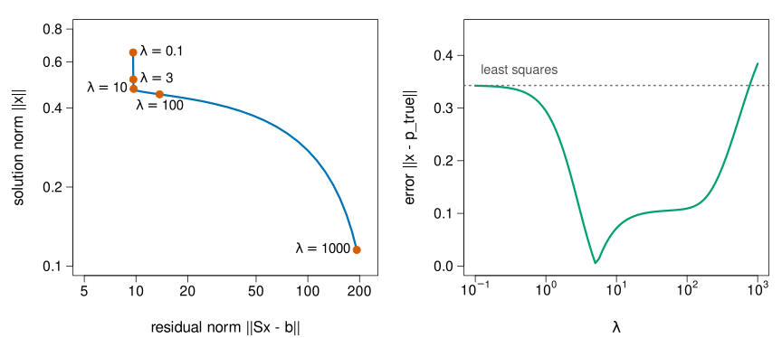
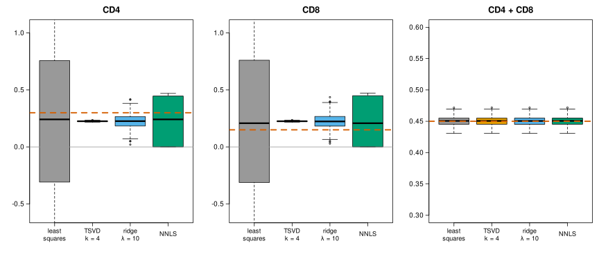

## About this lecture {.smaller}

In *Least squares: normal equations vs QR* we solved $\min_x \|Ax - b\|$ with QR and assumed the columns of $A$ were clearly different. This lecture is about what happens when they are **not**.

- The **singular value decomposition** $A = U\Sigma V^T$: every matrix is a rotation, a stretch along the axes, and another rotation.
- The **singular values** $\sigma_i$ give the condition number and the **numerical rank**. Small $\sigma_i$ mark combinations of parameters the data cannot pin down.
- Least squares through the SVD shows **where noise is amplified**: by $1/\sigma_i$.
- Three remedies: the **pseudoinverse**, the **truncated SVD**, and **Tikhonov (ridge) regularisation**, and how to choose $\lambda$ (the **L-curve**).
- **Non-negative least squares** for quantities that cannot be negative.
- Biology: estimating **cell-type proportions** from bulk RNA-seq, when two cell types (CD4 and CD8 T cells) have almost the same expression profile.

::: notes
This is the second least-squares unit. The previous one gave the machinery (QR, what lm does) for well-posed problems. Here the problem itself is the trouble: two columns that are nearly the same. The SVD is the tool that shows exactly which combination of parameters is badly determined, and every remedy (truncation, ridge, the pseudoinverse) is easiest to understand as "do something to the small singular values". NNLS comes at the end because it is what deconvolution tools actually use, and because it fails in an instructive way on the same data.
:::

## A biology problem: what is in this tissue? {.smaller}

{width="62%" fig-align="center"}

- A **signature matrix** $S$ (genes × cell types) holds the expression of each gene in each pure cell type.
- A bulk sample is a mixture: $b \approx S p$, with $p$ the **proportions** of the cell types. Given $S$ and $b$, find $p$.
- 40 genes, 5 cell types: an overdetermined least-squares problem. But the CD4T and CD8T columns differ by **2 % on 2 genes**.

::: notes
This is "deconvolution" of bulk RNA-seq (or microarray) data: tools such as CIBERSORT, EPIC, quanTIseq and MuSiC all solve some version of b = S p, with signature matrices built from sorted cells or single-cell data. Our signature is simulated so that we know the truth, but the structure is realistic: blocks of marker genes, and two T-cell subsets that share almost all of them. In real signatures CD4 and CD8 T cells, or naive and memory B cells, are the classic near-duplicates. The colour scale is logarithmic.
:::

## The simulated signature and bulk sample {.smaller}

```r
g <- 1:40                                  # 40 genes
S <- matrix(10, nrow = 40, ncol = 5,
            dimnames = list(NULL, c("CD4T", "CD8T", "B", "NK", "Mono")))
S[1:16, 1:2] <- 100                        # T-cell genes, high in both T types
S[cbind(17:40, rep(3:5, each = 8))] <- 100 # 8 marker genes each for B, NK, Mono
S <- S * (1 + 0.5 * sin(outer(g, 1:5)))    # gene-to-gene variation
S[, "CD8T"] <- S[, "CD4T"]                 # CD8 = CD4 ...
S[1, "CD8T"] <- 0.98 * S[1, "CD4T"]        # ... except 2% lower on gene 1
S[2, "CD8T"] <- 1.02 * S[2, "CD4T"]        #     and 2% higher on gene 2
p_true <- c(0.30, 0.15, 0.15, 0.10, 0.30)
b <- drop(S %*% p_true) * (1 + 0.05 * sin(37 * g))   # 5% "noise"
```

- The "noise" is a fixed pattern of size 5 %, so the numbers on the slides are reproducible. Random noise comes later.

::: notes
Walk through the construction. Every cell type has a block of high genes; the sin factor makes genes differ from each other without a random number generator, so R, Python and Rust in the exercise get the same matrix. The last two S lines are the whole point: the CD8 column is a copy of the CD4 column with two genes nudged by 2 percent. The bulk sample is the true mixture times a multiplicative error of up to 5 percent, a realistic size for bulk RNA-seq of a well-measured gene.
:::

## Least squares gives a negative cell type {.smaller}

```r
x <- qr.solve(S, b)                # least squares by QR (previous unit)
round(x, 3)
#   CD4T   CD8T      B     NK   Mono
#  0.543 -0.092  0.149  0.099  0.299
sqrt(sum((b - S %*% x)^2))         # residual of the least-squares fit
# [1] 9.621707
sqrt(sum((b - S %*% p_true)^2))    # residual of the TRUE proportions
# [1] 9.707244
```

- B, NK and monocytes are within 0.001 of the truth. CD4 is 0.54 (truth 0.30) and CD8 is **−0.09** (truth 0.15).
- The wrong answer fits the data **better** than the truth. No amount of iterating or pivoting fixes this: the data do not contain the information.
- QR did its job. The problem is ill-conditioned; we need a tool that shows **which** part of $p$ is undetermined.

::: notes
qr.solve with a rectangular matrix returns the least-squares solution, as in the previous unit. Point out the two residuals: the least-squares answer is by definition the best fit, so it beats the truth, which also has to fit the noise. A negative proportion is the visible symptom; the invisible one is that CD4 is off by 80 percent. Note that CD4 + CD8 = 0.451, almost exactly the true 0.45. Keep that in mind; it comes back.
:::

## Recap: conditioning of least squares {.smaller}

From *Pivoting, norms and conditioning* and *Least squares: normal equations vs QR*:

- The **condition number** $\kappa(A)$ bounds how much a relative error in $b$ is magnified in $x$: $\;\dfrac{\|\delta x\|}{\|x\|} \lesssim \kappa(A)\,\dfrac{\|\delta b\|}{\|b\|}$.
- Rule of thumb: lose about $\log_{10}\kappa$ digits. That counts rounding errors **and** measurement errors.
- The normal equations $A^TA x = A^Tb$ **square** $\kappa$; QR does not. So we used QR.

```r
kappa(S, exact = TRUE)
# [1] 223.6613
```

- With 5 % noise and $\kappa \approx 224$, the bound allows a relative error in $x$ of up to $224 \times 0.05 \approx 11$. QR cannot help: the trouble is in the problem, not the algorithm.

::: notes
One slide of recap only. For a rectangular matrix, kappa is sigma_max / sigma_min, which we define properly in a few slides. A condition number of 224 would be harmless for rounding errors (we lose 2 to 3 of 16 digits), but measurement noise is not 1e-16, it is 5 percent. That is the general lesson: the condition number multiplies whatever error is in the data. The bound is a worst case; here the actual damage is a relative error of about 1 in the CD4/CD8 entries and almost none elsewhere. The SVD explains why.
:::

## The singular value decomposition {.smaller}

Every $m \times n$ matrix $A$ (here $m \ge n$) can be written

$$A = U \Sigma V^T = \sum_{i=1}^{n} \sigma_i\, u_i v_i^T$$

- $V$ ($n\times n$): orthonormal columns $v_i$, directions in **parameter space** (here: combinations of cell types).
- $\Sigma = \mathrm{diag}(\sigma_1 \ge \sigma_2 \ge \dots \ge \sigma_n \ge 0)$: the **singular values**.
- $U$ ($m\times n$): orthonormal columns $u_i$, directions in **data space** (combinations of genes).
- Key relation: $A v_i = \sigma_i u_i$. Input direction $v_i$ comes out as $u_i$, multiplied by $\sigma_i$.

Example: $A = \begin{pmatrix} 3 & 0 \\ 4 & 5 \end{pmatrix}$ has $\sigma_1 = \sqrt{45} = 6.708$, $\sigma_2 = \sqrt{5} = 2.236$,
$v_1 = \tfrac{1}{\sqrt2}(1, 1)$, $u_1 = \tfrac{1}{\sqrt{10}}(1, 3)$, and $A v_1 = \tfrac{1}{\sqrt2}(3, 9) = 6.708\, u_1$.

::: notes
Orthonormal means V^T V = I and U^T U = I: the columns are unit vectors at right angles. This is the "thin" or "economy" SVD that R returns; the full SVD pads U to m x m, which we never need. Unlike eigenvalues, singular values exist for every matrix, rectangular or not, and they are always real and non-negative. Check the example on the board: A times (1,1)/sqrt2 is (3,9)/sqrt2, whose length is sqrt(90)/sqrt2 = sqrt(45). The by-hand exercise derives this SVD from A^T A.
:::

## Rotate – stretch – rotate

{width="100%" fig-align="center"}

$A x = U\,\Sigma\,V^T x$: (1) $V^T$ rotates $v_1, v_2$ onto the axes; (2) $\Sigma$ stretches axis $i$ by $\sigma_i$; (3) $U$ rotates the axes onto $u_1, u_2$.

- The unit circle becomes an **ellipse** with half-axes $\sigma_1 u_1$ and $\sigma_2 u_2$ (in $n$ dimensions: an ellipsoid).
- $\sigma_1$ is the largest stretch, $\|A\|_2 = \sigma_1$; $\sigma_n$ is the smallest. A direction with $\sigma_i \approx 0$ is **squashed flat**.

::: notes
Same matrix as the last slide, A = [[3,0],[4,5]]. Point at the orange vector: v1 goes to the horizontal axis, gets stretched to length 6.7, then rotated to sigma1 u1. The blue one is stretched only by 2.24. (Strictly, U and V may include a reflection; for this picture we chose signs so both are rotations.) The ellipse picture is the whole story of conditioning: if the ellipse is very thin, two quite different inputs give almost the same output, and going backwards from output to input is unstable.
:::

## `svd()` in R {.smaller}

```r
A <- matrix(c(3, 4, 0, 5), 2, 2)
s <- svd(A)
s$d                                          # singular values, largest first
# [1] 6.708204 2.236068
s$v                                          # right singular vectors (columns)
#            [,1]       [,2]
# [1,] -0.7071068 -0.7071068
# [2,] -0.7071068  0.7071068
max(abs(s$u %*% diag(s$d) %*% t(s$v) - A))   # reconstruct A
# [1] 1.33808e-15
```

- [`svd`](https://stat.ethz.ch/R-manual/R-devel/library/base/html/svd.html) returns `d`, `u`, `v` (LAPACK underneath, cost $O(mn^2)$, a few times a QR).
- **Signs are arbitrary**: $(-u_i, -v_i)$ is just as valid. Never compare singular vectors across programs without fixing a sign.

::: notes
R uses LAPACK's dgesdd. Here both v columns came out with the opposite sign of the slide before; that is fine because u flips too and u_i v_i^T is unchanged. Students comparing R with numpy or Rust will see different signs, so in the exercise we fix a sign convention. The reconstruction error 1e-15 is a few machine epsilons times the size of A: the SVD is computed by a backward-stable algorithm.
:::

## Why not take eigenvalues of $A^TA$? {.smaller}

$A^TA = V\Sigma^2V^T$, so $\sigma_i = \sqrt{\lambda_i(A^TA)}$. Correct on paper, but:

```r
B <- rbind(c(1, 1), c(1, 1 + 1e-9), c(1, 1 - 1e-9))   # nearly equal columns
svd(B)$d
# [1] 2.449489743 0.000000001
sqrt(eigen(crossprod(B))$values)
# [1] 2.449490e+00 2.107342e-08
```

- Forming $A^TA$ squares the condition number: $\sigma_2^2 = 10^{-18}$ is below the rounding error of the entries ($\approx 10^{-16}$) and is lost. The small singular value comes out 20 times too large.
- Same lesson as the normal equations: work with $A$, not $A^TA$. LAPACK's SVD does that (it first reduces $A$ by orthogonal transformations, like QR).

::: notes
crossprod(B) is t(B) %*% B. The two columns differ by (0, 1e-9, -1e-9), and the small singular value is 1.000e-9, as svd prints. By hand the A^T A route is fine (and the exercise uses it for a 2x2), but in floating point it throws away half the digits. The squared small singular value 1e-18 sits next to entries of size 3, whose rounding error is about 7e-16: the eigenvalue that comes out is mostly rounding error. The full algorithm (Golub-Kahan bidiagonalisation then an implicit QR iteration) is in Trefethen and Bau; we do not need its details.
:::

## The singular values of our signature {.smaller}

```r
sv <- svd(S)
sv$d
# [1] 642.934939 340.639955 278.842837 269.081951   2.874591
sv$d[1] / sv$d[5]                 # = kappa(S, exact = TRUE)
# [1] 223.6613
round(sv$v[, 5], 3)               # the direction that is squashed
# [1]  0.707 -0.707  0.000  0.000  0.000
```

- Four singular values of a few hundred, then a **gap** to 2.87. $\kappa = \sigma_1/\sigma_n$.
- $v_5 = \tfrac{1}{\sqrt2}(1, -1, 0, 0, 0)$: "more CD4, less CD8". Changing $p$ by $t\,v_5$ changes $Sp$ by only $2.87\,t$.
- The singular vectors **name** the problem: the data barely see the CD4 − CD8 difference. They see CD4 + CD8 fine.

::: notes
This is the diagnostic slide. The small singular value says something is badly determined; its right singular vector says what. Moving 0.1 of the population from CD8 to CD4 (t = 0.14) changes the predicted bulk profile by 0.4 in norm, while the noise has norm about 10. So that move is invisible. Moving 0.1 into B cells instead changes the profile by tens. In real deconvolution work, looking at the smallest singular vectors of the signature matrix tells you which cell types you cannot separate before you ever see a bulk sample.
:::

## Numerical rank {.smaller}

{width="55%" fig-align="center"}

- Make CD8 **identical** to CD4: exact rank 4, but $\sigma_5 = 6.6\times10^{-14}$, not 0. Rounding makes every matrix full rank on paper.
- **Numerical rank** = number of $\sigma_i$ above a tolerance. Default: $\max(m,n)\,\varepsilon\,\sigma_1 = 5.7\times10^{-12}$ → rank 4.
- For **measured** data the useful tolerance is the **noise level**, not $\varepsilon$: by that standard $\sigma_5 = 2.87$ is also "zero".

::: notes
The red curve is the same signature with the two T-cell columns exactly equal. The fifth singular value is about 1e-13, i.e. epsilon times sigma_1 times a small factor: it is pure rounding. The tolerance max(m,n) eps sigma_1 is what numpy's matrix_rank uses by default. R's qr() uses a pivoted QR with tol = 1e-7 to decide rank; it gives the same answer here. The important third point: for real data the question is not "is sigma exactly zero" but "is sigma times the size of a plausible change in p bigger than the noise". 2.87 is far above epsilon but far below what we can resolve with 5 percent noise.
:::

## Exact rank deficiency: what R does {.smaller}

```r
S0 <- S;  S0[, "CD8T"] <- S0[, "CD4T"]     # CD8 identical to CD4
qr(S0)$rank
# [1] 4
coef(lm(b ~ S0 - 1))
#     S0CD4T     S0CD8T        S0B       S0NK     S0Mono
# 0.45135405         NA 0.14888175 0.09887964 0.29860311
qr.solve(S0, b)
# Error in qr.solve(S0, b) : singular matrix 'a' in solve
```

- [`lm`](https://stat.ethz.ch/R-manual/R-devel/library/stats/html/lm.html) detects the rank deficiency (pivoted QR), **drops** CD8 and gives all of the T cells to CD4: one of infinitely many solutions.
- `qr.solve` refuses. `numpy.linalg.lstsq` instead silently returns the **minimum-norm** solution (next slides).
- **Check:** an `NA` coefficient in `lm` means collinear predictors. Look at the SVD.

::: notes
lm's NA is a feature: it is telling you that a predictor is a linear combination of the others. Many people delete the NA and move on, but the remaining coefficient (CD4 = 0.451) is not the CD4 proportion; it is CD4 + CD8. The same happens with collinear predictors in any regression: two drug doses always given together, or two genotype columns in perfect linkage. Different software chooses different members of the infinite solution set; the SVD gives a principled choice.
:::

## Least squares through the SVD {.smaller}

With $A = U\Sigma V^T$, the least-squares solution is

$$x = \sum_{i=1}^{n} \frac{u_i^T b}{\sigma_i}\, v_i$$

```r
beta <- drop(crossprod(sv$u, b))       # u_i^T b: the data in the u-basis
round(cbind(sigma = sv$d, beta = beta, ratio = beta / sv$d), 3)
#        sigma     beta  ratio
# [1,] 642.935 -246.178 -0.383
# [2,] 340.640   83.736  0.246
# [3,] 278.843   34.739  0.125
# [4,] 269.082    5.328  0.020
# [5,]   2.875    1.290  0.449
```

- Noise $\delta b$ adds $u_i^T\delta b/\sigma_i$ to coefficient $i$: **divided by $\sigma_i$**. Small $\sigma_i$, large amplification.
- Coefficient 5 is 0.449. Without noise it would be 0.106; noise of size 1 in $u_5^Tb$ became 0.34 in $x$.

::: notes
Derivation in one line: ||Ax - b|| is unchanged by rotating with U^T, and U^T A x = Sigma V^T x, so with y = V^T x the problem becomes sigma_i y_i ≈ u_i^T b, one equation per i. Solving each gives y_i = u_i^T b / sigma_i. crossprod(U, b) is t(U) %*% b. The ratio column is y: the coordinates of x in the v-basis. Since v_5 is the CD4-minus-CD8 direction, the 0.449 is exactly the CD4/CD8 split, now dominated by noise. Coefficients 1 to 4 have the noise divided by about 300 and are fine.
:::

## The Picard plot: where noise takes over {.smaller}

{width="62%" fig-align="center"}

- For a good problem, $|u_i^Tb|$ (orange) falls **faster** than $\sigma_i$ (blue), so the ratios (green) stay small.
- Noise gives every $u_i^Tb$ a floor of about the noise level. Where $\sigma_i$ drops below that floor, the ratio is **noise / small number**.
- **Check:** plot $\sigma_i$ and $|u_i^Tb|$ on a log scale. Components where they meet carry no information.

::: notes
This is called a Picard plot after the discrete Picard condition (Hansen). With only 5 components it is a small picture, but in inverse problems with hundreds of singular values (image deblurring, spectral unmixing, inverse heat problems) it is the standard first plot. The open green squares are the noise-free coefficients: they agree with the noisy ones for i = 1..4 and disagree at i = 5. In practice you do not have the noise-free version, but you can see where |u_i^T b| stops falling and levels out.
:::

## The pseudoinverse {.smaller}

$$A^+ = V\,\Sigma^+\,U^T, \qquad \Sigma^+ = \mathrm{diag}(1/\sigma_i \text{ if } \sigma_i > \text{tol, else } 0)$$

```r
pinv <- function(A, tol = max(dim(A)) * .Machine$double.eps) {
  s <- svd(A)
  keep <- s$d > tol * s$d[1]               # drop (numerically) zero sigmas
  s$v[, keep] %*% (t(s$u[, keep]) / s$d[keep])
}
round(drop(pinv(S0) %*% b), 3)              # CD8 identical to CD4
# [1] 0.226 0.226 0.149 0.099 0.299
```

- $A^+b$ is the least-squares solution with the **smallest** $\|x\|$. With identical columns, that splits CD4 + CD8 = 0.451 **equally**.
- Full rank: $A^+b$ is the ordinary least-squares solution. Library: [`MASS::ginv`](https://stat.ethz.ch/R-manual/R-devel/library/MASS/html/ginv.html).
- Never compute $A^+$ and multiply when you only need $x$; but the formula shows what is done.

::: notes
The pseudoinverse (Moore-Penrose inverse) is the formula from the last slide with the terms for zero singular values left out. Leaving out the v_5 term means the solution has no component along CD4 minus CD8, so CD4 = CD8. That is the minimum-norm choice: among all p with the same fit, the one with the smallest sum of squares, which for two identical columns is an equal split. It is a convention, not information from the data. MASS ships with R. The tolerance matters: the default here keeps everything above 1e-14 relative, so on the near-duplicate S (sigma_5 = 2.87) pinv would keep sigma_5 and reproduce the bad least-squares answer. That leads to truncation.
:::

## Truncated SVD: drop what the noise owns {.smaller}

Keep only the $k$ largest singular values: $\;x_k = \displaystyle\sum_{i=1}^{k} \frac{u_i^Tb}{\sigma_i}\, v_i$

```r
tsvd <- function(A, b, k) {
  s <- svd(A)
  drop(s$v[, 1:k] %*% (crossprod(s$u[, 1:k], b) / s$d[1:k]))
}
round(tsvd(S, b, 4), 3)
# [1] 0.226 0.226 0.149 0.099 0.299
```

- Same as the pseudoinverse with a tolerance **at the noise level**. The CD4 − CD8 component is set to 0, so the split is equal.
- CD4 + CD8 = 0.451 (true 0.45); B, NK and Mono unchanged. We report what the data determine and say so for the rest.

::: notes
The truncated SVD (TSVD) is the simplest regulariser: decide that components with sigma below some threshold are noise, and drop them. Here k = 4 gives CD4 = CD8 = 0.226. Compared with the truth (0.30, 0.15) that is still wrong, but it is honestly wrong: it is the answer "the T-cell total is 0.45 and we cannot tell you the split". Least squares gave 0.54 and -0.09, which looks like information but is noise. The right way to report the result is the sum, plus a statement that the split is not identifiable from this signature.
:::

## Choosing $k$: bias against noise {.smaller}

| $k$ | CD4 | CD8 | B | NK | Mono | $\|x_k - p\|$ | $\|Sx_k - b\|$ |
|---|---|---|---|---|---|---|---|
| 1 | 0.264 | 0.264 | 0.048 | 0.049 | 0.052 | 0.298 | 91.33 |
| 2 | 0.225 | 0.225 | 0.183 | 0.175 | 0.204 | 0.165 | 36.46 |
| 3 | 0.226 | 0.226 | 0.135 | 0.112 | 0.300 | 0.108 | 11.07 |
| **4** | **0.226** | **0.226** | **0.149** | **0.099** | **0.299** | **0.106** | **9.71** |
| 5 | 0.543 | −0.092 | 0.149 | 0.099 | 0.299 | 0.343 | 9.62 |

- $k$ too **small**: real signal is thrown away (**bias**), and the residual is large. $k$ too **large**: noise is amplified.
- **Check:** the residual drops steeply until $k = 4$, then barely moves (9.71 → 9.62). Stop where it levels off at the noise level.
- No $k$ recovers the true split. Regularisation cannot create information.

::: notes
The error column uses the truth, which we only know because we simulated. The residual column is available in real life and tells the same story: by k = 4 the fit is as good as the noise allows (the true p has residual 9.71, the same number). Adding component 5 lowers the residual by only 0.09 and moves the solution by 0.34: a sure sign that the component is fitting noise. This is the "discrepancy principle": choose the least regularisation for which the residual is about as large as the expected noise.
:::

## Tikhonov (ridge) regularisation {.smaller}

Penalise large solutions: $\;\min_x \|Ax - b\|^2 + \lambda^2\|x\|^2$. In SVD form:

$$x_\lambda = \sum_{i=1}^{n} f_i\,\frac{u_i^Tb}{\sigma_i}\,v_i, \qquad f_i = \frac{\sigma_i^2}{\sigma_i^2 + \lambda^2}$$

:::: {.columns}
::: {.column width="55%"}
{width="100%"}
:::
::: {.column width="45%"}
- **Filter factors** $f_i$: $\approx 1$ for $\sigma_i \gg \lambda$ (keep), $\approx 0$ for $\sigma_i \ll \lambda$ (damp).
- TSVD is the step function; ridge is a smooth step at $\sigma = \lambda$.
- Our $\sigma$'s (ticks): any $\lambda$ between about 5 and 100 damps $\sigma_5$ and keeps the rest.
:::
::::

::: notes
Ridge regression in statistics is the same thing (the statistics literature writes lambda for what we call lambda squared). To derive the filter factors: the normal equations of the penalised problem are (A^T A + lambda^2 I) x = A^T b; substituting the SVD gives (sigma_i^2 + lambda^2) y_i = sigma_i u_i^T b. Numbers: with lambda = 10, f_5 = 8.26 / 108.26 = 0.076, and f_4 = 72405 / 72505 = 0.9986. Ridge never sets a component exactly to zero, which is usually gentler than truncation.
:::

## Ridge in code: two routes {.smaller}

```r
ridge <- function(A, b, lambda) {
  s <- svd(A)
  f <- s$d^2 / (s$d^2 + lambda^2)          # filter factors
  drop(s$v %*% (f * crossprod(s$u, b) / s$d))
}
round(ridge(S, b, lambda = 10), 3)
# [1] 0.250 0.201 0.149 0.099 0.298
lambda <- 10                               # same thing as a stacked least squares
x_aug <- qr.solve(rbind(S, lambda * diag(5)), c(b, rep(0, 5)))
round(x_aug, 3)
#  CD4T  CD8T     B    NK  Mono
# 0.250 0.201 0.149 0.099 0.298
```

- Ridge is ordinary least squares on the **stacked** system $\begin{pmatrix}A\\ \lambda I\end{pmatrix}x \approx \begin{pmatrix}b\\0\end{pmatrix}$, so QR works too, without the SVD.
- Do **not** solve $(A^TA + \lambda^2 I)x = A^Tb$ for small $\lambda$: that is the normal equations again.

::: notes
The stacked form is how ridge is computed when the SVD is too expensive: add n rows that say "x should be close to 0, with weight lambda". Both give 0.250 and 0.201: closer to the truth than TSVD, but by luck; the noise pattern happened to push in the right direction. Python: scipy and sklearn have ridge solvers, but the two routes above are all one needs. Note ridge depends on the scaling of the columns: if one cell type's signature is in different units, it is penalised differently. Scale the columns comparably first.
:::

## Choosing $\lambda$: the L-curve {.smaller}

{width="85%" fig-align="center"}

- **L-curve** (left): residual norm against solution norm for many $\lambda$, log–log. Small $\lambda$: $\|x\|$ grows, fit barely improves. Large $\lambda$: fit gets worse fast. Pick the **corner** ($\lambda \approx 10$).
- **Failure** (right): too large a $\lambda$ shrinks **everything** towards 0. At $\lambda = 100$ the proportions sum to 0.96, at 300 to 0.74.
- Alternatives: the discrepancy principle (residual ≈ noise), generalised cross-validation, cross-validation.

::: notes
The right panel uses the truth and is not available in practice. Its sharp minimum near lambda = 5 is luck of this noise pattern; with other noise it moves. That is why we choose by a criterion that uses only the data. The L-curve corner is a heuristic; it works when the noise is roughly white and the singular values decay. Shrinkage towards zero is a real bias for proportions: ridge does not know they should sum to 1. An alternative is to penalise the distance from a prior guess instead of from 0, which the same formulas handle by a change of variables.
:::

## Proportions cannot be negative: NNLS {.smaller}

$$\min_x \|Ax - b\| \quad \text{subject to} \quad x_j \ge 0 \text{ for all } j$$

**Active-set idea** (Lawson–Hanson, 1974):

1. Start with every $x_j = 0$ (all "held at the bound").
2. Free the variable whose increase would reduce the residual fastest (largest $a_j^T(b - Ax)$).
3. Solve ordinary least squares on the free variables. If some go negative, step back until the first one hits 0, and hold it at 0.
4. Repeat until no held variable wants to increase.

- Each step is a small least-squares problem (QR, as in the previous unit). It ends after finitely many steps.
- Used, with variations, by deconvolution tools (EPIC and quanTIseq use constrained least squares; MuSiC uses weighted NNLS).

::: notes
The optimality condition: for every held variable, the gradient of the residual says increasing it would not help, and every free variable is positive. That is the KKT condition for this problem, the topic of *Constraints and linear programming* in Part 9. We do not need the full theory; the algorithm is easy to follow on a 2-variable example, and the exercise does one step by hand and writes it in Rust. Note what NNLS does not do: it does not regularise. It only rules out the negative half of the bad directions.
:::

## NNLS in R {.smaller}

```r
library(nnls)
fit <- nnls(S, b)
round(fit$x, 3)
# [1] 0.451 0.000 0.149 0.099 0.299
sum(fit$x)
# [1] 0.9977186
```

- [`nnls::nnls`](https://cran.r-project.org/package=nnls) (Python: [`scipy.optimize.nnls`](https://docs.scipy.org/doc/scipy/reference/generated/scipy.optimize.nnls.html)): no negative proportions, sum close to 1, B, NK and Mono right.
- But it puts **all** T cells in CD4 and **none** in CD8. A clean-looking answer, **confidently wrong**.
- Least squares wanted CD8 = −0.09; NNLS moved to the nearest feasible point along $v_5$: CD8 at the bound, CD4 + CD8 kept.

::: notes
This is the instructive failure. The constraint removed the obvious symptom (negative proportion), so the result looks trustworthy, but the split along the badly determined direction is still decided by noise: here the noise pushed towards CD4, so CD8 sits at 0. With a different noise pattern it would be CD4 that sits at 0. A zero from NNLS is therefore not evidence that the cell type is absent. The sum 0.998 comes for free here because the true proportions sum to 1 and the fit is good; some tools also enforce sum = 1 or rescale.
:::

## The check: refit with new noise {.smaller}

{width="95%" fig-align="center"}

500 bulk samples from the **same** $p$, each with fresh 5 % random noise. Standard deviations: least squares 0.86 (CD4), ridge 0.065, NNLS 0.21, TSVD 0.004. **CD4 + CD8**: 0.007 for all four.

- NNLS sets CD8 = 0 in 38 % of the replicates and CD4 = 0 in 37 %. TSVD is stable but **biased** (0.225 each).
- **Check:** perturb the data (bootstrap genes, or add noise of the measured size) and refit. Quantities that jump are not determined.

::: notes
This is the general-purpose check for any fit and it needs no theory: if a small, realistic change in the data moves an estimate a lot, do not report that estimate. All four methods agree perfectly on the T-cell total, which is the well-determined quantity. They disagree on the split, and each disagrees in its own characteristic way: least squares wildly, NNLS by flipping between the two bounds, ridge with moderate spread, TSVD by always returning the equal split. The way out is biological, not numerical: add genes that separate CD4 from CD8 (CD4, CD8A, CD8B and their co-expressed modules) to the signature, which raises sigma_5.
:::

## Checklist: rank trouble in a least-squares fit {.smaller}

- **Look at `svd(A)$d`** before trusting coefficients. A gap, or a $\sigma_n$ near the noise level, means some combination is not determined.
- **Read the smallest right singular vectors** $v_n, v_{n-1}$: they name the confounded parameters (here CD4 − CD8).
- **`NA` coefficients** in `lm`, or a "singular matrix" error → exact collinearity.
- **Negative or huge estimates** that should be positive and moderate → ill-conditioning, not biology.
- **Refit with perturbed data**: estimates that jump are not identifiable; report the combinations that are stable (sums, differences along large $\sigma$).
- **Regularise knowingly**: TSVD or ridge trade noise for bias. Pick $k$ or $\lambda$ from the residual (L-curve, discrepancy principle), and say that you did.
- **Constraints are not regularisation**: NNLS hides the symptom but not the cause.

::: notes
Each line maps to a slide. The common thread: the numerics can tell you that something is not determined and which combination it is, but cannot supply the missing information. In Part 9 (*Identifiability and uncertainty of fitted parameters*) the same ideas return for nonlinear models, with the Jacobian in the role of S.
:::

## Aside: PCA is an SVD {.smaller}

- Centre the data matrix $X$ (samples × genes) by columns. Then $X = U\Sigma V^T$ gives the **principal axes** $v_i$, the **scores** $U\Sigma$, and the **variance** explained $\sigma_i^2/(n-1)$.
- [`prcomp`](https://stat.ethz.ch/R-manual/R-devel/library/stats/html/prcomp.html) does exactly this (it calls `svd`, not `eigen` of the covariance matrix, for the reason on the $A^TA$ slide).
- The **truncated SVD** is the best rank-$k$ approximation of a matrix (Eckart–Young): keeping the top $k$ PCs is TSVD of the data.
- For a large sparse cells × genes matrix, compute only the top $k$ singular triplets with [`irlba`](https://cran.r-project.org/package=irlba) (Python: `scipy.sparse.linalg.svds`), as in *How `eigen()` works, and big problems*.

The statistics of PCA (scaling, interpretation, biplots) are in the sister course.

::: notes
One slide only, because PCA is taught elsewhere. The numerical points worth knowing: PCA is computed by the SVD of the centred data, not by eigen of the covariance (which would square the condition number); and for single-cell data with 1e5 cells nobody computes the full SVD, only the top 50 components with a Lanczos-type method (irlba), which is the subject of Part 5.
:::

## Summary {.smaller}

- **SVD** $A = U\Sigma V^T$: rotate ($V^T$), stretch by $\sigma_i$, rotate ($U$). $Av_i = \sigma_iu_i$. Compute it with `svd()`, not via $A^TA$.
- $\|A\|_2 = \sigma_1$, $\kappa = \sigma_1/\sigma_n$. **Numerical rank** = number of $\sigma_i$ above a tolerance: $\max(m,n)\varepsilon\sigma_1$ for rounding, the **noise level** for data.
- Least squares: $x = \sum_i (u_i^Tb/\sigma_i)\, v_i$. Noise is amplified by $1/\sigma_i$; the small-$\sigma$ directions $v_i$ name what is not determined.
- **Pseudoinverse**: minimum-norm solution, drops zero $\sigma_i$. **Truncated SVD**: drops $\sigma_i$ below the noise. **Ridge**: filter factors $\sigma_i^2/(\sigma_i^2+\lambda^2)$; choose $\lambda$ at the corner of the **L-curve**. Both trade noise for bias.
- **NNLS** (`nnls`, `scipy.optimize.nnls`) enforces $x \ge 0$ by an active set, but does not resolve an undetermined split.
- Deconvolution: CD4 + CD8 is well determined, the split is not. **Check** with the singular values and by refitting perturbed data.

**Next:** Part 5, *Power iteration and friends*: eigenvalues, starting from the simplest iteration.

::: notes
The three ideas to keep: the SVD as a diagnostic (singular values and vectors tell you what the data determine), every regulariser as a filter on singular values, and the refit-with-noise check. The next part turns to eigenvalue problems, where the SVD returns as a close relative (singular values are square roots of eigenvalues of A^T A), and the Lanczos idea behind irlba appears.
:::
